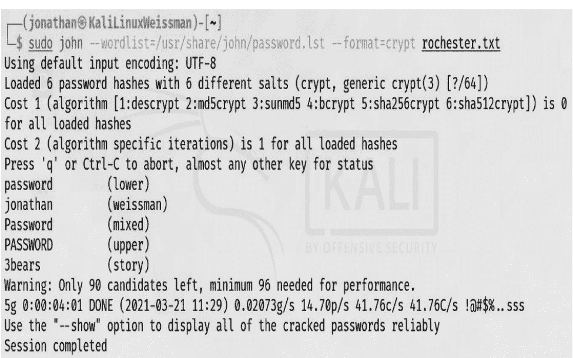
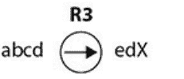
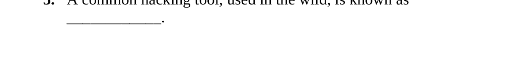

## Chapter 11
身份验证和远程访问

## 实验练习

+   11.01 使用 John the Ripper 对 Linux 密码进行字典攻击
+   11.02 使用 crunch 和 John the Ripper 对 Linux 密码进行暴力攻击
+   11.03 使用 Mimikatz、crunch 和 John the Ripper 对 Windows 密码进行字典攻击和暴力攻击
+   11.04 使用 ophcrack 对 Windows 密码进行彩虹表攻击
+   实验分析
+   关键术语测验

Verizon 2020 年数据泄露调查报告（DBIR）最大的收获之一是，超过 80% 的与黑客相关的泄露涉及暴力破解或使用被盗凭据。

## 交叉引用

Verizon DBIR 在第 1 章中被介绍并进行了审查。

尽管它们不是用于身份验证和获得对系统和网络的远程访问的最佳选择，但密码（你所知道的东西）仍然比安全令牌/密钥扣或智能卡（你所拥有的东西）和生物识别（你所是的东西）使用得更频繁。

攻击者可以使用一种称为密码猜测的技术，在登录提示处手动输入密码以获得对帐户的访问权限


当他们拥有有效用户名时，攻击者就可以实施猜测。事实上，2013年两支美国职业棒球大联盟球队就发生过这样的事：圣路易斯红雀队的一名高管猜出了前同事的密码，这位前同事曾为红雀队工作，后来转投休斯敦太空人队。这导致大量关于球员、潜在交易和球探报告的机密信息落入竞争对手高管手中。这些信息被公开曝光，让众多球员和球队颜面尽失。

请通过以下链接阅读相关报道：

www.npr.org/sections/thetwo-way/2016/07/18/486538276/former-cardinals-official-gets-nearly-4-years-in-prison-over-astros-hack

www.vice.com/en/article/d7mkvx/did-a-houston-astros-executive-use-david-eckstein-as-his-password

有一些工具可以自动化这种密码猜测过程，这是一种在线攻击类型，包括 Medusa、Ncrack 和 THC-Hydra（通常也简称为 Hydra）。这些工具旨在帮助公司保护其网络，因为安全专家可以测试主机和网络设备是否存在弱密码。这些工具也用于对设备进行审计。在线密码猜测攻击还可用于检查你的防火墙、入侵检测系统（IDS）和入侵防御系统（IPS）是否能在服务器遭受大量失败登录尝试时发出警报，以及账户是否会在此情况下自动锁定。通过手动或自动化手段进行密码猜测显然会非常嘈杂，因此攻击者需要更好的办法。

密码绝不应以明文形式存储在数据库中，因为一旦被盗就能立即被使用。正如第5章所展示的，密码应以哈希格式存储，因为哈希是一种单向函数。

在近年来的许多数据泄露事件中，被盗的密码数据库包含的密码要么以明文存储，要么使用弱函数（如 MD5 和 SHA-1）进行哈希处理。在 Linux 系统中，密码哈希存储在 /etc/shadow 文件中，你在第5章中已经学习并探索过该文件。大多数 Linux 发行版使用一种称为 sha512crypt 的 SHA-512 修改版本，并带有一种称为 salt（盐）的东西，我们将在本章后面看到。然而，Kali Linux 的 2021.1 版本改用了一种新的密码哈希函数，称为 yescrypt（本章稍后会详细介绍）。在 Windows 系统中，密码哈希存储在 SAM（Security Account Manager 和 Security Accounts Manager 均可展开）数据库文件中，位于 C:\Windows\System32\config。在运行 Active Directory 的 Windows 域控制器上，密码哈希存储在 C:\Windows\NTDS\ntds.dit 文件中。

Windows NTLM（New Technology LAN Manager）套件实际上使用 MD4 哈希函数（不带盐）来存储 Windows 密码哈希。

具有登录功能的网站会将密码存储在后端数据库中，很可能使用 MySQL 或 MariaDB（将在第19章介绍）关系数据库管理系统（RDBMS）。如果攻击者将窃取的哈希输入密码字段，该哈希本身会被再次哈希，因此不会这样做。

在本章中，你将探索包含哈希密码的数据库被盗后会发生什么，进一步深化你在第5章学到的关于密码哈希的知识。攻击者在窃取哈希密码数据库后有三种攻击选择：暴力攻击、字典攻击和彩虹表攻击。你将在本章中学习并执行这三种攻击。此外，本章中的所有实验练习都可以用安全专家的心态来完成，执行审计以识别弱密码。

在第22章中，你将学习攻击者如何获取包含哈希密码的数据库。不过，现在就假设你已经拥有密码哈希，来执行本章的实验练习。你也可以用渗透测试人员或安全专家的心态来执行本章实验练习，确保密码将来不会被破解。

在处理复杂密码时，可能有必要采用暴力攻击。复杂密码具有以下部分或全部特征：

- 定期更换（例如，每180天）。
- 具有最小长度（例如，10个字符）。
- 使用以下类别中至少三种：大写字母、小写字母、数字和符号。

字典文件使用可能的密码选项，与常规字典不同，它包含单词变体中的替代拼写以及额外的字母、数字和符号。

不幸的是，有很多人选择了短密码，这些密码是带有简单变体的常见单词。攻击者会制作包含常用密码的单词列表。这就是为什么用 0 代替字母 o 或用 $ 代替字母 s 并不是任何形式的安全措施。

攻击者窃取密码数据库后，在攻击者自己的机器和时间上（不同于前面描述的密码猜测），单词列表中的单词会被哈希，并与窃取的密码哈希进行比较。如果被盗数据库中的某个哈希与从单词列表中的某个单词计算出的哈希匹配，攻击者就可以将该匹配的计算哈希与其明文输入关联起来，即实际的明文密码，如图11-1所示。

### 图 11-1 字典攻击

| 可能的明文密码 | 计算出的哈希 |
|---|---|
| 123456 | ba32... |
| 123456789 | d9e6... |
| picture1 | 83fe... |
| password | b109... |
| qwerty | 0dd3... |

| 被盗哈希 |
|---|
| 4fcb... |
| 59a3... |
| 1c03... |
| b8b3... |
| b109... |

此攻击中使用的哈希函数必须与密码哈希被窃取的组织所使用的哈希函数相同。如第5章所述，哈希函数（就像加密算法一样）从来不是秘密（使用哪些哈希函数以及它们如何工作）。事实上，哈希的长度就足以揭示使用了哪个哈希函数。此外，用于数据库的哈希函数类型会以明文形式与用户名和其他数据一起存储在密码数据库中。由于用户名总是与其对应的哈希存储在同一条记录中，



### 图 11-2 已破解的密码

如果你的普通用户账户的密码在 password.lst 文件中，它也会被显示出来。

### 注意

Kali Linux 2021.1 将密码哈希函数从 sha512crypt（在 /etc/shadow 文件中列为 $6$）改为 yescrypt（在 /etc/shadow 文件中列为 $y$）。请在此处阅读有关 yescrypt 的信息：

https://www.openwall.com/yescrypt/

另外，与本章节相关的内容，来自

https://openwall.com/john/doc/OPTIONS.shtml：

> “--format=crypt”……可能需要对系统支持但尚未被 John 自身优化的加密例程所支持的密码哈希进行审计。

- l. 在撰写本文时，yescrypt 尚未被 John 自身优化的加密例程所支持。当你读到本文时，对 $y$ 哈希的支持可能已集成到 John the Ripper 中，这意味着你可以省略 --format=crypt 以获得一些加速。试试看。John the Ripper 不会尝试破解已经破解过的密码。要查看所有已破解的密码，请使用 --show 选项：

```
sudo john --show --format=crypt rochester.txt
```

- m. 要从 John the Ripper 中删除所有已记住的破解密码，请删除位于 /root/.john 的 john.pot 文件：

```
sudo rm /root/.john/john.pot
```

请注意，你现在不必输入该命令。但是，如果你执行了，你将需要重做步骤 k 以恢复到删除 john.pot 文件之前的状态。

- n. 创建一个名为 scott 的新用户：

```
sudo adduser scott
```

当提示时，提供密码 scott10314。按 ENTER 键不为 Full Name 输入值，但在提示 Room Number 时输入 10314 并按 ENTER。按 CTRL-C 键不为 Work Phone、Home Phone 和 Other 输入值。在最后的“Is the information correct? [Y/n]”问题处输入 Y 并按 ENTER。

- o. 创建一个名为 rochester2.txt 的新 unshadow 文件，并更新新用户（scott）：

```
sudo unshadow /etc/passwd /etc/shadow > rochester2.txt
```

你本可以用新信息覆盖 rochester.txt 文件，但创建额外的 unshadow 文件可以让你轻松返回查看之前的步骤，而无需重新创建用户或密码。

- p. 运行 John the Ripper，但这次不使用单词列表：

```
sudo john --format=crypt rochester2.txt
```

这默认为单机破解模式，该模式使用 GECOS 字段（第5章讨论过的元数据），而不使用单词列表。你会看到 GECOS 信息对该用户（scott）是有效的，如图11-3所示。此外，在单机破解模式下，John the Ripper


- c. 比较 John the Ripper 密码字典文件（26325 字节，即 26.325 KB）与 rockyou.txt（139921507 字节，即 139.921507 MB）的大小。

```
ls -l /usr/share/john/password.lst
ls -l rockyou.txt
```

差别真大！

- d. 输入以下命令安装 Leafpad：

```
sudo apt install leafpad
```

Leafpad 是一个文本编辑器，Kali Linux 默认不附带。

- e. 比较字典文件的内容。先通过终端显示内容：

```
cat /usr/share/john/password.lst
cat rockyou.txt
```

按 CTRL-C 中断，或输入 `cat rockyou.txt | less`，然后按 ENTER 逐行滚动，或按 SPACEBAR 逐页滚动。按 q 退出。

- f. 通过 Leafpad 查看文件内容：

```
leafpad /usr/share/john/password.lst
leafpad rockyou.txt
```

- g. 显示 rockyou.txt 中包含字符串 jonathan 的所有条目：

```
cat rockyou.txt | grep jonathan | less
```

- h. 显示 rockyou.txt 中包含字符串 weissman 的所有条目：

```
cat rockyou.txt | grep weissman
```

不，我不是 RockYou 的员工。

- i. 在 rockyou.txt 中搜索你选择的三组字符串，看看有多少密码包含这些字符串。

- j. 再生成两个用户，其密码要比本实验室练习到目前为止使用的密码更复杂，并创建一个名为 rochester3.txt 的新 unshadow 文件。

- k. 将 rockyou.txt 文件与 John the Ripper 一起使用（在 john 命令的 `--wordlist` 选项后指定 rockyou.txt 文件的路径）来破解密码。假设 rockyou.txt 位于当前目录（即你的主目录，你应该在那里），命令看起来像这样：

```
sudo john --wordlist=rockyou.txt --format=crypt rochester3.txt
```

- 1. 如果新密码不在 rockyou.txt 中，攻击将失败。如果密码在 rockyou.txt 中，但位于较靠后的条目中，则可能需要一段时间。另一种可能是你的新密码中有一个在 rockyou.txt 中。此步骤的结果随意。破解出零个、一个或两个新密码都可以。请记住，在密码破解中，失败是有可能的！

45 分钟

## 实验室练习 11.02：使用 crunch 和 John the Ripper 对 Linux 密码进行暴力破解攻击

暴力破解攻击类似于字典攻击。不过，它不是使用字典文件中一组可能是潜在密码的单词，而是遍历所有可能的小写字母、大写字母、数字和符号（对于密码短语，也可以包含空白字符）以及所有长度，以生成每一个可能的密码。这些生成的单词会被动态哈希，并与窃取的哈希值进行比较，就像使用字典进行字典攻击时那样，如图 11-4 所示。

| 可能的明文密码 | 计算得到的哈希值 |
|---|---|
| abcdef | e32e... |
| abcdeg | ab32... |
| abcdeh | 7c2d... |
| abcdei | 0d60... |
| abcdej | 1aec... |

| 窃取的哈希值 |
|---|
| 4fcb... |
| 59a3... |
| e32e... |
| 1c03... |
| b8b3... |

**图 11-4：暴力破解攻击**

如果密码不在字典攻击所用到的字典文件中，攻击就会失败。而使用暴力破解攻击，则没有失败的可能性，因为所有潜在的密码最终都会出现。这是必然的！缺点在于你可能活不到看到结果的那一天。长密码会使此类攻击失去作用，因为攻击者不想在数小时、数天、数周、数月甚至数年的时间里，为破解密码而占用如此多的资源。这是说明密码长度胜过其他一切因素的绝佳例子。

为了加快速度，你可以将迭代限制在字符的最小长度和最大长度之间。另一个加速限制涉及字符集，可以只使用字母、只使用小写字母、只使用大写字母、只使用数字、只使用符号，或不同字符集的某种组合。

你甚至可以使用像 crunch 这样的程序，它使用了前面提到的所有限制，但还能让你对细节有更多控制。例如，允许只使用单个字符集或多个字符集中的某些字符，以及包含已知字符串，如出生日期。

crunch 生成的字典可以动态地传递给尝试破解密码的程序，如 John the Ripper。crunch 字典也可以保存到字典文件中，之后传递给密码破解程序，如 John the Ripper。如前所述，John the Ripper 本身就可以进行暴力破解攻击，无需任何输入文件。

由于生成的是随机字符，即使有限制条件，甚至可能还有输出字典，这仍然可以被视为暴力破解攻击。字典攻击所使用的字典是由预先确定的、有意义的字符组成的，而不是将随机字符拼凑在一起。

### 学习目标

在本实验室练习中，你将生成自己的字典并执行暴力破解攻击。完成本实验室练习后，你将能够：

- 使用 crunch 生成用于暴力破解攻击的自定义字典
- 通过 John the Ripper 使用你的字典执行暴力破解攻击

crunch 手册页中的示例没什么用，所以我给大家一些我自己的示例。

- a. 生成长度从 1 到 3 的密码，使用小写字母，并将结果保存到名为 weissman.txt 的输出文件（-o）中，而不是输出到控制台：

```
crunch 1 3 -o weissman.txt
```

- b. 在 Leafpad 中查看文件内容：

```
leafpad weissman.txt
```

通过单击 Leafpad 窗口右上角的 X 关闭文件。

- c. 查看可以使用的不同字符集：

```
cat /usr/share/crunch/charset.lst
```

- d. 使用小写字母、大写字母和数字生成八字符密码：

```
crunch 8 8 -f /usr/share/crunch/charset.lst mixalpha-numeric
```

- e. 使用小写字母、大写字母、数字、符号甚至空白字符生成八字符密码：

```
crunch 8 8 -f /usr/share/crunch/charset.lst mixalpha-numeric-all-space
```

- f. 生成以 0415 结尾的长度为 8 的密码：

```
crunch 8 8 -t @@@@0415 -f /usr/share/crunch/charset.lst mixalpha-numeric-all-space
```

想象一下，你的攻击目标是一名在社交媒体上发布了自己出生日期的员工。Bob Smith 出生于 4 月 15 日。@ 符号是一个占位符，将由 -f 选项后指定的字符集替换（在本例中为小写字母、大写字母、数字、符号和空白字符）。

- g. 生成以 Bob 妻子 Alice 的名字开头的长度为 8 的密码：

```
crunch 8 8 -t alice@@@ -f /usr/share/crunch/charset.lst mixalpha-numeric-all-space
```

@ 占位符可以出现在模式的任何位置。

密码。

```
(jonathan@KaliLinuxWeissman)-[~]
$ sudo crunch 4 4 | sudo john --format=crypt rochester5.txt --stdin
Crunch will now generate the following amount of data: 2284880 bytes
2 MB
0 GB
0 TB
0 PB
Crunch will now generate the following number of lines: 456976
Using default input encoding: UTF-8
Loaded 7 password hashes with 7 different salts (crypt, generic crypt(3) [?/64])
Cost 1 (algorithm [1:descrypt 2:md5crypt 3:sunmd5 4:bcrypt 5:sha256crypt 6:sha512crypt]) is 0 for all loaded hashes
Cost 2 (algorithm specific iterations) is 1 for all loaded hashes
Press Ctrl-C to abort, or send SIGUSR1 to john process for status
jpgr        (scott)
```

**图 11-5：Mimikatz**

yescrypt 函数故意设计得很慢，就像仅有的另外四个应该用于密码的哈希函数：PBKDF2、Argon2、bcrypt 和 scrypt 一样。正如第 5 章所解释的，这些函数故意设计得很慢，以防止攻击者通过计算大量哈希来成功执行暴力破解攻击。这种缓慢只会影响暴力破解攻击，不会给提供密码的用户带来任何延迟，用户的密码随后会被哈希并与密码数据库中的存储哈希进行比较。

在 Kali Linux 使用 sha512crypt 哈希函数时，此步骤大约需要 10 到 20 分钟，但现在使用 yescrypt 函数可能需要很多小时（再加上使用 `--format=crypt` 选项的开销）。

根据你的密码是更接近 aaaa（第一个可能性，几乎可以瞬间破解）还是 zzzz（最后一个可能性，可能需要接近 20 小时），你需要让此过程运行的时间差异会很大。对于此步骤，我选择了一个密码 jpgr（可以


你能想出四个以这些字母开头的绝妙名字吗？），而且花了六个半小时才到达 jpgr。（是的，我用的是现代计算机！）当我在先前使用 sha512crypt 而非 yescrypt 的旧版 Kali Linux 中，对同一密码执行相同命令时，仅用了 10 分钟。

这说明了为什么只有某些哈希函数应用于密码：那些慢速的哈希函数。它也说明了在密码方面，更长意味着更强。如果对四个简单小写字母的暴力攻击可能需要数小时（在某些情况下接近一天），想象一下对于一个更长的密码需要多久！

- d. 为 scott 账户生成一个 zzz 的三字符密码（小写字母的最后一种可能性），创建一个名为 rochester6.txt 的新 unshadow 文件，使用 crunch 生成长度为 3 的小写字母单词，并动态地将这些单词传递给 John the Ripper：

  ```
  sudo crunch 3 3 | sudo john --format=crypt rochester6.txt --stdin
  ```

让它一直运行到底。

注意，当你从四个字符降到三个字符时，最大破解时间（从 aaa 一直走到 zzz）会大幅下降（对于从 aaaa 到 zzzz 的最大四字符序列，预计为 20 小时）降到不到 40 分钟，我实际用时就是这样。现在，再次考虑使用更长的密码所带来的影响。

30 分钟

## 实验室练习 11.03：使用 Mimikatz、crunch 和 John the Ripper 对 Windows 密码进行字典攻击和暴力攻击

既然你已经对 Linux 密码哈希执行了字典攻击和暴力攻击，现在是时候对 Windows 密码哈希执行字典攻击和暴力攻击了。

### 学习目标

在本实验室练习中，你将尝试破解 Windows 哈希。完成本实验室练习后，你将能够

- 使用 Mimikatz、crunch 和 John the Ripper 对 Windows 哈希执行字典攻击
- 使用 Mimikatz、crunch 和 John the Ripper 对 Windows 哈希执行暴力攻击

### 实验室材料和设置

本实验室所需的材料如下

- *《计算机安全原理：CompTIA Security+ 与进阶》* 教科书
- 一台装有互联网连接的 Web 浏览器
- 一台 Windows 10 主机或虚拟机。如果你还没有完成第 14 章实验室练习（涉及将该虚拟机连接到域），可以使用你在第 1 章中创建的 Windows 10 虚拟机（你可以不按书中顺序做）。如果你已将那个 Windows 10 虚拟机连接到域，你将无法按本实验室练习要求设置密码。可以按照第 1 章的步骤，像创建现有 Windows 10 虚拟机那样，为本实验室练习全新安装一台 Windows 10 虚拟机。
- 你在第 1 章中创建的 Kali Linux 虚拟机

### 让我们开始吧！

你即将下载并安装一个知名且常用的黑客工具，名为 Mimikatz。它曾与泄露的黑客工具（包括由美国国家安全局（NSA）制造的 EternalBlue）一起使用。这些工具和 Mimikatz 曾被用于臭名昭著的网络攻击，包括 NotPetya 和 BadRabbit 勒索软件攻击。仅 NotPetya 就造成了超过十亿美元的损失。为了完成本实验室练习，你必须关闭 Microsoft Defender 防病毒实时保护设置，并使用 Mozilla Firefox 下载 Mimikatz，具体步骤如下。

### 步骤 1 放宽安全设置，允许 Windows 下载 Mimikatz。然后使用 Mozilla Firefox 下载包含 Mimikatz 的 ZIP 文件并解压该 ZIP 文件。

- a. 在 Windows 10 虚拟机中，单击“开始”按钮或在搜索框中键入“Security”，然后点击“Windows 安全中心”。
- b. 点击“病毒和威胁防护”。
- c. 点击“病毒和威胁防护设置”下的“管理设置”。
- d. 在“实时保护”下，点击按钮将其关闭。
- e. 在弹出的提示中点击“是”。
- f. 点击右上角的“X”以关闭窗口。

如果你在虚拟机上安装了任何反恶意软件程序，也必须停止它们。

- g. 使用 Mozilla Firefox（Google Chrome 根本不允许）前往 https://github.com/gentilkiwi/mimikatz/releases 并点击 ZIP 文件的链接。或者，点击 7z 文件的链接。要解压 7z 文件，你需要 7-Zip，可从 https://www.7-zip.org/ 下载。
- h. 选择“保存文件”并点击“确定”。Firefox 会警告你：“此文件包含病毒或恶意软件。”不要点击蓝色的“删除文件”按钮，而要点击“打开”按钮。然后导航到“下载”文件夹，右键点击 ZIP 文件，选择“全部提取”，勾选“完成时显示提取的文件”复选框，然后点击“提取”按钮。如果你下载的是 7z 文件，右键点击该文件，选择“7-Zip”，然后选择“提取到‘mimikatz_trunk\’”。


### 步骤 2 创建两个 Windows 用户账户。

- a. 单击“开始”按钮或在搜索框中键入“计算机管理”，然后选择“计算机管理”。这将打开“计算机管理控制台”。
- b. 在左侧窗格中展开“本地用户和组”。
- c. 单击“用户”以查看当前所有本地用户账户。
- d. 在右侧窗格的空白区域右键点击，并选择“新用户”。
- e. 填写字段，创建一个仅包含小写字母的四位密码。
- f. 取消选中“用户下次登录时须更改密码”旁边的复选框，然后点击“创建”按钮。
- g. 以同样方式再创建一个用户账户，但给该用户设置一个你的名字的密码。如果你的名字只有四个字符，则加上你姓氏的首字母。

3a–3o

### 步骤 3 使用 Mimikatz 导出 Windows 哈希，然后在 Kali Linux 中使用 John the Ripper 对你创建的账户的哈希进行暴力攻击。

- a. 通过单击“开始”按钮或在搜索框中键入 cmd，右键点击“命令提示符”并选择“以管理员身份运行”，打开管理员命令提示符。输入每条命令后按 ENTER 键，如图 11-6 所示。

```
mimikatz 2.2.0 x64 (oe.eo)
Microsoft Windows [Version 10.0.19041.450]
(c) 2020 Microsoft Corporation. All rights reserved.

C:\WINDOWS\system32>reg save hklm\SAM sam.hiv
The operation completed successfully.

C:\WINDOWS\system32>reg save hklm\SYSTEM system.hiv
The operation completed successfully.

C:\WINDOWS\system32>cd C:\Users\jswics\Downloads\mimikatz_trunk\x64

C:\Users\jswics\Downloads\mimikatz_trunk\x64>mimikatz

.######.  mimikatz 2.2.0 (x64) #19041 Aug 16 2020 10:26:39
.## ^ ##. "A La Vie, A L'Amour" - (oe.eo)
## \ / ## /*** Benjamin DELPY 'gentilkiwi' ( benjamin@gentilkiwi.com )
## \ / ##  > http://blog.gentilkiwi.com/mimikatz
'## v ##'  Vincent LE TOUX          ( vincent.letoux@gmail.com )
'######'  > http://pingcastle.com / http://mysmartlogon.com  ***/

mimikatz # privilege::debug
Privilege '20' OK

mimikatz # token::elevate
Token Id : 0
User name :
SID name  : NT AUTHORITY\SYSTEM

844  {0;000003e7} 0 D 78596          NT AUTHORITY\SYSTEM      S-1-5-18
(04g,31p)        Primary
-> Impersonated !
* Process Token : {0;00028b91} 1 F 77262497  JWEISSMAN\jswics      S-1-5-21-2742620278-636730014-1991194632-1001 (16g,24p)        Primary
* Thread Token  : {0;000003e7} 0 D 77426027  NT AUTHORITY\SYSTEM    S-1-5-18        (04g,31p)        Impersonation (Delegation)

mimikatz # log hashes.txt
Using 'hashes.txt' for logfile : OK

mimikatz # lsadump::sam sam.hiv system.hiv
```

**图 11-6 Mimikatz**

- b. 提取并复制此计算机的 SAM 和 SYSTEM 注册表配置单元：

  ```
  reg save hklm\SAM sam.hiv
  reg save hklm\SYSTEM system.hiv
  ```

- c. 在命令提示符中，转到你的 Mimikatz 可执行文件所在位置，假定它已下载到 Downloads 目录：

  ```
  cd C:\Users\<your username>\Downloads\mimikatz_trunk\x64
  ```

- d. 启动程序：

  ```
  mimikatz
  ```

你将看到 mimikatz # 提示符。

- e. 为接下来的命令提升权限：

  ```
  privilege::debug
  token::elevate
  ```

- f. 将下一条命令的输出发送到名为 hashes.txt 的文本文件：

  ```
  log hashes.txt
  ```

- g. 输出系统上所有账户的用户名和哈希：

  ```
  lsadump::sam sam.hiv system.hiv
  ```

你会在屏幕上看到大量输出，其中当然包括 Windows 密码哈希。

- h. 在 Windows 资源管理器中转到 `C:\Users\<你的用户名>\Downloads\mimikatz_trunk\x64`。双击 hashes.txt 文件以在记事本中打开。重点关注 `User:` 和 `Hash NTLM:` 的值。

- i. 单击“文件 | 新建”以启动一个新的记事本实例。根据以下格式格式化 hashes.txt 中的一个或多个条目：

  ```
  <User>:<Hash NTLM>:::
  ```

用户名应放在首位。实际上，该值可以是任何内容。它不必与系统上的实际用户名匹配。用户名后跟一个冒号，然后是实际哈希。末尾需要四个冒号。以下两个条目可供使用：

  ```
  Beatles:5be2f274f2f80c5d4d0c597f023f4f61:::
  StarWars:b7c899154197e8a2a33121d76a240ab5:::
  ```

将文件保存为 formattedhashes.txt。我们将在下一个实验室练习中再次使用此文件。

- j. 在 Kali Linux 中，创建并命名一个文本文件：


45 MINUTES

## Lab Exercise 11.04: Rainbow Table Attacks on Windows Passwords with ophcrack

彩虹表攻击是一种权衡。与暴力攻击相比，彩虹表攻击使用更少的处理资源（暴力攻击可能永远持续下去），而使用更多的存储空间（暴力攻击可以在没有任何存储的情况下完成）。

与字典攻击相比，彩虹表攻击使用更多的处理资源（要处理的内容远不止一个简单的词表），而使用更少的存储空间（尽管彩虹表明显大于词表，但它们采用了一种压缩形式，使得与词表大小相同的彩虹表可以容纳极大量的额外数据，这些数据在处理时会显现出来）。

彩虹表涉及一种称为约简函数的算法，该算法将哈希映射为可能为实际明文密码的东西。这并不意味着它会反转哈希，因为这是无法完成的。彩虹表在哈希函数和约简函数之间交替，以产生交替的哈希和明文的链。

例如，如图 11-7 所示，明文字符串 Jonathan 可以通过哈希函数处理以产生 123456。然后，123456 会通过约简函数处理以产生 Scott。然后，Scott 会通过刚使用过的同一哈希函数处理以产生 abcdef。最后，abcdef 通过不同的（稍后会解释原因）约简函数处理以产生 Weissman。


FIGURE 11-7 Hashing and reducing

约简函数可以根据哈希（本身就是一个值）生成一个数学值，然后将该值编码为字母、数字和符号。如图 11-7 所示，123456 被约简为一个值（类似于 536），该值被编码为 Scott。

约简函数可以简单到取一个四位哈希（以十六进制、基数 16 表示）并删除前两位数字以产生明文。更进一步，这两位数字可以通过一些数学运算映射到 ASCII/Unicode（参见 www.asciitable.com）。

使用 rtgen 等工具生成彩虹表涉及计算具有特定链长度的若干链（行）。用于字典攻击的词表最多可存储 10,000 个明文值或哈希值，最多可破解 10,000 个密码。然而，一个彩虹表只需存储 5,000 条链的第一个和最后一个列（起点和终点），即 10,000 个条目，与词表相同数量的条目，却可以破解任意数量的密码：100,000、100 万、10 亿个或更多！

彩虹表特定于为其创建的哈希函数，这意味着，例如，SHA-512 表只能破解 SHA-512 哈希。

彩虹表由许多这样的链组成，使用不同的约简函数在表的每个位置进行约简；因此，如果在两条或多条链中发生哈希碰撞，只要碰撞不在每条链的同一位置，链就不会合并。虽然哈希函数应能抵抗不同输入产生相同输出，但约简函数不具备该特性。因此，如果相同的约简函数将两个不同的明文转换为相同的哈希，则从该点开始链将相同，从重复的哈希开始，这将转化为宝贵处理时间的浪费。

除了增加给定表大小的正确破解概率（因为会有更多唯一条目而非重复条目）之外，使用多个约简函数几乎使查找速度翻倍。

想象一个彩虹表看起来像图 11-8 所示，有三行七列。如前所述，只有第一列和最后一列被存储。

| Start | H | R1 | H | R2 | H | R3/End |
|---|---|---|---|---|---|---|
| qwerty | fec1 | apple | e6c1 | dwell | 8844 | Munson |
| password | 9992 | happy | 4432 | computer | 8888 | Orange |
| bob | a2b3 | Rochester | abcd | dog | a02f | RIT |

FIGURE 11-8 Rainbow table

实际上，彩虹表可以有数百甚至数千行（链的数量）和列（每条链的长度）。

在哈希密码数据库中，我们看到 Linux 系统中的 root 账户或 Windows 系统中的 Administrator 账户的哈希值为 abcd。这里使用四位哈希仅用于说明目的。

首先，对表中最后一次使用的约简在哈希上计算，并将结果与表中最后一列的每个条目进行比较，如图 11-9 所示。输出“edX”在最后一列的任何行中都不出现。

| Start | H | R1 | H | R2 | H | R3/End |
|---|---|---|---|---|---|---|
| qwerty | fec1 | apple | e6c1 | dwell | 8844 | Munson |
| password | 9992 | happy | 4432 | computer | 8888 | Orange |
| bob | a2b3 | Rochester | abcd | dog | a02f | RIT |



FIGURE 11-9 The last reduction function

如果测试失败，而它确实失败了，则哈希会经过最后两个约简函数以及中间的哈希函数，如图 11-10 所示。

并且以这种方式输入哈希函数，而不是仅仅 Rochester，如果没有使用盐，哈希就会不同。

假设 Rochester 和盐的哈希值为 efgh。efgh 在此彩虹表中找不到，因为此彩虹表是在没有任何盐的情况下生成的。因此，efgh 不会导致密码 Rochester，使用此彩虹表的攻击将不成功。

不过，关于盐有某些重要规则。首先，盐应该是唯一的，不仅在数据库中，而且在全球范围内（通过使用独特的方式生成它们）。如果使用特定盐生成彩虹表，最多只能攻击一个密码（该密码应用了该特定盐）。唯一的盐还通过使相同密码的加盐哈希实例彼此不同，从而保护常用密码，或那些在多个站点使用相同密码的人。其次，盐还应该是随机且不可预测的，这样攻击者就无法基于知道盐是基于诸如用户 ID 之类的东西来构建少量狭窄的彩虹表。第三，盐应该很长。由于盐不需要记忆，它们可以使成功攻击所需的彩虹表大小变得 prohibitively 大，而不会给用户带来任何负担。现在当你登录系统时，你的密码会在哈希之前与盐连接，如图 11-13 所示。

像以前一样，哈希与密码数据库中存储的哈希进行比较。如果两个哈希匹配，用户将被验证。

你认为盐对预计算的字典文件有效吗？如果该文件包含没有盐的预计算哈希，当然有效。现在该文件毫无价值，因为所有这些哈希都是在没有任何盐的情况下计算的。如果该文件包含将被哈希的明文条目呢？也是如此。如果每个用户的盐都不同，那么大型字典文件需要在哈希之前将所有盐应用于每个明文。这可能是数千或数百万个盐需要应用于字典文件中的每个条目，这对攻击者来说是不切实际的。

然而，当攻击者想要通过暴力攻击或字典攻击破解单个密码时，盐不会提供任何保护，因为它们以明文形式存储，并且可以轻松地将用户的唯一盐添加到字典文件的每个条目中。盐并非旨在防止单个密码被破解，而是为了防止使用彩虹表，并防止泄露的密码数据库被用于后续攻击。

## Learning Objectives

在本实验练习中，你将使用第三种攻击类型攻击密码。在本实验练习结束时，你将能够

- Understand how rainbow tables work
- Understand how salt foils rainbow tables
- Perform a rainbow table attack with ophcrack

## Lab Materials and Setup

本实验所需的材料有

- The *Principles of Computer Security: CompTIA Security+ and Beyond* textbook
- A web browser with an Internet connection
- The Windows 10 VM you created in Chapter 1

## Let’s Do This!

彩虹表攻击与字典攻击或暴力攻击非常不同，正如你将在本实验练习中看到的那样。使用 ophcrack 和预计算的彩虹表，你将破解使用 Mimikatz 提取的 Windows 密码哈希。

1a–1n

## Step 1 Download rainbow table files and install them to be used in ophcrack.

- a. Go to https://ophcrack.sourceforge.io/, click the Download menu item at the top, and click the download button for Windows (portable). The download from SourceForge will start automatically.
- b. Extract the ZIP file and install the software.
- c. In the uncompressed folder, open the x86 folder if you’re on a 32-bit


机器，或者如果你使用的是 64 位机器，则在 x64 文件夹中。

+   d. 右键单击 ophcrack.exe 文件，然后选择“以管理员身份运行”。
+   e. 回到 ophcrack 页面，点击“Tables”（表）菜单项。
+   f. 阅读每个下载按钮旁边的说明。
+   g. 下载第二个和第三个 Vista 表：
+     **Vista free**（461MB）
+     **Vista proba free**（581MB）
+     每张表都会自动从 SourceForge 下载。
+   h. 解压每个 ZIP 文件。
+   i. 在 ophcrack 中，点击顶部的“Tables”（表）按钮。
+   j. 点击 Vista Free，然后点击底部的“Install”（安装）按钮。
+   k. 浏览到已解压的 tables_vista_free 文件夹，然后点击“Select Folder”（选择文件夹）按钮。
+     在 ophcrack 的“Table Selection”（表选择）窗口中，你应该会看到 Vista Free 旁边出现一个绿点。
+   l. 点击 Vista Probabilistic Free，然后点击底部的“Install”（安装）按钮。
+   m. 浏览到已解压的 vista_proba_free 文件夹。在该文件夹内部还有另一个名为 vista_proba_free 的文件夹。选择第二个（嵌套在里面的）vista_proba_free 文件夹，然后点击“Select Folder”（选择文件夹）按钮。
+     在 ophcrack 的“Table Selection”（表选择）窗口中，你应该会看到 Vista Free 旁边出现一个绿点。
+   n. 点击 OK。
+     回到主屏幕后，你应该会在下方窗格中看到这两张表。

2a–2d

## 步骤 2 使用 Mimikatz 获取 Windows 密码哈希，并将其传递给 ophcrack，以通过彩虹表攻击进行破解。

a. 在较早的 Microsoft 操作系统（Windows 10 之前）上，在 ophcrack 中，你可以点击“Load”（加载）按钮，然后选择“Encrypted SAM”（加密的 SAM）。在 Windows 10 上，这种方法已经不再适用。不过不用担心，之前下载、安装并运行过的 Mimikatz 就是那个能够再次获取 Windows 密码哈希的工具。尽管我们已经获取了 Windows 哈希。

b. 之前，我们将通过 Mimikatz 获得的 NT 哈希整理成了 John the Ripper 所需的格式。现在，我们要将 NT 哈希整理成 ophcrack 所需的格式：

```
<用户名>:<用户ID>:<LM哈希>:<NT哈希>::
```

实际上，用户名和用户ID字段可以是任何内容，不必是该哈希所对应的真实用户名和用户ID。

打开上一个实验练习中的 formattedhashes.txt 文件，该文件位于 C:\Users\<你的用户名>\Downloads\mimikatz_trunk\x64。

如果你想使用我在上一个实验练习中的两个条目，它们如下：

```
Beatles:5be2f274f2f80c5d4d0c597f023f4f61:::
StarWars:b7c899154197e8a2a33121d76a240ab5:::
```

由于这些条目目前是 John the Ripper 所期望的格式，你需要做一些小的修改，将它们转换为 ophcrack 所期望的格式。按照上述格式规范，这些条目现在应如下所示：

```
Beatles:64::5be2f274f2f80c5d4d0c597f023f4f61::
StarWars:66::b7c899154197e8a2a33121d76a240ab5::
```

将文件保存为 formattedhashes2.txt。

c. 选择“Load”（加载）|“PWDUMP File”（PWDUMP 文件），然后浏览到上一步中的 formattedhashes2.txt 文件，该文件位于 C:\Users\<你的用户名>\Downloads\mimikatz_trunk\x64。或者，选择“Load”（加载）|“Single Hash”（单个哈希），然后粘贴一个哈希。你应该会在主窗格中看到用户账户及其对应的哈希。

d. 点击“Crack”（破解）按钮。

## 反事实公平性

如果预测在实际世界和个体属于不同受保护群体的反事实世界中是相同的，那么这些预测就是公平的。

- **示例：** 一种算法根据患者特征推荐治疗方案。考虑一位女性患者。我们将该推荐与假设该患者为男性时的推荐进行比较。
- 要使决策公平，治疗方案推荐在实际世界和反事实世界中必须相同。
- 如果推荐不同，则决策不公平——受保护属性（性别）影响了结果。

> > “核心思想是：如果一项决策在反事实世界中不受受保护属性的影响，那么它就是公平的。”

要估计反事实，我们需要一个数据的因果模型。该模型通常假设受保护属性是许多观测特征的原因，并且一些潜在变量介导了这种影响。



+   6. 字典攻击和暴力攻击可以使用一个名为 ____________ 的 Linux 工具来完成。
+   7. 彩虹表攻击可以使用一个名为 ____________ 的 Windows 工具来完成。

比如 COVID-19 疫情，或者那些制定了业务连续性计划（BCP）但其中完全没有涉及疫情场景的组织，它们都没有足够的能力维持业务运转，必须立即采取行动制定 BCP。

## 学习目标

在本实验练习中，你将探索业务连续性。完成本实验练习后，你将能够

- 理解业务连续性与 COVID-19 疫情的关系
- 理解缺乏 BCP 可能带来的危害，尤其是在 COVID-19 疫情期间
- 理解 BCP 中应包含哪些内容，特别是针对疫情场景

## 实验材料和准备

本实验所需的材料有

- 《计算机安全原理：CompTIA Security+ 及进阶》教科书
- 一个可连接互联网的网页浏览器

## 开始操作！

你将观看两个与 COVID-19 疫情和业务连续性相关的、非常有趣的网络研讨会。请认真观看并做笔记。观看结束后，你需要针对每场研讨会撰写一篇总结，阐述你学到的主要内容。

1b

步骤 1 第一场网络研讨会来自 PECB Group, Inc.，根据 https://pecb.com/en/about 的介绍，该公司“是一家认证机构，依据 ISO/IEC 17024 标准为个人提供涉及广泛学科的教育和认证。”

这个视频展示了业务连续性规划如何帮助管理与 COVID-19 相关的业务运营中断。

+   a. 观看标题为“Business Continuity Planning During and After the Coronavirus (COVID-19) Pandemic”（疫情期间及疫情后的业务连续性规划）（于 2020 年 5 月 13 日举办）的网络研讨会，网址为 https://youtu.be/4_0vHEbSlHg。
+   b. 撰写一页总结，概括最重要的经验教训，并将视频中的观点与你在同一时期的经历联系起来。

2b

步骤 2 第二场网络研讨会来自 IT Governance，其介绍见 www.itgovernance.co.uk/about，内容如下：

IT Governance 是一家全球领先的网络风险与隐私管理解决方案提供商，特别专注于网络弹性、数据保护、PCI DSS、ISO 27001 和网络安全。

这个视频展示了在 COVID-19 封锁期间，业务弹性变得多么重要。

+   a. 观看标题为“Business Continuity and the COVID-19 Pandemic Threat”（业务连续性与 COVID-19 疫情威胁）的网络研讨会（于 2020 年 5 月 21 日举办），网址为 https://youtu.be/6SVoez--zq4。
+   b. 撰写一页总结，概括最重要的经验教训，并将视频中的观点与你在同一时期的经历联系起来。

60 分钟

## 实验练习 21.02：灾难恢复

与 BCP 一样，灾难恢复计划（DRP）也面临着一系列与 COVID-19 疫情相关的新细微差别。过去，冷站、温站和热站通常是 DRP 初始讨论的一部分。随着 COVID-19 疫情的发展，公司实际上将员工的家庭变成了他们的冷站、温站和热站。与传统的备用场所不同，员工家中没有传统备用场所中具备的安全机制、软件更新和技术设施。

此外，是否应该要求员工在某些日子或为了某些活动来办公室？如果员工来办公室，需要制定哪些安全规程？会议是否应该采用虚拟方式？在家办公的员工在视频会议中应该穿什么以维护公司的专业形象？如果隐私问题要求关闭摄像头怎么办？如果员工在家办公，他们应该如何应对家庭成员和宠物等潜在的干扰？如果员工有孩子，而孩子的学校现在改为线上授课，该怎么办？这些员工是否应该一直在家办公？

这些问题以及其他更多问题都应由 DRP 来涵盖，DRP 应概述恢复的优先级和顺序。在灾难中，首先应该处理什么，这应在 DRP 中明确定义，并且该 DRP 应基于组织的优先级和需求。

## 学习目标

在本实验练习中，你将探索灾难恢复。完成本实验练习后，你将能够

- 理解灾难恢复与 COVID-19 疫情的关系
- 理解缺乏 DRP 可能带来的危害，尤其是在 COVID-19 疫情期间
- 理解 DRP 中应包含哪些内容，特别是针对疫情场景

## 实验材料和准备

本实验所需的材料有

- 《计算机安全原理：CompTIA Security+ 及进阶》教科书
- 一个可连接互联网的网页浏览器

## 开始操作！

你将观看一个与 COVID-19 疫情和灾难恢复相关的、非常有趣的网络直播。请认真观看并做笔记。观看结束后，你需要撰写一篇总结，阐述你从该网络直播中学到的内容。


练习完成后，你将能够：

- 理解变更管理与 COVID-19 疫情之间的关系
- 理解缺乏变更管理计划可能带来的危害，尤其是在 COVID-19 疫情期间
- 理解变更管理计划中应包含哪些内容，尤其是针对疫情情境

## 实验材料与准备

本实验所需的材料包括：

- 《计算机安全原理：CompTIA Security+ 及进阶》教材
- 一台可联网的网页浏览器

## 开始实验！

你将观看两个与 COVID-19 疫情及变更管理相关的精彩网络研讨会。请仔细观看并做笔记。观看结束后，你需要针对每个研讨会撰写一份学习总结。

1b

步骤 1 第一个网络研讨会来自 Panorama Consulting Group，其官网 www.panorama-consulting.com 上的介绍如下：

Panorama 完全独立于企业资源规划（ERP）软件供应商，提供分阶段且整合的战略对齐与执行方法，帮助每位客户实现其独特愿景。我们可根据每位客户独特的业务转型目标，灵活选择自上而下的战略方法或自下而上的战术方法来推进客户项目。

该视频展示了在重大组织和全球变化期间，如何通过变更管理技巧让员工保持积极心态和高生产力。

## 实验分析

- 1. 在 COVID-19 疫情背景下，业务连续性与以往有何不同？
- 2. 在 COVID-19 疫情背景下，灾难恢复与以往有何不同？
- 3. 在 COVID-19 疫情背景下，变更管理与以往有何不同？

## 关键术语测验

使用列表中的术语完成下列句子。

- 业务连续性
- 变更管理
- 灾难恢复

- 1. 当事情偏离正常轨道时，合理运用 __________ 有助于组织取得成功并达成里程碑、成果和目标。
- 2. 为确保任务/业务流程在重大中断期间及之后得以持续，组织必须制定 __________ 计划。
- 3. 为引导企业对重大能力损失或设施损坏做出响应，组织应依靠 __________ 计划。
