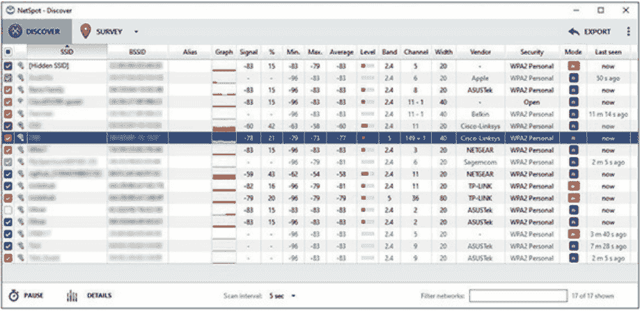
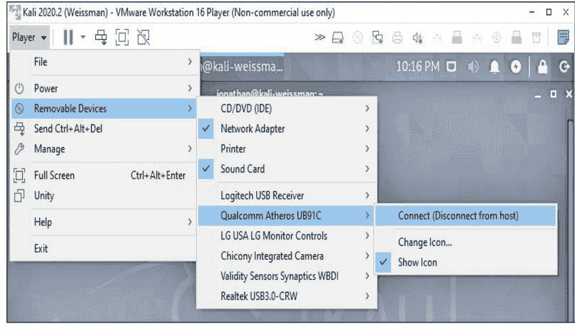
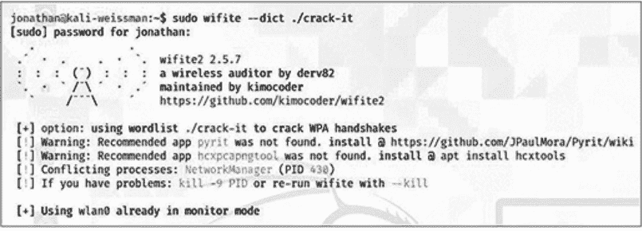
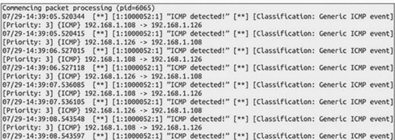
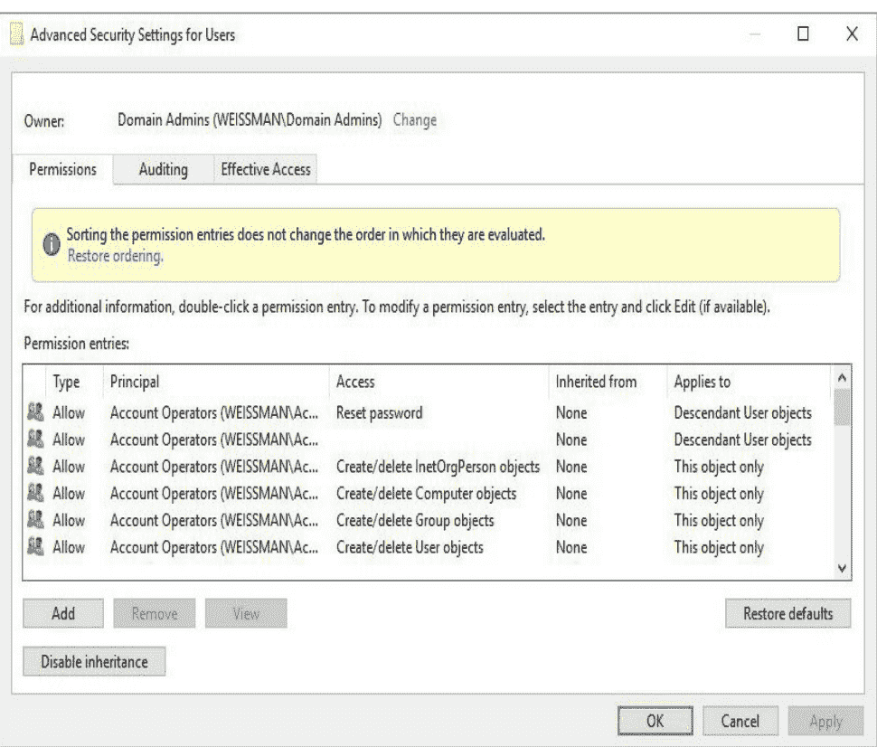
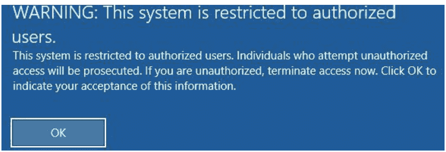
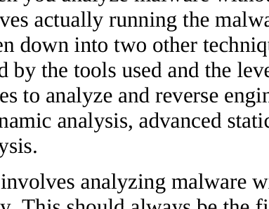
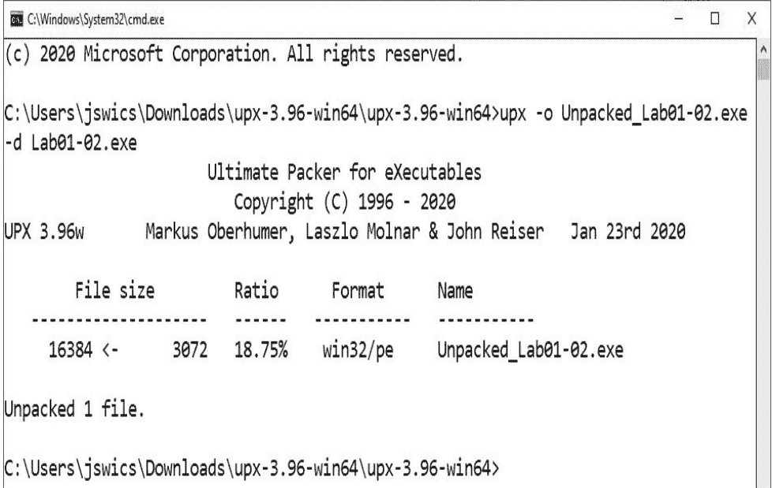
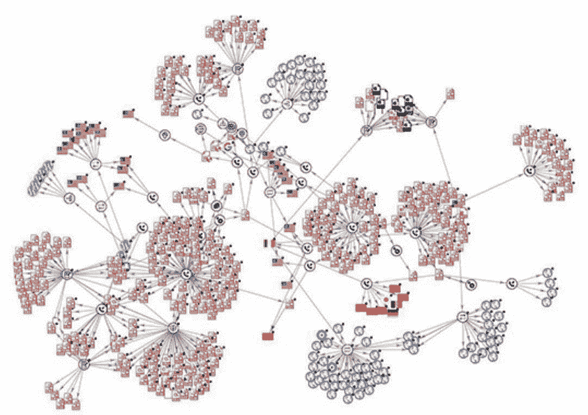

## 第 12 章
无线安全与移动设备

## 实验练习

- 12.01 无线网络与设备检测
- 12.02 监听模式嗅探
- 12.03 使用 Wifite 破解 WPA2 密码并解除客户端认证

实验分析

关键术语测验

当你走在街上或走廊里时，会听到别人说话吗？你会试图偷听这些对话吗？那些人知道你正在听他们说话吗？这是否违法？

我本人曾听到走廊里有人对着手机大声喊：“嗯，你需要先登录。你可以用我的账户。我的用户名是 x，密码是 y”（其中 x 和 y 是真实凭据）。我甚至听到有人非常大声地在手机通话中说出自己的社会安全号码。每次听到人们几乎对着手机大喊敏感信息，并且周围人都能听到时，我都感到无比震惊。

多年来，关于 Wi-Fi 流量是否合法的类似问题一直争论不休。与此相关的最新新闻可以追溯到 2010 年、2012 年和 2014 年。

- 这篇发表于 2010 年 5 月 17 日的文章解释了谷歌如何承认其街景车意外收集了未加密 Wi-Fi 网络的实际数据，而不仅仅是原本打算收集的网络名称和路由器 MAC 地址：
https://www.infosecurity-magazine.com/news/google-says-street-view-cars-collected-wifi-data-9499/

- 这篇发表于 2011 年 7 月 1 日的文章解释了联邦法官如何驳回了谷歌提出的驳回集体诉讼的请求，该诉讼指控谷歌因收集未加密 Wi-Fi 数据而违反了《联邦窃听法》：
https://www.infosecurity-magazine.com/news/federal-judge-rejects-googles-motion-to-dismiss/

- 在这篇发表于 2011 年 7 月 1 日的文章中，“史密斯女士”进一步解释了允许针对谷歌的诉讼继续进行的裁决：
https://www.csoonline.com/article/2220115/sniffing-open-wifi-may-be-wiretapping-judge-tells-google.html

- 在这篇发表于 2012 年 4 月 16 日的文章中，David Goldman 解释说，谷歌因妨碍联邦监管机构对拦截未加密 Wi-Fi 流量事件的调查而被罚款 25,000 美元：
https://money.cnn.com/2012/04/16/technology/google-fcc/index.htm

- 在这篇发表于 2012 年 4 月 27 日的文章中，David Kravets 解释说，司法部已澄清谷歌并未非法拦截未加密 Wi-Fi 流量：
https://www.wired.com/2012/04/doj-google-streetview/

- 在这篇发表于 2012 年 9 月 7 日的文章中，Timothy B. Lee 解释了联邦法官如何做出裁决：拦截未加密的 Wi-Fi 流量并不构成违反窃听法。Innovatio IP Ventures 希望获得初步裁决，允许其拦截 Wi-Fi 流量，以证明某些提供公共 Wi-Fi 的企业侵犯了其专利。该裁决与 2011 年针对谷歌的一项裁定相反，该裁定涉及谷歌街景车在美国各地捕获 Wi-Fi 流量的事件。
https://arstechnica.com/tech-policy/2012/09/sniffing-open-wifi-networks-is-not-wiretapping-judge-says/

- 在这篇发表于 2012 年 9 月 17 日、与同一案件相关的文章中，Kent Lawson 解释说，任何人都没有隐私预期或法律主张权利，如果……

网络安全。

## 学习目标

在本实验练习中，你将探索无线网络信号。完成本实验练习后，你将能够：

- 理解无线网络被检测出来有多么容易
- 理解关于无线网络的大量信息多么容易被检测到
- 理解无线设备被检测出来有多么容易
- 理解关于无线设备的大量信息多么容易被检测到

## 实验材料与准备

本实验所需的材料包括：

- 《计算机安全原理：CompTIA Security+ 及进阶》教材
- 一台可联网的 Windows 10 主机
- 一块连接到 Wi-Fi 网络的无线网卡（NIC）
- 一个无线接入点（WAP），也称为接入点（AP）

## 开始实验！

你将下载并安装两个程序。在继续之前，请确保你已连接到 Wi-Fi 网络。

1b、1c。你可以随意裁剪或遮盖截图的任何部分以保护隐私。

1d

步骤 1 在你的 Windows 10 机器上，下载并安装 NetSpot。以下介绍来自 www.netspotapp.com：

NetSpot 是唯一一款适用于 Mac OS X 和 Windows 的专业无线站点勘测、Wi-Fi 分析和故障排除应用。它是一款免费的 Wi-Fi 分析工具。无需成为网络专家，即可改善你的家庭或办公室 Wi-Fi！你只需要一台运行 Mac OS X 10.10+ 的 MacBook，或任何搭载 Windows 7/8/10 的笔记本电脑，以及 NetSpot——它适用于任何 802.11 网络。

- a. 访问 www.netspotapp.com。
- 点击“Get NetSpot”按钮。
- 在“NetSpot FREE edition”部分，点击“Download Now”按钮。
- 可执行文件将下载到你的“下载”文件夹。点击它以运行该可执行文件并安装 NetSpot。
- 点击蓝色的“Install Now”按钮开始安装。
- 安装完成后，点击“Launch”按钮。
- 点击左下角的“Continue”按钮继续使用免费版。

- b. 虽然操作系统可以为你提供关于你所处范围内无线网络的基本且有限的信息，但在选中“Discover”选项卡后，你将看到以下类别的信息：SSID、BSSID、Graph、Signal、%、Min、Max、Average、Level、Band、Channel、Width、Vendor、Security、Mode 和 Last Seen。图 12-1 展示了 NetSpot 的实际运行情况。



# 图 12-1 NetSpot 检测无线信号

SSID（服务集标识符）是网络的名称。BSSID（基本服务集标识符）是接入点的 MAC 地址。

NetSpot 在 www.netspotapp.com/help/terms-definitions/ 提供了一个很好的页面，其中包含“NetSpot 和 Wi-Fi 相关科学中使用的所有专业术语解释”。你可以去看看。

- c. 如果你在第一列的彩色复选框中勾选部分或所有行，然后点击底部栏中的“Details”按钮（或直接双击某一行而不勾选任何复选框），就可以获得将这些 SSID 与其他 SSID 进行比较的信息。如图 12-2 所示，你将看到一个包含以下选项卡的新窗口：Signal（5 分钟、30 分钟、60 分钟）、Tabular Data、Channels 2.4 GHz 和 Channels 5 GHz。Signal、Channels 2.4 GHz 和 Channels 5 GHz 选项卡将显示所选 SSID 的汇总信息。你可以添加或移除复选框，以动态改变彩色输出的内容。


在 Status 列中有一个箭头，点击它以展开选择以包含发现的服务。

d. 检测到多少台设备？列出了哪些制造商？某些设备上检测到哪些服务？有没有什么特别有趣的东西引起了你的注意？

60 MINUTES

## Lab Exercise 12.02: Monitor Mode Sniffing

当一帧进入 NIC 时，如果目标 MAC 地址不是 NIC 的单播 MAC 地址、多播地址或广播地址，NIC 将丢弃该帧。混杂模式是有线或无线 NIC 的一种模式，会导致 NIC 将其接收到的所有流量向上传递到机器的网络栈中。启用混杂模式后，NIC 将接受并读取目标地址为除 NIC MAC 地址之外的单播地址的帧。

当然，在交换网络上，混杂模式是没有用的，因为交换机只会将帧发送到与交换机源地址表 (SAT) 中列出的目标 MAC 地址相关联的端口，正如你在第 9 章中所看到的那样。唯一的例外是未知单播，即交换机不知道目标 MAC 地址与哪个端口相关联。在这种情况下，交换机将把帧泛洪到除帧源端口之外的所有端口。通常这不会成为问题，因为每次数据交换都应先进行 ARP 请求和 ARP 回复，这使得交换机在传输任何数据之前就已知道通信站。

在默认情况下使用 WPA2（Wi-Fi Protected Access 2）加密的 Wi-Fi 网络上，来自或发往其他主机的包将无法被 NIC 解密，也不会被捕获。因此，混杂模式的工作方式与非混杂模式相同。在未加密的 Wi-Fi 网络上，混杂模式的工作方式与有线网络相同，允许 NIC 读取目标地址为除 NIC MAC 地址之外的单播地址的流量。

监视模式与混杂模式类似，允许具有无线 NIC 的设备监视从无线网络接收到的所有流量。监视模式与混杂模式的区别在于，监视模式允许在无需先关联到 AP 的情况下捕获数据包。监视模式仅适用于无线网络（因为有线网络没有与 AP 的关联过程），而混杂模式适用于有线和无线网络。

无线网络上的混杂模式就像坐在餐厅桌子上一群人中间。你可以听到同一桌其他人之间的对话，因为你们都在一起用餐。监视模式就像你在街上或走廊行走时听人们的对话。你与他们没有任何联系，他们也与你没有任何联系。

默认情况下，监视模式无法在任何虚拟机（VM）上的任何客户操作系统中运行。VM 将虚拟 NIC 看作以太网适配器而不是 Wi-Fi 适配器。然而，使用允许混杂模式和监视模式的外部 NIC，在 VM 上进行监视模式嗅探是可能的，这就是本章要做的事情。

如果 VM 以桥接模式运行并具有自己的虚拟 NIC 和 MAC 地址，hypervisor 将通过设备驱动程序注入自身并强制有线物理 NIC 接受具有 VM MAC 地址的帧，以便将其发送到 VM。因此，即使目标 MAC 地址属于 VM 上的虚拟 NIC 而不是物理 NIC，物理 NIC 仍能够接受该帧。虚拟桥将流量发送到具有相应目标 MAC 地址的虚拟 NIC 上的 VM。

hypervisor 需要为无线流量调整该行为，因为许多无线适配器不支持混杂模式，并且如果目标 MAC 地址不是物理无线 NIC 的 MAC 地址，将自动丢弃流量。所有流量都必须使用主机无线 NIC 的 MAC 地址。hypervisor 需要将传出帧的 VM 源 MAC 地址替换为主机的 MAC 地址，以确保回复将发送回主机 MAC 地址而不是客户机 MAC 地址。

当 hypervisor 看到具有属于 VM 虚拟 NIC 之一的目标 IP 地址的传入数据包时，它会将帧中主机 NIC 的目标 MAC 地址替换为 VM 的 MAC

External/dp/B00VEEBOPG

然而，我实际上使用同一公司的较旧 802.11n 外部无线 USB NIC 进行数据包注入时获得了更稳定的成功：

www.amazon.com/gp/product/B004Y6MIXS

较新的 802.11ac 外部无线 USB NIC 有时会拒绝正常工作。欢迎来到 Linux 驱动的世界，欢迎来到无线嗅探的世界。

### Let’s Do This!

将你的外部无线 USB NIC 插入 USB 端口，然后启动你的 Kali Linux VM。

从 VMware Workstation Player 菜单中，单击 Player，将鼠标悬停在 Removable Devices 上，将鼠标悬停在 Qualcomm Atheros UB91C 上，然后单击 Connect（Disconnect from Host），如 Figure 12-3 所示。单击弹出对话框中的 OK 按钮。



FIGURE 12-3 Connecting the external wireless USB NIC to the Kali Linux VM

### Note

本章的屏幕截图是在使用 Bash（Bourne-again shell）通过 Kali Linux 2020.2 制作的。如第 2 章所述，Kali Linux 2020.4 从 Bash 切换到 Zsh（Z shell）。因此，你的终端外观会有所不同，但命令和输出的工作方式相同。

1e, 1f

### Step 1 Install the device drivers for the external USB wireless NIC.

- a. 外部 USB 无线 NIC 尚无法与 Kali Linux 通信。在任何 Linux 发行版中，棘手的部分是安装设备驱动程序（即使硬件能够与操作系统和程序通信的软件）。输入以下命令以安装无线 USB NIC 的驱动程序软件：

    ```
    sudo apt install realtek-rtl88xxau-dkms
    ```

    在提示时输入你的密码，并在本章其余部分中继续输入。

    在提示时输入 Y 并按 ENTER 继续安装。如果你再次执行该命令，你应该会看到类似以下的其他输出，具体取决于你在执行此实验练习时的当前版本：

    ```
    realtek-rtl88xxau-dkms is already the newest version (5.6.4.2~git20210118-0kali1).
    ```

- b. 关闭 Kali Linux VM 并移除外部 USB Wi-Fi NIC。打开 Kali Linux VM 然后登录。

- c. 运行以下两个命令（在提示时输入 Y 并按 ENTER）以更新 apt 包管理器并升级系统上的软件包：

    ```
    sudo apt update
    sudo apt upgrade
    ```

- d. 插入无线 USB NIC，选择单选按钮 Connect To A Virtual Machine，在 Remember My Choice and Do Not Ask Again 框中打勾，然后单击 OK 按钮。要撤消此操作，现在在 Removable Devices 菜单项中为 NIC 出现了“Forget Connection Rule”选择。

- e. 运行以下命令列出连接到 Kali Linux 的 USB 设备：

    ```
    lsusb
    ```

输出应包含引用 NIC 的一行，如 Figure 12-4 所示。

```
jonathan@kali-weissman:~$ lsusb
Bus 001 Device 002: ID 0cf3:9271 Qualcomm Atheros Communications AR9271 802.11n
Bus 001 Device 001: ID 1d6b:0002 Linux Foundation 2.0 root hub
Bus 002 Device 004: ID 0e0f:0008 VMware, Inc. Virtual Bluetooth Adapter
Bus 002 Device 003: ID 0e0f:0002 VMware, Inc. Virtual USB Hub
Bus 002 Device 002: ID 0e0f:0003 VMware, Inc. Virtual Mouse
Bus 002 Device 001: ID 1d6b:0001 Linux Foundation 1.1 root hub
jonathan@kali-weissman:~$
```

FIGURE 12-4 The NIC is recognized.

- f. 输入以下命令查看 IP 地址信息：

    ```
    ip a
    ```

    在输出中，注意到一个新 wlan0 接口的条目。

2a–2c

### Step 2 Put your NIC in monitor mode. By default, it’s in managed mode. Steps 2a, 2b, and 2c can be seen in Figure 12-5.


将 wlan0 接口切换到管理模式，并确认模式已回到管理（最后一条命令验证了在前三条命令之后模式为管理）。现在不要输入这些命令，因为下一步需要监控模式。

```
sudo ip link set wlan0 down
sudo iw wlan0 set type managed
sudo ip link set wlan0 up
iw dev
```

3c. 出于隐私考虑，可以随意裁剪或涂黑截图的任何部分。

## 步骤3 使用世界知名的数据包嗅探器 Wireshark 开始嗅探

有关 Wireshark 和数据包嗅探的更多内容将在后续章节中介绍。

- a. 在终端中输入以下命令：

```
sudo wireshark
```

- b. 双击 wlan0 接口，开始在监控模式下嗅探。

- c. 你会注意到来自 AP 的大量广播无线信标帧。请注意 Info 列中列出的 SSID。如果你在某个未加密网络的范围内，你实际上会看到所有数据包，包括来自该网络客户端发送和接收的数据包。你还应该看到来自客户端的广播探测请求和来自 AP 的单播探测响应。

根据范围内的设备情况，你也可能会捕获其他组播和单播流量。

- d. 单击红色方块（主工具栏上左起第二个图标）以停止捕获数据包。

- e. 在数据包列表窗格（顶部）中选择行，以查看数据包详情窗格（中间）中的字段名称和值。单击三角形展开每个部分。当你在数据包详情窗格中单击任何内容时，数据包字节窗格（底部）中左侧相应的十六进制转储和右侧的 ASCII/Unicode（如果适用；否则会看到点）会被选中。

- f. 要按 SSID 过滤，请在顶部的显示过滤栏（其中显示“Apply a display filter… <Ctrl-/>”）中输入

```
wlan.ssid == CSCPROF
```

其中 CSCPROF 是 SSID（替换为你正在过滤的 SSID），然后按回车。语法正确的过滤器，过滤栏会变为绿色；语法错误的过滤器则变为红色。

要移除显示过滤器，请单击过滤器栏右侧的 X。

- g. 要按信标帧过滤（AP 通过定期广播通告 SSID、数据速率、加密类型和其他能力，无需请求），请使用以下过滤器：

```
wlan.fc.type_subtype == 8
```

- h. 要按探测请求过滤（客户端通过广播向特定 AP 或范围内所有 AP 请求信息），请使用以下过滤器：

```
wlan.fc.type_subtype == 4
```

- i. 要按探测响应过滤（如果客户端与 AP 之间的数据速率兼容，AP 通过单播通告 SSID、数据速率、加密类型和其他能力），请使用以下过滤器：

```
wlan.fc.type_subtype == 5
```

- j. 一份很棒的 Wireshark 802.11 过滤器列表可以在这里找到：
+ www.semfionetworks.com/uploads/2/9/8/3/29831147/wireshark_802.11_filters_-_reference_sheet.pdf

从技术上讲，你现在可以带着装有无线网卡的笔记本电脑在镇上开车兜风，进行战争驾驶，直接从空中嗅探数据包。你可以在机场、咖啡店、商场、酒店以及任何其他公共 Wi-Fi 未加密的地方进行嗅探。在未加密的网络上，你将能看到所有数据包。然而，请记住本章开头提到的文章，并自己判断这些行为是合法还是非法、合乎道德还是不合乎道德、符合道义还是不符合道义。作者和出版商对因在不受你控制的网络上进行嗅探而产生的任何行为概不负责。

90分钟

## 实验练习 12.03：使用 Wifite 破解 WPA2 密码并解除客户端认证

WEP（有线等效加密）是 802.11 无线网络的第一个加密标准，于 1997 年批准生效，但它在防止攻击者嗅探无线客户端与 AP 之间传输的无线流量方面做得很差。它绝不等同于有线（以太网）网络通过线缆获得的隐私性。

WPA（Wi-Fi 保护访问）于 2003 年推出，作为 WEP 和 WPA2（Wi-Fi 保护访问 2）之间的过渡步骤，而 WPA2 本身于 2004 年推出。WEP 存在太多问题，因此迫切需要临时升级（WPA），直到设计出更好的长期解决方案（WPA2）。

WPA2 也有其问题与漏洞，但自 2004 年以来一直是无线安全的唯一选择。如今它正逐渐被 2018 年推出的 WPA3 所取代。WPA3 可以防止字典攻击和重放攻击，而这两种攻击在 WPA2 下都是可能的。事实上，在本实验练习中，你将破解 WPA2 密码并解密数据包，而这两者在 WPA3 下都是不可能实现的！

WPA2（以下所有内容同样适用于 WPA）有两种模式：个人模式，也称为预共享密钥（PSK），以及企业模式。个人模式仅使用密码形式的预共享密钥，而企业模式使用用户名/密码对，该配对与 802.1X（基于端口的认证）和 RADIUS（远程认证拨号用户服务）服务器一起使用（在大多数情况下，还使用 Active Directory 数据库）。破解企业模式比破解个人模式要困难得多。

在 WPA2-PSK 基础设施中，每个客户端都有自己的握手过程。因此，默认情况下，你无法监听加密网络中除自己流量以外的任何流量。然而，如果你知道预共享密钥并捕获了其他客户端与 AP 之间的握手过程，就可以解密他们的整个会话，这正是你将在本实验练习中要做的。

为了让 Wireshark 解密 WPA2 流量，它必须捕获 EAPoL（基于局域网的扩展认证协议）802.1X 握手过程，这是一个四次握手过程，其中包含 WPA2 用来建立密钥的值，这些密钥用于加密客户端与 AP 之间的流量。每次客户端连接到 AP 时都会发生这种情况，而且每次会话的值和密钥都不同。

使用数据包注入工具，你可以输入一条简单的命令，向与 AP 关联的客户端发送解除认证帧（仅当 802.11w-2009（稍后讨论）未启用时），使它们立即重新认证。发送到客户端单播地址比发送到广播地址更有效。然后，Wireshark 可以捕获 EAPoL 四次握手过程。一旦完成这一步，并且你已经破解了 WPA2 密码，就可以将密码和 SSID 一起放入 Wireshark，这样就能解密数据包。你将能够看到捕获到 EAPoL 握手的每个客户端发送和接收的每一个数据包。破解预共享密钥并强制受害者重新连接，这就是全部所需！

最新标准 WPA3 通过一种名为“对等实体同时认证”（SAE）的新密钥交换协议来限制主动攻击（即在字典攻击或暴力攻击中向 AP 发送无限次密码尝试），该协议取代了 WPA2 的预共享密钥（PSK）。WPA3 还消除了被动攻击，即使知道 Wi-Fi 密码并且成功连接，也能防止用户嗅探来自其他设备的流量。WPA3 还防止被动捕获交换过程来确定会话密钥，以及解密早先捕获的数据（完美前向保密）。WPA3 实际上消除了开放网络不使用加密的问题，比如咖啡店、酒店等场所的开放网络。不过，它通过机会性无线加密（OWE）的非认证加密使这些网络保持未认证状态，该加密使用客户端和 AP 在 OWE 下生成的密钥对消息进行加密，并为每条消息创建 MAC。使用的密钥对于每个客户端都是唯一且个性化的，因此其他设备无法解密这些流量。

支持 WPA3 的笔记本电脑和手机会在 AP 提供的最高安全级别仅为 WPA2 时回退到 WPA2。升级家用路由器可能很快，但对于组织以及公共 Wi-Fi 热点来说，转换可能需要更长的时间。因此，在相当长的一段时间内，我们仍将看到 WPA2 以及本章介绍的相关漏洞。


Wifite会使用一个默认文件，
/usr/share/dict/wordlist-probable.txt。

你可以使用**cat -n**（**-n**显示行号）和**grep**（搜索字符串）来检查默认的单词表，如下所示：

```
cat -n /usr/share/dict/wordlist-probable.txt | grep
weissman
```

在这种情况下，wordlist-probable.txt文件中有两个条目包含字符串weissman（第21682行的weissman和第78719行的weissmann）。你可以用其他字符串替换weissman来搜索文件中的其他单词。你可以通过输入以下命令使用**less**工具查看整个文件：

```
cat -n /usr/share/dict/wordlist-probable.txt | less
```

使用空格键逐页翻页，或使用上下箭头键（可按住快速滚动）或回车键逐行移动。按**q**退出。

或者，你可以通过输入以下命令在vim等文本编辑器中打开文件：

```
vim /usr/share/dict/wordlist-probable.txt
```

使用箭头键移动。按ESC、**:**、**q**和ENTER退出。

或者，你可以像在第11章中破解密码那样，使用Kali Linux自带的rockyou.txt。

c. 要查看Wifite帮助，请执行以下命令：

```
wifite -help
```

在WPA部分，注意以下与握手（hs）和字典（dict）文件相关的项目：

+   - **--new-hs** 捕获新的握手并忽略hs中的现有握手（默认关闭）
+   - **--dict [file]** 包含用于破解的密码的文件（默认为/usr/share/dict/wordlist-probable.txt）

2b、2d。为保护隐私，可以随意裁剪或编辑截图的任何部分。

步骤2 使用Wifite发现目标和客户端，然后发起攻击以捕获WPA2密码。

+   a. 使用以下命令启动Wifite：

```
sudo wifite --new-hs --dict ./crack-it
```

其中**crack-it**是当前目录中包含你的SSID的WPA2密码的文本文件的名称。

Wifite将开始扫描，如图12-6所示。



## 图12-6 Wifite启动

Wifite将发现目标（AP）和客户端。给它几分钟来收集信息和大量客户端。不久之后，您将看到目标列表和客户端数量，如图12-7所示。

```
[+] Scanning. Found 30 target(s), 25 client(s). Ctrl+C when ready ^C
NUM       ESSID                 CH  ENCR   POWER  WPS?  CLIENT
---       ----                  --  ----   -----  ----  ------
1         [blurred]            11  WPA-P  49db   yes   1
2         [blurred]            11  WPA-P  39db   yes   8
3         [blurred]             9  WPA-P  18db   yes
4         [blurred]             1  WPA-P  17db   no    1
5         [blurred]            11  WPA-P  17db   no    1
6         [blurred]             5  WPA-P  16db   no
7         [blurred]             9  WPA-P  15db   yes
8         [blurred]             5  WPA-P  15db   yes   1
9         [blurred]             9  WPA-P  15db   no
10        [blurred]             8  WPA-P  14db   yes
11        [blurred]             8  WPA-P  13db   yes
12        [blurred]            11  WPA-P  13db   yes
13        [blurred]             4  WPA-P  13db   yes
14        [blurred]             5  WPA-P  13db   yes
15        [blurred]            11  WPA-P  13db   no
16        [blurred]            11  WPA-P  12db   yes
17        [blurred]             6  WPA-P  12db   no
18        [blurred]             2  WPA-P  11db   yes
19        [blurred]             3  WPA-P  11db   yes   5
20        [blurred]             5  WPA-P  11db   yes
21        [blurred]             1  WPA-P  10db   yes   2
22        [blurred]            11  WPA-P  10db   yes   3
23        [blurred]             6  WPA-P  10db   no
24        [blurred]             8  WPA-P  10db   yes
25        [blurred]            11  WPA-P  10db   no    2
26        [blurred]             2  WPA-P   9db   yes
27        [blurred]             6  WPA-P   9db   no
28        [blurred]             6  WPA-P   8db   no
29        [blurred]             5  WPA-P   8db   no    1
30        [blurred]             5  WPA-P   7db   yes
[+] select target(s) (1-30) separated by commas, dashes or all: 2
```

## 图12-7 使用Wifite破解WPA2

b. 当为你的AP找到几个客户端时，按ESC停止（如图12-7所示）。在提示符下，输入代表你的目标接入点的数字（也如图12-7所示）。你会注意到攻击开始。按ESC跳过第一次攻击WPS Pixie dust，然后按c或ENTER继续，如图12-8所示。

```
[+] (1/1) Starting attacks against ████████████ (███)
[+] ███ (39db) WPS Pixie-Dust: [5m0s] Waiting for target to appear ... ^C
[!] Interrupted

[+] 4 attack(s) remain
[+] Do you want to continue attacking, or exit (c, e)? c
[+] ███ (36db) WPS NULL PIN: [4m53s] Sending ID ^C
[!] Interrupted

[+] 3 attack(s) remain
[+] Do you want to continue attacking, or exit (c, e)? c
[+] ███ (38db) WPS PIN Attack: [2s] (0.00%) Initializing ^C
[!] Interrupted

[+] 2 attack(s) remain
[+] Do you want to continue attacking, or exit (c, e)? c
[!] Skipping PMKID attack, missing required tools: hcxpcapngtool
[+] ███ (37db) WPA Handshake capture: Discovered new client: ████████████
[+] ███ (37db) WPA Handshake capture: Discovered new client: ████████████
[+] ███ (38db) WPA Handshake capture: Discovered new client: ████████████
[+] ███ (39db) WPA Handshake capture: Discovered new client: ████████████
[+] ███ (37db) WPA Handshake capture: Discovered new client: ████████████
[+] ███ (37db) WPA Handshake capture: Discovered new client: ████████████
[+] ███ (39db) WPA Handshake capture: Discovered new client: ████████████
[+] ███ (39db) WPA Handshake capture: Discovered new client: ████████████
[+] ███ (40db) WPA Handshake capture: Discovered new client: ████████████
[+] ███ (40db) WPA Handshake capture: Captured handshake
[+] saving copy of handshake to hs/handshake_████████████.cap saved

[+] analysis of captured handshake file:
[+]   tshark: .cap file contains a valid handshake for ████████████
[!] aircrack: .cap file does not contain a valid handshake

[+] Cracking WPA Handshake: Running aircrack-ng with crack-it wordlist
[+] Cracking WPA Handshake: 100.00% ETA: 0s @ 238.0kps (current key: )
[+] Cracked WPA Handshake PSK: ████████████

[+]     Access Point Name: ██
[+]     Access Point BSSID: ████████████
[+]             Encryption: WPA
[+]         Handshake File: hs/handshake_████████████████████.cap
[+]         PSK (password): █████████████!
[+] saved crack result to cracked.json (7 total)
[+] Finished attacking 1 target(s), exiting
```

wireshark/

在Wireshark中，按eapol过滤，你会看到多个EAPoL握手。要查看解除认证帧，请按wlan.fc.type_subtype == 12过滤。在多个过滤器之间使用||或or关键字，以按至少其中一个过滤（逻辑或）。

在当前捕获中包含EAPoL时，Wireshark将能够解密来自每个被解除认证并重新认证的客户端的数据包。不要停止捕获；否则，您将不得不再次解除客户端认证以查看解密的新流量。不过，如果停止捕获，您仍然可以查看截至该点的解密流量。

+   b. 在Wireshark中，按ip.addr == 192.168.1.0/24（使用你的网络ID和子网掩码）过滤，即可查看所有解密的数据包。注意源IP地址。

+   c. 向这些IP地址发送ping，并在Wireshark中按icmp过滤。现在你可以在Wireshark中明文嗅探ICMP（互联网控制消息协议）（来自重新认证的客户端）。

+   d. 从重新认证的客户端向完全限定域名（FQDN）如www.google.com发送ping。现在你可以在Wireshark中明文嗅探DNS和ICMP（来自重新认证的客户端）。

+   e. 在重新认证的客户端上打开浏览器并访问各种网站。你会在Wireshark中注意到，TLS仍然对使用加密的网站进行加密传输，如第7章所述。

## 实验室分析

+   1. 是否允许在任何网络上捕获无线流量？

+   2. 为什么在你控制的网络上捕获无线流量是一种网络安全形式？


当你通过安检准备前往登机口时，安检人员会检查你的登机牌和身份证件。TSA（美国运输安全管理局）人员检查的实际上相当于源IP地址（你是谁、住在哪里）、目的IP地址（你要乘坐飞机去见谁、去哪里）、协议（你的航空公司）以及端口（你的航班号）。TSA人员使用一组预配置的规则（如同防火墙），可能会询问你关于自己、航班或目的地的问题。入侵检测系统（IDS）或入侵防御系统（IPS）则相当于旅客等待登机的登机口另一侧的保安。

通过初步筛查的乘客可能会在登机口开始制造麻烦，比如因航班延误而大声喧哗甚至施暴。他们甚至可能进入机场员工限制区域。此时，检查过他们登机牌的TSA人员（防火墙）已无法提供帮助。问题已经超出了那个位置。现在必须由保安（IDS或IPS）介入。IDS和IPS需要更多的逻辑和学习能力，它们必须判断哪些界限被越过，然后采取相应的行动。

检查登机牌的TSA人员（防火墙）仍然是一个非常重要的组成部分。如果每个人都直接被放行到登机口，机场保安将不堪重负，无法监控所有潜在乘客。防火墙会过滤掉不应该进入网络的流量，而IDS或IPS则为任何通过了第一道筛查的内容增加了新的维度。

IDS和IPS有助于缓解本章开头提到的两个问题。IDS是带外的，只获取网络流量的副本。它可以是一个通过端口镜像（也称为SPAN，交换式端口分析器）获取流量副本以供检查的系统。这涉及到一台交换机，其配置为将连接到终端站的交换机端口上的所有进出流量副本发送到运行IDS的机器所在端口。这将允许IDS查看所有网络流量，包括公司服务器和客户端之间流动的内部数据，以及互联网流量。

或者，IDS可以连接到网络分流器（network tap），这是一种专用硬件设备，通常放置在基于网络的防火墙和交换机之间。采用这种拓扑结构，IDS可以看到所有进出流量。

SPAN端口可能会过载，数据包在到达IDS之前可能被丢弃。带有错误的帧也会丢失。使用网络分流器而不是SPAN端口可以保证每个数据包都能被看到，无论带宽、错误或其他任何情况如何。

IPS是内联的，原始流量必须经过IPS，这可能导致IPS宕机，造成拒绝服务（DoS），这与带外的IDS相反。此外，由于IDS是带外的，它不会增加延迟。IPS会增加一些延迟，因为它与必须经过的流量处于同一路径上。然而，IPS可以在看到恶意流量的那一刻就阻止它，而IDS则不能。

不过，IDS和IPS都可以根据观察到的数据包自动通知其他设备（如防火墙）提前阻止某些流量。IDS和IPS比防火墙需要更多的逻辑和学习能力。

一个显而易见的问题是，既然IPS能做IDS能做的事情，而且做得更好，为什么今天IDS仍然存在？答案是，IDS就像一扇窥视网络流量的窗口。它位于网络中，监听并收集可用于监控、分析和取证调查的数据。你可以将IDS视为可见性设备，而IPS是控制设备。IDS收集的数据包可以在之后进行分析，当大量流量和事件关联在一起时，可以深入了解过去的甚至可能的未来违规行为。

IDS和IPS都容易受到误报（将良性流量标记为恶意流量）和漏报（将恶意流量标记为良性流量）的影响。IDS和IPS需要不断调整，以最大限度地减少误报（会发出大量错误警报）和漏报（在发生恶意活动时不发出警报）。由于IDS是带外的，误报不会阻止合法流量，这也是为什么它们与IPS一起使用以形成深度防御体系的另一个原因。

IDS还可以被编程为仅向管理员发出警报，而不是告诉防火墙阻止某些流量。这更受那些只希望获得警报并自行采取行动的管理员青睐，而不是让IDS替他们做决定。

IDS和IPS与防火墙一样，可以基于主机，也可以基于网络。事实上，到目前为止，我们一直在讨论基于网络的IDS（NIDS）和基于网络的IPS（NIPS）。基于主机的IDS（HIDS）或基于主机的IPS（HIPS）驻留在特定计算机上，仅监视该主机系统上的活动。它基准测试并监视关键系统文件以及Windows注册表的访问、创建、修改和删除。与基于网络的IDS或IPS不同，基于主机的IDS或IPS可以处理已在主机上解密以供处理的加密流量。它还可以检测甚至可能逃脱基于网络的IDS或IPS的攻击。可想而知，基于主机的IDS或IPS确实会拖慢系统速度。HIDS和HIPS之间的区别在于，HIDS不会在流量传输过程中阻止它，而HIPS会。

正如基于网络的IDS或IPS可以捕获绕过网络防火墙或源自网络内部的恶意流量一样，基于主机的IDS或基于主机的IPS可以捕获绕过主机防火墙或源自机器内部的恶意流量。

基于签名的IDS和IPS就像反恶意软件一样，通过寻找模式（例如主机上的某些指令或协议的某些用法）来检测攻击。显而易见的问题是，未知模式无法被检测到，而攻击者不断改变代码以逃避简单的签名检测。此外，签名数据库需要不断更新。基于异常的IDS和IPS通过比较和建立基线来识别可能恶意的行为。然而，误报和漏报是需要通过监控和调整来解决的大问题。最新的基于异常的IDS和IPS可以检测恶意内部人员以及被外部人员入侵的机器或账户。

当今最流行的IDS之一是Snort，它既可以用作基于网络的IDS，也可以用作基于网络的IPS。Snort支持多种硬件平台和操作系统，包括Windows、Linux和MacOS。尽管Snort运行在主机上，但它不被视为基于主机的IDS/IPS，而是基于网络的IDS/IPS，因为它仍然在监控与网络相关的流量。

Snort的网站（www.snort.org/faq/what-is-snort）将该软件描述为“一个开源的网络入侵防御系统，能够在IP网络上执行实时流量分析和数据包记录。它可以执行协议分析、内容搜索/匹配，并且可以用于”

30分钟

## 实验练习13.02：Snort嗅探模式

与Wireshark一样，Snort可以嗅探数据包。在嗅探模式下，Snort嗅探到的字段和值会显示在控制台上。

### 学习目标

在本实验练习中，你将使用Snort作为数据包嗅探器。在本实验结束时

```
sudo apt install wireshark
```

- 在现在以及本章中每次提示时输入你的密码并按回车。
- 提示继续时输入Y并按回车。
- 在“非超级用户是否能够捕获数据包？”的问题上，按左箭头选择Yes，然后按回车。
- e. 输入以下命令下载并安装Snort：

```
sudo apt install snort
```

- 提示继续时输入Y并按回车。
- 在配置Snort屏幕中，按回车选择OK。
- 在“Snort应该监听的接口：”文本框中，使用BACKSPACE将eth0条目改为ens33，这是Ubuntu使用的接口名称。按回车选择OK。
- 如果你看到“无效接口”消息，按回车选择OK。你会再次回到第一个屏幕。再次按回车选择OK，然后再次按回车，此时文本框中仍然保留之前的ens33，选择OK。你会再次看到“无效接口”消息。按回车选择OK。这次安装完成。这是撰写本文时该版本Snort的一个已知错误，可能在你进行此实验练习时已经解决。即使Snort安装程序出现了这种阻挠，Snort也已成功安装。


## 图 13-1 在 Snort 中嗅探的 Internet 控制消息协议 (ICMP)

d. 输入以下命令：

```
sudo snort -v -i lo
```

要查看差异，请打开一个新的终端，ping 回环地址 (127.0.0.1)，并观察 Snort 正在嗅探的终端中的输出。

你可以用 CTRL-C 退出。

3a–3c

## 第 3 步 运行 Snort，生成上层数据，以及第 3 层和第 4 层报头信息。

a. 输入以下命令：

```
sudo snort -vd
```

以下内容摘自 Snort 手册页：

-d 在以详细模式或数据包日志模式显示数据包时转储应用层数据。

运行 Snort 并同时使用 -v 和 -d 选项 (-vd) 后，使用 CTRL-C 停止 Snort。

Snort 运行并显示上层数据，以及来自第 3 层和第 4 层的信息（当使用 TCP 或 UDP 时），如 图 13-2 所示。

```
WARNING: No preprocessors configured for policy 0.
07/29-14:27:25.257680 A0:AF:BD:BB:10:52 -> 00:0C:29:F6:47:73 type:0x800 len:0x4A
192.168.1.108 -> 192.168.1.126 ICMP TTL:128 TOS:0x0 ID:45524 IpLen:20 DgmLen:60
Type:8 Code:0 ID:1 Seq:10 ECHO
=+=+=+=+=+=+=+=+=+=+=+=+=+=+=+=+=+=+=+=+=+=+=+=+=+=+=+=+=+=+=+=+=+=+=+=+=+=+=+=+=+=+

WARNING: No preprocessors configured for policy 0.
07/29-14:27:25.257702 00:0C:29:F6:47:73 -> A0:AF:BD:BB:10:52 type:0x800 len:0x4A
192.168.1.126 -> 192.168.1.108 ICMP TTL:64 TOS:0x0 ID:55319 IpLen:20 DgmLen:60
Type:0 Code:0 ID:1 Seq:10 ECHO REPLY
=+=+=+=+=+=+=+=+=+=+=+=+=+=+=+=+=+=+=+=+=+=+=+=+=+=+=+=+=+=+=+=+=+=+=+=+=+=+=+=+=+=+

WARNING: No preprocessors configured for policy 0.
07/29-14:27:26.264515 A0:AF:BD:BB:10:52 -> 00:0C:29:F6:47:73 type:0x800 len:0x4A
192.168.1.108 -> 192.168.1.126 ICMP TTL:128 TOS:0x0 ID:45525 IpLen:20 DgmLen:60
Type:8 Code:0 ID:1 Seq:11 ECHO
=+=+=+=+=+=+=+=+=+=+=+=+=+=+=+=+=+=+=+=+=+=+=+=+=+=+=+=+=+=+=+=+=+=+=+=+=+=+=+=+=+=+

WARNING: No preprocessors configured for policy 0.
07/29-14:27:26.264537 00:0C:29:F6:47:73 -> A0:AF:BD:BB:10:52 type:0x800 len:0x4A
192.168.1.126 -> 192.168.1.108 ICMP TTL:64 TOS:0x0 ID:55403 IpLen:20 DgmLen:60
Type:0 Code:0 ID:1 Seq:11 ECHO REPLY
=+=+=+=+=+=+=+=+=+=+=+=+=+=+=+=+=+=+=+=+=+=+=+=+=+=+=+=+=+=+=+=+=+=+=+=+=+=+=+=+=+=+

WARNING: No preprocessors configured for policy 0.
07/29-14:27:26.656873 44:4A:DB:88:BA:20 -> 01:00:5E:00:00:FB type:0x800 len:0x82
192.168.1.140:5353 -> 224.0.0.251:5353 UDP TTL:255 TOS:0x0 ID:44194 IpLen:20 DgmLen:116
Len: 88
=+=+=+=+=+=+=+=+=+=+=+=+=+=+=+=+=+=+=+=+=+=+=+=+=+=+=+=+=+=+=+=+=+=+=+=+=+=+=+=+=+=+

WARNING: No preprocessors configured for policy 0.
07/29-14:27:26.656903 44:4A:DB:88:BA:20 -> 33:33:00:00:00:FB type:0x86DD len:0x96
fe80::40a:5819:38f2:a9dd:5353 -> ff02::fb:5353 UDP TTL:255 TOS:0x0 ID:0 IpLen:40 DgmLen:
Len: 88
=+=+=+=+=+=+=+=+=+=+=+=+=+=+=+=+=+=+=+=+=+=+=+=+=+=+=+=+=+=+=+=+=+=+=+=+=+=+=+=+=+=+

WARNING: No preprocessors configured for policy 0.
07/29-14:27:27.270258 A0:AF:BD:BB:10:52 -> 00:0C:29:F6:47:73 type:0x800 len:0x4A
192.168.1.108 -> 192.168.1.126 ICMP TTL:128 TOS:0x0 ID:45526 IpLen:20 DgmLen:60
```

图 13-3 Snort 显示第 2 层信息

c. 输入以下命令：

```
sudo snort -vde
```

运行 Snort 并同时使用 -v、-d 和 -e 选项 (-vde) 后，

a. 输入以下命令：
`sudo snort -l .`

## 注意

命令末尾的点代表当前目录。

以下内容摘自 Snort 手册页：

-l log-dir

将输出日志目录设置为 *log-dir*。所有纯文本警报和数据包日志都进入此目录。如果未指定此选项，则默认日志目录设置为 /var/log/snort。

你不需要 **-v**、**-d** 或 **-e**，与网上包括 Snort 自身文档在内的资料相反。

b. 从 Windows 10 VM 或主机机器向运行 Snort 的 Ubuntu VM 发送 ping。

使用 CTRL-C 停止 Snort。

2a, 2b

## 第 2 步 检查已记录的数据包。

a. 输入以下命令：
`ls`
查看生成的日志文件名。

b. 输入以下命令：
`sudo wireshark snort.log.159604382`

Wireshark 和数据包嗅探总体上已在第 12 章介绍，并在本章及后续章节中进一步探讨。目前，只需在 Wireshark 中打开已记录的数据包。在显示过滤栏（显示“Apply a display filter…” 的位置）中，输入 **icmp** 并按 ENTER 仅查看第 1b 步的 ping。

60 分钟

## 实验 13.04：Snort 网络入侵检测系统模式

在网络入侵检测系统 (NIDS) 模式下，Snort 监控网络流量并将流量与存储在配置文件中的用户定义规则集进行分析。Snort 然后根据识别到的内容执行特定操作。在此模式下，Snort 会记录并为匹配特定规则的数据包生成警报。

Snort 由多个组件组成。首先是数据包解码器，它确定帧中使用的协议，如第 2 层的以太网、第 3 层的 IP，以及第 4 层的 TCP 或 UDP。解码器将此信息与上层数据（如 DHCP、DNS、FTP、HTTP、SSH、TLS 及其大小）一起保存。解码器还会查找这些报头字段中的错误或异常。

如果 Snort 以内联 IPS 模式运行，snort.conf 配置文件中配置的规则甚至可以导致恶意或格式错误的数据包被丢弃。例如，如果以太网类型字段指示帧中封装了 IPv4 数据包，但捕获的 IP 报头大小小于 IPv4 报头 20 字节的最小长度，Snort 将生成警报并将数据包移出解码阶段。

第二个组件由多个预处理器组成，它们在数据包被发送到检测引擎进行分析之前对数据包进行排列和修改。一些预处理器通过对攻击者为欺骗目的而分片的数据包进行重新分片来检测一些基本异常。它们还可以执行 HTTP URL 解码，如果攻击者为欺骗目的在 URL 中使用了十六进制字符。预处理器是专门化的。有些可以检测并记录端口扫描活动，而其他可以检测 ARP 帧中的异常以识别 ARP 欺骗。预处理器可以排列字符串使其可被 IDS 检测到。一个表示目录的 scripts\ransomware 字符串可以有多种不同的排列方式；例如，以下所有目录引用都会使恶意软件到达 Windows 系统上的同一 scripts\ransomware 目录，而与引用的数量

最高优先级规则被使用。可能影响时间关键检测引擎行为的一些因素包括规则数量、Snort 运行的机器的性能、Snort 机器内部总线的速度以及网络负载。

第四个组件、日志记录和警报系统，会从检测引擎获悉入侵并生成日志条目和警报。

第五个组件、输出模块或插件，控制日志记录和警报系统产生的输出类型。选项包括生成日志报告、在文件中记录警报报告、发送 SNMP（简单网络管理协议）陷阱、记录到 MySQL 数据库、发送消息到 syslog 服务器、生成可扩展标记语言 (XML) 输出、修改路由器和防火墙的配置，以及发送服务器消息块 (SMB) 消息。

## 学习目标

在本实验中，你将以最有益和最有效的方式使用 Snort。完成本实验后，你将能够

- 编辑 Snort 配置文件
- 创建自己的自定义 Snort 配置文件
- 探索随 Snort 提供的各种规则
- 配置自己的自定义 Snort 规则
- 将 Snort 实施为 IDS
- 分析结果

## 实验材料和设置

本实验所需的材料有

- *Principles of Computer Security: CompTIA Security+ and Beyond* 教科书
- 具有 Internet 连接的网络浏览器
- 你在实验 13.01 中安装的 Ubuntu VM 和 Snort
- 你在第 1 章安装的 Windows 10 VM 或 Windows 10


host machine

# Let’s Do This!

在 Ubuntu VM 中，按 CTRL-ALT-T 打开一个新的终端。执行每条命令后按 ENTER。

1a–1k

## Step 1 Use custom and default Snort configuration files.

a. 在使用 Snort 的默认配置文件和规则之前，让我们先编写一个简单的配置文件以便开始：

```
sudo gedit /etc/snort/snort2.conf
```

使用 gedit 文本编辑器创建并编辑存储在 /etc/snort 中的 snort2.conf 文件，这里就是默认 snort.conf 文件所在的位置。对于类型为 ipvar 的变量 HOME_NET，如果你的网络 ID 为 192.168.1.0/24，则使用该值。否则，根据你的 IP 地址方案进行修改。route 命令会显示你的网络 ID。将以下行添加到配置文件中（第 3 行使用你的网络 ID）：

```
preprocessor frag3_global: max_frags 65536
include classification.config
ipvar HOME_NET 192.168.1.0/24
var RULE_PATH /etc/snort/rules
include $RULE_PATH/local.rules
```

点击屏幕右上角的红色 X，然后点击保存按钮。这会在 Snort 启动时使用的配置文件中添加一组最少的行。

包含了一个默认的预处理器，以消除 “WARNING: No preprocessors configured for policy 0.” 的消息。你可以在 http://manual-snort-org.s3-website-us-east-1.amazonaws.com/node17.html 上阅读有关预处理器的更多信息，包括此特定预处理器。

文件 classification.config 已被包含。

以下内容摘自 http://manual-snort-org.s3-website-us-east-1.amazonaws.com/node16.html：

include 关键字允许在 Snort 命令行上指定的 snort.conf 中包含其他 snort 配置文件。它的工作方式类似于 C 编程语言中的 #include，读取命名文件的内容并将其内容添加到文件中的 include 语句出现的位置。

要在你的系统上查看 classification.config 文件，输入

```
gedit /etc/snort/classification.config
```

然后按 ENTER。

对于类型为 var 的变量 RULE_PATH，将其值设为 /etc/snort/rules。include 语句会在 /local.rules 之前展开该路径（/etc/snort/rules），以产生规则文件的绝对引用。使用变量作为规则路径允许你对多个引用使用该变量，并且如果需要，只需更改 RULE_PATH 变量，而不必更改每个 include 语句。

查看完 classification.config 后关闭 gedit。

b. 输入以下命令：

```
sudo gedit /etc/snort/rules/local.rules
```

以下内容摘自文件中的注释部分：

```
This file intentionally does not come with signatures. Put your local additions here.
```

在单行中添加以下规则。不要按 ENTER 来换行。文本如有必要会自动换行到下一行。

```
alert icmp any any -> $HOME_NET any (msg:"ICMP detected!"; sid: 1000052; rev:1; classtype:icmp-event;)
```

Snort 规则分为两部分：规则头和规则选项。规则头出现在左括号之前，包含规则动作、协议、源 IP 地址、源端口、方向、目标 IP 地址和目标端口。头部回答了关于分析数据包的“谁？”这个问题。

此规则以 “alert” 开始，这是满足条件时要采取的动作。

以下内容摘自 http://manual-snort-org.s3-website-us-east-1.amazonaws.com/node29.html：

- 1. alert 使用所选的告警方法生成告警，然后记录数据包。
- 2. log 记录数据包。
- 3. pass 忽略数据包。
- 4. drop 阻止并记录数据包。
- 5. reject 阻止数据包，记录它，然后如果协议为 TCP 则发送 TCP 重置，如果协议为 UDP 则发送 ICMP 端口不可达消息。
- 6. sdrop 阻止数据包但不记录它。

与 alert 规则和 log 规则相反，pass 规则将匹配不需要生成告警或日志的良性流量（例如，应该由 Snort 忽略的网络上的漏洞扫描器）。

在上一页的规则头中，icmp 匹配封装在其中的 ICMP 数据包。

第一个 **any** 指任何源 IP 地址。

第二个 **any** 指任何源端口。

接下来是方向运算符——在本例中，表示匹配从箭头左侧的源到箭头右侧的目标的流量。还有一个双向运算符 <>，指示 Snort 分析来自每一侧（源和目标）的流量。

第三个 **any** 指任何目标 IP 地址。

第四个 **any** 指任何目标端口。

所有这些都属于 Snort 规则头。

如果规则头回答“谁？”这个问题，那么规则选项则回答“什么？”这个问题

表 13-1 显示了通用规则选项关键字及其描述，详细内容见 http://manual-snort-org.s3-website-us-east-1.amazonaws.com/node31.html。

| Keyword | Description |
|---|---|
| msg | msg 关键字告诉日志和告警引擎在数据包转储或告警中打印的消息。 |
| reference | reference 关键字允许规则包含对外部攻击识别系统的引用。 |
| gid | gid 关键字（生成器 id）用于标识当特定规则触发时生成事件的 Snort 的哪个部分。 |
| sid | sid 关键字用于唯一标识 Snort 规则。 |
| rev | rev 关键字用于唯一标识 Snort 规则的修订版本。 |
| classtype | classtype 关键字用于将规则归类为检测属于更一般攻击类别的攻击。 |
| priority | priority 关键字为规则分配严重级别。 |
| metadata | metadata 关键字允许规则编写者在规则中嵌入其他信息，通常采用键值格式。 |

TABLE 13-1 General Rule Option Keywords from the Snort Manual

让我们再看一下我们的 Snort 规则：

```
alert icmp any any -> $HOME_NET any (msg:"ICMP detected!"; sid:1000052; rev:1; classtype:icmp-event;)
```

规则选项部分以消息 “ICMP detected!” 开始，这是将在告警中显示并被记录的消息。

sid（Snort ID）唯一标识 Snort 规则。小于 100 的 ID 保留供将来使用。100 到 999,999 之间的 ID 为规则

你会注意到有八个 ICMP 告警（四个 Echo 请求和四个 Echo 回复），如图 13-5 所示。



# FIGURE 13-5 Snort alerts generated

按 CTRL-C 退出。注意输出末尾的所有信息，包括以下部分：

- - 数据包处理的运行时间
- - 处理的数据包数量
- - 内存使用摘要
- - 数据包 I/O 总计
- - 按协议的细分（包括重建的数据包）
- - 动作统计
- - Frag3 统计
- - 流统计
- - SMTP 预处理器统计
- - Dcerpc2 预处理器统计
- - SIP 预处理器统计

e. 输入以下命令查看日志文件的名称：

```
sudo ls -l /var/log/snort
```

f. 在 Wireshark 中打开日志文件：

```
sudo wireshark /var/log/snort/snort.log.[numbers seen
```

从 Windows 10 VM 或 host machine 对 Ubuntu VM 执行 ping。

你会注意到有八个 ICMP 告警（四个 Echo 请求和四个 Echo 回复）。按 CTRL-C 退出。**fast** 选项已被 **full** 替换。

- i. 输入以下命令：
- ```
sudo gedit /var/log/snort/alert
```
- 注意告警文件中每个告警的完整 IP 头（尽管排除了一些字段）。

- j. 删除告警文件并重新启动 Snort，同时使用 **fast** 和 **full with two -A** 选项：
- ```
sudo rm /var/log/snort/alert
sudo snort -A console -A fast -A full -c /etc/snort/snort2.conf -i ens33
```
- 从 Windows 10 VM 或 host machine 对 Ubuntu VM 执行 ping。
- 你会注意到有八个 ICMP 告警（四个 Echo 请求和四个 Echo 回复）。按 CTRL-C 退出。现在同时使用了 **full** 和 **fast** 选项。

- k. 输入以下命令：
- ```
sudo gedit /var/log/snort/alert
```
- 同时指定 **fast** 和 **full** 选项后，你现在会在每个单独的告警中看到两者的输出（一个接一个）。

2a

2c, 2d

## Step 2 Examine Snort’s default rules.

- a. 现在让我们看看随 Snort 提供的规则：
- ```
ls -l /etc/snort/rules
```
- 注意不同类别的规则，每个类别都在自己的 .rules 文件中，如图 13-7 所示。


```
jonathan-ubuntu@ubuntu:~$ ls -l /etc/snort/rules
total 1600
-rw-r--r-- 1 root root  5520 Apr  3 2018 attack-responses.rules
-rw-r--r-- 1 root root 17898 Apr  3 2018 backdoor.rules
-rw-r--r-- 1 root root  3862 Apr  3 2018 bad-traffic.rules
-rw-r--r-- 1 root root  7994 Apr  3 2018 chat.rules
-rw-r--r-- 1 root root 12759 Apr  3 2018 community-bot.rules
-rw-r--r-- 1 root root 1223 Apr  3 2018 community-deleted.rules
-rw-r--r-- 1 root root  2042 Apr  3 2018 community-dos.rules
-rw-r--r-- 1 root root  2176 Apr  3 2018 community-exploit.rules
-rw-r--r-- 1 root root   249 Apr  3 2018 community-ftp.rules
-rw-r--r-- 1 root root  1376 Apr  3 2018 community-game.rules
-rw-r--r-- 1 root root   689 Apr  3 2018 community-icmp.rules
-rw-r--r-- 1 root root  2777 Apr  3 2018 community-imap.rules
-rw-r--r-- 1 root root   948 Apr  3 2018 community-inappropriate.rules
-rw-r--r-- 1 root root   257 Apr  3 2018 community-mail-client.rules
-rw-r--r-- 1 root root  7837 Apr  3 2018 community-misc.rules
-rw-r--r-- 1 root root   621 Apr  3 2018 community-nntp.rules
-rw-r--r-- 1 root root   775 Apr  3 2018 community-oracle.rules
-rw-r--r-- 1 root root  1621 Apr  3 2018 community-policy.rules
-rw-r--r-- 1 root root  3551 Apr  3 2018 community-sip.rules
-rw-r--r-- 1 root root  2722 Apr  3 2018 community-smtp.rules
-rw-r--r-- 1 root root  4063 Apr  3 2018 community-sql-injection.rules
-rw-r--r-- 1 root root  3742 Apr  3 2018 community-virus.rules
-rw-r--r-- 1 root root  2406 Apr  3 2018 community-web-attacks.rules
-rw-r--r-- 1 root root  5128 Apr  3 2018 community-web-cgi.rules
-rw-r--r-- 1 root root  4589 Apr  3 2018 community-web-client.rules
-rw-r--r-- 1 root root   254 Apr  3 2018 community-web-dos.rules
-rw-r--r-- 1 root root  1473 Apr  3 2018 community-web-iis.rules
-rw-r--r-- 1 root root  68917 Apr  3 2018 community-web-misc.rules
-rw-r--r-- 1 root root 163259 Apr  3 2018 community-web-php.rules
-rw-r--r-- 1 root root  7646 Apr  3 2018 ddos.rules
-rw-r--r-- 1 root root 64313 Apr  3 2018 deleted.rules
-rw-r--r-- 1 root root  6743 Apr  3 2018 dns.rules
-rw-r--r-- 1 root root  6296 Apr  3 2018 dos.rules
-rw-r--r-- 1 root root  1335 Apr  3 2018 experimental.rules
-rw-r--r-- 1 root root 30744 Apr  3 2018 exploit.rules
-rw-r--r-- 1 root root  4210 Apr  3 2018 finger.rules
-rw-r--r-- 1 root root 22000 Apr  3 2018 ftp.rules
-rw-r--r-- 1 root root 16482 Apr  3 2018 icmp-info.rules
-rw-r--r-- 1 root root  5352 Apr  3 2018 icmp.rules
-rw-r--r-- 1 root root 13741 Apr  3 2018 imap.rules
-rw-r--r-- 1 root root  3287 Apr  3 2018 info.rules
-rw-r--r-- 1 root root   199 Jul 29 15:54 local.rules
-rw-r--r-- 1 root root 18486 Apr  3 2018 misc.rules
-rw-r--r-- 1 root root  3730 Apr  3 2018 multimedia.rules
-rw-r--r-- 1 root root  1935 Apr  3 2018 mysql.rules
-rw-r--r-- 1 root root 283854 Apr  3 2018 netbios.rules
-rw-r--r-- 1 root root  4755 Apr  3 2018 nntp.rules
-rw-r--r-- 1 root root 177773 Apr  3 2018 oracle.rules
-rw-r--r-- 1 root root  2247 Apr  3 2018 other-ids.rules
-rw-r--r-- 1 root root  5067 Apr  3 2018 p2p.rules
-rw-r--r-- 1 root root  6183 Apr  3 2018 policy.rules
-rw-r--r-- 1 root root  2088 Apr  3 2018 pop2.rules
-rw-r--r-- 1 root root  9591 Apr  3 2018 pop3.rules
-rw-r--r-- 1 root root  5918 Apr  3 2018 porn.rules
-rw-r--r-- 1 root root 52531 Apr  3 2018 rpc.rules
-rw-r--r-- 1 root root  3784 Apr  3 2018 rservices.rules
-rw-r--r-- 1 root root  4952 Apr  3 2018 scan.rules
-rw-r--r-- 1 root root  9904 Apr  3 2018 shellcode.rules
-rw-r--r-- 1 root root 23990 Apr  3 2018 smtp.rules
-rw-r--r-- 1 root root  5779 Apr  3 2018 snmp.rules
-rw-r--r-- 1 root root 18330 Apr  3 2018 sql.rules
-rw-r--r-- 1 root root  5118 Apr  3 2018 telnet.rules
-rw-r--r-- 1 root root  3424 Apr  3 2018 tftp.rules
-rw-r--r-- 1 root root  2075 Apr  3 2018 virus.rules
-rw-r--r-- 1 root root 11089 Apr  3 2018 web-attacks.rules
-rw-r--r-- 1 root root 103203 Apr  3 2018 web-cgi.rules
-rw-r--r-- 1 root root 10980 Apr  3 2018 web-client.rules
-rw-r--r-- 1 root root 10026 Apr  3 2018 web-coldfusion.rules
-rw-r--r-- 1 root root 10417 Apr  3 2018 web-frontpage.rules
-rw-r--r-- 1 root root 40907 Apr  3 2018 web-iis.rules
-rw-r--r-- 1 root root 97307 Apr  3 2018 web-misc.rules
-rw-r--r-- 1 root root 36661 Apr  3 2018 web-php.rules
-rw-r--r-- 1 root root  1437 Apr  3 2018 x11.rules
```

### 图 13-7 Snort 规则

- b. 使用以下语法通过 **gedit** 或 **cat** 查看所有规则：

```
gedit /etc/snort/rules/icmp.rules
cat /etc/snort/rules/dns.rules
```

第一个示例使用 **gedit**，第二个示例使用 **cat**。只需在 .rules 扩展名之前更改文件名。当我们再次运行 Snort 时，所有这些规则都将生效。

- c. 哪五个类别最有趣？

- d. 哪五个单独的规则最有趣？


### 步骤 3 使用自定义配置文件启动 Snort。

- a. 复制默认的 Snort 配置文件，将新文件命名为 snort3.conf：

```
sudo cp /etc/snort/snort.conf /etc/snort/snort3.conf
```

最好保留原始文件不变并基于副本进行更改，以防你想恢复或只是查看默认值。

- b. 输入以下命令：

```
sudo gedit /etc/snort/snort3.conf
```

要自定义默认的 Snort 配置文件，请向下滚动直到看到以下行：

```
ipvar HOME_NET any
```

在我查看的文件中，这是第 51 行，对你也应该是如此。

将 **any** 更改为你的网络 ID，并使用无类别域间路由（CIDR）表示法指定子网掩码（例如，我的是 192.168.1.0/24）。

检查整个文件，然后保存并退出。

- c. 现在当你启动 Snort 时，你会注意到大量初始输出：

```
sudo snort -A console -A full -c /etc/snort/snort3.conf -i ens33
```

从 Windows 10 虚拟机或主机机器 ping Ubuntu 虚拟机。

你会注意到超过八个 ICMP 警报（四个回显请求和四个回显应答），因为 icmp.rules 文件以及你之前查看的其他文件现在都已生效。按 CTRL-C 退出。我们再次使用 full 选项。

- d. 输入以下命令：

  `sudo gedit /var/log/snort/alert`

  现在请注意警报文件中由于包含所有 .rules 文件而产生的额外警报。

- e. 在 Wireshark 中打开日志文件：

  `ls -l /var/log/snort`

  `sudo wireshark /var/log/snort/snort.log.[numbers seen here]`

  当你在命令中到达 snort.log. 之后的文件名末尾时，按 TAB，数字部分的文件名将自动补全。

## 实验分析

1. Snort 的三种模式是什么？

   ________________________

   ________________________

2. Snort 最常使用的模式是哪一种，为什么？

   ________________________

   ________________________

3. Snort 可以使用的规则有哪些类别？

   ________________________

   ________________________

## 关键术语测验

层级结构，用于树的特定部分。例如，计算安全部门不希望父域的系统管理员控制该部门的资源，也不会让父域的系统管理员能够管理和保护来自树中所有子域的众多资源。父域和子域具有双向信任关系。这意味着用户可以在其域中进行身份验证，然后被授予访问其他域中资源的权限。子域甚至可以是另一个子域的父域。

森林是一个或多个使用不相交命名空间的树。假设一家大型公司收购了两家小型公司。母公司可能希望其子公司保留其品牌名称和 AD 命名约定。森林将包含每棵树，包括大型公司的父域及其子域、第一个子公司的父域及其子域，以及第二个子公司的父域及其子域。这三棵树将被放置在称为森林的逻辑容器中，森林是层级中的最高级别（高于域），因为它可以包含多个域，而域可以由树组成。森林中的每个域（父域或子域）都具有双向传递信任关系。这意味着在国家的某一部分的子公司中的用户，在对其域进行身份验证后，可以访问国家另一部分的大型公司的资源，反之亦然。

全局编录包含森林中所有对象的信息，允许搜索整个森林并访问对象，无论其位置如何。全局编录存储森林中所有对象的所有信息。然而，特定域中的全局编录仅包含部分信息——用于在其他域中搜索对象的常用属性。这种部分信息足以联系该对象所在域的域控制器以获取更多信息。森林中配置的第一个域控制器会自动存储此全局编录。包含全局编录的系统称为全局编录服务器。

如果森林仅包含一个域，所有域控制器都应配置为全局编录服务器。域控制器之间用于复制（为同步目的）的磁盘空间、CPU 利用率或流量不需要额外要求。每个域控制器都可以响应所有身份验证和服务请求。你不希望某些域控制器不执行这些功能。


从客户端获取用于身份验证、资源、文件等。 大多数人称机器（物理或虚拟）为“服务器”，但实际上，服务器实际上是一个软件程序。具体来说，服务器是一种作为进程在后台运行的服务，与登录无关，只要身份验证和授权检查通过，就能根据请求提供服务或资源。服务器操作系统也称为网络操作系统（NOS）。微软的 Windows Server 品牌服务器操作系统将服务分组为角色和功能。你可以在 Windows Server 2019 系统上安装域名系统（DNS）角色和/或动态主机配置协议（DHCP）角色，这将使机器变成一台成员服务器。成员服务器是运行服务器操作系统、连接到域并至少安装了一个角色（服务器服务）的机器。如果机器未连接到域，则它仅被称为独立服务器。

## Cross-Reference
服务在第 2 章中进行了讨论。

当在连接到域的服务器操作系统上安装 Active Directory 域服务（AD DS）角色时，该机器现在被称为域控制器（或简称为 DC），为域范围内的客户端执行身份验证和授权。即使机器除了 AD DS 之外还安装了其他角色，也只是称为 DC。每个 DC 与其他 DC 处于同一级别，包含整个对象范围。这使得 DC 之间可以轻松高效地进行复制（出于一致性目的）。

如果在安装 AD DS 角色时不存在现有的 DNS 服务器，则必须同时安装 DNS 角色。在 AD DS 安装期间，你将被提示安装 DNS。DNS 必须存在于域才能存在的理由非常简单。当客户端登录到域时，他们通过域的名称登录到域。DNS 需要就位以解析“weissman.edu 域的域控制器是谁？”形式的查询，以便客户端可以将请求发送到该特定机器。初始查询是用于 DNS SRV（服务）资源记录，该记录通过其完全限定域名（FQDN）标识运行轻量级目录访问协议（LDAP）的机器。然后，该机器的 DNS

在 Windows Server 2019 VM 上，Server Manager 将默认打开，并附带一个弹出窗口。点击右上角的 X 关闭每个窗口。

在每个 VM 上，点击开始按钮或在搜索框中输入 **cmd**，然后点击命令提示符。接下来输入 **ipconfig** 并按 ENTER。你应该会看到 VM 与你的主机机器在同一网络上，基于你的网络 DHCP 服务器分配的 IP 地址。

在每个 VM 上，点击开始按钮或在搜索框中输入 **firewall**，然后选择防火墙和网络保护。点击屏幕底部的高级设置，然后点击是按钮。在左侧窗格中，点击入站规则。接下来，右键点击入站规则并选择新建规则.... 在规则类型屏幕中点击自定义单选按钮并点击下一步按钮。在程序屏幕中点击下一步按钮。在协议和端口屏幕的协议类型：下拉菜单中，选择 ICMPv4 并点击下一步按钮。在范围屏幕中点击下一步按钮。在操作屏幕中点击下一步按钮。在配置文件屏幕中点击下一步按钮。在名称：框中输入 **Ping Allowed** 并点击完成按钮。

通过在命令提示符中输入 **ping**，后跟另一个 VM 的 IP 地址，并在每个 VM 上按 ENTER，从另一个 VM ping 每个 VM。你应该会在每个命令提示符中看到来自被 ping 的另一个 VM 的四个回复。

服务器应始终具有静态 IP 地址。你不希望服务器的 IP 地址可能发生变化，就像 DHCP 的情况一样。即使 DHCP 允许保留，其中相同的媒体访问控制（MAC）地址始终获得相同的 IP 地址，你也不希望你的服务器依赖于另一台服务器。如果由于某种原因，你的 DHCP 服务器宕机或无法访问，当另一台服务器的租约到期或重新启动时，它将无法获得 IP 地址并且自身也无法访问。此外，如果系统没有静态配置的 IP 地址，就无法在该系统上安装 AD DS 角色。

### ➔ Note
你即将静态配置 Windows Server 2019 VM 和 Windows 10 VM。如果选择的 IP 地址正在使用中，将会出现问题。请确保使用网络上当前未使用的第四段值。你会注意到一个问题，如果

ipconfig 的输出显示一个以 169.254.x.x 开头的自动专用 IP 地址分配（APIPA）地址，这本质上是在域上不可用的地址。

在 Windows Server 2019 VM 上，点击开始按钮或在搜索框中输入 **sharing**，选择管理高级共享设置，点击屏幕顶部地址栏中的网络和共享中心，点击左侧窗格中的更改适配器设置，右键点击 Ethernet0 接口，选择属性，并双击 Internet 协议版本 4（TCP/IPv4）。选择使用以下 IP 地址：单选按钮并在 IP 地址：栏中输入它当前拥有的 IP 地址或同一子网中的另一个地址。由于我的网络 ID 是 192.168.1.0/24（子网掩码 255.255.255.0 在无类别域间路由 [CIDR] 表示法中就是 /24），我将我的 Windows Server 2019 VM 配置为 IP 地址 192.168.1.19（第四段中的 19 是特意选择的，以匹配 Windows Server 2019 中的 19）。在子网掩码：栏中输入你的网络的子网掩码。在大多数情况下，它将是 255.255.255.0，这可以通过在 VM 或主机机器上的命令提示符中运行 **ipconfig** 来确认。在默认网关：栏中输入你的网络的默认网关的 IP 地址。在大多数情况下，它将是 192.168.1.1，这可以通过在 VM 或主机机器上运行 **ipconfig** 来确认。在使用以下 DNS 服务器地址：部分中，在首选 DNS 服务器：栏中输入 127.0.0.1（环回地址），这意味着该机器将是其自己的主要 DNS 服务器（用于域相关活动）。在备用 DNS 服务器：栏中输入 8.8.8.8，以允许 Google 公共 DNS 服务器在该机器的 DNS 服务未运行时解析该机器的查询。点击 Internet 协议版本 4（TCP/IPv4）属性框中的确定按钮。点击 Ethernet0 属性框中的确定按钮。更改后始终“关闭”并“打开”接口是个好主意，以确保更改生效。首先，右键点击 Ethernet0 接口并选择禁用。然后，右键点击 Ethernet0 接口并选择启用。

虽然将 Windows 10 机器的 IP 地址保持为动态、由你的 DHCP 服务器分配是可以的，但让我们出于一致性和故障排除目的，将 Windows 10 VM 静态配置为一个 IP 地址。在 Windows 10 VM 上，点击开始按钮或在搜索框中输入 **sharing**，选择管理高级共享设置，点击网络和

名称：框中，输入比此计算机的默认名称更有意义的名称（我将其命名为 WEISSMAN-SERVER），然后点击确定按钮。

- e. 在计算机名/域更改弹出窗口中，点击确定按钮。
- f. 在系统属性窗口中，点击关闭按钮。
- g. 在 Microsoft Windows 弹出窗口中，点击立即重新启动按钮以重新启动 VM。

## Step 2 为管理员账户配置密码。如果管理员账户没有复杂的密码，系统将无法安装 AD DS 角色。

- a. 点击开始按钮或在搜索框中输入计算机管理，然后点击计算机管理。
- b. 在计算机管理窗口中，在左侧窗格中，点击本地用户和组。
- c. 在中间窗格中，双击用户文件夹。
- d. 右键点击管理员账户并选择设置密码....
- e. 点击继续按钮。
- f. 在新密码：和确认密码：文本框中，输入至少八个字符的密码，使用以下组中的至少三个字符：大写字母、小写字母、数字和符号。点击确定按钮。回想一下第 11 章中关于 NIST 2017 密码指南的讨论，其中包括取消多字符集的要求。
- g. 关闭计算机管理窗口。

3i, 3j

## Step 3 安装 AD DS 角色。

- a. 点击开始按钮然后点击服务器管理器磁贴。在服务器管理器弹出窗口中，在不要再次显示此消息旁边打勾，然后点击弹出窗口右上角的 X。


- b. 点击屏幕顶部的 Manage 超链接，然后点击 Add Roles and Features。
- c. 在 Before You Begin 屏幕，点击 Next 按钮。
- d. 在 Installation Type 屏幕，选择 Role-based or Feature-based Installation 后，点击 Next 按钮。
- e. 在 Server Selection 屏幕，选择 Select a Server from the Server Pool 并在下方突出显示 VM 后，点击 Next 按钮。
- f. 在 Server Roles 屏幕，在 Active Directory Domain Services 旁边的框中打勾。打勾后会弹出提示，“Add features that are required for Active Directory Domain Services?” 在 Include Management Tools (If Applicable) 框中保持勾选，点击 Add Features 按钮。然后点击 Next 按钮。
- g. 在 Features 屏幕，保留默认选择并点击 Next 按钮。
- h. 在 AD DS 屏幕，阅读信息并点击 Next 按钮。
- i. 在 Confirmation 屏幕，在 Restart the Destination Server Automatically If Required 旁边的框中打勾。在弹出窗口中，点击 Yes 按钮然后点击 Install 按钮。你会看到一个进度条显示安装的进展。
- j. 安装完成后，你会看到消息“Configuration required. Installation succeeded on,” 后跟你的计算机名称。点击 Close 按钮。

4i, 4j

## Step 4 Promote the machine to a domain controller.
- a. 点击 Manage 旁边的旗帜下方的黄色三角形带黑色感叹号。在 Post-deployment Configuration 部分，点击 Promote This Server to a Domain Controller。
- b. 在 Deployment Configuration 屏幕，选择 Add a New Forest 的单选按钮，在 Root Domain Name 框中输入域名（我选择的是 weissman.edu），并点击 Next 按钮。

on the popup. Click the Close button to close the popup.
- d. 要过滤结果，在右侧窗格的 Actions 部分，点击 Filter Current Log... 然后按需自定义。要移除过滤器并查看所有结果，再次在右侧窗格的 Actions 部分点击 Clear Filter（仅在过滤器生效时可见）。这有助于隔离你可能正在寻找的特定内容。
- e. 按 Event ID 1000 过滤，这对应于 Microsoft Active Directory Domain Services 启动完成。

## Step 6 The default hostname for the Windows 10 VM is not a great hostname. Rename the Windows 10 VM.
- a. 点击 Start 按钮或在搜索框中输入 This PC，右键点击 This PC，选择 Properties 或在右侧窗格点击 Properties。
- b. 点击 Rename This PC 按钮，然后在文本框中输入比计算机默认名称更有意义的名称（我命名为 WEISSMAN-CLIENT）。点击 Next 按钮然后点击 Restart Now 按钮重启 VM。
- c. 在 VM 重启后登录 Windows 10 VM。

7f, 7h

## Step 7 Join the Windows 10 VM to the Active Directory domain.
- a. 点击 Start 按钮或在搜索框中输入 This PC，右键点击 This PC，选择 Properties 或在右侧窗格点击 Properties。
- b. 在 Related Settings 部分，点击 Rename This PC (Advanced)。一个 System Properties 窗口会打开，Computer Name 选项卡被选中。
- c. 在 System Properties 窗口中，点击 Change... 按钮。
- d. 在 Member Of 部分，选择 Domain 旁边的单选按钮，输入你之前配置的域名（我的为 weissman.edu），并点击 OK 按钮。
- e. 在 Computer Name/Domain Changes 弹出窗口中，输入用户名 Administrator 和你之前配置的密码

## Perception
传感器和感知系统对于机器人和自主系统解释和与世界交互至关重要。这些技术将环境中的原始数据转换为有意义的理解，使导航、障碍物 avoidance 和操作等任务成为可能。

你甚至可以使用 OUs 将对用户和组的行政控制委托给适当的用户和组。对单个人员，如 IT 总监，完成所有工作是不现实的。将任务和职责分配给其他人以管理某些 OU 更有意义。一个系统管理员可以负责 Marketing OU，另一个可以管理 Human Resources OU。打印机和打印队列对象的管理职责可以交给一个系统管理员，而另一个可以管理用户和组的权限。委托发生在 OU 级别，而不是对象级别。委托还可以防止系统管理员对大量对象拥有巨大权限。来自父 OU 的委托可以同时被父 OU 内的多个子 OU 继承。实施最小权限原则，每个系统管理员将拥有执行其任务所需的足够控制权，不多一分。

应将对资源的权限分配给组账户对象，而不是用户账户对象。把组看作用户所扮演的角色。如果将对资源的权限分配给用户对象，将会是管理噩梦。如果一个用户从组织中拥有访问 100 个资源的部门调到拥有访问另外 100 个资源的不同部门，如果权限分配给用户账户对象，你就必须做 200 次更改。如果实施了组，并且将对资源的权限绑定到组账户对象，你所要做的就是将用户从原始组的成员资格中移除并将用户添加为新组的成员。那将是两次更改而不是 200 次。此外，正如今天的做法一样，用户可以担任多个角色，因此他们需要拥有多个组的累积权限。给组授予权限并将用户分配给组是正确的做法。

了解组和 OU 之间的区别很重要。把组看作是一组用户甚至计算机的集合。组也可以是另一个组的成员。组的使用是为了安全目的（例如，授予对资源如共享文件夹、文件、服务器、打印机或应用程序的权限）。这些权限不能分配给 OU。组有一个唯一标识其的安全标识符（SID），但 OU 没有。

OU 更像是组织基础设施的逻辑边界，并将 GPO 应用于它（GPO 也可链接到站点和域）以对通用对象实施安全策略。GPO 不能链接到组。而 OU 可以包含组对象、用户对象、计算机对象和其他 OU，一个对象只能在单个 OU 内。相反，用户对象和组对象可以是多个组的成员。

## Learning Objectives
在本实验练习中，你将为 AD 对象创建逻辑容器。完成本实验练习后，你将能够
- 创建 OU
- 委派 OU 控制
- 配置 OU 权限
- 创建组

## Lab Materials and Setup
本实验所需的材料有
- *Principles of Computer Security: CompTIA Security+ and Beyond* 教科书
- 你在第 1 章安装的 Windows Server 2019 VM
- 你在第 1 章安装的 Windows 10 VM

## Let’s Do This!
本实验练习要求先前实验练习完全完成并在此基础上进行。


**Step 1** 在配置 OU 之前，你需要决定一个满足业务和技术需求的层次结构。OU 的名称和描述应简短明了。对象名称可以在多个 OU 中重复，但不能在同一 OU 中重复。


## Active Directory 用户和计算机

+   文件
+   操作
+   查看
+   帮助

+   Active Directory 用户和计算机 [WEISSMAN-SERVER.weissman.edu]
+     已保存的查询
+     weissman.edu
+       Builtin
+       Canandaigua
+         Administrative
+         Clients
+           Faculty
+             Desktops
+             Laptops
+           Staff
+             Desktops
+             Laptops
+           Students
+             Desktops
+             Laptops
+       Groups
+         Bursar
+         Business Services
+         Facilities and Grounds
+         Faculty
+         Finance
+         Human Resources
+         Information Technology
+         Marketing
+         Registrar
+         Research and Development
+         Staff
+         Students
+       Servers
+         Application Servers
+         Database Servers
+         DHCP Servers
+         DNS Servers
+         Domain Controllers
+         Exchange Servers
+         File Servers
+         FTP Servers
+         Mail Servers
+         Print Servers
+         RADIUS Servers
+         Terminal Servers
+         VPN Servers
+         Web Servers
+       Users
+         Faculty
+         Staff
+         Students
+       Computers
+       Domain Controllers
+       ForeignSecurityPrincipals
+       Geneva
+       Managed Service Accounts
+       Newark
+       Users
+       Victor

## 图 14-3 weissman.edu 域

+   a. 在 Windows Server 2019 虚拟机上，打开服务器管理器，点击工具，然后点击 Active Directory 用户和计算机。你会注意到多个默认容器。点击每个容器，右侧窗格会显示其内容。Builtin 包含默认组对象。Computers 包含代表刚刚加入域的 Windows 10 虚拟机的计算机对象。双击该计算机对象可查看有关它的更多信息。Domain controllers 包含你当前所在的 Windows Server 2019 虚拟机的计算机对象。双击该计算机对象可查看有关它的更多信息。ForeignSecurityPrincipals 和 Managed Service Accounts 将为空。Users 包含默认用户对象和组对象。

+   b. 右键单击域名称（我的为 weissman.edu），将鼠标悬停在新建上，然后选择组织单位。

+   c. 在名称：文本框中，输入 Canandaigua，取消选中标记为防止意外删除而保护容器的复选框，然后单击确定按钮。

如果选中此框，并且你想删除该 OU，则需要从顶部菜单点击查看，然后选择高级功能（这是一个切换选择，因此再次点击查看然后高级功能会将视图恢复到原来的样子）。选中高级功能后，在域名称下层次结构中会出现更多项目，每个对象的属性列表中也会出现更多选项卡。右键单击要删除的 OU，选择属性，并在对象选项卡中（与其他选项卡一样，如果未选中高级功能则不可见），取消选中旁边标记为防止意外删除而保护对象的复选框。现在，该 OU 将可以被删除。如何执行删除操作将在后面介绍。如果你确实打开了高级功能，请在此处将其关闭。

+   d. 以同样的方式，并且直接在域名称下，创建以下 OU：Geneva、Newark 和 Victor。创建 OU 的顺序无关紧要。它们将在下次打开 Active Directory 用户和计算机时自动按字母顺序排列。

+   e. 直接在 Canandaigua OU 内部（这次，右键单击 Canandaigua OU，将鼠标悬停在新建上，然后选择组织单位），创建以下二级 OU：Administrative、Clients、Servers、Users 和 Groups。

+   f. 直接在 Clients OU 内部，创建以下三级 OU：Faculty、Staff 和 Students。

+   g. 直接在 Faculty OU、Students OU 和 Staff OU 内部，创建以下四级 OU：Desktops 和 Laptops。

+   h. 直接在 Servers OU 内部，创建以下三级 OU：Application Servers、Database Servers、DHCP Servers、DNS Servers、Domain Controllers、Exchange Servers、File Servers、FTP Servers、Mail Servers、Print Servers、RADIUS Servers、Terminal Servers 和 VPN Servers。

+   i. 直接在 Users OU 内部，创建以下三级 OU：Faculty、Staff 和 Students。

+   j. 直接在 Groups OU 内部，创建以下三级 OU：Bursar、Business Services、Facilities and Grounds、Faculty、Finance、Human Resources、Information Technology、Marketing、Registrar、Research and Development、Staff 和 Students。此处创建的 OU 将作为各个类别中各种组的容器。例如，Staff Level 1 不会拥有 Staff Level 2 的所有权限。

+   k. 展开所有 OU 并将你的工作与图 14-3 进行比较。

### 注意

可以在 AD 中创建计算机对象，使其从一开始就位于正确的 OU 中，从而使其受应用于 OU 的 GPO 控制。你会以与之前相同的方式将计算机添加到域中，但此方法不会将计算机对象放置在默认的 Computers 容器中。

2f

## 第 2 步 部门、员工角色、资源等会随时间变化。

网络的管理已经具有挑战性，而随着动态变化，挑战更大。然而，Active Directory 的结构允许通过简单步骤进行结构更改。

你即将移动、删除和重命名 OU。

+   a. FLCC 已将 Bursar 和 Registrar 部门合并为 One Stop Center（他们确实这样做了）。右键单击 Bursar OU，选择删除，并在提示确认要删除 OU 时单击是按钮。此 OU 内的任何内容也将被删除。
+   b. 右键单击 Registrar OU，选择重命名，输入 One Stop Center，然后按 ENTER。
+   c. 右键单击默认 Computers 容器中客户端计算机的计算机对象，选择移动...，展开 Canandaigua，展开 Clients，展开 Students，选择 Desktops，然后单击确定按钮。
+   d. 导航到 Desktops OU 并在右侧窗格中单击计算机对象。将该对象拖放到左侧窗格中 Students 内的 Laptops OU 中。单击弹出警告中关于移动对象时可能发生的情况的“是”按钮。
+   e. 导航到 Laptops OU 并在右侧窗格中单击计算机对象。按 CTRL-X 或右键单击计算机对象并选择剪切。单击 Desktops OU 并按 CTRL-V 或右键单击并选择粘贴。单击弹出警告中关于移动对象时可能发生的情况的“是”按钮。粘贴甚至可以在右侧窗格中完成，只要选择了正确的 OU 即可。有很多方法可以移动对象。OU 可以以与刚才移动计算机对象相同的方式移动。
+   f. 展开所有 OU 并选择 Desktops OU 以显示计算机对象。


## 第 3 步

委派 OU 的控制权可以使大型组织在多个系统管理员之间划分角色和职责。例如，系统管理员可以管理几个域中的对象，所有

Principal 列。再次点击它以按反字母顺序排序。再次点击一次以按字母顺序排列项目。请注意，前六个条目的主体为 Account Operators，如图 14-4 所示。即使在步骤 3c 中你没有选择创建/删除 InetOrgPerson 对象、创建/删除计算机对象、创建/删除组对象或创建/删除用户对象，在委派控制向导中，Account Operators 组成员默认拥有这些权限。然而，Account Operators 组成员在你委派该权限之前无法更改密码。



## 图 14-4 用户的高级安全设置

除了能够修改帐户和组中的


- e. 在“仅以下文件夹中的对象”旁边的单选按钮上单击。
- f. 在“计算机对象”旁边的框中打勾。
- g. 在标记为“在此文件夹中创建所选对象”和“在此文件夹中删除所选对象”的选择窗口下方打勾。
- h. 单击“下一步”按钮。
- i. 在“权限”屏幕中，勾选“常规”旁边的框，滚动查看下方窗口中的权限。同样通过仅勾选“属性特定”然后是“特定子对象的创建/删除”来操作。
- j. 在“常规”选项旁打勾，并确保其他选项未被勾选。在“读取”和“写入”旁的框中打勾（这将触发“属性特定”旁的框被勾选）。向下滚动以查看添加到特定权限的额外勾选。
- k. 单击“下一步”按钮。单击“完成”按钮。

这将赋予“服务器操作员”组成员在“服务器”OU内创建新的计算机对象的能力，以及读取和写入计算机对象所有属性的权限。

- l. 选择“内置”容器并双击“服务器操作员”。注意该组的描述：成员可以管理域服务器。使用右上角的 X 按钮、“确定”按钮或“取消”按钮关闭窗口。如同在“帐户操作员”中提到的，最好不要使用权限过度委托的“服务器操作员”组。
- m. 右键单击“Canandaigua”OU 内的“服务器”OU，选择“属性”，选择“安全”选项卡，然后单击“高级”按钮。
- n. 对“主体”列进行排序，展开它，并检查“服务器操作员”的条目。
- o. 通过“查看”菜单栏项目关闭“高级功能”。

## 5c

步骤 5 OU 的属性有助于识别负责管理 OU 的用户。联系信息对于系统管理员很重要，以防他们需要联系负责 OU 的人。配置联系信息不会授予权限，就像委派那样，它只是外观上的。现在，你将配置联系信息。

- a. 右键单击“Victor”OU（直接位于域下），选择“属性”，然后单击“由…管理”选项卡。
- b. 单击“更改…”按钮，单击“高级”按钮，单击“立即查找”按钮，然后双击“管理员”帐户。单击“确定”按钮。
- c. 如果帐户有额外信息，它将自动填充到相应部分（办公室、街道、城市、州/省、国家/地区、电话号码和传真号码）。单击“确定”按钮关闭“Victor 属性”对话框。

## 6a–6c

步骤 6 Active Directory 中有两种组类型：安全组和分发组。

安全组被授予（或拒绝）对资源的权限。例如，如果你想让一组用户访问某个对象，例如共享文件夹，但指定其控制级别，请创建一个安全组然后将权限分配给该组。然后该组中的每个用户都会获得这些权限。你也可以向安全组发送电子邮件。如果配置了允许邮件启用组的邮件系统，如 Microsoft Exchange，则组中的所有用户都会收到电子邮件。

分发组严格用于电话列表和电子邮件列表，如果配置了允许邮件启用组的邮件系统，如 Microsoft Exchange。 但是，分发组永远不会获得对象的权限。它们只是用于快速提供信息的大规模分发。

安全组可以进一步细分为三种不同类型。

本地安全组管理不属于域的计算机上的资源，它不被视为三种域安全组类型之一。

第一个安全组称为域本地组，它保留在创建它的域中。该组用于授予对服务器、文件夹、共享文件夹和打印机等对象在单个域中的权限。域本地组不能在任何其他域中使用，必须位于创建它的域中。

第二个安全组称为全局组，它可以包含来自创建该组的域的其他组和帐户。该组可以在林中的任何域中获得权限。域本地组用于管理域中的资源并为来自同一域和不同域的全局组提供对资源的访问。如果你将需要访问资源的帐户添加到与全局组相同的域或另一个域的全局组中，然后将该全局组添加到域本地组中，这将是一个很好的管理操作。

想象一家公司的 AD 林有一个纽约总部的域、一个德克萨斯州分支机构的域和一个加利福尼亚州分支机构的域。公司的董事会受托人需要能够访问三个域中的资源。你可以在每个域中创建一个域本地组，授予董事会受托人成员所需的资源访问权限。然后你可以在纽约总部域中创建一个全局组，其中董事会受托人成员作为用户帐户成员。然后你可以将全局组添加到每个域的域本地组中。如果董事会受托人成员离职，只需禁用该帐户。如果新用户加入董事会受托人，将该用户的帐户添加到全局组。如果添加了新资源，请将权限添加到域本地组。

第三个安全组称为通用组，它可以包含林中任何域的其他组和帐户。通用组可以在林中的任何域中获得权限。你可以将需要访问多个（或全部）域中资源的帐户添加到全局组，然后将该全局组添加到单个通用组，而不是

## 实验材料和设置

本实验所需的材料有

- *《计算机安全原理：CompTIA Security+ 及以上》* 教科书
- 你在第 1 章安装的 Windows Server 2019 VM
- 你在第 1 章安装的 Windows 10 VM

## 让我们开始吧！

本实验练习要求完成前两个实验练习并在此基础上构建。


**步骤 1** 创建一个新的用户帐户对象，该对象稍后将被授予管理权限。

将用户添加到组。

- a. 在“Active Directory 用户和计算机”中，右键单击“Canandaigua”OU 中的“Users”OU 中的“Staff”OU，将鼠标悬停在“新建”上，然后选择“用户”。
- b. 填写“名字：”、“姓名缩写：”（只需输入一个字母）和“姓氏：”文本框。“全名：”字段将自动填充。
- c. 填写“用户登录名：”文本框。创建一个包含名字一部分、中间名缩写和姓氏的登录名。可以简单到只是名字、中间名和姓氏的首字母。
- d. 单击“下一步”按钮。
- e. 输入密码（与之前一样，需要是复杂密码）并确认。取消选中“用户下次登录时必须更改密码”旁边的框。单击“下一步”按钮。单击“完成”按钮。


**步骤 2** 创建第二个用户帐户对象。此帐户将不会被授予

GPO。

内置管理员组存在的主要原因是为了向后兼容，并允许检查管理权限的程序在任何系统上检查同一位置。该组在“紧急情况下打破玻璃”情况之外真的不应该被触碰。

- e. 双击“Users”容器中的“域管理员”组（一个全局组）。你会注意到以下描述：域的指定管理员。
- f. 在“Active Directory 用户和计算机”的左窗格中，单击“Canandaigua”OU 中的“Groups”OU 中的“Students”OU。在右窗格中，右键单击“Honors Students”组（你之前创建的）并选择“属性”。单击“成员”选项卡。单击“添加…”按钮。你可以向组添加用户或向用户添加组成员资格。将你的非管理员用户添加到“Students”组。

4b, 4c

## 步骤 4

对象在创建后，其属性仍会发生变化。默认属性可以更改，并且可以配置新属性。右键单击任何对象并选择“属性”，或直接双击，对 AD 中的所有对象都有效。你现在将这样做。

- a. 右键单击你创建的非管理员用户（该对象位于“Canandaigua”OU 中的“Users”OU 中的“Students”OU 中）并选择“属性”。
- b. 在“常规”选项卡下，为标记为“说明：”、“办公室：”、“电话号码：”、“电子邮件：”和“网页：”的文本框添加任何值。
- c. 单击“地址”选项卡。为标记为“街道：”、“邮政信箱：”、“城市：”、“州/省：”、“邮政编码/邮政编码：”和“县/地区：”（这是一个下拉列表）的文本框添加任何值。完成后，单击“确定”按钮。

5d, 5e


## 步骤 5 使用新的管理员用户帐户在本地登录 DC。禁用 Administrator 帐户。从 Windows 10 VM 远程使用新的非管理员用户帐户登录域。

- a. 在 Windows Server 2019 VM 上，单击“开始”按钮，单击左侧窗格中的用户图标（该列中的第一个图标），然后单击“注销”。
- b. 按 CTRL-ALT-INSERT 向 VM 发送 CTRL-ALT-DELETE。或者，单击 VMware Workstation Player 界面左上角的 Player 菜单项，然后选择 Send Ctrl+Alt+Del。
- c. 在左下角，单击“其他用户”。输入你创建的新管理员用户的凭据，然后按 ENTER 或单击密码文本框右侧的箭头。由于这是该用户首次登录，因此会显示一些消息。
- d. 转到“Active Directory 用户和计算机”。在 Users 容器中，右键单击 Administrator 帐户（位于 Users 容器中），然后选择“禁用帐户”。在确认弹出窗口中单击“确定”按钮。
- e. 在 Windows 10 VM 上，按照以下步骤使用新的非管理员用户帐户登录域。在登录屏幕的左下角，选择“其他用户”。你应该会在“用户名”和“密码”文本框下方看到“登录到：”后跟你的域名。在它下面，单击“如何登录到另一个域？”。你会看到有关如何再次在本地登录这台计算机的说明，包括键入计算机名、反斜杠，然后键入本地帐户。

现在，输入你创建的非管理员用户的名称和相应密码，然后登录域。如预期一样，系统会提示你更改密码。单击“确定”按钮。在底部两个文本框中输入新密码并确认。按 ENTER 或单击“确认密码”文本框旁边的箭头。单击确认密码已更改的“确定”按钮。由于这是该用户首次登录，因此会显示一些消息。

单击“开始”按钮或在搜索框中键入 **PowerShell**，然后选择 Windows PowerShell。在提示符下，键入 **whoami** 并按 ENTER。输出将显示你的域、反斜杠以及你登录时使用的用户名。

## 步骤 6

正如你在第 11 章中学到的，密码应以哈希格式存储。如果用户忘记了密码，拨打帮助台或系统管理员电话并说“我忘了密码。你能告诉我是什么吗？”，诚实的回答是“不能。”更好的请求是“你能重置我的密码吗？”，对此的回答应该是响亮的“可以！”

这就是你现在要做的。

- a. 在 Windows Server 2019 VM 上的“Active Directory 用户和计算机”中，右键单击非管理员用户帐户，然后选择“重置密码”。输入并确认密码。保留“用户下次登录时须更改密码”旁边的复选框中的勾选。
- b. 使用新密码登录并在提示时更改密码。

## 步骤 7

当用户辞职或被解雇而需要从 AD 中移除用户帐户时，禁用该帐户比删除它更好。原因是出于取证分析的需要，如有必要。可能有些证据是你不知道将来会需要的，或者实际上可能正在进行调查。你甚至可以将已禁用的帐户放入专门为此目的创建的特殊 OU 中。现在你将禁用一个帐户然后再启用它。

- a. 从 Windows 10 VM 上，使用非管理员用户从域中注销。
- b. 从 Windows Server 2019 VM 上，右键单击非管理员用户帐户并选择“禁用帐户”。
- c. 右键单击它，查看现在显示“启用帐户”。但是，不要单击它。
- d. 禁用和启用帐户也可以通过右键单击用户帐户、选择“属性”（或直接双击用户帐户），然后转到“帐户”选项卡来完成。在“帐户选项：”部分中，你需要勾选“帐户已禁用”复选框（现在已勾选）。
- e. 你还会注意到顶部的“解锁帐户”。这不是用于已禁用的帐户。帐户会因帐户锁定策略而自动锁定，该策略由 GPO 设置，因为存在一定次数的错误登录。管理员用户会在此“解锁帐户”复选框中打勾。请注意，没有可单击的用于锁定帐户的复选框，因为这是一个自动过程。
- f. 在“帐户选项：”部分下方，你会注意到可以配置帐户到期日期。例如，这对于你知道需要在特定时间禁用的承包商帐户非常有用。使用“帐户到期时间”部分可免除你手动禁用该帐户的工作，如果忘记禁用，这可能成为安全漏洞。

以下是 2020 年与此主题相关的一个故事：

Twitter 承包商使用 Twitter 内部工具监视名人：
www.theverge.com/2020/7/27/21340581/twitter-big-hack-contractors-spied-celebs-beyonce-bitcoin

以下是这个新的网络安全时代中与此主题相关的两个最早曝光的网络攻击故事：

Home Depot 的攻击者使用供暖和通风（HVAC）承包商的登录凭据：
www.computerworld.com/article/2844491/home-depot-attackers-broke-in-using-a-vendors-stolen-credentials.html

Target 通过制冷承包商的凭据遭到攻击：
www.zdnet.com/article/anatomy-of-the-target-data-breach-missed-opportunities-and-lessons-learned/

如果需要对多个对象执行相同的过程/设置，即使是共享通用设置/选项卡的不同对象，也可以同时选择多个对象（使用 SHIFT 或 CTRL），右键单击任意一个

- d. 在任何 OU 中创建第三个用户。在创建用户帐户期间，填写你想要的任何信息。右键单击用户帐户对象（确保你右键单击的是刚创建的第三个用户），然后选择“删除”。在对话框中，单击“是”按钮。这是不可逆的操作。AD 中的每个对象都有一个安全标识符（SID）来唯一标识它。唯一标识对象的是 SID 而不是对象的名称。这意味着，如果你有一个名为 Bob 的用户，删除用户帐户对象 Bob，然后创建一个名为 Bob 的新用户，那么新 Bob 帐户在加密、权限或访问方面不会与旧 Bob 帐户的任何内容关联。

如前所述，出于取证目的，应禁用帐户而不是删除帐户。但是，公司策略可能规定在删除之前将已禁用帐户保留多长时间。随着时间的推移，拥有太多这些所谓的孤立帐户可能会导致 AD 中出现大量混乱。

### 注意

碰巧有一个 Active Directory 回收站，如果你意外删除了错误的用户帐户对象，它可能会救你一命。但是，这个特殊的 AD 回收站默认是禁用的。此外，即使启用，它仍有可能在某个时候被另一位系统管理员清空。在 AD 中删除对象时要小心。

## 步骤 9

在大型环境中，从“Active Directory 用户和计算机”显示中过滤掉某些项目可能会很有帮助。立即尝试。

- a. 在“Active Directory 用户和计算机”顶部的菜单栏中，单击“查看 | 筛选选项...”，然后选择“仅显示以下类型的对象：”旁边的单选按钮。
- b. 在“计算机”旁边的复选框中打勾，然后单击“确定”按钮。在 Canandaigua OU 内的 Clients OU 内的 Students OU 内的 Desktops OU 中，你仍然能够看到计算机

将条件用于搜索。可以使用多个条件进行更具体的搜索。

- g. 右键单击“搜索结果：”部分中的结果。你会看到与在“Active Directory 用户和计算机”中看到的相同的上下文菜单，你可以从此处对搜索结果执行帐户管理。

## 90 分钟

## 实验室练习 14.04：权限和共享

Windows NTFS（新技术文件系统）权限用于通过仅向授权用户授予对资源的权限来保护文件夹和文件。

有五项基本的 NTFS 文件权限：

- **读取** 允许用户读取文件内容，以及查看属性、所有者和权限。
- **写入** 包含“读取”的所有权限，还允许用户更改文件内容并更改文件属性。
- **读取和执行** 包含“读取”的所有权限，还允许用户运行文件。此权限授予程序可执行文件。
- **修改** 为用户提供“读取”、“写入”和“读取和执行”的所有权限，还允许用户修改文件属性（包括存档、隐藏、系统、只读、压缩、加密等）以及删除文件。
- **完全控制** 包含“修改”的所有权限，还允许用户更改文件权限或更改文件所有者。

有六项基本的 NTFS 文件夹权限（即五项 NTFS 文件权限，对于文件夹有新的含义，以及一项文件夹独有的权限）：

- **读取** 允许用户查看和列出文件夹的内容。
- **写入** 允许用户向文件夹添加文件和子文件夹。


- **读取并执行**：允许用户查看和列出文件夹的内容，并执行文件夹中的程序可执行文件。
- **修改**：允许用户读取和创建文件及子文件夹，修改文件夹的属性，并删除文件夹。
- **完全控制**：允许“修改”中的所有操作，还允许用户更改权限或更改文件夹的所有者，以及删除子文件夹和子文件夹中的文件。
- **列出文件夹内容**：仅允许用户列出文件夹的内容，但不能像“读取”那样查看这些文件和子文件夹的内容。

高级权限包括“遍历文件夹/执行文件”、“列出文件夹/读取数据”、“读取属性”、“创建文件/写入数据”、“创建文件夹/追加数据”、“写入属性”、“写入扩展属性”、“删除子文件夹和文件（仅适用于文件夹）”、“删除”、“读取权限”、“更改权限”和“取得所有权”。

假设有一个名为“Accounts 2020”的文件夹。在该文件夹上，人力资源组拥有FC（完全控制），管理人员组拥有RW（读取、写入），工程师组拥有RX（读取、执行）。如果Bob是这三个组的成员，他将获得最高级别的权限，即FC。

该规则的一个例外是，如果其中一个组有“拒绝”权限。假设管理人员组拥有“拒绝”而不是RW。现在，Bob没有任何权限，因为该组的“拒绝”将覆盖Bob从工程师组和人力资源组获得的所有其他组设置。

解决这个问题的方法是给用户单独分配该文件夹的权限。假设Bob用户账户被授予了该文件夹的FC。现在，即使管理人员组有“拒绝”，Bob仍然拥有该文件夹的FC。单个用户权限会覆盖组“拒绝”权限。

NTFS权限可以分配给文件和文件夹，但共享权限只能分配给文件夹，并由其中的文件和子文件夹继承。共享权限仅在用户远程连接时适用，这意味着从存储这些文件夹的机器以外的其他机器访问这些共享文件夹。共享权限与NTFS权限一样是累加性的，即赋予用户其所属组的最高权限。共享权限与NTFS权限一样，使用组“拒绝”来覆盖组权限，并使用单个用户权限来覆盖组“拒绝”权限。

当文件夹被共享时，如果用户通过组和/或用户权限设置了正确的共享权限，则可以从其他机器访问该文件夹。与文件和文件夹的众多NTFS权限不同，共享权限只有三种，并且它们仅适用于文件夹，不适用于文件：

- **读取**：允许用户查看文件和子文件夹的名称，查看文件内容，并运行程序。默认情况下，Everyone组获得读取权限。
- **更改**：包含“读取”权限授予的所有权限，还允许用户添加文件和子文件夹，更改文件内容，以及删除文件和子文件夹。默认情况下，“更改”不分配给任何组。
- **完全控制**：包含“读取”和“更改”权限授予的所有权限，还允许用户更改文件和文件夹的NTFS权限。默认情况下，Administrators组获得完全控制权限。

自然，NTFS权限和共享权限可能会发生冲突。两条简单的规则决定了这种情况下的结果。第一，本地权限仅指NTFS权限。第二，NTFS权限和共享权限中限制更严格的权限成为远程权限。

考虑以下示例，其中用户是组1、组2和组3的成员。共享权限和NTFS权限分别针对每个组。

|  | 共享 | NTFS |
|---|---|---|
| 组1 | R | RX |
| 组2 | R | R |
| 组3 | R | FC |

如果用户同时属于这三个组，他们拥有什么权限？有一个三步解决方案：

1. 分别累加每一列中的权限并找出最高权限。最高的共享权限是读取。最高的NTFS权限是FC。
2. 共享权限仅在远程访问时适用，本地访问时不适用。如果用户本地访问该文件夹，则仅NTFS权限适用，因此FC是本地权限。
3. 远程权限是共享权限和NTFS权限中限制更严格的那个。在R和FC之间，R限制更严格，因此R是远程权限。

再试一个：

|  | 共享 | NTFS |
|---|---|---|
| 组1 | R | R |
| 组2 | FC | R |
| 组3 | R | R |

最高的共享权限是FC，而最高的NTFS权限是R。

本地权限将是R。远程权限也将是R，因为R比FC更具限制性。

最后再试一个：

|  | 共享 | NTFS |
|---|---|---|
| 组1 | R | R |
| 组2 | FC | RX |
| 组3 | R | RW |

## 高级共享

共享此文件夹

### 设置

- 共享名：SecurityPlus
- 添加
- 删除
- 将同时用户数限制为：16777
- 注释：
- 权限
- 缓存
- 确定
- 取消
- 应用

### SecurityPlus 的权限

### 共享权限

组或用户名：

- Everyone
- 添加...
- 删除

**Everyone 的权限**

| 权限 | 允许 | 拒绝 |
|---|---|---|
| 完全控制 |  |  |
| 更改 |  |  |
| 读取 |  |  |

确定
取消
应用

图14-5 通过点击“高级共享…”按钮（a）、勾选“共享此文件夹”复选框（b）并为Everyone保留默认的“读取”权限（c）来共享文件夹。

- d. 单击“共享此文件夹”框。“共享名：”文本框将自动填充文件夹的名称。
- e. 单击“权限”按钮。注意，Everyone组只有“读取”权限，没有其他用户或组拥有其他权限，如图14-5c所示。单击“确定”按钮关闭“权限”窗口。单击“确定”按钮关闭“高级共享”窗口。
- f. 单击“安全”选项卡进行NTFS权限配置。
- g. 在“组或用户名：”部分中突出显示项目，以在“权限”部分中查看相应的权限。你会注意到“Users”组具有“读取并执行”、“列出文件夹内容”、“读取”和“特殊权限”。
- h. 单击“确定”按钮关闭“权限”窗口。单击“确定”按钮关闭“高级共享”窗口。单击“关闭”按钮关闭“属性”窗口。

2d, 2e

### 步骤2 在AD中发布共享文件夹。

- a. 打开“Active Directory 用户和计算机”。展开当前域，在Canandaigua OU中的Servers OU中右键单击File Servers OU。将鼠标悬停在“新建”上，然后选择“共享文件夹”。
- b. 在“新建对象 – 共享文件夹”对话框中，为文件夹名称输入SecurityPlus（尽管AD名称不需要与文件夹的名称匹配）。然后输入共享的通用命名约定（UNC）路径（我输入了`\\WEISSMAN-SERVER\SecurityPlus`）。单击“确定”按钮。
- c. 右键单击共享文件夹对象并选择“重命名”。将名称更改为Security+并按ENTER。某些对象（如共享文件夹）可以轻松地以这种方式重命名。如果你尝试用同样的方式重命名其他类型的对象，会发生不同的事情。例如，如果

单击按钮执行搜索。右键单击结果并选择“资源管理器”。

- c. 尝试在共享中创建文件和文件夹。尝试删除共享中的文件和文件夹。当然，“读取”远程权限不允许执行这些操作。
- d. 尝试读取文本文件的内容。“读取”远程权限确实允许你这样做。
- e. 尝试修改文本文件的内容。同样，仅凭“读取”远程权限，你将被拒绝。
- f. 现在，以管理员用户身份远程登录。即使该用户是共享中文件和文件夹的所有者，拥有完全控制权，并且是Domain Admins组的成员，但“读取”仍然是共享/NTFS权限中限制更严格的权限。因此，该管理员用户对共享文件夹的远程访问级别与非管理员用户相同，即“读取”权限。
- g. 同一个管理员用户帐户当前已在本地登录到服务器。因此，当本地访问时，该用户拥有完全控制权，这首先允许用户在那里创建文件夹和文件。从Windows Server 2019 VM的本地访问中，尝试直接删除共享文件夹中的文本文件（你无法远程执行此操作）。现在它将正常工作，因为该用户对NTFS本地访问具有完全控制权。尝试从本地访问在共享文件夹中添加、删除、重命名或修改其他内容。不会有任何问题。


### 步骤5 修改共享权限。

- a. 在Windows Server 2019 VM上，单击“开始”按钮或在搜索框中输入“此电脑”，然后点击“此电脑”。双击“本地磁盘C:”。
- b. 右键单击SecurityPlus共享文件夹，然后选择“属性”。
- c. 单击“共享”选项卡，然后点击“高级共享”按钮。
- d. 点击“权限”按钮，点击“添加”按钮，点击“高级…”

按钮，以及“立即查找”按钮。双击“Domain Admins”组，然后点击“确定”按钮。在“允许”列中勾选“完全控制”复选框。

- e. 点击“确定”按钮关闭“权限”窗口。点击“确定”按钮关闭“高级共享”窗口。点击“关闭”按钮关闭“属性”窗口。

6c

## 步骤 6 使用新权限远程访问共享资源。

- a. 您应该仍然以管理员用户身份通过 Windows 10 虚拟机登录到域。这次，您将以不同的方式访问共享文件夹。

  搜索并选择“此电脑”，然后在左侧窗格中双击“网络”。在右侧窗格的“计算机”部分，您应该看到 Windows Server 2019 虚拟机的图标和名称。双击它。除了两个默认的共享文件夹外，您还会看到您的共享文件夹。sysvol 共享文件夹用于向域成员传递和存储策略脚本和登录脚本。如果有登录脚本，它们将存储在 netlogon 共享文件夹中。有趣的是，根据 https://social.technet.microsoft.com/wiki/contents/articles/8548.active-directory-sysvol-and-netlogon.aspx，netlogon 共享文件夹实际上并不是域控制器上名为 netlogon 的文件夹，而只是一个存储所有登录脚本的文件夹。

  如果您在 Windows 10 虚拟机的“网络”小程序中看不到 Windows Server 2019 虚拟机，请尝试从 Windows Server 2019 机器上打开“网络”小程序。系统会提示您开启“网络发现”。按照多个提示进行操作。之后，该图标应该会在 Windows 10 虚拟机的“网络”小程序中可见。

- b. 双击 SecurityPlus 共享文件夹。

- c. 尝试在共享文件夹中添加、删除、重命名或修改任何内容。现在，这些操作可以远程执行，因为该用户帐户是 Domain Admins 组的成员，而该组刚刚被授予了

通过域策略，您可以配置多个密码设置（例如，用户必须多久更改一次密码、密码长度、用户在重用密码之前必须使用多少个唯一密码，以及密码复杂性）。

右键单击“默认域策略”（将在您的域正下方）并选择“编辑”。在弹出的对话框中勾选复选框，然后选择“确定”以不再看到该提示。

- d. GPO 设置最初分为两类：计算机配置和用户配置。计算机配置和用户配置各自可以进一步分为两类：策略和首选项。策略可以进一步分为三类（单击左侧窗格中的箭头展开）：软件设置、Windows 设置和管理模板。首选项可以进一步分为 Windows 设置和控制面板设置。

  在打开的“组策略管理编辑器”（GPME）窗口中，在左侧窗格中依次展开“计算机配置”、“策略”、“Windows 设置”、“安全设置”、“帐户策略”和“密码策略”。也可以通过双击右侧窗格中的相同选项来完成导航。在左侧窗格中选择“密码策略”，以在右侧窗格中显示各种策略及其设置。

- e. 在右侧窗格中，一次双击每个策略，包括“强制密码历史”、“密码最长使用期限”、“密码最短使用期限”、“密码长度最小值”、“密码必须符合复杂性要求”（这就是为什么整个章节中您的密码必须复杂的原因）以及“用可逆加密存储密码”。浏览每个策略的“安全策略设置”和“解释”选项卡。

- f. 在右侧窗格中，双击“密码长度最小值”设置。

  在“安全策略设置”对话框中，确保选中“定义此策略设置”复选框。将“密码必须至少为”值增加到八个字符。

应用于 OU 且设置不同的 GPO 将覆盖。

3e、3g、3k

## 步骤 3 使用用户配置 GPO 显示登录警告消息。

- a. 在 GPMC 中，右键单击 Canandaigua OU 中的 Clients OU，然后选择“在此域中创建 GPO 并在此处链接”。

- b. 在“名称：”文本框中，键入**登录警告**，然后点击“确定”按钮。

- c. 展开 Clients OU，右键单击该 GPO，然后选择“编辑”。

- d. 在打开的 GPME 中，在左侧窗格中依次展开以下项：“计算机配置”、“策略”、“Windows 设置”、“安全设置”、“本地策略”和“安全选项”。选择“安全选项”。在右侧窗格中，向下滚动并双击“交互式登录：尝试登录的用户的消息文本”。阅读“解释”选项卡。

- e. 勾选“在模板中定义此策略设置”框。在文本框中，键入**本系统仅限于授权用户使用。任何试图未经授权访问的个人将被追究法律责任。如果您未经授权，请立即终止访问。点击“确定”表示您接受此信息。** 然后点击“确定”按钮。

- f. 双击“交互式登录：尝试登录的用户的消息标题”。阅读“解释”选项卡。

- g. 勾选“在模板中定义此策略设置”框。在文本框中，键入**警告：本系统仅限于授权用户使用。** 然后点击“确定”按钮。

- h. 在组策略管理控制台中，在左侧窗格中单击 Clients OU 中的“登录警告”GPO。在右侧窗格中，点击顶部的“设置”选项卡。点击右侧的“显示”链接，以查看与此 GPO 相关的信息，特别是“交互式登录”的“显示”。

- i. 在 Windows 10 虚拟机上，执行 **gpupdate**。

- j. 注销。

- k. 按任意键，您应该会看到 GPO 中配置的消息文本和消息标题，如图 14-7 所示。点击“确定”按钮，以非管理员用户身份登录。



**图 14-7 登录消息**

消息文本和消息标题策略用于法律目的。它们警告用户（恶意的或不知情的）如果他们滥用组织资源或信息可能会发生什么。它们还让用户知道他们的行为可能会被记账和审计，这有助于强化用户应该已经阅读过的书面政策。消息文本和消息标题策略也用于网络犯罪分子。不，攻击者不会说：“哦，糟了，我无法入侵这个”，然后转向另一个目标。然而，研究表明，这些警告消息可以提高成功起诉的几率。有鉴于此，最好让法律部门和人力资源部门批准警告消息。

4e、4i

## 步骤 4 到目前为止创建的 GPO 在创建时即被立即链接。现在您将能够看到 GPO 实际上是可以在单独步骤中创建和链接的对象。

使用用户配置 GPO 隐藏并禁用桌面上的所有项目。

- a. 在 GPMC 中，在左侧窗格中展开“组策略对象”

您仍然可以从该文件夹读取和写入，但系统桌面上不会显示任何内容。

5i、5j

## 步骤 5 在进行下一个 GPO 之前，您需要更改一个设置以获得 Internet 访问权限。然后，您将下载一个浏览器。最后，您将能够创建一个使用特定图像作为桌面壁纸的用户配置 GPO。组织通常希望其机器呈现统一的外观，以下步骤将引导您完成此操作。

- a. 在服务器管理器中，单击左侧窗格中的“本地服务器”。在顶部的“属性”部分中，在右侧列中，单击“IE 增强的安全配置”旁边的“启用”。在“管理员”和“用户”部分中选择“关闭”单选按钮，然后点击“确定”按钮。

- b. 由于 Internet Explorer 是系统上默认的唯一浏览器，并且已“生命周期终止”（EOL，Microsoft 不再提供更新或安全补丁支持），请下载并安装其他浏览器，如 Chrome (www.google.com/chrome/) 或 Firefox (www.mozilla.org/en-US/firefox/windows/)。

- c. 使用新浏览器，在 Google 上搜索 Weissman Security+。点击顶部的“图片”选项卡以找到本书的封面。点击其中一个缩略图，常规大小的图片将出现在右侧。右键单击图片，选择“将图片另存为...”。然后选择“此电脑”、C: 和 SecurityPlus 共享文件夹。将文件名更改为 bookcover.jpg，然后点击“保存”按钮。

- d. 在 GPMC 中，右键单击域并选择“在此域中创建 GPO 并在此处链接”。

- e. 在“名称：”文本框中，键入“桌面壁纸”，然后点击“确定”按钮。

- f. 右键单击域容器下方的“桌面壁纸”GPO，然后选择“编辑”。

- g. 在打开的 GPME 中，在左侧窗格中依次展开以下项：“用户配置”、“策略”、“管理模板”、“桌面”。然后选择“桌面”（此“桌面”嵌套在前一个“桌面”内部）。


在文本框中输入 UNC 格式的共享名称 \\WEISSMAN-SERVER\SecurityPlus（将 WEISSMAN-SERVER 替换为你的服务器名称）。或者，你也可以直接键入。

- g. 在“Reconnect:”复选框中打勾，这会使驱动器保持持久连接，并且不会在用户注销时移除。

- h. 在“Label As:”文本框中，输入“S: Drive”，然后点击“Use:”单选按钮旁边的下拉菜单，选择 S:。

- i. 将“Hide/Show This Drive”和“Hide/Show All Drives”单选按钮保留在默认的“No Change”选项上，然后点击“确定”按钮。

- j. 在 Windows Server 2019 虚拟机和 Windows 10 虚拟机上，在命令提示符中执行 `gpupdate` 命令。

- k. 在 Canandaigua OU 下的 Groups OU 中的 Faculty OU 中，创建一个名为 Faculty 的域本地组。在 Canandaigua OU 下的 Groups OU 中的 Students OU 中，创建一个名为 Students 的域本地组。

- l. 对于 SecurityPlus 文件夹，向 Faculty 组授予共享权限和 NTFS 权限的完全控制权。对于 SecurityPlus 文件夹，向 Students 组仅授予共享权限和 NTFS 权限的读取权限。

- m. 在 Faculty OU 中创建一个新用户帐户，并将该用户帐户添加到 Faculty 组。将 Students OU 中现有的用户帐户添加到 Students 组。

- n. 在每台虚拟机上打开“此电脑”，你会看到每台虚拟机上的 S: 驱动器。

- o. 从 Windows 10 虚拟机（应使用当前已是 Students 组成员的非管理员帐户登录到域）打开 S: 驱动器。注意，你将只能从共享的 SecurityPlus 文件夹中读取。

- p. 从 Windows Server 2019 虚拟机（应使用位于 Domain Admins 组中的管理员帐户本地登录，该组对共享和 NTFS 权限具有完全控制权）打开 S: 驱动器。根据 Windows 的设计，Domain Admins 组中的该帐户在登录时只能执行读取操作。

- g. 在“高级安全设置”中，仅针对非管理员用户的文件夹，单击“添加”按钮，单击“选择主体”，输入非管理员用户的登录名，单击“检查名称”按钮，然后单击“确定”按钮。在“修改”旁边的复选框中打勾。单击“确定”按钮关闭“权限条目”窗口。这样将授予非管理员用户单个共享文件夹所需的权限，而不会多出任何权限，这些多出的权限会包含在“完全控制”中。单击“确定”按钮关闭“高级安全设置”。单击“确定”按钮关闭属性。

- h. 在组策略管理控制台中，右键单击域，然后选择“在此域中创建 GPO，并在此处链接...”。

- i. 在“Name:”文本框中，输入“U: Drives”，然后点击“确定”按钮。

- j. 在左窗格中右键单击“U: Drives”，然后选择“编辑...”。

- k. 在打开的组策略管理编辑器（GPME）中，在左窗格中展开以下节点：用户配置、首选项、Windows 设置和驱动器映射。

- l. 右键单击“驱动器映射”，将鼠标悬停在“新建”上，然后选择“映射驱动器”。在“Action:”下拉菜单中，你可以保留默认的“Update”或选择“Create”。此时两个选项都会执行相同的操作（创建）。

- m. 在“Location:”文本框中，输入 \\WEISSMAN-SERVER\UDrives\%USERNAME%（将 WEISSMAN-SERVER 替换为你的服务器名称），这将自动将 %USERNAME% 变量解析为每个单独的用户名，以匹配同名的共享用户文件夹。这样，GPO 就可以应用于所有用户。

- n. 在“Reconnect:”复选框中打勾，这会使驱动器保持持久连接，并且不会在用户注销时移除。

- o. 在“Label As:”文本框中，输入“U: Drive”，点击“Use:”单选按钮旁边的下拉菜单，然后选择“U”。

- p. 将“Hide/Show This Drive”和“Hide/Show All Drives”单选按钮保留在默认的“No Change”选项上。然后点击“确定”按钮。

- q. 在 Windows Server 2019 虚拟机和 Windows 10 虚拟机上，执行 `gpupdate` 命令。

- r. 在每台虚拟机上打开“此电脑”，你会看到每台虚拟机上的 U: 驱动器。

- s. 从使用非管理员用户登录的 Windows 10 虚拟机中，在 U: 驱动器中创建文件和文件夹。

当非管理员用户在该用户的 U: 驱动器中创建文件和文件夹时，请从 Windows Server 2019 虚拟机上直接查看 C:\UDrives 中的用户文件夹，进行本地（实时）观察。在 Windows Server 2019 虚拟机上本地添加、修改和删除内容，然后从 Windows 10 虚拟机上通过非管理员用户的 U: 驱动器实时观察这些更改。要在本地查看该文件夹，当弹出窗口显示以下消息时，你需要点击“继续”按钮：“你当前没有权限访问此文件夹。点击‘继续’以永久获得对此文件夹的访问权限。”

- t. 从 Windows Server 2019 虚拟机，在管理员用户的 U: 驱动器中创建文件和文件夹。

- u. 从 Windows 10 虚拟机远程访问 \\WEISSMAN-SERVER（将 WEISSMAN-SERVER 替换为你的服务器名称），分别以非管理员用户和管理员用户身份登录。从那里，点击 UDrives 共享文件夹。由于先前已为“列出文件夹内容”设置“拒绝”，非管理员用户将无法看到该共享文件夹中的文件夹，但管理员用户可以看到，并且当然也能够访问和修改该层次结构中的任何文件和文件夹。

8g, 8h, 8k

## 步骤 8

通常，将常用文件夹的内容自动保存到网络共享是很有帮助的。例如，用户可能不知道“文档”文件夹只存在于他们当前使用的计算机本地，如果他们换到另一台客户端计算机，保存到另一台计算机的“文档”文件夹中的文件就不会出现在那里。现在，你将为此目的创建一个用户配置 GPO。

- a. 在 GPMC 中，右键单击域，然后选择“在此域中创建 GPO，并在此处链接...”。

- 4. 当共享权限和 NTFS 权限之间存在冲突时，远程访问会发生什么？

- 5. GPO 可以链接到哪三个级别？

## 关键术语测验

使用列表中的术语完成下列句子。

- bridgehead
- computer
- cumulative
- deny
- disabled
- domain controller
- domain local
- enabled
- global
- global catalog
- individual
- not configured
- universal
- user

- 1. 安装了 AD DS 角色的 _____________。
- 2. _____________ 服务器拥有所有 AD 对象的完整信息。
- 3. 每个站点只有一个 _____________ 服务器。
- 4. 三种类型的组是 _____________、_____________ 和 _____________。
- 5. 权限是 _____________ 的，但组 _____________ 会覆盖任何组授予的任何权限，而后者又可以被 _____________ 用户权限覆盖。
- 6. 组策略配置可以分解为 _____________ 和 _____________ 类别。
- 7. GPO 的三种设置是 _____________、_____________ 和 _____________。

## 自由能方程背后的直觉

自由能方程是一个结合了准确性与复杂性的数学公式。它描述了大脑如何生成关于世界的预测，并根据感觉输入更新这些预测，强调了我们如何最小化惊讶（预测误差）以维持与环境的平衡。



该图说明了感知与行动的循环。大脑不断生成预测（自上而下），而感觉输入提供反馈（自下而上）。两者之间的差异——即预测误差——是驱动学习和适应的因素。

本质上，自由能方程可以看作：

```
F = -ln p(y|m) + D_KL[q(x)||p(x|y,m)]
```

其中第一项表示模型的准确性，第二项表示复杂性代价（近似后验与真实后验之间的散度）。


完全关闭以防止分析人员对二进制样本了解更多信息。这就是为什么有些人开玩笑说：“只要在虚拟机里运行所有东西。恶意软件会检测到虚拟机并自行关闭。”

恶意软件检测虚拟机的方式有很多。MAC 地址会以虚拟机厂商已知的组织唯一标识符（OUI）开头。后台运行的各种进程表明存在虚拟机。会有与虚拟机相关的注册表项。可以检测到虚拟机的工具。各种 RAM 结构会显示正在使用虚拟机的迹象。BIOS 序列号可以识别虚拟机。与物理机相比，有各种硬件参数（序列号、主板信息和 CPU 值）是虚拟机特有的。恶意软件甚至可以操纵汇编语言 IN 指令，这可以在 CPU 寄存器中放置一个特殊值，表明正在使用 VMware 虚拟机。

高级静态分析是分析人员深入研究恶意软件的时候。这种类型的分析使用一种称为反汇编器的程序，经常是 IDA（交互式反汇编器），它将二进制的 0 和 1 转换为汇编语言，从而允许分析汇编代码本身。高级动态分析涉及通过称为调试器的程序运行恶意软件，例如 x64dbg，它允许分析人员在程序执行时检查 RAM 和 CPU 寄存器。这种类型的分析使分析人员能够一步一步地执行某些指令，在断点处暂停程序并调查每个指令。本章的实验室练习将涉及基本的静态分析和基本的动态分析，而不是需要扎实的汇编语言背景的高级静态分析或高级动态分析。

当我教授 C++、Java、Python 等编程课程时，我告诉我的学生，当他们提交高级代码时，代码必须有良好的文档记录。他们必须能够解释每一行代码的作用。当我教授恶意软件分析，也称为恶意软件逆向工程时，我说的是相反的。大多数恶意软件二进制文件被转换为大量汇编代码行。根本不可能理解每一行低级代码的作用。而且，这需要花费大量时间。此外，很多时候恶意软件作者会故意编写无用的垃圾代码行，什么都不做，只是为了误导分析人员，让他们走错方向。

## Note

编写恶意软件最常用的两种语言是 C 和 C++，因为它们没有依赖要求（例如，Java 需要 Java 虚拟机，Python 需要 Python 解释器），它们生成的可执行文件很小，并且可以用于编写 rootkit 和执行内存黑客攻击，因为它们没有抽象层/级别（不像其他语言）。

那么你应该怎么做？规则一：专注于二进制文件的某些具体细节，并寻找有趣的关注点。规则二：使用不同的工具和策略。不要在某个区域使用单一工具花费太多时间。做点不同的事情来改变局面。以不同的方式查看恶意软件。规则三：不要忘记网络安全和恶意软件分析是一场猫鼠游戏。反分析，即恶意软件作者故意使分析更困难，始终是一个问题。一旦好人弄清楚坏人在做什么，坏人就会使用新技术再次使分析更困难。

## 30 MINUTES

## Lab Exercise 15.01: Strings

分析恶意软件时，一个很好的第一步是查看二进制文件的字符串。字符串是字符的连续序列，包括字母、数字和符号。字符串可以为恶意软件分析人员提供关于恶意软件做什么、如何做以及其通信去向的巨大洞察。

字符串具体可以包含什么？它们可以包含通过动态链接库（DLL）文件实现的应用程序编程接口（API）名称。两个应该始终存在的 DLL 是 kernel32.dll 和 user32.dll（即使在 64 位系统上，名称也保持不变，因为 DLL 中带有“32”的名称）。

kernel32.dll 文件用于内存管理、输入/输出操作和硬件中断。kernel32.dll 中感兴趣的函数包括 OpenProcess、CreateFileW、WriteFile 和 FindNextFileW。

## Note

操作字符的 Windows 函数可以有三种格式之一：一种通用版本，可同时用于 Windows 代码页（在 1980 年代和 1990 年代 Windows 操作系统中使用，Windows 实现 Unicode 后被取代，但在使用 ALT 键的快捷方式时仍然适用）和 Unicode，一种仅用于 Windows 代码页且以字母 A 结尾的版本（代表 ANSI），以及一种仅用于 Unicode 且以字母 W 结尾的版本（代表宽）。以 Ex 结尾（代表扩展）的函数是现有函数的更新，增加了提供额外选项和行为的参数。由于新旧函数不兼容，微软仍然支持旧函数（不带 Ex 后缀）。

user32.dll 文件用于创建和控制 Windows 用户界面的元素，例如桌面、窗口、按钮、滚动条、菜单和用户操作响应，使程序能够实现图形用户界面（GUI），使其与 Windows 的外观和感觉相匹配。在 Strings 的输出中看到它并不能说明太多。user32.dll 中感兴趣的函数包括 SetWindowTextW 和 ShowWindow。

advapi32.dll 文件是一个高级 Windows 32 基础 API DLL 文件（API 服务库），支持安全、服务管理器和注册表。看到该 API 可能表明恶意软件可能正在做什么。advapi32.dll 中感兴趣的函数是 RegSetValueExW。字符串中某些注册表项可能是危险信号，例如 Software\Microsoft\Windows\CurrentVersion\Run，这是一个注册表项（在 HKEY_LOCAL_MACHINE 和 HKEY_CURRENT_USER 中均可找到），通常由控制 Windows 启动时自动运行哪些程序的恶意软件使用。

shell32.dll 文件包含 Windows shell 函数，可能表明恶意软件可能正在做什么。gdi32.dll 具有控制图形设备接口绘制和发送到视频显示器的输出的函数。

- Step 1 除了 strings64 是一个 64 位二进制文件而 strings 是一个 32 位二进制文件之外，两者之间没有区别，并且两者都会产生相同的结果。命令将引用 strings64，但它们都可以使用 strings 运行。

## Note

虽然今天运行 Windows 的绝大多数机器都是 64 位系统，但大多数恶意软件实际上仍然编译为 32 位二进制文件。虽然 32 位二进制文件在 64 位系统上向后兼容，但 64 位二进制文件无法在 32 位系统上运行。由于恶意软件对手希望感染尽可能多的系统，因此恶意软件仍然大量编译为 32 位二进制文件。事实上，在 2017 年，这份白皮书声称所有 Windows 恶意软件中超过 99% 为 32 位：https://info.deepinstinct.com/whitepaper-beware-of-the-64-bit-malware 白皮书解释说，虽然 64 位恶意软件正在上升，因为恶意软件对手将恶意软件编译为 64 位二进制文件具有优势，即使这会失去向后兼容性。

本文解释了 2020 年 Mac 恶意软件的兴起，尽管攻击范围有限：https://www.zdnet.com/article/mac-malware-is-growing-fast-but-its-still-not-as-dangerous-as-the-attacks-on-windows/

本文解释 Linux 系统也是恶意软件的目标：https://www.zdnet.com/article/this-surprise-linux-malware-warning-shows-that-hackers-are-changing-their-targets/

探索 Strings 的基本用法。

- a. 输入 strings64 Lab01-01.dll | more，如图 15-1 所示。


```
C:\Windows\System32\cmd.exe
Microsoft Windows [Version 10.0.19041.508]
(c) 2020 Microsoft Corporation. All rights reserved.

C:\Users\jswics\Downloads\Strings>strings64 Lab01-01.dll | more

Strings v2.53 - Search for ANSI and Unicode strings in binary images.
Copyright (C) 1999-2016 Mark Russinovich
Sysinternals - www.sysinternals.com

!This program cannot be run in DOS mode.
Rich
.text
`.rdata
@.data
.reloc
SUV
h8`
h8`
L$xQh
h(
RVf
D$"
-(
-- More --
```

## 图 15-1 运行 strings64

要逐行滚动，请按 ENTER 键。要逐页滚动，请按空格键。

你会注意到一些看起来像乱码的字符串，比如 Rvf、D$"、_^[] 等等。这些只是连续字节中可打印字符的 ASCII/Unicode 表示。不过，从逆向工程的角度来看，这些字符串毫无价值。

b. 要查看用法信息，只需输入：

```
strings64
```

c. 要去除长度为 3 及以下的字符串（很多乱码字符串都属于这个长度），请添加 -n 选项，后跟 4，这表示最小字符串长度为 4：

```
strings64 -n 4 Lab01-01.dll | more
```

仍然有一些乱码，但如果将值设为 5，像 **free** 和 **exec** 这样的四字符字符串就会被排除。

d. 要查看字符串在文件中的偏移量（可能有助于将某些字符串关联起来），请添加 -o（偏移量）选项：

```
strings64 -n 4 -o lab01-01.dll | more
```

或者，你也可以去掉 `| more`，然后向上滚动。

e. 另一种替代方案是将输出重定向到文本文件，然后在记事本中打开该文本文件：

```
strings64 -n 4 -o lab01-01.dll > lab01-01.txt
notepad lab01-01.txt
```

由于 -n 选项需要一个值，因此这里是一个不能用单个短横线组合多个选项的例子。

现在你可以看到某些字符串的位置被整齐地归组，包括 **exec**、**sleep**、**hello** 以及一个 IP 地址 127.26.152.15。这个二进制文件经过特殊构造，其 IP 地址以 127 开头，而 127 映射到 127.0.0.1 这个回环地址，流量不会离开你的计算机。

可以看到来自 kernel32.dll 的函数调用，如 **CreateProcessA**、**CreateMutexA** 和 **CloseHandle**。

也许该恶意软件会连接攻击者的 IP 地址，用“hello”向攻击者致意，接受 **sleep** 命令并执行它，然后用 **CreateProcessA** 运行程序。也可能并非如此。请记住，在恶意软件分析的这个步骤中，你只是在形成初步假设。

其他函数如 **malloc**、**free** 和 **strncmp** 来自 msvcrt.dll。在本例中，可能是为了混淆，ws2_32.dll 中的函数按序号（数字）而不是按名称调用，这就是为什么我们在这里看不到这些函数名称的原因。

只需在 Google 中简单搜索，就能找到 Microsoft Docs 页面，其中包含所有 Winsock 函数：

https://docs.microsoft.com/en-us/windows/win32/winsock/winsock-functions

2a

2b–2d

## 第 2 步：使用 Strings 分析 Lab01-01.exe，并就该二进制文件提出假设。

+   a. 让我们使用以下命令查看 Lab01-01.exe：
+   strings64 -n 4 Lab01-01.exe | more

+   b. 在字符串中可见的哪些函数用于查找、打开和操作文件？

+   c. 哪个字符串表明该恶意软件可能在搜索某种类型的文件？

+   d. 哪个字符串似乎通过狡猾地更改一个字符来伪造实际文件？该字符串还有哪两个其他问题？在字符串输出中也能看到的、被伪造字符串试图冒充的合法字符串是什么？

3a

3b, 3c

## 第 3 步：使用 Strings 分析 Lab01-02.exe，并就该二进制文件提出假设。

+   a. 使用以下命令在 Lab01-02.exe 上运行 strings64：
+   strings64 -n 4 Lab01-02.exe | more

这个二进制文件看起来是加壳的——换句话说，经过混淆以对像我们这样的恶意软件分析师隐藏字符串！加壳的二进制文件至少会

练习中，你将能够

- 解压二进制文件
- 使用结果来帮助对恶意软件样本形成更多假设

## 实验材料和设置

本实验所需的材料如下：

- *计算机安全原理：CompTIA Security+ 与进阶*教材
- 一台可联网的网页浏览器
- 你在第 1 章中安装的 Windows 10 虚拟机

## 让我们开始吧！

UPX 是一款开源加壳工具，可处理多种文件格式和多种操作系统。要下载并安装 UPX，请按照以下步骤操作：

- 1. 前往 https://upx.github.io/。
- 2. 点击 Download Latest Release（下载最新版本）。
- 3. 在 Assets 部分点击 upx-3.96-win64.zip，然后点击“确定”保存文件。
- 4. 解压 ZIP 文件。
- 5. 截至出版时，当前版本为 3.96。如果最新版本更新，请在后续命令中替换为新版本号。
- 6. 在 upx-3.96-win64 内部有一个同名文件夹。将 Strings 文件夹中的 Lab01-02.exe 复制到此文件夹中，你也会在这里看到 upx.exe 可执行文件。
- 7. 单击地址栏以选中当前路径，然后输入 **cmd** 并按 ENTER，在此目录中打开命令提示符。

在以下步骤中，每条命令后按 ENTER 键。


## 第 1 步：使用 UPX 解压二进制文件。

+   a. 要解压（-d）并解包 Lab01-02.exe，然后写入输出（-o）文件，请键入以下命令，如图 15-2 所示：



## 图 15-2 运行 UPX

```
upx -o Unpacked_Lab01-02.exe -d Lab01-02.exe
```

请注意所使用的 18.75% 压缩率以及提供的其他信息。

+   b. 输入 upx --help | more 以查看用法信息。

+   c. 将 Unpacked_Lab01-02.exe 文件复制到 Strings 目录中。

2a

2b–2d

## 第 2 步：使用 Strings 分析解压后的 Lab01-02.exe，并提出

## 图 15-3 运行 PEview

e. 在右侧窗格中，你会看到“值”部分的前两个 ASCII/Unicode 字符是 MZ（表示在“原始数据”部分找到的十六进制值 4D 5A），这就是为什么它被称为 MZ 头，表示这是一个 PE 文件。你还会注意到字符串“This program cannot be run in DOS mode.”，这是 PE 文件开头出现的错误消息签名。

f. 如果进一步向下滚动，你会注意到似乎有一堆有趣的字符串。

你已有足够的证据合理推断出这是一个嵌入式二进制文件，因此最好提取这个嵌入式二进制文件，以便单独分析它。


## 第 2 步：从 Lab01-04 中提取嵌入式二进制文件，以便使用 PEview 对其进行分析。

+   a. 双击提取出的 resource_hacker 文件夹中的 ResourceHacker.exe，启动 Resource Hacker。与 PEview 一样，它也是一个 GUI 工具。

+   b. 选择“File”，然后选择“Open”。在“打开”对话框中，浏览到 PEview 文件夹并选择 Lab01-04.exe。

+   c. 单击 BIN 旁边的箭头以展开树状结构。选择 101:1033，如图 15-4 所示。

## 图 15-4 运行 Resource Hacker

你会看到与 PEview 中相同的十六进制转储和 ASCII/Unicode 表示。

想要了解更多关于其高级服务的内容。

+   b. 单击“Create Account”按钮。
+   填写并提交你的信息。
+   点击电子邮件中的链接以激活你的账户。

+   c. 如有必要，重新上传 Lab01-01.exe，然后返回“Relations”选项卡。
+   单击所显示图形中的任意位置。继续点击你看到的一切！小图形将大幅展开，如图 15-5 所示。将鼠标悬停在图形的不同部分可以查看详细信息。



图 15-5 通过 VirusTotal 查找与 Lab01-01.exe 的关联

3a, 3b

## 第 3 步：向 VirusTotal 上传一个良性程序。

+   a. 将 C:\Windows\System32\calc.exe 上传到 VirusTotal。
+   b. 有多少比例的厂商认为它是恶意的？


## 4a, 4b

## Step 4 Create a new file and upload it to VirusTotal.

- a. If VirusTotal doesn’t have a matching hash on file, it submits your file to all of the APIs of the vendors. Let’s try one.
- Create a text file and type your name in it.
- Upload that file to VirusTotal.
- Click Confirm upload.
- Notice the real-time scanning, and you’ll see “No engines detected this file.”

- b. Now rename the file and upload it again.
- You’ll see that VirusTotal now realizes the hash is known, so it doesn’t do a real-time pass to all the engines.
- Go to the Details tab and see the previous name of the file, along with the First Submission timestamp (the time is in the UTC standard), matching your initial upload.

## 5c, 5d

## Step 5 Upload a file to VirusTotal that has a hash that matches a file that I, and others, have uploaded.

- a. Create a text file and type Professor Jonathan S. Weissman in it.
- Type it as is, using the same case and spacing, so the hash will match.
- Save the file and name it using your name (for example, jonathansweissman.txt).

- b. Upload the file to VirusTotal.

- c. Since I performed the previous two steps when writing this book, VirusTotal will recognize the hash and will not reanalyze the file, by default. Go to the Details tab and look at the History dates related to the submitted file, including First Submission, Last Submission, and Last Analysis.

- d. To have VirusTotal reanalyze a file if the hash is known, which

- l. Click the 2nd shot button.

- m. When that completes, click the Compare button and search the text file for any mention of the folders and files from this step. Now you’ll see sections of output including Files added, Files deleted, Files [attributes?] modified:, Folders added, and Folders deleted.


## Step 3 Using Regshot, explore the difference in registry modification between installing and uninstalling a program.

- a. Typically, when programs are installed, a bunch of registry keys will be added, but when programs are uninstalled, not all registry keys related to the installation will be removed. This, among other things, prevents someone from going through a free 30-day trial for software and then starting a new 30-day trial when it expires. Of course, registry keys are added at times when you might not expect, such as during normal activity, as well.

In Regshot, click the 1st shot button.

- b. Download and install a program of your choice from a reputable site.

- c. Click the 2nd shot button.

- d. When that completes, click the Compare button and search the text file to see how many registry keys were added related to the install.

- e. To see how the uninstallation of the program relates, click the 1st shot button.

- f. Uninstall the program.

- g. Click the 2nd shot button.

- h. When that completes, click the Compare button and search the text file to see how many registry keys were removed related to the uninstall.

## Lab Exercise 15.06: Process Monitor

Process Monitor is another great dynamic analysis tool that reports in real time on activity involving the registry, filesystem, networking, and, of course, processes. Since the tool tries to capture everything and anything, the odds are that some events will be missed at certain times. Since Process Monitor logs to RAM, it’s not advised to run it for an extended period of time.

## Learning Objectives

In this lab exercise, you’ll watch a list of events in real time on your system. At the end of this lab exercise, you’ll be able to

- Determine what effect a running binary has on the registry, filesystem, networking, and processes
- Implement various filters to make the output more targeted and meaningful

## Lab Materials and Setup

The materials you need for this lab are

- The *Principles of Computer Security: CompTIA Security+ and Beyond* textbook
- A web browser with an Internet connection
- The Windows 10 VM you installed in Chapter 1

## Let’s Do This!

Download Process Monitor from https://docs.microsoft.com/en-us/sysinternals/downloads/procmon and then extract the ZIP file and open the extracted folder.


## Step 1 Start collecting events with Process Monitor.

- a. You’ll notice three versions of Process Monitor in the extracted folder.

Double-click procmon64.exe to run it.
- b. Click the Yes button in the User Account Control dialog box.

Seeing adversaries’ FQDNs and capturing initial outbound communication from malware are great for analysts, but with ApateDNS, it gets even better.

Using ApateDNS, you can specify a number of nonexistent domain (NXDOMAIN) responses to be sent in response to DNS queries, although just one actually does the trick. Let’s say the first FQDN that is decrypted is www.badsite1.com. When the malware gets the NXDOMAIN response from ApateDNS, it will fetch another encrypted FQDN, decrypt it, and try it. If the query for www.badsite2.com generated another NXDOMAIN in response, the malware will try again with www.badsite3.com, and so on. This way, you can force the malware to divulge all hidden FQDNs that are in operation and acting as backups in the event that others get taken down.

## Learning Objectives

In this lab exercise, you’ll use ApateDNS for basic dynamic analysis. At the end of this lab exercise, you’ll be able to

- Use ApateDNS to decrypt FQDNs that have been obfuscated and, as a result, didn’t show up in the output of strings
- Use ApateDNS to generate DNS responses, fooling the malware into to the generated DNS query “What’s the IP address of this FQDN?”, the answer will always be 127.0.0.1. As a result, in Wireshark, you can now sniff the traffic sent from a victim machine on its way to an attacker’s machine. While you will be able to see the TCP three-way handshake and the request from the malware specimen, you won’t see any response traffic because the request never will reach the attacker’s machine since it has a destination IP address of 127.0.0.1.

In this case, since you sent a ping to the loopback interface, you will
