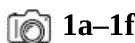

## Chapter 17
Web Components, E-mail, and Instant Messaging

## Lab Exercises

+   17.01  E-mail Headers
+   17.02  SPF, DKIM, and DMARC
+   Lab Analysis
+   Key Term Quiz

Web components that provide functionality through browsers include many protocols, especially those related to e-mail. When you use Gmail through a browser, for example, you are using Internet Message Access Protocol (IMAP) to retrieve e-mail messages from a mail server and Simple Mail Transfer Protocol (SMTP) to send e-mail to a mail server.

## Note

Post Office Protocol version 3 (POP3) is an older, less capable, and inferior protocol, compared to IMAP, used to retrieve e-mail messages. Interestingly, it’s often referred to as POP3 instead of simply POP, whereas IMAP is almost always referred to as IMAP instead of IMAP4 (its current version).

There are many client and server programs used by IMAP and SMTP, and their acronyms all start with M and end with A, as you’ll see shortly.

As you work through the lab exercises in this chapter, keep in mind that

most of what you’ll see and do in regard to e-mail can be applied to instant messaging (IM). However, instead of e-mail inboxes and directories on servers, IM is more…instant…sending text and images from an IM client application on your machine to another IM client application running on someone else’s machine.

60 MINUTES

## Lab Exercise 17.01: E-mail Headers

An e-mail header is like a log file because it chronicles the journey an e-mail takes as it passes through multiple mail servers.

These mail servers are known as Simple Mail Transfer Protocol (SMTP) servers because they use SMTP to send and receive e-mails. A user uses an e-mail client, also known as a mail/message user agent (MUA), such as Mozilla Thunderbird (which you used in Chapter 6), running a mail/message transfer agent (MTA) client to send e-mail messages to its SMTP server, which runs an MTA server.

The SMTP server of the client’s domain will issue a Domain Name System (DNS) query for the MX (mail exchanger) resource record of the e-mail recipient domain’s SMTP server. After the MX response arrives, in the form of a fully qualified domain name (FQDN), another DNS query will be issued by the SMTP server of the client’s domain, this time for the destination domain’s SMTP server’s IP address, through a DNS A (IPv4 host address) resource record. When that response arrives, the sending domain’s SMTP server (now acting as an MTA client) will send the e-mail to the destination domain’s SMTP server (acting as the MTA server for the sending domain’s SMTP server). At that point, a mail/message delivery agent (MDA), also known as a local delivery agent (LDA), will place the e-mail in a directory on a server for the e-mail recipient.

The recipient will check their e-mail by using a mail access agent (MAA), which accesses the directory where the MDA placed the e-mail. The older, obsolete POP3 MAA shouldn’t be used today. Instead, you should use either IMAP4 (Internet Control Message version 4) or one of Microsoft’s two protocols: MAPI (Messaging Application Programming Interface) or EAS


（Exchange ActiveSync）。

电子邮件头应自下而上阅读。下面是一个标准邮件头示例（不包含扩展，稍后将会讨论），它展示了一封从 noah@starwars.com 发送到 jacob@beatles.com 的电子邮件。此示例中的 IP 地址是私有 IP 地址，因此无法在互联网上路由。

```
Delivered-To: jacob@beatles.com
Received: by 10.1.2.3 with SMTP id PeNnyLaNe67; Wed, 12 Aug 2020 13:06:52 -0400 (EDT)
Return-Path: noah@starwars.com
Received: from mail.starwars.com (mail.starwars.com [172.16.17.18]) by mx.beatles.com with SMTP id RoTs05.2020.08.12.13.06.52; Wed, 12 Aug 2020 13:06:52 -0400 (EDT)
Message-ID: <20200812130650.10314.mail@mail.starwars.com>
Received: from [192.168.1.108] by mail.starwars.com via HTTP; Wed, 12 Aug 2020 13:06:50 EDT
Date: Wed, 12 Aug 2020 13:06:50 -0400 (EDT)
From: Noah Weissman <noah@starwars.com>
Subject: This is for Daddy’s book!
To: Jacob Weissman <jacob@beatles.com>
```

邮件头会在三个时间点被添加到电子邮件中。第一个是 Noah 发送电子邮件时：

```
Date: Wed, 12 Aug 2020 13:06:50 -0400 (EDT)
From: Noah Weissman <noah@starwars.com>
Subject: This is for Daddy’s book!
To: Jacob Weissman <jacob@beatles.com>
```

Date: 和 From: 字段会自动填充，而 Subject: 和 To: 字段由 Noah 手动输入。

第二个时间点是电子邮件到达 Noah 的 SMTP 服务器 mail.starwars.com 时：

```
Message-ID: <20200812130650.10314.mail@mail.starwars.com>
Received: from [192.168.1.108] by mail.starwars.com via HTTP; Wed, 12 Aug 2020 13:06:50 EDT
```

365 是唯一一种通过 X-Originating-IP 标头字段包含源 IP 地址的基于 Web 的电子邮件服务。Gmail、Yahoo 以及所有其他服务都不包含它。原因可以归结为 2013 年 Microsoft Answers 论坛中的一则回复：

> 请注意，Microsoft 已选择屏蔽 X-Originating IP 地址。这是 Microsoft 方面为了保障客户的福祉与安全而计划进行的更改。

不过请记住，电子邮件头中的某些字段可以被伪造，而源 IP 地址就是非常容易被伪造的字段之一。

## 学习目标

在本实验练习中，你将探索电子邮件头。完成本实验练习后，你将能够：

- 查找任何域的 SMTP 服务器的完全限定域名（FQDN）和 IP 地址
- 阅读并解读电子邮件头

## 实验材料与设置

完成本实验所需的材料如下：

- *《计算机安全原理：CompTIA Security+ 及超越》*教科书
- 任意装有命令行界面（CLI）且可连接互联网的操作系统
- 可连接互联网的网页浏览器
- 一个 Gmail 帐户

## 开始动手吧！

你将同时使用 CLI 和图形用户界面（GUI）来获取与电子邮件相关的不同类型的信息。让我们马上开始吧！



## 1c

第 1 步 要发现有关 SMTP 服务器的信息，你将使用 nslookup——一种用于发出特定 DNS 查询的网络/系统管理工具。这将模拟发送方的 SMTP 服务器如何发现目的地的 SMTP 服务器，并随后将电子邮件发送到目标域。

- a. 在 Windows 机器上打开命令提示符（或在 Linux 或 Mac 机器上打开终端，因为本章的实验练习可在任何平台上运行），然后输入

```
nslookup
```

以使用 nslookup 的交互模式。

- b. 要设置对 MX DNS 资源记录的查询，请输入以下内容：

```
set q=mx
```

- c. 现在指定你想查看其 SMTP 服务器的域。输入以下内容以发现 rit.edu 域的 SMTP 服务器，包括末尾的圆点，它指向 DNS 层次结构的根（如果没有末尾的圆点，你将无法获得预期结果）：

```
rit.edu.
```

你看到了多少个 RIT SMTP 服务器？

- d. 要获取 SMTP 服务器的 IP 地址，只需查询每台服务器的 A 资源记录即可。首先使用以下命令将查询类型改为 A：

```
set q=a
```

- e. 输入其中一个 RIT SMTP 服务器的 FQDN（无论末尾是否有圆点，此命令都会以相同方式工作）：

```
mx03c-in01r.rit.edu.
```

你应该会看到该 RIT SMTP 服务器的 IP 地址是 129.21.3.13。

- f. 用类似的方式，查找 FLCC SMTP 服务器的 MX 和 A 记录。

另一个网站。

- a. 前往 https://www.iptrackeronline.com/email-header-analysis.php 并粘贴另一个完整的电子邮件头。
- b. 点击“Submit Header For Analysis”按钮。
- c. 这个工具与之前的那个工具相比如何？

60 分钟

## 实验练习 17.02：SPF、DKIM 与 DMARC

垃圾邮件和网络钓鱼占了互联网上每日发送流量的大部分。美国国家标准与技术研究院（NIST）对垃圾邮件的定义如下：

> 电子垃圾邮件，或滥用电子消息系统不加区分地发送未经请求的群发消息。

垃圾邮件是未经请求的电子邮件，以群发方式同时发送给许多收件人。它也被称为垃圾邮件（junk mail），其主要目的是以陌生推销的方式，在互联网上向成百上千甚至更多的人销售产品或服务。

垃圾邮件也可以通过即时通讯（IM）或短信服务（SMS）发送。

垃圾邮件发送者从公开来源和数据库中收集电子邮件地址，甚至利用规律来生成可能的电子邮件地址（例如，bob1@gmail.com、bob2@gmail.com、bob3@gmail.com 等等）。

垃圾邮件的内容可以是产品广告、优惠券、推销信函、新闻通讯等等。垃圾邮件本质上是商业性的，不一定是恶意的。一些垃圾邮件定义包含了网络钓鱼的特征，甚至包括传播恶意软件的概念。

“spam”一词实际上源自 Monty Python 的一个短剧。你可以在 https://en.wikipedia.org/wiki/Spam_(Monty_Python) 阅读相关内容，并在 YouTube 上找到它的视频。

NIST 对网络钓鱼的定义如下：

> 一种通过电子邮件或网站中的欺诈性请求来尝试获取敏感数据（如银行账户号码）的技术，其中实施者伪装成合法企业或信誉良好的人。

垃圾邮件是商业性的、未经请求且不受欢迎的，而网络钓鱼则具有恶意设计，旨在对个人和企业造成伤害并窃取信息。钓鱼者会设计出看似来自可信发件人的合法电子邮件。钓鱼电子邮件旨在收集银行账户信息、用户名和密码，以及其他有助于窃取身份、盗取钱财并尽可能在多个层面上破坏机密性的信息。此外，恶意软件也会通过钓鱼电子邮件传播。

## 交叉引用

你在第 4 章中详细学习了网络钓鱼，并且实际上还发送了一封自己的钓鱼电子邮件。

为了阻止垃圾邮件和钓鱼电子邮件，已确立了三项标准。首先，发件人策略框架（SPF）允许将某个域的 SMTP 服务器公开发布为该域经授权的电子邮件发件人。其次，域名密钥识别邮件（DKIM）使用数字签名来验证消息来源，并确保电子邮件的完整性。第三，基于域的消息认证、报告与一致性（DMARC）允许域所有者告知接收邮件服务器：如果收到来自该域的伪造电子邮件，应如何处理。

## 学习目标

在本实验练习中，你将获得有关 SPF、DKIM 和 DMARC 的知识和实践经验。完成本实验练习后，你将能够：

- 理解 SPF 并查询 SPF 记录
- 理解 DKIM 并查询 DKIM 记录
- 理解 DMARC 并查询 DMARC 记录


RIT 地址的前两个八位组仍然以 129.21 开头。

b. 接下来，在输出中你会注意到一堆以 `_spf` 开头、后跟数字的子域。例如，第一个是 `include:_spf1.rit.edu`。

让我们在 **nslookup** 中查询该特殊子域的 TXT 资源记录，就好像它是一个真实域一样，输入以下内容（查询类型仍设置为 txt，因此无需再次指定）：
`_spf1.rit.edu`。

除 RIT 地址块外，其他被授权代表 RIT 客户端发送电子邮件的 IP 地址和子网掩码将显示在输出中。使用位于 https://whois.arin.net/ui/ 的 ARIN.net Whois 查询工具，你可以将这些地址与其对应的公司关联起来。以下是一些示例：

+   104.47.0.0/17 Microsoft
+   108.166.43.0/24 Webmail – ORD1c
+   13.111.0.0/18 Xerox Corporation
+   136.147.176.0/20 Salesforce.com, Inc.
+   148.87.89.36 Oracle Corporation

主机名由字母、数字和短划线符号组成，其他字符均无效。由于域名可以由字母、数字和任意符号组成，因此选择下划线来避免域名被误认为主机名。因此，`_spf1.rit.edu` 可以作为一个包含 SPF 策略的域使用，而不必担心存在名为 `_spf1` 的主机。

c. 在 rit.edu 的 TXT 资源记录的 SPF 输出末尾，你会注意到 `~all`。

这意味着，所有不符合所列任何条件的其他电子邮件都应视为软失败（soft fail）。在这种情况下，邮件不会被过滤，但接收域的邮件服务器可以将该软失败与其他指标结合使用，以判断该电子邮件实际上是否为垃圾邮件。微软、谷歌和苹果等公司使用软失败，因为有第三方供应商会代表这些公司发送调查、新闻通讯等邮件。

硬失败由 `-all` 表示（即用短划线替换波浪号），它会导致电子邮件被拒绝并当场丢弃。银行可能会使用硬失败选项，因为利用伪造发件人的钓鱼攻击可能造成巨大损害。其逻辑是，能够代表银行发送电子邮件的 IP 地址不应很多。不过，硬失败可能导致误报。SPF 在邮件转发服务和邮件列表方面存在问题，这可能导致在设置硬失败后邮件被丢弃。

SPF 实际上并不指示接收邮件服务器如何处理未通过 SPF 检查的电子邮件。虽然发送域可以指定 `-all` 导致硬失败，但实际上并非所有接收邮件服务器都会遵循这一点。有趣的是，SPF 验证的不是电子邮件中的 `From:` 字段，而是 `Return-Path` 值，即任何关于投递问题的退信消息应发送到的地址。

该邮件可以被记录到日志中，然后被丢弃或移至垃圾邮件。

在本实验练习的后面部分，我们将看到 DMARC 开始登场，帮助接收邮件服务器确定为未通过 SPF 的电子邮件采取的下一步行动。

公司使用 SPF 作为其中一个因素（与其他因素一起），以决定如果电子邮件未通过 SPF 时应如何处理该邮件。

以下是来自 https://hi.service-now.com/kb_view.do?sysparm_article=KB0755173 的一个示例：

你的 ServiceNow 电子邮件中继系统使用 SpamAssassin，通过基于多项垃圾邮件测试分配分数来判断电子邮件是否为垃圾邮件。

SPF 检查在很大程度上影响邮件的垃圾邮件评分。邮件要被标记为垃圾邮件，其总评分必须达到 6.2 或更高。SPF 软失败会为评分增加 3.5，而 SPF 硬失败会为评分增加 7.0，因此会立即将其标记为垃圾邮件。建议检查并确保你所在公司的 SPF 记录正确且为最新，否则某些邮件可能会被无意中标记为垃圾邮件。

以下是来自 https://portal.smartertools.com/community/a616/mail-rejected-due-to-smtp-spam-blocking-spf-fail.aspx 的提醒：

首先，你绝不应仅凭任何一项测试就进行 SMTP 拦截。没有哪项测试是 100% 准确的；如果你打算进行 SMTP 拦截，应要求邮件至少未通过两项测试。

其次，如果你因 SPF 失败而进行 SMTP 拦截，将会拦截大量只是通过不支持 SRS 的服务器转发的有效邮件。

除了 `~all` 和 `-all`，`+all` 表示通过（不推荐，因为它允许任何服务器代表某个域发送电子邮件），`?all` 表示中性，等同于无匹配结果（也不推荐）。

让我们输入以下内容来查看 chase.com 域如何使用 SPF（查询类型仍设置为 txt，因此无需再次指定）：

```
chase.com.
```

在输出中找到与 SPF 相关的条目：

```
"v=spf1 a:spf.jpmchase.com ip4:207.162.228.0/24 ip4:207.162.229.0/24 ip4:207.162.225.0/24 ip4:196.37.232.50 ip4:159.53.46.0/24 ip4:159.53.36.0/24 ip4:159.53.110.0/24 ip4:159.53.78.0/24 include:tpo.chase.com -all"
```

这里的 `a:spf.jpmchase.com` 表示，如果该域存在 `spf.jpmchase.com` 的 A 记录，则 SPF 检查通过。

让我们输入以下内容来验证一下：

```
set q=a
spf.jpmchase.com.
```

如响应所示，有多个 IPv4 地址可以满足此条件从而使 SPF 通过。

`ip4` 之后的 IP 地址及相应的子网掩码表示，如果电子邮件是从其中任意一个地址发送的，则 SPF 检查通过。`include:tpo.chase.com` 指定了一个子域，其中的其他地址可以代表 chase.com 发送电子邮件。要查看这些 IP 地址，请在 nslookup 提示符下输入以下命令（包括将查询类型从上一次的 A 资源记录查询改回 TXT 资源记录）：

```
set q=txt
tpo.chase.com.
```

注意输出中的新 IP 地址：

```
"v=spf1 ip4:68.233.76.14/32 ip4:63.150.74.35/32 ip4:198.64.159.0/24 ip4:198.104.137.206/32 ip4:161.58.88.0/24 -all"
```

最后，注意末尾的 `-all`，这表示 chase.com 采用的是硬失败策略。

要查看 MX 记录允许 SPF 检查通过的示例，请输入以下命令（查询类型仍设置为 txt，因此无需再次指定）：

```
syr.edu.
```

雪城大学的 SPF 配置显示如下：

```
"v=spf1 mx:spf.syr.edu include:spf.protection.outlook.com -all"
```

第一部分 `mx:spf.syr.edu` 表示，如果 `spf.syr.edu` 存在 MX 资源记录（并且该域是列出的发件人），则 SPF 检查通过。

让我们输入以下命令来确认这一点：

```
set q=mx
spf.syr.edu.
```

你会从输出中注意到，多个 MX 资源记录与 `spf.syr.edu` 相关联，这将使 SPF 检查通过。

d. 在 Gmail 中打开你之前实验练习中的一封电子邮件，并查看完整标头。你应该会在 `ARC-Authentication-Results:` 部分看到 `spf=pass` 以及更多信息。

例如，当我从我的 RIT 账户向我的 Gmail 账户发送一封电子邮件时，标头包含以下内容：

仅当你当前不在 **nslookup** 中，或者你虽然在 **nslookup** 中但上一次查询的是 TXT 以外的资源记录时，才需要第一条命令：

```
set q=txt
rit1608._domainkey.rit.edu.
```

第二条命令会根据你选择的电子邮件而有所不同。`_domainkey` 之前的第一部分是在 `s=` 值中指定的选择器。选择器非常晦涩难懂，即使很短，也无法猜测。然后，`_domainkey` 是必需的，后面跟着 `d=` 值中指定的域。

以下是我从第二条 **nslookup** 命令获得的输出：

```
"v=DKIM1;
p=MIGfMA0GCSqGSIb3DQEB AQUAA4GNADCBiQKBgQDXq97I7+PXPn39GE0fTg3Ypn3Gmtr
A2LsQCNj+q2iyK0Cewa1H9RiM7bF7SbrDFzFF2iQv1PPcHfBpBihpnnnPx
r5txK+UZDEb5b9VDyUr+MC
Wsk7l4w8Fr6DA8Bwn4X5Ykzp6rvJe0AFofG8d/0dhxQyA/1Rg23aXE6ee6
SQjFQIDAQAB;"
```

字段及其值如下：

+   - **v=** DKIM 版本（始终为 1）
+   - **p=** 公钥

接收电子邮件服务器使用该公钥解密加密的哈希值。之后，接收邮件服务器自行计算哈希值。如果计算出的哈希值与解密后的哈希值匹配，则允许邮件继续其投递旅程。这是因为，加密的哈希值如果能用发送者的公钥解密，那么它只能是用发送者的私钥加密的，而只有发送者才拥有这把私钥。

官方 DKIM 标准建议至少每六个月更换一次 DKIM 密钥并撤销旧密钥，让新旧密钥之间保留一小段重叠时间。


# **步骤 4** DMARC 是第三种电子邮件安全机制，它实际上


_dmarc.paypal.com.

你将看到以下输出：

```
"v=DMARC1; p=reject; rua=mailto:d@rua.agari.com; ruf=mailto:d@ruf.agari.com"
```

现在试试这个：

```
_dmarc.linkedin.com.
```

你将看到以下输出：

```
"v=DMARC1; p=reject; rua=mailto:d@rua.agari.com; ruf=mailto:d@ruf.agari.com; pct=100"
```

字段及其值如下：

**v=** DMARC 版本（始终为 1）。

**p=** 当 DMARC 身份验证失败时，接收邮件服务器应应用的策略。适用于主域和所有子域，除非包含可选的 sp 标签。三种可能的策略值是 none、quarantine 和 reject。

**rua=** 告诉接收邮件服务器将聚合报告发送到何处，这些报告以 XML（可扩展标记语言）格式提供，有助于深入了解你的电子邮件基础设施，通过识别身份验证可能存在的问题甚至恶意活动。

**ruf=** 告诉接收邮件服务器将具有 DMARC 违规的电子邮件的删节取证副本发送到何处。与显示电子邮件流量的 RUA 报告不同，RUF 报告包含电子邮件的片段。由于隐私问题，删节并不理想，因此这种报告已不再常用。医疗、金融和政府行业不会要求此项，以免将来因删节不够完善而承担责任。

**pct=** 应用 DMARC 策略的消息百分比。这允许公司逐步实施和监控策略及其可能产生的影响。取值范围为 1 到 100，100 为默认值。

以下是其他一些 DMARC 字段和值：

**fo=** 告诉接收邮件服务器向你发送电子邮件样本以
