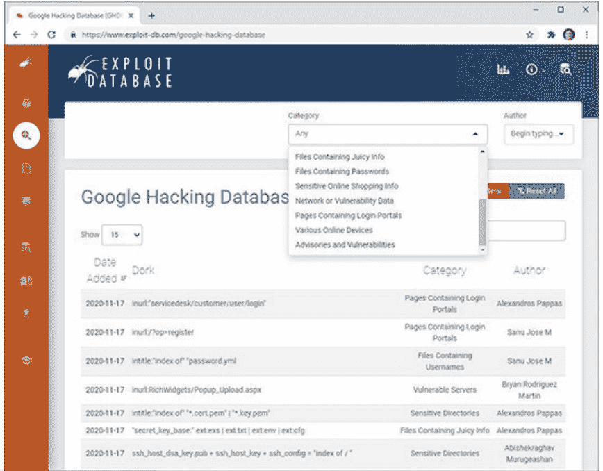

# Chapter 24
法律问题与伦理

# Lab Exercises

- 24.01 ACM Ethics
- 24.02 USENIX Ethics
- 24.03 Ethical Scenarios
- 24.04 Copyright
- 24.05 Creative Commons
- 24.06 FSF and GNU
- Lab Analysis
- Key Term Quiz

伦理和道德都与“正确”和“错误”的行为有关。伦理是一套适用于个人或群体的行为原则，由外部来源提供，例如社会或职业。另一方面，道德是个体自身关于对错的原则。

以下是四个众所周知的伦理标准：

- **Rights** 个人的基本需求和福祉
- **Justice** 某项行动或政策的成本和收益如何在群体成员之间公平分配
- **Utility** 某项行动或政策对公众产生的积极和消极影响
- **Care** 我们与其他个人的关系

- 了解 ACM 伦理与职业行为准则
- 将 ACM 伦理与职业行为准则与你自己的经验联系起来

# Lab Materials and Setup

你需要完成本实验的材料有

- *Principles of Computer Security: CompTIA Security+ and Beyond* 教科书
- 带有互联网连接的网络浏览器

# Let’s Do This!

阅读 ACM 伦理与职业行为准则（版权所有 © 2018 由 Association for Computing Machinery）中列出的每项内容及其描述（参考 https://ethics.acm.org/）。对于每项内容，给出一个你作为计算专业人员在伦理或非伦理方面的例子。如果你从未遇到过所描述的情况，请提及这一点，但同时也添加你对所描述内容的想法。

1–4

Step 1 Give an example of where you, as a computing professional, acted ethically or non-ethically relating to these general ethical principles identified by the ACM.

# 1. GENERAL ETHICAL PRINCIPLES.

*A computing professional should...*

- 1.1 Contribute to society and to human well-being, acknowledging that all people are stakeholders in computing.
- 1.2 Avoid harm.
- 1.3 Be honest and trustworthy.
- 1.4 Be fair and take action not to discriminate.
- 1.5 Respect the work required to produce new ideas, inventions, creative works, and computing artifacts.

1.6 Respect privacy.
1.7 Honor confidentiality.

Step 2 Give an example of where you, as a computing professional, acted ethically or non-ethically relating to these professional responsibilities identified by the ACM.

# 2. PROFESSIONAL RESPONSIBILITIES.

A computing professional should...

- 2.1 Strive to achieve high quality in both the processes and products of professional work.
- 2.2 Maintain high standards of professional competence, conduct, and ethical practice.
- 2.3 Know and respect existing rules pertaining to professional work.
- 2.4 Accept and provide appropriate professional review.
- 2.5 Give comprehensive and thorough evaluations of computer systems and their impacts, including analysis of possible risks.
- 2.6 Perform work only in areas of competence.
- 2.7 Foster public awareness and understanding of computing, related technologies, and their consequences.
- 2.8 Access computing and communication resources only when authorized or when compelled by the public good.
- 2.9 Design and implement systems that are robustly and usably secure.

Step 3 Give an example of where you, as a computing professional, acted ethically or non-ethically relating to these professional leadership principles identified by the ACM.

# 3. PROFESSIONAL LEADERSHIP PRINCIPLES.

Leadership may either be a formal designation or arise informally from influence over others. In this section, “leader” means any member of an organization or group who has influence, educational responsibilities, or managerial responsibilities. While these principles apply to all computing professionals, leaders bear a heightened responsibility to uphold and promote them, both within and through their organizations.

*A computing professional, especially one acting as a leader, should...*

- 3.1 Ensure that the public good is the central concern during all professional computing work.
- 3.2 Articulate, encourage acceptance of, and evaluate fulfillment of social responsibilities by members of the organization or group.
- 3.3 Manage personnel and resources to enhance the quality of working life.
- 3.4 Articulate, apply, and support policies and processes that reflect the principles of the Code.
- 3.5 Create opportunities for members of the organization or group to grow as professionals.
- 3.6 Use care when modifying or retiring systems.
- 3.7 Recognize and take special care of systems that become integrated into the infrastructure of society.

**Step 4** Give an example of where you, as a computing professional, acted ethically or non-ethically relating to compliance with the ACM code.

# 4. COMPLIANCE WITH THE CODE.

*A computing professional should...*

- 4.1 Uphold, promote, and respect the principles of the Code.
- 4.2 Treat violations of the Code as inconsistent with membership in the ACM.

60 MINUTES

# Lab Exercise 24.02: USENIX Ethics

本实验练习还涉及分析伦理的良好基础。USENIX 支持先进的计算系统社区，并致力于推动创新研究的覆盖范围。虽然以组织会议和发表研究而闻名，但其最强大的优势在于在计算系统中建立社区。欲了解更多背景信息，请查看 USENIX 的网站 www.usenix.org/about。

# Note

USENIX 最初在 1975 年成立时被称为 Unix Users Group。1977 年，名称更改是因为他们被告知 UNIX 已被商标化。此后，他们一直是 USENIX：The Advanced Computing Systems Association。USENIX 不是缩写。

另请阅读关于 2016 年 LISA 特别兴趣小组（SIG） for Sysadmins 退役的文章，网址为 www.usenix.org/blog/refocusing-lisa-community。

如今，LISA 指的是大型安装系统管理大会（www.usenix.org/conferences/byname/5）。

最后，调查 League of Professional System Administrators（LOPSA）网站 https://lopsa.org/。LOPSA 推动系统管理实践，通过与系统管理问题相关的教育和外联为公众服务。从业者得到支持、认可、教育并受到鼓励。

# Learning Objectives

在本实验练习中，你将探索由 USENIX、LISA 和 LOPSA 于 2006 年共同签署的 USENIX 系统管理员伦理准则。在本实验练习结束时，你将能够

- 了解 USENIX 系统管理员伦理准则
- 将 USENIX 系统管理员伦理准则与你自己的经验联系起来

# Lab Materials and Setup

你需要完成本实验的材料有

如果你尚未发现自己陷入道德困境，那么很可能在某个时候你会遇到。角色扮演并模拟可能的道德场景是为此类不可避免的情况做准备的好方法。

## 学习目标

在本实验练习中，你将探索各种道德场景。完成本实验练习后，你将能够

- 理解各种道德场景
- 分析各种道德场景

## 实验材料和设置

本实验所需的材料包括

- *《计算机安全原理：CompTIA Security+及进阶》* 教科书
- 具有互联网连接的网页浏览器

## 让我们开始吧！

分析以下涉及道德困境的场景。对于以下每个场景，你应该执行以下任务：

- 识别道德困境。
- 列出风险、问题、难题和后果。
- 列出所有利益相关者（有利益关系、能够影响或受影响的人）及其权利。
- 描述可能的行动以及这些行动可能对利益相关者产生的影响。
- 找到至少一条适用于每个场景的ACM道德规范条款。

1–8

### 步骤1 电子邮件

## 学习目标

- 理解合理使用原则
- 理解商标、专利和版权之间的区别

## 实验材料和设置

本实验所需的材料包括

- *《计算机安全原理：CompTIA Security+及进阶》* 教科书
- 具有互联网连接的网页浏览器

## 让我们开始吧！

1998年《版权期限延长法案》（也称为《桑尼·波诺版权期限延长法案》、《桑尼·波诺法案》，甚至《米老鼠保护法案》）将1923年或之后创作且于1998年仍受版权保护的作品的版权期限延长至至少2019年。

根据该法案，1923年或之后创作且于1998年仍受版权保护的作品要到2019年或之后才会进入公有领域。

由于米老鼠于1928年首次亮相，2024年标志着以米老鼠为主角的作品首次进入公有领域。根据产品出现的日期，可能会更晚。

3–6

### 步骤1 阅读这篇关于米老鼠如何逃避进入公有领域的文章：

https://priceonomics.com/how-mickey-mouse-evades-the-public-domain/

### 步骤2 阅读这些关于为什么米老鼠这次不太可能逃避进入公有领域的文章：

https://mentalfloss.com/article/524325/why-mickey-mouse-could-soon-be-public-domain

https://arstechnica.com/tech-policy/2018/01/hollywood-says-its-not-

## 学习目标

在本实验练习中，你将探索知识共享许可。完成本实验练习后，你将能够

- 识别不同的知识共享许可
- 基于原创想法选择知识共享许可

## 实验材料和设置

本实验所需的材料包括

- *《计算机安全原理：CompTIA Security+及进阶》* 教科书
- 具有互联网连接的网页浏览器

## 让我们开始吧！

知识共享提供许可和公有领域工具，允许个人和组织授予创意和学术作品的版权许可，确保有适当的署名，并允许其他个人和组织复制、分发和使用这些作品。请浏览知识共享网站 https://creativecommons.org/about/ 以了解更多背景信息。

1–3

### 步骤1 解释此处找到的每种不同类型的许可：

https://creativecommons.org/licenses/

### 步骤2 阅读以下内容并解释CC0与其他许可的不同之处：

https://creativecommons.org/share-your-work/public-domain/cc0/

### 步骤3 描述一个你正在考虑创作的作品（或者随便编一个）。使用此页面，最终得到的许可是什么？

https://creativecommons.org/choose/

60分钟

## 实验练习24.06：FSF和GNU

访问FSF网站 www.fsf.org。自由软件基金会（FSF）倡导计算机用户自由并捍卫所有软件用户的权利。

我们巡游的另一站是GNU操作系统网站 www.gnu.org/home.en.html。GNU操作系统是保护计算机用户自由的自由软件。它由GNU软件包和其他人设计的自由软件组成。

## 学习目标

在本实验练习中，你将探索FSF和GNU的宗旨。完成本实验练习后，你将能够

- 理解自由软件基金会的动机
- 理解GNU代表什么

## 实验材料和设置

本实验所需的材料包括

- *《计算机安全原理：CompTIA Security+及进阶》* 教科书
- 具有互联网连接的网页浏览器

## 让我们开始吧！

以下关于自由软件的解释来自 www.gnu.org/philosophy/free-sw.en.html：

如果一个程序的用户拥有四项基本自由，那么该程序就是自由软件：

- 出于任何目的，按照你的意愿运行该程序的自由（自由0）。
- 研究该程序如何工作，并对其进行修改，使其按照你的意愿进行计算（自由1）。访问源代码是实现这一点的前提。
- 重新分发副本的自由，以便你可以帮助他人（自由2）。
- 向他人分发你的修改后副本的自由（自由3）。通过这样做，你可以让整个社区从你的修改中受益。访问源代码是实现这一点的前提。

关于自由编号从0开始的原因，可以在网页底部的脚注中找到。

1–4

### 步骤1 描述GNU项目和GNU系统之间的区别，如这里所解释的：

https://www.gnu.org/gnu/gnu-history.en.html

### 步骤2 解释这里列出的不同GNU许可：

https://www.gnu.org/licenses/licenses.html

### 步骤3 分享你对理查德·斯托曼这个视频的看法：

https://youtu.be/Ag1AKIl_2GM

### 步骤4 自由软件基金会强烈宣称“自由软件”和“开源”不是一回事，如这里所述：

https://www.gnu.org/philosophy/open-source-misses-the-point.en.html

这是另一方的说法：

https://opensource.com/resources/what-open-source

两者之间的区别是什么？

## 实验分析

1. 什么是ACM？
2. 什么是USENIX？
3. 米老鼠保护法案阻止了米老鼠进入________。
4. 一套与“正确”和“错误”行为相关的行为准则被称为________。
5. 自由软件基金会将自己的信念与________软件区分开来。
6. 在大学课程中使用本书的一部分，可能属于被称为________的原则。

物联网（IoT）代表了具有传感器、软件等并与其他设备通信的非传统计算设备。它们可以在智能家居、车辆以及各种组织中找到，包括医疗保健、交通运输、制造业、农业、海事、基础设施（城市、能源和环境）、军事等等。

许多物联网设备出于各种原因几乎没有或没有安全性。实现安全性的财务成本可能使设备利润降低。安全性与便利性和易用性成反比（就像跷跷板一样，一侧上升，另一侧下降），因此一些制造商尽量让物联网设备对用户简单易用，担心一些客户会因为认为设备难以使用和配置而不购买。与其他设备相比，物联网设备没有太多的RAM和CPU能力，因此无法支持某些安全机制。许多设备使用默认密码，而这些密码只需一次简单的网络搜索就能找到。有些设备在设计时完全没考虑安全性，实际上完全没有安全性！有些物联网设备需要人工启动升级或安全补丁（这并不能保证），而其他设备甚至不具备更新能力。

现在考虑一下，物联网设备始终连接到互联网，不断收集大量数据信息，并在几乎没有或没有安全性、使用不安全协议的网络上运行。

我最喜欢的一个故事是关于一家赌场通过其联网的鱼缸温度计被黑客入侵。在这里阅读：https://thehackernews.com/2018/04/iot-hacking-thermometer.html。

有一个著名的梗：“物联网中的S代表安全”，现在应该完全明白了。

Shodan的最大用户实际上不是网络罪犯，而是网络安全专家、渗透测试人员、学术研究人员、执法部门和政府。

数十亿设备可在线访问。这些设备可以通过横幅信息轻松识别。这些横幅包含有关设备软件的元数据，包括版本和支持的选项，以及欢迎消息、警告消息等。通过横幅，Shodan能够识别这些设备的详细信息，包括品牌和型号。横幅甚至可能表明使用了哪些身份验证机制，或

如果禁用了身份验证。横幅因创建者不同以及设备提供的服务类型而有所不同。当这些信息与地理信息、互联网服务提供商（ISP）信息以及从 IP 地址获取的其他信息相结合时，就能勾勒出设备的清晰图景。这一清晰图景可能包括可以被轻易利用的设备漏洞，例如无法更改的硬编码密码和制造商创建的后门。Shodan 是一个很棒的工具，可以帮助找到这些易受攻击的设备，最终实现对它们的保护。

Shodan 甚至可以收集统计数据并计算测量值。例如，Shodan 可以指出哪些国家之间的互联越来越多，使用最多的是哪个版本的 Apache，甚至有多少设备容易受到新型恶意软件的攻击。

研究人员 Dan Tentler 在 2013 年使用 Shodan 发现的一些物联网设备——该服务在 2008 年首次亮相后五年——包括交通灯控制、交通摄像头、游泳池酸泵、水电站、酒店酒柜、医院心率监测仪、家庭安全应用、缆车和洗车场。在交通灯控制的情况下，横幅中可见警告信息“DEATH MAY OCCUR!!!”。如果 Tentler 想这样做，他本可以轻松地将灯光置于“测试”模式并造成难以想象的损害！为什么？令人难以置信的是，这些控制装置根本不需要登录凭据。

您可以在 https://money.cnn.com/gallery/technology/security/2013/05/01/shodan-most-dangerous-internet-searches/index.html 阅读更多关于这些发现的内容。

在 2016 年初宣布的进一步研究中，Tentler 发现了显示大麻种植园的网络摄像头、银行后室、房屋内部房间（包括厨房、客厅和车库）、房屋外部区域（包括前院和后院）、公共场所如滑雪场和游泳池、大学和学校的学生、实验室，甚至零售店内的收银机。

2013 年，另一位研究人员 Shawn Merdinger 详细说明了他使用 Shodan 发现的内容，包括装有易于猜测的用户名/密码组合的在线监控系统的卡特彼勒卡车、胎儿心率监测仪，甚至控制医院神经外科病区的电源开关。

Shodan 扫描返回的数据已经在各种开放端口上可用，即使没有 Shodan 等服务的帮助也是如此。这就是为什么我们说 Shodan 本身什么都不做。它除了显示已经可用的信息外什么都不做。换句话说，Shodan 找到的是已经可用的信息。此外，我们的研究还表明，诸如端口扫描之类的活动并不违法。此类活动在任何方面都不会违反《计算机欺诈和滥用法》中提到的内容。为了举例说明，Google 在定制其搜索结果方面做得非常出色，这些结果实际上基于一个非常具体的算法。完成此操作后，Google 会以 Google 认为对特定在线用户最有益的方式呈现其在互联网上找到的所有信息。现在，我们知道 Shodan 并没有做任何这些。简单搜索结果所做的全部工作就是暴露易受攻击的系统和设备。

以上内容不代表任何官方法律建议。作者和出版商不对与本实验练习相关的任何原因承担责任。这包括但不限于尝试访问和更改任何设备的配置。您可以自行决定如何进行。

### Step 1

您将首先创建一个免费的 Shodan 账户并登录。然后您就可以执行第一次 Shodan 搜索了。

- a. 转到 https://www.shodan.io/，如图 25-1 所示。

## The search engine for Security

Shodan 是世界上第一个面向互联网连接设备的搜索引擎。

Create a Free Account

Getting Started

### Explore the Internet of Things

使用 Shodan 发现您的哪些设备已连接到互联网，它们位于何处以及谁在使用它们。

### See the Big Picture

网站只是互联网的一部分。Shodan 可以找到发电厂、智能电视、冰箱等等！

### Monitor Network Security

跟踪网络上所有可直接从互联网访问的计算机。Shodan 让您了解您的数字足迹。

### Get a Competitive Advantage

谁在使用您的产品？他们位于何处？使用 Shodan 进行实证市场情报。

### 81% of Fortune 100

### 1,000+ Universities

Shodan 在全球范围内被研究人员、安全专业人员、大型企业、CERT 以及介于两者之间的人使用。

### Analyze the Internet in Seconds

Shodan 在全球设有服务器，24/7 爬取互联网以提供最新的互联网情报。谁购买智能电视？哪些国家正在建设最多的风电场？哪些公司受到 Heartbleed 的影响？Shodan 提供了在互联网规模上回答问题的工具。

点击 PayPal 按钮或立即购买按钮，然后通过提交所有所需信息成为会员。那 49 美元的费用是一次性终身会员费。我强烈推荐它。您仍然仅限于通过网站每天进行 200 次搜索。

提交付款后，您将被带到一个页面，其中包含对新项目的访问，包括以下内容：

- *Complete Guide to Shodan* 的数字副本，其中提供了网站和 API 的概述，并解释了所有工作原理
- Shodan API，可完全访问收集的数据
- 增加对 Shodan 地图的访问
- 访问一个新的搜索界面，用于浏览 Shodan 收集的来自许多不同服务（X11、RDP、网络摄像头等）的屏幕截图
- 通过命令行启动扫描、实时监控网络等的能力，以及访问帮助中心、示例命令和简短教程视频

2a–2g

### Step 2

现在您将执行一些特定的查询。

- a. 在 Shodan 搜索栏中，在顶部，输入 **school** 并点击搜索栏右侧的红色 Search 按钮。您会注意到大量结果，包括横幅、IP地址、ISP 信息、城市信息等。在左侧边栏，您会注意到一个世界聚合，类别包括 Top Countries、Top Services、Top Organizations、Top Operating Systems 和 Top Products。如果您点击一个国家，显示将重新排列并按比例显示该国家在其他类别中的统计数据，而 Top Countries 类别将更改为 Top Cities。如果您点击结果窗格中的任何其他项目，结果将相应地与您点击的内容对齐。例如，如果您点击 United

有关搜索查询基础知识的指南可以在此处找到：
https://help.shodan.io/the-basics/search-query-fundamentals

使用这些链接中的信息，构建并执行五个原创查询。为每个查询使用多个标准以产生特定结果。

60 MINUTES

## Lab Exercise 25.02: Insecam

以下内容来自 www.insecam.org：

欢迎来到 Insecam 项目。世界上最大的在线监控安防摄像头目录。选择一个国家观看实时街道、交通、停车场、办公室、道路、海滩、地球在线网络摄像头。现在您可以搜索世界各地的实时网络摄像头。您可以在这里找到 Axis、Panasonic、Linksys、Sony、TPLink、Foscam 以及大量其他无需密码即可在线使用的网络视频摄像头。建议使用 Mozilla Firefox 浏览器观看网络摄像头。

为保护个人隐私，对 Insecam 采取了以下措施：

- 现在只有经过筛选的摄像头可用。这样 Insecam 上的摄像头就不会侵犯任何人的私人生活。
- 任何私人或不道德的摄像头在收到电子邮件投诉后会立即被移除。请提供直接链接以便及时移除摄像头。
- 如果您不想通过电子邮件联系我们，您仍然可以从 Insecam 中移除您的摄像头。您需要做的唯一一件事就是为您的摄像头设置密码。
- 您可以通过以下链接将您的摄像头添加到目录中。它只有在管理员批准后才会可用。

这里有两句话特别引人注目：“如果您不想通过电子邮件联系我们，您仍然可以从 Insecam 中移除您的摄像头。您需要做的唯一一件事就是为您的摄像头设置密码。”

**这不违法吗？** 对于使用默认密码访问的摄像头来说，当然违法。律师 Jay Leiderman 告诉 Motherboard，Insecam “是对《计算机欺诈和滥用法》(CFAA) 的惊人明显违反”，即使其本意是作为公益宣传。“你给计算机设置密码是为了保持其私密性，即使该密码只是‘1’。这就是进入受保护计算机。”

但谁会阻止它呢？*Gawker* 报道称，该域名似乎通过 GoDaddy 注册到莫斯科的一个 IP 地址，这意味着他们不太可能被追踪到。与此同时，该网站声称的匿名管理员坚持向 *Motherboard* 表示，问题的规模值得采取戏剧性行动——并且一个“自动化”流程每周会添加数千个更多摄像头。

不过要记住，Insecam 上展示的任何摄像头都没有密码。以下内容摘自 Insecam 的常见问题解答（www.insecam.org/en/faq/）：

**Q：** 这些摄像头被黑了吗？

**A：** 这些摄像头并未被黑。网站上列出的所有摄像头都没有任何密码保护。

如果你想了解访问 Insecam 的网站访客观看网络摄像头的合法性，请考虑以下来自 www.tnp.sg/news/singapore/unprotected-webcams-streamed-live-web 的内容：

查看 Insecam 上的 feed 并不是非法的。

“仅仅查看 feed 并不构成侵权，”律师 Gloria James-Civetta 表示，她是 Gloria James-Civetta & Co. 律师事务所的管理合伙人。

“这相当于观看一集被非法上传到 YouTube 的电视剧集。”

以上内容不代表任何官方法律建议。作者和出版方不对与本实验练习相关的任何原因承担责任。这包括但不限于尝试访问和更改

**图 25-4 Insecam**

- a. 从三个不同类别中各挑选三个网络摄像头。每个观看 10 分钟。

- b. 解释你从摄像头中观察到了什么以及注意到的隐私问题。如果你没有完成步骤 1a，请解释你预期从三个类别中的摄像头会看到哪些隐私问题。

2a

2b

### 步骤 2

除了 Insecam 之外，还有许多其他展示网络摄像头的网站。在某些网站上，网络摄像头流是有意由摄像头所有者放置在那里的，而在其他网站上，所有者并不知道他们的网络摄像头正在互联网上显示（Insecam 的情况就是如此）。

- a. 使用 Google 找到一个展示有意放置在那里的网络摄像头流的网站。例如（不要使用这个），www.earthcam.com 拥有大量网络摄像头流，类别包括鸟巢季节、城市天际线、湖泊生活、陆地与海洋、热带目的地、旅游热点、动物与动物园、标志性地标等等。

- b. 解释即使在摄像头所有者知道其在互联网上显示的情况下，其中一个网络摄像头如何仍可被网络罪犯或渗透测试人员利用。

60 分钟

## 实验练习 25.03：Google Hacking

像 Shodan 和 Insecam 一样，如果设备具有基于 Web 的界面，Google 也能找到它们。

Google 还能找到什么？相信吗？发票、用户名和密码组合（以及它们所使用的网站）、服务器、数据库、允许目录遍历、文件上传等的网站？Google 还能找到允许远程控制工作站的虚拟网络计算（VNC）客户端和服务器、防恶意软件网关、防火墙、入侵检测系统（IDS）、打印服务器和打印机、网络摄像头、安防摄像头、录像机、路由器和交换机、不间断电源（UPS）监控器、电力系统、互联网协议语音（VoIP）电话、视频会议门户、私人分支交换机（PBX）系统、登录门户、个人照片、联系人列表、浏览器历史文件、Secure Shell（SSH）密钥、整个硬盘、敏感政府文件、信用卡信息（包括 CVV 号）、法庭文件、警察犯罪报告、费用报告、银行账号、社会安全号码、学校和大学花名册和成绩等等。

这怎么可能呢？通过使用高级搜索运算符，这些运算符可以从位于 www.google.com/advanced_search 的表单自动生成，你可以将 Google 搜索变成 Google hacking，也称为 Google dorking。

### 学习目标

在本实验练习中，你将探索 Google hacking。完成本实验练习后，你将能够

- 理解 Google hacking 的工作原理
- 理解保护可通过万维网访问的信息的必要性

### 实验材料和设置

本实验所需的材料有

- 《计算机安全原理：CompTIA Security+ 及更远》教科书
- 具有互联网连接的网络浏览器

### 开始吧！

关于 Google hacking 的合法性存在不同看法，这因发出查询的人的国家和州以及目标

和相应的易受攻击软件，由渗透测试人员和漏洞研究人员使用。我们的目标是提供通过直接提交、邮件列表以及其他公共来源收集的最全面的漏洞利用集合，并以自由可用且易于导航的数据库形式呈现。Exploit Database 是漏洞利用和概念验证的存储库，而非咨询公告，使其成为那些需要立即采取行动数据的宝贵资源。

Google Hacking Database（GHDB）是分类的互联网搜索引擎查询索引，旨在发现有趣的，通常是敏感的，通过互联网公开的信息。在大多数情况下，此类信息本无意公开，但由于多种因素，这些信息被链接到某个网页文档中，被搜索引擎抓取，随后跟随该链接并索引了敏感信息。

- a. 要探索高级搜索查询能发现什么，请访问 www.exploit-db.com/google-hacking-database。
- b. 点击页面右上角的橙色 Filters 按钮并点击下拉箭头以探索类别，如图 25-6 所示。类别包括 Footholds、Files Containing Usernames、Sensitive Directories、Web Server Detection 等。

**图 25-6 筛选 Google Hacking Database**

- c. 当你点击一个实际的 Google dork 时，你将被带到一个包含相关信息的页面，包括作者、描述（附有实际 Google dork 的超链接）以及其他元数据。
- d. 首先查看这个 Google dork：

  `www.exploit-db.com/ghdb/4057`

  它如此简单、合乎逻辑……而且可能具有毁灭性和破坏性。

  使用搜索查询 `intitle:"Index of" "DCIM"`，Google 将返回人们不知道存在的大量图片集合。以下是关于此查询的一些要点：

  - **intitle:** 在浏览器的标题栏中搜索“Index of”。
  - **“DCIM”** 指的是 Digital Camera IMages，是数码相机使用的目录名。由于 DCIM 用双引号括起来，因此必须出现在页面上。

`allintext:username,password filetype:log`

以下是关于此查询的一些要点：

- **allintext:** 匹配同时包含 username 和 password 两个字符串的页面，而 **filetype:** 检查扩展名，仅在扩展名为 .log 时才返回结果。

- **allintext:** 匹配其后所有单词，而 **intext:** 仅匹配其后直接的单词，与 **allintitle:** 和 **intitle:** 的工作方式相同。

- 如果所列单词出现在标题中但未出现在正文中，则该页面不会作为结果返回。因此，**allintext:** 和 **intext:** 本质上与常规 Google 搜索查询相同。

- g. 返回 GHDB（www.exploit-db.com/google-hacking-database），在右侧的 Quick Search 文本框中输入 **FTP**。将出现大量与文件传输协议（FTP）相关的 Google dorks。

  以下查询提供了一种简单的方法来查找 FTP 服务器上的 FTP 目录或托管 FTP 内容的 Web 服务器：

  `intitle:"index of" inurl:ftp`

  此查询在标题栏中查找“index of”，并在实际 URL 中查找“ftp”。

- h. 从不同类别中各挑选五个 Google dorks，并解释它们可能如何危险。可选地，点击实际 Google dorks 的超链接以查看返回了哪些结果。不建议你跟进搜索结果中的任何链接，因为这可能违法，如前所述。

- i. 可以通过 robots.txt 文件防止 Google dorks。网络爬虫必须遵守 robots.txt 排除标准（可在 www.robotstxt.org/orig.html 找到），该标准可以指定网络爬虫忽略你的网站，无论是部分还是全部。虽然主要搜索引擎的网络爬虫确实遵守此规范，但网络罪犯有其他规避方法且不遵守任何规则。

2a–2g

# 第 2 步 通过执行一些无害的高级 Google 搜索来结束本实验练习、章节以及整本书。

+   a. 前往 www.google.com/advanced_search。
+   
+   b. 默认情况下，当你执行 Google 搜索时，Google 假定你希望匹配所有单词。在“All These Words:”文本框中输入三个词，然后点击页面底部的蓝色 Advanced Search 按钮。你会看到它在 Google 搜索栏中只是一个普通的 Google 搜索，没有任何特别之处。结果将包含全部三个词，尽管顺序任意且可在网页的任何位置。点击浏览器的返回按钮返回 Advanced Search 页面并清除之前的输入。
+   
+   c. 将相同的三个词放入“This Exact Word or Phrase:”文本框中，然后点击页面底部的蓝色 Advanced Search 按钮。你会注意到这三个词在 Google 搜索栏中出现了双引号，表明这三个词必须以该字符串的精确形式出现（第一个词、空白、第二个词、空白、第三个词、空白）在网页上。点击浏览器的返回按钮返回 Advanced Search 页面并清除之前的输入。
+   
+   d. 将相同的三个词放入“Any of These Words:”文本框中并点击页面底部的蓝色 Advanced Search 按钮。你会注意到在 Google 搜索栏中第一个词和第二个词之间以及第二个词和第三个词之间存在逻辑“OR”，表明要被包含在结果中，只需网页上出现其中一个词（也可能是两个或三个）。点击浏览器的返回按钮返回 Advanced Search 页面并清除之前的输入。
+   
+   e. 现在，在之前使用过的任何文本框（All These Words、This Exact Word or Phrase 或 Any of These Words）中输入三个新词。这次，也在“None of These Words:”文本框中输入一个或多个词。在“None of These Words:”文本框中选择一个或多个与你在其他文本框中选择的词具有某种联系或关系的词。你会注意到在 Google 搜索栏中你在“None of These Words:”文本框中输入的词或词前面有一个减号，表明满足

autocompletion of IOS commands, 184–185
Automatic Private IP Addressing (APIPA) addresses, 310
autonomous system numbers (ASNs), 186
autonomous systems, 186
Autopsy tool, 587–592
availability
  CIA triad, 20
  cryptography, 96
  privacy, 612
AWS (Amazon Web Services)
  exploring, 479–484
  training and certification, 476–479
AWS Educate, 476–479
AXFR (authoritative transfer), 147, 149
Azure Marketplace, 474–475

B
backbone routers, 186
background command, 557
BadRabbit ransomware attacks, 239
banner information, 614
baselines
  description, 304
  IDSs and IPSs, 279
Bash (Bourne-again shell), 24
basic service set identifiers (BSSIDs), 257
Berkeley Internet Name Domain (BIND) DNS servers, 148
BGP (Border Gateway Protocol), 135, 187
binaries, embedding, 372–376
BIND (Berkeley Internet Name Domain) DNS servers, 148
bind shells, 420
bitstream images in forensics, 586–587
black hat hackers, 540
black swan events, 531

+   block ciphers, 99
+   Boolean logic, 100–101
+   booting switches, 174
+   bootloaders, 165–166
+   Border Gateway Protocol (BGP), 135, 187
+   Bourne-again shell (Bash), 24
+   BPAs (business partnership agreements), 76
+   breaches
+     DBIR, 20, 222
+     e-mail, 123, 223
+     PII, 488
+     plaintext passwords, 150
+     privacy, 612
+     SQL injection, 497
+   broad network access in cloud computing, 466
+   brute force password attacks, 224, 233–238
+   BSSIDs (basic service set identifiers), 257
+   Build a solution section in AWS, 481–482
+   Builtin Administrators group, 329
+   business continuity plans (BCPs)
+     definition, 530
+     key term quiz, 536
+     lab analysis, 535
+     purpose, 531
+     webinars, 532
+   business partnership agreements (BPAs), 76
+   Bypass execution policy option, 517
+   
+   C
+   C language for malware, 362
+   C++ language for malware, 362
+   cables for routers, 188–189
+   cache poisoning in DNS, 136
+   call operator (&) in PowerShell scripts, 525–526

CAM (content addressable memory) tables, 180, 202–203
cameras, discovering, 620–623
capturing keystrokes, 553–554
care standard in ethics, 596
case-sensitivity in Linux, 25
casino hacking, 614
cat command, 32
CC (Creative Commons) licenses, 605–606
cd command
  Meterpreter, 556
  Zsh, 26–27
Cerf, Vint, 400
certificate authorities (CAs) in TLS, 159
certificates
  e-mail cryptography, 125
  TLS, 158–160
certifications
  Amazon Web Services, 476–479
  importance, 4–5
CFAA (Computer Fraud and Abuse Act)
  Insecam, 621
  port scanning, 395–396
  Shodan, 616
chains in rainbow table attacks, 244–246
change management
  components, 530
  COVID-19 effects, 534–535
  key term quiz, 536
  lab analysis, 536
  policy examples, 71
Change permissions, 336
chat servers, creating, 421–424
Check Point ThreatCloud Live Cyber Threat Map, 6–7
Cherokee County Georgia Emergency 911 System, 395–396

+   concatenating
+     database columns, 509–510
+     files, 32–33
+   confidentiality
+     CIA triad, 20
+     cryptography, 96
+     privacy, 612
+   config-register command, 172
+   configure terminal command
+     global configuration mode, 170, 172, 189
+     passwords, 196–197
+   conflicts, ethical, 596
+   confreg command, 171
+   congruent symbol, 114
+   connect scans, 403–405
+   connectivity for Active Directory Domain Services, 308–317
+   contact information in organizational units, 325
+   content addressable memory (CAM) tables, 180, 202–203
+   contiguous namespaces in Active Directory, 305
+   contingency plans, 530
+   continuity of operations plans (COOPs), 530
+   Control Panel for GPOs, 344–346
+   Copy-Item cmdlet, 525
+   copy running-config startup-config command, 170, 199, 206
+   copy startup-config running-config command, 172
+   copying files, 28–29
+   copyright issues, 603–605
+   Copyright Term Extension Act, 604–605
+   costs in forensics, 565
+   COVID-19 pandemic effects
+     business continuity plans, 531–532
+     change management, 534–535
+     disaster recovery plans, 532–533
+   cp command, 28–29

Creative Commons (CC) licenses, 605–606
credential policies, finding examples of, 72
credentials, obtaining in fake sites, 87–88
crossover cable for routers, 188
crunch program, 233–238
cryptanalysis, 96–97
crypto key generate rsa command, 198
cryptography
  applied. See applied cryptography
  asymmetric key encryption, 103–105
  Diffie-Hellman key exchange, 112–114
  hashing, 106–112
  key term quiz, 115
  lab analysis, 115
  overview, 96–97
  symmetric key encryption, 99–103
cryptology
  description, 97
  TLS, 156–160
CSRC (Computer Security Resource Center) glossary
  incident definition, 538
  risk definition, 514
current directory in Zsh, 25–27
CURRENT_USER() function, 508
CurrentUser object in execution policies, 519–520
customized payloads in hping3, 428–433
CVE (Common Vulnerabilities and Exposures) system, 543
cyber threat maps, 5–8
cybercrimes, 564
cybersecurity survey, 8–10

D
daemons, 24, 393
Damn Vulnerable Web App (DVWA), 489–497

+   downloading, 492
+   incorporating, 493
+   login, 495–496
+   SQL injection, 502
+   data as evidence, 565
+   Data Breach Investigations Report (DBIR), 20–22, 222
+   Data Encryption Standard (DES), 99
+   data policies, finding examples of, 72
+   databases
+     Active Directory, 305
+     creating, 493–496
+     exploits, 545–547
+     Google Hacking Database, 625–626
+     passwords, 106, 109–110, 223–227
+     queries, 499–502
+     registry, 567
+     sandboxes, 360
+     signatures, 279
+     SQL injection, 497–510
+   DBIR (Data Breach Investigations Report), 20–22, 222
+   DCIM (Digital Camera IMages), searching for, 627–629
+   DCode, 568–570
+   deauthenticating clients, 266–272
+   debuggers for malware, 361
+   decrypting packets, 268–269, 271–272
+   Default Domain Policy for GPOs, 343
+   Default execution policy option, 517
+   default routes, 185–186, 193
+   default values, 65–66
+   Defender Antivirus, 239
+   del command, 556
+   delegation in organizational units, 317–318, 322–324
+   delegation signer (DS) resource records, 141–144
+   deleted files, recovering, 586–589

删除
  目录，31
  文件，31
  组，56
  用户，56，333
  用户从组中，55
delgroup 命令，56
deluser 命令，56
拒绝服务 (DoS) 攻击
  内联 IPS，277
  按需签名漏洞，155
  端口扫描，396
  SQL 注入，497
deny 语句，209–211，213，215
deny any 语句，208，210–211
Deny 权限，335，351
deny tcp 语句，216–217
云计算中的部署模型，468–469
DES（数据加密标准），99
DESCRIBE 命令，498–499
目标 IP 地址，208
目标端口
  hping3，429，434
  网络通信，394
Snort 中的检测引擎，291
Deteque Botnet Threat Map，7
无线网络中的设备检测，256–260
设备管理器，168–169
注册表中的 Device Parameter 键，576
DHCP。参见 动态主机配置协议 (DHCP)
WPA2 中的字典 (dict) 文件，269
字典密码攻击，224，226–233
Diffie，Whitfield，112
Diffie-Hellman 密钥交换 (DHKE)
非对称密码学，112–114
密码，198
dig 工具
  DNS，137–147
  DNSSEC，148–155
Digital Attack Map，7
数字相机图像 (DCIM)，搜索，627–629
数字证书
  电子邮件密码学，125
  TLS，158–160
数字取证。参见 取证
数字签名。参见 签名
dir 命令，556
dir_flash 命令，174
目录
  更改，26–27
  创建，26–27
  当前，25–27
  删除，31
  列出，26，57–58
  Meterpreter 命令，556
  权限，39–47
  重命名，29–30
  包含特殊字符，57
事件查看器中的目录服务，314
disable 命令，196
GPO 的 Disabled 设置，344
禁用用户，331–332
恶意软件的反汇编器，361
灾难恢复计划 (DRPs)
  COVID-19 影响，532–533
  定义，530
  关键术语测验，536
  实验室分析，535
网络研讨会，533
Active Directory 中的不相交命名空间，305–306
Scapy 中的 display() 函数，440
分布式拒绝服务 (DDoS) 攻击，96，526，555
Active Directory 中的分发组，325–326
DKIM（域名密钥识别邮件），454，458–461
DLL（动态链接库）文件用于 strings，362–363
DMARC（基于域的消息认证、报告和一致性），454，461–463
DNS。参见 域名系统 (DNS)
DNSKEY 资源记录，139–145
DNSSEC 协议
  用于利用，147–155
  用于安全，134–147
文档、培训，73–74
Domain Admins 组，329
基于域的消息认证、报告和一致性 (DMARC)，454，461–463
域控制器 (DCs)
  Active Directory，305–308
  组织单位，319
  将机器提升为，313
Active Directory 中的域本地组，325–326
域名系统 (DNS)
  ApateDNS 欺骗，384–389
  权威服务器，148–149
  DNSSEC，137–147
  电子邮件，449
  事件，314
  用于成员服务器，308
  端口扫描，414
  资源记录，137，139–142，149–155
  服务器，310
  TTL 字段，136
WPA2 中的企业模式，266
EOSL（服务寿命结束）协议，76
Equation Group，541
/etc/passwd 文件，111，228–229
/etc/shadow 文件，61，111，223，228–229
/etc/sudoers 文件，62–65
EternalBlue 工具
    Mimikatz 工具，239
    WannaCry 漏洞利用，548
    零日漏洞利用，541
伦理
    ACM，597–600
    关键术语测验，609
    实验室分析，608–609
    概述，596
    场景，602–603
    USENIX，600–601
欧洲联盟 (EU) GDPR，488
事件查看器，314
Process Monitor 中的事件，382–384
证据
    云存储，566–567
    描述，564–565
    RAM 和硬盘，578–581
    注册表，567–578
    类型，565
Exchange ActiveSync (EAS)，449
可交换图像文件格式 (EXIF) 元数据，591
排除性证据，564
EXEC 模式
    密码，196
    路由器，170–171，189–192
    交换机，183–184
exit 命令
  Cisco 路由器，170
  超级用户，37
专家证人，564
Exploit Database，625
漏洞利用
  配置，548–549
  定义，540
  描述，543–544
  DNSSEC，147–155
  Metasploit，548–549
  钓鱼，550
扩展 ACL，207–208，214–217
局域网上的可扩展身份验证协议 (EAPoL)，266–267，272
外部网关协议 (EGP)，187
外部区域传输，147–149
F
合理使用原则，605
恶意链接到伪造站点，86–88
联邦调查局 (FBI) 与 Apple Inc.，119
联邦窃听法，254
文件传输协议 (FTP)，134，393，440
无文件恶意软件，515–516，520–527
文件
  串联，32–33
  复制，28–29
  创建，28
  删除，31
  显示，59
  查找，58
  GPTs，342
Scapy，442–444
文件夹
  GPTs，342
  权限，335
  共享，335–341
取证
  2009-M57-Patents 场景，591–592
  文件恢复，588
  文件签名，588–591
  镜像，586–587
  关键术语测验，593
  实验室分析，592
  概述，564–567
  RAM 和硬盘，578–581
  注册表，567–578
  隐写术，581–586
Active Directory 中的森林，306–307
FQDNs。参见 完全限定域名 (FQDNs)
取证中的欺诈，565
自由软件基金会 (FSF)，606–608
FTP（文件传输协议），134，393，440
完全控制权限，335–336
完整区域，147
完全限定域名 (FQDNs)
  ApateDNS，384–389
  中的点，137
  电子邮件，455
  MX 记录，449
  部分，134
  SRV 记录，308
  字符串，363
  交换机，198
G
游戏，伦理场景，603
Garfinkel，Simson L.，256
gdi32.dll 文件，363
gedit 文本编辑器，292–293
通用数据保护条例 (GDPR)，488
通用电气综合操作系统 (GECOS)，111
Get-Content cmdlet，526
Get-ExecutionPolicy cmdlet，517，520
Get-Process cmdlet，525
Get-Service cmdlet，524
GHDB（Google Hacking Database），626，628
Snort 规则中的 gid 选项，295
GIDs（组 ID），111
GLBA（格拉姆-里奇-布莱利法案），488
Active Directory 中的全局编录，306–307
全局配置模式
  密码，198
  路由器，189，191–193
  交换机，184
Active Directory 中的全局组，325–326
全球移动通信系统 (GSM) 标准，99
全局唯一标识符 (GUIDs)，342
GNU GRUB 2（GNU GRand Unified Bootloader version 2），165–166
GNU 操作系统，606–608
GNU Privacy Guard (GPG)，123
Goldman，David，255
Google
  黑客，624–629
  Street View 汽车，254–256
Google Hacking Database (GHDB)，626，628
Google Project Zero，543
GPCs（组策略容器），342
GPG（GNU Privacy Guard），123
GPMC。参见 组策略管理控制台 (GPMC)
GPME（组策略管理编辑器），343–344，346–348
GPOs。参见 组策略对象 (GPOs)
GPTs（组策略模板），342
gpupdate 命令，345–346，348，350
格拉姆-里奇-布莱利法案 (GLBA)，488
图形用户界面 (GUIs)
  Armitage，560–561
  描述，23
  Meterpreter，558–560
中国防火墙，137
grep 命令
  过滤器，41
  组，54
组 ID（GIDs），111
组策略容器 (GPCs)，342
组策略管理控制台 (GPMC)
  控制面板，344
  默认域策略，343
  登录警告，346–347
  用户，353
组策略管理编辑器 (GPME)，343–344，346–348
组策略对象 (GPOs)
  控制面板，344–346
  创建，347–348
  默认域策略，343
  在执行策略中，519
  互联网访问，348–349
  登录警告，346–347
  将网络驱动器映射到共享文件夹，349–351
  网络共享，353–354
  组织单位，317–318
  概述，342–343
  共享文件夹，351–353
组策略模板 (GPTs)，342
安装
  AD DS，312–313
  Kali Linux，11–12
  Ubuntu 和 Snort，280–282
  WampServer，490–492
  Windows 10，13–14
  Windows Server 2019，15–16
  Wireshark，282
即时消息 (IM)，448
insults 设置，65
完整性
  CIA 三元组，20
  密码学，96
  文件，109–110
  隐私，612
交互式反汇编器 (IDA)，361
互联安全协议 (ISAs)，76
interface 命令用于路由器，189
interface vlan 命令，197
内部网关协议 (IGP)，187
互联网号码分配机构 (IANA)，394
互联网控制消息协议 (ICMP)
  错误消息，185
  hping3，431–433
  Scapy 回显请求，436–437
  嗅探，272
  Snort，285
互联网名称与数字地址分配机构 (ICANN)，153
互联网工程任务组 (IETF)，123
互联网消息访问协议 (IMAP)，448–449
物联网 (IoT)，发现，613–616
互联网 vs. 万维网，613
Internetworking Operating System (IOS) 命令，184–185
互操作性协议，74–76

入侵检测系统 (IDSs)
  安装，280–282
  概述，276–280
入侵防御系统 (IPSs)，276–280
Invoke-Expression cmdlet，524，526
IOS（Internetworking Operating System）命令，184–185
物联网 (IoT)，发现，613–616
ip access-group 命令，213，217
IP地址
  ACLs，208–210，216–217
  ApateDNS 欺骗，384–389
  DHCP，310–311
  DNS，308–309
  DNSSEC，137–147
  电子邮件，449–450，455–456，458
  头部，135–136
  hping3，433–434
  超级虚拟化，261
  加入域，316
  Metasploit，549
  监听模式嗅探，263–266
  netstat 工具，422
  路由器，189–191
  Scapy，440–441
  服务器，310
  Snort 规则，294
  Snort 嗅探模式，284–288
  套接字，419
  字符串，363，367
  交换机，183，197
  URL，134–136
ip any any 命令，216
ip default-gateway 命令，197
ip domain-name 命令，198

字典密码攻击，226–233
密码恢复，164–167
Linux 文件系统管理
复制文件，28–29
层次结构，25–27
概述，22–23
重命名和删除文件及目录，29–32
启动，24–25
文本，32
Linux 系统管理
文件创建，37–40
文件列表，57–59
文件所有者，51–53
组，53–57
概述，34–35
权限，39–50
用户，35–36
Linux 系统安全
默认值，65–66
锁定账户，60–62
概述，59–60
sudo 命令，62–64
LISA 特别兴趣小组，600–601
列出文件夹内容权限，335
列出目录，57–58
负载均衡，194
load_helper 命令，174
本地投递代理 (LDAs)，449
本地权限，337
Active Directory 中的本地安全组，325–326
执行策略中的 LocalMachine 对象，519
锁定 root 账户，60–62
login local 命令，198
passwd 文件中的 login shell，111–112

GPO 中的登录警告，346–347
日志
  清除，558
  事件查看器，314，557–558
  沙箱，360
  Snort，289–292，294，297，300
LookingGlass 威胁地图，7
漏洞，伦理情景，603
LOPSA（专业系统管理员联盟）网站，600–601
ls 命令
  目录，57–58
  Zsh，26
LSBs（最低有效位）在隐写术中，581–582
lsusb 命令，263

M
MAAs（邮件访问代理），449
MAC 地址
  监听模式嗅探，260–266
  OUIs，360–361
  注册表，570
  交换机，179–181，184，202–207
执行策略中的 MachinePolicy 对象，519
Macof 工具，202
邮件访问代理 (MAAs)，449
邮件交换器 (MX) 资源记录，449，455
邮件/消息投递代理 (MDAs)，449
邮件/消息传输代理 (MTAs)，448–449
邮件/消息用户代理 (MUAs)，448
恶意链接到假网站，86–88
Maltego 工具，90–93
恶意软件
  分析，358–362
  ApateDNS，384–389
  伪迹，379–382
  嵌入二进制文件，372–376
  无文件，515–516，520–527
  关键术语测验，390
  实验室分析，389–390
  Process Monitor 工具，382–384
  Regshot 工具，379–382
  字符串，362–370
  解包，370–372
  虚拟机，360–361
  VirusTotal 工具，376–379
  MalwareTech 研究员，542
  中间人 (MITM) 攻击，99
  MAPI（邮件应用程序编程接口），449
  将网络驱动器映射到共享文件夹，349–351
  网络威胁地图，5–8
  掩码
    ACLs，210–211
    子网，310–311
  Matherly，John，615
  passwd 文件中密码有效最大天数字段，112
  McCarrin，Michael，256
  md 命令，556
  MD4 哈希函数，224
  MD5 哈希函数，223
  MDAs（邮件/消息投递代理），449
  云计算中的计费服务，467
  测量系统分析 (MSA)，75
  Medusa 工具，223
  协议备忘录 (MOA)，75
  谅解备忘录 (MOU)，75
  内存
    证据，578–581
    恶意软件分析，361

passwd 文件中用户将被警告密码必须更改前的天数字段，112
passwd 文件中从 Unix 时间起账户将被禁用的天数字段，112
NXDOMAIN（不存在的域名）响应，385，389
NXDOMAIN（不存在的域名）状态，149–151

# O

对象
  Active Directory，304–305，327–334
  定义，330
  组织单位，317–318，321
义务，定义，596
权限的八进制编号系统，40
云计算中的按需自助服务，466
按需签名，155
单向哈希函数，106–109
开放端口
  netstat 工具，422
  UDP，414
开放最短路径优先 (OSPF) 协议，187，194–195
开源情报 (OSINT)，89–93
开放系统互连 (OSI) 模型
  ACLs，208
  网络通信，392–394
  区域传输，147
开放 Web 应用程序安全项目 (OWASP)，488
OpenPGP 标准，123–130
OpenPGP 工作组，123
注册表中的 OpenSaveMRU 键，575
注册表中的 OpenSavePidIMRU 键，574
操作和组织安全
  互操作性协议，74–76
  关键术语测验，77

解密，268–269，271–272
监听模式嗅探，260–266
Snort，解码器，290
Snort，记录模式，288–290
Snort，嗅探，283–288
大流行影响
  业务连续性计划，531–532
  变更管理，534–535
  灾难恢复计划，532–533
Panorama Consulting Group 网络研讨会，534–535
Zsh 中的参数，25
父目录，43
Active Directory 中的父域，305–306
部分区域，147
Snort 中的 pass 规则，294
passwd 命令，37
passwd_timeout 行，66
passwd_tries 行，66
无密码 root shell，167
密码
  暴力攻击，233–238
  复杂，224–225
  字典攻击，226–233
  查找策略示例，72
  GPOs，343
  哈希，110–111
  概述，222–225
  彩虹表攻击，243–250
  恢复，Cisco 路由器，168–172
  恢复，Cisco 交换机，172–174
  恢复，Linux，164–167
  root 账户，60–61
  路由器和交换机，195–199
  SQL 注入，503
用户，37，328，331
Windows 攻击，238–243
WPA2，266–272
补丁
  漏洞，543
  WannaCry 勒索软件，541–542
专利，605
有效载荷
  漏洞利用，543–544
  hping3，428–433
  Meterpreter，551–560
支付卡行业数据安全标准 (PCI DSS)，488
PayPal，欺骗，462–463
PECB Group，Inc. 网络研讨会，532
渗透测试，544
渗透测试人员，540
权限
  Active Directory，323–324，326
  文件，39–50
  文件夹，335–341
  组，318
  组织单位，317–318
  概述，334–341
permit 语句，209–211，213
permit any 语句，211，213–214
permit ip 语句，216–217
WPA2 中的个人模式，266
个人身份信息 (PII)，488
PEview 工具，373–376
PGP（Pretty Good Privacy），123
网络钓鱼，80–83
  概述，453–454
  模拟，550
  Social-Engineer Toolkit，84–86
测试，88–89
PhishMe 研究，82
电话，注册表数据，576–577
物理层，392–393
物理安全
  关键术语测验，175
  实验室分析，175
  概述，164
  密码恢复，Cisco 路由器，168–172
  密码恢复，Cisco 交换机，172–174
  密码恢复，Linux，164–167
PII（个人身份信息），488
管道，58
PKI。参见 公钥基础设施 (PKI)
明文
  非对称密钥加密，103
  描述，97
  密码，223
平台即服务 (PaaS)，468
PoC（概念验证）漏洞利用，543
策略
  GPOs。参见 组策略对象 (GPOs)
  概述，71
  工作方式，71–73
POP3（邮局协议版本 3），448–449
端口扫描
  连接扫描，403–405
  描述，394–395
  Insecam，621
  使用 nmap，392–419
  Null、FIN 和 Xmas 扫描，405–413
  步骤，399–403
  测试站点，418–419
  UDP，414–418

非对称密钥加密，103–105
密码，198
特权 EXEC 模式。参见 EXEC 模式
Process Monitor 工具，382–384
执行策略中的 Process 对象，519
进程，描述，24
ACM 伦理准则中的专业责任和原则，599–600
NIC 中的混杂模式，260
将机器提升为域控制器，313
Zsh 中的提示，24
概念验证 (PoC) 漏洞利用，543
PROTECT IP 法案，605
交换机端口中的 Protect 模式，203
.ps1 扩展名，517
PSH 标志，405–406
PSK（预共享密钥），266–267
公共云，469
公钥加密，103–105
公钥基础设施 (PKI)，134
  用于利用的 DNSSEC，147–155
  用于安全的 DNSSEC，134–147
  关键术语测验，161
  实验室分析，161
  TLS，156–160
公钥
  电子邮件加密，125–127
  密码，198
PuTTY，168–170，173
pwd 命令，25

Q
量子计算，104
数据库中的查询，499–502
Microsoft Azure 中的 Quickstart 中心，472–473

# R

RADIUS（远程身份验证拨入用户服务 Remote Authentication Dial-In User Service），266
彩虹表攻击，224，243–250
随机访问存储器（RAM）
  证据，578–581
  恶意软件分析，361
RandShort() 函数，443
勒索软件
  描述，82
  NotPetya 和 BadRabbit，239
  WannaCry，541–542
云计算中的快速弹性，467
hping3 中的 Raw IP 模式，432–433
RC4（Rivest Cipher 4），99
rd 命令，556
rdesktop 命令，559
读取权限
  文件，39–46
  NTFS，334–336
读取和执行权限，334–335
注册表中的 RecentDocs 键，572–573
通过开源情报进行侦察，89–93
记录的伦理场景，602
恢复
  DRPs。参见 灾难恢复计划（DRPs）
  文件，586–589
  Cisco 路由器的密码，168–172
  Cisco 交换机的密码，172–174
  Linux 的密码，164–167
递归列出目录，57–58
Active Directory 的回收站，333
重定向文件，32–33
彩虹表攻击中的约简函数，243–245
Snort 规则中的 reference 选项，295

REG_BINARY 值，569
区域互联网注册管理机构（RIRs），138
已注册端口，394
恶意软件分析中的寄存器，361
注册表
  advapi32.dll，363
  内容，567
  文件数据，572–574
  在其中定位信息，568–570
  Metasploit 利用，557–558
  网络设置，570–572
  Process Monitor，382–384
  Regshot 工具，379–382
  shell 创建，426
  USB 数据，576–577
  用户数据，575
  Wi-Fi 路由器数据，570
RegSetValueExW 函数，363
Regshot 工具，379–382
Snort 中的 reject 规则，294
reload 命令
  路由器，170
  交换机，206
远程身份验证拨入用户服务（RADIUS），266
远程桌面协议，558–560
RemoteSigned 执行策略选项，517，520
用于证据的可移动媒体和设备，566
rename flash 命令，174
重命名
  目录，29–30
  文件，29–31
  主机名，315
  用户，332–333
reset 命令，171

钓鱼测试，89–90
Social-Engineer Toolkit，83–88
ROMMON（ROM 监视器）模式，171
root 账户
  已锁定，60–62
  密码，60–61
根服务器，135–136
根区域，145
route 命令，292–293
router ospf 命令，194
路由器
  ACLs，扩展，214–217
  ACLs，标准，207–214
  配置，185–195
  描述，178
  密码和 SSH，195–199
  密码恢复，168–172
  端口和接口，179
  静态路由，193–195
  拓扑，188–189
路由表，185–186，190–193
数据库中的行，505
RRSIG（资源记录签名）资源记录，139–140，144–145
RSA 算法，104–105
RST 标志
  关闭的端口，405，438
  连接终止，402，407–408，412
  Scapy，439，442
  TCP 连接，399–404
rtgen 工具，244
规则
防火墙，309
Process Monitor，384
Snort，290–291，293–300

run-help 命令，25

run multi_console_command 命令，559

# S

SaaS（软件即服务），467

SAE（同时认证双方）协议，267

彩虹表攻击中的 salts，246–247

SAM（安全账户管理器），223

沙箱，359–360

SANS Institute 安全策略模板页面，71

萨班斯-奥克斯利法案（SOX），488

SATs（源地址表），180，202，205，260

Scapy 工具

ICMP 回显请求，436–437

网络流量，440–442

数据包伪造，435–444

SYN 洪水攻击，442–444

TCP 段，437–439

勒索软件，81

screenshare 命令，553

screenshot 命令，552

脚本

PowerShell 利用，520–527

PowerShell 设置，516–520

Snort 中的 sdrop 规则，294

搜索引擎 Shodan，613–620

使用 Google  hacking 进行搜索，624–629

二级域名（SLDs），134

驱动器中的扇区，578–579

安全哈希算法 1（SHA-1），106，223

安全外壳（SSH）

基于网络的防火墙，395

密码，195–199

安全套接层（SSL），156

安全软件开发
  关键术语测验，511
  实验室分析，510–511
  概述，488
  SQL 注入，497–510
  WampServer 和 DVWA，489–497
安全
  物联网设备，613
  物理。参见 物理安全
安全账户管理器（SAM），223
安全概念
  数据泄露调查报告，20–22
  关键术语测验，67
  实验室分析，66
  Linux 文件系统管理。参见 Linux 文件系统管理
  Linux 系统管理。参见 Linux 系统管理
  Linux 系统安全。参见 Linux 系统安全
  概述，20
事件查看器中的安全事件，314
Active Directory 中的安全组，325–326
组的 security identifiers（SIDs），318
查找安全策略示例，72
通过混淆实现安全，98
安全工具和技术
  hping3，427–435
  关键术语测验，445–446
  实验室分析，444–445
  概述，392
  使用 nmap 进行端口扫描，392–419
  Scapy，435–444
  套接字，419–427
安全趋势
  网络威胁地图，5–8
  网络安全调查，8–10

关键术语测验，17
实验室分析，16–17
概述，2
保持最新，3–5
虚拟实验室，10–16
SecurityIntelligence 用于事件响应的文章，540
segment 命令，438
SELECT VERSION() 函数，507
Scapy 中的 send 函数，436–437
发件人策略框架（SPF），454–458
用于网络威胁的传感器，5–6
Serling，Rod，122
Server Manager，314
服务器消息块（SMB）协议
  EternalBlue 漏洞利用，541
  Metasploit 利用，548
  网络连接，393
服务等级协议（SLAs），75
云计算中的服务模型，467–468
服务集标识符（SSIDs），257–259，265
服务，24，393
会话密钥
  电子邮件加密，127
  TLS，158
sessions 命令，557
SET。参见 Social-Engineer Toolkit（SET）
Social-Engineer Toolkit 中的 SET 命令，84–86
Set-ExecutionPolicy cmdlet，518–520
SGID（设置组 ID）权限，46–48
SHA-1（安全哈希算法 1），106，223
SHA-2 哈希标准族，110–111
SHA-256，109–111
SHA-512，223
sha512crypt，223

Shamir，Adi，104
Shannon’s Maxim，98
共享文件夹
  GPOs，351–353
  映射网络驱动器到，349–351
共享密钥
  非对称密钥加密，104
  Diffie-Hellman 密钥交换，198
文件夹的共享和共享权限，334–341
SHA-1 碎裂攻击，106–107
shell32.dll 文件，363
shells
  创建，425–427
  描述，23
  passwd 文件，111–112
Shodan 搜索引擎，613–620
show access-lists 命令，213–214，217
SHOW DATABASES 命令，498–499
show interface 命令，184，206–207
show ip route 命令，190–192
show ip ssh 命令，199
show mac-address-table 命令，184
show options 命令，549
show port-security 命令，205–207
show port-security interface 命令，205–207
show run 命令，213
show running-config 命令
  路由器，170
  交换机，199，205–206
show ssh 命令，199
SHOW TABLES 命令，498–499
交换机端口的 Shutdown 模式，203
Snort 规则中的 sid 选项，295
SIDs（安全标识符）用于组，318

签名
  DKIM，459–460
  文件，588–591
  hping3，429
  TLS，159
简单邮件传输协议（SMTP），448–451
简单网络管理协议（SNMP），197，203
同时认证双方（SAE）协议，267
Active Directory 中的站点容器，307
站点调查，NetSpot 用于，257–259
SLAs（服务等级协议），75
SLDs（二级域名），134
SMB（服务器消息块）协议
  EternalBlue 漏洞利用，541
  Metasploit 利用，548
  网络连接，393
smishing，80
SMTP（简单邮件传输协议），448–451
嗅探
  监控模式，260–266
  Snort 模式，283–288
SNMP（简单网络管理协议），197，203
snort.conf 文件，293
Snort IDS，279–280
  配置文件，293，300
  网络入侵检测系统模式，290–300
  数据包记录器模式，288–290
  嗅探器模式，283–288
Social-Engineer Toolkit（SET）
  启动，84
  恶意链接到虚假站点，86–88
  概述，83–84
  钓鱼，84–86，88–89

社会工程，80
套接字，419–427
软件即服务（SaaS），467
软件推荐的伦理场景，603
索尼·博诺版权期限延长法案，604–605
sort 命令，34
排序文件，34
源地址表（SATs），180，202，205，260
源 IP 地址，208
源端口
  hping3，429，434
  IP 地址，394
SOX（萨班斯-奥克斯利法案），488
垃圾邮件，453–463
SpamAssassin，457
SpamHaus Technology Live Botnet Threats Worldwide，7
SPAN（交换端口分析器），277
 spear phishing，82
带特殊字符的目录，57
特殊权限，46–50
SPF（发件人策略框架），454–458
hping3 与伪造项目，433–435
spoofing
  Diffie-Hellman 密钥交换，112
  DNS，136
sport 命令，440，443
SQL 注入。参见 结构化查询语言（SQL）注入
sr() 函数，437
sr1() 函数，441–442
srloop() 函数，443
SRV 资源记录，308
SSH（安全外壳）
  基于网络的防火墙，395
  密码，195–199

- SSIDs（服务集标识符），257–259，265
- SSL（Secure Sockets Layer，安全套接层），156
- St. Louis Cardinals，密码猜测，222
- Stallman，Richard，607
- 标准 ACL，207–214
- startup-config 文件命令，174
- 服务器的静态 IP 地址，310
- 静态恶意软件分析，358–359，361
- 静态路由，191–195
- 隐写术，581–586
- 粘滞位权限，46–50
- 粘滞命令，204–205
- Stop-Computer cmdlet，527
- 停止网络盗版法案，605
- 流密码，99
- Street View 汽车，254–256
- strings
  - 分析，368–370
  - 执行，523–524
  - 恶意软件，362–370
  - 用途，366–368
- strings64 文件，365–367
- 结构化查询语言（SQL）注入
  - 命令，498–499
  - 示例，502–506
  - 概述，497–498
  - 查询，499–502
- su 命令，37，61–62
- sudo 命令，35–36，62–64
- SUID（set user ID，设置用户 ID）权限，46–47
- Scapy 中的 summary() 函数，442
- Sun Tzu，《孙子兵法》，2
- 超级用户，35–36
- 调查，网络安全，8–10
- sockets，419
- 三次握手，134，397–400
- 区域传输，147
- 传输控制协议/互联网协议（TCP/IP）协议
  - netcat 工具，419–427
  - 站点容器，307
- transport input ssh 命令，198
- 传输层安全（TLS），125，156–160
- 运输安全管理局（TSA）防火墙示例，276–277
- Active Directory 中的树，305–306
- Triple DES（3DES），99
- Active Directory 中的信任关系，305
- 真值表，100–101
- TSA（运输安全管理局）防火墙示例，276–277
- TSIG（Transaction SIGnature，事务签名），148
- TTL（Time To Live，生存时间）字段
  - DNS，136
  - Scapy，440
- 《迷离境界》，“To Serve Man”集，122
- Twitter 承包商名人间谍，332
- 2009-M57-Patents 场景，591–592
- type 命令，556

## U

- UAC，绕过，557–558
- Ubuntu，安装，280–282
- UDP。参见 User Datagram Protocol（UDP）
- UIDs（User IDs，用户 ID），111
- 乌克兰电网网络攻击，81
- Undefined execution policy 选项，517
- 交换机的单播，180，260
- Unicode，363
- 统一资源定位符（URLs）
  - 解码，290
  - 部分，134–135
- SQL 中的 UNION 操作符，507–509
- Active Directory 中的通用组，326
- 解包恶意软件，370–372
- Unrestricted execution policy 选项，517，520
- unshadow 文件，237
- unshadow 实用程序，229–230
- UPX 打包器，370–372
- URG 标志，405
- urlmon.dll 文件，363
- URLs（统一资源定位符）
  - 解码，290
  - 部分，134–135
- USB 设备，注册表数据，576–577
- USB 端口，USB 转串口转换器，168
- SQL 中的 USE 命令，498–499
- use exploit 命令，557
- USENIX 伦理，600–601
- User Configuration 类别，343
- User Datagram Protocol（UDP，用户数据报协议）
  - DNS，135–136
  - 端口扫描，414–418
  - 端口，394
  - sockets，419
- user EXEC 模式。参见 EXEC 模式
- USER() 函数，508
- User IDs（UIDs，用户 ID），111
- user32.dll 文件，362–363
- userdel 命令，56
- usermod 命令，54
- %USERNAME% 变量，522，525
- 用户名
  - 显示，37
  - passwd 文件，111
- 路由器和交换机，196–197
- 执行策略中的 UserPolicy 对象，519
- 用户
  - Active Directory，327–334
  - 添加到组，328–329
  - 创建，35–36，327–328
  - 删除，56
  - 从组中删除，55
  - 禁用，331–332
  - 管理，332–333
  - 密码，37，331
  - 注册表数据，575
- 伦理中的效用标准，596

## V

- Verizon 数据泄露调查报告，20–22，222
- Verkada 安全公司，329
- VERSION() 函数，508
- 垂直组织单位，317
- Vi IMproved 文本编辑器（vim），37–39
- 虚拟实验室，构建，10–16
- 虚拟局域网（VLAN）接口，197
- 虚拟机（VMs）
  - 恶意软件，360–361
  - 监控模式，260–261
  - 交换机，203
- VirusTotal 工具，376–379
- VirusTotal 网站，360
- vishing，80
- VLAN（虚拟局域网）接口，197
- vmlinuz 行，166
- VMware Workstation Player，10–11
- 漏洞
  - 示例，540–544
- 下载，12–13
- 安装，13–14
- Windows 注册表。参见 Registry
- Windows Server 2019
  - 下载，14–15
  - 安装，15–16
- wininet.dll 文件，363
- 有线等效隐私（WEP），266
- 无线安全
  - 设备检测，256–260
  - 关键术语测验，273
  - 实验室分析，272
  - 监控模式嗅探，260–266
  - 概述，254–256
  - 密码破解，266–272
- Wireshark 数据包嗅探器
  - 安装，282
  - 数据包捕获，265–267
  - 数据包解密，268–269，271–272
- wordlist-probable.txt 文件，268–269
- 词表
  - 爆破密码攻击，233–234
  - 字典密码攻击，226–227，230–232
- Workstation Player，下载，10–11
- 万维网 vs. 互联网，613
- WPA Handshake 捕获攻击，270
- WPA（Wi-Fi Protected Access，Wi-Fi 受保护访问），266
- WPA2（Wi-Fi Protected Access 2，Wi-Fi 受保护访问 2）
  - 加密，260
  - 密码，266–272
- WPA3，266–267
- 写权限
  - 文件，39–46
  - NTFS，334–335
- ws2_32.dll 文件，363
- wsock32.dll 文件，363

## X

- X-headers，449
- Xmas 扫描，405–413
- XOR 密码，99–103

## Y

- yescrypt 函数，229–230，237
- Your ServiceNow 电子邮件中继系统，457

## Z

- Z shell（Zsh），24
- zero-day 攻击，541
- Zimmerman，Phil，123
- 区域签名密钥（ZSKs），139–141，143–145
- 区域传输，147–148
- 区域漫游，152–153

- 3. 实验练习 4.03：通过开源情报进行侦察
- 4. 实验室分析
- 5. 关键术语测验
- 15. 第 5 章 密码学
  - 1. 实验练习 5.01：对称密钥加密
  - 2. 实验练习 5.02：非对称密钥加密
  - 3. 实验练习 5.03：哈希
  - 4. 实验练习 5.04：Diffie-Hellman 密钥交换
  - 5. 实验室分析
  - 6. 关键术语测验
- 16. 第 6 章 应用密码学
  - 1. 实验练习 6.01：苹果 vs. FBI
  - 2. 实验练习 6.02：澳大利亚的《协助与获取法案》
  - 3. 实验练习 6.03：To Serve Man
  - 4. 实验练习 6.04：电子邮件加密
  - 5. 实验室分析
  - 6. 关键术语测验
- 17. 第 7 章 公钥基础设施
  - 1. 实验练习 7.01：DNSSEC 用于安全
  - 2. 实验练习 7.02：DNSSEC 用于利用
  - 3. 实验练习 7.03：TLS 实际操作
  - 4. 实验室分析
  - 5. 关键术语测验
- 18. 第 8 章 物理安全
  - 1. 实验练习 8.01：Linux 密码恢复
  - 2. 实验练习 8.02：Cisco 路由器密码恢复
  - 3. 实验练习 8.03：Cisco 交换机密码恢复
  - 4. 实验室分析
  - 5. 关键术语测验
- 19. 第 9 章 网络基础
  - 1. 实验练习 9.01：交换机配置
  - 2. 实验练习 9.02：路由器配置
  - 3. 实验练习 9.03：密码和 SSH
  - 4. 实验室分析
  - 5. 关键术语测验
- 20. 第 10 章 基础设施安全
  - 4. 关键术语测验
- 30. 第 20 章 风险管理
  - 1. 实验练习 20.01：PowerShell 脚本设置
  - 2. 实验练习 20.02：PowerShell 利用
  - 3. 实验室分析
  - 4. 关键术语测验
- 31. 第 21 章 业务连续性、灾难恢复和变更管理
  - 1. 实验练习 21.01：业务连续性
  - 2. 实验练习 21.02：灾难恢复
  - 3. 实验练习 21.03：变更管理
  - 4. 实验室分析
  - 5. 关键术语测验
- 32. 第 22 章 事件响应
  - 1. 实验练习 22.01：事件响应公司和故事
  - 2. 实验练习 22.02：Metasploit 框架
  - 3. 实验练习 22.03：Metasploit 的 Meterpreter
  - 4. 实验练习 22.04：Armitage
  - 5. 实验室分析
  - 6. 关键术语测验
- 33. 第 23 章 计算机取证
  - 1. 实验练习 23.01：Windows 注册表取证
  - 2. 实验练习 23.02：RAM 和硬盘上的数字证据
  - 3. 实验练习 23.03：隐写术
  - 4. 实验练习 23.04：成像、恢复已删除文件、文件签名和分析图像
  - 5. 实验室分析
  - 6. 关键术语测验
- 34. 第 24 章 法律问题和伦理
  - 1. 实验练习 24.01：ACM 伦理
  - 2. 实验练习 24.02：USENIX 伦理
  - 3. 实验练习 24.03：伦理场景
  - 4. 实验练习 24.04：版权
  - 5. 实验练习 24.05：知识共享
  - 6. 实验练习 24.06：FSF 和 GNU
  - 7. 实验室分析

- 28. 110
- 29. 111
- 30. 112
- 31. 113
- 32. 114
- 33. 115
- 34. 116
- 35. 117
- 36. 118
- 37. 119
- 38. 120
- 39. 121
- 40. 122
- 41. 123
- 42. 124
- 43. 125
- 44. 126
- 45. 127
- 46. 128
- 47. 129
- 48. 130
- 49. 131
- 50. 132
- 51. 133
- 52. 134
- 53. 135
- 54. 136
- 55. 137
- 56. 138
- 57. 139
- 58. 140
- 59. 141
- 60. 142
- 61. 143
- 62. 144
- 63. 145
- 64. 146
- 65. 147
- 66. 148
- 67. 149
- 68. 150
- 69. 151
- 70. 152
- 71. 153
- 72. 154
- 73. 155
- 74. 156
- 75. 157
- 76. 158
- 77. 159
- 78. 160
- 79. 161
- 80. 162
- 81. 163
- 82. 164
- 83. 165
- 84. 166
- 85. 167
- 86. 168
- 87. 169
- 88. 170
- 89. 171
- 90. 172
- 91. 173
- 92. 174
- 93. 175
- 94. 176
- 95. 177
- 96. 178
- 97. 179
- 98. 180
- 99. 181
- 100. 182
- 101. 183
- 239. 221
- 240. 222
- 241. 223
- 242. 224
- 243. 225
- 244. 226
- 245. 227
- 246. 228
- 247. 229
- 248. 230
- 249. 231
- 250. 232
- 251. 233
- 252. 234
- 253. 235
- 254. 236
- 255. 237
- 256. 238
- 257. 239
- 258. 240
- 259. 241
- 260. 242
- 261. 243
- 262. 244
- 263. 245
- 264. 246
- 265. 247
- 266. 248
- 267. 249
- 268. 250
- 269. 251
- 270. 252
- 271. 253
- 272. 254
- 273. 255
- 274. 256
- 275. 257
- 13. 295
- 14. 296
- 15. 297
- 16. 298
- 17. 299
- 18. 300
- 19. 301
- 20. 302
- 21. 303
- 22. 304
- 23. 305
- 24. 306
- 25. 307
- 26. 308
- 27. 309
- 28. 310
- 29. 311
- 30. 312
- 31. 313
- 32. 314
- 33. 315
- 34. 316
- 35. 317
- 36. 318
- 37. 319
- 38. 320
- 39. 321
- 40. 322
- 41. 323
- 42. 324
- 43. 325
- 44. 326
- 45. 327
- 46. 328
- 47. 329
- 48. 330
- 49. 331
- 350. 332
- 351. 333
- 352. 334
- 353. 335
- 354. 336
- 355. 337
- 356. 338
- 357. 339
- 358. 340
- 359. 341
- 360. 342
- 361. 343
- 362. 344
- 363. 345
- 364. 346
- 365. 347
- 366. 348
- 367. 349
- 368. 350
- 369. 351
- 370. 352
- 371. 353
- 372. 354
- 373. 355
- 374. 356
- 375. 357
- 376. 358
- 377. 359
- 378. 360
- 379. 361
- 380. 362
- 381. 363
- 382. 364
- 383. 365
- 384. 366
- 385. 367
- 386. 368
- 387. 369
- 388. 370
- 389. 371
- 390. 372
- 391. 373
- 392. 374
- 393. 375
- 394. 376
- 395. 377
- 396. 378
- 397. 379
- 398. 380
- 399. 381
- 100. 382
- 101. 383
- 102. 384
- 103. 385
- 104. 386
- 105. 387
- 106. 388
- 107. 389
- 108. 390
- 109. 391
- 110. 392
- 111. 393
- 112. 394
- 113. 395
- 114. 396
- 115. 397
- 116. 398
- 117. 399
- 118. 400
- 119. 401
- 120. 402
- 121. 403
- 122. 404
- 123. 405
- 35. 517
- 36. 518
- 37. 519
- 38. 520
- 39. 521
- 40. 522
- 41. 523
- 42. 524
- 43. 525
- 44. 526
- 45. 527
- 46. 528
- 47. 529
- 48. 530
- 49. 531
- 50. 532
- 51. 533
- 52. 534
- 53. 535
- 54. 536
- 55. 537
- 56. 538
- 57. 539
- 58. 540
- 59. 541
- 60. 542
- 61. 543
- 62. 544
- 63. 545
- 64. 546
- 65. 547
- 66. 548
- 67. 549
- 68. 550
- 69. 551
- 70. 552
- 71. 553
- 572. 554
- 573. 555
- 574. 556
- 575. 557
- 576. 558
- 577. 559
- 578. 560
- 579. 561
- 580. 562
- 581. 563
- 582. 564
- 583. 565
- 584. 566
- 585. 567
- 586. 568
- 587. 569
- 588. 570
- 589. 571
- 590. 572
- 591. 573
- 592. 574
- 593. 575
- 594. 576
- 595. 577
- 596. 578
- 597. 579
- 598. 580
- 599. 581
- 600. 582
- 601. 583
- 602. 584
- 603. 585
- 604. 586
- 605. 587
- 606. 588
- 607. 589
- 608. 590
- 509. 591
- 510. 592
- 511. 593
- 512. 594
- 513. 595
- 514. 596
- 515. 597
- 516. 598
- 517. 599
- 518. 600
- 519. 601
- 520. 602
- 521. 603
- 522. 604
- 523. 605
- 524. 606
- 525. 607
- 526. 608
- 527. 609
- 528. 610
- 529. 611
- 530. 612
- 531. 613
- 532. 614
- 533. 615
- 534. 616
- 535. 617
- 536. 618
- 537. 619
- 538. 620
- 539. 621
- 540. 622
- 541. 623
- 542. 624
- 543. 625
- 544. 626
- 545. 627
