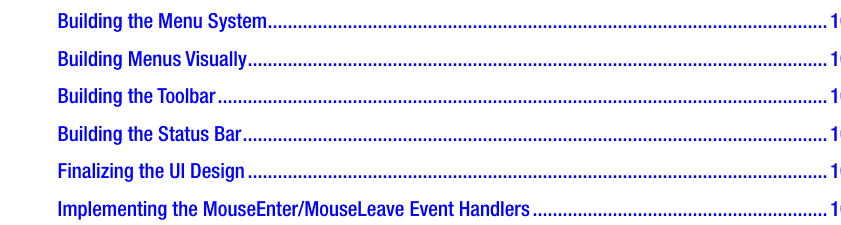

# .NET 5 C# 9 高级指南：编程基础原理与实践

To my family, Amy, Conner, Logan, and Skylar,
thank you for all of the support and patience you have given me.
Also, to my father (Cor);
father, husband, inventor, and my center of excellence.
—Phil

处理命令行参数（更新 9.0）...........................................................55

使用 Visual Studio 指定命令行参数...........................................................57

## 有趣的旁注：System.Environment 类的某些额外成员......58

## 使用 System.Console 类...................................................................59

使用 Console 类执行基本输入和输出（I/O） .............................................60

格式化控制台输出...........................................................................61

格式化数值数据 ...........................................................................62

超出控制台应用程序的数值数据格式化 ......................................................63

## 使用 System 数据类型和相应的 C# 关键字................................63

理解变量声明和初始化.....................................................65

使用内置数据类型和 new 运算符（更新 9.0） ...........................................67

理解数据类型类层次结构...............................................................67

理解数值数据类型的成员 .......................................................69

理解 System.Boolean 的成员 ..............................................................70

理解 System.Char 的成员...............................................................70

从字符串数据解析值.......................................................................71

使用 TryParse 从字符串数据解析值 ...........................................................71

使用 System.DateTime 和 System.TimeSpan...............................................................72

使用 System.Numerics 命名空间 ..............................................................72

使用数字分隔符（新 7.0）.......................................................................74

使用二进制字面量（新 7.0/7.2）.....................................................................74

## 使用字符串数据 ...........................................................................75

执行基本字符串操作...............................................................75

执行字符串连接 .....................................................................76

使用转义字符...............................................................................77

执行字符串插值 ......................................................................78

定义逐字字符串（更新 8.0）...............................................................79

使用字符串和相等 ....................................................................79

字符串是不可变的..................................................................................81

使用 System.Text.StringBuilder 类型.............................................................83

- 缩窄和扩展数据类型转换................................................... 84
- 使用 checked 关键字........................................................................ 86
- 设置项目范围的溢出检查........................................................... 88
- 设置项目范围的溢出检查（Visual Studio）........................................... 88
- 使用 unchecked 关键字...................................................................... 89
- 理解隐式类型局部变量..................................................... 89
- 隐式声明数值.................................................................... 91
- 理解隐式类型变量的限制......................................... 91
- 隐式类型数据是强类型数据....................................................... 92
- 理解隐式类型局部变量的有用性............................... 93
- 使用 C# 迭代结构................................................................ 94
- 使用 for 循环............................................................................... 94
- 使用 foreach 循环........................................................................... 95
- 在 foreach 结构中使用隐式类型.................................................. 95
- 使用 while 和 do/while 循环结构................................................ 96
- 关于作用域的简要讨论...................................................................... 96
- 使用决策结构和关系/相等运算符....................... 97
- 使用 if/else 语句...................................................................... 97
- 使用相等和关系运算符.......................................................... 98
- 使用 if/else 进行模式匹配（新 7.0）................................................... 99
- 改进模式匹配（新 9.0）................................................. 99
- 使用条件运算符（更新 7.2, 9.0）.............................................. 100
- 使用逻辑运算符......................................................................... 102
- 使用 switch 语句...................................................................... 102
- 执行 switch 语句模式匹配（新 7.0，更新 9.0）....................... 105
- 使用 switch 表达式（新 8.0）.............................................................. 108
- 总结................................................................................................ 109
- 第 4 章：核心 C# 编程结构，第 2 部分............................................... 111
- 理解 C# 数组............................................................................. 111
- 查看 C# 数组初始化语法.................................................... 112
- 理解隐式类型局部数组..................................................... 113

定义对象数组......................................................... 114

使用多维数组......................................................... 114

将数组用作参数或返回值......................................................... 116

使用 System.Array 基类......................................................... 117

使用索引和范围（新 8.0）......................................................... 118

## 理解方法......................................................... 120

理解表达式体成员......................................................... 121

理解局部函数（新 7.0，更新 9.0）......................................................... 121

理解静态局部函数（新 8.0）......................................................... 122

## 理解方法参数......................................................... 123

理解方法参数修饰符......................................................... 123

理解默认参数传递行为......................................................... 124

使用 out 修饰符（更新 7.0）......................................................... 125

使用 ref 修饰符......................................................... 127

使用 in 修饰符（新 7.2）......................................................... 128

使用 params 修饰符......................................................... 129

定义可选参数......................................................... 130

使用命名参数（更新 7.2）......................................................... 131

理解方法重载......................................................... 133

## 理解 enum 类型......................................................... 135

控制 enum 的底层存储......................................................... 137

声明 enum 变量......................................................... 137

使用 System.Enum 类型......................................................... 138

动态发现 enum 的名称-值对......................................................... 139

使用枚举、标志和按位运算......................................................... 140

## 理解结构（又名值类型）......................................................... 142

创建结构变量......................................................... 144

使用只读结构体（新 7.2）......................................................... 145

使用只读成员（新 8.0）......................................................... 145

使用 ref 结构体（新 7.2）......................................................... 146

使用可释放的 ref 结构体（新 8.0）......................................................... 147

## 理解值类型和引用类型
## 使用值类型、引用类型和赋值运算符
## 使用包含引用类型的值类型
## 理解值类型和引用类型
## 使用值类型、引用类型和赋值运算符
## 使用包含引用类型的值类型
## 按值传递引用类型
## 按引用传递引用类型
## 关于值类型和引用类型的最终细节
## 理解 C# 可空类型
## 使用可空值类型
## 使用可空引用类型（新增 8.0）
## 操作可空类型
## 理解元组（新增/更新 7.0）
## 开始使用元组
## 使用推断的变量名（更新 7.1）
## 理解元组相等/不等（新增 7.3）
## 理解元组作为方法返回值
## 理解元组中的丢弃
## 理解元组模式匹配 switch 表达式（新增 8.0）
## 解构元组
## 总结
## 第三部分：使用 C# 进行面向对象编程
## 第 5 章：理解封装
## 介绍 C# 类类型
## 使用 new 关键字分配对象
## 理解构造函数
## 理解默认构造函数的角色
## 定义自定义构造函数
## 重新理解默认构造函数
## 理解 this 关键字的角色
## 使用 this 链接构造函数调用
## 观察构造函数流程
## 重新审视可选参数
### 理解 static 关键字
### 定义静态字段数据
### 定义静态方法
### 定义静态构造函数
### 定义静态类
### 通过 C# using 关键字导入静态成员
### 定义 OOP 的支柱
### 理解封装的角色
### 理解继承的角色
### 理解多态的角色
### 理解 C# 访问修饰符（更新 7.2）
### 使用默认访问修饰符
### 使用访问修饰符和嵌套类型
### 理解第一个支柱：C# 的封装服务
### 使用传统访问器和修改器进行封装
### 使用属性进行封装
### 在类定义中使用属性
### 属性 只读属性
### 属性 只写属性
### 在属性上混合私有和公共 Get/Set 方法
### 重新审视 static 关键字：定义静态属性
### 使用属性模式进行模式匹配（新增 8.0）
### 理解自动属性
### 与自动属性交互
### 属性 自动属性和默认值
### 初始化自动属性
### 理解对象初始化
### 查看对象初始化语法
### 使用 init-Only 设置器（新增 9.0）
### 使用初始化语法调用自定义构造函数
### 使用初始化语法初始化数据
## 处理常量和只读字段数据
## 理解常量字段数据
## 理解只读字段
## 理解静态只读字段
## 理解部分类
## 使用记录（新增 9.0）
## 理解记录类型的相等性
## 总结
## 第 6 章：理解继承和多态
## 理解继承的基本机制
## 指定现有类的父类
## 关于多个基类
## 使用 sealed 关键字
## 重新审视 Visual Studio 类图
## 理解 OOP 的第二支柱：继承的细节
## 使用 base 关键字调用基类构造函数
## 保持家族秘密：protected 关键字
## 添加 sealed 类
## 理解记录类型的继承（新增 9.0）
## 为包含/委托编程
## 理解嵌套类型定义
## 理解 OOP 的第三支柱：C# 的多态支持
## 使用 virtual 和 override 关键字
## 使用 Visual Studio/Visual Studio Code 重写虚拟成员
## 密封虚拟成员
## 理解抽象类
## 理解多态接口
## 理解成员隐藏
## 理解基类/派生类转换规则
## 使用 C# as 关键字
## 使用 C# is 关键字（更新 7.0、9.0）

Data Parallelism with the Parallel Class ......................................................... 570

Accessing UI Elements on Secondary Threads ..................................................... 574

The Task Class ............................................................................... 575

Handling Cancellation Request ............................................................... 575

Task Parallelism Using the Parallel Class ...................................................... 577

## Parallel LINQ Queries (PLINQ) ............................................................... 580

Opting in to a PLINQ Query ............................................................... 581

Cancelling a PLINQ Query ............................................................... 581

## Async Calls with the async/await ............................................................... 582

A First Look at the C# async and await Keywords (Updated 7.1, 9.0) ........................... 582

SynchronizationContext and async/await ...................................................... 584

The Role of ConfigureAwait ............................................................... 585

Naming Conventions for Asynchronous Methods ................................................... 585

Void Async Methods ....................................................................... 586

Async Methods with Multiple Awaits ....................................................... 587

Calling Async Methods from Non-async Methods ............................................... 588

Await in catch and finally Blocks ....................................................... 589

Generalized Async Return Types (New 7.0) ................................................... 589

Local Functions (New 7.0) ............................................................... 590

Cancelling async/await Operations ....................................................... 591

Asynchronous Streams (New 8.0) ........................................................... 593

Wrapping Up async and await .............................................................. 594

Summary ............................................................................... 594

## 第 VI 部分：文件处理、对象序列化与数据访问................ 721

## 第 20 章：文件 I/O 和对象序列化................................................ 723

## 探索 System.IO 命名空间 ..................................................................... 723

## Directory(Info) 和 File(Info) 类型.............................................................. 724

## 抽象 FileSystemInfo 基类 ............................................................... 725

- 使用 DirectoryInfo 类型 ........................................................... 725
- 使用 DirectoryInfo 类型枚举文件 ................................................... 727
- 使用 DirectoryInfo 类型创建子目录 ............................................. 728
- 使用 Directory 类型 ............................................................... 729
- 使用 DriveInfo 类类型 ........................................................... 730
- 使用 FileInfo 类 ................................................................ 731
- FileInfo.Create() 方法 ............................................................... 732
- FileInfo.Open() 方法 ................................................................. 733
- FileInfo.OpenRead() 和 FileInfo.OpenWrite() 方法 ...................................... 734
- FileInfo.OpenText() 方法 ............................................................. 735
- FileInfo.CreateText() 和 FileInfo.AppendText() 方法 ................................... 735
- 使用 File 类型 ................................................................... 736
- 其他以文件为中心的成员 .............................................................. 736
- 抽象的 Stream 类 ................................................................... 737
- 使用 FileStreams ................................................................... 738
- 使用 StreamWriters 和 StreamReaders .................................................... 740
- 写入文本文件 ..................................................................... 740
- 从文本文件读取 .................................................................. 741
- 直接创建 StreamWriter/StreamReader 类型 .............................................. 742
- 使用 StringWriters 和 StringReaders .................................................... 743
- 使用 BinaryWriters 和 BinaryReaders .................................................... 744
- 以编程方式监视文件 ............................................................... 746
- 理解对象序列化 ............................................................ 748
- 对象图的角色 ................................................................. 748
- 创建 Samples 类型和顶级语句 ............................................ 749
- 使用 XmlSerializer 进行序列化和反序列化 .......................................... 752
- 使用 System.Text.Json 进行序列化和反序列化 .......................................... 755
- 摘要 ................................................................................... 762

## 第 21 章：使用 ADO.NET 进行数据访问......................................................... 763
- ADO.NET 与 ADO......................................................... 763
- 理解 ADO.NET 数据提供程序......................................................... 764
- ADO.NET 数据提供程序......................................................... 765
- System.Data 命名空间的类型......................................................... 766
- IDbConnection 接口的作用......................................................... 767
- IDbTransaction 接口的作用......................................................... 767
- IDbCommand 接口的作用......................................................... 767
- IDbDataParameter 和 IDataParameter 接口的作用......................................................... 768
- IDbDataAdapter 和 IDataAdapter 接口的作用......................................................... 769
- IDataReader 和 IDataRecord 接口的作用......................................................... 769
- 使用接口抽象数据提供程序......................................................... 770
- 设置 SQL Server 和 Azure Data Studio......................................................... 773
- 安装 SQL Server......................................................... 773
- 安装 SQL Server IDE......................................................... 775
- 连接到 SQL Server......................................................... 775
- 恢复 AutoLot 数据库备份......................................................... 779
- 将备份文件复制到您的容器......................................................... 779
- 使用 SSMS 恢复数据库......................................................... 779
- 使用 Azure Data Studio 恢复数据库......................................................... 781
- 创建 AutoLot 数据库......................................................... 782
- 创建数据库......................................................... 783
- 创建表......................................................... 783
- 创建表关系......................................................... 785
- 创建 GetPetName() 存储过程......................................................... 787
- 添加测试记录......................................................... 787
- ADO.NET 数据提供程序工厂模型......................................................... 789
- 一个完整的数据提供程序工厂示例......................................................... 790
- 数据提供程序工厂模型的潜在缺点......................................................... 794

- 深入研究连接、命令和数据读取器 ........................................ 795
- 使用连接对象................................................................ 796
- 使用命令对象 ................................................................ 798
- 使用数据读取器 .................................................................... 799
- 使用创建、更新和删除查询................................................... 801
- 创建 Car 和 CarViewModel 类....................................................... 802
- 添加 InventoryDal 类................................................................ 803
- 添加删除逻辑.................................................................... 807
- 添加更新逻辑...................................................................... 808
- 使用参数化命令对象.................................................... 808
- 执行存储过程 ................................................................ 812
- 创建基于控制台的客户端应用程序 ..................................................... 813
- 理解数据库事务 ............................................................. 814
- ADO.NET 事务对象的关键成员 .................................................. 815
- 向 InventoryDal 添加事务方法...................................................... 816
- 测试您的数据库事务............................................................. 818
- 使用 ADO.NET 执行批量复制 ............................................................... 819
- 探索 SqlBulkCopy 类............................................................... 819
- 创建自定义数据读取器 ............................................................... 819
- 执行批量复制...................................................................... 823
- 测试批量复制........................................................................ 824
- 摘要................................................................................... 825

## 第 VII 部分：Entity Framework Core .................................................................. 827
## 第 22 章：介绍 Entity Framework Core.................................................... 829
- 对象关系映射器....................................................................... 830
- 理解 Entity Framework Core 的作用.............................................. 830
- Entity Framework 的构建块 ..................................................... 831
- DbContext 类......................................................................... 831
- DbSet<T> 类.......................................................................... 836
- ChangeTracker........................................................................... 838
- 实体.................................................................................. 839

## 查询执行 859
## 混合客户端-服务器评估 860
## 跟踪与非跟踪查询 860
## 值得注意的 EF Core 功能 860
## 处理数据库生成的值 861
## 并发检查 861
## 连接弹性 863
## 相关数据 863
## 全局查询筛选器 866
## 使用 LINQ 的原始 SQL 查询 868
## 语句批处理 869
## 拥有实体类型 870
## 数据库函数映射 872
## EF Core 全局工具 CLI 命令 872
## 迁移命令 874
## 数据库命令 877
## DbContext 命令 878
## 总结 880

## 第 23 章：使用 Entity Framework Core 构建数据访问层 881
### 代码优先或数据库优先 881
### 创建 AutoLot.Dal 和 AutoLot.Models 项目 882
### 生成 DbContext 和实体 883
### 切换到代码优先 883
### 创建 DbContext 设计时工厂 884
### 创建初始迁移 884
### 应用迁移 885
### 更新模型 886
### 实体 886
### ApplicationDbContext 895
### 创建迁移并更新数据库 901
### 添加数据库视图和存储过程 902
### 添加 MigrationHelpers 类 902
### 更新并应用迁移 903
### 添加视图模型 904
### 将视图模型添加到 ApplicationDbContext 905
### 添加存储库 905
### 添加 IRepo 基础接口 906
### 添加 BaseRepo 906
### 实体特定存储库接口 910
### 实现实体特定的存储库 912
### 编程方式处理数据库和迁移 917
### 删除、创建和清理数据库 917
### 数据初始化 919
### 创建示例数据 919
### 加载示例数据 920
### 设置测试驱动 922
### 创建项目 922
### 配置项目 923
### 创建测试助手 923
### 添加 BaseTest 类 924
### 添加 EnsureAutoLotDatabase 测试夹具类 926
### 添加集成测试类 927
### 执行测试 930
### 查询数据库 930
### 实体状态 930
### LINQ 查询 930
### 使用 LINQ 的 SQL 查询 949
### 聚合方法 950
### Any() 和 All() 951
### 从存储过程获取数据 952
### 创建记录 953
### 实体状态 954
### 添加单条记录 954
### 使用 Attach 添加单条记录 955
### 一次添加多条记录 955
### 添加记录时的标识列注意事项 956
### 添加对象图 956
### 更新记录 957
### 实体状态 958
### 更新已跟踪实体 958
### 更新未跟踪实体 959
### 并发检查 960
### 删除记录 961
### 实体状态 961
### 删除已跟踪记录 961
### 删除未跟踪实体 962
### 捕获级联删除失败 962
### 并发检查 963
### 总结 963

## 第 VIII 部分：Windows 客户端开发 965

## 第 24 章：介绍 Windows Presentation Foundation 和 XAML 967
### WPF 的动机 967
### 统一多样化的 API 968
### 通过 XAML 提供关注点分离 968
### 提供优化的渲染模型 969
### 简化复杂的 UI 编程 969
### 调查 WPF 程序集 970
### Application 类的作用 971
### 构造 Application 类 972
### 枚举窗口集合 973
### Window 类的作用 973

## 目录

- 理解 WPF XAML 的语法 .................................................. 977
  - 介绍 XAML ........................................................................ 977
  - XAML XML 命名空间和 XAML“关键字” .............................................. 979
  - 控制类和成员变量的可见性 ........................................... 982
  - XAML 元素、XAML 属性和类型转换器 ...................................... 982
  - 理解 XAML 属性-元素语法 ............................................. 983
  - 理解 XAML 附加属性 .................................................. 984
  - 理解 XAML 标记扩展 .................................................... 985
- 使用 Visual Studio 构建 WPF 应用程序 ............................................... 987
  - WPF 项目模板 ................................................................... 988
  - 工具箱和 XAML 设计器/编辑器 ..................................................... 988
  - 使用属性窗口设置属性 ............................................. 989
  - 使用属性窗口处理事件 ................................................ 991
  - 在 XAML 编辑器中处理事件 .......................................................... 992
  - 文档大纲窗口 ............................................................... 993
  - 启用或禁用 XAML 调试器 ........................................................ 994
  - 检查 App.xaml 文件 ................................................................. 995
  - 将窗口 XAML 标记映射到 C# 代码 ................................................. 996
  - BAML 的作用 ............................................................................. 998
  - 解决 Main() 的谜团 ............................................................... 998
  - 与应用程序级数据交互 ..................................................... 999
  - 处理窗口对象的关闭 ................................................... 1000
  - 拦截鼠标事件 ................................................................. 1001
  - 拦截键盘事件 .............................................................. 1002
- 总结 ...................................................................................... 1003

## 第 25 章：WPF 控件、布局、事件和数据绑定 ........................ 1005

- 核心 WPF 控件概览 ....................................................... 1005
  - WPF Ink 控件 ........................................................................ 1006
  - WPF 文档控件 ................................................................. 1006
  - WPF 通用对话框 ..................................................................... 1007

## Claude 3 模型家族：介绍 Claude 3.5 Sonnet

2025 年 4 月 22 日 · Anthropic

我们推出 Claude 3.5 Sonnet，Claude 3 家族中性能最强的模型。它在广泛的评估中超越了 Claude 3 Opus 和 GPT-4o，同时保持与 Claude 3 Sonnet 相同的速度和成本。

Claude 3.5 Sonnet 现已在 Anthropic API、Claude 应用以及通过第一方合作伙伴提供。

Claude 3.5 Sonnet 的亮点：
- 在广泛任务中具有最先进的性能
- 在代理和编码任务中取得变革性成果
- 视觉能力取得突破性改进
- 能够以 Claude 3 Sonnet 的速度和成本运行

| 模型 | SWE-bench Verified | MMLU |
| --- | --- | --- |
| Claude 3.5 Sonnet | 50.8% | 88.7% |
| Claude 3 Opus | 38.2% | 86.8% |

> 我们相信 Claude 3.5 Sonnet 是我们迄今为止构建的最有能力、最安全的模型。

此次发布代表着迈向可访问、可靠的 AI 的又一步，它能够安全有效地处理复杂的现实世界任务。

## 目录

- 构建 Ink API 选项卡................................................................................................................ 1039
- 设计工具栏.................................................................................................................... 1039
- RadioButton 控件................................................................................................................ 1040
- 添加保存、加载和删除按钮....................................................................................... 1040
- 添加 InkCanvas 控件............................................................................................................. 1041
- 预览窗口...................................................................................................................... 1041
- 处理 Ink API 选项卡的事件............................................................................................. 1041
- 向工具箱添加控件.......................................................................................................... 1042
- InkCanvas 控件................................................................................................................... 1043
- ComboBox 控件................................................................................................................... 1045
- 保存、加载和清除 InkCanvas 数据............................................................................... 1047
- 介绍 WPF 数据绑定模型...................................................................................... 1048
- 构建数据绑定选项卡....................................................................................................... 1048
- 建立数据绑定........................................................................................................... 1049
- DataContext 属性............................................................................................................. 1049
- 格式化绑定数据........................................................................................................... 1050
- 使用 IValueConverter 进行数据转换....................................................................................... 1050
- 在代码中建立数据绑定.............................................................................................. 1052
- 构建 DataGrid 选项卡............................................................................................................. 1053
- 理解依赖属性的作用......................................................................... 1055
- 检查现有依赖属性................................................................................. 1057
- 关于 CLR 属性包装器的注意事项....................................................................... 1059
- 构建自定义依赖属性....................................................................................... 1060
- 添加数据验证例程.................................................................................................. 1063
- 响应属性更改............................................................................................... 1063
- 总结........................................................................................................................................ 1064
- 第 26 章：WPF 图形渲染服务.............................................................................. 1065
- 理解 WPF 的图形渲染服务..................................................................... 1065
- WPF 图形渲染选项................................................................................................ 1066
- 使用形状渲染图形数据........................................................................................ 1067
- 向 Canvas 添加矩形、椭圆和线条...................................................................... 1068

从画布中删除矩形、椭圆和线条......................................................... 1071

使用折线和多边形........................................................................ 1072

使用路径............................................................................... 1072

## WPF 画刷和画笔 ............................................................................ 1075

使用 Visual Studio 配置画刷.................................................................. 1076

在代码中配置画刷 ....................................................................... 1079

配置画笔 ............................................................................... 1080

## 应用图形变换............................................................... 1081

首次了解变换..................................................................... 1082

变换画布数据..................................................................... 1083

## 使用 Visual Studio 变换编辑器 ................................................... 1085

构建初始布局........................................................................ 1085

在设计时应用变换 ........................................................... 1087

在代码中变换画布.................................................................... 1088

## 使用绘图和几何图形渲染图形数据 ....................................... 1089

使用几何图形构建 DrawingBrush.......................................................... 1089

使用 DrawingBrush 进行绘制....................................................................... 1090

将绘图类型包含在 DrawingImage 中....................................................... 1091

## 使用矢量图像........................................................................ 1092

将示例矢量图形文件转换为 XAML ............................................... 1092

将图形数据导入 WPF 项目.................................................. 1093

与标志交互 ....................................................................... 1094

## 使用视觉图层渲染图形数据 ................................................. 1094

Visual 基类及其派生子类 ................................................. 1094

首次使用 DrawingVisual 类 .................................................... 1095

将视觉数据渲染到自定义布局管理器................................................ 1097

响应命中测试操作............................................................... 1099

## 摘要...................................................................................... 1101

## 第 27 章：WPF 资源、动画、样式和模板.................... 1103

- 了解 WPF 资源系统 ............................................................ 1103
- 使用二进制资源......................................................................... 1104
- 使用对象（逻辑）资源............................................................. 1108
- Resources 属性的作用 .................................................................. 1108
- 定义窗口级资源....................................................................... 1108
- {StaticResource} 标记扩展............................................................... 1112
- {DynamicResource} 标记扩展............................................................. 1112
- 应用程序级资源............................................................................ 1113
- 定义合并资源字典 ............................................................... 1114
- 定义仅资源程序集.................................................................... 1115
- 了解 WPF 的动画服务.............................................................. 1116
- 动画类类型的作用............................................................... 1116
- To、From 和 By 属性 ...................................................................... 1117
- Timeline 基类的作用................................................................... 1117
- 在 C# 代码中编写动画.................................................................... 1118
- 控制动画节奏 ................................................................ 1119
- 反转和循环动画 ................................................................. 1120
- 在 XAML 中编写动画.......................................................................... 1121
- Storyboard 的作用................................................................................ 1122
- 事件触发器的作用............................................................................. 1122
- 使用离散关键帧进行动画............................................................... 1123
- 了解 WPF 样式的作用 ............................................................... 1124
- 定义和应用样式.......................................................................... 1124
- 覆盖样式设置.............................................................................. 1125
- TargetType 对样式的影响.................................................................... 1125
- 继承现有样式............................................................................. 1127
- 使用触发器定义样式.......................................................................... 1128
- 使用多个触发器定义样式.............................................................. 1128
- 动画样式........................................................................................ 1129
- 以编程方式分配样式 .................................................................... 1129

## 逻辑树、视觉树和默认模板 ........................................ 1131

以编程方式检查逻辑树...................................................... 1132

以编程方式检查视觉树........................................................ 1133

以编程方式检查控件的默认模板.................................... 1135

## 使用触发器框架构建控件模板 ..................................... 1137

模板作为资源........................................................................... 1138

使用触发器添加视觉提示 ....................................................... 1139

{TemplateBinding} 标记扩展的作用........................................... 1140

ContentPresenter 的作用 .................................................................. 1141

将模板合并到样式中 .............................................................. 1141

## 摘要................................................................................................... 1142

## 第 28 章：WPF 通知、验证、命令和 MVVM............. 1143

## 介绍模型-视图-视图模型 ............................................................... 1143

模型................................................................................................ 1143

视图 ................................................................................................. 1144

视图模型 ...................................................................................... 1144

贫血模型或贫血视图模型............................................................ 1144

## WPF 绑定通知系统 ............................................................. 1145

可观察模型和集合............................................................... 1145

添加绑定和数据 ........................................................................ 1147

以编程方式更改车辆数据................................................... 1147

可观察模型 .................................................................................. 1148

可观察集合 ............................................................................ 1150

总结通知和可观察对象 ................................................... 1152

## WPF 验证........................................................................................ 1152

为验证示例更新示例............................................................. 1153

Validation 类............................................................................... 1153

验证选项................................................................................... 1153

利用数据注解与 WPF ............................................................. 1163

自定义 ErrorTemplate .................................................................. 1165

总结验证........................................................................... 1167

## 创建自定义命令................................................................................................................ 1167
- 实现 ICommand 接口 ........................................................................................................................ 1168
- 添加 ChangeColorCommand............................................................................................................................. 1168
- 创建 CommandBase 类 ............................................................................................................................. 1170
- 添加 AddCarCommand 类 ............................................................................................................................. 1171
- RelayCommands........................................................................................................................................................ 1172
- 完成命令............................................................................................................................................. 1175

## 将代码和数据迁移到视图模型 ........................................................................................................................ 1175
- 移动 MainWindow.xaml.cs 代码 ........................................................................................................................ 1175
- 更新 MainWindow 代码和标记 .............................................................................................................. 1176
- 更新控件标记..................................................................................................................................... 1176
- 完成视图模型......................................................................................................................................... 1177

## 为 MVVM 更新 AutoLot.Dal ............................................................................................................................... 1177

## 摘要................................................................................................................................................................... 1177

## 第九部分：ASP.NET Core............................................................................................................................................... 1179

## 第 29 章：介绍 ASP.NET Core....................................................................................................................... 1181

## 快速回顾..................................................................................................................................................... 1181
- 介绍 MVC 模式..................................................................................................................................... 1181
- ASP.NET Core 与 MVC 模式 .......................................................................................................................... 1182

## ASP.NET Core 和 .NET Core ................................................................................................................................... 1182
- 一个框架，多重用途..................................................................................................................................... 1182

## 来自 MVC/Web API 的 ASP.NET Core 功能................................................................................................................ 1183
- 约定优于配置 ............................................................................................................................... 1183
- 控制器和操作........................................................................................................................................... 1184
- 模型绑定........................................................................................................................................................ 1186
- 模型验证 .................................................................................................................................................... 1190
- 路由 ................................................................................................................................................................ 1191
- 过滤器................................................................................................................................................................... 1197

## ASP.NET Core 的新特性 ................................................................................................................................... 1198
- 内置依赖注入................................................................................................................................ 1198
- 环境感知 ...................................................................................................................................... 1199

## 应用程序配置 ......................................................... 1200

## 部署 ASP.NET Core 应用程序 ......................................................... 1201

## 轻量级且模块化的 HTTP 请求管道 ......................................................... 1201

## 创建和配置解决方案 ......................................................... 1202

## 使用 Visual Studio ......................................................... 1202

## 使用命令行 ......................................................... 1205

## 运行 ASP.NET Core 应用程序 ......................................................... 1206

## 配置启动设置 ......................................................... 1207

## 使用 Visual Studio ......................................................... 1208

## 使用命令行或 Visual Studio Code 终端窗口 ......................................................... 1208

## 使用 Visual Studio Code（VS Code） ......................................................... 1209

## 调试 ASP.NET Core 应用程序 ......................................................... 1209

## 更新 AutoLot.Api 端口 ......................................................... 1210

## 创建和配置 WebHost ......................................................... 1210

## Program.cs 文件 ......................................................... 1211

## Startup.cs 文件 ......................................................... 1211

## 日志记录 ......................................................... 1219

## 摘要 ......................................................... 1234

## 第 30 章：使用 ASP.NET Core 的 RESTful 服务 ......................................................... 1235

## 介绍 ASP.NET Core RESTful 服务 ......................................................... 1235

## 使用 RESTful 服务的控制器操作 ......................................................... 1236

## 格式化 JSON 响应结果 ......................................................... 1236

## ApiController 属性 ......................................................... 1239

## 更新 Swagger/OpenAPI 设置 ......................................................... 1241

## 更新 Startup 类中的 Swagger 调用 ......................................................... 1241

## 添加 XML 文档文件 ......................................................... 1243

## 为 SwaggerGen 添加 XML 注释 ......................................................... 1245

## API 端点的其他文档选项 ......................................................... 1246

## 构建 API 操作方法 ......................................................... 1248

## 构造函数 ......................................................... 1249

## Get 方法 ......................................................... 1250

目录

The UpdateOne Method ........................................................................................ 1251
The AddOne Method ............................................................................................ 1252
The DeleteOne Method ......................................................................................... 1253
The CarsController .............................................................................................. 1254
The Remaining Controllers ..................................................................................... 1255
Exception Filters ................................................................................................. 1257
Create the CustomExceptionFilter ........................................................................... 1258
Test the Exception Filter ...................................................................................... 1260
Add Cross-Origin Requests Support ........................................................................... 1260
Create a CORS Policy ........................................................................................... 1260
Add the CORS Policy to the HTTP Pipeline Handling ....................................................... 1261
Summary ................................................................................................................ 1261

## Chapter 31: MVC Applications with ASP.NET Core ....................................................... 1263
Introducing the “V” in ASP.NET Core ........................................................................... 1263
ViewResults and Action Methods .............................................................................. 1263
The Razor View Engine and Razor Syntax .................................................................... 1266
Views ................................................................................................................... 1269
Layouts ................................................................................................................ 1273
Partial Views ........................................................................................................ 1274
Update the Layout and Partials ................................................................................ 1274
Sending Data to Views ............................................................................................ 1276
Tag Helpers .......................................................................................................... 1277
Enabling Tag Helpers ............................................................................................. 1280
The Form Tag Helper ............................................................................................. 1281
The Form Action Tag Helper .................................................................................... 1282
The Anchor Tag Helper ........................................................................................... 1282
The Input Tag Helper ............................................................................................. 1283
The TextArea Tag Helper ........................................................................................ 1284
The Select Tag Helper ............................................................................................ 1284
The Validation Tag Helpers ..................................................................................... 1285
The Environment Tag Helper .................................................................................... 1286
The Link Tag Helper ......................................................... 1286
The Script Tag Helper ........................................................ 1287
The Image Tag Helper ......................................................... 1288

### Custom Tag Helpers........................................................... 1288
Set the Foundation ........................................................... 1288
Create the Base Class........................................................ 1289
The Item Details Tag Helper.................................................. 1290
The Item Delete Tag Helper................................................... 1291
The Item Edit Tag Helper..................................................... 1292
The Item Create Tag Helper .................................................. 1292
The Item List Tag Helper..................................................... 1293
Making Custom Tag Helpers Visible............................................. 1294

### HTML Helpers............................................................... 1294
The DisplayFor HTML Helper .................................................. 1294
The DisplayForModel HTML Helper.............................................. 1295
The EditorFor and EditorForModel HTML Helpers................................ 1295

### Managing Client-Side Libraries............................................... 1295
Install Library Manager As a .NET Core Global Tool............................. 1295
Add Client-Side Libraries to AutoLot.Mvc .................................... 1295

### Finish the CarsController and Cars Views .................................... 1299
The CarsController........................................................... 1299
The Car List Partial View.................................................... 1300
The Index View............................................................... 1302
The ByMake View ............................................................. 1303
The Details View ............................................................ 1304
The Create View.............................................................. 1305
The Edit View ............................................................... 1307
The Delete View ............................................................. 1310

### View Components............................................................. 1311
The Server-Side Code......................................................... 1312
Build the Partial View....................................................... 1313
Invoking View Components................................................................................................................1314
Invoking View Components As Custom Tag Helpers................................................................................................1314
Updating the Menu ...............................................................................................................................1314
Bundling and Minification ...........................................................................................................................1315
Bundling ...............................................................................................................................1315
Minification...............................................................................................................................1315
The WebOptimizer Solution ...............................................................................................................................1315
The Options Pattern in ASP.NET Core ...........................................................................................................................1317
Add the Dealer Information...............................................................................................................................1317
Create the Service Wrapper ...........................................................................................................................1319
Update the Application Configuration...............................................................................................................................1319
Create the ServiceSettings Class ...........................................................................................................................1320
The API Service Wrapper ...............................................................................................................................1320
Configure the Services ...............................................................................................................................1324
Build the API CarsController ...........................................................................................................................1325
The GetMakes Helper Method ...............................................................................................................................1326
The GetOne Car Method...............................................................................................................................1326
The Public Action Methods...............................................................................................................................1326
Update the View Component...........................................................................................................................1328
Run AutoLot.Mvc and AutoLot.Api Together...........................................................................................................................1329
Using Visual Studio...............................................................................................................................1329
Using the Command Line...............................................................................................................................1330
Summary...............................................................................................................................1330
Index...............................................................................................................................1331

