## CHAPTER 1
## Introducing C# and .NET (Core) 5

Microsoft 的 .NET 平台和 C# 编程语言于 2002 年左右正式推出，很快就成为现代软件开发的主流。 .NET 平台使大量编程语言（包括 C#、VB.NET 和 F#）能够相互交互。用 C# 编写的程序可以被用 VB.NET 编写的另一个程序引用。有关此互操作性的更多信息将在本章后面介绍。

2016 年，微软正式发布了 .NET Core。与 .NET 一样，.NET Core 允许语言相互互操作（尽管支持的语言数量有限）。更重要的是，这个新的框架不再局限于在 Windows 操作系统上运行，还可以在 iOS 和 Linux 上运行（并进行开发）。这种平台独立性使 C# 面向了更庞大的开发者群体。虽然在 .NET Core 之前 C# 的跨平台使用已通过 Mono 等各种其他框架得到支持。

> 注 你可能会对章节标题中的括号感到好奇。随着 .NET 5 的发布，“Core” 部分的名称被删除，以表明该版本是所有 .NET 的统一。在整本书中，我仍然使用 .NET Core 和 .NET Framework 术语以求清晰。

2020 年 11 月 10 日，微软发布了 C# 9 和 .NET 5。与 C# 8 一样，C# 9 与特定版本的框架绑定，仅可在 .NET 5.0 及更高版本上运行。语言版本与框架版本绑定使 C# 团队能够引入原本由于框架限制而无法添加到语言中的功能。

如本书引言中所述，本书的目标有两个。首先是为您提供对 C# 语法和语义的深入详细[content]

## PART I
## Introducing C# and .NET 5

## CHAPTER 1
## Introducing C# and .NET (Core) 5

Microsoft 的 .NET 平台和 C# 编程语言于 2002 年左右正式推出，很快就成为现代软件开发的主流。 .NET 平台使大量编程语言（包括 C#、VB.NET 和 F#）能够相互交互。用 C# 编写的程序可以被用 VB.NET 编写的另一个程序引用。有关此互操作性的更多信息将在本章后面介绍。

2016 年，微软正式发布了 .NET Core。与 .NET 一样，.NET Core 允许语言相互互操作（尽管支持的语言数量有限）。更重要的是，这个新的框架不再局限于在 Windows 操作系统上运行，还可以在 iOS 和 Linux 上运行（并进行开发）。这种平台独立性使 C# 面向了更庞大的开发者群体。虽然在 .NET Core 之前 C# 的跨平台使用已通过 Mono 等各种其他框架得到支持。

> 注 你可能会对章节标题中的括号感到好奇。随着 .NET 5 的发布，“Core” 部分的名称被删除，以表明该版本是所有 .NET 的统一。在整本书中，我仍然使用 .NET Core 和 .NET Framework 术语以求清晰。

2020 年 11 月 10 日，微软发布了 C# 9 和 .NET 5。与 C# 8 一样，C# 9 与特定版本的框架绑定，仅可在 .NET 5.0 及更高版本上运行。语言版本与框架版本绑定使 C# 团队能够引入原本由于框架限制而无法添加到语言中的功能。

如本书引言中所述，本书的目标有两个。首先是为您提供对 C# 语法和语义的深入详细考察。第二项同样重要的任务是说明众多 .NET Core API 的使用。这些包括使用 ADO.NET 和 Entity Framework (EF) Core 进行数据库访问，使用 Windows Presentation Foundation (WPF) 进行用户界面，以及最后使用 ASP.NET Core 进行 RESTful 服务和 Web 应用程序。正如所说，千里之行始于足下；在此，我欢迎您进入第 1 章。

本章为本书的其余部分奠定了概念基础。在这里，您将找到对许多 .NET 相关主题的高层次讨论，例如程序集、通用中间语言 (CIL) 和即时 (JIT) 编译。除了预览 C# 编程语言的一些关键字外，您还将了解 .NET Core 框架各个方面之间的关系。这包括 .NET 运行时，它将 .NET Core 通用语言运行时 (CoreCLR) 和 .NET Core 库 (CoreFX) 组合成单一代码库；通用类型系统 (CTS)；通用语言规范 (CLS)；以及 .NET Standard。

本章还为您提供了 .NET Core 基础类库提供的功能概览，有时缩写为 BCLs。在这里，您将了解 .NET Core 平台的语言无关和平台无关的本质。正如您所期望的，这些主题将在本书其余部分中进一步详细探讨。

注 本章中强调的许多功能（以及整本书中的内容）也适用于原始的 .NET Framework。在本书中，我始终使用 .NET Core 框架和 .NET Core 运行时术语，而不是通用的 .NET 术语，以明确表示这些功能在 .NET Core 中受支持。

### Exploring Some Key Benefits of the .NET Core Platform

.NET Core 框架是用于在 Windows、iOS 和 Linux 操作系统上构建 Web 应用程序和服务系统的软件平台，以及在 Windows 操作系统上构建 WinForms 和 WPF 应用程序。为了设定基调，以下是 .NET Core 提供的一些核心功能的快速概述：

- *与现有代码的互操作性：* 这当然是好事。现有的 .NET Framework 软件可以通过 .NET Standard 与更新的 .NET Core 软件进行互操作，反之亦然。
- *对众多编程语言的支持：* .NET Core 应用程序可以使用 C#、F# 和 VB.NET 编程语言创建（其中 C# 和 F# 是 ASP.NET Core 的主要语言）。
- *所有 .NET Core 语言共享的通用运行时引擎：* 该引擎的一个方面是每个 .NET Core 语言都理解的、定义良好的类型集。
- *语言集成：* .NET Core 支持跨语言继承、跨语言异常处理和代码的跨语言调试。例如，您可以在 C# 中定义基类，并在 Visual Basic 中扩展该类型。
- *全面的基础类库：* 该库提供了数千个预定义类型，允许您构建代码库、简单的终端应用程序、图形桌面应用程序和企业级网站。
- *简化的部署模型：* .NET Core 库不会注册到系统注册表。此外，.NET Core 平台允许多个版本的框架以及应用程序在同一台机器上和谐共存。
- *广泛的命令行支持：* .NET Core 命令行界面 (CLI) 是用于开发和打包 .NET Core 应用程序的跨平台工具链。除了随 .NET Core SDK 一起提供的标准工具之外，还可以安装额外的工具（全局或本地）。

您将在接下来的章节中看到这些主题（以及更多主题）的探讨。但首先，我需要解释 .NET Core 的新支持生命周期。

### Understanding the .NET Core Support Lifecycle

.NET Core 版本的发布频率比 .NET Framework 高得多。鉴于所有这些版本都可用，跟上进度可能很困难，尤其是在企业开发环境中。为了更好地定义发布的支持生命周期，微软采用了 Long-Term Support Model¹ 的变体，该模型通常由现代开源框架使用。

¹https://en.wikipedia.org/wiki/Long-term_support

长期支持 (LTS) 版本是主要版本，将在较长时间内得到支持。它们在其生命周期内只会收到关键和/或非破坏性修复。在生命周期结束之前，LTS 版本将被更改为维护 designation。.NET Core 的 LTS 版本将得到以下时间段的支持，以较长者为准：

- 初始发布后三年
- 后续 LTS 版本发布后一年的维护支持

微软决定将短期支持版本命名为 Current，它们是主要 LTS 版本之间的间隔版本。它们在后续 Current 或 LTS 版本发布后得到三个月的支持。

如前所述，.NET 5 于 2020 年 11 月 10 日发布。它作为 Current 版本发布，而不是 LTS 版本。这意味着 .NET 5 将在下一个版本发布后三个月停止支持。于 2019 年 12 月发布的 .NET Core 3.1 是 LTS 版本，并在 2022 年 12 月 3 日之前完全受支持。

> 注 .NET 的下一个计划发布版本是 .NET 6，计划于 2021 年 11 月发布。这为 .NET 5 提供了大约 15 个月的支持。但是，如果微软决定发布补丁（例如 5.1），则三个月的倒计时将从该版本开始。我建议您在为生产应用程序选择版本时仔细考虑此支持策略。明确地说，我并不是说您不应该使用 .NET 5。我强烈建议您在为生产应用程序开发选择 .NET (Core) 版本时了解支持策略。

对于发布的每个新版本的 .NET Core，检查其支持策略很重要。仅仅版本号更高并不一定意味着它会长期得到支持。完整的策略位于此处：

https://dotnet.microsoft.com/platform/support-policy/dotnet-core

### Previewing the Building Blocks of the .NET Core Platform (.NET Runtime, CTS, and CLS)

现在您已经了解了 .NET Core 提供的一些主要优势，让我们预览使这一切成为可能的关键（且相互关联）主题：Core 运行时（正式为 CoreCLR 和 CoreFX）、CTS 和 CLS。从程序员的角度来看，.NET Core 可以理解为运行时环境和全面的基础类库。运行时层包含专门绑定到平台（Windows、iOS、Linux）和架构（x86、x64、ARM）的最小实现，以及 .NET Core 的所有基本类型。

.NET Core 平台的另一个构建块是通用类型系统，或 CTS。CTS 规范完整描述了运行时支持的所有可能数据类型和所有编程构造，指定了这些实体如何相互交互，并详细说明了它们在 .NET Core 元数据格式中的表示方式（有关元数据的更多信息将在本章后面介绍；有关完整详细信息，请参阅第 17 章）。

请理解，给定的 .NET Core 语言可能不支持 CTS 定义的每个功能。通用语言规范，或 CLS，是一个相关的规范，它定义了所有 .NET Core 编程语言可以达成一致的通用类型和编程构造子集。因此，如果您构建的 .NET Core 类型仅公开 CLS 合规功能，您可以确信所有 .NET Core 语言都可以消费它们。相反，如果您使用超出 CLS 范围的数据类型或编程构造，您就不能保证每个 .NET Core 编程语言都能交互


with your .NET Core code library. Thankfully, as you will see later in this chapter, it is simple to tell your C# compiler to check all of your code for CLS compliance.

## The Role of the Base Class Libraries

The .NET Core platform also provides a set of base class libraries (BCLs) that are available to all .NET Core programming languages. Not only does this base class library encapsulate various primitives such as threads, file input/output (I/O), graphical rendering systems, and interaction with various external hardware devices, but it also provides support for a number of services required by most real-world applications.

The base class libraries define types that can be used to build any type of software application and for components of the application to interact with each other.

## The Role of .NET Standard

The number of base class libraries in the .NET Framework far exceeds those in .NET Core, even with the release of .NET 5.0. This is understandable, as the .NET Framework had a 14-year head start on .NET Core. This disparity created issues when attempting to use .NET Framework code with .NET Core code. The solution (and requirement) for .NET Framework/.NET Core interop is .NET Standard.

.NET Standard is a specification that defines the availability of .NET APIs and base class libraries that must be available in each implementation. The standard enables the following scenarios:

- Defines a uniform set of BCL APIs for all .NET implementations to implement, independent of workload
- Enables developers to produce portable libraries that are usable across .NET implementations, using this same set of APIs
- Reduces or even eliminates conditional compilation of shared source due to .NET APIs, only for OS APIs

The chart located in the Microsoft documentation (https://docs.microsoft.com/en-us/dotnet/standard/net-standard) shows the various compatibility between .NET Framework and .NET Core. This is useful for prior versions of C#. However, C# 9 will only run on .NET 5.0 (or above) or .NET Standard 2.1, and .NET Standard 2.1 is not available to the .NET Framework.

## What C# Brings to the Table

C# is a programming language whose core syntax looks *very* similar to the syntax of Java. However, calling C# a Java clone is inaccurate. In reality, both C# and Java are members of the C family of programming languages (e.g., C, Objective-C, C++) and, therefore, share a similar syntax.

The truth of the matter is that many of C#’s syntactic constructs are modeled after various aspects of Visual Basic (VB) and C++. For example, like VB, C# supports the notion of class properties (as opposed to traditional getter and setter methods) and optional parameters. Like C++, C# allows you to overload operators, as well as create structures, enumerations, and callback functions (via delegates).

Moreover, as you work through this text, you will quickly see that C# supports a number of features, such as lambda expressions and anonymous types, traditionally found in various functional languages (e.g., LISP or Haskell). Furthermore, with the advent of *Language Integrated Query* (LINQ), C# supports a number of constructs that make it quite unique in the programming landscape. Nevertheless, the bulk of C# is indeed influenced by C-based languages.

Because C# is a hybrid of numerous languages, the result is a product that is as syntactically clean as (if not cleaner than) Java, is about as simple as VB, and provides just about as much power and flexibility as C++. Here is a partial list of core C# features that are found in all versions of the language:

- No pointers required! C# programs typically have no need for direct pointer manipulation (although you are free to drop down to that level if absolutely necessary, as shown in Chapter 11).
- Automatic memory management through garbage collection. Given this, C# does not support a delete keyword.
- Formal syntactic constructs for classes, interfaces, structures, enumerations, and delegates.
- The C++-like ability to overload operators for a custom type, without the complexity.
- Support for attribute-based programming. This brand of development allows you to annotate types and their members to further qualify their behavior. For example, if you mark a method with the [Obsolete] attribute, programmers will see your custom warning message print out if they attempt to make use of the decorated member.

C# 9 is an already powerful language and, combined with .NET Core, enables building a wide range of application types.

## Major Features in Prior Releases

With the release of .NET 2.0 (circa 2005), the C# programming language was updated to support numerous new bells and whistles, most notably the following:

- The ability to build generic types and generic members. Using generics, you are able to build efficient and type-safe code that defines numerous placeholders specified at the time you interact with the generic item.
- Support for anonymous methods, which allow you to supply an inline function anywhere a delegate type is required.
- The ability to define a single type across multiple code files (or, if necessary, as an in-memory representation) using the partial keyword.

.NET 3.5 (released circa 2008) added even more functionality to the C# programming language, including the following features:

- Support for strongly typed queries (e.g., LINQ) used to interact with various forms of data. You will first encounter LINQ in Chapter 13.
- Support for anonymous types that allow you to model the structure of a type (rather than its behavior) on the fly in code.
- The ability to extend the functionality of an existing type (without subclassing) using extension methods.
- Inclusion of a lambda operator (=>), which even further simplifies working with .NET delegate types.
- A new object initialization syntax, which allows you to set property values at the time of object creation.

.NET 4.0 (released in 2010) updated C# yet again with a handful of features, listed here:

- Support for optional method parameters, as well as named method arguments.
- Support for dynamic lookup of members at runtime via the dynamic keyword. As you will see in Chapter 19, this provides a unified approach to invoking members on the fly, regardless of which framework the member implemented.
- Working with generic types is much more intuitive, given that you can easily map generic data to and from general System.Object collections via covariance and contravariance.

With the release of .NET 4.5, C# received a pair of new keywords (async and await), which greatly simplify multithreaded and asynchronous programming. If you have worked with previous versions of C#, you might recall that calling methods via secondary threads required a fair amount of cryptic code and the use of various .NET namespaces. Given that C# now supports language keywords that handle this complexity for you, the process of calling methods asynchronously is almost as easy as calling a method in a synchronous manner. Chapter 15 will cover these topics in detail.

C# 6 was released with .NET 4.6 and introduced a number of minor features that help streamline your code base. Here is a quick rundown of some of the new features in C# 6:

- Inline initialization for automatic properties as well as support for read-only automatic properties
- Single-line method implementations using the C# lambda operator
- Support of static imports to provide direct access to static members within a namespace
- A null conditional operator, which helps check for null parameters in a method implementation
- A new string formatting syntax termed string interpolation
- The ability to filter exceptions using the new when keyword
- Using await in catch and finally blocks
- nameOf expressions to return a string representation of symbols
- Index initializers
- Improved overload resolution

C# 7, released with .NET 4.7 in March 2017, introduced additional features for streamlining your code base, and it added some more significant features (such as tuples and ref locals and returns) that developers have been asking to have included in the language specification for quite some time. Here is a quick rundown of the new features in C# 7:

- Declaring out variables as inline arguments
- Local functions
- Additional expression-bodied members
- Generalized async return types
- New tokens to improve readability for numeric constants
- Lightweight unnamed types (called tuples) that contain multiple fields


- 使用类型匹配（模式匹配）更新逻辑流程，除了值检查之外
- 返回对值的引用，而不仅仅是值本身（ref locals 和 returns）
- 引入轻量级临时变量（称为 *discards*）
- 抛出表达式，允许在更多地方执行抛出，例如条件表达式、lambda 等

C# 7 进行了两次次要版本发布，增加了以下功能：

- 程序的 main 方法可以是 async。
- 一个新的字面量 default，允许初始化任何类型。
- 修正了模式匹配的问题，该问题阻止了使用泛型与新的模式匹配功能。
- 与匿名方法类似，元组名称可以从创建它们的投影中推断出来。
- 编写安全高效代码的技术，是语法改进的组合，使其能够使用引用语义处理值类型。
- 命名参数后可以跟位置参数。
- 数字字面量现在可以在任何打印的数字前加上前导下划线。
- private protected 访问修饰符使同一程序集中的派生类可以访问。
- 条件表达式 (?:) 的结果现在可以是一个引用。

这也是我在章节标题中添加 "(New 7.x)" 和 "(Updated 7.x)" 以便更轻松地找到语言相对于上一个版本的更改的版本。"x" 表示 C# 7 的次要版本，例如 7.1。

C# 8 于 2019 年 9 月 23 日随 .NET Core 3.0 发布，引入了额外的功能来简化你的代码库，并添加了一些更重要的功能（例如元组和 ref locals 和 returns），这些功能是开发人员长期以来一直要求纳入语言规范的。

C# 8 进行了两次次要版本发布，增加了以下功能：

- 结构体的只读成员
- 默认接口成员
- 模式匹配增强
- Using 声明
- 静态局部函数
- 可释放 ref 结构体
- 可空引用类型
- 异步流
- 索引和范围
- 空合并赋值
- 非托管构造类型
- 嵌套表达式中的 stackalloc
- 插值逐字字符串的增强

C# 8 中的新功能在其章节标题中以“(New 8)”标示，更新的功能以“(Updated 8)”标示。

## C# 9 中的新功能

C# 9 于 2020 年 11 月 10 日随 .NET 5 发布，增加了以下功能：

- 记录
- 仅初始化 setter
- 顶级语句
- 模式匹配增强
- 用于互操作的性能改进
- “贴合与完成”功能
- 对代码生成器的支持

C# 9 中的新功能在其章节标题中以“(New 9)”标示，更新的功能以“(Updated 9)”标示。

## 受管与非受管代码

需要注意的是，C# 语言只能用于构建托管在 .NET Core 运行时下的软件（你永远无法使用 C# 构建原生 COM 服务器或非受管的 C/C++ 风格应用程序）。官方来说，用于描述针对 .NET Core 运行时代码的术语是受管代码。包含受管代码的二进制单元称为程序集（稍后会详细介绍程序集）。相反，不能直接由 .NET Core 运行时托管的代码称为非受管代码。

如前所述，.NET Core 平台可以在各种操作系统上运行。因此，完全有可能在 Windows 机器上构建 C# 应用程序并使用 .NET Core 运行时在 iOS 机器上运行该程序。同样，你也可以在 Linux 上使用 Visual Studio Code 构建 C# 应用程序并在 Windows 上运行该程序。使用 Visual Studio for Mac，你也可以在 Mac 上构建 .NET Core 应用程序以在 Windows、macOS 或 Linux 上运行。

非受管代码仍然可以从 C# 程序中访问，但这会将你锁定到特定的开发和部署目标。

## 使用其他 .NET Core 感知的编程语言

要理解 C# 并不是构建 .NET Core 应用程序的唯一语言。.NET Core 应用程序通常可以用 C#、Visual Basic 和 F# 构建，这三种语言是微软直接支持的。

## 获取 .NET 程序集的概览

无论你选择哪种 .NET Core 语言进行编程，都要理解尽管 .NET Core 二进制文件采用与非受管 Windows 二进制文件相同的扩展名（*.dll），但它们在内部没有任何相似之处。具体来说，.NET Core 二进制文件不包含特定于平台的指令，而是包含平台无关的中间语言（IL）和类型元数据。

> 请注意 IL 也称为 Microsoft Intermediate Language（MSIL）或另称为通用中间语言（CIL）。因此，当你阅读 .NET/.NET Core 文献时，要理解 IL、MSIL 和 CIL 都是描述本质上相同的概念。在本书中，我将使用缩写 CIL 来指代这套低级指令集。

当 *.dll 是使用 .NET Core 编译器创建时，二进制 blob 被称为程序集。你将在第 16 章中检查 .NET Core 程序集的众多细节。然而，为了便于当前讨论，你需要理解这种新文件格式的四个基本属性。

首先，与可以是 *.dll 或 *.exe 的 .NET Framework 程序集不同，.NET Core 项目始终编译为 .dll 扩展名的文件，即使项目是可执行文件。可执行 .NET Core 程序集使用命令 dotnet <assembly name>.dll 执行。新于 .NET Core 3.0（及以后），dotnet.exe 命令被复制到构建目录并重命名为 <assembly name>.exe。运行此命令会自动调用 dotnet <assembly name>.dll 文件，执行相当于 dotnet <assembly name>.dll 的操作。带有你项目名称的 *.exe 并不是你项目的代码；它是为了方便运行你的应用程序的快捷方式。

新于 .NET 5，你的应用程序可以减少为直接执行的一个文件。即使这个单个文件看起来和表现像 C++ 风格的原生可执行文件，单个文件也只是一个打包的便利。它包含运行你的应用程序所需的所有文件，甚至可能包括 .NET 5 运行时本身！但要知道你的代码仍然在受管容器中运行，就像它作为多个文件发布一样。

其次，程序集包含 CIL 代码，它在概念上类似于 Java 字节码，即在绝对必要之前不会编译为特定于平台的指令。通常，“绝对必要”是指 .NET Core 运行时引用一块 CIL 指令（例如方法实现）以供使用时。

第三，程序集还包含元数据，详细描述二进制中每个“类型”的特征。例如，如果你有一个名为 SportsCar 的类，则类型元数据描述了诸如 SportsCar 的基类、指定 SportsCar 实现的接口（如果有）以及 SportsCar 类型支持的每个成员的完整描述等细节。.NET Core 元数据始终存在于程序集中，并由语言编译器自动生成。

最后，除了 CIL 和类型元数据之外，程序集本身也使用元数据进行描述，官方称为清单。清单包含有关程序集当前版本的信息、文化信息（用于本地化字符串和图像资源），以及正确执行所需的所有外部引用程序集的列表。你将在接下来的几章中检查可用于检查程序集的类型、元数据和清单信息的各种工具。

## 通用中间语言的作用

让我们更详细地检查 CIL 代码、类型元数据和程序集清单。CIL 是一种位于任何特定平台指令集之上的语言。例如，以下 C# 代码模拟了一个简单的计算器。现在不要关心确切的语法，但请注意 Calc 类中 Add() 方法的格式。


//Calc.cs
using System;

namespace CalculatorExamples
{
    //This class contains the app's entry point.
    class Program
    {
        static void Main(string[] args)
        {
            Calc c = new Calc();
            int ans = c.Add(10, 84);
            Console.WriteLine("10 + 84 is {0}.", ans);
            //Wait for user to press the Enter key
            Console.ReadLine();
        }
    }
    // The C# calculator.
    class Calc
    {
        public int Add(int addend1, int addend2)
        {
            return addend1 + addend2;
        }
    }
}

编译此代码会生成一个文件 *.dll 程序集，其中包含清单、CIL 指令以及描述 Calc 和 Program 类各个方面的元数据。

注意 第 2 章将介绍如何使用图形化集成开发环境（IDE），例如 Visual Studio Community，来编译你的代码文件。

例如，如果你使用 ildasm.exe（本章稍后会介绍）输出此程序集的 IL，你会发现 Add() 方法使用如下的 CIL 表示：

```
.method public hidebysig instance int32
    Add(int32 addend1,
        int32 addend2) cil managed
{
    // Code size       9 (0x9)
    .maxstack  2
    .locals init (int32 V_0)
    IL_0000:  nop
    IL_0001:  ldarg.1
    IL_0002:  ldarg.2
    IL_0003:  add
    IL_0004:  stloc.0
    IL_0005:  br.s       IL_0007
```

```
IL_0007: ldloc.0
IL_0008: ret
} // end of method Calc::Add
```

如果无法理解该方法生成的 CIL 也不要担心，因为第 19 章将介绍 CIL 编程语言的基础知识。需要关注的重点是，C# 编译器生成的是 CIL，而不是特定于平台的指令。

现在，请回想一下，这对所有 .NET Core 编译器都是如此。为了说明这一点，假设你使用 Visual Basic 而不是 C# 创建了同一个应用程序。

```
' Calc.vb
Namespace CalculatorExample
    Module Program
        ' This class contains the app's entry point.
        Sub Main(args As String())
            Dim c As New Calc
            Dim ans As Integer = c.Add(10, 84)
            Console.WriteLine("10 + 84 is {0}", ans)
            'Wait for user to press the Enter key before shutting down
            Console.ReadLine()
        End Sub
    End Module
    ' The VB.NET calculator.
    Class Calc
        Public Function Add(ByVal addend1 As Integer, ByVal addend2 As Integer) As Integer
            Return addend1 + addend2
        End Function
    End Class
End Namespace
```

如果你检查 Add() 方法的 CIL，会发现类似的指令（由 Visual Basic 编译器略微调整）。

```
.method public instance int32 Add(int32 addend1,
    int32 addend2) cil managed
{
    // Code size       9 (0x9)
    .maxstack 2
    .locals init (int32 V_0)
    IL_0000: nop
    IL_0001: ldarg.1
    IL_0002: ldarg.2
    IL_0003: add.ovf
    IL_0004: stloc.0
    IL_0005: br.s       IL_0007

    IL_0007: ldloc.0
    IL_0008: ret
} // end of method Calc::Add
```

作为最后一个例子，使用 F#（另一种 .NET Core 语言）开发的同一个简单的 Calc 程序如下所示：

// Learn more about F# at http://fsharp.org

// Calc.fs
open System

module Calc =
    let add addend1 addend2 =
        addend1 + addend2

[<EntryPoint>]
let main argv =
    let ans = Calc.add 10 84
    printfn "10 + 84 is %d" ans
    Console.ReadLine()
    0

如果你检查 Add() 方法的 CIL，同样会发现类似的指令（由 F# 编译器略微调整）。

```
.method public static int32 Add(int32 addend1,
                                int32 addend2) cil managed
{
    .custom instance void [FSharp.Core]Microsoft.FSharp.Core.
CompilationArgumentCountsAttribute::.ctor(int32[]) = ( 01 00 02 00 00 00 01 00 00 00 01 00 00 00 00 00 )
    // Code size       4 (0x4)
    .maxstack 8
    IL_0000:  ldarg.0
    IL_0001:  ldarg.1
    IL_0002:  add
    IL_0003:  ret
} // end of method Calc::'add'
```

## CIL 的优势

到目前为止，你可能会想知道，将源代码编译成 CIL 而不是直接编译成特定指令集究竟获得了什么好处。一个好处是语言集成。正如你已经看到的，每个 .NET Core 编译器都会生成几乎相同的 CIL 指令。因此，所有语言都能够在一个定义良好的二进制环境中相互交互。

此外，由于 CIL 与平台无关，.NET Core 框架本身也是与平台无关的，为 Java 开发者所熟悉的好处提供了同样的支持（例如，单个代码库在众多操作系统上运行）。事实上，C# 语言有一个国际标准。在 .NET Core 之前，存在许多针对非 Windows 平台的 .NET 实现，例如 Mono。它们仍然存在，但随着 .NET Core 的跨平台能力，对它们的需求大大降低。

## 将 CIL 编译为特定于平台的指令

由于程序集包含 CIL 指令而不是特定于平台的指令，因此在使用前必须即时编译 CIL 代码。编译 CIL 代码为有意义的 CPU 指令的实体是 JIT 编译器，有时也被称为 jitter。.NET Core 运行时环境为针对运行时的每个 CPU 利用 JIT 编译器，每个编译器都针对底层平台进行了优化。

例如，如果你构建一个 .NET Core 应用程序以部署到手持设备（如 iOS 或 Android 手机），相应的 jitter 就非常适合在低内存环境中运行。另一方面，如果你将程序集部署到后端公司服务器（内存很少是问题），jitter 将针对高内存环境进行优化。这样，开发者可以编写单一的代码体，在具有不同架构的机器上高效地进行 JIT 编译和执行。

此外，随着特定 jitter 将 CIL 指令编译为相应的机器代码，它会以适合目标操作系统的形式将结果缓存到内存中。这样，如果对名为 PrintDocument() 的方法进行调用，CIL 指令将在首次调用时编译为特定于平台的指令并保留在内存中以供以后使用。因此，下次调用 PrintDocument() 时，就无需重新编译 CIL。

## 预编译 CIL 为特定于平台的指令

.NET Core 中有一个名为 crossgen.exe 的实用工具，可用于预 JIT 你的代码。幸运的是，在 .NET Core 3.0 中，生成“即用型”程序集的能力已内置到框架中。稍后本书会详细介绍。

## .NET Core 类型元数据的作用

除了 CIL 指令外，.NET Core 程序集还包含完整、完整且准确的元数据，其中描述了二进制中定义的所有类型（例如类、结构、枚举），以及每种类型的成员（例如属性、方法、事件）。值得庆幸的是，始终是编译器（而不是程序员）的职责来发出最新最好的类型元数据。由于 .NET Core 元数据非常细致入微，程序集是完全自描述的实体。

为了说明 .NET Core 类型元数据的格式，让我们看一下为前面检查过的 C# Calc 类的 Add() 方法生成的元数据（为 Visual Basic 版本的 Add() 方法生成的元数据类似，因此我们只检查 C# 版本）。

```
TypeDef #2 (02000003)
--------------------------------------------------
    TypDefName: CalculatorExamples.Calc  (02000003)
    Flags      : [NotPublic] [AutoLayout] [Class] [AnsiClass] [BeforeFieldInit]  (00100000)
    Extends    : 0100000C [TypeRef] System.Object
    Method #1 (06000003)
--------------------------------------------------
    MethodName: Add (06000003)
    Flags      : [Public] [HideBySig] [ReuseSlot]  (00000086)
    RVA        : 0x00002090
    ImplFlags  : [IL] [Managed]  (00000000)
    CallCnvtn: [DEFAULT]
    hasThis
    ReturnType: I4
    2 Arguments
```


## 理解通用类型系统

给定的程序集可能包含任意数量的独立类型。在 .NET Core 的世界里，类型只是一个通用术语，用来指代集合 {class, interface, structure, enumeration, delegate} 中的成员。当你使用 .NET Core 语言构建解决方案时，你很可能会与其中许多类型交互。例如，你的程序集可能定义了一个实现若干接口的类。也许其中一个接口方法将枚举类型作为输入参数，并向调用方返回一个结构。

请记住，CTS 是一个正式规范，记录了类型必须如何定义才能被 .NET Runtime 主持。通常，只有那些构建面向 .NET Core 平台的工具和/或编译器的人才会深入关心 CTS 的内部工作原理。然而，对于所有 .NET 程序员来说，了解如何在自己选择的语言中处理 CTS 定义的五种类型是很重要的。以下是简要概述。

## CTS 类类型

每个 .NET Core 语言至少都支持类类型的概念，这是面向对象编程（OOP）的基石。一个类可以由任意数量的成员（例如构造函数、属性、方法、事件）和数据点（字段）组成。在 C# 中，类使用 class 关键字声明，如下所示：

// A C# class type with 1 method.
class Calc
{
    public int Add(int addend1, int addend2)
    {
        return addend1 + addend2;
    }
}
```

第 5 章将开始你对使用 C# 构建类类型的正式考察；然而，表 1-1 记录了与类类型相关的若干特性。

### 表 1-1. CTS 类特性

| 类特性 | 含义 |
|---|---|
| 该类是否被密封？ | 密封类不能作为其他类的基类。 |
| 该类是否实现任何接口？ | 接口是一组抽象成员，为对象与对象使用者之间提供契约。CTS 允许一个类实现任意数量的接口。 |
| 该类是抽象的还是具体的？ | 抽象类不能直接实例化，但旨在为派生类型定义通用行为。具体类可以直接实例化。 |
| 此类的可见性是什么？ | 每个类必须使用 public 或 internal 等可见性关键字进行配置。基本上，这控制着该类是否可被外部程序集使用，或仅在定义程序集内部使用。 |

## CTS 接口类型

*接口* 只是命名的一组抽象成员定义和/或（C# 8 中的新特性）默认实现，由给定的类或结构实现（在默认实现的情况下是可选的）。在 C# 中，接口类型使用 *interface* 关键字定义。根据惯例，所有 .NET 接口都以大写字母 *I* 开头，如以下示例所示：

// A C# interface type is usually
// declared as public, to allow types in other
// assemblies to implement their behavior.
public interface IDraw
{
    void Draw();
}
```

单独来看，接口用处不大。然而，当一个类或结构以其独特的方式实现给定接口时，你就可以使用接口引用以多态方式请求访问所提供的功能。基于接口的编程将在第 8 章中全面探讨。

## CTS 结构类型

结构的概念也在 CTS 下得到形式化。如果你有 C 语言背景，应该很高兴知道这些用户定义类型（UDT）在 .NET Core 世界中得以保留（尽管在内部行为上略有不同）。简单地说，*结构* 可以被视为一种具有值语义的轻量级类类型。有关结构的细微差别，请参阅第 4 章。通常，结构最适合建模几何和数学数据，并在 C# 中使用 *struct* 关键字创建，如下所示：

// A C# structure type.
struct Point
{
    // Structures can contain fields.
    public int xPos, yPos;

    // Structures can contain parameterized constructors.
    public Point(int x, int y)
    { xPos = x; yPos = y; }

    // Structures may define methods.
    public void PrintPosition()
    {
        Console.WriteLine("({0}, {1})", xPos, yPos);
    }
}
```

## CTS 枚举类型

*枚举* 是一种方便的编程构造，允许你对名称-值对进行分组。例如，假设你正在创建一个视频游戏应用程序，允许玩家从三个角色类别（Wizard、Fighter 或 Thief）中选择。与其跟踪简单的数值来表示每种可能性，你可以使用 enum 关键字构建一个强类型的枚举。

```
// A C# enumeration type.
enum CharacterTypeEnum
{
    Wizard = 100,
    Fighter = 200,
    Thief = 300
}
```

默认情况下，用于保存每个项目的存储是一个 32 位整数；然而，如果需要，可以更改此存储槽（例如，在为低内存设备如移动设备编程时）。此外，CTS 要求枚举类型派生自一个公共基类 System.Enum。正如你在第 4 章中将看到的，该基类定义了许多有趣的成员，允许你以编程方式提取、操作和转换底层的名称-值对。

## CTS 委托类型

*委托* 是 .NET Core 中类型安全的 C 风格函数指针的等价物。关键区别在于，.NET Core 委托是一个派生自 System.MulticastDelegate 的 *类*，而不是指向原始内存地址的简单指针。在 C# 中，委托使用 delegate 关键字声明。

```
// This C# delegate type can "point to" any method
// returning an int and taking two ints as input.
delegate int BinaryOp(int x, int y);
```

当你想要提供一种方式让一个对象将调用转发给另一个对象时，委托至关重要，并且为 .NET Core 事件架构奠定了基础。正如你在第 12 章和第 14 章中将看到的，委托具有固有的多播支持（即向多个接收方转发请求）和异步方法调用（即在辅助线程上调用方法）。

## CTS 类型成员

现在你已经预览了 CTS 形式化的每种类型，请注意大多数类型都包含任意数量的 *成员*。从形式上讲，类型成员受集合 {constructor, finalizer, static constructor, nested type, operator, method, property, indexer, field, read-only field, constant, event} 约束。

CTS 定义了可与给定成员关联的各种 *修饰*。例如，每个成员都有一个给定的可见性特征（例如，public、private、protected）。一些成员可以声明为 abstract（以强制派生类型的多态行为）以及 virtual（以定义一个罐装但可重写的实现）。此外，大多数成员可以配置为 static（绑定到类级别）或 instance（绑定到对象级别）。类型成员的创建将在接下来的几章中进行探讨。

> Note 如第 10 章所述，C# 语言还支持创建泛型类型和泛型成员。

## 内在 CTS 数据类型

目前需要了解的 CTS 的最后一个方面是，它建立了一组定义良好的基本数据类型。虽然给定的语言通常有唯一的关键字用于声明基本数据类型，但所有 .NET 语言关键字最终都解析为在名为 mscorlib.dll 的程序集中定义的相同 CTS 类型。请考虑表 1-2，其中记录了关键 CTS 数据类型在 VB.NET 和 C# 中的表达方式。

### 表 1-2. 内在 CTS 数据类型

| CTS 数据类型 | VB 关键字 | C# 关键字 |
|---|---|---|
| System.Byte | Byte | byte |
| System.SByte | SByte | sbyte |
| System.Int16 | Short | short |
| System.Int32 | Integer | int |
| System.Int64 | Long | long |
| System.UInt16 | UShort | ushort |
| System.UInt32 | UInt32 | uint |
| System.UInt64 | ULong | ulong |
| System.Single | Single | float |
| System.Double | Double | double |
| System.Object | Object | object |
| System.Char | Char | char |
| System.String | String | string |
| System.Decimal | Decimal | decimal |
| System.Boolean | Boolean | bool |

鉴于托管语言的唯一关键字只是 System 命名空间中真实类型的简写表示法，你不再需要担心数值数据的溢出/下溢条件，或字符串和布尔值在不同语言中的内部表示方式。请考虑以下代码片段，它们使用语言关键字以及正式的 CTS 数据类型在 C# 和 Visual Basic 中定义 32 位数值变量：

// Define some "ints" in C#.
int i = 0;
System.Int32 j = 0;
```

```
' Define some "ints" in VB.
Dim i As Integer = 0
Dim j As System.Int32 = 0
```


## 理解通用语言规范

如你所知，不同的语言以独特的、特定于语言的术语表达相同的编程结构。例如，在 C# 中你使用加号运算符 (+) 表示字符串连接，而在 VB 中你通常使用与号 (&)。即使两种不同的语言表达相同的程序化习惯用法（例如，无返回值的函数），表面上的语法也可能看起来截然不同。

```
// C# method returning nothing.
public void MyMethod()
{
    // Some interesting code...
}
```

```
' VB method returning nothing.
Public Sub MyMethod()
    ' Some interesting code...
End Sub
```

正如你已经看到的，这些细微的语法差异在 .NET Core 运行时眼中是无关紧要的，因为相应的编译器（本例中为 csc.exe 或 vbc.exe）会发出相似的 CIL 指令集。然而，语言在整体功能水平上也可能存在差异。例如，一个 .NET Core 语言可能有也可能没有表示无符号数据的关键字，也可能支持也可能不支持指针类型。鉴于这些可能的差异，最好有一个所有 .NET Core 语言都期望遵循的基线。

CLS 是一组规则，详细描述了给定 .NET Core 编译器必须支持的最小且完整的特性集，以便生成可由 .NET 运行时托管的代码，同时能够以统一的方式被所有针对 .NET Core 平台的语言访问。在许多方面，CLS 可以被视为 CTS 定义的完整功能的子集。

CLS 最终是一组规则，编译器构建者必须遵守这些规则，如果他们希望其产品在 .NET Core 宇宙中无缝运行。每条规则都被赋予一个简单名称（例如 CLS Rule 6），并描述了该规则如何影响构建编译器的那些人以及以某种方式与之交互的那些人。CLS 的精华是规则 1。

> Rule 1: CLS rules apply only to those parts of a type that are exposed outside the defining assembly.

根据此规则，你可以（正确地）推断出 CLS 的其余规则不适用于构建 .NET Core 类型内部工作所使用的逻辑。必须符合 CLS 的类型唯一方面是成员定义本身（即命名约定、参数和返回类型）。成员的实现逻辑可以使用任意数量的非 CLS 技术，因为外部世界不会知道其中的差异。

举例说明，以下 C# Add() 方法不符合 CLS，因为参数和返回值使用了无符号数据（这不是 CLS 的要求）：

```
class Calc
{
    // Exposed unsigned data is not CLS compliant!
    public ulong Add(ulong addend1, ulong addend2)
    {
        return addend1 + addend2;
    }
}
```

然而，考虑以下在方法内部使用无符号数据的代码：

```
class Calc
{
    public int Add(int addend1, int addend2)
    {
        // As this ulong variable is only used internally,
        // we are still CLS compliant.
        ulong temp = 0;
        ...
        return addend1 + addend2;
    }
}
```

该类仍然符合 CLS 的规则，可以放心所有 .NET Core 语言都能调用 Add() 方法。

当然，除了规则 1 之外，CLS 还定义了许多其他规则。例如，CLS 描述了给定语言必须如何表示文本字符串，枚举应如何在内部表示（用于存储的基础类型），如何定义静态成员等等。幸运的是，你不必记住这些规则才能成为一名熟练的 .NET 开发者。总体而言，对 CTS 和 CLS 规范的深入理解通常只对工具/编译器构建者感兴趣。

## 确保 CLS 合规性

正如你在本书的后续章节中会看到的，C# 确实定义了一些不符合 CLS 的编程结构。好消息是，你可以指示 C# 编译器使用单个 .NET 属性来检查你的代码是否符合 CLS。

```
// Tell the C# compiler to check for CLS compliance.
[assembly: CLSCompliant(true)]
```

第 17 章深入探讨了基于属性的编程的细节。在此之前，只需理解 [CLSCompliant] 属性将指示 C# 编译器根据 CLS 规则检查代码的每一行。如果发现任何 CLS 违规，你会收到编译器警告和违规代码的描述。

## 理解 .NET Core 运行时

除了 CTS 和 CLS 规范之外，拼图的最后一块是 .NET Core 运行时，或简称为 .NET 运行时。从编程角度来看，运行时可以理解为执行给定编译代码单元所需的服务集合。例如，当 Java 开发者将软件部署到新计算机时，他们需要确保 Java 虚拟机（JVM）已安装在机器上才能运行其软件。

.NET Core 平台提供了另一种运行时系统。.NET Core 运行时与其他运行时之间的关键区别在于，.NET Core 运行时提供了一个单一的、定义良好的运行时层，由所有 .NET Core 语言和平台共享。

## 区分程序集、命名空间和类型

我们每个人都了解代码库的重要性。框架库的目的是为开发者提供一套现成的代码供其在应用程序中使用。然而，C# 语言并不附带特定于语言的代码库。相反，C# 开发者利用语言中立的 .NET Core 库。为了使基类库中的所有类型保持良好的组织，.NET Core 平台大量使用命名空间概念。

命名空间是一个语义相关的类型集合，包含在程序集中或可能分布在多个相关程序集中。例如，System.IO 命名空间包含文件 I/O 相关类型，System.Data 命名空间定义基本数据库类型，等等。重要的是要指出，单个程序集可以包含任意数量的命名空间，每个命名空间可以包含任意数量的类型。

这种方法与特定于语言的库之间的关键区别在于，任何针对 .NET Core 运行时目标的语言都使用相同的命名空间和相同类型。例如，以下两个程序都说明了无处不在的 Hello World 应用程序，分别用 C# 和 VB 编写：

// Hello World in C#.
using System;

public class MyApp
{
    static void Main()
    {
        Console.WriteLine("Hi from C#");
    }
}
```

```
' Hello World in VB.
Imports System
Public Module MyApp
    Sub Main()
        Console.WriteLine("Hi from VB")
    End Sub
End Module
```

请注意，每个语言都在使用 System 命名空间中定义的 Console 类。除了一些明显的语法差异外，这些应用程序在物理和逻辑上看起来和感觉都非常相似。

显然，一旦你熟悉了选择的 .NET Core 编程语言，作为 .NET Core 开发者你的下一个目标就是熟悉（众多） .NET Core 命名空间中定义的丰富类型。最初需要掌握的最基本的命名空间名为 System。该命名空间提供了一组核心类型，你将作为 .NET Core 开发者一次又一次地需要利用它们。事实上，你无法构建任何功能性的 C# 应用程序而不至少引用 System 命名空间，因为核心数据类型（例如 System.Int32、System.String）在这里定义。表 1-3 按相关功能对一些（但 certainly 不是全部） .NET Core 命名空间进行了概述。

## 表 1-3. .NET 命名空间采样

| .NET Namespace | Meaning in Life |
|---|---|
| System | Within System, you find numerous useful types dealing with intrinsic data, mathematical computations, random number generation, environment variables, and garbage collection, as well as a number of commonly used exceptions and attributes. |
| System.Collections System.Collections.Generic | These namespaces define a number of stock container types, as well as base types and interfaces that allow you to build customized collections. |
| System.Data System.Data.Common System.Data.SqlClient | These namespaces are used for interacting with relational databases using ADO.NET. |
| System.IO System.IO.Compression System.IO.Ports | These namespaces define numerous types used to work with file I/O, compression of data, and port manipulation. |
| System.Reflection System.Reflection.Emit | These namespaces define types that support runtime type discovery as well as dynamic creation of types. |
| System.Runtime.InteropServices | This namespace provides facilities to allow .NET types to interact with unmanaged code (e.g., C-based DLLs and COM servers) and vice versa. |
| System.Drawing System.Windows.Forms | These namespaces define types used to build desktop applications using .NET's original UI toolkit (Windows Forms). |
| System.Windows System.Windows.Controls System.Windows.Shapes | The System.Windows namespace is the root for several namespaces that are used in Windows Presentation Foundation applications. |
| System.Windows.Forms System.Drawing | The System.Windows.Forms namespace is the root for several namespaces used in Windows Forms applications. |
| System.Linq System.Linq.Expressions | These namespaces define types used when programming against the LINQ API. |
| System.AspNetCore | This is one of many namespaces that allows you to build ASP.NET Core web applications and RESTful services. |
| System.Threading System.Threading.Tasks | These namespaces define numerous types to build multithreaded applications that can distribute workloads across multiple CPUs. |
| System.Security | Security is an integrated aspect of the .NET universe. In the security-centric namespaces, you find numerous types dealing with permissions, cryptography, etc. |
| System.Xml | The XML-centric namespaces contain numerous types used to interact with XML data. |

## 以编程方式访问命名空间

值得重申的是，命名空间只不过是我们这些凡人为了逻辑上理解和组织相关类型而方便使用的一种方式。再次考虑 System 命名空间。从你的角度来看，你可以假设 System.Console 代表一个名为 Console 的类，包含在名为 System 的命名空间中。然而，在 .NET Core 运行时眼中并非如此。运行时引擎只看到一个名为 System.Console 的单一类。


在 C# 中，`using` 关键字简化了引用特定命名空间中定义的类型这一过程。以下是其工作原理。回到本章前面出现的 Calc 示例程序，文件顶部有一个 `using` 语句。

```
using System;
```

该语句是启用以下代码行的快捷方式：

```
Console.WriteLine("10 + 84 is {0}.", ans);
```

如果没有 `using` 语句，代码则需要写成如下形式：

```
System.Console.WriteLine("10 + 84 is {0}.", ans);
```

虽然使用完全限定名称定义类型能提供更高的可读性，但我认为你会同意 C# 的 `using` 关键字减少了击键次数。在本文中，我们将避免使用完全限定名称（除非需要解决明确的歧义），并选择 C# `using` 关键字的简化方法。

然而，请始终记住 `using` 关键字只是指定类型完全限定名称的简写表示法，而两种方法都会产生相同的底层 CIL（因为 CIL 代码始终使用完全限定名称），并且对性能或程序集的大小没有任何影响。

## 引用外部程序集

.NET Framework 的早期版本使用一个名为全局程序集缓存（GAC）的通用安装位置来存放框架库。不同于单一安装位置，.NET Core 不使用 GAC。相反，每个版本（包括次要发行版）都会按版本安装在计算机上的独立位置。当使用 Windows 时，每个运行时和 SDK 的版本都会安装到 c:\Program Files\dotnet。

向大多数 .NET Core 项目添加程序集是通过添加 NuGet 包来完成的（本文后面会介绍）。然而，针对 Windows（并在 Windows 上开发）的 .NET Core 应用程序仍然可以访问 COM 库。这也将在本文后面介绍。

要使一个程序集能够访问你正在构建（或他人为你构建）的另一个程序集，你需要从你的程序集向另一个程序集添加引用，并且要有对另一个程序集的物理访问权限。根据你用来构建 .NET Core 应用程序的开发工具，你将有各种方法来告知编译器在编译周期中希望包含哪些程序集。

## 使用 ildasm.exe 探索程序集

如果你开始觉得掌握 .NET Core 平台中每个命名空间的想法有点不知所措，请记住，使一个命名空间独特的原因是它包含在语义上相关的类型。因此，如果你除了简单的控制台应用程序之外不需要用户界面，你就可以忘记桌面和 Web 命名空间（以及其他）。如果你正在构建一个绘图应用程序，数据库命名空间很可能与你无关。你将随着时间的推移学习到哪些命名空间与你的编程需求最相关。

中间语言反汇编程序实用工具（ildasm.exe）允许你创建一个表示 .NET Core 程序集的文本文档并调查其内容，包括关联的清单、CIL 代码和类型元数据。此工具允许你深入了解 C# 代码如何映射到 CIL，并最终帮助你理解 .NET Core 平台的内部工作原理。虽然你永远不需要使用 ildasm.exe 才能成为熟练的 .NET Core 程序员，但我强烈建议你不时启动此工具，以便更好地理解你的 C# 代码如何映射到运行时概念。

注意 ildasm.exe 程序不再随 .NET 5 运行时一起提供。获取此工具进入你的工作区的有两种选择。第一种是从位于 https://github.com/dotnet/runtime 的 .NET 5 运行时源代码编译。第二种、更简单的方法是从 www.nuget.org 下载所需版本。NuGet 上的 ILDasm 位于 https://www.nuget.org/packages/Microsoft.NETCore.ILDasm/。请确保选择正确的版本（对于本书，你需要 5.0.0 或更高版本）。使用以下命令将 ILDasm 添加到你的项目中：dotnet add package Microsoft.NETCore.ILDasm --version 5.0.0。

这实际上并没有将 ILDasm.exe 加载到你的项目中，而是将其放置在你的包文件夹中（在 Windows 上）：%userprofile%\.nuget\packages\microsoft.netcore.ildasm\5.0.0\runtimes\native\。

我还将 ILDasm.exe 的 5.0.0 版本包含在本书记的 Github 仓库中，位于第 1 章文件夹（以及使用 ildasm.exe 的每一章）。

在你将 ildasm.exe 加载到机器上后，你可以在命令行中不带任何参数运行该程序以查看帮助注释。至少，你必须指定要提取 CIL 的程序集。

```
An example command line is as follows: ildasm /all /METADATA /out=csharp.il calc.cs.dll
```

这将创建一个名为 csharp.il 的文件，将所有可用数据导出到该文件中。

## 摘要

本章的目的是为本书的其余部分奠定必要的概念框架。我首先检查了 .NET Core 之前技术中发现的许多限制和复杂性，并随后概述了 .NET Core 和 C# 如何尝试简化当前状况。

.NET Core 基本上归结为一个运行时执行引擎（.NET 运行时）和基类库。运行时能够托管任何遵守托管代码规则的 .NET Core 二进制文件（又名程序集）。正如你所见，程序集包含 CIL 指令（除类型元数据和程序集清单外），这些指令使用即时编译器编译为特定于平台的指令。此外，你还探索了通用语言规范和通用类型系统的角色。

在下一章中，你将参观在构建 C# 编程项目时可以使用的常见集成开发环境。你会很高兴知道，在本书中你将使用完全免费（且功能丰富的）IDE，因此你可以零成本开始探索 .NET Core 宇宙。

为较低版本的运行时开发，例如 .NET Core 3.1。下一个数字（1）是季度功能带。由于我们目前处于发布以来第一季度，因此是 1。最后两个数字（00）表示补丁版本。如果在你的脑海中为版本添加分隔符并将当前版本视为 5.0.1.00，就会更清晰一些。

## 确认 .NET 5 安装

要确认 SDK 和运行时的安装，请打开一个命令窗口并使用 .NET 5 命令行界面（CLI），dotnet.exe。CLI 具有 SDK 选项和命令可用。命令包括创建、构建、运行和发布项目和解决方案，你将在本文后面看到这些命令的示例。在本节中，我们将检查 SDK 选项，其中有四个，如表 2-1 所示。

表 2-1. .NET 5 CLI SDK 选项

| 选项 | 含义 |
|---|---|
| --version | 显示正在使用的 .NET SDK 版本 |
| --info | 显示 .NET 信息 |
| --list-runtimes | 显示已安装的运行时 |
| --list-sdks | 显示已安装的 SDK |
| --version | 显示正在使用的 .NET SDK 版本 |

`--version` 选项显示机器上安装的最高 SDK 版本，或在当前目录或其上方的 global.json 中指定的版本。检查机器上安装的 .NET 5 SDK 的当前版本，输入以下内容：

```
dotnet --version
```

对于本书，结果需要为 5.0.100（或更高）。

要显示机器上安装的所有 .NET Core 运行时，输入以下内容：

```
dotnet --list-runtimes
```

有三种不同的运行时：
- Microsoft.AspNetCore.App（用于构建 ASP.NET Core 应用程序）
- Microsoft.NETCore.App（.NET Core 的基础运行时）
- Microsoft.WindowsDesktop.App（用于构建 WinForms 和 WPF 应用程序）

如果你正在运行 Windows 操作系统，每个都必须是 5.0.0（或更高）版本。如果你不在 Windows 上，你只需要前两个，Microsoft.NETCore.App 和 Microsoft.AspNetCore.App，并且版本也显示为 5.0.0（或更高）。

最后，要显示所有已安装的 SDK，输入以下内容：

```
dotnet --list-sdks
```

同样，版本必须为 5.0.100（或更高）。


## 使用早期版本的 .NET（Core）SDK

如果需要将项目固定到早期版本的 .NET Core SDK，可以使用 global.json 文件来完成。创建此文件可以使用以下命令：

```
dotnet new globaljson -sdk-version 3.1.404
```

这会创建一个如下所示的 global.json 文件：

```
{
  "sdk": {
    "version": "3.1.404"
  }
}
```

此文件会将当前目录及其下所有子目录的 .NET Core SDK 版本“固定”为 3.1.404。在此目录中运行 dotnet.exe --version 将返回 3.1.404。

## 使用 Visual Studio 构建 .NET Core 应用程序

如果你有使用 Microsoft 早期技术构建应用程序的经验，你可能熟悉 Visual Studio。产品在生命周期中版本名称和功能集不断变化，但在 .NET Core 发布后已趋于稳定。Visual Studio 提供以下版本（适用于 Windows 和 Mac）：

- Visual Studio 2019 Community（免费）
- Visual Studio 2019 Professional（付费）
- Visual Studio 2019 Enterprise（付费）

Community 和 Professional 版本本质上是相同的。最显著的区别在于许可模式。Community 许可用于开源、学术和小企业用途。Professional 和 Enterprise 是商业产品，可用于任何开发，包括企业开发。正如预期的那样，Enterprise 版本相比 Professional 版本具有许多额外功能。

注意 有关具体的许可细节，请访问 www.visualstudio.com。许可 Microsoft 产品可能很复杂，本书不涵盖细节。为了编写（并跟随）本书，Community 是合法可用的。

所有 Visual Studio 版本都附带复杂的代码编辑器、集成调试器、桌面和 Web 应用程序的 GUI 设计器等。由于它们共享一组核心功能，好消息是可以在它们之间轻松切换，并对其基本操作感到非常舒适。

## 安装 Visual Studio 2019（Windows）

在使用 Visual Studio 2019 开发、执行和调试 C# 应用程序之前，需要先安装它。安装体验在 2017 版本后发生了巨大变化，值得更详细地讨论。

Visual Studio 2019 的安装过程现已细分为按应用程序类型的工作负载。这使你只需安装构建计划应用程序类型所需的组件即可。例如，如果你要构建 Web 应用程序，你将安装“ASP.NET 和 Web 开发”工作负载。

另一个（极其）重大的变化是 Visual Studio 2019 支持真正的并行安装。请注意，我指的不仅是 Visual Studio 的早期版本，而是 Visual Studio 2019 本身！例如，在我的主要工作电脑上，我安装了 Visual Studio 2019 Enterprise 用于专业工作，并安装了 Visual Studio 2019 Community 用于我的书籍、课程和会议讲座。如果你有雇主提供的 Professional 或 Enterprise 版本，你仍然可以安装 Community 版本来处理开源项目（或本书中的代码）。

当你启动 Visual Studio 2019 Community 安装程序时，会看到如图 2-1 所示的屏幕。此屏幕显示所有可用工作负载、可选择单个组件的选项，以及右侧的摘要，显示已选择的内容。

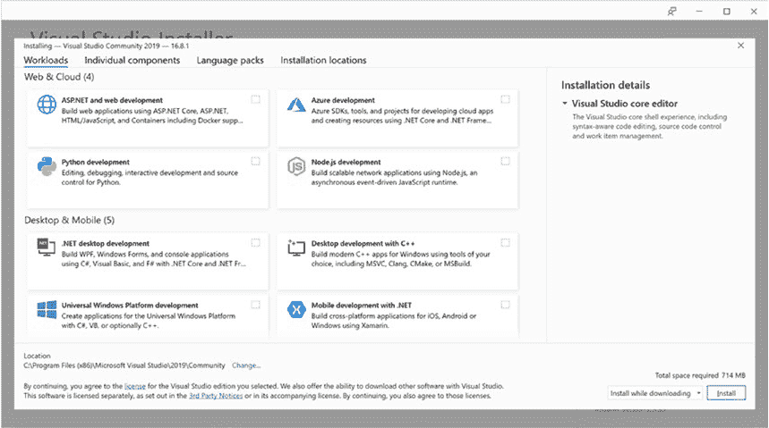

**图 2-1。** *新的 Visual Studio 安装程序*

对于本书，你需要安装以下工作负载：

- .NET 桌面开发
- ASP.NET 和 Web 开发
- 数据存储和处理
- .NET Core 跨平台开发

在“单个组件”选项卡上，还选择 Class Designer、Git for Windows 和“Visual Studio 的 GitHub 扩展”（均在“代码工具”下）。选择所有这些后，单击 Install。这将为你提供完成本书示例所需的一切。

## 试用 Visual Studio 2019

Visual Studio 2019 是使用 .NET 平台和 C# 进行软件开发的一站式商店。让我们通过构建一个简单的 .NET 5 控制台应用程序来快速浏览 Visual Studio。

## 使用新的项目对话框和 C# 代码编辑器

启动 Visual Studio 时，你会看到如图 2-2 所示的更新后的启动对话框。对话框左侧显示最近使用的解决方案，右侧提供从存储库启动代码、打开现有项目/解决方案、打开本地文件夹或创建新项目的选项。还有一个无需代码继续的选项，只会启动 Visual Studio IDE。

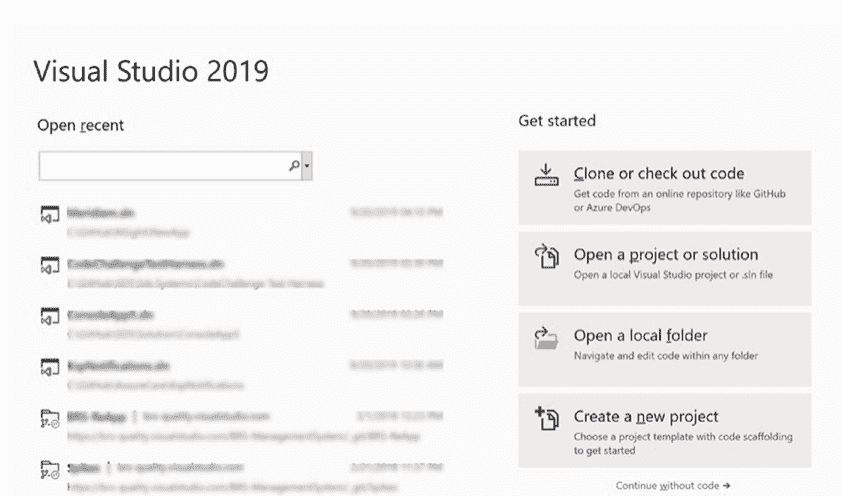

图 2-2。新的 Visual Studio 启动对话框

选择“创建新项目”选项，你将被提示“创建新项目”对话框。如图 2-3 所示，左侧为最近使用的模板（如有），右侧为所有可用模板，包括一组筛选器和搜索框。

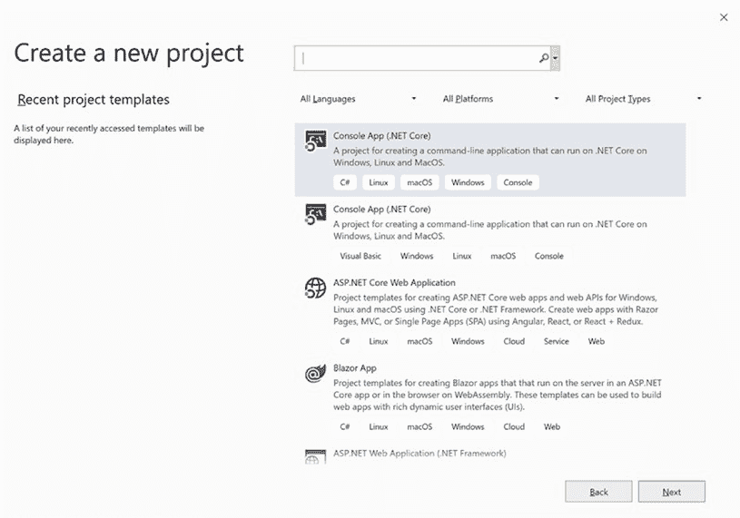

# 图 2-3。“创建新项目”对话框

首先，创建一个新的 Console App（.NET Core）C# 项目，确保选择 C# 版本而不是 Visual Basic 版本。

下一个屏幕是“配置你的新项目”对话框，如图 2-4 所示。为项目名称输入 SimpleCSharpConsoleApp 并选择项目位置。向导还将默认创建一个以项目名称命名的 Visual Studio 解决方案。

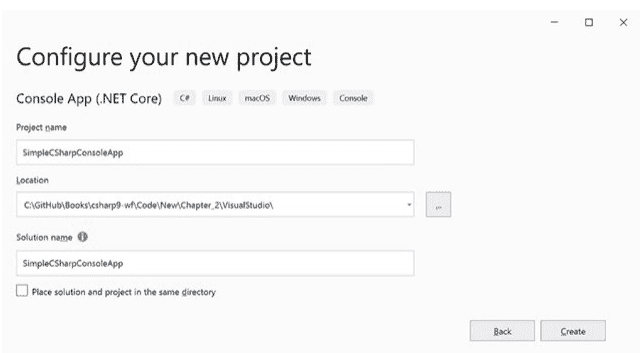

# 图 2-4。“配置你的新项目”对话框

注意 创建解决方案和项目也可以使用 .NET Core CLI 完成。这将在 Visual Studio Code 中介绍。

项目创建后，你会看到初始 C# 代码文件（名为 Program.cs）已在代码编辑器中打开。用以下代码替换 Main() 方法中的单行代码。你会注意到在输入时使用点运算符时 IntelliSense（代码补全帮助）会启动。

```
static void Main(string[] args)
{
    // Set up Console UI (CUI)
    Console.Title = "My Rocking App";
    Console.ForegroundColor = ConsoleColor.Yellow;
    Console.BackgroundColor = ConsoleColor.Blue;
    Console.WriteLine("********************************************");
    Console.WriteLine("**** Welcome to My Rocking App ****");
    Console.WriteLine("********************************************");
    Console.BackgroundColor = ConsoleColor.Black;

    // Wait for Enter key to be pressed.
    Console.ReadLine();
}
```

这里，你使用的是 System 命名空间中定义的 Console 类。由于 System 命名空间已通过 using 语句自动包含在文件顶部，因此你无需在类名前限定命名空间（例如 System.Console.WriteLine()）。此程序没有做太多有趣的事情；不过，请注意最后对 Console.ReadLine() 的调用。这只是为了确保用户必须按一个键才能终止应用程序。使用 Visual Studio 2019 时这是不必要的，因为 VS 调试器会暂停程序并防止其退出。如果你导航到编译版本并运行它，程序在调试程序时几乎会立即消失！

注意 如果你想更改 VS 调试体验以便在调试停止时自动结束程序，请选择 Tools ► Options ► Debugging ► Automatically close the console when debugging stops。

## 更改目标 .NET Core 框架

.NET Core 控制台应用程序和类库的默认 .NET Core 版本是最新 LTS 版本，即 .NET Core 3.1。要使用 .NET 5 或只是检查应用程序的目标 .NET（Core）版本，请在解决方案资源管理器中双击项目。这将在编辑器中打开项目文件（这是 Visual Studio 2019 和 .NET Core 的新功能）。你也可以通过在解决方案资源管理器中右键单击项目名称并选择“编辑项目文件”来编辑项目文件。你将看到以下内容：

```
<Project Sdk="Microsoft.NET.Sdk">
    <PropertyGroup>
        <OutputType>Exe</OutputType>
        <TargetFramework>netcoreapp3.1</TargetFramework>
    </PropertyGroup>
</Project>
```


要将 .NET Core 版本更改为 .NET 5，只需将 TargetFramework 值更改为 net5.0，如下所示：

```
<Project Sdk="Microsoft.NET.Sdk">
    <PropertyGroup>
        <OutputType>Exe</OutputType>
        <TargetFramework>net5.0</TargetFramework>
    </PropertyGroup>
</Project>
```

你也可以通过在解决方案资源管理器中右键单击项目名称并选择属性，打开应用程序选项卡，然后更新目标框架值来更改目标框架，如图 2-5 所示。

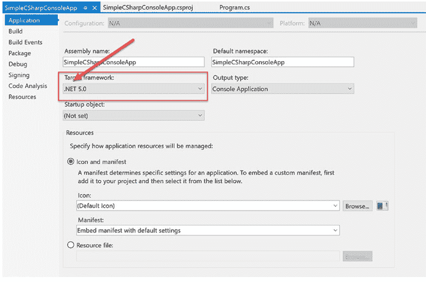

图 2-5. 更改应用程序的目标框架

## 使用 C# 9 功能

在之前的 .NET 版本中，项目支持的 C# 版本可以更改。自 .NET Core 3.0 起，使用 C# 的版本与框架版本绑定。要确认这一点，请在解决方案资源管理器中右键单击项目名称并选择属性。在属性对话框中，单击左侧的生成，然后单击右下角的高级。这将打开如图 2-6 所示的对话框。

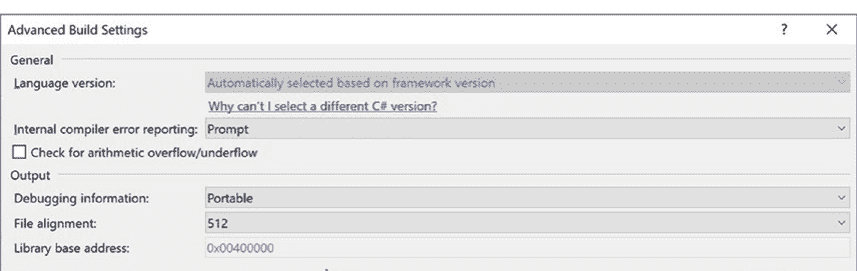

图 2-6. 高级生成设置

对于 .NET 5.0 项目，语言版本锁定为 C# 9。表 2-2 列出了目标框架（.NET Core、.NET Standard 和 .NET Framework）以及使用的默认 C# 版本。

表 2-2. C# 版本和目标框架

| Target Framework | Version | C# Language Version Default |
|---|---|---|
| .NET | 5.x | C# 9.0 |
| .NET Core | 3.x | C# 8.0 |
| .NET Core | 2.x | C# 7.3 |
| .NET Standard | 2.1 | C# 8.0 |
| .NET Standard | 2.0 | C# 7.3 |
| .NET Standard | 1.x | C# 7.3 |
| .NET Framework | all | C# 7.3 |

## 运行和调试你的项目

要运行程序并查看输出，请按 Ctrl+F5 键盘命令（也可以通过 Debug ▶ Start Without Debugging 菜单选项访问）。一旦执行，你将看到一个 Windows 控制台窗口弹出，显示你的自定义（且色彩丰富）的消息。请注意，当你使用 Ctrl+F5 “运行”程序时，你会绕过集成调试器。

> 注意 .NET Core 应用程序也可以使用 CLI 编译和执行。要运行你的项目，在与项目文件相同目录下（本例中为 `SimpleCSharpApp.csproj`）输入 `dotnet run`。`dotnet run` 命令也会自动构建项目。

如果你需要调试代码（在构建较大程序时这肯定很重要），你的第一步是在要检查的代码语句处设置断点。尽管本示例中的代码不多，但可以通过单击代码编辑器最左侧的灰色栏来设置断点（注意断点用红色圆点图标标记；见图 2-7）。

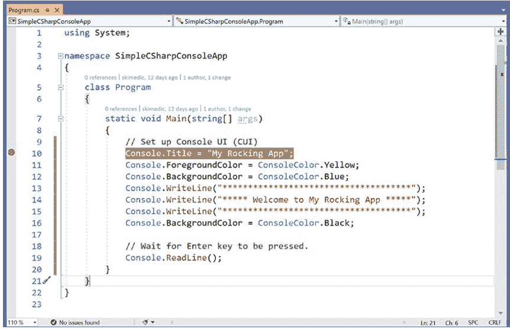

图 2-7. 设置断点

如果现在按下 F5 键（或使用 Debug ▶ Start Debugging 菜单选项，或单击工具栏中旁边的绿色箭头开始），你的程序将在每个断点处暂停。正如你所期望的，你可以使用 IDE 的各种工具栏按钮和菜单选项与调试器交互。一旦你评估完所有断点，应用程序将在 Main() 完成后最终终止。

> 注意 Microsoft IDE 具有复杂的调试器，你将在接下来的章节中学习各种技术。现在，请注意，当你处于调试会话中时，Debug 菜单下会出现大量有用的选项。花点时间自行验证这一点。

## 使用解决方案资源管理器

如果你查看 IDE 的右侧，你会看到一个解决方案资源管理器窗口，它向你展示了一些重要内容。首先，注意 IDE 创建了一个包含单个项目的解决方案。起初这可能会令人困惑，因为它们都使用相同的名称（SimpleCSharpConsoleApp）。这里的想法是，“解决方案”可以包含多个协同工作的项目。例如，你的解决方案可能包括三个类库、一个 WPF 应用程序和一个 ASP.NET Core Web 服务。本书的前几章始终只有一个项目；然而，当你构建一些更复杂的示例时，你将看到如何向初始解决方案空间添加新项目。

> 注意 请注意，当你在解决方案资源管理器窗口中选择最顶层的解决方案时，IDE 的菜单系统会显示与选择项目时不同的选项集。如果你发现某个菜单项不翼而飞，请仔细检查是否不小心选择了错误的节点。

## 使用 Visual 类设计器

Visual Studio 还允许你以可视方式设计类和其他类型（如接口或委托）。类设计器实用程序允许你查看和修改项目中类型（类、接口、结构、枚举和委托）的关系。使用此工具，你可以可视地向类型添加（或从类型中删除）成员，并使你的修改反映在相应的 C# 文件中。此外，当你修改给定的 C# 文件时，更改会反映在类图中。

要访问可视类型设计器工具，第一步是插入新的类图文件。为此，激活项目 ► 添加新项菜单选项并找到类图类型（图 2-8）。

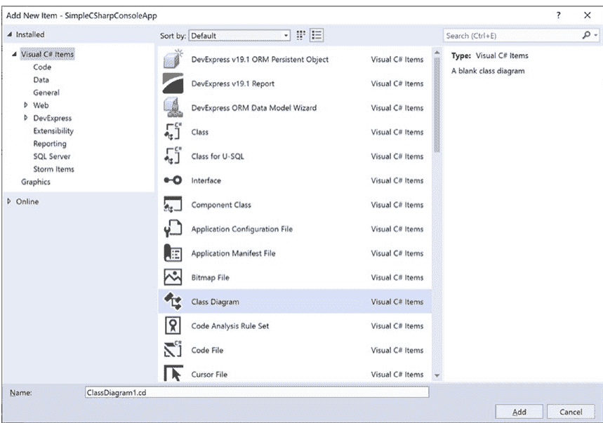

图 2-8. 向当前项目插入类图文件

最初，设计器将是空的；然而，你可以从解决方案资源管理器窗口将文件拖放到表面上。例如，一旦将 Program.cs 拖到设计器上，你会发现 Program 类的可视化表示。如果你单击给定类型的箭头图标，你可以显示或隐藏该类型的成员（见图 2-9）。

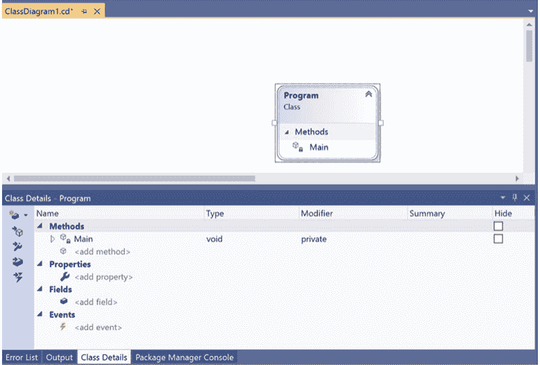

图 2-9. 类图查看器

> 注意 使用类设计器工具栏，你可以微调设计器表面的显示选项。

类设计器实用程序与 Visual Studio 的另外两个方面协同工作：类详细信息窗口（使用 View ► Other Windows 菜单激活）和类设计器工具箱（使用 View ► Toolbox 菜单项激活）。类详细信息窗口不仅显示图中当前选中项的详细信息，还允许你即时修改现有成员并插入新成员（见图 2-10）。

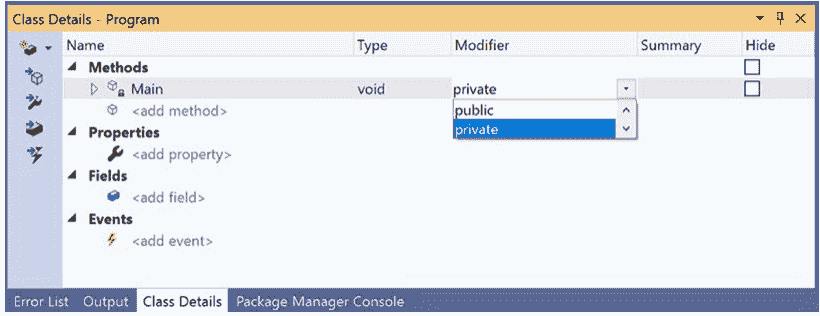

图 2-10. 类详细信息窗口

类设计器工具箱也可以通过 View 菜单激活，允许你可视地向项目中插入新类型（并在这些类型之间创建关系）（见图 2-11）。（请注意，你必须将类图作为活动窗口才能查看此工具箱。）这样做时，IDE 会在后台自动创建新的 C# 类型定义。

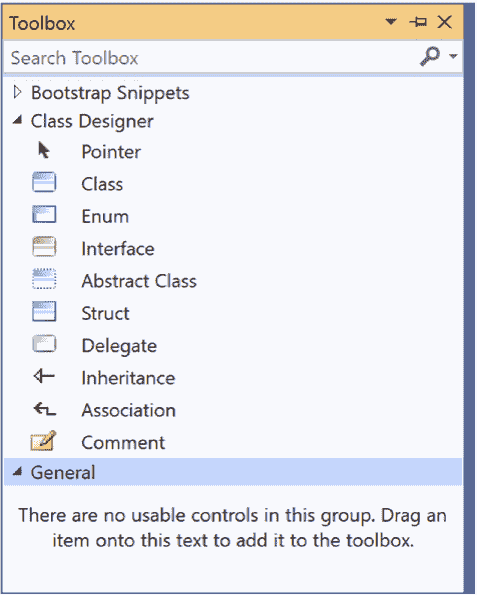

图 2-11. 类设计器工具箱

举例来说，从类设计器工具箱拖动一个新类到你的类设计器，并在结果对话框中将其命名为 Car。这将导致创建一个名为 Car.cs 的新 C# 文件并自动添加到你的项目中。现在，使用类详细信息窗口添加一个名为 PetName 的公共字符串字段（见图 2-12）。

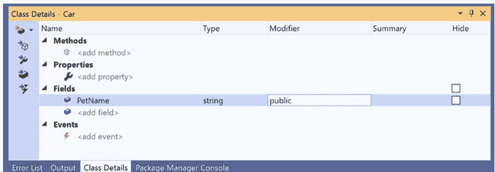

图 2-12. 使用类详细信息窗口添加字段

如果现在查看 Car 类的 C# 定义，你会看到它已相应更新（不包括此处显示的额外代码注释）：

```
public class Car
{
    // Public data is typically a bad idea; however,
    // it keeps this example simple.
    public string PetName;
}
```

现在，再次激活设计器文件并拖动另一个新类到设计器上并将其命名为 SportsCar。单击类设计器工具箱中的继承图标并单击 SportsCar 图标顶部。接下来，单击鼠标在 Car 类图标顶部。如果执行这些步骤正确，你刚刚从 Car 派生出 SportsCar 类（见图 2-13）。

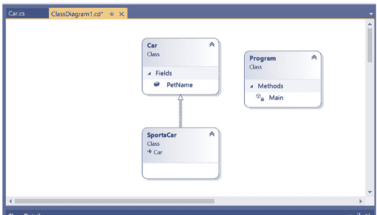

图 2-13. 可视化从现有类派生


注意 继承的概念将在第 6 章中全面探讨。

要完成此示例，请使用以下方式为生成的 SportsCar 类添加一个名为 GetPetName() 的公共方法：

```
public class SportsCar : Car
{
    public string GetPetName()
    {
        PetName = "Fred";
        return PetName;
    }
}
```

正如你所期望的，设计器会显示添加到 SportsCar 类的新方法。
这就是你对 Visual Studio 的首次了解。在整本书中，你将看到更多使用 Visual Studio 构建 C# 9 和 .NET 5 应用的示例。

## 使用 Visual Studio Code 构建 .NET Core 应用

微软的另一款流行 IDE 是 Visual Studio Code（VSC）。Visual Studio Code 是微软家族中的一个相对较新的成员；它是免费的、开源的、跨平台的，并在 .NET Core 生态系统内外获得了开发者的显著采用。Visual Studio Code 的重点（正如其名称所示）是你的应用程序的代码。它不具备 Visual Studio 中包含的许多内置功能。然而，可以通过扩展向 Visual Studio Code 添加额外功能。这使你能够拥有一个针对工作流程定制的快速 IDE。本书中的许多示例都是使用 Visual Studio Code 构建和测试的。你可以从这里下载：

https://code.visualstudio.com/download

安装 VSC 后，你需要添加从这里找到的 C# 扩展：

https://marketplace.visualstudio.com/items?itemName=ms-dotnettools.csharp

注意 Visual Studio Code 用于基于多种语言开发许多不同类型的应用程序。有 Angular、Vue、PHP、Java 等等的扩展。

## 试用 Visual Studio Code

让我们通过构建与 Visual Studio 示例中相同的 .NET 5 控制台应用程序来快速浏览 Visual Studio Code。

## 创建解决方案和项目

当你启动 Visual Studio Code 时，会看到一个空白画布。创建解决方案和项目必须通过 .NET 5 命令行界面，也称为 CLI 来完成。首先，通过选择 File ► Open Folder 用 Visual Studio Code 打开一个文件夹，并在资源管理器窗口中导航到你希望解决方案和项目所在的位置。接下来，通过选择 Terminal ► New Terminal 或按 Ctrl+Shift+` 打开一个终端窗口。

在终端窗口中，输入以下命令以创建空的 .NET 5 解决方案文件：

```
dotnet new sln -n SimpleCSharpConsoleApp -o .\VisualStudioCode
```

这会在当前目录的子目录 VisualStudioCode 中创建一个名为 (-n) SimpleCSharpConsoleApp 的新解决方案文件。当使用 Visual Studio Code 进行单项目应用时，无需创建解决方案文件。Visual Studio 以解决方案为中心；Visual Studio Code 以代码为中心。我们在此创建解决方案文件是为了复制 Visual Studio 示例中的流程。

> 注意 这些示例使用 Windows 目录分隔符。根据你的操作系统调整分隔符。

接下来，创建一个新的 C# 9/.NET 5 (-f net5.0) 控制台应用程序，命名为 (-n) SimpleCSharpConsoleApp，位于同名子目录 (-o) 中（注意此命令必须在一行上）：

```
dotnet new console -lang c# -n SimpleCSharpConsoleApp -o .\VisualStudioCode\
SimpleCSharpConsoleApp -f net5.0
```

> 注意 因为使用 -f 选项指定了目标框架，所以你无需像在 Visual Studio 中那样更新项目文件。

最后，使用以下命令将新创建的项目添加到解决方案中：

```
dotnet sln .\VisualStudioCode\SimpleCSharpConsoleApp.sln add .\VisualStudioCode\
SimpleCSharpConsoleApp
```

> 注意 这只是 CLI 能力的少量示例。要发现 CLI 的所有功能，请输入 dotnet -h。

## 探索 Visual Studio Code 工作区

如你在图 2-14 中看到的，Visual Studio Code 工作区专注于代码，但也提供了许多额外的功能来提高你的生产力。资源管理器 (1) 是一个集成的资源管理器，并在图中被选中。源代码管理 (2) 与 Git 集成。调试图标 (3) 启动适当的调试器（前提是安装了正确的扩展）。下一个是扩展管理器 (4)。点击调试图标会显示推荐的扩展以及所有可用扩展的列表。扩展管理器是上下文相关的，并会根据打开目录及其子目录中的代码类型做出推荐。

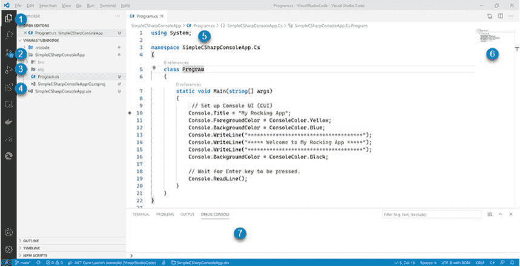

*Figure 2-14.* The Visual Studio Code workspace

代码编辑器 (5) 具有颜色编码和 IntelliSense 支持，两者都依赖于扩展。代码地图 (6) 显示整个代码文件的地图，调试控制台 (7) 接收调试会话的输出并接受用户输入（类似于 Visual Studio 中的“即时”窗口）。

## 还原包、构建和运行程序

.NET 5 CLI 具有还原包、构建解决方案、构建项目和运行应用程序所需的所有功能。要还原解决方案和项目所需的所有 NuGet 包，请在终端窗口（或 VSC 外部的命令窗口）中输入以下命令，确保从与解决方案文件相同的目录运行命令：

```
```text
dotnet restore
```
```

要构建解决方案中的所有项目，请在终端/命令窗口中执行以下操作（同样，确保命令在与解决方案文件相同的目录中执行）：

```
```text
dotnet build
```
```

> **注意** 当 `dotnet restore` 和 `dotnet build` 在包含解决方案文件的目录中执行时，解决方案中的所有项目都会被操作。这些命令也可以在单个项目上运行，只需在 C# 项目文件 (`*.csproj`) 的目录中运行命令即可。

要在不调试的情况下运行项目，请在与项目文件 (`SimpleCSharpConsoleApp.csproj`) 相同的目录中执行以下 .NET CLI 命令：

```
```text
dotnet run
```
```

## 调试你的项目

要调试程序，请按 F5 键盘命令或点击调试图标（图 2-14 中的 2）。假设你已为 VSC 加载了 C# 扩展，程序将在调试模式下运行。断点的管理方式与使用 Visual Studio 时相同，尽管在编辑器中它们不那么明显（图 2-15）。

```
using System;

namespace SimpleCSharpConsoleApp.Cs
{
    class Program
    {
        static void Main(string[] args)
        {
            // Set up Console UI (CUI)
            Console.Title = "My Rocking App";
            Console.ForegroundColor = ConsoleColor.Yellow;
            Console.BackgroundColor = ConsoleColor.Blue;
            Console.WriteLine("********************************************");
            Console.WriteLine("***** Welcome to My Rocking App *****");
            Console.WriteLine("********************************************");
            Console.BackgroundColor = ConsoleColor.Black;

            // Wait for Enter key to be pressed.
            Console.ReadLine();
        }
}
```

Figure 2-15. Breakpoints in Visual Studio Code

要将终端更改为集成终端并允许向程序输入，首先打开 launch.json 文件（位于 .vscode 目录中）。将 console 条目从 internalConsole 更改为 integratedTerminal，如下所示：

```
{
    // Use IntelliSense to find out which attributes exist for C# debugging
    // Use hover for the description of the existing attributes
    // For further information visit https://github.com/OmniSharp/omnisharp-vscode/blob/master/debugger-launchjson.md
    "version": "0.2.0",
    "configurations": [
        {
            "name": ".NET Core Launch (console)",
            "type": "coreclr",
            "request": "launch",
            "preLaunchTask": "build",
            // If you have changed target frameworks, make sure to update the program path.
            "program": "${workspaceFolder}/SimpleCSharpConsoleApp/bin/Debug/net5.0/SimpleCSharpConsoleApp.Cs.dll",
            "args": [],
```


```
"cwd": "${workspaceFolder}/SimpleCSharpConsoleApp",
// For more information about the 'console' field, see https://aka.ms/VSCode-CS-LaunchJson-Console
"console": "integratedTerminal",
"stopAtEntry": false
},
{
  "name": ".NET Core Attach",
  "type": "coreclr",
  "request": "attach",
  "processId": "${command:pickProcess}"
}
]
```

## Finding the .NET Core and C# Documentation

C# 和 .NET Core 的文档都非常优秀，可读性很强，并且充满了有用的信息。鉴于预定义 .NET 类型数量巨大 [数量达数千种]，你必须愿意撸起袖子深入查阅提供的文档。你可以在以下位置查看所有 Microsoft 文档：

https://docs.microsoft.com/en-us/dotnet/csharp/

本书前半部分你会使用最多的区域是 C# 文档和 .NET Core 文档，位于以下位置：

https://docs.microsoft.com/en-us/dotnet/csharp/
https://docs.microsoft.com/en-us/dotnet/core/

## Summary

本章的目的是为你提供使用 .NET 5 SDK 和运行时设置开发环境的信息，以及对 Visual Studio 2019 Community Edition 和 Visual Studio Code 的介绍。如果你只对构建跨平台 .NET Core 应用程序感兴趣，你有许多选择。Visual Studio [仅限 Windows]、Visual Studio for Mac [仅限 Mac] 和 Visual Studio Code [跨平台] 均由 Microsoft 提供。构建 WPF 或 WinForms 应用程序仍需要在 Windows 机器上使用 Visual Studio。
