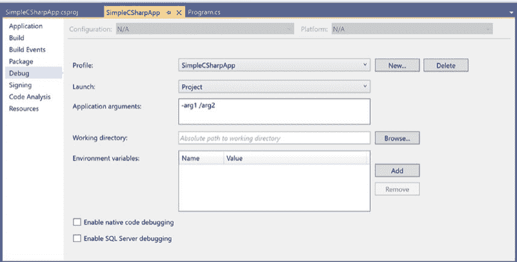
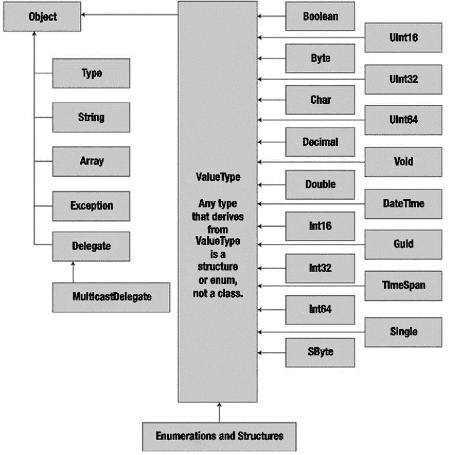
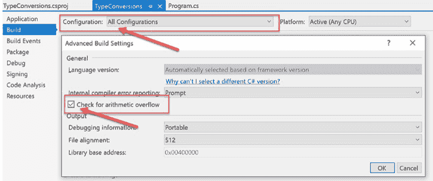

## CHAPTER 3

## Core C# Programming Constructs, Part 1

本章通过介绍一系列独立的小主题，开始你对 C# 编程语言的正式研究，这些主题是你探索 .NET Core Framework 时必须熟悉的。首先要了解如何构建程序的应用程序对象，并检查可执行程序入口点的组成：Main() 方法以及 C# 9.0 的新特性 top-level statements。接下来，你将研究基本的 C# 数据类型 [及其在 System 命名空间中的等效类型]，包括对 System.String 和 System.Text.StringBuilder 类的检查。

在了解了基本 .NET Core 数据类型的细节后，你将研究多种数据类型转换技术，包括窄化操作、扩展操作以及 checked 和 unchecked 关键字的用法。

本章还将探讨 C# var 关键字的角色，它允许你隐式定义局部变量。正如你将在本书后面看到的那样，隐式类型在处理 LINQ 技术集时非常有帮助，如果不是偶尔强制要求的话。你将通过快速检查允许你使用各种循环和决策结构控制应用程序流程的 C# 关键字和运算符来结束本章。

### Breaking Down a Simple C# Program

C# 要求所有程序逻辑都包含在类型定义中 [请回顾第 1 章，type 是指 {class, interface, structure, enumeration, delegate} 集合中的成员这一通用术语]。与许多其他语言不同，在 C# 中不可能创建全局函数或全局数据点。相反，所有数据成员和方法都必须包含在类型定义中。为了开始，创建一个名为 Chapter3_AllProject.sln 的新空解决方案，其中包含一个名为 SimpleCSharpApp 的 C# 控制台应用程序。

从 Visual Studio，在“创建新项目”屏幕上选择 Blank Solution 模板。解决方案打开后，在解决方案资源管理器中右键单击解决方案并选择 Add ► New Project。选择“C# console app”模板，将其命名为 SimpleCSharpApp，然后单击 Create。记得将目标框架更新为 net5.0。

从命令行执行以下操作：

```
dotnet new sln -n Chapter3_AllProjects

dotnet new console -lang c# -n SimpleCSharpApp -o .\SimpleCSharpApp -f net5.0
dotnet sln .\Chapter3_AllProjects.sln add .\SimpleCSharpApp
```

你可能会同意初始 Program.cs 文件中的代码相当乏味。

```
using System;

namespace SimpleCSharpApp
{
    class Program
    {
        static void Main(string[] args)
        {
            Console.WriteLine("Hello World!");
        }
    }
}
```

鉴于此，使用以下代码语句更新你的 Program 类的 Main() 方法：

```
class Program
{
    static void Main(string[] args)
    {
        // Display a simple message to the user.
        Console.WriteLine("***** My First C# App *****");
        Console.WriteLine("Hello World!");
        Console.WriteLine();

        // Wait for Enter key to be pressed before shutting down.
        Console.ReadLine();
    }
}
```

> 注 C# 是区分大小写的编程语言。因此，Main 与 main 不同，Readline 与 ReadLine 不同。请注意，所有 C# 关键字都是小写 [例如，public, lock, class, dynamic]，而命名空间、类型和成员名称 [按惯例] 以大写字母开头，嵌入词的首字母也大写 [例如，Console.WriteLine, System.Windows.MessageBox, System.Data.SqlClient]。作为经验法则，每当你收到关于“未定义符号”的编译器错误时，请先检查拼写和大小写！

之前的代码包含一个类类型的定义，该类支持一个名为 Main() 的方法。默认情况下，Visual Studio 将定义 Main() 的类命名为 Program；但是，如果你愿意，你可以更改它。在 C# 9.0 之前，每个可执行 C# 应用程序 [控制台程序、Windows 桌面程序或 Windows 服务] 必须包含一个定义 Main() 方法的类，该方法用于表示应用程序的入口点。

正式地说，定义 Main() 方法的类被称为应用程序对象。一个可执行应用程序可能有多个应用程序对象 [这在执行单元测试时很有用]，但编译器必须知道应使用哪个 Main() 方法作为入口点。这可以通过项目文件中的 <StartupObject> 元素或位于 Visual Studio 项目属性窗口应用程序选项卡上的 Startup Object 下拉列表框来完成。

请注意，Main() 的签名装饰有 static 关键字，该关键字将在第 5 章中详细讨论。目前，只需理解 static 成员是作用域到类级别 [而不是对象级别]，因此可以在无需先创建新的类实例的情况下调用它们。

除了 static 关键字之外，此 Main() 方法有一个参数，它是一个字符串数组 [string[] args]。虽然你目前没有处理这个数组，但此参数可能包含任意数量的传入命令行参数 [你将很快看到如何访问它们]。最后，此 Main() 方法被设置为 void 返回值，这意味着在退出方法作用域之前，你不使用 return 关键字显式定义返回值。

Program 类的逻辑在 Main() 中。这里，你使用了在 System 命名空间中定义的 Console 类。其成员之一是静态 WriteLine()，顾名思义，它将文本字符串和回车发送到标准输出。你还调用 Console.ReadLine() 以确保由 Visual Studio IDE 启动的命令提示符保持可见。在使用 Visual Studio 运行 .NET Core 控制台应用程序 [调试或发布模式] 时，控制台窗口默认保持可见。此行为可以通过启用“调试停止时自动关闭控制台”设置来更改，该设置位于 Tools ► Options ► Debugging 下。Console.ReadLine 方法是为了在通过 Windows 资源管理器双击产品 *.exe 文件执行程序时保持窗口打开。你将很快了解更多关于 System.Console 类的信息。

### Using Variations of the Main() Method (Updated 7.1)

默认情况下，Visual Studio 会生成一个 Main() 方法，该方法具有 void 返回值和一个字符串类型数组作为单个输入参数。这并不是 Main() 的唯一可能形式。然而，允许使用以下任何签名构建应用程序的入口点 [假设它包含在 C# 类或结构定义中]：

```
// int return type, array of strings as the parameter.
static int Main(string[] args)
{
    // Must return a value before exiting!
    return 0;
}
```

```
// No return type, no parameters.
static void Main()
{
}
```

```
// int return type, no parameters.
static int Main()
{
    // Must return a value before exiting!
    return 0;
}
```

随着 C# 7.1 的发布，Main() 方法现在可以是异步的。异步编程在第 15 章中介绍，但现在请注意还有另外四种签名。

```
static Task Main()
static Task<int> Main()
static Task Main(string[])
static Task<int> Main(string[])
```


在幕后，编译器会填补空白。检查更新后代码生成的 IL，你会看到应用程序入口点的以下 TypeDef：

// TypeDef #1 (02000002)
// --------------------------------------------------
//   TypDefName: <Program>$  (02000002)
//   Flags      : [NotPublic] [AutoLayout] [Class] [Abstract] [Sealed] [AnsiClass]
//   [BeforeFieldInit]  (00100180)
//   Extends    : 0100000D [TypeRef] System.Object
//   Method #1 (06000001) [ENTRYPOINT]
// --------------------------------------------------
//               MethodName: <Main>$ (06000001)

将其与第 1 章中入口点的 TypeDef 进行比较：

// TypeDef #1 (02000002)
// --------------------------------------------------
//   TypDefName: CalculatorExamples.Program  (02000002)
//   Flags      : [NotPublic] [AutoLayout] [Class] [AnsiClass]
//   [BeforeFieldInit]  (00100000)
//   Extends    : 0100000C [TypeRef] System.Object
//   Method #1 (06000001) [ENTRYPOINT]
// --------------------------------------------------
//               MethodName: Main (06000001)

注意，对于第 1 章的示例，TypDefName 值显示为命名空间（CalculatorExamples）加上类名（Program），而 MethodName 值为 Main。在使用顶层语句的更新示例中，编译器已将 TypDefName 的值填充为 <Program>$，将方法名填充为 <Main>$。

## 指定应用程序错误代码（更新 9.0）

绝大多数你的 Main() 方法（或顶层语句）的返回值为 void，但能够返回 int（或 Task<int>）使 C# 与其他基于 C 的语言保持一致。根据惯例，返回值为 0 表示程序已成功终止，而其他值（如 -1）表示错误条件（请注意，即使你构造了一个原型为返回 void 的 Main() 方法，值 0 也会自动返回）。

当使用顶层语句（因此没有 Main() 方法）时，如果执行代码返回一个整数，则该整数即为返回码。如果没有显式返回，仍然返回 0，与显式使用 Main() 方法的情况相同。

在 Windows 操作系统中，应用程序的返回值存储在名为 %ERRORLEVEL% 的系统环境变量中。如果你创建了一个以编程方式启动另一个可执行文件的应用程序（该主题将在第 19 章中讨论），你可以使用已启动进程的 ExitCode 属性获取 %ERRORLEVEL% 的值。

由于应用程序的返回值在应用程序终止时传递给系统，因此应用程序在运行时显然无法获取并显示其最终错误代码。但是，为了说明程序终止后如何查看此错误级别，请首先按如下方式更新顶层语句：

// Note we are explicitly returning an int, rather than void.
// Display a message and wait for Enter key to be pressed.
Console.WriteLine("***** My First C# App *****");
Console.WriteLine("Hello World!");

```
Console.WriteLine();
Console.ReadLine();
```

```
// Return an arbitrary error code.
return -1;
```

如果程序仍在使用 Main() 方法作为入口点，请将方法签名更改为返回 int 而不是 void，如下所示：

```
static int Main()
{
...
}
```

现在让我们借助批处理文件捕获程序的返回值。使用 Windows 资源管理器，导航到包含项目文件的文件夹（例如，C:\SimpleCSharpApp）并在该文件夹中添加一个新文本文件（命名为 SimpleCSharpApp.cmd）。将文件夹的内容更新为以下内容（如果你以前从未编写过 *.cmd 文件，无需关心细节）：

```
@echo off
rem A batch file for SimpleCSharpApp.exe
rem which captures the app's return value.

dotnet run
@if "%ERRORLEVEL%" == "0" goto success

:fail
echo This application has failed!
echo return value = %ERRORLEVEL%
goto end
:success
echo This application has succeeded!
echo return value = %ERRORLEVEL%
goto end
:end
echo All Done.
```

此时，打开命令提示符（或使用 VSC 终端）并导航到包含新的 *.cmd 文件的文件夹。通过键入其名称并按 Enter 键执行该文件。由于你的 Main() 方法返回 -1，你应该会看到如下输出。如果 Main() 方法返回 0，你会看到消息“This application has succeeded!”打印到控制台。

```
***** My First C# App *****

Hello World!

This application has failed!
return value = -1
All Done.
```

前面 *.cmd 文件的 PowerShell 等效文件如下：

```
dotnet run
if ($LastExitCode -eq 0) {
    Write-Host "This application has succeeded!"
} else
{
    Write-Host "This application has failed!"
}
Write-Host "All Done."
```

要运行它，请在 VSC 终端中输入 PowerShell，然后通过键入以下内容执行脚本：

```
.\SimpleCSharpApp.ps1
```

你将在终端窗口中看到以下内容：

```
***** My First C# App *****

Hello World!

This application has failed!
All Done.
```

绝大多数（如果不是全部）你的 C# 应用程序将使用 void 作为 Main() 的返回值，这如你所回忆的那样，隐式返回错误代码零。为此，本书中当前示例之外的 Main() 方法将返回 void。

## 处理命令行参数（更新 9.0）

现在你更好地理解了 Main() 方法或顶层语句的返回值，让我们来检查传入的字符串数据数组。假设你现在想要更新应用程序以处理任何可能的命令行参数。一种方法是使用 C# for 循环。（请注意，C# 的迭代结构将在本章末尾详细讨论。）

// Display a message and wait for Enter key to be pressed.
Console.WriteLine("***** My First C# App *****");
Console.WriteLine("Hello World!");
Console.WriteLine();
// Process any incoming args.
for (int i = 0; i < args.Length; i++)
{
    Console.WriteLine("Arg: {0}", args[i]);
}
Console.ReadLine();
// Return an arbitrary error code.
return 0;

> 注意 此示例使用顶层语句，不使用 Main() 方法。更新 Main() 方法以接受 args 参数的内容将在后面介绍。

再次检查使用顶层语句的程序生成的 IL，注意到 <Main>$ 方法接受一个名为 args 的字符串数组，如下所示（为节省空间已缩写）：

```
.class private abstract auto ansi sealed beforefieldinit '<Program>$'
    extends [System.Runtime]System.Object
{
    .custom instance void [System.Runtime]System.Runtime.CompilerServices.
CompilerGeneratedAttribute::.ctor()=
    ( 01 00 00 00 )
    .method private hidebysig static
        void '<Main>$' (string[] args) cil managed
    {
        .entrypoint
... } // end of method '<Program>$'::'<Main>$'
} // end of class '<Program>$'
```

如果程序仍在使用 Main() 方法作为入口点，请确保方法签名接受一个名为 args 的字符串数组，如下所示：

```
static int Main(string[] args)
{
...
}
```

在这里，你使用 System.Array 的 Length 属性检查字符串数组是否包含若干项。正如你在第 4 章中将看到的那样，所有 C# 数组实际上都别名为 System.Array 类，因此共享一组公共成员。当你遍历数组中的每个项时，其值会被打印到控制台窗口。命令行提供参数同样简单，如下所示：

```
C:\SimpleCSharpApp>dotnet run /arg1 -arg2

***** My First C# App *****
Hello World!
Arg: /arg1
Arg: -arg2
```

作为标准 for 循环的替代方案，你可以使用 C# foreach 关键字遍历传入的字符串数组。以下是一些示例用法（但循环结构的细节你将在本章后面看到）：

// Notice you have no need to check the size of the array when using "foreach".
// Process any incoming args using foreach.
foreach(string arg in args)


```
{
    Console.WriteLine("Arg: {0}", arg);
}
Console.ReadLine();
return 0;
```

最后，你也可以使用 `System.Environment` 类型的静态 `GetCommandLineArgs()` 方法来访问命令行参数。此方法返回值的类型为字符串数组。第一个条目保存应用程序本身的名称，而数组中的其余元素包含各个命令行参数。

// 使用 System.Environment 获取参数。
string[] theArgs = Environment.GetCommandLineArgs();
foreach(string arg in theArgs)
{
    Console.WriteLine("Arg: {0}", arg);
}
Console.ReadLine();
return 0;

> 注 `GetCommandLineArgs` 方法不会通过 `Main()` 方法接收应用程序的参数，也不依赖于 `string[] args` 参数。

当然，由你来决定你的程序将响应哪些命令行参数（如果有的话），以及它们必须采用何种格式（例如使用 - 或 / 前缀）。在这里，我只是传入了一系列选项并直接打印到命令提示符。假设你正在创建一个新的视频游戏，并且将你的应用程序编程为处理名为 `-godmode` 的选项。如果用户使用该标志启动你的应用程序，你就知道他实际上是个作弊者，你可以采取适当的行动。

## 使用 Visual Studio 指定命令行参数

在现实世界中，最终用户在启动程序时可以选择提供命令行参数。然而，在开发周期中，你可能希望为测试目的指定可能的命令行标志。要在 Visual Studio 中执行此操作，请在“解决方案资源管理器”中右键单击项目名称，选择“属性”，然后导航到左侧的“调试”选项卡。从那里，使用“应用程序参数”文本框指定值（见图 3-1）并保存更改。



图 3-1. 在 Visual Studio 中设置应用程序参数

在你建立了此类命令行参数后，它们将在调试或在 Visual Studio IDE 内运行应用程序时自动传递给 `Main()` 方法。

## 一个有趣的旁注：System.Environment 类的一些额外成员

`Environment` 类除了 `GetCommandLineArgs()` 之外还公开了许多极有帮助的方法。具体来说，该类允许你使用各种静态成员获得有关当前托管你的 .NET 5 应用程序的操作系统的许多详细信息。为了说明 `System.Environment` 的用处，将你的代码更新为调用名为 `ShowEnvironmentDetails()` 的本地方法。

// 顶层语句中的本地方法。
ShowEnvironmentDetails();

Console.ReadLine();
return -1;
}

在顶层语句之后实现此方法以调用 `Environment` 类型的各种成员：

```
static void ShowEnvironmentDetails()
{
    // Print out the drives on this machine,
    // and other interesting details.
    foreach (string drive in Environment.GetLogicalDrives())
    {
        Console.WriteLine("Drive: {0}", drive);
```
```
}
Console.WriteLine("OS: {0}", Environment.OSVersion);
Console.WriteLine("Number of processors: {0}",
    Environment.ProcessorCount);
Console.WriteLine(".NET Core Version: {0}",
    Environment.Version);
}
```

以下输出显示了调用此方法的一种可能的测试运行：

```
**** My First C# App ****

Hello World!

Drive: C:\
OS: Microsoft Windows NT 10.0.19042.0
Number of processors: 16
.NET Core Version: 5.0.0
```

`Environment` 类型定义了除前例所示之外的其他成员。表 3-1 记录了一些感兴趣的额外属性；不过，请务必查看在线文档以获取完整详细信息。

## 表 3-1 System.Environment 的选定属性

| Property | Meaning in Life |
|---|---|
| ExitCode | Gets or sets the exit code for the application |
| Is64BitOperatingSystem | Returns a bool to represent whether the host machine is running a 64-bit OS |
| MachineName | Gets the name of the current machine |
| NewLine | Gets the newline symbol for the current environment |
| SystemDirectory | Returns the full path to the system directory |
| UserName | Returns the name of the user that started this application |
| Version | Returns a Version object that represents the version of the .NET Core platform |

## 使用 System.Console 类

在本书前几章创建的几乎所有示例应用程序都大量使用了 `System.Console` 类。虽然控制台用户界面（CUI）可能不如图形用户界面（GUI）或 Web 应用程序那么吸引人，但将早期的示例限制为控制台程序将使你能够专注于 C# 的语法和 .NET 5 平台的核心方面，而不必处理构建桌面 GUI 或网站的复杂性。

顾名思义，`Console` 类封装了控制台应用程序的输入、输出和错误流操作。表 3-2 列出了一些（但绝对不是全部）感兴趣的成员。正如你所见，`Console` 类确实提供了一些可以为简单的命令行应用程序增色的成员，例如更改背景和前景颜色以及发出蜂鸣声（多种频率！）的能力。

## 表 3-2. System.Console 的选定成员

| Member | Meaning in Life |
|---|---|
| Beep() | This method forces the console to emit a beep of a specified frequency and duration. |
| BackgroundColor | These properties set the background/foreground colors for the current output. |
| ForegroundColor | They may be assigned any member of the ConsoleColor enumeration. |
| BufferHeightBufferWidth | These properties control the height/width of the console’s buffer area. |
| Title | This property gets or sets the title of the current console. |
| WindowHeightWindowWidthWindowTopWindowLeft | These properties control the dimensions of the console in relation to the established buffer. |
| Clear() | This method clears the established buffer and console display area. |

## 使用 Console 类执行基本输入和输出（I/O）

除了表 3-2 中的成员外，`Console` 类型还定义了一组用于捕获输入和输出的方法，所有这些方法都是静态的，因此通过在方法名前加上类名（Console）来调用。 如你所见，`WriteLine()` 将文本字符串（包括回车）泵送到输出流。 `Write()` 方法将文本泵送到输出流而不带回车。 `ReadLine()` 允许你在按下 Enter 键之前从输入流接收信息，而 `Read()` 用于从输入流捕获单个字符。

为了说明使用 `Console` 类进行简单 I/O，创建一个名为 `BasicConsoleIO` 的新控制台应用程序项目，并使用以下 CLI 命令将其添加到解决方案中：

```
dotnet new console -lang c# -n BasicConsoleIO -o .\BasicConsoleIO -f net5.0
dotnet sln .\Chapter3_AllProjects.sln add .\BasicConsoleIO
```

```
Replace the Program.cs code with the following:
using System;
Console.WriteLine("***** Basic Console I/O *****");
GetUserData();
Console.ReadLine();
static void GetUserData()
{
}
```

> 注 Visual Studio 和 Visual Studio Code 都支持一些“代码片段”，激活后会插入代码。 `cw` 代码片段在本书的前几章中非常有用，因为它会自动扩展为 `Console.WriteLine()`！ 要自行测试，输入 `cw` 并按 Tab 键。注意：在 Visual Studio Code 中，你按一次 Tab 键；在 Visual Studio 中，你必须按两次 Tab 键。

在顶层语句之后实现此方法，使用逻辑提示用户输入一些信息并将每项回显到标准输出流。例如，你可以要求用户输入姓名和年龄（为简单起见，将其视为文本值，而不是预期的数值），如下所示：

```
static void GetUserData()
{
    // Get name and age.
    Console.Write("Please enter your name: ");
    string userName = Console.ReadLine();
    Console.Write("Please enter your age: ");
    string userAge = Console.ReadLine();

    // Change echo color, just for fun.
    ConsoleColor prevColor = Console.ForegroundColor;
    Console.ForegroundColor = ConsoleColor.Yellow;

    // Echo to the console.
    Console.WriteLine("Hello {0}! You are {1} years old.",
    userName, userAge);

    // Restore previous color.
    Console.ForegroundColor = prevColor;
}
```

不出所料，当你运行此应用程序时，输入数据会打印到控制台（还使用自定义颜色！）。

## 格式化控制台输出

在前几章中，你可能已经注意到在各种字符串文字中嵌入了诸如 `{0}` 和 `{1}` 之类的标记。 .NET 5 平台支持一种字符串格式化样式，与 C 的 `printf()` 语句略有相似。简单来说，当你在定义包含运行时值未知的数据段的字符串文字时，可以使用这种大括号语法在字符串文字中指定占位符。在运行时，传递给 `Console.WriteLine()` 的值将被替换为每个占位符。

`WriteLine()` 的第一个参数表示包含可选占位符 `{0}`、`{1}`、`{2}` 等的字符串文字。请注意，大括号占位符的第一个序数数字始终从 0 开始。`WriteLine()` 的其余参数只是要插入到相应占位符中的值。

> 注 如果你有比填充参数更多的唯一编号的大括号占位符，你将在运行时收到格式异常。但是，如果你有比占位符更多的填充参数，未使用的填充参数将被忽略。


允许在给定的字符串中重复使用占位符。例如，如果你是一名 Beatles 粉丝，想要构建字符串 "9, Number 9, Number 9"，你会这样写：

```
// John says...
Console.WriteLine("{0}, Number {0}, Number {0}", 9);
```

另外，请注意，可以将每个占位符放置在字符串字面量中的任意位置，并且不必遵循递增的顺序。例如，考虑以下代码片段：

```
// Prints: 20, 10, 30
Console.WriteLine("{1}, {0}, {2}", 10, 20, 30);
```

字符串也可以使用字符串插值进行格式化，这将在本章后面介绍。

## Formatting Numerical Data

如果需要对数值数据进行更精细的格式化，每个占位符都可以选择性地包含各种格式字符。表 3-3 显示了最常见的格式化选项。

Table 3-3. .NET Core Numerical Format Characters

| String Format Character | Meaning in Life |
|---|---|
| C or c | 用于格式化货币。默认情况下，该标志会加上本地文化符号前缀（对于美国英语为美元符号 [$]）。 |
| D or d | 用于格式化十进制数字。该标志还可以指定用于填充值的最小位数。 |
| E or e | 用于指数记数法。大写或小写控制指数常数是使用大写字母 E 还是小写字母 e。 |
| F or f | 用于定点格式化。该标志还可以指定用于填充值的最小位数。 |
| G or g | 代表通用。此字符可用于将数字格式化为定点或指数格式。 |
| N or n | 用于基本数值格式化（带逗号）。 |
| X or x | 用于十六进制格式化。如果使用大写 X，你的十六进制格式也将包含大写字符。 |

这些格式字符使用冒号标记后缀添加到给定的占位符值（例如，{0:C}, {1:d}, {2:X}）。为了说明这一点，将 Main() 方法更新为调用名为 FormatNumericalData() 的新辅助函数。在你的 Program 类中实现此方法，以多种方式格式化固定的数值。

```
// Now make use of some format tags.
static void FormatNumericalData()
{
    Console.WriteLine("The value 99999 in various formats:");
    Console.WriteLine("c format: {0:c}", 99999);
```

```
Console.WriteLine("d9 format: {0:d9}", 99999);
Console.WriteLine("f3 format: {0:f3}", 99999);
Console.WriteLine("n format: {0:n}", 99999);

// Notice that upper- or lowercasing for hex
// determines if letters are upper- or lowercase.
Console.WriteLine("E format: {0:E}", 99999);
Console.WriteLine("e format: {0:e}", 99999);
Console.WriteLine("X format: {0:X}", 99999);
Console.WriteLine("x format: {0:x}", 99999);
}
```

调用 FormatNumericalData() 方法后的输出如下所示：

```
The value 99999 in various formats:

c format: $99,999.00
d9 format: 000099999
f3 format: 99999.000
n format: 99,999.00
E format: 9.999900E+004
e format: 9.999900e+004
X format: 1869F
x format: 1869f
```

在本文中需要时你会看到额外的格式化示例；然而，如果你有兴趣进一步深入研究字符串格式化，请查阅 .NET Core 文档中的主题“Formatting Types”。

## Formatting Numerical Data Beyond Console Applications

最后请注意，字符串格式化字符的使用并不限于控制台程序。相同的格式化语法也可以在调用静态 string.Format() 方法时使用。当你需要在运行时为任何应用程序类型（例如，桌面 GUI 应用、ASP.NET Web 应用等）组合文本数据时，这会很有帮助。

string.Format() 方法返回一个新字符串对象，该对象根据提供的标志进行格式化。以下代码以十六进制格式化字符串：

```
// Using string.Format() to format a string literal.
string userMessage = string.Format("100000 in hex is {0:x}", 100000);
```

## Working with System Data Types and Corresponding C# Keywords

像任何编程语言一样，C# 为基本数据类型定义了关键字，用于表示局部变量、类数据成员变量、方法返回值和参数。与其他编程语言不同的是，这些关键字不仅仅是简单的编译器识别的标记。相反，C# 数据类型关键字实际上是 System 命名空间中完整类型的简写表示。表 3-4 列出了每个系统数据类型、其范围、对应的 C# 关键字以及类型是否符合通用语言规范（CLS）。出于可读性考虑，所有系统类型均位于 System 命名空间中，在图表中省略了该命名空间。

## Table 3-4. The Intrinsic Data Types of C#

| C# Shorthand | CLS Compliant? | System Type | Range | Meaning in Life |
|---|---|---|---|---|
| bool | Yes | Boolean | true or false | 代表真或假 |
| sbyte | No | SByte | -128 to 127 | 有符号 8 位数字 |
| byte | Yes | Byte | 0 to 255 | 无符号 8 位数字 |
| short | Yes | Int16 | -32,768 to 32,767 | 有符号 16 位数字 |
| ushort | No | UInt16 | 0 to 65,535 | 无符号 16 位数字 |
| int | Yes | Int32 | -2,147,483,648 to 2,147,483,647 | 有符号 32 位数字 |
| uint | No | UInt32 | 0 to 4,294,967,295 | 无符号 32 位数字 |
| long | Yes | Int64 | -9,223,372,036,854,775,808 to 9,223,372,036,854,775,807 | 有符号 64 位数字 |
| ulong | No | UInt64 | 0 to 18,446,744,073,709,551,615 | 无符号 64 位数字 |
| char | Yes | Char | U+0000 to U+ffff | 单个 16 位 Unicode 字符 |
| float | Yes | Single | -3.4 10³⁸ to +3.4 10³⁸ | 32 位浮点数 |
| double | Yes | Double | ±5.0 10⁻³²⁴ to ±1.7 10³⁰⁸ | 64 位浮点数 |
| decimal | Yes | Decimal | (-7.9 x 10²⁸ to 7.9 x 10²⁸)/(10⁰ to ²⁸) | 128 位有符号数字 |
| string | Yes | String | Limited by system memory | 代表一组 Unicode 字符 |
| object | Yes | Object | Can store any data type in an object variable | .NET 宇宙中所有类型的基类 |

> Note Recall from Chapter 1 that CLS-compliant .NET Core code can be used by any other .NET Core programming language. If you expose non-CLS-compliant data from your programs, other .NET Core languages might not be able to make use of it.

## Understanding Variable Declaration and Initialization

当你声明局部变量（例如成员作用域内的变量）时，你通过指定数据类型，然后是变量名来完成。首先，创建一个名为 BasicDataTypes 的新控制台应用程序项目，并使用以下命令将其添加到解决方案中：

```
dotnet new console -lang c# -n BasicDataTypes -o .\BasicDataTypes -f net5.0
dotnet sln .\Chapter3_AllProjects.sln add .\BasicDataTypes
```

将代码更新为以下内容：

```
using System;
using System.Numerics;

Console.WriteLine("***** Fun with Basic Data Types *****
");
```

现在，添加以下静态局部函数并从顶层语句调用它：

```
static void LocalVarDeclarations()
{
    Console.WriteLine("=> Data Declarations:");
    // Local variables are declared as so:
    // dataType varName;
    int myInt;
    string myString;
    Console.WriteLine();
}
```

请注意，在为局部变量分配初始值之前使用它是一个编译器错误。鉴于此，在声明时为本地数据点分配初始值是一个良好的实践。你可以在一行中完成，也可以通过将声明和赋值分离为两个代码语句。

```
static void LocalVarDeclarations()
{
    Console.WriteLine("=> Data Declarations:");
    // Local variables are declared and initialized as follows:
    // dataType varName = initialValue;
    int myInt = 0;

    // You can also declare and assign on two lines.
    string myString;
    myString = "This is my character data";

    Console.WriteLine();
}
```

你也可以在一行代码中声明同一底层类型的多个变量，如以下三个 bool 变量所示：

```
static void LocalVarDeclarations()
{
    Console.WriteLine("=> Data Declarations:");
    int myInt = 0;
    string myString;
    myString = "This is my character data";

    // Declare 3 bools on a single line.
    bool b1 = true, b2 = false, b3 = b1;
    Console.WriteLine();
}
```

由于 C# 的 bool 关键字只是 System.Boolean 结构的简写表示，因此也可以使用其全名分配任何数据类型（当然，同样的原则适用于任何 C# 数据类型关键字）。以下是 LocalVarDeclarations() 的最终实现，展示了声明局部变量的各种方法：

```
static void LocalVarDeclarations()
{
    Console.WriteLine("=> Data Declarations:");
    // Local variables are declared and initialized as follows:
    // dataType varName = initialValue;
    int myInt = 0;

    string myString;
    myString = "This is my character data";

    // Declare 3 bools on a single line.
    bool b1 = true, b2 = false, b3 = b1;

    // Use System.Boolean data type to declare a bool.
    System.Boolean b4 = false;

    Console.WriteLine("Your data: {0}, {1}, {2}, {3}, {4}, {5}",
        myInt, myString, b1, b2, b3, b4);
    Console.WriteLine();
}
```

## The default Literal (New 7.1)

default 字面量为变量分配其数据类型的默认值。这适用于标准数据类型以及自定义类（第 5 章）和泛型类型（第 10 章）。创建一个名为 DefaultDeclarations() 的新方法并添加以下代码：

```
static void DefaultDeclarations()
{
    Console.WriteLine("=> Default Declarations:");
    int myInt = default;
}
```


## 使用内在数据类型和 new 运算符（更新至 9.0）

所有内在数据类型都支持所谓的 *默认构造函数*（参见第 5 章）。此功能允许你使用 new 关键字创建变量，该关键字会自动将变量设置为其默认值：

- bool 变量被设置为 false。
- 数值数据被设置为 0（对于浮点数据类型则为 0.0）。
- char 变量被设置为一个空字符。
- BigInteger 变量被设置为 0。
- DateTime 变量被设置为 1/1/0001 12:00:00 AM。
- 对象引用（包括字符串）被设置为 null。

注意 前面列表中提到的 BigInteger 数据类型将在稍后进行解释。

尽管使用 new 关键字创建基本数据类型变量会更繁琐，但以下代码在语法上是合法的 C# 代码：

```
static void NewingDataTypes()
{
    Console.WriteLine("=> Using new to create variables:");
    bool b = new bool();           // Set to false.
    int i = new int();             // Set to 0.
    double d = new double();       // Set to 0.
    DateTime dt = new DateTime();  // Set to 1/1/0001 12:00:00 AM
    Console.WriteLine("{0}, {1}, {2}, {3}", b, i, d, dt);
    Console.WriteLine();
}
```

C# 9.0 为创建变量实例添加了快捷方式。此快捷方式仅是使用关键字 new() 而不带数据类型。NewingDataTypes 的更新版本如下所示：

```
static void NewingDataTypesWith9()
{
    Console.WriteLine("=> Using new to create variables:");
    bool b = new();                // Set to false.
    int i = new();                 // Set to 0.
    double d = new();              // Set to 0.
    DateTime dt = new();           // Set to 1/1/0001 12:00:00 AM
    Console.WriteLine("{0}, {1}, {2}, {3}", b, i, d, dt);
    Console.WriteLine();
}
```

## 理解数据类型类层次结构

值得注意的是，即使是原生的 .NET Core 数据类型也是按类层次结构排列的。如果你对继承的世界还不熟悉，你将在第 6 章中发现全部细节。在此之前，只需理解类层次结构顶部的类型提供了一些默认行为，这些行为被授予派生类型。这些核心系统类型之间的关系可如 图 3-2 所示。



图 3-2. 系统类型的类层次结构

请注意，每个类型最终都派生自 System.Object，后者定义了一组方法（例如 ToString()、Equals()、GetHashCode()），这些方法对 .NET Core 基类库中的所有类型都是通用的（这些方法在第 6 章中详细介绍）。

另请注意，许多数值数据类型都派生自名为 System.ValueType 的类。ValueType 的后代会自动分配在栈上，因此具有可预测的生命周期并且效率很高。另一方面，继承链中没有 System.ValueType 的类型（例如 System.Type、System.String、System.Array、System.Exception 和 System.Delegate）不会分配在栈上而是分配在垃圾回收的堆上。（你可以在第 4 章中找到有关此区别的更多信息。）

不要过分纠结于 System.Object 和 System.ValueType 的细节，只需理解由于 C# 关键字（例如 int）只是对应系统类型的简写表示法（在本例中为 System.Int32），因此以下语法是完全合法的，因为 System.Int32（即 C# int）最终派生自 System.Object，因此可以调用其任何公共成员，如以下附加辅助函数所示：

```
static void ObjectFunctionality()
{
    Console.WriteLine("=> System.Object Functionality:");

    // A C# int is really a shorthand for System.Int32,
    // which inherits the following members from System.Object.
    Console.WriteLine("12.GetHashCode() = {0}", 12.GetHashCode());
    Console.WriteLine("12.Equals(23) = {0}", 12.Equals(23));
    Console.WriteLine("12.ToString() = {0}", 12.ToString());
    Console.WriteLine("12.GetType() = {0}", 12.GetType());
    Console.WriteLine();
}
```

如果你从 Main() 中调用此方法，你会发现输出如下所示：

```
=> System.Object Functionality:

12.GetHashCode() = 12
12.Equals(23) = False
12.ToString() = 12
12.GetType() = System.Int32
```

## 理解数值数据类型的成员

为了继续实验内在的 C# 数据类型，请理解 .NET Core 的数值类型支持 MaxValue 和 MinValue 属性，这些属性提供了给定类型可以存储的范围信息。除了 MinValue/MaxValue 属性之外，给定的数值系统类型可能还定义了其他有用的成员。例如，System.Double 类型允许你获取 epsilon 和 infinity 的值（这可能对那些数学功底较好的人感兴趣）。为说明这一点，请考虑以下辅助函数：

```
static void DataTypeFunctionality()
{
    Console.WriteLine("=> Data type Functionality:");

    Console.WriteLine("Max of int: {0}", int.MaxValue);
    Console.WriteLine("Min of int: {0}", int.MinValue);
    Console.WriteLine("Max of double: {0}", double.MaxValue);
    Console.WriteLine("Min of double: {0}", double.MinValue);
    Console.WriteLine("double.Epsilon: {0}", double.Epsilon);
    Console.WriteLine("double.PositiveInfinity: {0}",
        double.PositiveInfinity);
    Console.WriteLine("double.NegativeInfinity: {0}",
```

```
double.NegativeInfinity);
Console.WriteLine();
}
```

当你定义一个字面整数（例如 500）时，运行时会默认数据类型为 int。同样，字面浮点数据（例如 55.333）将默认为 double。要将底层数据类型设置为 long，请使用后缀 l 或 L（4L）。要声明 float 变量，请在原始数值后使用后缀 f 或 F（5.3F），并使用后缀 m 或 M 将浮点数声明为 decimal（300.5M）。当隐式声明变量时，这变得更加重要，这将在本章后面介绍。

## 理解 System.Boolean 的成员

接下来，考虑 System.Boolean 数据类型。C# bool 唯一有效的赋值只能来自集合 {true || false}。鉴于这一点，很明显 System.Boolean 不支持 MinValue/MaxValue 属性集，而是支持 TrueString/FalseString（分别返回字符串 "True" 或 "False"）。这里有一个示例：

```
Console.WriteLine("bool.FalseString: {0}", bool.FalseString);
Console.WriteLine("bool.TrueString: {0}", bool.TrueString);
```

## 理解 System.Char 的成员

C# 文本数据由 string 和 char 关键字表示，它们分别是 System.String 和 System.Char 的简单简写，两者底层都是 Unicode。如你可能已知的，string 表示一组连续的字符（例如 "Hello"），而 char 可以表示字符串中的单个位置（例如 'H'）。

System.Char 类型提供了超出保存单个字符数据的能力的大量功能。使用 System.Char 的静态方法，你能够确定给定字符是否为数值、字母、标点符号或诸如此类。考虑以下方法：

```
static void CharFunctionality()
{
    Console.WriteLine("=> char type Functionality:");
    char myChar = 'a';
    Console.WriteLine("char.IsDigit('a'): {0}", char.IsDigit(myChar));
    Console.WriteLine("char.IsLetter('a'): {0}", char.IsLetter(myChar));
    Console.WriteLine("char.IsWhiteSpace('Hello There', 5): {0}",
        char.IsWhiteSpace("Hello There", 5));
    Console.WriteLine("char.IsWhiteSpace('Hello There', 6): {0}",
        char.IsWhiteSpace("Hello There", 6));
    Console.WriteLine("char.IsPunctuation('?'): {0}",
        char.IsPunctuation('?'));
    Console.WriteLine();
}
```

如前述方法所示，System.Char 的许多成员都有两种调用约定：单个字符或带数值索引的字符串，该索引指定要测试的字符的位置。


## 从字符串数据中解析值

.NET Core 数据类型提供根据文本等价物生成其底层类型变量的能力（例如，解析）。当你想要将某些用户输入数据（例如从基于 GUI 的下拉列表框中选择的项）转换为数值时，此技术非常有帮助。考虑在名为 ParseFromStrings() 的方法中以下解析逻辑：

```
static void ParseFromStrings()
{
    Console.WriteLine("=> Data type parsing:");
    bool b = bool.Parse("True");
    Console.WriteLine("Value of b: {0}", b);
    double d = double.Parse("99.884");
    Console.WriteLine("Value of d: {0}", d);
    int i = int.Parse("8");
    Console.WriteLine("Value of i: {0}", i);
    char c = Char.Parse("w");
    Console.WriteLine("Value of c: {0}", c);
    Console.WriteLine();
}
```

## 使用 TryParse 从字符串数据中解析值

前述代码的一个问题是，如果字符串无法干净地转换为正确的数据类型，将会抛出异常。例如，以下代码将在运行时失败：

```
bool b = bool.Parse("Hello");
```

一种解决方案是将每次对 Parse() 的调用都包装在 try-catch 块中（异常处理将在第 7 章中详细介绍），这会添加大量代码，或者使用 TryParse() 语句。TryParse() 语句接受一个 out 参数（out 修饰符将在第 4 章中详细介绍）并在解析成功时返回一个 bool。创建一个名为 ParseFromStringWithTryParse() 的新方法并添加以下代码：

```
static void ParseFromStringsWithTryParse()
{
    Console.WriteLine("=> Data type parsing with TryParse:");
    if (bool.TryParse("True", out bool b))
    {
        Console.WriteLine("Value of b: {0}", b);
    }
    else
    {
        Console.WriteLine("Default value of b: {0}", b);
    }
    string value = "Hello";
    if (double.TryParse(value, out double d))
    {
        Console.WriteLine("Value of d: {0}", d);
    }
    else
{
    Console.WriteLine("Failed to convert the input {0}) to a double and the variable was assigned the default {1}", value,d);
}
Console.WriteLine();
}
```

如果你是编程新手并且不知道 if/else 语句的工作原理，它们将在本章后面详细介绍。需要从前述示例中注意的重要一点是，如果字符串可以转换为请求的数据类型，TryParse() 方法返回 true 并将解析后的值分配给传递给该方法的变量。如果值无法解析，变量将被赋予其默认值，并且 TryParse() 方法返回 false。

## 使用 System.DateTime 和 System.TimeSpan

System 命名空间定义了一些没有 C# 关键字的有用数据类型，例如 DateTime 和 TimeSpan 结构。（我将 System.Void 的研究，如图 3-2 所示，留给感兴趣的读者。）

DateTime 类型包含表示特定日期（月、日、年）和时间值的数据，两者都可以使用提供的成员以多种方式格式化。TimeSpan 结构允许你使用各种成员轻松定义和转换时间单位。

```
static void UseDatesAndTimes()
{
    Console.WriteLine("=> Dates and Times:");

    // This constructor takes (year, month, day).
    DateTime dt = new DateTime(2015, 10, 17);

    // What day of the month is this?
    Console.WriteLine("The day of {0} is {1}", dt.Date, dt.DayOfWeek);

    // Month is now December.
    dt = dt.AddMonths(2);
    Console.WriteLine("Daylight savings: {0}", dt.IsDaylightSavingTime());

    // This constructor takes (hours, minutes, seconds).
    TimeSpan ts = new TimeSpan(4, 30, 0);
    Console.WriteLine(ts);

    // Subtract 15 minutes from the current TimeSpan and
    // print the result.
    Console.WriteLine(ts.Subtract(new TimeSpan(0, 15, 0)));
}
```

## 使用 System.Numerics 命名空间

System.Numerics 命名空间定义了一个名为 BigInteger 的结构。顾名思义，BigInteger 数据类型可用于在你需要表示庞大的数值时使用，这些数值不受固定上限或下限的约束。

注意 System.Numerics 命名空间定义了第二个名为 Complex 的结构，它允许你对数学上复杂的数值数据进行建模（例如，虚数单位、实数数据、双曲正切）。如果你感兴趣，请查阅 .NET Core 文档。

虽然你的许多 .NET Core 应用程序可能永远不需要使用 BigInteger 结构，但如果你确实需要定义一个巨大的数值值，第一步是在文件中添加以下 using 指令：

```
// BigInteger lives here!
using System.Numerics;
```

此时，你可以使用 new 运算符创建一个 BigInteger 变量。在构造函数中，你可以指定一个数值，包括浮点数据。然而，C# 会将非浮点数隐式类型化为 int，而将浮点数类型化为 double。那么，如何在不溢出用于原始数值值的默认数据类型的情况下将 BigInteger 设置为巨大的值呢？

最简单的方法是将巨大的数值值作为文本文字建立，然后通过静态 Parse() 方法将其转换为 BigInteger 变量。如果需要，你也可以直接将字节数组传递给 BigInteger 类的构造函数。

注意 在你将值分配给 BigInteger 变量后，你就无法更改它，因为数据是不可变的。但是，BigInteger 类定义了许多成员，这些成员将根据你的数据修改返回新的 BigInteger 对象（例如以下代码示例中使用的静态 Multiply() 方法）。

无论如何，在你定义了 BigInteger 变量后，你会发现该类定义了与 C# 其他内置数据类型（例如 float、int）类似的成员。此外，BigInteger 类定义了几个静态成员，允许你对 BigInteger 变量应用基本数学表达式（例如加法和乘法）。以下是使用 BigInteger 类的示例：

```
static void UseBigInteger()
{
    Console.WriteLine("=> Use BigInteger:");
    BigInteger biggy =
        BigInteger.Parse("999999999999999999999999999999999999999999999");
    Console.WriteLine("Value of biggy is {0}", biggy);
    Console.WriteLine("Is biggy an even value?: {0}", biggy.IsEven);
    Console.WriteLine("Is biggy a power of two?: {0}", biggy.IsPowerOfTwo);
    BigInteger reallyBig = BigInteger.Multiply(biggy,
        BigInteger.Parse("88888888888888888888888888888888888888888888"));
    Console.WriteLine("Value of reallyBig is {0}", reallyBig);
}
```

还需要注意的是，BigInteger 数据类型响应 C# 的内置数学运算符，例如 +、- 和 *。因此，与其调用 BigInteger.Multiply() 来乘以两个巨大的数字，你可以编写以下代码：

```
BigInteger reallyBig2 = biggy * reallyBig;
```

此时，我希望你理解，表示基本数据类型的 C# 关键字在 .NET Core 基类库中都有对应的类型，每个类型都公开了固定的功能。虽然我没有详细介绍这些数据类型的每个成员，但你处于一个很好的位置，可以根据需要深入研究细节。务必查阅 .NET Core 文档以获取有关各种 .NET 数据类型的完整详细信息——你可能会对内置功能的丰富程度感到惊讶。

## 使用数字分隔符（新 7.0）

有时在将大数字分配给数值变量时，数字太多，眼睛难以跟踪。C# 7.0 引入了下划线（_）作为数字分隔符（用于整数、long、decimal、double 数据或十六进制类型）。C# 7.2 允许十六进制值（以及新的二进制文字，下文将介绍）在打开声明后以下划线开头。以下是使用新数字分隔符的示例：

```
static void DigitSeparators()
{
    Console.WriteLine("=> Use Digit Separators:");
    Console.Write("Integer:");
    Console.WriteLine(123_456);
    Console.Write("Long:");
    Console.WriteLine(123_456_789L);
    Console.Write("Float:");
    Console.WriteLine(123_456.1234F);
    Console.Write("Double:");
    Console.WriteLine(123_456.12);
    Console.Write("Decimal:");
    Console.WriteLine(123_456.12M);
    //Updated in 7.2, Hex can begin with _
    Console.Write("Hex:");
    Console.WriteLine(0x_00_00_FF);
}
```

## 使用二进制文字（新 7.0/7.2）

C# 7.0 引入了用于二进制值的新的文字，例如用于创建位掩码。新的数字分隔符适用于二进制文字，并且 C# 7.2 允许二进制和十六进制数字以下划线开头。现在，二进制数字可以按预期编写。以下是示例：

0b_0001_0000

以下是显示使用数字分隔符的新文字的方法：

```
static void BinaryLiterals()
{
    //Updated in 7.2, Binary can begin with _
    Console.WriteLine("=> Use Binary Literals:");
    Console.WriteLine("Sixteen: {0}",0b_0001_0000);
    Console.WriteLine("Thirty Two: {0}",0b_0010_0000);
    Console.WriteLine("Sixty Four: {0}",0b_0100_0000);
}
```


## 使用字符串数据

System.String 提供了此类实用类所期望的许多方法，包括返回字符数据的长度、在当前字符串中查找子字符串，以及在大小写之间转换的方法。表 3-5 列出了一些（但绝非全部）有趣的成员。

表 3-5. System.String 的选定成员

| String Member | Meaning in Life |
|---|---|
| Length | 此属性返回当前字符串的长度。 |
| Compare() | 此静态方法比较两个字符串。 |
| Contains() | 此方法确定字符串是否包含特定子字符串。 |
| Equals() | 此方法测试两个字符串对象是否包含相同的字符数据。 |
| Format() | 此静态方法使用其他基元（例如数值数据、其他字符串）和本章前面介绍过的 {0} 记法来格式化字符串。 |
| Insert() | 此方法在给定字符串内插入一个字符串。 |
| PadLeft() \ PadRight() | 这些方法用于用某些字符填充字符串。 |
| Remove() \ Replace() | 这些方法用于接收带有修改的字符串的副本（删除或替换字符）。 |
| Split() | 此方法返回一个 String 数组，其中包含此实例中由指定 char 数组或字符串数组的元素分隔的子字符串。 |
| Trim() | 此方法从当前字符串的开头和结尾删除一组指定字符的所有出现。 |
| ToUpper() \ ToLower() | 这些方法分别创建当前字符串的大写或小写格式的副本。 |

### 执行基本字符串操作

使用 System.String 的成员与预期一样。只需声明一个字符串变量并通过点运算符使用提供的功能即可。请注意，System.String 的一些成员是静态成员，因此在类级别（而不是对象级别）调用。

假设您已创建了一个名为 FunWithStrings 的新控制台应用程序项目并将其添加到解决方案中。清除现有代码并添加以下内容：

```
using System;
using System.Text;
BasicStringFunctionality();

static void BasicStringFunctionality()
{
Console.WriteLine("=> Basic String functionality:");
string firstName = "Freddy";
Console.WriteLine("Value of firstName: {0}", firstName);
Console.WriteLine("firstName has {0} characters.", firstName.Length);
Console.WriteLine("firstName in uppercase: {0}", firstName.ToUpper());
Console.WriteLine("firstName in lowercase: {0}", firstName.ToLower());
```

```
Console.WriteLine("firstName contains the letter y?: {0}",
    firstName.Contains("y"));
Console.WriteLine("New first name: {0}", firstName.Replace("dy", ""));
Console.WriteLine();
}
```

这里没什么好说的，因为该方法只是对本地字符串变量调用各种成员，例如 ToUpper() 和 Contains()，以产生各种格式和转换。以下是初始输出：

```
**** Fun with Strings ****

=> Basic String functionality:
Value of firstName: Freddy
firstName has 6 characters.
firstName in uppercase: FREDDY
firstName in lowercase: freddy
firstName contains the letter y?: True
firstName after replace: Fred
```

虽然此输出可能并不太令人惊讶，但通过调用 Replace() 方法看到的输出有点误导人。实际上，firstName 变量根本没有改变；相反，您会收到一个格式修改后的新字符串。您将在几分钟后重新讨论字符串的不可变性。

### 执行字符串连接

字符串变量可以通过 C# +（以及 +=）运算符连接以构建更大的字符串。正如您可能知道的那样，这种技术正式称为字符串连接。考虑以下新的辅助函数：

```
static void StringConcatenation()
{
    Console.WriteLine("=> String concatenation:");
    string s1 = "Programming the ";
    string s2 = "PsychoDrill (PTP)";
    string s3 = s1 + s2;
    Console.WriteLine(s3);
    Console.WriteLine();
}
```

您可能有兴趣知道 C# + 符号由编译器处理以发出对静态 String.Concat() 方法的调用。鉴于此，可以通过直接调用 String.Concat() 来执行字符串连接，如以下修改后的方法所示（尽管这样做实际上并没有获得任何好处——事实上，您增加了额外的击键！）：

```
static void StringConcatenation()
{
    Console.WriteLine("=> String concatenation:");
    string s1 = "Programming the ";
    string s2 = "PsychoDrill (PTP)";
    string s3 = String.Concat(s1, s2);
```

```
Console.WriteLine(s3);
Console.WriteLine();
}
```

### 使用转义字符

与其它 C 语言一样，C# 字符串文字中可能包含各种 *转义字符*，这些转义字符限定字符数据应如何打印到输出流。每个转义字符以反斜杠开头，后跟特定标记。如果您对这些转义字符的含义有点生疏，表 3-6 列出了更常见的选项。

*表 3-6. 字符串文字转义字符*

| Character | Meaning in Life |
|---|---|
| \' | 在字符串文字中插入单引号。 |
| \" | 在字符串文字中插入双引号。 |
| \\ | 在字符串文字中插入反斜杠。当定义文件或网络路径时，这非常有帮助。 |
| \a | 触发系统警报（蜂鸣）。对于控制台程序，这可以是对用户的音频提示。 |
| \n | 插入换行符（在 Windows 平台上）。 |
| \r | 插入回车符。 |
| \t | 在字符串文字中插入水平制表符。 |

例如，要打印一个字符串，其中每个单词之间都有一个制表符，您可以使用 \t 转义字符。或者假设您想要创建一个包含引号的字符串文字、一个定义目录路径的字符串文字，以及一个在打印字符数据后插入三行空白的最终字符串文字。为了避免编译器错误，您需要使用 \", \\ 和 \n 转义字符。此外，为了让 10 英尺半径内的任何人都感到厌烦，请注意我已在每个字符串文字中嵌入了警报（以触发蜂鸣）。考虑以下内容：

```
static void EscapeChars()
{
    Console.WriteLine("=> Escape characters:\a");
    string strWithTabs = "Model\tColor\tSpeed\tPet Name\a ";
    Console.WriteLine(strWithTabs);

    Console.WriteLine("Everyone loves \"Hello World\"\a ");
    Console.WriteLine("C:\\MyApp\\bin\\Debug\a ");

    // Adds a total of 4 blank lines (then beep again!).
    Console.WriteLine("All finished.\n\n\n\a ");
    Console.WriteLine();
}
```

### 执行字符串插值

本章中说明的花括号语法（{0}、{1} 等）在 .NET 平台 1.0 版本就已存在。自 C# 6 发布以来，C# 程序员可以使用替代语法来构建包含变量占位符的字符串文字。正式来说，这称为字符串插值。虽然操作的输出与传统字符串格式化语法相同，但这种新方法允许您直接嵌入变量本身，而不是作为逗号分隔的列表附加。

考虑以下 Program 类的附加方法 StringInterpolation()，它使用每种方法构建字符串变量：

```
static void StringInterpolation()
{
    Console.WriteLine("=> String interpolation:\n");

    // Some local variables we will plug into our larger string
    int age = 4;
    string name = "Soren";

    // Using curly-bracket syntax.
    string greeting = string.Format("Hello {0} you are {1} years old.", name, age);
    Console.WriteLine(greeting);

    // Using string interpolation
    string greeting2 = $"Hello {name} you are {age} years old.";
    Console.WriteLine(greeting2);
}
```

在 greeting2 变量中，请注意您构建的字符串以美元符号 ($) 前缀开头。接下来，请注意花括号仍用于标记变量占位符；但是，与使用数字标签不同，您可以直接将变量放在作用域中。假设的优势是这种新的格式化语法在线性（从左到右）方面更易于阅读，因为您不需要“跳转到末尾”以查看在运行时要插入的值列表。

这种新语法还有另一个有趣的方面：字符串插值中使用的花括号是一个有效的作用域。因此，您可以在变量上使用点操作来更改其状态。考虑对每个组装的字符串变量的更新。

```
string greeting = string.Format("Hello {0} you are {1} years old.", name.ToUpper(), age);
string greeting2 = $"Hello {name.ToUpper()} you are {age} years old.";
```

在这里，我通过调用 ToUpper() 将名称大写。请注意，在字符串插值方法中，您在调用此方法时不会添加分号终止符。鉴于此，您不能将花括号作用域用作包含大量可执行代码的完全展开的方法作用域。相反，您可以使用点运算符在对象上调用单个成员，以及定义简单的通用表达式，例如 {age += 1}。

还值得注意的是，您仍然可以在这种新语法中的字符串文字中使用转义字符。因此，如果您想插入一个制表符，可以像这样前缀 \t 标记：

```
string greeting = string.Format("\tHello {0} you are {1} years old.", name.ToUpper(), age);
string greeting2 = $"\tHello {name.ToUpper()} you are {age} years old.";
```


## 定义逐字字符串（8.0 版更新）

当你用 @ 符号为字符串字面量加上前缀时，你就创建了所谓的逐字字符串。使用逐字字符串，你会禁用字面量的转义字符处理并原样打印出字符串。当处理表示目录和网络路径的字符串时，这非常有用。因此，与其使用 \\ 转义字符，不如直接写如下内容：

```
// 以下字符串被原样打印，
// 因此所有转义字符都会被显示。
Console.WriteLine(@"C:\MyApp\bin\Debug");
```

还要注意，逐字字符串可用于保留跨越多行的字符串的空白。

// 逐字字符串会保留空白。
string myLongString = @"This is a very
    very
        very
            long string";
Console.WriteLine(myLongString);

使用逐字字符串，你还可以通过重复 " 标记来直接在字面量字符串中插入双引号。

```
Console.WriteLine(@"Cerebus said ""Darrr! Pret-ty sun-sets""");
```

逐字字符串也可以是插值字符串，只需同时指定插值运算符（$）和逐字运算符（@）。

```
string interp = "interpolation";
string myLongString2 = $@"This is a very
    very
        long string with {interp}";
```

C# 8 中的新特性，顺序无关紧要。使用 $@ 或 @$ 都可以。

## 处理字符串和相等性

正如第 4 章将全面解释的那样，引用类型是分配在垃圾回收的托管堆上的对象。默认情况下，当你对引用类型执行相等性测试（通过 C# 的 == 和 != 运算符）时，如果引用指向内存中的同一对象，则返回 true。然而，即使字符串数据类型确实是引用类型，相等运算符已被重新定义为比较字符串对象的值，而不是它们在内存中引用的对象。

```
static void StringEquality()
{
    Console.WriteLine("=> String equality:");
    string s1 = "Hello!";
    string s2 = "Yo!";
    Console.WriteLine("s1 = {0}", s1);
    Console.WriteLine("s2 = {0}", s2);
    Console.WriteLine();

// Test these strings for equality.
Console.WriteLine("s1 == s2: {0}", s1 == s2);
Console.WriteLine("s1 == Hello!: {0}", s1 == "Hello!");
Console.WriteLine("s1 == HELLO!: {0}", s1 == "HELLO!");
Console.WriteLine("s1 == hello!: {0}", s1 == "hello!");
Console.WriteLine("s1.Equals(s2): {0}", s1.Equals(s2));
Console.WriteLine("Yo!.Equals(s2): {0}", "Yo!".Equals(s2));
Console.WriteLine();
}
```

C# 的相等运算符默认对字符串对象执行区分大小写、文化不敏感、逐字符的相等性测试。因此，"Hello!" 不等于 "HELLO!"，后者也不同于 "hello!"。此外，考虑到字符串与 System.String 之间的联系，注意你也可以使用 String 的 Equals() 方法以及内置的相等运算符来测试相等性。最后，由于每个字符串字面量（如 "Yo!"）都是有效的 System.String 实例，你可以从固定字符序列中访问字符串相关的功能。

## 修改字符串比较行为

如前所述，字符串相等运算符（Compare()、Equals() 和 ==）以及 IndexOf() 函数默认区分大小写且文化不敏感。如果你的程序不关心大小写，这可能会导致问题。一种解决方法是将所有内容转换为大写或小写然后再比较，像这样：

```
if (firstString.ToUpper() == secondString.ToUpper())
{
    //Do something
}
```

这会为每个字符串创建一个副本，其中所有字母均为小写。在大多数情况下这可能不是问题，但在处理非常大的字符串时可能会带来性能损失。即使不是性能问题，每次都要这样写也很麻烦。而且如果忘记调用 ToUpper() 呢？这可能导致程序中难以发现的错误。

更好的做法是使用前面列出的方法的重载，这些重载接受 StringComparison 枚举的值来精确控制比较方式。表 3-7 描述了 StringComparison 的值。

### 表 3-7. StringComparison 枚举的值

| C# 相等/关系运算符 | 含义 |
|---|---|
| CurrentCulture | 使用文化敏感的排序规则和当前文化比较字符串 |
| CurrentCultureIgnoreCase | 使用文化敏感的排序规则和当前文化比较字符串并忽略比较字符串的大小写 |
| InvariantCulture | 使用文化敏感的排序规则和不变文化比较字符串 |
| InvariantCultureIgnoreCase | 使用文化敏感的排序规则和不变文化比较字符串并忽略比较字符串的大小写 |
| Ordinal | 使用序数（二进制）排序规则比较字符串 |
| OrdinalIgnoreCase | 使用序数（二进制）排序规则比较字符串并忽略比较字符串的大小写 |

要查看使用 StringComparison 选项的效果，创建一个名为 StringEqualitySpecifyingCompareRules() 的新方法并添加以下代码：

```
static void StringEqualitySpecifyingCompareRules()
{
    Console.WriteLine("=> String equality (Case Insensitive:" );
    string s1 = "Hello!";
    string s2 = "HELLO!";
    Console.WriteLine("s1 = {0}", s1);
    Console.WriteLine("s2 = {0}", s2);
    Console.WriteLine();

// Check the results of changing the default compare rules.
Console.WriteLine("Default rules: s1={0},s2={1} s1.Equals(s2): {2}", s1, s2, s1.Equals(s2));
Console.WriteLine("Ignore case: s1.Equals(s2, StringComparison.OrdinalIgnoreCase): {0}", s1.Equals(s2, StringComparison.OrdinalIgnoreCase));
Console.WriteLine("Ignore case, Invariant Culture: s1.Equals(s2, StringComparison.InvariantCultureIgnoreCase): {0}", s1.Equals(s2, StringComparison.InvariantCultureIgnoreCase));
Console.WriteLine();
Console.WriteLine("Default rules: s1={0},s2={1} s1.IndexOf(\"E\"): {2}", s1, s2, s1.IndexOf("E"));
Console.WriteLine("Ignore case: s1.IndexOf(\"E\", StringComparison.OrdinalIgnoreCase): {0}", s1.IndexOf("E", StringComparison.OrdinalIgnoreCase));
Console.WriteLine("Ignore case, Invariant Culture: s1.IndexOf(\"E\", StringComparison.InvariantCultureIgnoreCase): {0}", s1.IndexOf("E", StringComparison.InvariantCultureIgnoreCase));
Console.WriteLine();
}
```

这里的示例很简单，并且在大多数文化中使用相同的字母，如果你的应用程序需要考虑不同的文化集，使用 StringComparison 选项是必须的。

## 字符串是不可变的

System.String 的一个有趣方面是，在你用初始值分配字符串对象后，其字符数据就无法更改。乍一看，这似乎完全是谎言，因为你总是将字符串重新分配给新值，并且 System.String 类型定义了许多似乎以一种或另一种方式修改字符数据的方法（例如大写和小写）。然而，如果你更仔细地观察幕后发生的事情，你会注意到字符串类型的方法实际上是返回一个以修改格式的新字符串对象。

```
static void StringsAreImmutable()
{
    Console.WriteLine("=> Immutable Strings:\a");
    // Set initial string value.
    string s1 = "This is my string.";
    Console.WriteLine("s1 = {0}", s1);

// Uppercase s1?
string upperString = s1.ToUpper();
Console.WriteLine("upperString = {0}", upperString);

// Nope! s1 is in the same format!
Console.WriteLine("s1 = {0}", s1);
}
```

如果你检查以下相关输出，你可以验证在调用 ToUpper() 时原始字符串对象（s1）并未被大写。相反，你会得到一个以修改格式的字符串副本。

```
s1 = This is my string.

upperString = THIS IS MY STRING.
s1 = This is my string.
```

使用 C# 赋值运算符时，不可变性定律同样适用。为了说明这一点，实现以下 StringsAreImmutable2() 方法：

```
static void StringsAreImmutable2()
{
    Console.WriteLine("=> Immutable Strings 2:\a");
    string s2 = "My other string";
    s2 = "New string value";
}
```

现在，编译你的应用程序并运行 ildasm.exe（参见第 1 章）。以下输出显示了如果你为 StringsAreImmutable2() 方法生成 CIL 代码会找到的内容：

```
.method private hidebysig static void  StringsAreImmutable2() cil managed
{
    // Code size       21 (0x15)
    .maxstack  1
    .locals init (string V_0)
    IL_0000:  nop
    IL_0001:  ldstr      "My other string"
    IL_0006:  stloc.0
    IL_0007:  ldstr      "New string value" /* 70000B3B */
    IL_000c:  stloc.0
    IL_000d:  ldloc.0
    IL_0013:  nop
    IL_0014:  ret
} // end of method Program::StringsAreImmutable2
```

虽然你尚未检查 CIL 的低级细节，但请注意对 ldstr（加载字符串）操作码的多次调用。简单来说，CIL 的 ldstr 操作码在托管堆上加载一个新的字符串对象。包含值 "My other string" 的先前字符串对象最终将被垃圾回收。


那么，从这一见解中你到底能得到什么？简而言之，string 类如果被误用，尤其是在执行字符串拼接或处理大量文本数据时，可能会效率低下并导致代码臃肿。如果你需要表示基本字符数据，例如美国社会安全号码、名字或姓氏，或在应用程序中使用的简单文本片段，string 类就是完美的选择。

然而，如果你正在构建一个大量使用频繁变化的文本数据（如文字处理程序）的应用程序，使用 string 对象来表示文字处理数据就是一个坏主意，因为你很可能会（并且通常是间接地）产生不必要的字符串数据副本。那么，程序员该怎么办？很高兴你问了。

## 使用 System.Text.StringBuilder 类型

鉴于 string 类型在使用时如果放任不管会效率低下，.NET Core 基类库提供了 System.Text 命名空间。在这个（相对较小）命名空间中有一个名为 StringBuilder 的类。与 System.String 类一样，StringBuilder 定义了方法让你可以替换或格式化段落等。当你想在 C# 代码文件中使用此类型时，第一步是确保以下命名空间已导入到你的代码文件中（对于新的 Visual Studio 项目，这应该已经是这种情况）：

// StringBuilder lives here!
using System.Text;

StringBuilder 的独特之处在于，当你调用此类型的成员时，你是直接修改对象的内部字符数据（使其更高效），而不是以修改后的格式获取数据的副本。当你创建一个 StringBuilder 实例时，你可以通过其中一个构造函数为对象的初始启动值提供值。如果你是构造函数主题的新手，只需理解构造函数允许你在应用 new 关键字时创建具有初始状态的对象。考虑以下 StringBuilder 的用法：

```
static void FunWithStringBuilder()
{
    Console.WriteLine("=> Using the StringBuilder:");
    StringBuilder sb = new StringBuilder("**** Fantastic Games ****");
    sb.Append("\n");
    sb.AppendLine("Half Life");
    sb.AppendLine("Morrowind");
    sb.AppendLine("Deus Ex" + "2");
    sb.AppendLine("System Shock");
    Console.WriteLine(sb.ToString());
    sb.Replace("2", " Invisible War");
    Console.WriteLine(sb.ToString());
    Console.WriteLine("sb has {0} chars.", sb.Length);
    Console.WriteLine();
}
```

这里，我构造了一个初始值为 "**** Fantastic Games ****" 的 StringBuilder。正如你所见，我正在向内部缓冲区追加，并且能够随意替换或删除字符。默认情况下，StringBuilder 只能最初容纳 16 个字符或更少的字符串（但如果需要会自动扩展）；然而，这个默认起始值可以通过额外的构造函数参数更改。

// Make a StringBuilder with an initial size of 256.
StringBuilder sb = new StringBuilder("**** Fantastic Games ****", 256);

如果你追加的字符超过了指定的限制，StringBuilder 对象会将其数据复制到新实例中并按指定限制增长缓冲区。

## 收窄和扩展数据类型转换

现在你已经了解了如何使用 C# 内在数据类型，让我们来检查相关的 *数据类型转换* 主题。假设你有一个名为 TypeConversions 的新控制台应用程序项目并将其添加到你的解决方案中。将代码更新为匹配以下内容：

```
```csharp
using System;

Console.WriteLine("***** Fun with type conversions *****");

// Add two shorts and print the result.
short numb1 = 9, numb2 = 10;
Console.WriteLine("{0} + {1} = {2}",
    numb1, numb2, Add(numb1, numb2));
Console.ReadLine();

static int Add(int x, int y)
{
    return x + y;
}
```
```

请注意 Add() 方法期望接收两个 int 参数。然而，调用代码实际上发送了两个 short 变量。虽然这看起来像是数据类型完全不匹配，但程序在编译和执行时不会出错，并返回预期的结果 19。

编译器将此代码视为语法正确的原因是没有任何数据丢失的可能性。鉴于 short 的最大值（32,767）完全在 int 的最大范围（2,147,483,647）之内，编译器会隐式地将每个 short 扩展为 int。正式地说，*扩展* 是指定义隐式 *向上转换* 的术语，该转换不会导致数据丢失。

> **注意**  如果你想查看每个 C# 数据类型的允许扩展（和下面讨论的收窄）转换，请在 .NET Core 文档中查找“Type Conversion Tables”。

虽然这种隐式扩展在前一个示例中对你有利，但在其他时候这种“特性”可能是编译时错误的来源。例如，假设你已将值设置为 numb1 和 numb2，使得它们相加后溢出 short 的最大值。此外，假设你将 Add() 方法的返回值存储在新的局部 short 变量中，而不是直接将其打印到控制台。

```
```csharp
static void Main(string[] args)
{
    Console.WriteLine("***** Fun with type conversions *****");

    // Compiler error below!
    short numb1 = 30000, numb2 = 30000;
    short answer = Add(numb1, numb2);
```

```
Console.WriteLine("{0} + {1} = {2}",
    numb1, numb2, answer);
Console.ReadLine();
}
```

在这种情况下，编译器报告以下错误：

> Cannot implicitly convert type 'int' to 'short'. An explicit conversion exists (are you missing a cast?)

问题在于，虽然 Add() 方法能够返回值为 60,000 的 int（这在 System.Int32 的范围内），但该值无法存储在 short 中，因为它溢出了此数据类型的边界。正式地说，CoreCLR 无法应用收窄操作。正如你所猜测的，收窄是扩展的逻辑相反，即将较大值存储在较小的数据类型变量中。

重要的是要指出，所有收窄转换都会导致编译器错误，即使你可以推断收窄转换确实应该成功。例如，以下代码也会导致编译器错误：

// Another compiler error!
static void NarrowingAttempt()
{
    byte myByte = 0;
    int myInt = 200;
    myByte = myInt;

    Console.WriteLine("Value of myByte: {0}", myByte);
}
```

这里，int 变量（myInt）中的值安全地在 byte 的范围内；因此，你会期望收窄操作不会导致运行时错误。然而，由于 C# 是以类型安全为目标构建的语言，你确实会收到编译器错误。

当你想告知编译器你愿意处理因收窄操作可能导致的数据丢失时，你必须使用 C# 强制转换运算符，()，应用显式转换。考虑对 Program 类型的以下更新：

```
class Program
{
    static void Main(string[] args)
    {
        Console.WriteLine("***** Fun with type conversions *****");
        short numb1 = 30000, numb2 = 30000;

        // Explicitly cast the int into a short (and allow loss of data).
        short answer = (short)Add(numb1, numb2);

        Console.WriteLine("{0} + {1} = {2}",
            numb1, numb2, answer);
        NarrowingAttempt();
        Console.ReadLine();
    }
}
```

```
static int Add(int x, int y)
{
    return x + y;
}

static void NarrowingAttempt()
{
    byte myByte = 0;
    int myInt = 200;

    // Explicitly cast the int into a byte (no loss of data).
    myByte = (byte)myInt;
    Console.WriteLine("Value of myByte: {0}", myByte);
}
```

此时，代码可以编译；然而，加法的结果完全不正确。

```
**** Fun with type conversions ****

30000 + 30000 = -5536
Value of myByte: 200
```

正如你刚刚所见，显式转换允许你强制编译器应用收窄转换，即使这样做可能导致数据丢失。在 NarrowingAttempt() 方法的情况下，这不是问题，因为值 200 可以很好地容纳在 byte 的范围内。然而，在 Main() 中添加两个 shorts 的情况下，最终结果完全不可接受（30,000 + 30,000 = -5536？）。

如果你正在构建一个应用程序，其中数据丢失总是不可接受的，C# 提供了 checked 和 unchecked 关键字来确保数据丢失不会未被检测到。

## 使用 checked 关键字

让我们开始学习 checked 关键字的角色。假设你在 Program 中有一个新方法，尝试添加两个字节，每个字节都被分配了一个安全低于最大值（255）的值。如果你将这些类型的值相加（将返回的 int 强制转换为 byte），你会假设结果将是每个成员的确切总和。

```
static void ProcessBytes()
{
    byte b1 = 100;
    byte b2 = 250;
    byte sum = (byte)Add(b1, b2);

    // sum should hold the value 350. However, we find the value 94!
    Console.WriteLine("sum = {0}", sum);
}
```


如果查看此应用程序的输出，你可能会惊讶地发现 sum 包含的值为 94（而不是预期的 350）。原因很简单。鉴于 System.Byte 只能保存 0 到 255 之间（包含）的值（总共 256 个槽），sum 现在包含溢出值（350 – 256 = 94）。默认情况下，如果你不采取任何纠正措施，溢出/下溢条件会在没有错误的情况下发生。

要在应用程序中处理溢出或下溢条件，你有两个选择。你的第一个选择是利用你的智慧和编程技能手动处理所有溢出/下溢条件。当然，这种技术的问题在于简单的事实是你是一个人类，即使你最好的尝试也可能导致错误而逃脱你的视线。

值得庆幸的是，C# 提供了 checked 关键字。当你将语句（或语句块）包装在 checked 关键字的范围内时，C# 编译器会发出额外的 CIL 指令来测试在添加、乘法、减法或除法两个数值数据类型时可能发生的溢出条件。

如果发生了溢出，你将收到一个运行时异常：System.OverflowException。第 7 章将检查结构化异常处理以及 try 和 catch 关键字的使用的所有细节。在不在此刻过于纠结于细节的情况下，请观察以下更新：

```
static void ProcessBytes()
{
    byte b1 = 100;
    byte b2 = 250;

    // This time, tell the compiler to add CIL code
    // to throw an exception if overflow/underflow
    // takes place.
    try
    {
        byte sum = checked((byte)Add(b1, b2));
        Console.WriteLine("sum = {0}", sum);
    }
    catch (OverflowException ex)
    {
        Console.WriteLine(ex.Message);
    }
}
```

请注意，Add() 的返回值已被包装在 checked 关键字的范围内。因为总和大于一个字节，所以这会触发运行时异常。请注意通过 Message 属性打印出的错误消息。

Arithmetic operation resulted in an overflow.

如果你想强制对代码语句块进行溢出检查，可以通过定义“checked 范围”来做到这一点，如下所示：

```
try
{
    checked
    {
        byte sum = (byte)Add(b1, b2);
        Console.WriteLine("sum = {0}", sum);
    }
}
catch (OverflowException ex)
{
    Console.WriteLine(ex.Message);
}
```

在任何一种情况下，所讨论的代码都将被自动评估为可能的溢出条件，如果遇到则会触发溢出异常。

## 设置项目范围的溢出检查

如果你正在创建一个应用程序，该应用程序绝不允许静默溢出发生，你可能会发现自己处于令人厌烦的位置，即将大量代码行包装在 checked 关键字的范围内。作为替代方案，C# 编译器支持 /checked 标志。当启用时，你的所有算术运算都将被评估溢出，而无需使用 C# checked 关键字。如果发现溢出，你仍然会收到运行时异常。要为整个项目设置它，请在项目文件中输入以下内容：

```
<PropertyGroup>
    <CheckForOverflowUnderflow>true</CheckForOverflowUnderflow>
</PropertyGroup>
```

## 设置项目范围的溢出检查（Visual Studio）

要使用 Visual Studio 启用此标志，请打开项目的属性页。选择所有配置，然后单击构建选项卡上的高级按钮。从 resulting 对话框中，选择“检查算术溢出/下溢”复选框（见图 3-3）。在创建调试构建时启用此设置可能有所帮助。所有溢出异常一旦从代码库中消除，你就可以为后续构建禁用 /checked 标志（这可以提高应用程序的运行时性能）。



图 3-3. 启用项目范围的溢出/下溢数据检查

为了说明隐式类型的角色，创建一个名为 ImplicitlyTypedLocalVars 的新控制台应用程序项目并将其添加到你的解决方案中。将 Program.cs 中的代码更新为以下内容：

```
using System;
using System.Linq;
Console.WriteLine("***** Fun with Implicit Typing *****");
```

添加以下函数来演示隐式声明：

```
static void DeclareImplicitVars()
{
    // Implicitly typed local variables
    // are declared as follows:
    // var variableName = initialValue;
    var myInt = 0;
    var myBool = true;
    var myString = "Time, marches on...";
}
```

注意 严格来说，var 不是 C# 关键字。允许声明名为 var 的变量、参数和字段而不会出现编译时错误。但是，当 var 标记用作数据类型时，编译器在上下文中将其视为关键字。

在这种情况下，编译器能够根据最初分配的值推断出 myInt 实际上是 System.Int32，myBool 是 System.Boolean，而 myString 确实是 System.String 类型。你可以通过反射打印类型名称来验证这一点。正如你在第 17 章中将更详细地看到的那样，反射是在运行时确定类型的组成的行为。例如，使用反射，你可以确定隐式类型局部变量的数据类型。用以下代码语句更新你的方法：

```
static void DeclareImplicitVars()
{
    // Implicitly typed local variables.
    var myInt = 0;
    var myBool = true;
    var myString = "Time, marches on...";

    // Print out the underlying type.
    Console.WriteLine("myInt is a: {0}", myInt.GetType().Name);
    Console.WriteLine("myBool is a: {0}", myBool.GetType().Name);
    Console.WriteLine("myString is a: {0}", myString.GetType().Name);
}
```

注意 请注意，你可以使用此隐式类型用于任何类型，包括数组、泛型类型（见第 10 章）和你自己的自定义类型。你将在本书的后续部分看到隐式类型的其他示例。

如果你从顶层语句调用 DeclareImplicitVars() 方法，你会发现输出如下所示：

```
**** Fun with Implicit Typing ****

myInt is a: Int32
myBool is a: Boolean
myString is a: String
```

## 隐式声明数值

如前所述，整数默认是整数，浮点数默认是双精度数。创建一个名为 DeclareImplicitNumerics 的新方法，并添加以下代码来演示数值的隐式声明：

```
static void DeclareImplicitNumerics()
{
    // Implicitly typed numeric variables.
    var myUInt = 0u;
    var myInt = 0;
    var myLong = 0L;
    var myDouble = 0.5;
    var myFloat = 0.5F;
    var myDecimal = 0.5M;

    // Print out the underlying type.
    Console.WriteLine("myUInt is a: {0}", myUInt.GetType().Name);
    Console.WriteLine("myInt is a: {0}", myInt.GetType().Name);
    Console.WriteLine("myLong is a: {0}", myLong.GetType().Name);
    Console.WriteLine("myDouble is a: {0}", myDouble.GetType().Name);
    Console.WriteLine("myFloat is a: {0}", myFloat.GetType().Name);
    Console.WriteLine("myDecimal is a: {0}", myDecimal.GetType().Name);
}
```

## 了解隐式类型变量的限制

关于 var 关键字的用法有各种限制。首先，隐式类型仅适用于方法或属性范围中的局部变量。使用 var 关键字定义自定义类型的返回值、参数或字段数据是非法的。例如，以下类定义将导致各种编译时错误：

```
class ThisWillNeverCompile
{
    // Error! var cannot be used as field data!
    private var myInt = 10;

    // Error! var cannot be used as a return value
    // or parameter type!
    public var MyMethod(var x, var y){}
}
```

此外，使用 var 关键字声明的局部变量必须在声明的确切时间分配初始值，并且不能分配初始值为 null。最后这个限制是有道理的，因为编译器仅根据 null 无法推断变量在内存中将指向的类型。

```
// Error! Must assign a value!
var myData;
```

```
// Error! Must assign value at exact time of declaration!
var myInt;
myInt = 0;
```

```
// Error! Can't assign null as initial value!
var myObj = null;
```

但是，允许在初始分配后将推断的局部变量分配为 null（前提是它是引用类型）。

```
// OK, if SportsCar is a reference type!
var myCar = new SportsCar();
myCar = null;
```

此外，允许将隐式类型局部变量的值分配给其他变量的值，无论是否隐式类型。

```
// Also OK!
var myInt = 0;
var anotherInt = myInt;
```

```
string myString = "Wake up!";
var myData = myString;
```

此外，允许将隐式类型局部变量返回给调用者，前提是方法返回类型与 var 定义的数据点的底层类型相同。

```
static int GetAnInt()
{
    var retVal = 9;
    return retVal;
}
```

## 隐式类型数据是强类型数据

请注意，局部变量的隐式类型化会产生强类型数据。因此，使用 var 关键字并不是与脚本语言（如 JavaScript 或 Perl）或 COM Variant 数据类型中使用的技术相同，在这些技术中，变量在其在程序中的生命周期内可以保存不同类型的值（通常称为动态类型）。

> 注意 C# 使用一个名为——惊喜，惊喜——dynamic 的关键字允许在 C# 中进行动态类型。你将在第 18 章学习语言的这一方面。


相反，类型推断保留了 C# 语言的强类型特性，并且仅在编译时影响变量的声明。之后，该数据点被视为已使用该类型声明；将不同类型的值赋给该变量将导致编译时错误。

```
static void ImplicitTypingIsStrongTyping()
{
    // The compiler knows "s" is a System.String.
    var s = "This variable can only hold string data!";
    s = "This is fine...";

    // Can invoke any member of the underlying type.
    string upper = s.ToUpper();

    // Error! Can't assign numerical data to a string!
    s = 44;
}
```

## 理解隐式类型局部变量的用处

现在你已经看到了用于声明隐式类型局部变量的语法，我相信你会想知道何时使用这种构造。首先，仅为了使用而使用 var 声明局部变量并不会带来太多好处。这样做可能会让阅读你代码的其他人感到困惑，因为更难快速确定底层数据类型，因此也更难理解变量的整体功能。所以，如果你知道需要一个 int，就声明一个 int！

然而，正如你将在第 13 章开始时看到的，LINQ 技术集使用了可以根据查询本身的格式生成动态创建的结果集的查询表达式。在这些情况下，隐式类型非常有帮助，因为你不需要显式定义查询可能返回的类型，在某些情况下这甚至是根本不可能的。在不纠结于以下 LINQ 示例代码的情况下，看看你能否弄清楚 subset 的底层数据类型：

```
static void LinqQueryOverInts()
{
    int[] numbers = { 10, 20, 30, 40, 1, 2, 3, 8 };

    // LINQ query!
    var subset = from i in numbers where i < 10 select i;

    Console.Write("Values in subset: ");
    foreach (var i in subset)
    {
        Console.Write("{0} ", i);
    }
    Console.WriteLine();

    // Hmm...what type is subset?
    Console.WriteLine("subset is a: {0}", subset.GetType().Name);
    Console.WriteLine("subset is defined in: {0}", subset.GetType().Namespace);
}
```

你可能假设 subset 数据类型是整数数组。看起来是这样，但事实上它是一个低级的 LINQ 数据类型，除非你使用 LINQ 很长时间或在 ildasm.exe 中打开编译后的映像，否则你永远不会知道。好消息是，当你使用 LINQ 时，你很少（如果有的话）关心查询返回值的底层类型；你只需将值赋给一个隐式类型的局部变量。

事实上，可以说你使用 var 关键字定义数据的唯一时间就是在定义 LINQ 查询返回的数据时。记住，如果你知道需要一个 int，就直接声明一个 int！大多数开发人员认为在生产代码中过度使用隐式类型（通过 var 关键字）是不良风格。

## 使用 C# 迭代构造

所有编程语言都提供在满足终止条件之前重复执行代码块的方法。无论你过去使用过哪种语言，我猜 C# 的迭代语句不应该引起太多惊讶，并且需要很少的解释。C# 提供了以下四种迭代构造：

- for 循环
- foreach/in 循环
- while 循环
- do/while 循环

让我们使用名为 IterationsAndDecisions 的新控制台应用程序项目，依次快速检查每个循环构造。

注意我会让本章这一部分简短扼要，因为我假设你有使用类似关键字（if、for、switch 等）的经验。如果你需要更多信息，请在 C# 文档中查找“Iteration Statements (C# Reference)”、“Jump Statements (C# Reference)”和“Selection Statements (C# Reference)”主题。

### 使用 for 循环

当你需要固定次数地迭代代码块时，for 语句提供了很大的灵活性。从本质上讲，你能够指定代码块重复的次数以及终止条件。不啰嗦，以下是语法的示例：

```
// A basic for loop.
static void ForLoopExample()
{
    // Note! "i" is only visible within the scope of the for loop.
    for(int i = 0; i < 4; i++)
    {
        Console.WriteLine("Number is: {0} ", i);
    }
    // "i" is not visible here.
}
```

你构建 C# for 语句时，旧的 C、C++ 和 Java 技巧仍然适用。你可以创建复杂的终止条件，构建无限循环，反向循环（通过 -- 运算符），并使用 goto、continue 和 break 跳转关键字。

### 使用 foreach 循环

C# 的 foreach 关键字允许你在无需测试上限的情况下遍历容器中的所有项目。然而，与 for 循环不同，foreach 循环只会以线性（n+1）方式遍历容器（因此，你不能向后遍历容器、跳过每第三个元素或类似操作）。

然而，当你只需要逐项遍历集合时，foreach 循环是完美的选择。以下是两个使用 foreach 的示例——一个遍历字符串数组，另一个遍历整数数组。请注意 in 关键字前的数据类型表示容器中数据的类型。

```
// Iterate array items using foreach.
static void ForEachLoopExample()
{
    string[] carTypes = {"Ford", "BMW", "Yugo", "Honda"};
    foreach (string c in carTypes)
    {
        Console.WriteLine(c);
    }

    int[] myInts = { 10, 20, 30, 40 };
    foreach (int i in myInts)
    {
        Console.WriteLine(i);
    }
}
```

in 关键字后的项目可以是一个简单数组（如此处所示），或更具体地说，任何实现 IEnumerable 接口的类。正如你在第 10 章中看到的，.NET Core 基础类库随附了许多包含常见抽象数据类型（ADT）实现的集合。任何这些项目（如泛型 List<T>）都可以在 foreach 循环中使用。

### 在 foreach 构造中使用隐式类型

在 foreach 循环构造中也可以使用隐式类型。正如你所期望的，编译器会正确推断正确的“类型”。回想一下本章前面显示的 LINQ 示例方法。鉴于你不知道 subset 变量的确切底层数据类型，你可以使用隐式类型遍历结果集。请确保在文件顶部添加以下 using 语句：

```
using System.Linq;
static void LinqQueryOverInts()
{
    int[] numbers = { 10, 20, 30, 40, 1, 2, 3, 8 };

    // LINQ query!
    var subset = from i in numbers where i < 10 select i;
    Console.Write("Values in subset: ");

    foreach (var i in subset)
    {
        Console.Write("{0} ", i);
    }
}
```

### 使用 while 和 do/while 循环构造

while 循环构造在你想要在达到某个终止条件之前执行一组语句时很有用。在 while 循环的作用域内，你需要确保该终止事件确实已建立；否则，你将被困在无限循环中。在以下示例中，消息 "In while loop" 将持续打印，直到用户在命令提示符下输入 yes 终止循环：

```
static void WhileLoopExample()
{
    string userIsDone = "";

    // Test on a lower-class copy of the string.
    while(userIsDone.ToLower() != "yes")
    {
        Console.WriteLine("In while loop");
        Console.Write("Are you done? [yes] [no]: ");
        userIsDone = Console.ReadLine();
    }
}
```

与 while 循环密切相关的是 do/while 语句。与简单的 while 循环一样，do/while 用于需要执行某项操作不确定次数的情况。不同之处在于 do/while 循环保证至少执行一次相应的代码块。相比之下，如果终止条件从一开始就为假，简单的 while 循环可能永远不会执行。

```
static void DoWhileLoopExample()
{
    string userIsDone = "";

    do
    {
        Console.WriteLine("In do/while loop");
        Console.Write("Are you done? [yes] [no]: ");
        userIsDone = Console.ReadLine();
    }while(userIsDone.ToLower() != "yes"); // Note the semicolon!
}
```

### 关于作用域的简要讨论

像 C（C#、Java 等）这样的所有语言都使用大括号创建作用域。你已经在许多示例中看到过这一点，包括命名空间、类和方法。迭代和决策构造也在作用域中运行，如以下示例所示：

```
for(int i = 0; i < 4; i++)
{
    Console.WriteLine("Number is: {0} ", i);
}
```


对于这些结构（上一节和下一节中的结构），允许不使用大括号。换句话说，下面的代码与之前的示例完全相同：

```
for(int i = 0; i < 4; i++)
    Console.WriteLine("Number is: {0} ", i);
```

虽然这是允许的，但通常并不是一个好主意。问题不在于单行语句，而在于从一行扩展到多行以上的语句。如果没有大括号，在迭代/决策结构中扩展代码时可能会出错。例如，下面两个示例并不相同：

```
for(int i = 0; i < 4; i++)
{
    Console.WriteLine("Number is: {0} ", i);
    Console.WriteLine("Number plus 1 is: {0} ", i+1)
}
for(int i = 0; i < 4; i++)
    Console.WriteLine("Number is: {0} ", i);
    Console.WriteLine("Number plus 1 is: {0} ", i+1)
```

如果你很幸运（像这个例子一样），额外的代码行会产生编译错误，因为变量 i 仅在 for 循环的作用域内定义。如果你不幸，你执行的代码不会被标记为编译器错误，但会是一个逻辑错误，这更难找到和调试。

## 使用决策结构和关系/相等运算符

现在你可以在一组语句上进行迭代，下一个相关概念是如何控制程序执行的流程。C# 定义了两个简单的结构来根据各种情况改变程序的流程：

- if/else 语句
- switch 语句

> 注意 C# 7 扩展了 is 表达式和 switch 语句，使用了一种称为模式匹配的技术。这里出于完整性考虑展示了这些扩展如何影响 if/else 和 switch 语句的基础。这些扩展在阅读第 6 章后会更有意义，第 6 章涵盖了基类/派生类规则、强制转换和标准的 is 运算符。

## 使用 if/else 语句

首先是 if/else 语句。与 C 和 C++ 不同，C# 中的 if/else 语句仅对布尔表达式操作，而不是 -1 或 0 这样的临时值。

## 使用相等和关系运算符

C# if/else 语句通常涉及使用表 3-8 中所示的 C# 运算符来获得字面布尔值。

表 3-8. C# 关系和相等运算符

| C# 相等/关系运算符 | 示例用法 | 含义 |
|---|---|---|
| == | if(age == 30) | 仅当每个表达式相同时返回 true |
| != | if("Foo" != myStr) | 仅当每个表达式不同时返回 true |
| < | if(bonus < 2000) | 如果表达式 A（bonus）小于表达式 B（2000）则返回 true |
| > | if(bonus > 2000) | 如果表达式 A（bonus）大于表达式 B（2000）则返回 true |
| <= | if(bonus <= 2000) | 如果表达式 A（bonus）小于或等于表达式 B（2000）则返回 true |
| >= | if(bonus >= 2000) | 如果表达式 A（bonus）大于或等于表达式 B（2000）则返回 true |

同样，C 和 C++ 程序员需要注意，测试条件是否不等于零的旧技巧在 C# 中不起作用。假设你想查看你正在处理的字符串是否长于零个字符。你可能会被诱惑写成这样：

```
static void IfElseExample()
{
    // This is illegal, given that Length returns an int, not a bool.
    string stringData = "My textual data";
    if(stringData.Length)
    {
        Console.WriteLine("string is greater than 0 characters");
    }
    else
    {
        Console.WriteLine("string is not greater than 0 characters");
    }
    Console.WriteLine();
}
```

如果你想使用 String.Length 属性来确定真假，你需要修改条件表达式使其解析为布尔值。

```
// Legal, as this resolves to either true or false.
If (stringData.Length > 0)
{
    Console.WriteLine("string is greater than 0 characters");
}
```

## 使用 if/else 进行模式匹配（新 7.0）

C# 7.0 中新增，*模式匹配* 允许在 if/else 语句中使用。模式匹配允许代码检查对象是否具有某些特征和属性，并根据这些属性和特征的（非）存在做出决策。如果你是面向对象编程的新手，不用担心；上一句话将在后面的章节中详细解释。只需知道（暂时）你可以使用 is 关键字检查对象的类型，如果模式匹配则将该对象分配给变量，然后使用该变量。

IfElsePatternMatching 方法检查两个对象变量并确定它们是字符串还是 int，然后将结果打印到控制台：

```
static void IfElsePatternMatching()
{
    Console.WriteLine("===If Else Pattern Matching ===/n");
    object testItem1 = 123;
    object testItem2 = "Hello";
    if (testItem1 is string myStringValue1)
    {
        Console.WriteLine($"{myStringValue1} is a string");
    }
    if (testItem1 is int myValue1)
    {
        Console.WriteLine($"{myValue1} is an int");
    }
    if (testItem2 is string myStringValue2)
    {
        Console.WriteLine($"{myStringValue2} is a string");
    }
    if (testItem2 is int myValue2)
    {
        Console.WriteLine($"{myValue2} is an int");
    }
    Console.WriteLine();
}
```

## 改进模式匹配（新 9.0）

C# 9.0 引入了对模式匹配的一系列改进，如表 3-9 所示。

*表 3-9. 模式匹配改进*

| 模式 | 含义 |
|---|---|
| 类型模式 | 检查变量是否为某种类型 |
| 带括号的模式 | 强制或强调模式组合的优先级 |
| 合取（and）模式 | 要求两个模式都匹配 |
| 析取（or）模式 | 要求任一模式匹配 |
| 否定（not）模式 | 要求模式不匹配 |
| 关系模式 | 要求输入小于、小于或等于、大于或大于或等于 |

更新后的 IfElsePatternMatchingUpdatedInCSharp9() 展示了这些新模式的实际应用：

```
static void IfElsePatternMatchingUpdatedInCSharp9()
{
    Console.WriteLine("============== C# 9 If Else Pattern Matching Improvements
=================/n");
    object testItem1 = 123;
    Type t = typeof(string);
    char c = 'f';

    //Type patterns
    if (t is Type)
    {
        Console.WriteLine($"{t} is a Type");
    }

    //Relational, Conjuctive, and Disjunctive patterns
    if (c is >= 'a' and <= 'z' or >= 'A' and <= 'Z')
    {
        Console.WriteLine($"{c} is a character");
    };

    //Parenthesized patterns
    if (c is (>= 'a' and <= 'z') or (>= 'A' and <= 'Z') or '.' or ',')
    {
        Console.WriteLine($"{c} is a character or separator");
    };

    //Negative patterns
    if (testItem1 is not string)
    {
        Console.WriteLine($"{testItem1} is not a string");
    }
    if (testItem1 is not null)
    {
        Console.WriteLine($"{testItem1} is not null");
    }
    Console.WriteLine();
}
```

## 使用条件运算符（更新 7.2、9.0）

条件运算符 (?:)，也称为三元条件运算符，是编写简单 if/else 语句的简写方法。语法如下：

```
condition ? first_expression : second_expression;
```

condition 是条件测试（if/else 语句的 if 部分）。如果测试通过，则在问号 (?) 之后立即执行的代码将被执行。如果测试未评估为 true，则在冒号之后的代码

else 部分的 if/else 语句）将被执行。之前的代码示例可以用条件运算符写成如下：

```
static void ExecuteIfElseUsingConditionalOperator()
{
    string stringData = "My textual data";
    Console.WriteLine(stringData.Length > 0
        ? "string is greater than 0 characters"
        : "string is not greater than 0 characters");
    Console.WriteLine();
}
```

条件运算符有一些限制。首先，first_expression 和 second_expression 的两种类型必须具有相互的隐式转换，或者在 C# 9.0 中新增的，每个都必须具有到目标类型的隐式转换。其次，只能在赋值语句中使用条件运算符。以下代码将导致编译器错误“Only assignment, call, increment, decrement, and new object expressions can be used as a statement”：

```
stringData.Length > 0
    ? Console.WriteLine("string is greater than 0 characters")
    : Console.WriteLine("string is not greater than 0 characters");
```

C# 7.2 中新增，条件运算符可用于返回条件结果的引用。以下示例使用两种形式的 by ref 条件运算符：

```
static void ConditionalRefExample()
{
    var smallArray = new int[] { 1, 2, 3, 4, 5 };
    var largeArray = new int[] { 10, 20, 30, 40, 50 };

    int index = 7;
    ref int refValue = ref ((index < 5)
        ? ref smallArray[index]
        : ref largeArray[index - 5]);
    refValue = 0;

    index = 2;
    ((index < 5)
        ? ref smallArray[index]
        : ref largeArray[index - 5]) = 100;

    Console.WriteLine(string.Join(" ", smallArray));
    Console.WriteLine(string.Join(" ", largeArray));
}
```

如果你不熟悉 ref 关键字，现在不用担心太多，因为它将在下一章中深入介绍。总结一下，第一个示例返回条件检查的数组位置的引用，并将 refValue 变量分配给该引用。概念上将引用视为指向数组中位置的指针，而不是数组位置的实际值。这允许通过更改分配给变量的值直接更改数组中该位置的值。将 refValue 变量的值设置为零的结果会将第二个数组的值更改为 10,20,0,40,50。第二个示例将第一个数组的第二个值更新为 100，导致 1,2,100,4,5。


## 使用逻辑运算符

if 语句也可以由复杂的表达式组成，并且可以包含 else 语句以执行更复杂的测试。语法与 C（和 C++）以及 Java 相同。为了构建复杂表达式，C# 提供了预期的一组逻辑运算符，如表 3-10 所示。

表 3-10. C# 逻辑运算符

| 运算符 | 示例 | 实际意义 |
|---|---|---|
| && | if(age == 30 && name == "Fred") | AND 运算符。如果所有表达式都为真则返回 true。 |
| \|\| | if(age == 30 \|\| name == "Fred") | OR 运算符。如果至少一个表达式为真则返回 true。 |
| ! | if(!myBool) | NOT 运算符。如果为假则返回 true，或如果为真则返回 false。 |

注意 && 和 || 运算符在必要时会“短路”。这意味着一旦确定复杂表达式为假，其余子表达式将不会被检查。如果需要无论如何都要测试所有表达式，可以使用相关的 & 和 | 运算符。

## 使用 switch 语句

C# 提供的另一个简单选择构造是 switch 语句。与其他基于 C 的语言一样，switch 语句允许您根据预定义的一组选择来处理程序流程。例如，以下逻辑根据两种可能的选择之一打印特定的字符串消息（default 分支处理无效选择）：

```
// Switch on a numerical value.
static void SwitchExample()
{
    Console.WriteLine("1 [C#], 2 [VB]");
    Console.Write("Please pick your language preference: ");

    string langChoice = Console.ReadLine();
    int n = int.Parse(langChoice);

    switch (n)
    {
        case 1:
            Console.WriteLine("Good choice, C# is a fine language.");
            break;
        case 2:
            Console.WriteLine("VB: OOP, multithreading, and more!");
            break;
        default:
            Console.WriteLine("Well...good luck with that!");
            break;
    }
}
```

注意 C# 要求每个包含可执行语句的 case（包括 default）必须以终止的 return、break 或 goto 结束，以避免落入下一个语句。

C# switch 语句的一个不错的特性是，您可以评估字符串数据而不仅仅是数值数据。事实上，所有版本的 C# 都可以评估 char、string、bool、int、long 和 enum 数据类型。正如您将在下一节看到的，C# 7 添加了额外的功能。下面是一个评估字符串变量的更新后的 switch 语句：

```
static void SwitchOnStringExample()
{
    Console.WriteLine("C# or VB");
    Console.Write("Please pick your language preference: ");

    string langChoice = Console.ReadLine();
    switch (langChoice.ToUpper())
    {
        case "C#":
            Console.WriteLine("Good choice, C# is a fine language.");
            break;
        case "VB":
            Console.WriteLine("VB: OOP, multithreading and more!");
            break;
        default:
            Console.WriteLine("Well...good luck with that!");
            break;
    }
}
```

也可以在枚举数据类型上进行 switch。正如您将在第 4 章看到的，C# enum 关键字允许您定义自定义的名称-值对。为了吊起您的胃口，请考虑以下最终的辅助函数，它对 System.DayOfWeek 枚举执行 switch 测试。您会注意到一些我尚未检查的语法，但请关注在枚举本身上进行切换的问题；缺失的部分将在接下来的章节中填补。

```
static void SwitchOnEnumExample()
{
    Console.Write("Enter your favorite day of the week: ");
    DayOfWeek favDay;
    try
    {
        favDay = (DayOfWeek) Enum.Parse(typeof(DayOfWeek), Console.ReadLine());
    }
    catch (Exception)
    {
        Console.WriteLine("Bad input!");
        return;
    }
    switch (favDay)
    {
```

```
case DayOfWeek.Sunday:
    Console.WriteLine("Football!!");
    break;
case DayOfWeek.Monday:
    Console.WriteLine("Another day, another dollar");
    break;
case DayOfWeek.Tuesday:
    Console.WriteLine("At least it is not Monday");
    break;
case DayOfWeek.Wednesday:
    Console.WriteLine("A fine day.");
    break;
case DayOfWeek.Thursday:
    Console.WriteLine("Almost Friday...");
    break;
case DayOfWeek.Friday:
    Console.WriteLine("Yes, Friday rules!");
    break;
case DayOfWeek.Saturday:
    Console.WriteLine("Great day indeed.");
    break;
}
Console.WriteLine();
}
```

从一个 case 语句落入另一个 case 语句是不允许的，但如果多个 case 语句应产生相同的结果怎么办？幸运的是，它们可以合并，如以下代码片段所示：

```
case DayOfWeek.Saturday:
case DayOfWeek.Sunday:
    Console.WriteLine("It's the weekend!");
    break;
```

如果在 case 语句之间包含任何代码，编译器会抛出错误。只要它们是连续的语句，如上所示，case 语句就可以合并以共享通用代码。

除了前面的代码示例中显示的 return 和 break 语句之外，switch 语句还支持使用 goto 来退出 case 条件并执行另一个 case 语句。虽然这是受支持的，但它通常被认为是一种反模式并且通常不使用。下面是 switch 块中使用 goto 语句的示例：

```
static void SwitchWithGoto()
{
    var foo = 5;
    switch (foo)
    {
        case 1:
            //do something
            goto case 2;
        case 2:
            //do something else
            break;

```

```
case 3:
    //yet another action
    goto default;
default:
    //default action
    break;
}
}
```

## 执行 switch 语句模式匹配（新 7.0，更新 9.0）

在 C# 7 之前，switch 语句中的匹配表达式仅限于将变量与常量值进行比较，有时称为常量模式。在 C# 7 中，switch 语句还可以采用类型模式，其中 case 语句可以评估正在检查的变量的类型，并且 case 表达式不再限于常量值。每条 case 语句必须以 return 或 break 终止的规则仍然适用；但是，使用类型模式时不支持 goto 语句。

> 注意 如果您是面向对象编程的新手，本节可能有点令人困惑。一切将在第 6 章汇合，当您在类和基类的上下文中重新审视 C# 7 的新模式匹配功能时。现在，只需理解有一种强大的新方法来编写 switch 语句。

添加另一个名为 ExecutePatternMatchingSwitch() 的方法并添加以下代码：

```
static void ExecutePatternMatchingSwitch()
{
    Console.WriteLine("1 [Integer (5)], 2 [String (\"Hi\")], 3 [Decimal (2.5)]");
    Console.Write("Please choose an option: ");
    string userChoice = Console.ReadLine();
    object choice;
    //This is a standard constant pattern switch statement to set up the example
    switch (userChoice)
    {
        case "1":
            choice = 5;
            break;
        case "2":
            choice = "Hi";
            break;
        case "3":
            choice = 2.5;
            break;
        default:
            choice = 5;
            break;
    }
    //This is new the pattern matching switch statement
    switch (choice)
```

```
{
    case int i:
        Console.WriteLine("Your choice is an integer.");
        break;
    case string s:
        Console.WriteLine("Your choice is a string.");
        break;
    case decimal d:
        Console.WriteLine("Your choice is a decimal.");
        break;
    default:
        Console.WriteLine("Your choice is something else");
        break;
}
Console.WriteLine();
}
```

第一个 switch 语句使用标准的常量模式，仅用于设置此（平凡的）示例。在第二个 switch 语句中，变量的类型为 object，并且根据用户的输入可以解析为 int、string 或 decimal 数据类型。基于变量的类型，不同的 case 语句被匹配。除了检查数据类型之外，每个 case 语句（default 除外）中都会分配一个变量。将代码更新为以下内容以使用变量中的值：

```
//This is new the pattern matching switch statement
switch (choice)
{
    case int i:
        Console.WriteLine("Your choice is an integer {0}.",i);
        break;
    case string s:
        Console.WriteLine("Your choice is a string. {0}", s);
        break;
    case decimal d:
        Console.WriteLine("Your choice is a decimal. {0}", d);
        break;
    default:
        Console.WriteLine("Your choice is something else");
        break;
}
```

除了根据匹配表达式的类型进行评估之外，还可以在 case 语句中添加 when 子句来评估变量的条件。在此示例中，除了检查类型之外，转换后类型的值也将被检查以进行匹配：

```
static void ExecutePatternMatchingSwitchWithWhen()
{
    Console.WriteLine("1 [C#], 2 [VB]");
    Console.Write("Please pick your language preference: ");

    object langChoice = Console.ReadLine();
```


var choice = int.TryParse(langChoice.ToString(), out int c) ? c : langChoice;

switch (choice)
{
    case int i when i == 2:
    case string s when s.Equals("VB", StringComparison.OrdinalIgnoreCase):
        Console.WriteLine("VB: OOP, multithreading, and more!");
        break;
    case int i when i == 1:
    case string s when s.Equals("C#", StringComparison.OrdinalIgnoreCase):
        Console.WriteLine("Good choice, C# is a fine language.");
        break;
    default:
        Console.WriteLine("Well...good luck with that!");
        break;
}
Console.WriteLine();
}

这为 switch 语句增添了一个新的维度，因为 case 语句的顺序现在变得重要了。使用常量模式时，每个 case 语句必须是唯一的。使用类型模式时则不再如此。例如，以下代码将在第一个 case 语句中匹配每一个整数，并且永远不会执行第二个或第三个（实际上，以下代码将无法编译）：

```
switch (choice)
{
    case int i:
        //do something
        break;
    case int i when i == 0:
        //do something
        break;
    case int i when i == -1:
        // do something
        break;
}
```

在 C# 7 首次发布时，使用泛型类型进行模式匹配时存在一个小问题。这已在 C# 7.1 中得到解决。泛型类型将在第 10 章中介绍。

注意 C# 9.0 中之前演示过的所有模式匹配改进也可在 switch 语句中使用。

## 使用 switch 表达式（新于 8.0）

C# 8 中新增了 switch 表达式，允许在简洁的语句中为变量赋值。考虑一下该方法在 C# 7 中的版本，该方法接收一个颜色并返回该颜色名称的十六进制值：

```
static string FromRainbowClassic(string colorBand)
{
    switch (colorBand)
    {
        case "Red":
            return "#FF0000";
        case "Orange":
            return "#FF7F00";
        case "Yellow":
            return "#FFFF00";
        case "Green":
            return "#00FF00";
        case "Blue":
            return "#0000FF";
        case "Indigo":
            return "#4B0082";
        case "Violet":
            return "#9400D3";
        default:
            return "#FFFFFF";
    };
}
```

使用 C# 8 中的新 switch 表达式，前述方法可以写成如下形式，更加简洁：

```
static string FromRainbow(string colorBand)
{
    return colorBand switch
    {
        "Red" => "#FF0000",
        "Orange" => "#FF7F00",
        "Yellow" => "#FFFF00",
        "Green" => "#00FF00",
        "Blue" => "#0000FF",
        "Indigo" => "#4B0082",
        "Violet" => "#9400D3",
        _ => "#FFFFFF",
    };
}
```

这个示例有很多内容需要解析，从 lambda（=>）语句到丢弃（_）。这些内容将在后面的章节中全部介绍，该示例也将在后续章节中更详细地介绍。

在结束 switch 表达式主题之前还有一个示例，它涉及元组。元组在第 4 章中有详细介绍，因此现在请将元组视为一个简单的构造，它保存一个以上的值并用括号定义，像这样保存一个字符串和一个 int 的元组：

```
(string, int)
```

在下面的示例中，传递给 RockPaperScissors 方法的两个值被转换为一个元组，然后 switch 表达式在单个表达式中评估这两个值。这种模式允许在 switch 语句期间比较一个以上的值。

```
//Switch expression with Tuples
static string RockPaperScissors(string first, string second)
{
    return (first, second) switch
    {
        ("rock", "paper") => "Paper wins.",
        ("rock", "scissors") => "Rock wins.",
        ("paper", "rock") => "Paper wins.",
        ("paper", "scissors") => "Scissors wins.",
        ("scissors", "rock") => "Rock wins.",
        ("scissors", "paper") => "Scissors wins.",
        (_, _) => "Tie.",
    };
}
```

要调用此方法，请在 Main() 方法中添加以下代码行：

```
Console.WriteLine(RockPaperScissors("paper", "rock"));
Console.WriteLine(RockPaperScissors("scissors", "rock"));
```

当在第 4 章介绍元组时，此示例将被重新审视。

## 摘要

本章的目的是让你接触 C# 编程语言的众多核心方面。你检查了在你可能感兴趣的任何应用程序中常见的构造。在检查了应用程序对象的角色之后，你了解到每个 C# 可执行程序必须有一个定义 Main() 方法的类型，要么是显式定义，要么是通过使用顶级语句。这方法充当程序的入口点。

接下来，你深入研究了 C# 内置数据类型的细节，并了解到每个数据类型关键字（例如 int）实际上是 System 命名空间中完整类型的简写表示法（System.Int32）。由此，每个 C# 数据类型都有一些内置成员。同样，你还了解了 widening 和 narrowing 的作用，以及 checked 和 unchecked 关键字的角色。

本章通过介绍使用 var 关键字的隐式类型化来收尾。如讨论所述，隐式类型化的最有用之处在于使用 LINQ 编程模型时。最后，你快速检查了 C# 支持的各种迭代和决策构造。

现在你已经了解了一些基本原理，下一章（第 4 章）将完成你对核心语言特性的检查。在那之后，你将完全准备好从第 5 章开始检查 C# 的面向对象特性。
