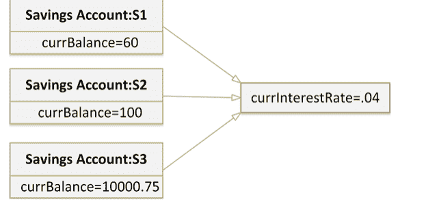
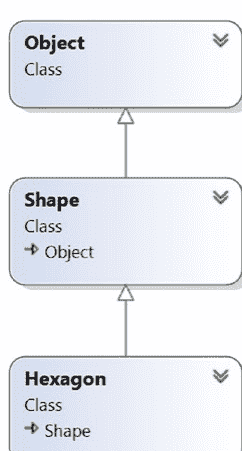
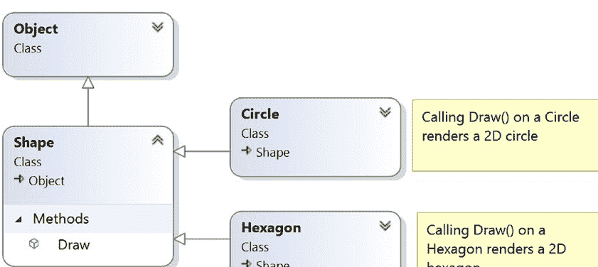
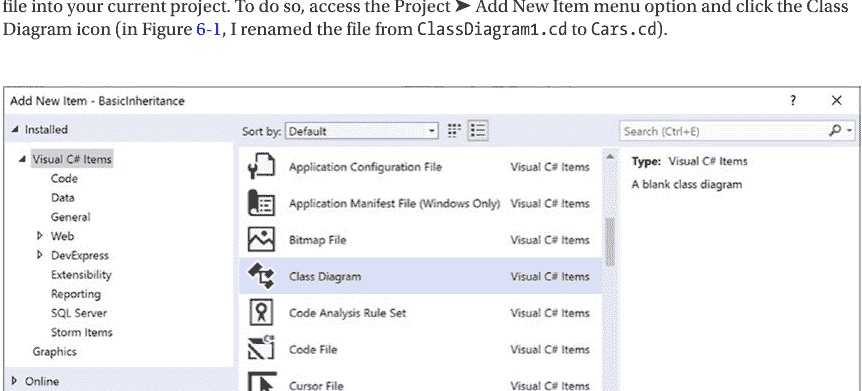
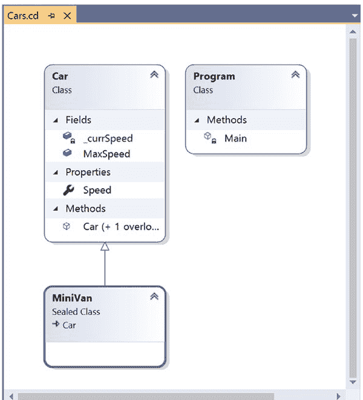
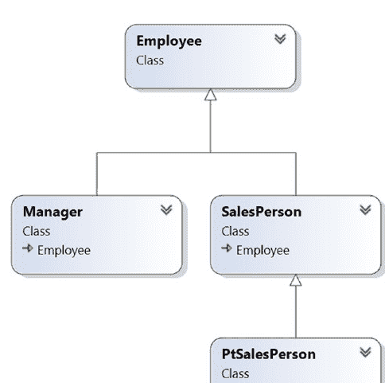
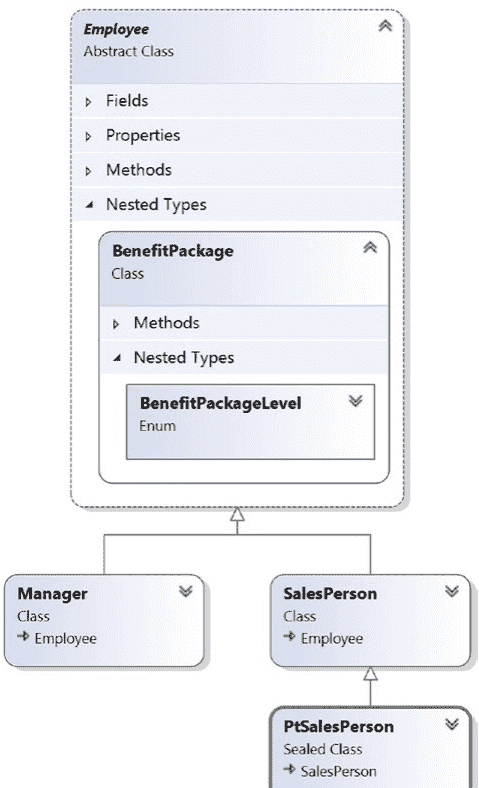
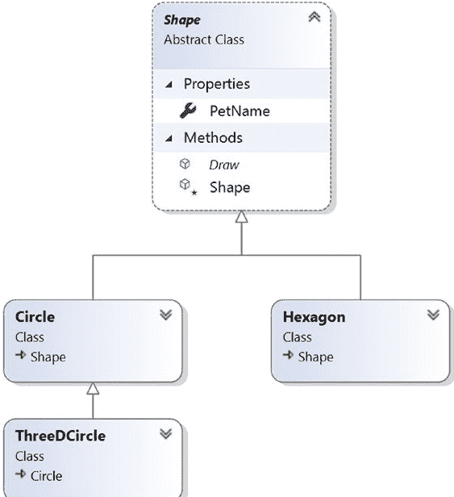
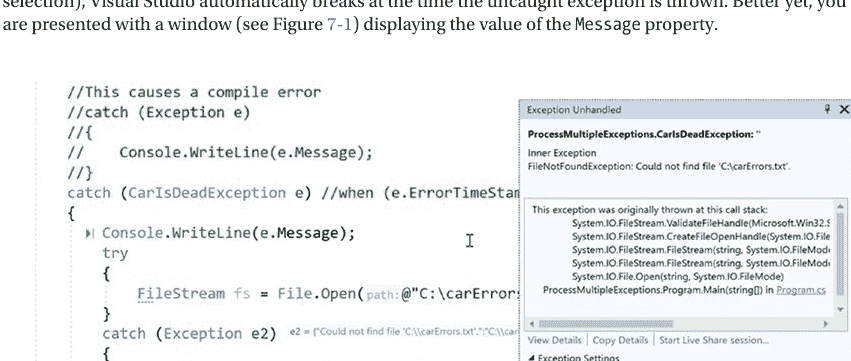
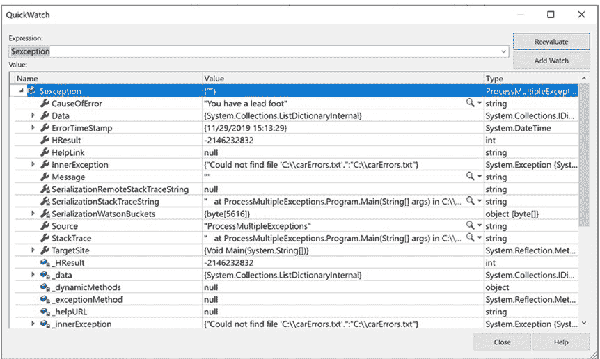

## 第 5 章

## 理解封装

在第 3 章和第 4 章中，您研究了许多核心语法构造，这些构造对于您可能正在开发的任何 .NET Core 应用程序来说都是常见的。在这里，您将开始研究 C# 的面向对象能力。首先需要做的是检查构建定义良好的类类型的过程，这些类类型支持任意数量的构造函数。在您理解了定义类和分配对象的基础知识之后，本章其余部分将研究封装的作用。在此过程中，您将学习如何定义类属性，并了解 `static` 关键字、对象初始化语法、只读字段、常量数据和分部类的详细信息。

## 介绍 C# 类类型

就 .NET 平台而言，最基本的编程构造之一是类类型。形式上，类是一种用户定义的类型，由字段数据（通常称为成员变量）和操作这些数据的成员（例如构造函数、属性、方法、事件等）组成。总的来说，字段数据集合表示类实例（也称为对象）的“状态”。诸如 C# 之类的面向对象语言的力量在于，通过将数据和相关功能分组到统一的类定义中，您能够根据现实世界中的实体来建模您的软件。

为了开始，创建一个名为 SimpleClassExample 的新 C# 控制台应用程序项目。接下来，在项目中插入一个新的类文件（命名为 Car.cs）。在这个新文件中，添加以下命名空间和 using 语句：

```
using System;

namespace SimpleClassExample
{
}
```

> 注意 对于这些示例，定义命名空间是严格必需的。但是，养成对所有代码使用命名空间的好习惯。命名空间在第 1 章中详细讨论过。

类在 C# 中使用 `class` 关键字定义。下面是最简单的声明（确保将类声明添加到 SimpleClassExample 命名空间内）：

```
class Car
{
}
```

定义类类型后，您需要考虑用于表示其状态的一组成员变量。例如，您可能决定汽车使用 `int` 数据类型来表示当前速度，并使用 `string` 数据类型来表示汽车的友好昵称。根据这些初步设计说明，更新您的 Car 类，如下所示：

```
class Car
{
    // The 'state' of the Car.
    public string petName;
    public int currSpeed;
}
```

请注意，这些成员变量使用 `public` 访问修饰符声明。一旦创建了此类型的对象，就可以直接访问类的公共成员。回想一下，术语“对象”用于描述使用 `new` 关键字创建的给定类类型的实例。

> 注意 类的字段数据很少（如果有的话）应定义为公共的。为了保持状态数据的完整性，更好的设计是将数据定义为私有（或可能受保护），并通过属性允许受控访问（如本章后面所示）。但是，为了使第一个示例尽可能简单，公共数据符合要求。

在定义了表示类状态的一组成员变量之后，下一步设计是建立对其行为进行建模的成员。对于此示例，Car 类将定义一个名为 SpeedUp() 的方法和另一个名为 PrintState() 的方法。将您的类更新为如下所示：

```
class Car
{
    // The 'state' of the Car.
    public string petName;
    public int currSpeed;

    // The functionality of the Car.
    // Using the expression-bodied member syntax
    // covered in Chapter 4
    public void PrintState()
        => Console.WriteLine("{0} is going {1} MPH.", petName, currSpeed);

    public void SpeedUp(int delta)
        => currSpeed += delta;
}
```

PrintState() 或多或少是一个诊断函数，它只是将给定 Car 对象的当前状态转储到命令窗口。SpeedUp() 将根据传入的 `int` 参数指定的量来增加 Car 对象的速度。现在，使用以下代码更新 Program.cs 文件中的顶级语句：

```
Console.WriteLine("***** Fun with Class Types *****
");
// Allocate and configure a Car object.
Car myCar = new Car();
```

```
myCar.petName = "Henry";
myCar.currSpeed = 10;

// Speed up the car a few times and print out the
// new state.
for (int i = 0; i <= 10; i++)
{
    myCar.SpeedUp(5);
    myCar.PrintState();
}
Console.ReadLine();
```

运行程序后，您将看到 Car 变量（myCar）在应用程序的整个生命周期中保持其当前状态，如下输出所示：

```
**** Fun with Class Types ****
Henry is going 15 MPH.
Henry is going 20 MPH.
Henry is going 25 MPH.
Henry is going 30 MPH.
Henry is going 35 MPH.
Henry is going 40 MPH.
Henry is going 45 MPH.
Henry is going 50 MPH.
Henry is going 55 MPH.
Henry is going 60 MPH.
Henry is going 65 MPH.
```

## 使用 new 关键字分配对象

如前面的代码示例所示，必须使用 `new` 关键字将对象分配到内存中。如果未使用 `new` 关键字并尝试在后续代码语句中使用类变量，您将收到编译器错误。例如，以下顶级语句将无法编译：

```
Console.WriteLine("**** Fun with Class Types ****\n");
// Compiler error! Forgot to use 'new' to create object!
Car myCar;
myCar.petName = "Fred";
```

要使用 `new` 关键字正确创建对象，您可以在单行代码中定义和分配 Car 对象。

```
Console.WriteLine("**** Fun with Class Types ****\n");
Car myCar = new Car();
myCar.petName = "Fred";
```


作为替代方案，如果你想在多行代码中分别定义和分配一个类实例，可以按如下方式操作：

```
Console.WriteLine("***** Fun with Class Types *****
");
Car myCar;
myCar = new Car();
myCar.petName = "Fred";
```

这里，第一条代码语句只是声明了一个对尚未确定的 Car 对象的引用。直到你将引用分配给一个对象时，该引用才会指向内存中的有效对象。

无论如何，到目前为止，你已经有一个简单的类，它定义了一些数据点和一些基本操作。要增强当前 Car 类的功能，你需要理解构造函数的角色。

## 理解构造函数

鉴于对象具有状态（由对象成员变量的值表示），程序员通常希望在使用对象之前为对象的字段数据分配相关值。目前，Car 类要求 petName 和 currSpeed 字段按字段逐个分配。对于当前示例而言，这并不成问题，因为你只有两个公共数据点。然而，一个类拥有数十个字段的情况并不少见。显然，为设置 20 个数据点而编写 20 条初始化语句是不合适的！

值得庆幸的是，C# 支持使用构造函数，这使得可以在创建时建立对象的状态。构造函数是类的特殊方法，在使用 new 关键字创建对象时会被间接调用。但是，与“普通”方法不同，构造函数永远没有返回值（甚至不是 void），并且始终与它们所构造的类同名。

## 理解默认构造函数的角色

每个 C# 类都提供了一个可以按需重新定义的“免费”默认构造函数。按定义，默认构造函数不接受参数。在将新对象分配到内存后，默认构造函数确保类的所有字段数据都被设置为适当默认值（请参阅第 3 章，了解 C# 数据类型的默认值信息）。

如果你对这些默认分配不满意，可以重新定义默认构造函数以满足你的需求。为说明这一点，按如下方式更新你的 C# Car 类：

```
class Car
{
    // The 'state' of the Car.
    public string petName;
    public int currSpeed;

    // A custom default constructor.
    public Car()
    {
        petName = "Chuck";
        currSpeed = 10;
    }
    ...
}
```

在这种情况下，你强制所有 Car 对象以 Chuck 的名字和 10 MPH 的速度开始生命。有了这个，你就可以按如下方式创建设置为这些默认值 的 Car 对象：

```
Console.WriteLine("***** Fun with Class Types *****
");
// Invoking the default constructor.
Car chuck = new Car();

// Prints "Chuck is going 10 MPH."
chuck.PrintState();
...
```

## 定义自定义构造函数

通常，类会在默认构造函数之外定义额外的构造函数。这样做，你为对象使用者提供了一种简单且一致的方式，在创建时直接初始化对象的状态。请考虑对 Car 类的以下更新，现在它支持总共三个构造函数：

```
class Car
{
    // The 'state' of the Car.
    public string petName;
    public int currSpeed;

    // A custom default constructor.
    public Car()
    {
        petName = "Chuck";
        currSpeed = 10;
    }

    // Here, currSpeed will receive the
    // default value of an int (zero).
    public Car(string pn)
    {
        petName = pn;
    }

    // Let caller set the full state of the Car.
    public Car(string pn, int cs)
    {
        petName = pn;
        currSpeed = cs;
    }
    ...
}
```

请记住，使一个构造函数与另一个构造函数不同（在 C# 编译器的眼中）的是构造函数参数的数量和/或类型。回顾第 4 章，当你定义一个同名但参数数量或类型不同的方法时，你就重载了该方法。因此，Car 类重载了构造函数，以提供多种在声明时创建对象的方式。无论如何，你现在可以使用任何公共构造函数创建 Car 对象。以下是一个示例：

```
Console.WriteLine("***** Fun with Class Types *****
");

// Make a Car called Chuck going 10 MPH.
Car chuck = new Car();
chuck.PrintState();

// Make a Car called Mary going 0 MPH.
Car mary = new Car("Mary");
mary.PrintState();

// Make a Car called Daisy going 75 MPH.
Car daisy = new Car("Daisy", 75);
daisy.PrintState();
...
```

## 构造函数作为表达式体成员（新 7.0）

C# 7 为表达式体成员样式添加了额外的用途。构造函数、终结器以及属性和索引器的 get/set 访问器现在接受新的语法。考虑到这一点，之前的构造函数可以写成如下形式：

```
// Here, currSpeed will receive the
// default value of an int (zero).
public Car(string pn) => petName = pn;
```

第二个自定义构造函数无法转换为表达式，因为表达式体成员必须是单行方法。

## 带有 out 参数的构造函数（新 7.3）

从 C# 7.3 开始，构造函数（以及稍后介绍的字段和属性初始化器）可以使用 out 参数。以下是在 Car 类中添加此构造函数的简单示例：

```
public Car(string pn, int cs, out bool inDanger)
{
    petName = pn;
    currSpeed = cs;
    if (cs > 100)
    {
        inDanger = true;
    }
    else
    {
        inDanger = false;
    }
}
```

必须遵循所有 out 参数的规则。在此示例中，inDanger 参数必须在构造函数结束前被赋一个值。

## 重新理解默认构造函数的角色

正如你刚刚学到的，所有类都提供了一个免费的默认构造函数。在你的项目中插入一个名为 Motorcycle.cs 的新文件，并添加以下内容来定义 Motorcycle 类：

```
using System;
namespace SimpleClassExample
{
    class Motorcycle
    {
        public void PopAWheely()
        {
            Console.WriteLine("Yeeeeee Haaaaaeeeww!");
        }
    }
}
```

现在你可以通过开箱即用的默认构造函数创建 Motorcycle 类型的实例。

```
Console.WriteLine("***** Fun with Class Types ****\n");
Motorcycle mc = new Motorcycle();
mc.PopAWheely();
...
```

然而，一旦你定义了带任意数量参数的自定义构造函数，默认构造函数就会被静默地从类中移除，不再可用。可以这样想：如果不定义自定义构造函数，C# 编译器会为你提供一个默认构造函数，以便对象使用者能够以字段数据设置为正确默认值的方式分配你的类型的实例。但是，当你定义一个独特的构造函数时，编译器会认为你已经自行处理了此事。

因此，如果你希望对象使用者既能使用默认构造函数创建你的类型的实例，又能使用你的自定义构造函数，你必须显式地重新定义默认构造函数。为此，请理解在绝大多数情况下，类的默认构造函数的实现是有意为空的，因为你只需要能够以默认值创建对象即可。请考虑对 Motorcycle 类的以下更新：

```
class Motorcycle
{
    public int driverIntensity;

    public void PopAWheely()
    {
        for (int i = 0; i <= driverIntensity; i++)
        {
            Console.WriteLine("Yeeeeee Haaaaaeeeww!");
        }
    }

    // Put back the default constructor, which will
    // set all data members to default values.
    public Motorcycle() {}
}
```

```
// Our custom constructor.
public Motorcycle(int intensity)
{
    driverIntensity = intensity;
}
```

> 注意 现在你更好地理解了类构造函数的角色，这里有一个不错的快捷方式。Visual Studio 和 Visual Studio Code 都提供了 ctor 代码片段。当你输入 ctor 并按 Tab 键时，IDE 会自动定义一个自定义默认构造函数。然后你可以添加自定义参数和实现逻辑。试试看。

## 理解 this 关键字的角色

C# 提供了 this 关键字，可用于访问当前类实例。this 关键字的一个可能用途是解决作用域歧义，当传入参数与类的某个数据字段同名时就会出现这种歧义。然而，你也可以采用一种命名约定来避免此类歧义；为说明 this 关键字的这种用法，用一个新的字符串字段（名为 name）更新你的 Motorcycle 类，以表示驾驶员的名字。接下来，添加一个名为 SetDriverName() 的方法，实现如下：

```
class Motorcycle
{
    public int driverIntensity;

    // New members to represent the name of the driver.
    public string name;
    public void SetDriverName(string name) => name = name;
    ...
}
```

尽管这段代码可以编译，C# 编译器会显示警告信息，告知你已将变量赋回给自身！为说明这一点，更新你的代码以调用 SetDriverName()，然后打印 name 字段的值。你可能会惊讶地发现 name 字段的值是一个空字符串！

```
// Make a Motorcycle with a rider named Tiny?
Motorcycle c = new Motorcycle(5);
c.SetDriverName("Tiny");
c.PopAWheely();
Console.WriteLine("Rider name is {0}", c.name); // Prints an empty name value!
```

问题在于 SetDriverName() 的实现将传入参数赋回给自身，因为编译器假定 name 指的是当前在方法作用域中的变量，而不是类作用域中的 name 字段。为了告知编译器你想要将当前对象的 name 数据字段设置为传入的 name 参数，只需使用 this 来解决歧义即可。

```
public void SetDriverName(string name) => this.name = name;
```


如果没有歧义，在访问数据字段或成员时，你并不需要使用 `this` 关键字。例如，如果你将字符串数据成员从 `name` 重命名为 `driverName`（这也需要你更新顶层的语句），使用 `this` 是可选的，因为此时已不存在作用域歧义。

```
class Motorcycle
{
    public int driverIntensity;
    public string driverName;

    public void SetDriverName(string name)
    {
        // These two statements are functionally the same.
        driverName = name;
        this.driverName = name;
    }
    ...
}
```

即使在没有歧义的情况下使用 `this` 收获不大，你在实现类成员时仍可能会发现该关键字很有用，因为像 Visual Studio 和 Visual Studio Code 这样的 IDE 在指定 `this` 时会启用 IntelliSense。当你忘记了类成员的名称并想快速回忆其定义时，这会很有帮助。

注意 一个常见的命名约定是以下划线开头私有（或内部）类级变量名（例如，_driverName），这样 IntelliSense 会将你的所有变量显示在列表顶部。在我们这个简单的示例中，所有字段都是公开的，因此该命名约定不适用。在本书的其余部分，你会看到以前导下划线命名的私有和内部变量。

## 使用 this 链式调用构造函数

`this` 关键字的另一个用途是使用一种称为构造函数链式调用的技术来设计类。当一个类定义了多个构造函数时，这种设计模式很有帮助。鉴于构造函数通常会验证传入的参数以执行各种业务规则，在一个类的构造函数集中找到冗余的验证逻辑是很常见的。考虑以下更新后的 Motorcycle：

```
class Motorcycle
{
    public int driverIntensity;
    public string driverName;

    public Motorcycle() { }

    // Redundant constructor logic!
    public Motorcycle(int intensity)
    {
        if (intensity > 10)
        {
            intensity = 10;
        }
        driverIntensity = intensity;
    }

    public Motorcycle(int intensity, string name)
    {
        if (intensity > 10)
        {
            intensity = 10;
        }
        driverIntensity = intensity;
        driverName = name;
    }
    ...
}
```

这里（也许是为了确保骑手的 安全）每个构造函数都确保强度水平永远不会大于 10。虽然这很好，但你在两个构造函数中确实有冗余的代码语句。这并不理想，因为如果你的规则发生变化（例如，强度不应大于 5 而不是 10），你现在需要在多个位置更新代码。

改善当前情况的一种方法是定义 Motorcycle 类中的一个方法来验证传入的参数。如果你这样做，每个构造函数都可以在进行字段赋值之前调用此方法。虽然这种方法确实允许你在业务规则发生变化时隔离需要更新的代码，但你现在会遇到以下冗余：

```
class Motorcycle
{
    public int driverIntensity;
    public string driverName;

    // Constructors.
    public Motorcycle() { }

    public Motorcycle(int intensity)
    {
        SetIntensity(intensity);
    }

    public Motorcycle(int intensity, string name)
    {
        SetIntensity(intensity);
        driverName = name;
    }

    public void SetIntensity(int intensity)
    {
        if (intensity > 10)
        {
            intensity = 10;
        }
        driverIntensity = intensity;
    }
    ...
}
```

更简洁的方法是将接受最多参数的构造函数指定为“主构造函数”，并让其实现执行所需的验证逻辑。其余构造函数可以使用 `this` 关键字将传入的参数转发给主构造函数，并在必要时提供任何附加参数。这样，你只需要担心维护整个类的单个构造函数，而其余构造函数基本上是空的。

以下是 Motorcycle 类的最终迭代（为说明起见增加了一个额外的构造函数）。在链式调用构造函数时，注意 `this` 关键字如何通过冒号运算符“悬挂”在构造函数的声明之外，超出构造函数本身的作用域。

```
class Motorcycle
{
    public int driverIntensity;
    public string driverName;

    // Constructor chaining.
    public Motorcycle() {}
    public Motorcycle(int intensity)
        : this(intensity, "") {}
    public Motorcycle(string name)
        : this(0, name) {}

    // This is the 'master' constructor that does all the real work.
    public Motorcycle(int intensity, string name)
    {
        if (intensity > 10)
        {
            intensity = 10;
        }
        driverIntensity = intensity;
        driverName = name;
    }
    ...
}
```

要理解，使用 `this` 关键字链式调用构造函数永远不是强制性的。然而，当你使用这种技术时，你往往会得到更易维护和更简洁的类定义。再次使用这种技术，你可以简化你的编程任务，因为实际工作被委托给单个构造函数（通常是参数最多的构造函数），而其他构造函数只是简单地“推卸责任”。

注意 回顾第 4 章，C# 支持可选参数。如果你在使用类构造函数时使用可选参数，你可以用更少的代码实现与构造函数链式调用相同的优势。你将在稍后看到如何做到这一点。

## 观察构造函数流程

最后一点需要注意的是，一旦构造函数将参数传递给指定的主构造函数（并且该构造函数处理了数据），最初由调用者调用的构造函数将完成执行任何剩余的代码语句。为了澄清，请为 Motorcycle 类的每个构造函数添加一个合适的 `Console.WriteLine()` 调用。

```
class Motorcycle
{
    public int driverIntensity;
    public string driverName;

    // Constructor chaining.
    public Motorcycle()
    {
        Console.WriteLine("In default ctor");
    }

    public Motorcycle(int intensity)
        : this(intensity, "")
    {
        Console.WriteLine("In ctor taking an int");
    }

    public Motorcycle(string name)
        : this(0, name)
    {
        Console.WriteLine("In ctor taking a string");
    }

    // This is the 'master' constructor that does all the real work.
    public Motorcycle(int intensity, string name)
    {
        Console.WriteLine("In master ctor ");
        if (intensity > 10)
        {
            intensity = 10;
        }
        driverIntensity = intensity;
        driverName = name;
    }
    ...
}
```

现在，确保你的顶层语句按如下方式使用 Motorcycle 对象：

```
Console.WriteLine("***** Fun with class Types *****");

// Make a Motorcycle.
Motorcycle c = new Motorcycle(5);
c.SetDriverName("Tiny");
c.PopAWheely();
Console.WriteLine("Rider name is {0}", c.driverName);
Console.ReadLine();
```

有了这个，请思考前面代码的输出：

```
**** Fun with Motorcycles ****
In master ctor
In ctor taking an int
Yeeeeeee Haaaaaeeeww!
Yeeeeeee Haaaaaeeeww!
Yeeeeeee Haaaaaeeeww!
Yeeeeeee Haaaaaeeeww!
Yeeeeeee Haaaaaeeeww!
Yeeeeeee Haaaaaeeeww!
Rider name is Tiny
```

正如你所见，构造函数逻辑的流程如下：

- 你通过调用需要单个 int 的构造函数来创建对象。
- 该构造函数将提供的数据转发给主构造函数，并提供调用者未指定的任何额外启动参数。
- 主构造函数将传入的数据分配给对象的字段数据。
- 控制权返回到最初调用的构造函数并执行任何剩余的代码语句。

使用构造函数链式调用的好处是这种编程模式适用于任何版本的 C# 语言和 .NET 平台。然而，如果你以 .NET 4.0 及更高版本为目标，你可以通过使用可选参数作为传统构造函数链式调用的替代方案来进一步简化编程任务。

## 重新审视可选参数

在第 4 章中，你学习了可选参数和命名参数。回想一下，可选参数允许你为传入参数定义提供的默认值。如果调用者对这些默认值满意，他们无需指定唯一值；但是，他们可以这样做以向对象提供自定义数据。考虑以下 Motorcycle 版本，它现在使用单个构造函数定义提供了多种构造对象的方式：

```
class Motorcycle
{
    // Single constructor using optional args.
    public Motorcycle(int intensity = 0, string name = "")
    {
        if (intensity > 10)
        {
            intensity = 10;
        }
        driverIntensity = intensity;
```


```
driverName = name;
}
...
}
```

有了这个构造函数，你现在可以使用零个、一个或两个参数来创建一个新的 Motorcycle 对象。请记住，命名参数语法允许你本质上跳过可接受的默认值（参见第 3 章）。

```
static void MakeSomeBikes()
{
    // driverName = "", driverIntensity = 0
    Motorcycle m1 = new Motorcycle();
    Console.WriteLine("Name= {0}, Intensity= {1}",
        m1.driverName, m1.driverIntensity);

    // driverName = "Tiny", driverIntensity = 0
    Motorcycle m2 = new Motorcycle(name:"Tiny");
    Console.WriteLine("Name= {0}, Intensity= {1}",
        m2.driverName, m2.driverIntensity);

    // driverName = "", driverIntensity = 7
    Motorcycle m3 = new Motorcycle(7);
    Console.WriteLine("Name= {0}, Intensity= {1}",
        m3.driverName, m3.driverIntensity);
}
```

无论如何，到目前为止，你能够定义一个具有字段数据（也称为成员变量）以及各种操作（如方法和构造函数）的类。接下来，让我们正式化 static 关键字的角色。

## 理解 static 关键字

C# 类可以定义任意数量的静态成员，这些成员使用 static 关键字声明。当你这样做时，所涉及的成员必须直接从类级别调用，而不是从对象引用变量调用。为了说明这种区别，请考虑你的好朋友 System.Console。正如你所见，你不会从对象级别调用 WriteLine() 方法，如下所示：

```
// 编译器错误！WriteLine() 不是对象级别方法！
Console c = new Console();
c.WriteLine("I can't be printed...");
```

相反，只需将类名作为前缀添加到静态 WriteLine() 成员即可。

```
// 正确！WriteLine() 是一个静态方法。
Console.WriteLine("Much better! Thanks...");
```

简单来说，静态成员是被认为（由类设计者）如此常见，以至于在调用成员之前无需创建类的实例。虽然任何类都可以定义静态成员，但它们在实用程序类中很常见。按定义，实用程序类是一个

不维护任何对象级别状态并且不使用 new 关键字创建的类。相反，实用程序类将所有功能作为类级别（也称为静态）成员公开。

例如，如果你使用 Visual Studio 对象浏览器（通过 View ▶ Object Browser 菜单项）查看 System 命名空间，你会看到 Console、Math、Environment 和 GC 类（其中其他）中的所有成员都通过静态成员公开其所有功能。这些只是 .NET Core 基础类库中发现的几个实用程序类。

再次注意，静态成员不仅存在于实用程序类中；它们可以是任何类定义的一部分。只要记住静态成员会将给定项目提升到类级别而不是对象级别即可。正如你将在接下来的几个部分中看到的那样，static 关键字可以应用于以下内容：

- 类的数据
- 类的方法
- 类的属性
- 构造函数
- 整个类定义
- 与 C# using 关键字结合使用

让我们从静态数据的概念开始，看看我们的每个选项。

> 注 你将在本章后面在检查属性时检查静态属性的作用。

## 定义静态字段数据

在设计类时，大多数时候你将数据定义为实例级数据，或者换句话说，非静态数据。当你定义实例级数据时，你知道每次创建新对象时，对象都会维护自己独立的数据副本。相比之下，当你定义类的静态数据时，内存由该类别的所有对象共享。

为了看到这种区别，创建一个名为 StaticDataAndMembers 的新控制台应用程序项目。现在，将一个名为 SavingsAccount.cs 的文件插入到你的项目中，并在该文件中创建一个名为 SavingsAccount 的新类。首先定义一个实例级变量（用于建模当前余额）以及一个自定义构造函数来设置初始余额。

```
using System;
namespace StaticDataAndMembers
{
    // A simple savings account class.
    class SavingsAccount
    {
        // Instance-level data.
        public double currBalance;
        public SavingsAccount(double balance)
        {
            currBalance = balance;
        }
    }
}
```

当你创建 SavingsAccount 对象时，会为每个对象分配 currBalance 字段的内存。因此，你可以创建五个不同的 SavingsAccount 对象，每个对象都有自己唯一的余额。此外，如果你更改一个账户的余额，其他对象不会受到影响。

另一方面，静态数据只分配一次，并在同一类的所有对象之间共享。将一个名为 currInterestRate 的静态变量添加到 SavingsAccount 类中，默认值为 0.04。

```
// A simple savings account class.
class SavingsAccount
{
    // A static point of data.
    public static double currInterestRate = 0.04;

    // Instance-level data.
    public double currBalance;

    public SavingsAccount(double balance)
    {
        currBalance = balance;
    }
}
```

在顶层语句中创建三个 SavingsAccount 实例，如下所示：

```
using System;
using StaticDataAndMembers;

Console.WriteLine("***** Fun with Static Data *****
");
SavingsAccount s1 = new SavingsAccount(50);
SavingsAccount s2 = new SavingsAccount(100);
SavingsAccount s3 = new SavingsAccount(10000.75);
Console.ReadLine();
```

内存中数据的分配可能看起来像图 5-1。



图 5-1. 静态数据只分配一次，并在类的所有实例之间共享

这里的假设是所有储蓄账户都应具有相同的利率。因为静态数据由同一类别的所有对象共享，所以如果你以任何方式更改它，所有对象在下次访问静态数据时都会“看到”新值，因为它们本质上都在查看同一个内存位置。要了解如何更改（或获取）静态数据，你需要考虑静态方法的作用。

## 定义静态方法

让我们更新 SavingsAccount 类以定义两个静态方法。第一个静态方法 GetInterestRate() 将返回当前利率，而第二个静态方法 SetInterestRate() 将允许你更改利率。

```
// A simple savings account class.
class SavingsAccount
{
    // Instance-level data.
    public double currBalance;

    // A static point of data.
    public static double currInterestRate = 0.04;

    public SavingsAccount(double balance)
    {
        currBalance = balance;
    }

    // Static members to get/set interest rate.
    public static void SetInterestRate(double newRate)
        => currInterestRate = newRate;

    public static double GetInterestRate()
        => currInterestRate;
}
```

现在，观察以下用法：

```
using System;
using StaticDataAndMembers;

Console.WriteLine("***** Fun with Static Data *****
");
SavingsAccount s1 = new SavingsAccount(50);
SavingsAccount s2 = new SavingsAccount(100);

// Print the current interest rate.
Console.WriteLine("Interest Rate is: {0}", SavingsAccount.GetInterestRate());

// Make new object, this does NOT 'reset' the interest rate.
SavingsAccount s3 = new SavingsAccount(10000.75);
Console.WriteLine("Interest Rate is: {0}", SavingsAccount.GetInterestRate());

Console.ReadLine();
```

前一段代码的输出如下所示：

```
***** Fun with Static Data *****
Interest Rate is: 0.04
Interest Rate is: 0.04
```

正如你所见，当你创建 SavingsAccount 类的新实例时，静态数据的值不会重置，因为 CoreCLR 只会将静态数据分配到内存中一次。此后，类型为 SavingsAccount 的所有对象都对静态 currInterestRate 字段使用相同的值。

在设计任何 C# 类时，你的设计挑战之一是确定哪些数据片段应定义为静态成员，哪些不应。虽然没有硬性规定，但请记住静态数据字段由该类型的所有对象共享。因此，如果你定义的数据点应由所有对象在它们之间共享，那么 static 就是正确的方法。

考虑如果利率变量未使用 static 关键字定义会发生什么。这意味着每个 SavingsAccount 对象都将拥有自己的 currInterestRate 字段副本。现在，假设你创建了 100 个 SavingsAccount 对象并需要更改利率。那将要求你调用 SetInterestRate() 方法 100 次！显然，这不是建模“共享数据”的有用方法。再次，静态数据在你有一个应对该类别的所有对象通用的值时非常完美。

> 注 静态成员引用其实现中的非静态成员是编译器错误。相关地，在静态成员上使用 this 关键字是错误的，因为 this 意味着一个对象！

## 定义静态构造函数

典型的构造函数用于在创建时设置对象的实例级数据的值。但是，如果你尝试在典型的构造函数中为静态数据点分配值会怎样？你可能会惊讶地发现，每次创建新对象时该值都会被重置。

为了说明这一点，假设你已按如下方式更新了 SavingsAccount 类构造函数（另请注意，你不再内联分配 currInterestRate 字段）：

```
class SavingsAccount
{
    public double currBalance;
    public static double currInterestRate;

    // Notice that our constructor is setting
    // the static currInterestRate value.
    public SavingsAccount(double balance)
    {
        currInterestRate = 0.04; // This is static data!
        currBalance = balance;
    }
    ...
}
```


现在，假设你在顶层语句中编写了以下代码：

// Make an account.
SavingsAccount s1 = new SavingsAccount(50);

// Print the current interest rate.
Console.WriteLine("Interest Rate is: {0}", SavingsAccount.GetInterestRate());

// Try to change the interest rate via property.
SavingsAccount.SetInterestRate(0.08);

// Make a second account.
SavingsAccount s2 = new SavingsAccount(100);

// Should print 0.08...right??
Console.WriteLine("Interest Rate is: {0}", SavingsAccount.GetInterestRate());
Console.ReadLine();
```

如果执行上述代码，你会看到 `currInterestRate` 变量在每次创建新的 `SavingsAccount` 对象时都会被重置，并且始终设置为 0.04。很明显，在普通的实例级构造函数中设置静态数据的数值完全违背了初衷。每创建一次新对象，类级数据就会被重置。设置静态字段的一种方法是使用成员初始化语法，就像你最初做的那样。

```
class SavingsAccount
{
    public double currBalance;

    // A static point of data.
    public static double currInterestRate = 0.04;
    ...
}
```

这种方法可以确保静态字段无论创建多少个对象都只被赋值一次。然而，如果你的静态数据的值需要在运行时获取怎么办？例如，在典型的银行应用程序中，利率变量的值会从数据库或外部文件读取。执行此类任务通常需要一个方法作用域，例如构造函数来执行代码语句。

因此，C# 允许你定义静态构造函数，从而可以安全地设置静态数据的值。考虑对你的类进行的以下更新：

```
class SavingsAccount
{
    public double currBalance;
    public static double currInterestRate;

    public SavingsAccount(double balance)
    {
        currBalance = balance;
    }
}
```

```
// A static constructor!
static SavingsAccount()
{
    Console.WriteLine("In static ctor!");
    currInterestRate = 0.04;
}
...
}
```

简单来说，静态构造函数是一种特殊的构造函数，是在值在编译时未知时初始化静态数据值的理想位置（例如，你需要从外部文件读取值、从数据库读取值、生成随机数等等）。如果你重新运行之前的代码，就会发现预期的输出。请注意，消息“In static ctor!”只打印一次，因为 CoreCLR 会在首次使用之前调用所有静态构造函数，并且在该应用程序实例中不再调用它们。

```
***** Fun with Static Data *****
In static ctor!
Interest Rate is: 0.04
Interest Rate is: 0.08
```

以下是关于静态构造函数的几点注意事项：

- 给定类只能定义一个静态构造函数。换句话说，静态构造函数不能被重载。
- 静态构造函数不接受访问修饰符，也不能接受任何参数。
- 静态构造函数恰好执行一次，无论创建了多少个该类型的对象。
- 运行时在创建类的实例或在调用方调用第一个静态成员之前调用静态构造函数。
- 静态构造函数在任何实例级构造函数之前执行。

有了此修改，当你创建新的 `SavingsAccount` 对象时，静态数据的值会被保留，因为静态成员只在静态构造函数中设置一次，无论创建了多少个对象。

## Defining Static Classes

也可以直接在类级别应用 `static` 关键字。当类被定义为静态时，就不能使用 `new` 关键字创建它，并且它只能包含标记为 `static` 的成员或数据字段。如果不是这种情况，你会收到编译器错误。

> Note Recall that a class (or structure) that exposes only static functionality is often termed a utility class. When designing a utility class, it is good practice to apply the static keyword to the class definition.

乍一看，这似乎是一个相当奇怪的功能，因为一个无法创建的类看起来并不那么有用。然而，如果你创建一个类，其中只包含静态成员和/或常量数据，那么该类根本不需要被分配！为了说明这一点，创建一个名为 `TimeUtilClass` 的新类并按如下方式定义它：

```
using System;
namespace StaticDataAndMembers
{
    // Static classes can only
    // contain static members!
    static class TimeUtilClass
    {
        public static void PrintTime()
            => Console.WriteLine(DateTime.Now.ToShortTimeString());

        public static void PrintDate()
            => Console.WriteLine(DateTime.Today.ToShortDateString());
    }
}
```

由于该类已使用 `static` 关键字定义，你不能使用 `new` 关键字创建 `TimeUtilClass` 的实例。相反，所有功能都从类级别公开。要测试此类，请将以下内容添加到顶层语句中：

// This is just fine.
TimeUtilClass.PrintDate();
TimeUtilClass.PrintTime();

// Compiler error! Can't create instance of static classes!
TimeUtilClass u = new TimeUtilClass();

Console.ReadLine();
```

## Importing Static Members via the C# using Keyword

C# 6 添加了使用 `using` 关键字导入静态成员的支持。为了说明这一点，请考虑当前定义实用程序类的 C# 文件。由于你正在调用 `Console` 类的 `WriteLine()` 方法以及 `DateTime` 类的 `Now` 和 `Today` 属性，你必须为 `System` 命名空间有一个 `using` 语句。由于这些类的成员都是静态的，你可以用以下静态 using 指令修改你的代码文件：

// Import the static members of Console and DateTime.
using static System.Console;
using static System.DateTime;
```

有了这些“静态导入”，你的其余代码文件能够直接使用 `Console` 和 `DateTime` 类的静态成员，而无需前缀定义类。例如，你可以像这样更新你的实用程序类：

```
static class TimeUtilClass
{
```

```
public static void PrintTime()
    => WriteLine(Now.ToShortTimeString());

public static void PrintDate()
    => WriteLine(Today.ToShortDateString());
}
```

使用导入静态成员进行代码简化的更现实的示例可能涉及大量使用 `System.Math` 类（或其他实用程序类）的 C# 类。由于该类只有静态成员，因此为该类型设置一个静态 using 语句然后直接在你的代码文件中调用 `Math` 类的成员可能会更容易。

然而，请注意，过度使用静态导入语句可能会导致潜在的混淆。首先，如果多个类定义了 `WriteLine()` 方法，编译器会感到困惑，阅读代码的其他人也会感到困惑。其次，除非开发人员熟悉 .NET Core 代码库，否则他们可能不知道 `WriteLine()` 是 `Console` 类的成员。除非人们注意到 C# 代码文件顶部的一组静态导入，否则他们可能完全不确定此方法实际定义在哪里。出于这些原因，我将在本文中限制使用静态 using 语句。

无论如何，在本章的这一点上，你应该能够舒适地定义包含构造函数、字段以及各种静态（和非静态）成员的简单类类型。现在你了解了类构造的基础知识，可以正式研究面向对象编程的三大支柱。

## Defining the Pillars of OOP

所有面向对象的语言（C#、Java、C++、Visual Basic 等）都必须处理这三个核心原则，通常称为面向对象编程（OOP）的支柱：

- Encapsulation: How does this language hide an object’s internal implementation details and preserve data integrity?
- Inheritance: How does this language promote code reuse?
- Polymorphism: How does this language let you treat related objects in a similar way?

在深入研究每个支柱的细节之前，了解它们的基本作用很重要。以下是每个支柱的概述，将在本章剩余部分和下一章中进行详细检查。

## Understanding the Role of Encapsulation

OOP 的第一个支柱称为封装。此特性归结为语言隐藏不必要的实现细节并保护数据完整性的能力。例如，假设你正在使用一个名为 `DatabaseReader` 的类，它有两个主要方法，名为 `Open()` 和 `Close()`。

```
// Assume this class encapsulates the details of opening and closing a database.
DatabaseReader dbReader = new DatabaseReader();
dbReader.Open("@C:\AutoLot.mdf");

// Do something with data file and close the file.
dbReader.Close();
```

虚构的 `DatabaseReader` 类封装了定位、加载、操作和关闭数据文件的内部细节。程序员喜欢封装，因为 OOP 的这一支柱使编码任务更简单。无需担心幕后执行任务的众多代码行


DatabaseReader 类的工作。您所要做的就是创建一个实例并发送适当的指令（例如，“打开位于我的 C 驱动器上的名为 AutoLot.mdf 的文件”）。

与封装编程逻辑的概念密切相关的是数据保护的想法。理想情况下，对象的状态数据应使用 private、internal 或 protected 关键字来指定。这样，外部世界必须有礼貌地请求才能更改或获取底层值。这是一件好事，因为公开声明的数据点很容易被破坏（理想情况下是意外而不是故意！）。您将在稍后正式研究封装的这一方面。

## 理解继承的作用

面向对象编程的下一个支柱是继承，其本质上是语言允许您基于现有类定义构建新类定义的能力。从本质上讲，继承允许您通过将核心功能继承到派生子类（也称为子代类）中来扩展基类（或父类）的行为。图 5-2 显示了一个简单的示例。



图 5-2. “is-a” 关系

您可以将图 5-2 中的图表解读为“一个六边形是 Shape，而 Shape 是 Object”。当您通过这种形式的继承将类关联起来时，您就在类型之间建立了“is-a”关系。“is-a”关系被称为继承。

在这里，可以假设 Shape 定义了一些对所有后代都通用的成员（也许是一个表示绘制形状颜色的值，以及表示高度和宽度的其他值）。由于 Hexagon 类扩展了 Shape，因此它继承了 Shape 和 Object 定义的核心功能，同时还定义了自己的额外与六边形相关的细节（无论它们是什么）。

> 注 在 .NET/.NET Core 平台下，System.Object 总是任何类层次结构中的最顶层父类，它为所有类型定义了一些通用功能（在第 6 章中全面描述）。

在面向对象编程的世界中，还有另一种代码重用形式：包含/委托模型，也称为“has-a”关系或聚合。这种重用形式不用于建立父子关系。相反，“has-a”关系允许一个类定义另一个类的成员变量并间接地向对象使用者公开其功能（如果需要）。

例如，假设您再次对汽车进行建模。您可能希望表达汽车“has-a”收音机的想法。试图从 Radio 派生 Car 类或反之亦然是不合逻辑的（汽车“is-a”收音机？我看不是！）。相反，您有两个独立的类协同工作，其中 Car 类创建并公开 Radio 的功能。

```
class Radio
{
    public void Power(bool turnOn)
    {
        Console.WriteLine("Radio on: {0}", turnOn);
    }
}
```

```
class Car
{
    // Car 'has-a' Radio.
    private Radio myRadio = new Radio();

    public void TurnOnRadio(bool onOff)
    {
        // Delegate call to inner object.
        myRadio.Power(onOff);
    }
}
```

请注意，对象使用者并不知道 Car 类正在使用内部 Radio 对象。

```
// Call is forwarded to Radio internally.
Car viper = new Car();
viper.TurnOnRadio(false);
```

## 理解多态的作用

面向对象编程的最后一个支柱是多态。该特性捕获了语言以类似方式处理相关对象的能力。具体来说，面向对象语言的这一原则允许基类定义一组成员（正式称为多态接口），这些成员可供所有后代使用。类的多态接口由任意数量的 virtual 或 abstract 成员构造而成（有关完整细节，请参阅第 6 章）。

简而言之，virtual 成员是基类中的一个成员，它定义了默认实现，该实现可以被派生类更改（或更正式地说，重写）。相比之下，abstract 方法是基类中的一个成员，它不提供默认实现但提供签名。当一个类从定义了 abstract 方法的基类派生时，它必须被派生类型重写。在任何一种情况下，当派生类型重写基类定义的方法时，它们本质上是在重新定义对同一请求的响应方式。

为了预览多态，让我们提供图 5-3 中显示的形状层次结构背后的一些细节。假设 Shape 类定义了一个名为 Draw() 的 virtual 方法，它不带参数。鉴于

每个形状都需要以独特的方式渲染自己，像 Hexagon 和 Circle 这样的子类可以自由地按自己的喜好重写此方法（参见图 5-3）。



图 5-3. 经典多态

在设计多态接口后，您就可以开始在代码中做出各种假设。例如，鉴于 Hexagon 和 Circle 派生自一个共同的父类（Shape），Shape 类型的数组可以包含派生自该基类的任何内容。此外，鉴于 Shape 为所有派生类型定义了多态接口（本例中的 Draw() 方法），您可以假设数组中的每个成员都具有此功能。

考虑以下代码，它指示 Shape 派生类型的数组使用 Draw() 方法自行渲染：

```
Shape[] myShapes = new Shape[3];
myShapes[0] = new Hexagon();
myShapes[1] = new Circle();
myShapes[2] = new Hexagon();

foreach (Shape s in myShapes)
{
    // Use the polymorphic interface!
    s.Draw();
}
Console.ReadLine();
```

这结束了我们对面向对象编程支柱的简要概述。现在您已经在脑海中掌握了理论，本章的其余部分将探讨 C# 下封装处理的进一步细节，从访问修饰符开始。 第 6 章将处理继承和多态的细节。

## 理解 C# 访问修饰符（更新 7.2）

在使用封装时，您必须始终考虑类型的哪些方面对应用程序的各个部分可见。具体来说，类型（类、接口、结构、枚举和委托）以及它们的成员（属性、方法、构造函数和字段）是使用特定关键字定义的，以控制项目对应用程序其他部分的“可见性”。尽管 C# 定义了许多关键字来控制访问，但它们在可以成功应用的位置（类型或成员）上有所不同。表 5-1 记录了每个访问修饰符的作用以及可以应用的位置。

## 表 5-1. C# 访问修饰符

| C# 访问修饰符 | 可应用于 | 含义 |
|---|---|---|
| public | 类型或类型成员 | 公共项目没有任何访问限制。公共成员可以从对象以及任何派生类访问。公共类型可以从其他外部程序集访问。 |
| private | 类型成员或嵌套类型 | 私有项目只能由定义该项目的类（或结构）访问。 |
| protected | 类型成员或嵌套类型 | 受保护的项目可以由定义它的类和任何子代类使用。它们不能从继承链之外访问。 |
| internal | 类型或类型成员 | 内部项目只能在当前程序集中访问。其他程序集可以被明确授予查看内部项目的权限。 |
| protected internal | 类型成员或嵌套类型 | 当 protected 和 internal 关键字组合在项目上时，该项目可在定义程序集内、在定义类内以及在定义程序集内或外的派生类中访问。 |
| private protected (new 7.2) | 类型成员或嵌套类型 | 当 private 和 protected 关键字组合在项目上时，该项目可在定义类内以及同一程序集中的派生类中访问。 |

在本章中，您只关心 public 和 private 关键字。 后续章节将研究 internal 和 protected internal 修饰符的作用（在构建代码库和单元测试时很有用）以及 protected 修饰符（在创建类层次结构时很有用）。

## 使用默认访问修饰符

默认情况下，类型成员隐式为 private，而类型隐式为 internal。 因此，以下类定义自动设置为 internal，而该类型的默认构造函数自动设置为 private（然而，正如您所料，您很少希望类构造函数为 private）：

```
// An internal class with a private default constructor.
class Radio
{
    Radio(){}
}


如果您想明确表达，可以自行添加这些关键字而不会产生不良影响（除了多敲几个键之外）。

```
// An internal class with a private default constructor.
internal class Radio
{
    private Radio(){}
}
```

要允许程序的其他部分调用对象的成员，您必须使用 public 关键字（或可能是 protected 关键字，您将在下一章学习到）来定义它们。此外，如果您想将 Radio 暴露给外部程序集（在构建大型解决方案或代码库时很有用），您需要添加 public 修饰符。

```
// A public class with a public default constructor.
public class Radio
{
    public Radio(){}
}
```

## 使用访问修饰符和嵌套类型

如表 5-1 所述，private、protected、protected internal 和 private protected 访问修饰符可以应用于嵌套类型。第 6 章将详细讨论嵌套。此时您需要知道的是，嵌套类型是在类或结构的作用域内直接声明的类型。举例来说，这里有一个私有枚举（名为 CarColor），嵌套在公有类（名为 SportsCar）中：

```
public class SportsCar
{
    // OK! Nested types can be marked private.
    private enum CarColor
    {
        Red, Green, Blue
    }
}
```

在这里，允许在嵌套类型上应用 private 访问修饰符。然而，非嵌套类型（例如 SportsCar）只能使用 public 或 internal 修饰符来定义。因此，以下类定义是非法的：

```
// Error! Nonnested types cannot be marked private!
private class SportsCar
{}
```

## 理解第一支柱：C# 的封装服务

封装的概念围绕着这样一个观点：对象的内部数据不应从对象实例直接访问。相反，类数据被定义为 private。如果对象使用者想要更改对象的状态，它会通过使用 public 成员间接进行操作。为了说明封装服务的需求，假设您创建了以下类定义：

```
// A class with a single public field.
class Book
{
    public int numberOfPages;
}
```

公有数据的问题在于数据本身没有能力“理解”当前分配给它的值是否符合系统的当前业务规则。正如您所知，C# int 的上限相当大（2,147,483,647）。因此，编译器允许以下赋值：

```
// Humm. That is one heck of a mini-novel!
Book miniNovel = new Book();
miniNovel.numberOfPages = 30_000_000;
```

虽然您没有超出 int 数据类型的边界，但很明显，一本页数为 30,000,000 页的小型小说是有些不合理的。正如您所见，公有字段没有提供一种方法来捕获逻辑上的上限（或下限）。如果您的当前系统有业务规则规定一本书必须在 1 到 1,000 页之间，您将无法以编程方式强制执行这一点。正因如此，公有字段通常在生产级类定义中没有位置。

> 注意 更具体地说，表示对象状态的类的成员不应标记为 public。正如您将在本章后面看到的那样，public 常量和 public 只读字段非常有用。

封装提供了一种保护对象状态数据完整性的方式。与定义容易导致数据损坏的公有字段相比，您应该养成定义私有数据并通过两种主要技术间接操作的习惯。

- 您可以定义一对公有访问器（get）和修改器（set）方法。
- 您可以定义一个公有属性。

无论您选择哪种技术，关键点在于一个封装良好的类应该保护其数据并隐藏其内部运作细节，不让外界窥探。这通常被称为黑盒编程。这种方法的优点是对象可以自由地在内部更改给定方法的实现方式，而不会破坏使用它的任何现有代码，前提是该方法的参数和返回值保持不变。

## 使用传统访问器和修改器进行封装

在本章的剩余页面中，您将构建一个相当完整的类来模拟一个通用员工。为了开始，先创建一个名为 EmployeeApp 的新控制台应用程序项目，并创建一个名为 Employee.cs 的新类文件。使用以下命名空间、字段、方法和构造函数更新 Employee 类：

```
using System;
namespace EmployeeApp
{
class Employee
{
    // Field data.
    private string _empName;
    private int _empId;
    private float _currPay;

    // Constructors.
    public Employee() {}
    public Employee(string name, int id, float pay)
    {
        _empName = name;
        _empId = id;
        _currPay = pay;
    }

    // Methods.
    public void GiveBonus(float amount) => _currPay += amount;
    public void DisplayStats()
    {
        Console.WriteLine("Name: {0}", _empName);
        Console.WriteLine("ID: {0}", _empId);
        Console.WriteLine("Pay: {0}", _currPay);
    }
}
```

请注意，Employee 类的字段目前使用 private 关键字定义。鉴于此，_empName、_empId 和 _currPay 字段不能从对象变量直接访问。因此，您代码中的以下逻辑将导致编译器错误：

```
Employee emp = new Employee();
// Error! Cannot directly access private members
// from an object!
emp._empName = "Marv";
```

如果您希望外部世界与员工的姓名进行交互，传统的方法是定义一个访问器（get 方法）和一个修改器（set 方法）。get 方法的角色是向调用者返回底层状态数据的当前值。set 方法允许调用者在满足定义的业务规则的情况下更改底层状态数据的当前值。

为了说明，让我们封装 empName 字段。为此，将以下公有方法添加到 Employee 类。请注意，SetName() 方法对传入的数据进行测试，以确保字符串长度不超过 15 个字符。如果超过，则向控制台打印错误并返回，而不更改 empName 字段。

注意 如果这是一个生产级类，您还应该在构造函数逻辑中检查员工姓名的字符长度。暂时忽略此细节，因为您将在稍后检查属性语法时清理这段代码。

```
class Employee
{
    // Field data.
    private string _empName;
    ...

    // Accessor (get method).
    public string GetName() => _empName;

    // Mutator (set method).
    public void SetName(string name)
    {
        // Do a check on incoming value
        // before making assignment.
        if (name.Length > 15)
        {
            Console.WriteLine("Error! Name length exceeds 15 characters!");
        }
        else
        {
            _empName = name;
        }
    }
}
```

此技术需要两个唯一命名的方法来操作单个数据点。为了测试您新创建的方法，按如下方式更新您的代码方法：

```
Console.WriteLine("***** Fun with Encapsulation ****\n");
Employee emp = new Employee("Marvin", 456, 30_000);
emp.GiveBonus(1000);
emp.DisplayStats();

// Use the get/set methods to interact with the object's name.
emp.SetName("Marv");
Console.WriteLine("Employee is named: {0}", emp.GetName());
Console.ReadLine();
```

由于 SetName() 方法中的代码，如果您尝试指定超过 15 个字符（见下文），您会发现硬编码的错误消息会打印到控制台：

```
Console.WriteLine("***** Fun with Encapsulation ****\n");
...
// Longer than 15 characters! Error will print to console.
Employee emp2 = new Employee();
emp2.SetName("Xena the warrior princess");

Console.ReadLine();
```

到目前为止，一切顺利。您已使用两个公有方法 GetName() 和 SetName() 封装了私有 empName 字段。如果您要进一步封装 Employee 类中的数据，您将需要


to add various additional methods (such as GetID(), SetID(), GetCurrentPay(), SetCurrentPay()). Each of the mutator methods could also have various lines of code to check for additional business rules. While this could certainly be done, the C# language has a useful alternative notation to encapsulate class data.

## Encapsulation Using Properties

Although you can encapsulate a piece of field data using traditional get and set methods, .NET Core languages prefer to enforce data encapsulation state data using properties. First, understand that properties are just a container for "real" accessor and mutator methods, named get and set, respectively. Therefore, as a class designer, you are still able to perform any internal logic necessary before making the value assignment (e.g., uppercase the value, scrub the value for illegal characters, check the bounds of a numerical value, etc.).

Here is the updated Employee class, now enforcing encapsulation of each field using property syntax rather than traditional get and set methods:

```
class Employee
{
    // Field data.
    private string _empName;
    private int _empId;
    private float _currPay;
    // Properties!
    public string Name
    {
        get { return _empName; }
        set
        {
            if (value.Length > 15)
            {
                Console.WriteLine("Error! Name length exceeds 15 characters!");
            }
            else
            {
                _empName = value;
            }
        }
    }
    // We could add additional business rules to the sets of these properties;
    // however, there is no need to do so for this example.
    public int Id
    {
        get { return _empId; }
        set { _empId = value; }
    }
    public float Pay
    {
        get { return _currPay; }
        set { _currPay = value; }
    }
    ...
}
```

A C# property is composed by defining a get scope (accessor) and set scope (mutator) directly within the property itself. Notice that the property specifies the type of data it is encapsulating by what appears to be a return value. Also take note that, unlike a method, properties do not make use of parentheses (not even empty parentheses) when being defined. Consider the following commentary on your current Id property:

```
// The 'int' represents the type of data this property encapsulates.
public int Id // Note lack of parentheses.
{
    get { return _empId; }
    set { _empId = value; }
}
```

Within a set scope of a property, you use a token named value, which is used to represent the incoming value used to assign the property by the caller. This token is not a true C# keyword but is what is known as a contextual keyword. When the token value is within the set scope of the property, it always represents the value being assigned by the caller, and it will always be the same underlying data type as the property itself. Thus, notice how the Name property can still test the range of the string as so:

```
public string Name
{
    get { return _empName; }
    set
    {
        // Here, value is really a string.
        if (value.Length > 15)
        {    Console.WriteLine("Error! Name length exceeds 15 characters!");
        }
        else
        {
            empName = value;
        }
    }
}
```

After you have these properties in place, it appears to the caller that it is getting and setting a public point of data; however, the correct get and set block is called behind the scenes to preserve encapsulation.

```
Console.WriteLine("**** Fun with Encapsulation ****\n");
Employee emp = new Employee("Marvin", 456, 30000);
emp.GiveBonus(1000);
emp.DisplayStats();
```

```
// Reset and then get the Name property.
emp.Name = "Marv";
Console.WriteLine("Employee is named: {0}", emp.Name);
Console.ReadLine();
```

Properties (as opposed to accessor and mutator methods) also make your types easier to manipulate, in that properties are able to respond to the intrinsic operators of C#. To illustrate, assume that the Employee

class type has an internal private member variable representing the age of the employee. Here is the relevant update (notice the use of constructor chaining):

```
class Employee
{
    ...
    // New field and property.
    private int _empAge;
    public int Age
    {
        get { return _empAge; }
        set { _empAge = value; }
    }

    // Updated constructors.
    public Employee() {}
    public Employee(string name, int id, float pay)
    :this(name, 0, id, pay){}

    public Employee(string name, int age, int id, float pay)
    {
        _empName = name;
        _empId = id;
        _empAge = age;
        _currPay = pay;
    }

    // Updated DisplayStats() method now accounts for age.
    public void DisplayStats()
    {
        Console.WriteLine("Name: {0}", _empName);
        Console.WriteLine("ID: {0}", _empId);
        Console.WriteLine("Age: {0}", _empAge);
        Console.WriteLine("Pay: {0}", _currPay);
    }
}
```

Now assume you have created an Employee object named joe. On his birthday, you want to increment the age by one. Using traditional accessor and mutator methods, you would need to write code such as the following:

```
Employee joe = new Employee();
joe.SetAge(joe.GetAge() + 1);
```

However, if you encapsulate empAge using a property named Age, you are able to simply write this:

```
Employee joe = new Employee();
joe.Age++;
```

## Properties As Expression-Bodied Members (New 7.0)

As mentioned previously, property get and set accessors can also be written as expression-bodied members. The rules and syntax are the same: single-line methods can be written using the new syntax. So, the Age property could be written like this:

```
public int Age
{
    get => empAge;
    set => empAge = value;
}
```

Both syntaxes compile down to the same IL, so which syntax you use is completely up to you. In this text, you will see a mix of both styles to keep visibility on them, not because I am adhering to a specific code style.

## Using Properties Within a Class Definition

Properties, specifically the set portion of a property, are common places to package up the business rules of your class. Currently, the Employee class has a Name property that ensures the name is no more than 15 characters. The remaining properties (ID, Pay, and Age) could also be updated with any relevant logic.

While this is well and good, also consider what a class constructor typically does internally. It will take the incoming parameters, check for valid data, and then make assignments to the internal private fields. Currently, your master constructor does not test the incoming string data for a valid range, so you could update this member as so:

```
public Employee(string name, int age, int id, float pay)
{
    // Humm, this seems like a problem...
    if (name.Length > 15)
    {
        Console.WriteLine("Error! Name length exceeds 15 characters!");
    }
    else
    {
        _empName = name;
    }
    _empId = id;
    _empAge = age;
    _currPay = pay;
}
```

I am sure you can see the problem with this approach. The Name property and your master constructor are performing the same error checking. If you were also making checks on the other data points, you would have a good deal of duplicate code. To streamline your code and isolate all of your error checking to a central location, you will do well if you always use properties within your class whenever you need to get or set the values. Consider the following updated constructor:

```
public Employee(string name, int age, int id, float pay)
{
    // Better! Use properties when setting class data.
    // This reduces the amount of duplicate error checks.
```

```
Name = name;
Age = age;
ID = id;
Pay = pay;
}
```

Beyond updating constructors to use properties when assigning values, it is good practice to use properties throughout a class implementation to ensure your business rules are always enforced. In many cases, the only time when you directly refer to the underlying private piece of data is within the property itself. With this in mind, here is your updated Employee class:

```
class Employee
{
    // Field data.
    private string _empName;
    private int _empId;
    private float _currPay;
    private int _empAge;
    // Constructors.
    public Employee() { }
    public Employee(string name, int id, float pay)
        :this(name, 0, id, pay){}
    public Employee(string name, int age, int id, float pay)
    {
        Name = name;
        Age = age;
        ID = id;
        Pay = pay;
    }
    // Methods.
    public void GiveBonus(float amount) => Pay += amount;

    public void DisplayStats()
    {
        Console.WriteLine("Name: {0}", Name);
        Console.WriteLine("ID: {0}", Id);
        Console.WriteLine("Age: {0}", Age);
        Console.WriteLine("Pay: {0}", Pay);
    }

    // Properties as before...
    ...
}
```

## Properties Read-Only Properties

When encapsulating data, you might want to configure a read-only property. To do so, simply omit the set block. For example, assume you have a new property named SocialSecurityNumber, which encapsulates a private string variable named empSSN. If you want to make this a read-only property, you could write this:

```
public string SocialSecurityNumber
```


```
{
    get { return _empSSN; }
}
```

仅具有 getter 的属性也可以使用表达式体成员进行简化。以下行与前面的代码块等价：

```
public string SocialSecurityNumber => _empSSN;
```

现在假设你的类构造函数有一个新参数，让调用方设置对象的 SSN。由于 SocialSecurityNumber 属性是只读的，你不能像这样设置值：

```
public Employee(string name, int age, int id, float pay, string ssn)
{
    Name = name;
    Age = age;
    ID = id;
    Pay = pay;

    // OOPS! This is no longer possible if the property is read only.
    SocialSecurityNumber = ssn;
}
```

除非你愿意将属性重新设计为读写属性，否则对于只读属性，你唯一的选择是在构造函数逻辑中使用底层的 empSSN 成员变量，如下所示：

```
public Employee(string name, int age, int id, float pay, string ssn)
{
    ...
    // Check incoming ssn parameter as required and then set the value.
    empSSN = ssn;
}
```

## 属性 仅写属性

如果你想将属性配置为仅写属性，请省略 get 块，像这样：

```
public int Id
{
    set { _empId = value; }
}
```

## 混合属性上的私有和公共 Get/Set 方法

在定义属性时，get 和 set 方法的访问级别可以不同。重新审视社会安全号码，如果目标是防止类外部修改该号码，那么将 get 方法声明为 public 但将 set 方法声明为 private，像这样：

```
public string SocialSecurityNumber
{
    get => _empSSN;
    private set => _empSSN = value;
}
```

请注意，这将属性从只读更改为读写。区别在于写入对定义类之外的任何内容都是隐藏的。

## 重新审视 static 关键字：定义静态属性

本章前面你已经研究了 static 关键字的角色。现在你了解了 C# 属性语法的用法，你可以正式化静态属性。在本章前面创建的 StaticDataAndMembers 项目中，你的 SavingsAccount 类有两个公共静态方法来获取和设置利率。然而，更标准的做法是将此数据点包装在静态属性中。以下是一个示例，注意 static 关键字的用法：

```
// A simple savings account class.
class SavingsAccount
{
    // Instance-level data.
    public double currBalance;

    // A static point of data.
    private static double _currInterestRate = 0.04;

    // A static property.
    public static double InterestRate
    {
        get { return _currInterestRate; }
        set { _currInterestRate = value; }
    }
    ...
}
```

如果你想用此属性替换之前的静态方法，你可以像这样更新你的代码：

```
// Print the current interest rate via property.
Console.WriteLine("Interest Rate is: {0}", SavingsAccount.InterestRate);
```

## 使用属性模式进行模式匹配（新 8.0）

属性模式使你能够匹配对象的属性。为了设置示例，添加一个新文件 EmployeePayTypeEnum.cs 用于员工支付类型的枚举，如下所示：

```
namespace EmployeeApp
{
    public enum EmployeePayTypeEnum
    {
        Hourly,
        Salaried,
        Commission
    }
}
```

使用构造函数初始化它，为 Employee 类添加一个支付类型属性。相关的代码更改如下所示：

```
private EmployeePayTypeEnum _payType;
public EmployeePayTypeEnum PayType
{
    get => _payType;
    set => _payType = value;
}
public Employee(string name, int id, float pay, string empSsn)
    : this(name,0,id,pay, empSsn, EmployeePayTypeEnum.Salaried)
{
}
public Employee(string name, int age, int id,
    float pay, string empSsn, EmployeePayTypeEnum payType)
{
    Name = name;
    Id = id;
    Age = age;
    Pay = pay;
    SocialSecurityNumber = empSsn;
    PayType = payType;
}
```

现在所有组件都已就位，GiveBonus() 方法可以根据员工的支付类型进行更新。佣金员工获得奖金的 10%，小时工获得按比例计算奖金相当于 40 小时的金额，而薪资员工获得输入的金额。更新后的 GiveBonus() 方法如下所示：

```
public void GiveBonus(float amount)
{
    Pay = this switch
    {
        {PayType: EmployeePayTypeEnum.Commission } => Pay += .10F * amount,
        {PayType: EmployeePayTypeEnum.Hourly } => Pay += 40F * amount/2080F,
        {PayType: EmployeePayTypeEnum.Salaried } => Pay += amount,
        _ => Pay+=0
    };
}
```

与使用模式匹配的其他 switch 语句一样，要么必须有通配符 case 语句，要么如果没有 case 语句匹配，switch 语句必须抛出异常。

要测试此功能，将以下代码添加到顶层语句中：

```
Employee emp = new Employee("Marvin",45,123,1000,"111-11-1111",EmployeePayTypeEnum.Salaried);
Console.WriteLine(emp.Pay);
emp.GiveBonus(100);
Console.WriteLine(emp.Pay);
```

## 理解自动属性

当你构建属性来封装数据时，通常会发现 set 范围内有代码来强制执行程序的业务规则。然而，在某些情况下，你可能不需要任何超出简单获取和设置值的实现逻辑。这意味着你最终会得到大量看起来像以下的代码：

```
// An Employee Car type using standard property
// syntax.
class Car
{
    private string carName = "";
    public string PetName
    {
        get { return carName; }
        set { carName = value; }
    }
}
```

在这些情况下，多次定义私有支持字段和简单的属性定义会变得相当冗长。举例来说，如果你正在建模一个需要九个私有字段数据点的类，你最终会编写九个相关的属性，它们不过是封装服务的薄包装。

为了简化提供字段数据简单封装的过程，你可以使用自动属性语法。顾名思义，此功能将定义私有支持字段和相关的 C# 属性成员的工作交给编译器，使用新的语法片段来完成。为了说明这一点，创建一个名为 AutoProps 的新控制台应用程序项目并添加一个名为 Car.cs 的新类文件。现在，考虑使用此语法快速创建三个属性的 Car 类的重构：

```
using System;

namespace AutoProps
{
    class Car
    {
        // Automatic properties! No need to define backing fields.
        public string PetName { get; set; }
        public int Speed { get; set; }
        public string Color { get; set; }
    }
}
```

> 注意 Visual Studio 和 Visual Studio Code 提供 prop 代码片段。如果你在一个类定义中输入 prop 并按两次 Tab 键，IDE 将为新的自动属性生成起始代码。然后你可以使用 Tab 键在每个定义部分之间循环以填写详细信息。试试看！

在定义自动属性时，你只需指定访问修饰符、底层数据类型、属性名称以及空的 get/set 范围。在编译时，你的类型将获得一个自动生成的私有支持字段和一个合适的 get/set 逻辑实现。

> 注意 自动生成的私有支持字段的名称在你的 C# 代码库中不可见。唯一能看到它的方法是使用 ilasm.exe 等工具。

自 C# 版本 6 起，可以通过省略 set 范围来定义“只读自动属性”。只读自动属性只能在构造函数中设置。然而，不可能定义仅写属性。为了巩固，考虑以下内容：

```
// Read-only property? This is OK!
public int MyReadOnlyProp { get; }

// Write only property? Error!
public int MyWriteOnlyProp { set; }
```

## 与自动属性交互

由于编译器将在编译时定义私有支持字段，并且这些字段在 C# 代码中无法直接访问，因此定义自动属性的类始终需要使用属性语法来获取和设置底层值。这很重要，因为许多程序员会在类定义中直接使用私有字段，而在这种情况下这是不可能的。例如，如果 Car 类要提供一个 DisplayStats() 方法，它需要使用属性名称来实现此方法。

```
class Car
{
    // Automatic properties!
    public string PetName { get; set; }
    public int Speed { get; set; }
    public string Color { get; set; }

    public void DisplayStats()
    {
        Console.WriteLine("Car Name: {0}", PetName);
        Console.WriteLine("Speed: {0}", Speed);
        Console.WriteLine("Color: {0}", Color);
    }
}
```


当你使用使用自动属性定义的对象时，你将能够使用预期的属性语法来赋值和获取值。

```
using System;
using AutoProps;

Console.WriteLine("***** Fun with Automatic Properties ****\n");

Car c = new Car();
c.PetName = "Frank";
c.Speed = 55;
c.Color = "Red";

Console.WriteLine("Your car is named {0}? That's odd...",
    c.PetName);
c.DisplayStats();

Console.ReadLine();
```

## 属性 自动属性和默认值

当你使用自动属性来封装数值或布尔数据时，你可以在代码库中直接使用自动生成的类型属性，因为隐藏的 backing 字段将被赋予一个安全默认值（布尔值为 false，数值为 0）。然而，请注意，如果你使用自动属性语法来包装另一个类变量，隐藏的私有引用类型也将被设置为默认值 null（如果不小心，这可能会导致问题）。

让我们在当前项目中插入一个名为 Garage.cs 的新类文件，该文件使用了两个自动属性（当然，真正的车库类可能会维护一个 Car 对象的集合；但在这里忽略这个细节）。

```
namespace AutoProps
{
    class Garage
    {
        // The hidden int backing field is set to zero!
        public int NumberOfCars { get; set; }

        // The hidden Car backing field is set to null!
        public Car MyAuto { get; set; }
    }
}
```

根据 C# 对字段数据的默认值，你可以按原样打印出 NumberOfCars 的值（因为它自动被赋值为零），但如果你直接调用 MyAuto，你将在运行时收到“空引用异常”，因为在后台使用的 Car 成员变量尚未被分配给新对象。

```
...
Garage g = new Garage();

// OK, prints default value of zero.
Console.WriteLine("Number of Cars: {0}", g.NumberOfCars);

// Runtime error! Backing field is currently null!
Console.WriteLine(g.MyAuto.PetName);
Console.ReadLine();
```

为了解决这个问题，你可以更新类构造函数以确保对象以安全的方式诞生。以下是一个示例：

```
class Garage
{
    // The hidden backing field is set to zero!
    public int NumberOfCars { get; set; }
    // The hidden backing field is set to null!
    public Car MyAuto { get; set; }
    // Must use constructors to override default
    // values assigned to hidden backing fields.
    public Garage()
    {
        MyAuto = new Car();
        NumberOfCars = 1;
    }
    public Garage(Car car, int number)
    {
        MyAuto = car;
        NumberOfCars = number;
    }
}
```

通过此修改，你现在可以按如下方式将 Car 对象放入 Garage 对象中：

```
Console.WriteLine("***** Fun with Automatic Properties *****
");

// Make a car.
Car c = new Car();
c.PetName = "Frank";
c.Speed = 55;
c.Color = "Red";
c.DisplayStats();

// Put car in the garage.
Garage g = new Garage();
g.MyAuto = c;
Console.WriteLine("Number of Cars in garage: {0}", g.NumberOfCars);
Console.WriteLine("Your car is named: {0}", g.MyAuto.PetName);

Console.ReadLine();
```

## 初始化自动属性

虽然上述方法有效，但自 C# 6 发布以来，你可以使用一种语言特性来简化自动属性接收初始值分配的方式。回顾本章开头，一个类的字段可以在声明时直接赋予初始值。以下是一个示例：

```
class Car
{
    private int numberOfDoors = 2;
}
```

以类似的方式，C# 现在允许你为编译器生成的底层 backing 字段分配初始值。这使你无需在类构造函数中添加代码语句来确保属性数据按预期诞生。

以下是更新后的 Garage 类，它将自动属性初始化为合适的值。请注意，你不再需要在默认类构造函数中添加逻辑来进行安全赋值。在此迭代中，你直接将一个新的 Car 对象分配给 MyAuto 属性。

```
class Garage
{
    // The hidden backing field is set to 1.
    public int NumberOfCars { get; set; } = 1;

    // The hidden backing field is set to a new Car object.
    public Car MyAuto { get; set; } = new Car();

    public Garage(){}
    public Garage(Car car, int number)
    {
        MyAuto = car;
        NumberOfCars = number;
    }
}
```

正如你可能同意的，自动属性是 C# 编程语言的一个不错特性，因为你可以使用简化的语法为类定义多个属性。当然，请注意，如果你构建的属性需要超出获取和设置底层私有字段的代码（例如数据验证逻辑、写入事件日志、与数据库通信等），你将需要手工定义“普通”的 .NET Core 属性类型。C# 自动属性永远不会做得比为底层（编译器生成）的私有数据提供简单封装更多。

## 理解对象初始化

正如本章所示，构造函数允许你在创建新对象时指定启动值。相关地，属性允许你以安全的方式获取和设置底层数据。当你使用他人的类时，包括 .NET Core 基类库中的类，发现没有一个构造函数允许你设置每件底层状态数据的情况并不少见。鉴于这一点，程序员通常被迫选择最好的构造函数，然后使用提供的一些属性进行赋值。

## 查看对象初始化语法

为了简化使对象运行起来的过程，C# 提供了对象初始化器语法。使用此技术，可以在几行代码中创建新的对象变量并为一系列属性和/或公共字段赋值。语法上，对象初始化器由用 { 和 } 标记括起来的逗号分隔的指定值列表组成。初始化列表中的每个成员映射到正在初始化的对象的公共字段或公共属性的名称。

要查看此语法在行动中，创建一个名为 ObjectInitializers 的新控制台应用程序项目。现在，考虑一个名为 Point 的简单类，使用自动属性创建（这对于对象初始化语法不是强制性的，但有助于你编写简洁的代码）。

```
class Point
{
    public int X { get; set; }
    public int Y { get; set; }

    public Point(int xVal, int yVal)
    {
        X = xVal;
        Y = yVal;
    }
    public Point() { }

    public void DisplayStats()
    {
        Console.WriteLine("[{0}, {1}]", X, Y);
    }
}
```

现在考虑如何使用以下任何方法创建 Point 对象：

```
Console.WriteLine("***** Fun with Object Init Syntax ****\n");

// Make a Point by setting each property manually.
Point firstPoint = new Point();
firstPoint.X = 10;
firstPoint.Y = 10;
firstPoint.DisplayStats();

// Or make a Point via a custom constructor.
Point anotherPoint = new Point(20, 20);
anotherPoint.DisplayStats();

// Or make a Point using object init syntax.
Point finalPoint = new Point { X = 30, Y = 30 };
finalPoint.DisplayStats();
Console.ReadLine();
```

最终的 Point 变量并未使用自定义构造函数（像传统做法那样），而是为公共 X 和 Y 属性设置值。在幕后，类型的默认构造函数被调用，然后将值设置为指定的属性。因此，对象初始化语法只是创建类变量使用默认构造函数并逐个属性设置状态数据的语法的简写表示法。

> 注意 重要的是要记住，对象初始化过程会隐式使用属性 setter。如果属性 setter 被标记为 private，则此语法无法使用。

## 使用 init-Only Setter（新 9.0）

C# 9.0 中添加的新特性是 init-only setter。这些 setter 使属性的值可以在初始化期间设置，但在对象构造完成后，属性变为只读。这类属性称为不可变。向项目添加一个名为 ReadOnlyPointAfterCreation.cs 的新类文件，并添加以下代码：

```
using System;

namespace ObjectInitializers
{
    class PointReadOnlyAfterCreation
    {
        public int X { get; init; }
        public int Y { get; init; }

        public void DisplayStats()
        {
            Console.WriteLine("InitOnlySetter: [{0}, {1}]", X, Y);
        }
        public PointReadOnlyAfterCreation(int xVal, int yVal)
        {
            X = xVal;
            Y = yVal;
        }
        public PointReadOnlyAfterCreation() { }
    }
}
```

使用以下代码对这个新类进行测试：

```
//Make readonly point after construction
PointReadOnlyAfterCreation firstReadonlyPoint = new PointReadOnlyAfterCreation(20, 20);
firstReadonlyPoint.DisplayStats();

// Or make a Point using object init syntax.
PointReadOnlyAfterCreation secondReadonlyPoint = new PointReadOnlyAfterCreation { X = 30, Y = 30 };
secondReadonlyPoint.DisplayStats();
```


注意代码中为 Point 类所写的代码没有任何变化，除了当然类名不同。不同之处在于，一旦类创建后，X 或 Y 的值就无法修改。例如，以下代码将无法编译：

//The next two lines will not compile
secondReadonlyPoint.X = 10;
secondReadonlyPoint.Y = 10;

## 使用初始化语法调用自定义构造函数

之前的示例通过隐式调用类型上的默认构造函数来初始化 Point 类型。

```
// Here, the default constructor is called implicitly.
Point finalPoint = new Point { X = 30, Y = 30 };
```

如果你想明确这一点，显式调用默认构造函数是允许的，如下所示：

// Here, the default constructor is called explicitly.
Point finalPoint = new Point() { X = 30, Y = 30 };
```

请注意，当你使用初始化语法构造一个类型时，你可以调用该类定义的任何构造函数。你的 Point 类型当前定义了一个双参数构造函数来设置 (x, y) 位置。因此，以下 Point 声明会导致 X 的值为 100，Y 的值为 100，而不管构造函数参数指定的值是 10 和 16：

// Calling a custom constructor.
Point pt = new Point(10, 16) { X = 100, Y = 100 };
```

鉴于你 Point 类型的当前定义，在使用初始化语法调用自定义构造函数并不是特别有用（而且有点冗长）。然而，如果你的 Point 类型提供了一个新的构造函数，允许调用者通过自定义枚举 PointColor 建立颜色，那么自定义构造函数和对象初始化语法的组合就变得清晰了。

向你的项目中添加一个名为 PointColorEnum.cs 的新类，并添加以下代码来创建颜色枚举：

```
namespace ObjectInitializers
{
    enum PointColorEnum
    {
        LightBlue,
        BloodRed,
        Gold
    }
}
```

现在，按如下方式更新 Point 类：

```
class Point
{
    public int X { get; set; }
    public int Y { get; set; }
```

```
public PointColorEnum Color{ get; set; }

public Point(int xVal, int yVal)
{
    X = xVal;
    Y = yVal;
    Color = PointColorEnum.Gold;
}

public Point(PointColorEnum ptColor)
{
    Color = ptColor;
}

public Point() : this(PointColorEnum.BloodRed){ }

public void DisplayStats()
{
    Console.WriteLine("{0}, {1}", X, Y);
    Console.WriteLine("Point is {0}", Color);
}
```

有了这个新构造函数，你现在可以按如下方式创建一个金色点（位于 90, 20）：

// Calling a more interesting custom constructor with init syntax.
Point goldPoint = new Point(PointColorEnum.Gold){ X = 90, Y = 20 };
goldPoint.DisplayStats();
```

## 使用初始化语法初始化数据

正如本章前面简要提到的（并在第 6 章中全面探讨），“has-a” 关系允许你通过定义现有类的成员变量来组合新的类。例如，假设你现在有一个 Rectangle 类，它使用 Point 类型来表示其左上/右下坐标。由于自动属性将类变量的所有字段都设置为 null，你将使用“传统”属性语法实现这个新类。

```
using System;

namespace ObjectInitializers
{
    class Rectangle
    {
        private Point topLeft = new Point();
        private Point bottomRight = new Point();

        public Point TopLeft
        {
            get { return topLeft; }
            set { topLeft = value; }
        }
    }
```

```
public Point BottomRight
{
    get { return bottomRight; }
    set { bottomRight = value; }
}

public void DisplayStats()
{
    Console.WriteLine("[TopLeft: {0}, {1}, {2} BottomRight: {3}, {4}, {5}]",
        topLeft.X, topLeft.Y, topLeft.Color,
        bottomRight.X, bottomRight.Y, bottomRight.Color);
}
}
```

使用对象初始化语法，你可以创建新的 Rectangle 变量并按如下方式设置内部的 Point：

// Create and initialize a Rectangle.
Rectangle myRect = new Rectangle
{
    TopLeft = new Point { X = 10, Y = 10 },
    BottomRight = new Point { X = 200, Y = 200}
};
```

再次，对象初始化语法的优点是它基本上减少了按键次数（假设没有合适的构造函数）。以下是建立类似 Rectangle 的传统方法：

// Old-school approach.
Rectangle r = new Rectangle();
Point p1 = new Point();
p1.X = 10;
p1.Y = 10;
r.TopLeft = p1;
Point p2 = new Point();
p2.X = 200;
p2.Y = 200;
r.BottomRight = p2;
```

虽然你可能会觉得对象初始化语法需要一点时间来适应，但一旦你熟悉了代码，你会非常满意能够以最少的麻烦和打扰快速建立新对象的状态。

## 处理常量和只读字段数据

有时你需要一个属性，你根本不希望它被更改，也称为不可变，无论是在编译时还是在构造期间设置之后。我们已经用仅初始化的 setter 探索了一个例子。现在我们将研究常量和只读字段。

## 理解常量字段数据

C# 提供了 const 关键字来定义常量数据，一旦初始赋值后就永远不能更改。正如你可能猜到的，这在你为应用程序定义一组已知值时很有帮助，这些值在逻辑上与给定的类或结构相关联。

假设你正在构建一个名为 MyMathClass 的实用程序类，需要定义 pi 的值（为简单起见，你将假设它为 3.14）。首先创建一个名为 ConstData 的新控制台应用程序项目，并添加一个名为 MyMathClass.cs 的文件。鉴于你不希望其他开发人员在代码中更改此值，pi 可以用以下常量建模：

//MyMathClass.cs
using System;
namespace ConstData
{
    class MyMathClass
    {
        public const double PI = 3.14;
    }
}
```

更新 Program.cs 类中的代码以匹配此内容：

```
using System;
using ConstData;

Console.WriteLine("**** Fun with Const ****\n");
Console.WriteLine("The value of PI is: {0}", MyMathClass.PI);
// Error! Can't change a constant!
// MyMathClass.PI = 3.1444;

Console.ReadLine();
```

请注意，你正在使用类名前缀（即 MyMathClass.PI）引用 MyMathClass 定义的常量数据。这是因为类的常量字段是隐式静态的。然而，允许在方法或属性的作用域内定义和访问局部常量变量。这里有一个例子：

```
static void LocalConstStringVariable()
{
    // A local constant data point can be directly accessed.
    const string fixedStr = "Fixed string Data";
    Console.WriteLine(fixedStr);

    // Error!
    // fixedStr = "This will not work!";
}
```

无论你在哪里定义常量数据，始终要记住的一点是，分配给常量的初始值必须在定义常量时指定。在类构造函数中为 pi 分配值，如以下代码所示，会产生编译错误：

```
class MyMathClass
{
    // Try to set PI in ctor?
    public const double PI;

    public MyMathClass()
    {
        // Not possible- must assign at time of declaration.
        PI = 3.14;
    }
}
```

此限制的原因与常量数据的值必须在编译时已知这一事实有关。构造函数（或任何其他方法），正如你所知，是在运行时调用的。

## 理解只读字段

与常量数据密切相关的是只读字段数据的概念（不应与只读属性混淆）。像常量一样，只读字段在初始赋值后不能更改，否则你会收到编译时错误。然而，与常量不同，分配给只读字段的值可以在运行时确定，因此可以合法地在构造函数的作用域内赋值，但其他地方不行。

这在你不知道字段的值直到运行时时很有帮助，也许因为你需要读取外部文件来获取值，但希望确保该值之后不会更改。为了说明起见，假设对 MyMathClass 的以下更新：

```
class MyMathClass
{
    // Read-only fields can be assigned in ctors,
    // but nowhere else.
    public readonly double PI;

    public MyMathClass ()
    {
        PI = 3.14;
    }
}
```

再次，任何在构造函数作用域之外对标记为 readonly 的字段进行赋值尝试都会导致编译器错误。

```
class MyMathClass
{
    public readonly double PI;
    public MyMathClass ()
    {
        PI = 3.14;
    }

    // Error!
    public void ChangePI()
    { PI = 3.14444;}
}
```


# 理解静态只读字段

与常量字段不同，只读字段并非隐式静态。因此，如果你想从类级别公开 PI，则必须显式使用 static 关键字。如果你能在编译时知道静态只读字段的值，初始赋值看起来与常量类似（然而，在这种情况下，最初就使用 const 关键字会更容易，因为你在声明时就为数据字段赋值）。

```
class MyMathClass
{
    public static readonly double PI = 3.14;
}
```

```
//Program.cs
Console.WriteLine("***** Fun with Const *****");
Console.WriteLine("The value of PI is: {0}", MyMathClass.PI);
Console.ReadLine();
```

然而，如果静态只读字段的值要到运行时才知道，你必须使用本章前面描述的静态构造函数。

```
class MyMathClass
{
    public static readonly double PI;

    static MyMathClass()
    { PI = 3.14; }
}
```

## 理解部分类

在处理类时，了解 C# partial 关键字的角色很重要。partial 关键字允许将单个类划分到多个代码文件中。当你从数据库脚手架 Entity Framework Core 类时，创建的类都作为部分类创建。这样，你为增强这些文件而编写的任何代码都不会被覆盖，前提是你的代码在标记为 partial 关键字的单独类文件中。另一个原因是也许你的类随着时间的推移变得难以管理，作为重构该类的中间步骤，你可以将其拆分为 partials。

在 C# 中，你可以将单个类划分到多个代码文件中，以将样板代码与更实用（且更复杂）的成员隔离开来。为了说明部分类可能有用的地方，打开本章前面创建的 EmployeeApp 项目，然后在 Visual Studio 中打开 Employee.cs 文件进行编辑。正如你所回忆的，此单个文件包含类的所有方面的代码。

```
class Employee
{
    // Field Data

    // Constructors

    // Methods

    // Properties
}
```

使用部分类，你可以选择将（例如）属性、构造函数和字段数据移动到名为 Employee.Core.cs 的新文件中（文件名无关紧要）。第一步是向当前类定义添加 partial 关键字并剪切要放入新文件中的代码。

```
// Employee.cs
partial class Employee
{
    // Methods
    // Properties
}
```

接下来，假设你已在项目中插入了一个新的类文件，你可以使用简单的剪切粘贴操作将数据字段和属性移动到新文件。此外，你必须向此部分类定义添加 partial 关键字。以下是一个示例：

```
// Employee.Core.cs
partial class Employee
{
    // Field data
    // Properties
}
```

注意 请记住，每个部分类都必须标记为 partial 关键字！

编译修改后的项目后，你应该看不到任何差异。部分类的整个思想仅在设计时实现。应用程序编译后，程序集中只有一个统一的类。定义部分类型时唯一的必要条件是类型的名称（本例中为 Employee）必须相同并且在同一个 .NET Core 命名空间中定义。

## 使用记录（新 9.0）

C# 9.0 新增的 record 类型是一种特殊的类类型。记录是引用类型，提供合成方法以提供相等性的值语义。默认情况下，记录类型默认是不可变的。虽然你可以使用 init-only setter 和只读属性的组合本质上创建一个不可变类，但记录类型消除了这项额外工作。

要开始尝试记录，创建一个名为 FunWithRecords 的新控制台应用程序。考虑以下 Car 类，它修改自本章早期的示例：

```
class Car
{
    public string Make { get; set; }
    public string Model { get; set; }
    public string Color { get; set; }

    public Car() {}

    public Car(string make, string model, string color)
{
    Make = make;
    Model = model;
    Color = color;
}
}
```

正如你现在所熟知的，一旦你创建了此类的实例，你可以在运行时更改任何属性。如果每个实例都需要不可变，你可以将属性定义更改为以下内容：

```
public string Make { get; init; }
public string Model { get; init; }
public string Color { get; init; }
```

为了练习这个新类，以下代码创建了 Car 类的两个实例，一个通过对象初始化，另一个通过自定义构造函数。将 Program.cs 文件更新为以下内容：

```
using System;
using FunWithRecords;

Console.WriteLine("Fun with Records!");

//Use object initialization
Car myCar = new Car
{
    Make = "Honda",
    Model = "Pilot",
    Color = "Blue"
};
Console.WriteLine("My car: ");
DisplayCarStats(myCar);
Console.WriteLine();
//Use the custom constructor
Car anotherMyCar = new Car("Honda", "Pilot", "Blue");
Console.WriteLine("Another variable for my car: ");
DisplayCarStats(anotherMyCar);
Console.WriteLine();

//Compile error if property is changed
//myCar.Color = "Red";

Console.ReadLine();

static void DisplayCarStats(Car c)
{
    Console.WriteLine("Car Make: {0}", c.Make);
    Console.WriteLine("Car Model: {0}", c.Model);
    Console.WriteLine("Car Color: {0}", c.Color);
}
```

如预期，两者对象创建方法都有效，属性得到显示，并且尝试在构造后更改属性会引发编译错误。

要创建 Car 记录类型，向项目添加一个名为 (CarRecord.cs) 的新文件并添加以下代码：

```
record CarRecord
{
    public string Make { get; init; }
    public string Model { get; init; }
    public string Color { get; init; }

    public CarRecord () {}
    public CarRecord (string make, string model, string color)
    {
        Make = make;
        Model = model;
        Color = color;
    }
}
```

你可以通过在 Program.cs 中运行以下代码来确认行为与具有 init-only 设置的 Car 类相同：

```
Console.WriteLine("/***************** RECORDS ********************/");
//Use object initialization
CarRecord myCarRecord = new CarRecord
{
    Make = "Honda",
    Model = "Pilot",
    Color = "Blue"
};
Console.WriteLine("My car: ");
DisplayCarRecordStats(myCarRecord);
Console.WriteLine();

//Use the custom constructor
CarRecord anotherMyCarRecord = new CarRecord("Honda", "Pilot", "Blue");
Console.WriteLine("Another variable for my car: ");
Console.WriteLine(anotherMyCarRecord.ToString());
Console.WriteLine();

//Compile error if property is changed
//myCarRecord.Color = "Red";

Console.ReadLine();
```

虽然我们尚未涵盖记录的相等性（下一节）或继承（下一章），但对记录的首次了解似乎没有多大好处。当前的 Car 示例包含我们所期望的所有管道代码。有一个显著的不同输出：ToString() 方法对记录类型进行了美化，如以下示例输出所示：

/************** RECORDS ****************/
My car:
CarRecord { Make = Honda, Model = Pilot, Color = Blue }
Another variable for my car:
CarRecord { Make = Honda, Model = Pilot, Color = Blue }

但考虑 Car 记录的此更新定义：

```
record CarRecord(string Make, string Model, string Color);
```

称为 *位置记录类型*，构造函数定义记录上的属性，并且所有其他管道代码已被删除。使用此语法时有三个考虑因素：第一是不能使用紧凑定义语法对记录类型进行对象初始化，第二是记录必须使用正确的顺序构造属性，第三是构造函数中属性的大小写直接转换为记录类型上属性的大小写。

## 理解记录类型的相等性

在 Car 类示例中，两个 Car 实例使用完全相同的数据创建。人们 *可能* 认为这两个类是相等的，如以下代码行测试的那样：

```
Console.WriteLine($"Cars are the same? {myCar.Equals(anotherMyCar)}");
```

然而，它们并不相等。回想一下，记录类型是类的一种专门类型，而类是 *引用类型*。对于两个引用类型相等，它们必须指向内存中的同一对象。作为进一步测试，检查两个 Car 对象是否指向同一对象：

```
Console.WriteLine($"Cars are the same reference? {ReferenceEquals(myCar, anotherMyCar)}");
```

再次运行程序会产生以下（简略）结果：

```
Cars are the same? False
CarRecords are the same? False
```

记录类型的行为不同。记录类型隐式重写 Equals、== 和 !=，并且产生的结果就像实例是值类型一样。考虑以下代码及其后续结果：

```
Console.WriteLine($"CarRecords are the same? {myCarRecord.Equals(anotherMyCarRecord)}");
Console.WriteLine($"CarRecords are the same reference? {ReferenceEquals(myCarRecord,anotherMyCarRecord)}");
Console.WriteLine($"CarRecords are the same? {myCarRecord == anotherMyCarRecord}");
Console.WriteLine($"CarRecords are not the same? {myCarRecord != anotherMyCarRecord}");
```


/************** RECORDS ****************/
我的汽车：
CarRecord { Make = Honda, Model = Pilot, Color = Blue }
我的汽车的另一个变量：
CarRecord { Make = Honda, Model = Pilot, Color = Blue }

CarRecords 相同吗？ True
CarRecords 是同一引用吗？ false
CarRecords 相同吗？ True
CarRecords 不相同吗？ False

请注意，即使变量指向内存中的两个不同变量，它们也被视为相等。

## 使用 with 表达式复制记录类型

对于记录类型，将记录类型实例分配给新变量会创建一个指向同一引用的指针，其行为与类相同。以下代码演示了这一点：

```
CarRecord carRecordCopy = anotherMyCarRecord;
Console.WriteLine("Car Record copy results");
Console.WriteLine($"CarRecords are the same? {carRecordCopy.Equals(anotherMyCarRecord)}");
Console.WriteLine($"CarRecords are the same? {ReferenceEquals(carRecordCopy,
anotherMyCarRecord)}");
```

执行时，两个测试都返回 Yes，证明它们在值和引用上是相同的。

要创建具有一个或多个属性被修改的记录的真正副本，C# 9.0 引入了 with 表达式。在 with 构造中，任何需要更新的属性都与其新值一起指定，而未列出的属性则完全复制。请查看以下示例：

```
CarRecord ourOtherCar = myCarRecord with {Model = "Odyssey"};
Console.WriteLine("My copied car:");
Console.WriteLine(ourOtherCar.ToString());

Console.WriteLine("Car Record copy using with expression results");
Console.WriteLine($"CarRecords are the same? {ourOtherCar.Equals(myCarRecord)}");
Console.WriteLine($"CarRecords are the same? {ReferenceEquals(ourOtherCar, myCarRecord)}");
```

该代码创建了 CarRecord 类型的新的实例，复制了 myCarRecord 实例的 Make 和 Color 值，并将 Model 设置为字符串 Odyssey。此代码的结果如下所示：

/************** RECORDS ****************/
我的复制汽车：
CarRecord { Make = Honda, Model = Odyssey, Color = Blue }

使用 with 表达式的 Car 记录复制结果
CarRecords 相同吗？ False
CarRecords 相同吗？ False

使用 with 表达式，您可以将复杂记录类型转换为具有更新属性值的新记录类型实例。

这结束了我们对新的 C# 9.0 记录类型的首次介绍。下一章将研究记录类型和继承。

## 摘要

本章的重点是向您介绍 C# 类类型的作用以及新的 C# 9.0 记录类型。正如您所见，类可以采用任意数量的构造函数，使对象用户能够在创建时建立对象的状态。本章还说明了几种类设计技术（以及相关的关键字）。this 关键字可用于获得对当前对象的访问。static 关键字允许您定义绑定在类（而非对象）级别的字段和成员。const 关键字、readonly 修饰符和 init-only 设置器允许您定义在初始赋值或对象构造后永远不会更改的数据点。记录类型是一种特殊的类类型，它是不可变的，并且在比较记录类型与其同一记录类型的另一个实例时表现得像值类型。

本章的大部分内容深入探讨了 OOP 的第一个支柱：封装。您学习了 C# 的访问修饰符以及类型属性、对象初始化语法和部分类的作用。有了这些知识，您现在可以转向下一章，在下一章中，您将学习如何使用继承和多态性构建相关类的族。

## 理解继承和多态性

第 5 章研究了 OOP 的第一个支柱：封装。当时，您学习了如何构建具有构造函数和各种成员（字段、属性、方法、常量和只读字段）的单个良好定义的类类型。本章将重点关注 OOP 的其余两个支柱：继承和多态性。

首先，您将学习如何使用 *继承* 构建相关类的族。正如您将看到的，这种代码重用形式允许您在父类中定义通用功能，由子类利用并可能更改。在此过程中，您将学习如何使用虚拟和抽象成员以及显式转换的角色来建立进入类层次结构的 *多态接口*。

本章将通过研究 .NET 基类库中的终极父类 System.Object 的作用结束。

## 理解继承的基本机制

回顾第 5 章，继承是促进代码重用的 OOP 方面。具体来说，代码重用有两种形式：继承（“is-a” 关系）和包含/委托模型（“has-a” 关系）。让我们从研究“is-a”关系的经典继承模型开始。

当您在类之间建立“is-a”关系时，您是在两个或多个类类型之间建立依赖关系。经典继承背后的基本思想是，可以使用现有类作为起点来创建新类。从一个简单的例子开始，创建一个名为 BasicInheritance 的新控制台应用程序项目。现在假设您设计了一个名为 Car 的类，用于模拟汽车的一些基本细节。

```
namespace BasicInheritance
{
    // A simple base class.
    class Car
    {
        public readonly int MaxSpeed;
        private int _currSpeed;

        public Car(int max)
        {
            MaxSpeed = max;
        }
```

```
public Car()
{
    MaxSpeed = 55;
}
public int Speed
{
    get { return _currSpeed; }
    set
    {
        _currSpeed = value;
        if (_currSpeed > MaxSpeed)
        {
            _currSpeed = MaxSpeed;
        }
    }
}
}
```

请注意，Car 类正在使用封装服务，通过名为 Speed 的公共属性控制对私有 currSpeed 字段的访问。此时，您可以按如下方式使用您的 Car 类型：

```
using System;
using BasicInheritance;

Console.WriteLine("***** Basic Inheritance *****
");
// Make a Car object, set max speed and current speed.
Car myCar = new Car(80) {Speed = 50};

// Print current speed.
Console.WriteLine("My car is going {0} MPH", myCar.Speed);
Console.ReadLine();
```

## 指定现有类的父类

现在假设您想构建一个名为 MiniVan 的新类。与基本的 Car 一样，您希望将 MiniVan 类定义为支持最大速度、当前速度的数据以及名为 Speed 的属性，以允许对象用户修改对象的状态。显然，Car 和 MiniVan 类是相关的；事实上，可以说 MiniVan “is-a” 类型的 Car。“is-a”关系（正式称为经典继承）允许您构建扩展现有类功能的新类定义。

将作为新类基础的现有类称为基类、超类或父类。基类的作用是为扩展它的类定义所有通用数据和成员。扩展类正式称为派生类或子类。在 C# 中，您在类定义上使用冒号运算符在类之间建立“is-a”关系。假设您编写了以下新的 MiniVan 类：

```
namespace BasicInheritance
{
    // MiniVan "is-a" Car.
    sealed class MiniVan : Car
    {
```

目前，此新类尚未定义任何成员。于是，通过从 Car 基类扩展 MiniVan，您获得了什么？简单地说，MiniVan 对象现在可以访问父类中定义的每个公共成员。

> 注意 尽管构造函数通常定义为 public，但派生类永远不会继承父类的构造函数。构造函数仅用于构造它们所定义的类，尽管派生类可以通过构造函数链调用它们。这将在后面介绍。

鉴于这两种类类型之间的关系，您现在可以按如下方式使用 MiniVan 类：

```
Console.WriteLine("***** Basic Inheritance *****
");

// Now make a MiniVan object.
MiniVan myVan = new MiniVan {Speed = 10};
Console.WriteLine("My van is going {0} MPH", myVan.Speed);
Console.ReadLine();
```

再次注意，虽然您没有向 MiniVan 类添加任何成员，但您可以直接访问父类的公共 Speed 属性，从而重用了代码。这比创建一个具有与 Car 相同成员的 MiniVan 类（如 Speed 属性）要好得多。如果您在这些类之间重复代码，您现在需要维护两段代码，这显然是对您时间的浪费。

请始终记住继承保留封装；因此，以下代码会导致编译器错误，因为私有成员永远无法从对象引用访问：

```
Console.WriteLine("***** Basic Inheritance *****
");
...
// Make a MiniVan object.
MiniVan myVan = new MiniVan();
myVan.Speed = 10;
Console.WriteLine("My van is going {0} MPH",
    myVan.Speed);

// Error! Can't access private members!
myVan._currSpeed = 55;
Console.ReadLine();
```

相关地，如果 MiniVan 定义了自己的成员集，它仍然无法访问 Car 基类的任何私有成员。请记住，私有成员只能由定义它的类访问。例如，MiniVan 中的以下方法会导致编译器错误：

// MiniVan derives from Car.
class MiniVan : Car
{
    public void TestMethod()
    {

```
// OK! 可以在派生类型中访问父类的公共成员
Speed = 10;

// 错误！不能在派生类型中访问父类的私有成员
_currSpeed = 10;
}
}
```

## 关于多个基类

说到基类，有一点很重要需要牢记：C# 要求一个给定的类只能有一个直接基类。不可能创建一个直接从两个或多个基类派生的类类型（这种技术在非托管 C++ 中受支持，被称为多重继承，简称 MI）。如果你试图创建一个指定两个直接父类的类，如下面的代码所示，你会收到编译器错误：

```
// 非法！C# 不允许类进行多重继承！
class WontWork
: BaseClassOne, BaseClassTwo
{}
```

正如你将在第 8 章看到的，.NET Core 平台确实允许一个给定的类或结构实现任意数量的独立接口。通过这种方式，C# 类型可以表现出多种行为，同时避免与 MI 相关的复杂性。利用这种技术，你可以构建复杂的接口层次结构来建模复杂的行为（同样，请参阅第 8 章）。

## 使用 sealed 关键字

C# 提供了另一个关键字 `sealed`，用于阻止继承的发生。当你将类标记为 sealed 时，编译器将不允许你从该类型派生。例如，假设你决定进一步扩展 MiniVan 类没有意义。

```
// MiniVan 类不能被扩展！
sealed class MiniVan : Car
{
}
```

如果你（或队友）试图从这个类派生，你将会收到一个编译时错误。

```
// 错误！不能扩展
// 标记为 sealed 关键字的类！
class DeluxeMiniVan
: MiniVan
{}
```

大多数情况下，当你设计一个工具类时，密封类是最有意义的。例如，`System` 命名空间定义了多个密封类，如 `String` 类。因此，就像 MiniVan 一样，如果你试图构建一个扩展 `System.String` 的新类，你将会收到编译时错误。

```
// 另一个错误！不能扩展
// 标记为 sealed 的类！
class MyString
  : String
{
}
```

> 注意 在第 4 章中，你学到了 C# 结构总是隐式密封的（参见表 4-3）。因此，你永远不能从一个结构派生另一个结构、从结构派生类或从类派生结构。结构只能用于建模独立的、原子的、用户自定义的数据类型。如果你想利用“是一个”（is-a）关系，你必须使用类。

正如你所猜测的，在本章剩余部分中，你还会了解到更多关于继承的细节。现在，只需记住：冒号运算符允许你建立基类/派生类关系，而 sealed 关键字则阻止后续继承的发生。

## 重新审视 Visual Studio 类图

在第 2 章中，我简要提到 Visual Studio 允许你在设计时以可视方式建立基类/派生类关系。要利用 IDE 的这一方面，第一步是将新的类图文件包含到当前项目中。为此，请访问“项目 ► 添加新项”菜单选项，并单击“类图”图标（在图 6-1 中，我将文件从 ClassDiagram1.cd 重命名为 Cars.cd）。



图 6-1. 插入新的类图

单击“添加”按钮后，你将看到一个空的设计器图面。要将类型添加到类设计器中，只需将“解决方案资源管理器”窗口中的每个文件拖到图面上。还要记住，如果你从可视化设计器中删除某个项（只需选择它并按 Delete 键），这不会破坏相关的源代码，而只是将该项从设计器图面上移除。图 6-2 显示了当前的类层次结构。



图 6-2. Visual Studio 的可视化设计器

除了显示当前应用程序中类型之间的关系之外，回顾第 2 章的内容，你还可以使用“类设计器”工具箱和“类详细信息”窗口创建新类型并填充其成员。

如果你想在本书剩余部分使用这些可视化工具，请随意使用。但是，始终确保你分析生成的代码，以便对这些工具替你做了什么有一个扎实的理解。

## 理解 OOP 的第二大支柱：继承的细节

既然你已经了解了继承的基本语法，让我们创建一个更复杂的示例，并深入了解构建类层次结构的众多细节。为此，你将重用你在第 5 章中设计的 Employee 类。首先，创建一个名为 Employees 的新 C# 控制台应用程序项目。

接下来，将你在第 5 章 EmployeeApp 示例中创建的 Employee.cs、Employee.Core.cs 和 EmployeePayTypeEnum.cs 文件复制到 Employees 项目中。

> 注意 在 .NET Core 之前，文件需要在 .csproj 文件中被引用才能在 C# 项目中使用。在 .NET Core 中，当前目录结构中的所有文件都会自动包含到你的项目中。只需将其他项目中的这两个文件复制到当前项目目录中，就足以使它们包含在你的项目中。

在开始构建一些派生类之前，你有两个细节需要处理。由于原始的 Employee 类是在名为 EmployeeApp 的项目中创建的，因此该类被包装在同名的 .NET Core 命名空间中。第 16 章将详细讨论命名空间；但为简单起见，请将当前命名空间（在所有三个文件位置）重命名为 Employees，以匹配你的新项目名称。

```
// 确保在两个 C# 文件（实际上三个）中都更改命名空间名称！
namespace Employees
{
    partial class Employee
    {...}
}
```

> 注意 如果你在第 5 章对 Employee 类的修改过程中删除了默认构造函数，请确保将其添加回类中。

第二个细节是从第 5 章示例中 Employee 类的不同迭代中删除任何注释代码。

> 注意 作为健全性检查，请通过在命令提示符（项目目录中）输入 `dotnet run` 或使用 Visual Studio 按 Ctrl+F5 来编译并运行你的新项目。此时程序不会执行任何操作；但这会确保你没有编译器错误。

你的目标是创建一个类族，用于建模公司中各种类型的员工。假设你想利用 Employee 类的功能来创建两个新类（SalesPerson 和 Manager）。新的 SalesPerson 类“是一个”（is-an）Employee（Manager 也是如此）。请记住，在经典继承模型下，基类（如 Employee）用于定义所有后代共有的通用特征。子类（如 SalesPerson 和 Manager）扩展了这种通用功能，同时添加了更具体的功能。

对于你的示例，你将假设 Manager 类通过记录股票期权数量来扩展 Employee，而 SalesPerson 类则维护已完成的销售数量。插入一个新的类文件（Manager.cs），用以下自动属性定义 Manager 类：

```
// 管理者需要知道他们的股票期权数量。
class Manager : Employee
{
    public int StockOptions { get; set; }
}
```

接下来，添加另一个新的类文件（SalesPerson.cs），用合适的自动属性定义 SalesPerson 类。

```
// 销售人员需要知道他们的销售数量。
class SalesPerson : Employee
{
    public int SalesNumber { get; set; }
}
```

既然你已经建立了“是一个”（is-a）关系，SalesPerson 和 Manager 就自动继承了 Employee 基类的所有公共成员。为了说明这一点，请将你的顶层语句更新为以下内容：

```
// 创建子类对象并访问基类功能。
Console.WriteLine("***** The Employee Class Hierarchy ****\n");
SalesPerson fred = new SalesPerson
{
    Age = 31, Name = "Fred", SalesNumber = 50
};
```

## 使用 base 关键字调用基类构造函数

目前，SalesPerson 和 Manager 只能使用“免费”的默认构造函数（参见第 5 章）来创建。考虑到这一点，假设你已向 Manager 类型添加了一个新的七参数构造函数，其调用方式如下：

```
// 假设 Manager 有一个与此签名匹配的构造函数：
// (string fullName, int age, int empId,
// float currPay, string ssn, int numbOfOpts)
Manager chucky = new Manager("Chucky", 50, 92, 100000, "333-23-2322", 9000);
```

如果你查看参数列表，可以清楚地看到大多数这些参数应该存储在用 Employee 基类定义的成员变量中。为此，你可以在 Manager 类上实现这个自定义构造函数，如下所示：

```
public Manager(string fullName, int age, int empId,
            float currPay, string ssn, int numbOfOpts)
{
    // 此属性由 Manager 类定义。
    StockOptions = numbOfOpts;
```


// Assign incoming parameters using the
// inherited properties of the parent class.
Id = empId;
Age = age;
Name = fullName;
Pay = currPay;
PayType = EmployeePayTypeEnum.Salaried;
// OOPS! This would be a compiler error,
// if the SSN property were read-only!
SocialSecurityNumber = ssn;
}

这种方法存在第一个问题是，如果你将某个属性定义为只读（例如 SocialSecurityNumber 属性），你将无法将传入的字符串参数赋给该字段，如本自定义构造函数最后一条代码语句所示。

第二个问题是，你间接创建了一个相当低效的构造函数，因为在 C# 中，除非另有说明，否则在派生构造函数逻辑执行之前，基类的默认构造函数会自动调用。此时，当前实现会访问 Employee 基类的众多公共属性来建立其状态。因此，在创建 Manager 对象期间，你实际上进行了八次访问（六个继承的属性和两次构造函数调用）！

为了帮助优化派生类的创建，最好将子类构造函数实现为显式调用适当的自定义基类构造函数，而不是默认构造函数。这样，你就能减少对继承初始化成员的调用次数（从而节省处理时间）。首先，确保你的 Employee 父类具有以下六参数构造函数：

// Add to the Employee base class.
public Employee(string name, int age, int id, float pay, string empSsn, EmployeePayTypeEnum payType)
{
    Name = name;
    Id = id;
    Age = age;
    Pay = pay;
    SocialSecurityNumber = empSsn;
    PayType = payType;
}
```

现在，让我们重构 Manager 类型的自定义构造函数，使其使用 base 关键字调用此构造函数。

```
public Manager(string fullName, int age, int empId,
    float currPay, string ssn, int numbOfOpts)
    : base(fullName, age, empId, currPay, ssn,
        EmployeePayTypeEnum.Salaried)
{
    // This property is defined by the Manager class.
    StockOptions = numbOfOpts;
}
```

这里，base 关键字悬挂在构造函数签名之外（与使用 this 关键字在单个类上链接构造函数的语法类似，正如第 5 章中所讨论的），这始终表示派生构造函数正在将数据传递给直接父构造函数。在这种情况下，你显式调用了 Employee 定义的六参数构造函数，并在创建子类的过程中节省了不必要的调用。此外，你为 Manager 类添加了特定行为，即工资类型始终设置为 Salaried。自定义 SalesPerson 构造函数几乎完全相同，只是工资类型设置为 Commission。

```
// As a general rule, all subclasses should explicitly call an appropriate
// base class constructor.
public SalesPerson(string fullName, int age, int empId,
    float currPay, string ssn, int numbOfSales)
: base(fullName, age, empId, currPay, ssn,
        EmployeePayTypeEnum.Commission)
{
    // This belongs with us!
    SalesNumber = numbOfSales;
}
```

> 注意 你可以在子类想要访问父类定义的公共或受保护成员时随时使用 base 关键字。此关键字的用途不限于构造函数逻辑。在本章后面探讨多态性时，你将看到以这种方式使用 base 的示例。

最后，请记住，一旦你向类定义中添加自定义构造函数，默认构造函数就会被静默移除。因此，请确保为 SalesPerson 和 Manager 类型重新定义默认构造函数。以下是一个示例：

// Add back the default ctor
// in the Manager class as well.
public SalesPerson() {}
```

## Keeping Family Secrets: The protected Keyword

正如你所知，public 项可以直接从任何地方访问，而 private 项只能由定义它们的类访问。回顾第 5 章，C# 借鉴了许多其他现代面向对象语言的思路，并提供了另一个关键字来定义成员可访问性：protected。

当基类定义受保护的数据或受保护的成员时，它建立了一组可以直接被任何后代访问的项。如果你想允许 SalesPerson 和 Manager 子类直接访问 Employee 定义的数据区，你可以按如下方式更新原始 Employee 类定义（在 EmployeeCore.cs 文件中）：

// Protected state data.
partial class Employee
{
    // Derived classes can now directly access this information.
    protected string EmpName;
    protected int EmpId;
    protected float CurrPay;
    protected int EmpAge;
    protected string EmpSsn;
    protected EmployeePayTypeEnum EmpPayType;...
}
```

> 注意 惯例是受保护的成员采用 Pascal 大小写命名（EmpName），而不是下划线驼峰式命名（_empName）。这不是语言的要求，而是常见的代码风格。如果你决定像我在这里所做的那样更新名称，请确保将属性中的支持方法重命名以匹配 Pascal 大小写的受保护属性。

在基类中定义受保护成员的好处是，派生类型不再需要使用公共方法或属性间接访问数据。当然，可能的弊端是，当派生类型可以直接访问其父类的内部数据时，可能会无意中绕过公共属性中存在的业务规则。当你定义受保护成员时，你在父类和子类之间建立了一种信任关系，因为编译器不会捕获你类型业务规则的任何违规。

最后，请理解，就对象使用者而言，受保护的数据被视为私有（因为使用者在“家族”之外）。因此，以下代码是非法的：

// Error! Can't access protected data from client code.
Employee emp = new Employee();
emp.empName = "Fred";
```

> 注意 尽管受保护的字段数据会破坏封装，但定义受保护的方法是相当安全且有用的。在构建类层次结构时，通常会定义一组仅供派生类型使用且不打算供外部世界使用的 方法。

## Adding a sealed Class

请记住，密封类不能被其他类扩展。如前所述，这种技术最常用于设计实用工具类。然而，在构建类层次结构时，你可能会发现继承链中的某个分支应该被“封顶”，因为进一步扩展该分支没有意义。例如，假设你向程序中添加了另一个类（PtSalesPerson），它扩展了现有的 SalesPerson 类型。图 6-3 显示了当前更新。



图 6-3. PtSalesPerson 类

PtSalesPerson 当然是一个代表兼职销售人员的类。出于论证的目的，假设你希望确保没有其他开发人员能够从 PtSalesPerson 派生子类。要防止他人扩展一个类，请使用 sealed 关键字。

```
sealed class PtSalesPerson : SalesPerson
{
    public PtSalesPerson(string fullName, int age, int empId,
        float currPay, string ssn, int numbOfSales)
        : base(fullName, age, empId, currPay, ssn, numbOfSales)
    {
    }
    // Assume other members here...
}
```

## Understanding Inheritance with Record Types (New 9.0)

新的 C# 9.0 记录类型也支持继承。为了探索这一点，请将你的工作在 Employees 项目中暂停，并创建一个名为 RecordInheritance 的新控制台应用程序。添加两个名为 Car.cs 和 MiniVan.cs 的新文件，并将以下记录定义代码添加到各自的文件中：

//Car.cs
namespace RecordInheritance
{
    //Car record type
    public record Car


{
    public string Make { get; init; }
    public string Model { get; init; }
    public string Color { get; init; }

    public Car(string make, string model, string color)
    {
        Make = make;
        Model = model;
        Color = color;
    }
}

//MiniVan.cs
namespace RecordInheritance
{
    //MiniVan 记录类型
    public sealed record MiniVan : Car
    {
        public int Seating { get; init; }
        public MiniVan(string make, string model, string color, int seating) : base(make, model, color)
        {
            Seating = seating;
        }
    }
}

请注意，使用记录类型的这些示例与之前使用类的示例之间并没有太大区别。属性和方法上的 protected 访问修饰符的行为相同，而记录类型上的 sealed 访问修饰符会阻止其他记录类型从 sealed 记录类型派生。你还会发现，本章的其余主题同样适用于继承的记录类型。这是因为记录类型只是一种特殊类型的不可变类（详见第 5 章）。

记录类型还包含向其基类进行隐式转换的功能，如以下代码所示：

```
using System;
using RecordInheritance;

Console.WriteLine("Record type inheritance!");

Car c = new Car("Honda","Pilot","Blue");
MiniVan m = new MiniVan("Honda", "Pilot", "Blue",10);
Console.WriteLine($"Checking MiniVan is-a Car:{m is Car}");
```

正如预期的那样，检查 m 是否为 Car 的结果为 true，如以下输出所示：

```
Record type inheritance!
Checking minivan is-a car:True
```

需要注意的是，尽管记录类型是专门的类，但不能在类和记录之间交叉继承。也就是说，类不能从记录类型继承，记录类型也不能从类继承。请考虑以下代码，并注意最后两个示例无法编译：

```
namespace RecordInheritance
{
    public class TestClass { }
    public record TestRecord { }

    //类不能继承记录
    // public class Test2 : TestRecord { }

    //记录类型不能继承类
    // public record Test2 : TestClass { }
}
```

继承同样适用于位置记录类型。在项目中创建一个名为 PositionalRecordTypes.cs 的新文件。将以下代码添加到文件中：

```
namespace RecordInheritance
{
    public record PositionalCar (string Make, string Model, string Color);
    public record PositionalMiniVan (string Make, string Model, string Color)
        : PositionalCar(Make, Model, Color);
}
```

添加以下代码，以展示你已经知道的事实：位置记录类型的工作方式与记录类型完全相同：

```
PositionalCar pc = new PositionalCar("Honda", "Pilot", "Blue");
PositionalMiniVan pm = new PositionalMiniVan("Honda", "Pilot", "Blue", 10);
Console.WriteLine($"Checking PositionalMiniVan is-a PositionalCar:{pm is PositionalCar}");
```

## 继承记录类型的相等性

回顾第 5 章，记录类型使用值语义来确定相等性。关于记录类型的另一个细节是，记录的类型也是相等性判断的一部分。例如，请考虑以下简单示例：

```
public record MotorCycle(string Make, string Model);
public record Scooter(string Make, string Model) : MotorCycle(Make,Model);
```

暂且不考虑继承类通常会扩展基类这一事实，这些简单示例定义了两个具有相同属性的不同记录类型。当使用相同的属性值创建实例时，由于它们属于不同类型，因此相等性测试会失败。以下代码及其结果就是一个例子：

```
MotorCycle mc = new MotorCycle("Harley","Lowrider");
Scooter sc = new Scooter("Harley", "Lowrider");
Console.WriteLine($"MotorCycle and Scooter are equal: {Equals(mc,sc)}");
```

记录类型继承！
MotorCycle 和 Scooter 相等：False

## 面向包含/委托进行编程

回顾一下，代码重用有两种形式。你刚刚了解了经典的“is-a”关系。在研究 OOP 的第三大支柱（多态）之前，我们先来研究“has-a”关系（也称为包含/委托模型或聚合）。回到 Employees 项目，创建一个名为 BenefitPackage.cs 的新文件，并添加以下代码，用于表示员工福利包：

```
namespace Employees
{
    // 此新类型将作为被包含的类。
    class BenefitPackage
    {
        // 假设我们还有其他成员，用于表示
        // 牙科、医疗福利等。
        public double ComputePayDeduction()
        {
            return 125.0;
        }
    }
}
```

显然，在 BenefitPackage 类与员工类型之间建立“is-a”关系会相当奇怪。（Employee “is-a” BenefitPackage？我可不这么认为。）不过，很明显，可以在两者之间建立某种关系。简而言之，你希望表达每个员工“has-a” BenefitPackage 这一概念。为此，可以按如下方式更新 Employee 类定义：

```
// Employee 现在拥有福利。
partial class Employee
{
    // 包含一个 BenefitPackage 对象。
    protected BenefitPackage EmpBenefits = new BenefitPackage();
    ...
}
```

至此，你已经成功包含了另一个对象。不过，要将被包含对象的功能公开给外部世界，还需要使用委托。委托就是向包含类添加公共成员，并在这些成员中使用被包含对象的功能。

例如，你可以更新 Employee 类，通过自定义属性公开被包含的 empBenefits 对象，同时使用名为 GetBenefitCost() 的新方法在内部调用其功能。

```
partial class Employee
{
    // 包含一个 BenefitPackage 对象。
    protected BenefitPackage EmpBenefits = new BenefitPackage();

// 公开对象的某些福利行为。
public double GetBenefitCost()
    => EmpBenefits.ComputePayDeduction();

// 通过自定义属性公开对象。
public BenefitPackage Benefits
{
    get { return EmpBenefits; }
    set { EmpBenefits = value; }
}
```

在下面更新后的代码中，请注意如何与 Employee 类型定义的内部 BenefitsPackage 类型进行交互：

```
Console.WriteLine("***** The Employee Class Hierarchy ****\n");
...
Manager chucky = new Manager("Chucky", 50, 92, 100000, "333-23-2322", 9000);
double cost = chucky.GetBenefitCost();
Console.WriteLine($"Benefit Cost: {cost}");
Console.ReadLine();
```

## 理解嵌套类型定义

第 5 章简要提到了嵌套类型的概念，它是刚刚介绍的“has-a”关系的一种变体。在 C#（以及其他 .NET 语言）中，可以直接在类或结构的作用域内定义一种类型（枚举、类、接口、结构或委托）。完成此操作后，嵌套类型（或“内部”类型）就被视为嵌套（或“外部”）类的成员，并且在运行时看来，可以像其他成员（字段、属性、方法和事件）一样进行操作。用于嵌套类型的语法非常简单。

```
public class OuterClass
{
    // 公共嵌套类型可供任何人使用。
    public class PublicInnerClass {}

    // 私有嵌套类型只能由包含类的成员使用。
    private class PrivateInnerClass {}
}
```

尽管语法相当清晰，但你可能不太容易立即理解为什么要这样做。为了理解这一技术，请思考嵌套类型的以下特征：

- 嵌套类型允许你完全控制内部类型的访问级别，因为它们可以声明为私有（请回忆，非嵌套类不能使用 private 关键字声明）。
- 由于嵌套类型是包含类的成员，因此它可以访问包含类的私有成员。
- 通常，嵌套类型仅作为外部类的辅助类型使用，并不打算供外部世界使用。


当一个类型嵌套了另一个类类型时，它可以创建该类型的成员变量，就像对任何数据点一样。然而，如果你想从包含类型之外使用嵌套类型，你必须通过嵌套类型的范围来限定它。请考虑以下代码：

// 创建并使用公共内部类。OK！
OuterClass.PublicInnerClass inner;
inner = new OuterClass.PublicInnerClass();

// 编译错误！无法访问私有类。
OuterClass.PrivateInnerClass inner2;
inner2 = new OuterClass.PrivateInnerClass();
```

要在员工的示例中使用这一概念，假设你现在已将 BenefitPackage 直接嵌套在 Employee 类类型内。

```
partial class Employee
{
    public class BenefitPackage
    {
        // 假设我们有其他成员表示
        // 牙科/健康福利等。
        public double ComputePayDeduction()
        {
            return 125.0;
        }
    }
    ...
}
```

嵌套过程可以“深入”到你所需的程度。例如，假设你想创建一个名为 BenefitPackageLevel 的枚举，用于记录员工可能选择的各种福利级别。为了以编程方式强制执行 Employee、BenefitPackage 和 BenefitPackageLevel 之间紧密的连接，你可以按如下方式嵌套该枚举：

// Employee 嵌套 BenefitPackage。
public partial class Employee
{
    // BenefitPackage 嵌套 BenefitPackageLevel。
    public class BenefitPackage
    {
        public enum BenefitPackageLevel
        {
            Standard, Gold, Platinum
        }

        public double ComputePayDeduction()
        {
            return 125.0;
        }
    }
    ...
}
```

由于嵌套关系，请注意你如何被要求使用此枚举：

...
// 定义我的福利级别。
Employee.BenefitPackage.BenefitPackageLevel myBenefitLevel =
    Employee.BenefitPackage.BenefitPackageLevel.Platinum;
```

太好了！到目前为止，你已经接触到了一系列关键字（和概念），它们允许你通过经典的继承、包含和嵌套类型来构建相关类型的层次结构。如果细节现在还不够清晰，也不用担心。你将在本书剩余部分构建许多额外的层次结构。接下来，让我们检查 OOP 的最后一个支柱：多态。

## 了解 OOP 的第三个支柱：C# 的多态支持

回想一下，Employee 基类定义了一个名为 GiveBonus() 的方法，最初实现如下（在更新为使用属性模式之前）：

```
public partial class Employee
{
    public void GiveBonus(float amount) => _currPay += amount;
    ...
}
```

由于该方法已使用 public 关键字定义，你现在可以给销售人员和管理人员（以及兼职销售人员）发放奖金。

```
Console.WriteLine("***** The Employee Class Hierarchy *****
");

// 给每个员工发奖金？
Manager chucky = new Manager("Chucky", 50, 92, 100000, "333-23-2322", 9000);
chucky.GiveBonus(300);
chucky.DisplayStats();
Console.WriteLine();

SalesPerson fran = new SalesPerson("Fran", 43, 93, 3000, "932-32-3232", 31);
fran.GiveBonus(200);
fran.DisplayStats();
Console.ReadLine();
```

当前设计的缺陷在于，公开继承的 GiveBonus() 方法对所有子类操作完全相同。理想情况下，销售人员或兼职销售人员的奖金应考虑销售数量。也许管理人员在薪资货币提升的同时应获得额外的股票期权。鉴于此，你突然面临一个有趣的问题：“相关类型如何对相同的请求做出不同响应？” 又问得好！

## 使用 virtual 和 override 关键字

多态提供了一种方式，让子类能够使用称为 *方法重写* 的过程定义其基类定义的方法的自己的版本。为了改造你当前的方案，你需要理解 virtual 和 override 关键字的含义。如果基类想要定义一个 *可能*（但不必）被子类重写的方法，它必须使用 virtual 关键字标记该方法。

```
partial class Employee
{
    // 此方法现在可以被派生类“重写”。
    public virtual void GiveBonus(float amount)
    {
        Pay += amount;
    }
    ...
}
```

> 注 已标记为 virtual 关键字的 方法（不出所料）称为 *虚方法*。

当子类想要更改虚方法的实现细节时，它使用 override 关键字来完成。例如，SalesPerson 和 Manager 可以按如下方式重写 GiveBonus()（假设 PTSalesPerson 不会重写 GiveBonus()，因此简单地继承 SalesPerson 定义的版本）：

```
using System;
class SalesPerson : Employee
{
    ...
    // 销售人员的奖金受销售数量影响。
    public override void GiveBonus(float amount)
    {
        int salesBonus = 0;
        if (SalesNumber >= 0 && SalesNumber <= 100)
            salesBonus = 10;
        else
        {
            if (SalesNumber >= 101 && SalesNumber <= 200)
                salesBonus = 15;
            else
                salesBonus = 20;
        }
        base.GiveBonus(amount * salesBonus);
    }
}
```

```
class Manager : Employee
{
    ...
    public override void GiveBonus(float amount)
    {
        base.GiveBonus(amount);
        Random r = new Random();
        StockOptions += r.Next(500);
    }
}
```

请注意，每个重写的方法都可以自由地利用 base 关键字来使用默认行为。这样，你无需完全重新实现 GiveBonus() 背后的逻辑，而是可以重用（并可能扩展）父类的默认行为。

还假设 Employee 类的当前 DisplayStats() 方法已被声明为虚方法。

```
public virtual void DisplayStats()
{
    Console.WriteLine("Name: {0}", Name);
    Console.WriteLine("Id: {0}", Id);
    Console.WriteLine("Age: {0}", Age);
    Console.WriteLine("Pay: {0}", Pay);
    Console.WriteLine("SSN: {0}", SocialSecurityNumber);
}
```

通过这样做，每个子类都可以重写此方法以考虑显示销售数量（对于销售人员）和当前股票期权（对于管理人员）。例如，考虑 Manager 的 DisplayStats() 方法版本（SalesPerson 类将以类似方式实现 DisplayStats() 以显示销售数量）。

```
//Manager.cs
public override void DisplayStats()
{
    base.DisplayStats();
    Console.WriteLine("Number of Stock Options: {0}", StockOptions);
}
//SalesPerson.cs
public override void DisplayStats()
{
    base.DisplayStats();
    Console.WriteLine("Number of Sales: {0}", SalesNumber);
}
```

现在每个子类都可以解释这些虚方法对自身意味着什么，每个对象实例都表现得更像一个独立的实体。

```
Console.WriteLine("***** The Employee Class Hierarchy *****
");

// 更好的奖金系统！
Manager chucky = new Manager("Chucky", 50, 92, 100000, "333-23-2322", 9000);
chucky.GiveBonus(300);
chucky.DisplayStats();
Console.WriteLine();

SalesPerson fran = new SalesPerson("Fran", 43, 93, 3000, "932-32-3232", 31);
fran.GiveBonus(200);
fran.DisplayStats();
Console.ReadLine();
```

以下输出显示了迄今为止应用程序的可能测试运行：

```
**** The Employee Class Hierarchy ****
Name: Chucky
ID: 92
Age: 50
Pay: 100300
SSN: 333-23-2322
Number of Stock Options: 9337

Name: Fran
ID: 93
Age: 43
Pay: 5000
SSN: 932-32-3232
Number of Sales: 31
```

## 使用 Visual Studio/Visual Studio Code 重写虚成员

正如你可能已经注意到的，当你重写一个成员时，你必须记住每个参数的类型——更不用说方法名和参数传递约定（ref、out 和 params）。Visual Studio 和 Visual Studio Code 都有一个有用的功能，你可以在重写虚成员时使用它。如果你键入 override 单词在类类型的范围内（然后按空格键），IntelliSense 将自动显示父类中定义的所有可重写成员的列表，排除已重写的 方法。

当你选择一个成员并按 Enter 键时，IDE 会自动代表你填充方法存根。请注意，你还会收到一个调用父类虚成员版本的代码语句（如果你不需要，可以自由删除该行）。例如，如果你使用此技术重写 DisplayStats() 方法，你可能会发现以下自动生成的代码：

```
public override void DisplayStats()
{
    base.DisplayStats();
}
```

## 密封虚成员

回想一下，sealed 关键字可以应用于类类型，以防止其他类型通过继承扩展其行为。正如你可能记得的，你密封了 PtSalesPerson，因为你认为让其他开发人员在此继承线上进一步扩展没有意义。

相关地，有时你可能不想密封整个类，但只是想防止派生类型重写特定的虚方法。例如，假设你不希望兼职销售人员获得定制的奖金。为了防止 PTSalesPerson 类重写虚的 GiveBonus() 方法，你可以在 SalesPerson 类中有效地密封此方法，如下所示：

// SalesPerson 已密封 GiveBonus() 方法！
class SalesPerson : Employee
{
...
}


```
public override sealed void GiveBonus(float amount)
{
    ...
}
```

在这里，SalesPerson 确实重写了 Employee 类中定义的虚方法 GiveBonus()；然而，它显式地将其标记为 sealed。因此，如果你试图在 PtSalesPerson 类中重写此方法，将会收到编译时错误，如下面的代码所示：

```
sealed class PTSalesPerson : SalesPerson
{
    ...
    // 编译器错误！无法在 PTSalesPerson 类中
    // 重写此方法，因为它已被密封。
    public override void GiveBonus(float amount)
    {
    }
}
```

## 理解抽象类

目前，Employee 基类被设计为向其子类提供各种数据成员，并提供两个虚方法（GiveBonus() 和 DisplayStats()），这些方法可由特定子类重写。虽然这一切都很好，但当前设计有一个相当奇怪的副产品：你可以直接创建 Employee 基类的实例。

// 这到底意味着什么？
Employee X = new Employee();

在这个示例中，Employee 基类的唯一实际目的是为所有子类定义公共成员。很可能，你并不希望任何人直接创建此类的实例，原因是 Employee 类型本身的概念过于笼统。例如，如果我走到你面前说“我是一名员工”，我敢打赌你的第一个问题会是“你是哪种员工？你是顾问、培训师、行政助理、文字编辑，还是白宫助理？”

鉴于许多基类往往是相当模糊的实体，对于此示例，更好的设计是阻止在代码中直接创建新的 Employee 对象。在 C# 中，你可以通过在类定义中使用 abstract 关键字以编程方式强制执行此操作，从而创建抽象基类。

// 将 Employee 类更新为抽象类
// 以防止直接实例化。
abstract partial class Employee
{
    ...
}

这样，如果你现在尝试创建 Employee 类的实例，将会收到编译时错误。

// 错误！无法创建抽象类的实例！
Employee X = new Employee();

乍一看，定义一个无法直接创建实例的类似乎很奇怪。但请记住，基类（无论是否抽象）之所以有用，是因为它们包含派生类型的所有公共数据和功能。通过使用这种抽象形式，你能够建模“员工”这一概念是完全合理的；只是它不是一个具体实体。还要理解，虽然你不能直接创建抽象类的实例，但在创建派生类时，它仍会在内存中被组装。因此，抽象类定义任意数量的构造函数是完全合理的（也是常见的），这些构造函数在分配派生类时会被间接调用。

此时，你已经构建了一个相当有趣的员工层次结构。在本章稍后探讨 C# 转换规则时，你将向此应用程序添加更多功能。在此之前，图 6-4 展示了当前设计的核心。



图 6-4. 员工层次结构

## 理解多态接口

当一个类被定义为抽象基类（通过 abstract 关键字）时，它可以定义任意数量的抽象成员。每当你想要定义一个不提供默认实现但必须由每个派生类处理的成员时，都可以使用抽象成员。通过这样做，你在每个子类上强制执行多态接口，让它们负责提供抽象方法背后的细节。

简而言之，抽象基类的多态接口仅指其虚方法和抽象方法的集合。这比乍看起来要有趣得多，因为 OOP 的这一特性允许你构建易于扩展和灵活的软件应用程序。为了说明这一点，你将实现（并稍微修改）第 5 章在 OOP 支柱概述中简要探讨的形状层次结构。首先，创建一个名为 Shapes 的新 C# 控制台应用程序项目。

在图 6-5 中，注意 Hexagon 和 Circle 类型都扩展了 Shape 基类。与任何基类一样，Shape 定义了所有子类共有的若干成员（本例中为 PetName 属性和 Draw() 方法）。



图 6-5. 形状层次结构

与员工层次结构类似，你应该能够看出，你不希望允许对象用户直接创建 Shape 的实例，因为它的概念过于抽象。同样，为了防止直接创建 Shape 类型，你可以将其定义为抽象类。此外，鉴于你希望派生类型对 Draw() 方法做出独特响应，让我们将其标记为 virtual 并定义默认实现。注意构造函数被标记为 protected，因此只能从派生类中调用。

// 层次结构的抽象基类。
abstract class Shape
{
    protected Shape(string name = "NoName")
    { PetName = name; }

    public string PetName { get; set; }

    // 一个虚方法。
    public virtual void Draw()
    {
        Console.WriteLine("Inside Shape.Draw()");
    }
}

注意，虚方法 Draw() 提供了一个默认实现，它只是打印一条消息，告知你正在 Shape 基类中调用 Draw() 方法。现在回想一下，当一个方法被标记为 virtual 关键字时，该方法提供了一个所有派生类型自动继承的默认实现。如果子类选择这样做，它可以重写该方法，但并非必须。鉴于此，请考虑以下 Circle 和 Hexagon 类型的实现：

// Circle 不重写 Draw()。
class Circle : Shape
{
    public Circle() {}
    public Circle(string name) : base(name){}
}

// Hexagon 重写了 Draw()。
class Hexagon : Shape
{
    public Hexagon() {}
    public Hexagon(string name) : base(name){}
    public override void Draw()
    {
        Console.WriteLine("Drawing {0} the Hexagon", PetName);
    }
}

当你再次记住子类永远不需要重写虚方法（如 Circle 的情况）时，抽象方法的有用性就变得一目了然。因此，如果你创建 Hexagon 和 Circle 类型的实例，你会发现 Hexagon 知道如何正确“绘制”自己，或者至少向控制台打印一条适当的消息。然而，Circle 则有些困惑。

Console.WriteLine("***** Fun with Polymorphism *****
");

Hexagon hex = new Hexagon("Beth");

hex.Draw();
Circle cir = new Circle("Cindy");
// 调用基类实现！
cir.Draw();
Console.ReadLine();

现在考虑前面代码的输出：

```
***** Fun with Polymorphism *****
Drawing Beth the Hexagon
Inside Shape.Draw()
```

显然，对于当前层次结构来说，这不是一个明智的设计。为了强制每个子类重写 Draw() 方法，你可以将 Draw() 定义为 Shape 类的抽象方法，这按定义意味着你不提供任何默认实现。要在 C# 中将方法标记为抽象，你使用 abstract 关键字。注意抽象成员不提供任何实现。

```
abstract class Shape
{
    // 强制所有子类定义如何被渲染。
    public abstract void Draw();
    ...
}
```

注意 抽象方法只能在抽象类中定义。如果你尝试在其他地方定义，将会收到编译器错误。

标记为 abstract 的方法是纯协议。它们仅定义名称、返回类型（如果有）和参数集（如果需要）。在这里，抽象 Shape 类告知派生类型：“我有一个名为 Draw() 的方法，它不带参数且不返回任何内容。如果你从我的派生，你来处理细节。”

鉴于此，你现在有义务在 Circle 类中重写 Draw() 方法。如果你不这样做，Circle 也将被视为不可创建的抽象类型，必须用 abstract 关键字修饰（这在此示例中显然没有用处）。以下是代码更新：

// 如果我们没有实现抽象 Draw() 方法，Circle 也将被视为
// 抽象类，并且必须标记为 abstract！
class Circle : Shape
{
    public Circle() {}
    public Circle(string name) : base(name) {}
    public override void Draw()
    {
        Console.WriteLine("Drawing {0} the Circle", PetName);
    }
}


简而言之，现在你可以认为任何从 Shape 派生的类型确实都有自己独特的 Draw() 方法版本。为了完整说明多态的故事，请考虑以下代码：

```
Console.WriteLine("***** Fun with Polymorphism *****
");

// Make an array of Shape-compatible objects.
Shape[] myShapes = {new Hexagon(), new Circle(), new Hexagon("Mick"),
    new Circle("Beth"), new Hexagon("Linda")};

// Loop over each item and interact with the
// polymorphic interface.
foreach (Shape s in myShapes)
{
    s.Draw();
}
Console.ReadLine();
```

下面是修改后代码的输出：

```
***** Fun with Polymorphism *****
Drawing NoName the Hexagon
Drawing NoName the Circle
Drawing Mick the Hexagon
Drawing Beth the Circle
Drawing Linda the Hexagon
```

这段代码淋漓尽致地展示了多态。虽然无法直接创建抽象基类（Shape）的实例，但你完全可以使用一个抽象基类变量自由存储任何子类的引用。因此，当你创建 Shape 数组时，该数组可以容纳任何派生自 Shape 基类的对象（如果你试图将不兼容 Shape 的对象放入数组，就会收到编译器错误）。

鉴于 myShapes 数组中的所有项确实都派生自 Shape，因此你知道它们都支持相同的“多态接口”（更简单地说，它们都有一个 Draw() 方法）。当你在 Shape 引用数组上迭代时，底层类型是在运行时才确定的。此时，内存中会调用正确版本的 Draw() 方法。

这种技术还使得安全地扩展当前层次结构变得简单。例如，假设你从抽象的 Shape 基类派生出更多类（Triangle、Square 等）。由于多态接口的存在，foreach 循环中的代码将完全无需更改，因为编译器强制只有 Shape 兼容的类型才能放入 myShapes 数组。

## 理解成员隐藏

C# 提供了一种与方法重写在逻辑上相反的功能，称为隐藏（shadowing）。严格来说，如果派生类定义了一个与基类中定义的成员相同的成员，那么派生类就隐藏了父类的版本。在现实世界中，当你（或你的团队）从并非自己创建的类（例如你购买了第三方软件包）派生子类时，发生这种情况的可能性最大。

为了便于说明，假设你从同事（或同学）那里收到了一个名为 ThreeDCircle 的类，它定义了一个名为 Draw() 且不带参数的方法。

```
class ThreeDCircle
{
    public void Draw()
    {
        Console.WriteLine("Drawing a 3D Circle");
    }
}
```

你认为 ThreeDCircle “是一个”（is-a）Circle，因此你从现有的 Circle 类型派生。

```
class ThreeDCircle : Circle
{
    public void Draw()
    {
        Console.WriteLine("Drawing a 3D Circle");
    }
}
```

重新编译后，你发现以下警告：

> 'ThreeDCircle.Draw()' 隐藏了继承的成员 'Circle.Draw()'。若要使当前成员重写该实现，请添加 override 关键字。否则请添加 new 关键字。

问题在于你有一个派生类（ThreeDCircle），其中包含一个与继承方法相同的方法。要解决这个问题，你有几种选择。你可以按照编译器的建议，使用 override 关键字简单地更新子类的 Draw() 版本。通过这种方法，ThreeDCircle 类型能够按需扩展父类的默认行为。然而，如果你无法访问定义基类的代码（同样，在许多第三方库中就是这种情况），你就无法将 Draw() 方法修改为虚成员，因为你无法访问该代码文件！

另一种选择是，你可以向派生类型（本例中为 ThreeDCircle）中引起问题的 Draw() 成员添加 new 关键字。这样做明确指出，派生类型的实现是有意设计为有效忽略父类版本的（同样，在现实世界中，如果外部软件与当前软件发生冲突，这会很有帮助）。

```
// This class extends Circle and hides the inherited Draw() method.
class ThreeDCircle : Circle
{
    // Hide any Draw() implementation above me.
    public new void Draw()
    {
        Console.WriteLine("Drawing a 3D Circle");
    }
}
```

你还可以将 new 关键字应用于从基类继承的任何成员类型（字段、常量、静态成员或属性）。再举一个例子，假设 ThreeDCircle 想隐藏继承而来的 PetName 属性。

```
class ThreeDCircle : Circle
{
    // Hide the PetName property above me.
    public new string PetName { get; set; }

    // Hide any Draw() implementation above me.
    public new void Draw()
    {
        Console.WriteLine("Drawing a 3D Circle");
    }
}
```

最后，请注意，仍然可以通过显式转换来触发被隐藏成员的基类实现，下一节将对此进行描述。下面的代码展示了一个示例：

```
// This calls the Draw() method of the ThreeDCircle.
ThreeDCircle o = new ThreeDCircle();
o.Draw();

// This calls the Draw() method of the parent!
((Circle)o).Draw();
Console.ReadLine();
```

## 理解基类/派生类转换规则

既然你已经能够构建一族相关的类类型，接下来需要学习类转换操作的规则。为此，让我们回到本章前面创建的员工层次结构，并向 Program 类添加一些新方法（如果你在跟着操作，请打开 Visual Studio 中的 Employees 项目）。正如本章后面所述，系统中的终极基类是 System.Object。因此，一切“是一个”（is-an）Object，都可以按 Object 处理。鉴于这一事实，将任何类型的实例存储在 object 变量中是合法的。

```
static void CastingExamples()
{
    // A Manager "is-a" System.Object, so we can
    // store a Manager reference in an object variable just fine.
    object frank = new Manager("Frank Zappa", 9, 3000, 40000, "111-11-1111", 5);
}
```

在 Employees 项目中，Manager、SalesPerson 和 PtSalesPerson 类型都扩展自 Employee，因此你可以将其中任何对象存储在有效的基类引用中。因此，以下语句也是合法的：

```
static void CastingExamples()
{
    // A Manager "is-a" System.Object, so we can
    // store a Manager reference in an object variable just fine.
    object frank = new Manager("Frank Zappa", 9, 3000, 40000, "111-11-1111", 5);

    // A Manager "is-an" Employee too.
    Employee moonUnit = new Manager("MoonUnit Zappa", 2, 3001, 20000, "101-11-1321", 1);

    // A PtSalesPerson "is-a" SalesPerson.
    SalesPerson jill = new PtSalesPerson("Jill", 834, 3002, 100000, "111-12-1119", 90);
}
```

类类型之间转换的第一条法则是，当两个类通过“is-a”关系相关联时，将派生对象存储在基类引用中始终是安全的。正式地，这称为隐式转换（implicit cast），因为根据继承法则，它“就是能正常工作”。这会带来一些强大的编程结构。例如，假设你在当前的 Program 类中定义了一个新方法。

```
static void GivePromotion(Employee emp)
{
    // Increase pay...
    // Give new parking space in company garage...
    Console.WriteLine("{0} was promoted!", emp.Name);
}
```

因为这个方法接受一个 Employee 类型的参数，所以在“is-a”关系下，你可以有效地将 Employee 类的任何后代直接传递给此方法。

```
static void CastingExamples()
{
    // A Manager "is-a" System.Object, so we can
    // store a Manager reference in an object variable just fine.
    object frank = new Manager("Frank Zappa", 9, 3000, 40000, "111-11-1111", 5);

    // A Manager "is-an" Employee too.
    Employee moonUnit = new Manager("MoonUnit Zappa", 2, 3001, 20000, "101-11-1321", 1);
    GivePromotion(moonUnit);

    // A PtSalesPerson "is-a" SalesPerson.
    SalesPerson jill = new PtSalesPerson("Jill", 834, 3002, 100000, "111-12-1119", 90);
    GivePromotion(jill);
}
```

由于从基类类型（Employee）到派生类型的隐式转换，前面的代码可以编译。但是，如果你还想晋升 Frank Zappa（当前存储在一个通用的 System.Object 引用中）呢？如果直接将 frank 对象传递给此方法，你会发现如下编译器错误：

```
object frank = new Manager("Frank Zappa", 9, 3000, 40000, "111-11-1111", 5);
// Error!
GivePromotion(frank);
```

问题在于，你试图传入的变量不是声明为 Employee，而是更通用的 System.Object。由于 object 在继承链中的位置比 Employee 更高，编译器不会允许隐式转换，以尽可能保持代码的类型安全。

即使你可以推断出该 object 引用在内存中指向的是一个与 Employee 兼容的类，编译器也无法做到，因为这要到运行时才能确定。你可以通过执行显式转换来满足编译器的要求。这是转换的第二条法则：在这种情况下，你可以使用 C# 转换运算符显式地向下转换。执行显式转换时遵循的基本模板大致如下：

```
(ClassIWantToCastTo)referenceIHave
```


因此，要将对象变量传递给 `GivePromotion()` 方法，可以编写以下代码：

```
// 正确！
GivePromotion((Manager)frank);
```

## 使用 C# 的 as 关键字

请注意，显式转换在运行时执行，而不是在编译时执行。作为示例，假设你的 Employees 项目中包含本章前面创建的 `Hexagon` 类副本。为简单起见，你可以将以下类添加到当前项目中：

```
class Hexagon
{
    public void Draw()
    {
        Console.WriteLine("Drawing a hexagon!");
    }
}
```

虽然将员工对象转换为形状对象完全没有意义，但类似下面的代码仍然可以在没有错误的情况下编译：

```
// 糟糕！不能将 frank 转换为 Hexagon，但这段代码可以正常编译！
object frank = new Manager();
Hexagon hex = (Hexagon)frank;
```

但是，你会收到运行时错误，或者更正式地说，会收到运行时异常。第 7 章将详细介绍结构化异常处理；不过，目前值得指出的是，在执行显式转换时，可以使用 `try` 和 `catch` 关键字捕获无效转换的可能性（完整细节同样请参阅第 7 章）。

```
// 捕获可能发生的无效转换。
object frank = new Manager();
Hexagon hex;
try
{
    hex = (Hexagon)frank;
}
catch (InvalidCastException ex)
{
    Console.WriteLine(ex.Message);
}
```

显然，这是一个人为设计的示例；在这种情况下，你绝不会费心在这些类型之间进行转换。不过，假设你有一个 `System.Object` 类型数组，其中只有少数元素包含与 `Employee` 兼容的对象。在这种情况下，你需要先确定数组中的某项是否兼容，如果兼容，再执行转换。

C# 提供了 `as` 关键字，用于在运行时快速确定给定类型是否与另一类型兼容。使用 `as` 关键字时，可以通过检查返回值是否为 `null` 来确定兼容性。请看下面的代码：

```
// 使用 "as" 测试兼容性。
object[] things = new object[4];
things[0] = new Hexagon();
things[1] = false;
things[2] = new Manager();
things[3] = "Last thing";

foreach (object item in things)
{
    Hexagon h = item as Hexagon;
    if (h == null)
    {
        Console.WriteLine("Item is not a hexagon");
    }
    else
    {
        h.Draw();
    }
}
```

这里，你遍历对象数组中的每一项，检查每一项是否与 `Hexagon` 类兼容。如果（且仅当！）找到与 `Hexagon` 兼容的对象，就调用 `Draw()` 方法。否则，只需报告该项不兼容。

## 使用 C# 的 is 关键字（C# 7.0、9.0 更新）

除了 `as` 关键字之外，C# 语言还提供了 `is` 关键字，用于确定两个对象是否兼容。不过，与 `as` 关键字不同的是，如果类型不兼容，`is` 关键字会返回 `false`，而不是返回 `null` 引用。目前，`GivePromotion()` 方法被设计为接受从 `Employee` 派生的任何类型。请看下面的更新版本，它现在会检查传入的具体“员工类型”：

```
static void GivePromotion(Employee emp)
{
    Console.WriteLine("{0} was promoted!", emp.Name);
    if (emp is SalesPerson)
    {
        Console.WriteLine("{0} made {1} sale(s)!", emp.Name,
            ((SalesPerson)emp).SalesNumber);
        Console.WriteLine();
    }
    else if (emp is Manager)
    {
        Console.WriteLine("{0} had {1} stock options…", emp.Name,
            ((Manager)emp).StockOptions);
        Console.WriteLine();
    }
}
```

这里，你执行了运行时检查，以确定传入的基类引用实际上指向内存中的什么对象。确定接收到的是 `SalesPerson` 类型还是 `Manager` 类型后，就可以执行显式转换，从而访问该类的专用成员。还要注意，你不需要将转换操作包装在 `try/catch` 结构中，因为根据条件检查，只要进入任意一个 `if` 作用域，就可以确定转换是安全的。

C# 7.0 新增了一个功能：如果转换成功，`is` 关键字还可以将转换后的类型赋值给一个变量。这可以避免“双重转换”问题，从而简化前面的方法。在前面的示例中，第一次转换发生在检查类型是否匹配时；如果匹配，就必须再次转换该变量。请看下面对前述方法的更新：

```
static void GivePromotion(Employee emp)
{
    Console.WriteLine("{0} was promoted!", emp.Name);
    //检查是否为 SalesPerson，并将其赋值给变量 s
    if (emp is SalesPerson s)
    {
        Console.WriteLine("{0} made {1} sale(s)!", s.Name,
            s.SalesNumber);
        Console.WriteLine();
    }
    //检查是否为 Manager，如果是，则将其赋值给变量 m
    else if (emp is Manager m)
    {
        Console.WriteLine("{0} had {1} stock options...",
            m.Name, m.StockOptions);
        Console.WriteLine();
    }
}
```

C# 9.0 引入了其他模式匹配功能（第 3 章将对此进行介绍）。这些更新后的模式匹配功能可以与 `is` 关键字结合使用。例如，要检查员工既不是 `Manager` 也不是 `SalesPerson`，可以使用以下代码：

```
if (emp is not Manager and not SalesPerson)
{
    Console.WriteLine("Unable to promote {0}. Wrong employee type", emp.Name);
    Console.WriteLine();
}
```

## 使用 is 关键字进行弃元（C# 7.0 新增）

`is` 关键字还可以与弃元变量占位符结合使用。如果你想在 `if` 或 `switch` 语句中创建一个通用匹配分支，可以按如下方式进行：

```
if (obj is var _)
{
    //执行某些操作
}
```

这会匹配所有内容，因此使用比较器与弃元时要特别注意顺序。更新后的 `GivePromotion()` 方法如下所示：

```
if (emp is SalesPerson s)
{
    Console.WriteLine("{0} made {1} sale(s)!", s.Name, s.SalesNumber);
    Console.WriteLine();
}
//检查是否为 Manager，如果是，则将其赋值给变量 m
else if (emp is Manager m)
{
    Console.WriteLine("{0} had {1} stock options...", m.Name, m.StockOptions);
    Console.WriteLine();
}
else if (emp is var _)
{
    Console.WriteLine("Unable to promote {0}. Wrong employee type", emp.Name);
    Console.WriteLine();
}
```

最后一个 `if` 语句会捕获所有不是 `Manager`、`SalesPerson` 或 `PtSalesPerson` 的 `Employee` 实例。请记住，可以向下转换为基类，因此 `PtSalesPerson` 会被识别为 `SalesPerson`。

## 再看模式匹配（C# 7.0 新增）

第 3 章介绍了 C# 7 的模式匹配功能，以及 C# 9.0 带来的更新。现在你已经牢固掌握了类型转换，是时候看一个更好的示例了。前面的示例现在可以简洁地更新为使用模式匹配 `switch` 语句，如下所示：

```
static void GivePromotion(Employee emp)
{
    Console.WriteLine("{0} was promoted!", emp.Name);
    switch (emp)
    {
        case SalesPerson s:
            Console.WriteLine("{0} made {1} sale(s)!", emp.Name,
                s.SalesNumber);
            break;
        case Manager m:
            Console.WriteLine("{0} had {1} stock options...",
                emp.Name, m.StockOptions);
            break;
    }
    Console.WriteLine();
}
```

向 `case` 语句添加 `when` 子句时，可以使用对象转换后完整定义中的所有内容。例如，`SalesNumber` 属性只存在于 `SalesPerson` 类中，而不存在于 `Employee` 类中。如果第一个 `case` 语句中的转换成功，变量 `s` 将保存一个 `SalesPerson` 类实例，因此可以将该 `case` 语句更新为：

```
case SalesPerson s when s.SalesNumber > 5:
```

这些针对 `is` 和 `switch` 语句的新功能带来了很好的改进，有助于减少执行匹配所需的代码量，正如前面的示例所示。

## switch 语句中的弃元（C# 7.0 新增）

弃元也可以用于 `switch` 语句中，如下面的代码所示：

```
switch (emp)
{
    case SalesPerson s when s.SalesNumber > 5:
        Console.WriteLine("{0} made {1} sale(s)!", emp.Name,
            s.SalesNumber);
        break;
    case Manager m:
        Console.WriteLine("{0} had {1} stock options...",
            emp.Name, m.StockOptions);
        break;
    case Employee _:
        Console.WriteLine("Unable to promote {0}. Wrong employee type", emp.Name);
        break;
}
```

传入的每一种类型本身都是 `Employee`，因此最后一个 `case` 语句始终为真。不过，正如第 3 章介绍模式匹配时所讨论的，一旦匹配成功，`switch` 语句就会退出。这说明了正确排列顺序的重要性。如果将最后一个语句移到最前面，就不会有任何 `Employee` 获得晋升。

## 理解超级父类：System.Object

本章最后，我想详细介绍超级父类：`Object`。在阅读前一节时，你可能注意到，层次结构中的基类（`Car`、`Shape`、`Employee`）从未显式指定它们的父类。

```
// Car 的父类是谁？
class Car
{...}
```

在 .NET Core 世界中，每种类型最终都派生自名为 `System.Object` 的基类，该类可以用 C# 的 `object` 关键字（小写的 o）表示。`Object` 类为框架中的每种类型定义了一组通用成员。事实上，当你创建一个未显式定义父类的类时，编译器会自动使该类型派生自 `Object`。如果你希望明确表达自己的意图，也可以定义派生自 `Object` 的类，如下所示（不过，同样没有必要这样做）：

```
// 这里显式派生自 System.Object。
class Car : object
{...}
```


与任何类一样，System.Object 定义了一组成员。在下面的正式 C# 定义中，请注意其中一些成员被声明为 virtual，这表示某个成员可能被子类重写，而另一些则被标记为 static（因此是在类级别调用的）：

```
public class Object
{
    // Virtual members.
    public virtual bool Equals(object obj);
    protected virtual void Finalize();
    public virtual int GetHashCode();
    public virtual string ToString();

    // Instance-level, nonvirtual members.
    public Type GetType();
    protected object MemberwiseClone();

    // Static members.
    public static bool Equals(object objA, object objB);
    public static bool ReferenceEquals(object objA, object objB);
}
```

表 6-1 概述了其中一些你最可能用到的方法所提供的功能。

## 表 6-1. System.Object 的核心成员

| Object 类的实例方法 | 含义 |
|---|---|
| Equals() | 默认情况下，仅当被比较的项目引用内存中的同一项目时，此方法才返回 true。因此，Equals() 用于比较对象引用，而不是对象的状态。通常，重写此方法后，仅当被比较的对象具有相同的内部状态值（即基于值的语义）时才返回 true。<br><br>请注意，如果你重写了 Equals()，还应该重写 GetHashCode()，因为这些方法在内部被 Hashtable 类型用来从容器中检索子对象。<br><br>还要记得第 4 章提到过，ValueType 类为所有结构重写了此方法，因此它们可以进行基于值的比较。 |
| Finalize() | 目前，你可以将此方法（在被重写时）理解为在对象被销毁之前被调用，以释放所有已分配的资源。我将在第 9 章中详细介绍 CoreCLR 垃圾回收服务。 |
| GetHashCode() | 此方法返回一个 int，用于标识特定的对象实例。 |
| ToString() | 此方法使用 `<namespace>.<type name>` 格式（称为完全限定名）返回此对象的字符串表示形式。子类通常会重写此方法，以返回表示对象内部状态的名称-值对标记字符串，而不是其完全限定名。 |
| GetType() | 此方法返回一个 Type 对象，该对象完整描述了你当前引用的对象。简而言之，这是一个适用于所有对象的运行时类型标识（RTTI）方法（将在第 16 章中详细讨论）。 |
| MemberwiseClone() | 此方法用于返回当前对象的逐成员副本，通常在克隆对象时使用（参见第 8 章）。 |

为了演示 Object 基类提供的某些默认行为，最后，请创建一个名为 ObjectOverrides 的 C# 控制台应用程序项目。插入一个新的 C# 类类型，其中包含针对名为 Person 的类型的以下空类定义：

```
// Remember! Person extends Object.
class Person {}
```

现在，更新你的顶级语句，以与 System.Object 的继承成员进行交互，如下所示：

```
Console.WriteLine("***** Fun with System.Object *****
");
Person p1 = new Person();

// Use inherited members of System.Object.
Console.WriteLine("ToString: {0}", p1.ToString());
Console.WriteLine("Hash code: {0}", p1.GetHashCode());
Console.WriteLine("Type: {0}", p1.GetType());

// Make some other references to p1.
Person p2 = p1;
object o = p2;
// Are the references pointing to the same object in memory?
if (o.Equals(p1) && p2.Equals(o))
{
    Console.WriteLine("Same instance!");
}
Console.ReadLine();
}
```

以下是当前代码的输出：

```
***** Fun with System.Object *****
ToString: ObjectOverrides.Person
Hash code: 58225482
Type: ObjectOverrides.Person
Same instance!
```

请注意，ToString() 的默认实现返回当前类型的完全限定名（ObjectOverrides.Person）。在第 15 章研究构建自定义命名空间时，你将看到，每个 C# 项目都定义一个“根命名空间”，它与项目本身的名称相同。在这里，你创建了一个名为 ObjectOverrides 的项目；因此，Person 类型和 Program 类都被放在 ObjectOverrides 命名空间内。

Equals() 的默认行为是测试两个变量是否指向内存中的同一个对象。在这里，你创建了一个名为 p1 的新 Person 变量。此时，一个新的 Person 对象被放置在托管堆上。p2 也是 Person 类型。但是，你并不是在创建新实例，而是将此变量赋值为引用 p1。因此，p1 和 p2 都指向内存中的同一个对象，变量 o（object 类型，是为了保险起见而加上的）也是如此。鉴于 p1、p2 和 o 都指向同一个内存位置，相等性测试成功。

尽管 System.Object 的预设行为在许多情况下能够满足要求，但自定义类型重写某些继承方法也是很常见的。为了说明这一点，请更新 Person 类，使其支持一些表示个人名字、姓氏和年龄的属性，每个属性都可以通过自定义构造函数进行设置。

```
// Remember! Person extends Object.
class Person
{
    public string FirstName { get; set; } = "";
    public string LastName { get; set; } = "";
    public int Age { get; set; }

    public Person(string fName, string lName, int personAge)
    {
        FirstName = fName;
        LastName = lName;
        Age = personAge;
    }
    public Person(){}
}
```

## 重写 System.Object.ToString()

你创建的许多类（和结构）都可以通过重写 ToString() 来返回类型当前状态的字符串文本表示形式，从而受益。这对于调试（以及其他原因）非常有帮助。如何构造此字符串是个人选择的问题；但是，推荐的方法是用分号分隔每个名称-值对，并将整个字符串放在方括号内（.NET Core 基类库中的许多类型都遵循这种方法）。请考虑为 Person 类重写 ToString()，如下所示：

```
public override string ToString() => $"[First Name: {FirstName}; Last Name: {LastName}; Age: {Age}]";
```

鉴于 Person 类只有三项状态数据，这个 ToString() 的实现相当简单直接。但是，请始终记住，一个正确的 ToString() 重写还应该考虑继承链上定义的任何数据。

当你为一个继承自定义基类的类重写 ToString() 时，首要任务是通过 base 关键字从父类获取 ToString() 值。获得父类的字符串数据后，你可以追加派生类的自定义信息。

## 重写 System.Object.Equals()

让我们也重写 Object.Equals() 的行为，使其基于值的语义进行工作。回想一下，默认情况下，Equals() 仅当被比较的两个对象引用内存中的同一个对象实例时才返回 true。对于 Person 类，如果被比较的两个变量包含相同的状态值（例如名字、姓氏和年龄），那么实现 Equals() 使其返回 true 可能会很有帮助。

首先，请注意 Equals() 方法的传入参数是一个通用的 System.Object。因此，你的首要任务是确保调用者确实传入了一个 Person 对象，并且作为额外的保障，确保传入的参数不是空引用。

在确认调用者已向你传入一个已分配的 Person 后，实现 Equals() 的一种方法是对传入对象的数据与当前对象的数据进行逐字段比较。

```
public override bool Equals(object obj)
{
    if (!(obj is Person temp))
    {
        return false;
    }
    if (temp.FirstName == this.FirstName
        && temp.LastName == this.LastName
        && temp.Age == this.Age)
    {
        return true;
    }
    return false;
}
```

在这里，你正在将传入对象的值与内部的值进行比较（注意 this 关键字的使用）。如果两者的名字和年龄完全相同，那么你就有两个具有相同状态数据的对象，因此返回 true。任何其他可能性都会导致返回 false。

虽然这种方法确实有效，但你肯定可以想象，对于可能包含数十个数据字段的非平凡类型，实现自定义 Equals() 方法将多么耗费人力。一种常见的捷径是利用你自己对 ToString() 的实现。如果一个类有一个恰当的 ToString() 实现，并且考虑了继承链上的所有字段数据，那么你可以直接比较对象的字符串数据（检查是否为空）。

```
// No need to cast "obj" to a Person anymore,
// as everything has a ToString() method.
public override bool Equals(object obj)
    => obj?.ToString() == ToString();
```

请注意，在这种情况下，你不再需要检查传入参数的类型是否正确（在此示例中是 Person），因为 .NET 中的所有内容都支持 ToString() 方法。更好的是，你不再需要逐属性进行相等性检查，因为你现在只需测试 ToString() 返回的值。

## 重写 System.Object.GetHashCode()

当类重写 Equals() 方法时，你还应该重写 GetHashCode() 的默认实现。简而言之，哈希码是一个数值，表示处于特定状态的对象。例如，如果你创建两个保存值 Hello 的字符串变量，你将获得相同的哈希码。但是，如果其中一个字符串对象全是小写（hello），你将获得不同的哈希码。

默认情况下，System.Object.GetHashCode() 使用对象在内存中的当前位置来生成哈希值。但是，如果你要构建一个打算存储在 Hashtable 类型（在 System.Collections 命名空间内）中的自定义类型，则应该始终重写此成员，因为 Hashtable 将在内部调用 Equals() 和 GetHashCode() 来检索正确的对象。

注意：更具体地说，System.Collections.Hashtable 类在内部调用 GetHashCode() 来大致了解对象所在的位置，但随后（在内部）调用 Equals() 来确定精确匹配。


尽管在本示例中你不会将 Person 对象放入 System.Collections.Hashtable，但为了完整性，我们还是重写 GetHashCode() 方法。有很多算法可以用来生成哈希码——有些很精巧，有些则没那么精巧。大多数情况下，你可以借助 System.String 的 GetHashCode() 实现来生成哈希码值。

由于 String 类已经拥有一个可靠的哈希码算法，该算法利用 String 的字符数据来计算哈希值，因此如果你能找到类中对于所有实例都应是唯一的字段数据（例如社会安全号码），只需对该字段数据调用 GetHashCode() 即可。因此，如果 Person 类定义了一个 SSN 属性，你可以编写如下代码：

```
// Assume we have an SSN property as so.
class Person
{
    public string SSN {get; } = "";
    public Person(string fName, string lName, int personAge,
        string ssn)
    {
        FirstName = fName;
        LastName = lName;
        Age = personAge;
        SSN = ssn;
    }
    // Return a hash code based on unique string data.
    public override int GetHashCode() => SSN.GetHashCode();
}
```

如果你使用可读写的属性作为哈希码的基础，将会收到警告。一旦对象创建完成，哈希码就应当是固定不变的。在之前的示例中，SSN 属性只有 get 方法，这使其成为只读属性，只能在构造函数中进行设置。

如果你找不到唯一的字符串数据点，但已经重写了 ToString()（这满足只读约定），那么可以在你自己生成的字符串表示上调用 GetHashCode()。

```
// Return a hash code based on the person's ToString() value.
public override int GetHashCode() => ToString().GetHashCode();
```

## 测试修改后的 Person 类

既然你已经重写了 Object 的虚成员，接下来更新顶层语句来测试这些修改。

```
Console.WriteLine("***** Fun with System.Object *****
");

// NOTE: We want these to be identical to test
// the Equals() and GetHashCode() methods.
Person p1 = new Person("Homer", "Simpson", 50,
    "111-11-1111");
Person p2 = new Person("Homer", "Simpson", 50,
    "111-11-1111");

// Get stringified version of objects.
Console.WriteLine("p1.ToString() = {0}", p1.ToString());
```

```
Console.WriteLine("p2.ToString() = {0}", p2.ToString());

// Test overridden Equals().
Console.WriteLine("p1 = p2?: {0}", p1.Equals(p2));

// Test hash codes.
//still using the hash of the SSN
Console.WriteLine("Same hash codes?: {0}", p1.GetHashCode() == p2.GetHashCode());
Console.WriteLine();

// Change age of p2 and test again.
p2.Age = 45;
Console.WriteLine("p1.ToString() = {0}", p1.ToString());
Console.WriteLine("p2.ToString() = {0}", p2.ToString());
Console.WriteLine("p1 = p2?: {0}", p1.Equals(p2));
//still using the hash of the SSN
Console.WriteLine("Same hash codes?: {0}", p1.GetHashCode() == p2.GetHashCode());
Console.ReadLine();
```

输出如下所示：

```
***** Fun with System.Object *****
p1.ToString() = [First Name: Homer; Last Name: Simpson; Age: 50]
p2.ToString() = [First Name: Homer; Last Name: Simpson; Age: 50]
p1 = p2?: True
Same hash codes?: True

p1.ToString() = [First Name: Homer; Last Name: Simpson; Age: 50]
p2.ToString() = [First Name: Homer; Last Name: Simpson; Age: 45]
p1 = p2?: False
Same hash codes?: True
```

## 使用 System.Object 的静态成员

除了刚刚考察的实例级成员之外，System.Object 还定义了两个静态成员，用于测试基于值或基于引用的相等性。请看下面的代码：

```
static void StaticMembersOfObject()
{
    // Static members of System.Object.
    Person p3 = new Person("Sally", "Jones", 4);
    Person p4 = new Person("Sally", "Jones", 4);
    Console.WriteLine("P3 and P4 have same state: {0}", object.Equals(p3, p4));
    Console.WriteLine("P3 and P4 are pointing to same object: {0}",
        object.ReferenceEquals(p3, p4));
}
```

在这里，你可以简单地将两个对象（任意类型）传入，让 System.Object 类自动确定细节。

输出（从顶层语句调用时）如下所示：

```
***** Fun with System.Object *****
P3 and P4 have the same state: True
P3 and P4 are pointing to the same object: False
```

## 小结

本章探讨了继承和多态的作用及细节。在这些篇幅中，你接触到了许多用于支持这些技术的新关键字和标记。例如，回顾一下冒号标记用于建立给定类型的父类。父类型可以定义任意数量的虚成员和/或抽象成员，以建立多态接口。派生类型使用 override 关键字重写这些成员。

除了构建大量的类层次结构之外，本章还考察了如何在基类和派生类型之间进行显式转换，最后深入探讨了 .NET 基类库中的宇宙父类：System.Object。

## 理解结构化异常处理

在本章中，你将学习如何通过*结构化异常处理*来处理 C# 代码中的运行时异常。你不仅会考察用于处理此类问题的 C# 关键字（try、catch、throw、finally、when），还将了解应用程序级异常与系统级异常之间的区别，以及 System.Exception 基类的作用。这一讨论将引出构建自定义异常的主题，最后简要介绍 Visual Studio 中一些以异常为中心的调试工具。

## 致错误、Bug 和异常

尽管我们（有时膨胀的）自我可能会告诉我们，没有程序员是完美的。编写软件是一项复杂的任务，鉴于这种复杂性，即使是最好的软件也常常会带着各种问题发布。有时问题是由糟糕的代码引起的（例如数组越界）。其他时候，问题是由应用程序代码库中未考虑到的虚假用户输入引起的（例如，一个电话号码输入字段被赋值为“Chucky”）。现在，无论问题的原因是什么，最终结果都是应用程序无法按预期工作。为了帮助构建接下来的结构化异常处理讨论，请允许我提供三个常用的以异常为中心的术语的定义。

- *Bug*：简单来说，就是程序员犯的错误。例如，假设你正在使用非托管 C++ 编程。如果你未能删除动态分配的内存，导致内存泄漏，那么你就有个 Bug。
- *用户错误*：用户错误通常是由运行你的应用程序的个人引起的，而不是由创建它的人引起的。例如，如果最终用户向文本框输入了格式错误的字符串，而你的代码库没有处理这种错误输入，就很可能产生错误。
- *异常*：异常通常被视为运行时异常情况，在编写应用程序时很难（甚至不可能）考虑到。可能的异常包括尝试连接一个已不存在的数据库、打开一个损坏的 XML 文件，或者尝试联系一台当前离线的机器。在这些情况下，程序员（或最终用户）几乎无法控制这些“异常”情况。

根据这些定义，应该清楚 .NET 结构化异常处理是一种处理运行时异常的技术。然而，即使是一些逃过你视线的 Bug 和用户错误，运行时也常常会生成一个相应的异常来指出当前的问题。举例来说，.NET 5 基类库定义了大量的异常，如 FormatException、IndexOutOfRangeException、FileNotFoundException、ArgumentOutOfRangeException 等等。

在 .NET 的术语中，异常涵盖了 Bug、虚假用户输入和运行时错误，尽管程序员可能将每一项视为不同的问题。然而，在我过于深入之前，让我们先正式确定结构化异常处理的作用，并看看它与传统错误处理技术有何不同。

> 注 为了使本书中的代码示例尽可能简洁，我不会捕获基类库中给定方法可能抛出的所有异常。在你的生产级项目中，你当然应该大量使用本章介绍的技术。

## .NET 异常处理的作用

在 .NET 之前，Windows 操作系统下的错误处理是各种技术的混乱混合物。许多程序员在特定应用程序的上下文中自行设计错误处理逻辑。例如，开发团队可以定义一组表示已知错误条件的数值常量，并将它们用作方法返回值。举例来说，请看下面这段部分 C 代码：

```
/* A very C-style error trapping mechanism. */
#define E_FILENOTFOUND 1000

int UseFileSystem()
{
    // Assume something happens in this function
    // that causes the following return value.
    return E_FILENOTFOUND;
}

void main()
{
    int retVal = UseFileSystem();
    if(retVal == E_FILENOTFOUND)
        printf("Cannot find file...");
}
```

这种方法并不理想，因为常量 E_FILENOTFOUND 只不过是一个数值，远远不能成为处理问题时的有用助手。理想情况下，你希望将错误名称、描述性消息以及其他关于此错误状况的有用信息包装到一个定义良好的单一包中（这正是结构化异常处理所做的事情）。除了开发人员的临时技术之外，Windows API 还定义了数以百计的错误代码，它们来自 #defines、HRESULT 以及简单布尔值（bool、BOOL、VARIANT_BOOL 等）的多得数不清的变体。


这些旧技术明显的缺点是缺乏对称性。每个方法或多或少都是针对特定的技术、特定的语言，甚至可能是特定的项目量身定制的。为了结束这种疯狂，.NET 平台提供了一种标准的发送和捕获运行时错误的技术：结构化异常处理。这种方法的美妙之处在于，开发人员现在拥有了一种统一的错误处理方法，该方法适用于所有针对 .NET 平台的语言。因此，C# 程序员处理错误的方式在语法上与 VB 程序员或使用 C++/CLI 的 C++ 程序员相似。

作为额外的好处，用于跨程序集和机器边界抛出和捕获异常的语法是相同的。例如，如果你使用 C# 构建 ASP.NET Core RESTful 服务，你可以使用与在同一应用程序中方法之间抛出异常相同的关键字，向远程调用方抛出 JSON 错误。

.NET 异常的另一个好处是，与其接收晦涩的数值，异常是包含问题的人类可读描述的对象，以及触发异常的调用堆栈的详细快照。此外，你能够为最终用户提供帮助链接信息，该信息指向提供错误详细信息的 URL，以及自定义程序员定义的数据。

## .NET 异常处理的构建块

使用结构化异常处理涉及使用四个相互关联的实体。

- 表示异常详细信息的类类型
- 在正确情况下向调用方抛出异常类实例的成员
- 调用方上调用易发生异常成员的代码块
- 调用方上将处理（或捕获）异常的代码块，如果发生异常的话

C# 编程语言提供了五个关键字（`try`、`catch`、`throw`、`finally` 和 `when`）来让你抛出和处理异常。表示当前问题的对象是一个扩展 `System.Exception`（或其后代）的类。鉴于此，让我们来看看这个以异常为中心的基类的角色。

## System.Exception 基类

所有异常最终都派生自 `System.Exception` 基类，而它又派生自 `System.Object`。以下是该类的核心（请注意，其中一些成员是虚拟的，因此可能被派生类重写）：

```csharp
public class Exception : ISerializable
{
    // Public constructors
    public Exception(string message, Exception innerException);
    public Exception(string message);
    public Exception();
    ...
    // Methods
    public virtual Exception GetBaseException();
    public virtual void GetObjectData(SerializationInfo info,
        StreamingContext context);
    // Properties
    public virtual IDictionary Data { get; }
    public virtual string HelpLink { get; set; }
    public int HResult { get; set; }
    public Exception InnerException { get; }
    public virtual string Message { get; }
    public virtual string Source { get; set; }
    public virtual string StackTrace { get; }
    public MethodBase TargetSite { get; }
}
```

正如你所见，`System.Exception` 定义的许多属性本质上是只读的。这是因为派生类型通常会为每个属性提供默认值。例如，`IndexOutOfRangeException` 类型的默认消息是“Index was outside the bounds of the array。”

表 7-1 描述了 `System.Exception` 的最重要的成员。

## 表 7-1. System.Exception 类型的核心成员

| System.Exception 属性 | 意义 |
|---|---|
| Data | 此只读属性检索一个键值对集合（由实现 `IDictionary` 的对象表示），提供有关异常的额外、程序员定义的信息。默认情况下，此集合为空。 |
| HelpLink | 此属性获取或设置指向描述错误的帮助文件或网站的 URL。 |
| InnerException | 此只读属性可用于获取有关导致当前异常发生的先前异常的信息。先前异常是通过将它们传递给当前异常的构造函数来记录的。 |
| Message | 此只读属性返回给定错误的文本描述。错误消息本身作为构造函数参数设置。 |
| Source | 此属性获取或设置抛出当前异常的程序集或对象的名称。 |
| StackTrace | 此只读属性包含一个字符串，标识触发异常的调用序列。正如你可能猜到的，此属性在调试期间很有用，或者如果你想将错误转储到外部错误日志中。 |
| TargetSite | 此只读属性返回一个 `MethodBase` 对象，该对象描述了抛出异常的方法的众多细节（调用 `ToString()` 将按名称标识该方法）。 |

## 最简单的可能示例

为了说明结构化异常处理的用处，你需要创建一个类，该类在正确（或可以说异常）的情况下抛出异常。假设你创建了一个新的 C# 控制台应用程序项目（名为 `SimpleException`），它定义了两个相关联的类类型（`Car` 和 `Radio`），关联方式为“has-a”关系。`Radio` 类型定义了单个方法，用于打开或关闭收音机的电源。

```csharp
using System;

namespace SimpleException
{
    class Radio
    {
        public void TurnOn(bool on)
        {
            Console.WriteLine(on ? "Jamming..." : "Quiet time...");
        }
    }
}
```

除了通过包含/委托利用 `Radio` 类之外，`Car` 类（如下所示）还定义为：如果用户将 `Car` 对象的加速超过预定义的最高速度（使用名为 `MaxSpeed` 的常量成员变量指定），其发动机就会爆炸，使 `Car` 无法使用（由名为 `_carIsDead` 的私有 `bool` 成员变量捕获）。

除此之外，`Car` 类型还有一些属性来表示当前速度和用户提供的“昵称”，以及各种构造函数来设置新 `Car` 对象的状态。以下是完整的定义（带代码注释）：

```csharp
using System;

namespace SimpleException
{
    class Car
    {
        // Constant for maximum speed.
        public const int MaxSpeed = 100;

        // Car properties.
        public int CurrentSpeed { get; set; } = 0;
        public string PetName { get; set; } = "";

        // Is the car still operational?
        private bool _carIsDead;

        // A car has-a radio.
        private readonly Radio _theMusicBox = new Radio();

        // Constructors.
        public Car() { }
        public Car(string name, int speed)
        {
            CurrentSpeed = speed;
            PetName = name;
        }

        public void CrankTunes(bool state)
        {
            // Delegate request to inner object.
            _theMusicBox.TurnOn(state);
        }
    }
}
```

```csharp
// See if Car has overheated.
public void Accelerate(int delta)
{
    if (_carIsDead)
    {
        Console.WriteLine("{0} is out of order...", PetName);
    }
    else
    {
        CurrentSpeed += delta;
        if (CurrentSpeed > MaxSpeed)
        {
            Console.WriteLine("{0} has overheated!", PetName);
            CurrentSpeed = 0;
            _carIsDead = true;
        }
        else
        {
            Console.WriteLine("=> CurrentSpeed = {0}",
                CurrentSpeed);
        }
    }
}
```

接下来，更新你的 `Program.cs` 代码以强制 `Car` 对象超过预定义的最高速度（在 `Car` 类中设置为 100），如下所示：

```csharp
using System;
using System.Collections;
using SimpleException;

Console.WriteLine("***** Simple Exception Example *****");
Console.WriteLine("=> Creating a car and stepping on it!");
Car myCar = new Car("Zippy", 20);
myCar.CrankTunes(true);

for (int i = 0; i < 10; i++)
{
    myCar.Accelerate(10);
}
Console.ReadLine();
```

执行代码时，你会看到以下输出：

```text
***** Simple Exception Example *****
=> Creating a car and stepping on it!
Jamming...
=> CurrentSpeed = 30
=> CurrentSpeed = 40
```

```
=> CurrentSpeed = 50
=> CurrentSpeed = 60
=> CurrentSpeed = 70
=> CurrentSpeed = 80
=> CurrentSpeed = 90
=> CurrentSpeed = 100
Zippy has overheated!
Zippy is out of order...
```

## 抛出一般异常

现在你已经有了一个可用的 Car 类，我将演示抛出异常的最简单方法。当前 `Accelerate()` 的实现只是在调用者试图将汽车加速到超过其上限时显示一条错误消息。

要将此方法改造为在用户试图让已经“寿终正寝”的汽车加速时抛出异常，你需要创建并配置一个新的 `System.Exception` 类实例，并通过类构造函数设置只读的 `Message` 属性。当你想要将异常对象发送回调用者时，请使用 C# 的 `throw` 关键字。以下是对 `Accelerate()` 方法的相关代码更新：

```
// This time, throw an exception if the user speeds up beyond MaxSpeed.
public void Accelerate(int delta)
{
    if (_carIsDead)
    {
        Console.WriteLine("{0} is out of order...", PetName);
    }
    else
    {
        CurrentSpeed += delta;
        if (CurrentSpeed >= MaxSpeed)
        {
            CurrentSpeed = 0;
            _carIsDead = true;

            // Use the "throw" keyword to raise an exception.
            throw new Exception($"{PetName} has overheated!");
        }
        Console.WriteLine("=> CurrentSpeed = {0}", CurrentSpeed);
    }
}
```

在检查调用者如何捕获此异常之前，让我们看几个值得关注的点。首先，当抛出异常时，始终由你来决定什么构成错误以及何时应抛出异常。在这里，你假设如果程序试图将 `Car` 对象的速度增加到超过最大值，则应抛出 `System.Exception` 对象，以指示 `Accelerate()` 方法无法继续（这可能是一个有效的假设，也可能不是；这将是你根据正在创建的应用程序做出的判断）。

或者，你可以实现 `Accelerate()` 以自动恢复，而无需首先抛出异常。总的来说，只有在满足更严重的条件时（例如找不到必要的文件、无法连接到数据库等）才应抛出异常，而不要将其用作逻辑流机制。确切决定什么情况下应该抛出异常是你必须始终面对的设计问题。就当前目的而言，假设要求一辆注定报废的汽车提高速度是抛出异常的理由。

第二，注意方法中最后的 `else` 被移除了。当抛出异常时（无论是框架抛出还是手动使用 `throw` 语句），控制权都会返回给调用方法（或 `try/catch` 中的 `catch` 块）。这消除了对最后 `else` 的需求。是否为了可读性而保留它，取决于你和你的编码标准。

无论如何，如果你此时使用顶级语句中的先前逻辑重新运行应用程序，最终将抛出异常。如下面的输出所示，不处理此错误的结果并不理想，因为你会收到一个冗长的错误转储，随后程序终止（包含你特定的文件路径和行号）：

```
**** Simple Exception Example ****
=> Creating a car and stepping on it!
Jamming...
=> CurrentSpeed = 30
=> CurrentSpeed = 40
=> CurrentSpeed = 50
=> CurrentSpeed = 60
=> CurrentSpeed = 70
=> CurrentSpeed = 80
=> CurrentSpeed = 90
=> CurrentSpeed = 100

Unhandled exception. System.Exception: Zippy has overheated!
  at SimpleException.Car.Accelerate(Int32 delta) in [path to file]\Car.cs:line 52
  at SimpleException.Program.Main(String[] args) in [path to file]\Program.cs:line 16
```

## 捕获异常

> 注意 对于从 Java 背景转到 .NET 5 的人来说，需要理解类型成员不会用它们可能抛出的异常集来定义原型（换句话说，.NET Core 不支持受检异常）。无论好坏，你都不需要处理给定成员抛出的每个异常。

由于 `Accelerate()` 方法现在会抛出异常，调用者需要准备好处理异常，以防发生。当调用可能抛出异常的方法时，需要使用 `try/catch` 块。捕获异常对象后，可以调用异常对象的成员来提取问题的详细信息。

如何处理这些数据很大程度上取决于你。你可能希望将此信息记录到报告文件中，将数据写入事件日志，向系统管理员发送电子邮件，或将问题显示给最终用户。在这里，你只需将内容转储到控制台窗口：

```
// Handle the thrown exception.
Console.WriteLine("***** Simple Exception Example *****");
Console.WriteLine("=> Creating a car and stepping on it!");
Car myCar = new Car("Zippy", 20);
myCar.CrankTunes(true);

// Speed up past the car's max speed to
// trigger the exception.
try
{
    for(int i = 0; i < 10; i++)
    {
        myCar.Accelerate(10);
    }
}
catch(Exception e)
{
    Console.WriteLine("\n*** Error! ***");
    Console.WriteLine("Method: {0}", e.TargetSite);
    Console.WriteLine("Message: {0}", e.Message);
    Console.WriteLine("Source: {0}", e.Source);
}
// The error has been handled, processing continues with the next statement.
Console.WriteLine("\n***** Out of exception logic *****");
Console.ReadLine();
```

本质上，`try` 块是在执行过程中可能抛出异常的语句段。如果检测到异常，程序执行流将转到相应的 `catch` 块。另一方面，如果 `try` 块中的代码没有触发异常，则完全跳过 `catch` 块，一切正常。以下输出显示了该程序的测试运行：

```
***** Simple Exception Example *****
=> Creating a car and stepping on it!
Jamming...
=> CurrentSpeed = 30
=> CurrentSpeed = 40
=> CurrentSpeed = 50
=> CurrentSpeed = 60
=> CurrentSpeed = 70
=> CurrentSpeed = 80
=> CurrentSpeed = 90
=> CurrentSpeed = 100

*** Error! ***
Method: Void Accelerate(Int32)
Message: Zippy has overheated!
Source: SimpleException

***** Out of exception logic *****
```

正如你所看到的，在异常被处理后，应用程序可以自由地从 `catch` 块之后的点继续执行。在某些情况下，给定的异常可能严重到足以导致应用程序终止。然而，在相当多的情况下，异常处理程序中的逻辑将确保应用程序可以继续正常运行（尽管它可能功能稍差，例如无法连接到远程数据源）。

## 将 Throw 用作表达式（C# 7.0 新增）

在 C# 7 之前，`throw` 是语句，这意味着只能在允许语句的地方抛出异常。从 C# 7.0 开始，`throw` 也可以作为表达式使用，并且可以在允许表达式的任何地方调用。

## 配置异常的状态

目前，在 `Accelerate()` 方法中配置的 `System.Exception` 对象只是通过构造函数参数设置 `Message` 属性公开的值。然而，如前面表 7-1 所示，`Exception` 类还提供了许多其他成员（`TargetSite`、`StackTrace`、`HelpLink` 和 `Data`），这些成员可用于进一步限定问题的性质。为了改进当前示例，让我们逐一检查这些成员的更多细节。

### TargetSite 属性

`System.Exception.TargetSite` 属性允许你确定抛出给定异常的方法的各种细节。如前面的代码示例所示，打印 `TargetSite` 的值将显示抛出异常的方法的返回类型、名称和参数类型。但是，`TargetSite` 返回的不仅仅是一个普通字符串，而是一个强类型的 `System.Reflection.MethodBase` 对象。此类型可用于收集有关有问题的方法以及定义该方法的类的许多详细信息。为了说明，假设之前的 `catch` 逻辑已更新如下：

```
...
// TargetSite actually returns a MethodBase object.
catch(Exception e)
{
    Console.WriteLine("\n*** Error! ***");
    Console.WriteLine("Member name: {0}", e.TargetSite);
    Console.WriteLine("Class defining member: {0}",
        e.TargetSite.DeclaringType);
    Console.WriteLine("Member type: {0}",
        e.TargetSite.MemberType);
    Console.WriteLine("Message: {0}", e.Message);
    Console.WriteLine("Source: {0}", e.Source);
}
Console.WriteLine("\n**** Out of exception logic ****");
Console.ReadLine();
```


这次，你使用 `MethodBase.DeclaringType` 属性来确定抛出错误的类的完全限定名称（本例中为 SimpleException.Car），以及 `MethodBase` 对象的 `MemberType` 属性来识别此异常起源的成员类型（例如属性与方法）。在这种情况下，catch 逻辑将显示以下内容：

```
*** Error! ***
Member name: Void Accelerate(Int32)
Class defining member: SimpleException.Car
Member type: Method
Message: Zippy has overheated!
Source: SimpleException
```

## The StackTrace Property

`System.Exception.StackTrace` 属性允许你识别导致异常的一系列调用。请注意，你永远不会设置 `StackTrace` 的值，因为它在异常创建时自动建立。为了说明，假设你再次更新了 catch 逻辑。

```
catch(Exception e)
{
    ...
    Console.WriteLine("Stack: {0}", e.StackTrace);
}
```

如果你运行程序，你会发现以下堆栈跟踪被打印到控制台（你的行号和文件路径可能不同，当然）：

```
Stack: at SimpleException.Car.Accelerate(Int32 delta)
in [path to file]\car.cs:line 57 at <Program>$.<Main>$(String[] args)
in [path to file]\Program.cs:line 20
```

从 `StackTrace` 返回的字符串记录了导致抛出此异常的调用序列。注意此字符串的最底行号标识序列中的第一次调用，而最顶行号标识有问题的成员的确切位置。显然，在调试或记录给定应用程序时，此信息非常有帮助，因为你能够“追踪”错误的来源。

## The HelpLink Property

虽然 `TargetSite` 和 `StackTrace` 属性允许程序员了解给定异常，但这些信息对最终用户几乎没有用处。正如你已经看到的，`System.Exception.Message` 属性可用于获取可供人类阅读的信息，可显示给当前用户。此外，`HelpLink` 属性可以设置为指向特定 URL 或标准帮助文件，其中包含更详细的信息。

默认情况下，`HelpLink` 属性管理的值为空字符串。使用对象初始化更新异常以提供更有趣的值。以下是 `Car.Accelerate()` 方法的相关更新：

```
public void Accelerate(int delta)
{
    if (_carIsDead)
    {
        Console.WriteLine("{0} is out of order...", PetName);
    }
    else
    {
        CurrentSpeed += delta;
        if (CurrentSpeed >= MaxSpeed)
        {
            CurrentSpeed = 0;
            _carIsDead = true;

            // Use the "throw" keyword to raise an exception and
            // return to the caller.
            throw new Exception($"{PetName} has overheated!")
            {
                HelpLink = "http://www.CarsRUs.com"
            };
        }
        Console.WriteLine("=> CurrentSpeed = {0}", CurrentSpeed);
    }
}
```

catch 逻辑现在可以更新为按如下方式打印此帮助链接信息：

```
catch(Exception e)
{
    ...
    Console.WriteLine("Help Link: {0}", e.HelpLink);
}
```

## The Data Property

`System.Exception` 的 `Data` 属性允许你用相关辅助信息（例如时间戳）填充异常对象。`Data` 属性返回一个实现名为 `IDictionary` 的接口的对象，该接口定义在 `System.Collections` 命名空间中。第 8 章检查基于接口的编程的作用，以及 `System.Collections` 命名空间。目前，只需理解字典集合允许你创建使用特定键检索的一组值。请观察对 `Car.Accelerate()` 方法的下一个更新：

```
public void Accelerate(int delta)
{
    if (_carIsDead)
    {
        Console.WriteLine("{0} is out of order...", PetName);
    }
    else
    {
        CurrentSpeed += delta;
        if (CurrentSpeed >= MaxSpeed)
        {
            Console.WriteLine("{0} has overheated!", PetName);
            CurrentSpeed = 0;
            _carIsDead = true;
            // Use the "throw" keyword to raise an exception
            // and return to the caller.
            throw new Exception($"{PetName} has overheated!")
            {
                HelpLink = "http://www.CarsRUs.com",
                Data = {
                    {"TimeStamp",$"The car exploded at {DateTime.Now}"},
                    {"Cause","You have a lead foot."}
                };
            };
        }
        Console.WriteLine("=> CurrentSpeed = {0}", CurrentSpeed);
    }
}
```

要成功枚举键值对，请确保你为 `System.Collections` 命名空间添加了 using 指令，因为你将在实现顶级语句的类所在的<|message|> 文件中使用 `DictionaryEntry` 类型：

```
using System.Collections;
```

接下来，你需要更新 catch 逻辑以测试从 `Data` 属性返回的值是否不为 null（默认值）。之后，你使用 `DictionaryEntry` 类型的 `Key` 和 `Value` 属性将自定义数据打印到控制台。

```
catch (Exception e)
{
    ...
    Console.WriteLine("\n-> Custom Data:");
    foreach (DictionaryEntry de in e.Data)
    {
        Console.WriteLine("-> {0}: {1}", de.Key, de.Value);
    }
}
```

有了这个，这里是你会看到的最终输出：

```
**** Simple Exception Example ****
=> Creating a car and stepping on it!
Jamming...
=> CurrentSpeed = 30
=> CurrentSpeed = 40
=> CurrentSpeed = 50
=> CurrentSpeed = 60
=> CurrentSpeed = 70
=> CurrentSpeed = 80
=> CurrentSpeed = 90
*** Error! ***
Member name: Void Accelerate(Int32)
Class defining member: SimpleException.Car
Member type: Method
Message: Zippy has overheated!
Source: SimpleException
Stack: at SimpleException.Car.Accelerate(Int32 delta) ...
        at SimpleException.Program.Main(String[] args) ...
Help Link: http://www.CarsRUS.com

-> Custom Data:
-> TimeStamp: The car exploded at 3/15/2020 16:22:59
-> Cause: You have a lead foot.

***** Out of exception logic *****
```

`Data` 属性的用处在于它允许你在不要求构建新的类类型来扩展 `Exception` 基类的情况下打包有关当前错误的自定义信息。尽管 `Data` 属性可能很有帮助，但开发人员仍然经常构建强类型异常类，这些类使用强类型属性处理自定义数据。

这种方法允许调用者捕获特定异常派生类型，而不是必须挖掘数据集合以获取其他详细信息。要了解如何执行此操作，你需要检查系统级异常和应用程序级异常之间的区别。

## System-Level Exceptions (System.SystemException)

.NET 5 基类库定义了许多最终派生自 `System.Exception` 的类。例如，`System` 命名空间定义了核心异常对象，如 `ArgumentOutOfRangeException`、`IndexOutOfRangeException`、`StackOverflowException` 等。其他命名空间定义反映该命名空间行为的异常。例如，`System.Drawing.Printing` 定义打印异常，`System.IO` 定义输入/输出基于异常，`System.Data` 定义数据库中心异常，等等。

由 .NET 5 平台抛出的异常（恰当地）称为系统异常。这些异常通常被视为不可恢复的、致命的错误。系统异常直接派生自名为 `System.SystemException` 的基类，而后者又派生自 `System.Exception`（派生自 `System.Object`）。

```
public class SystemException : Exception
{
    // Various constructors.
}
```

鉴于 `System.SystemException` 类型除了自定义构造函数集之外没有添加任何额外功能，你可能会想知道为什么 `SystemException` 首先存在。简单地说，当异常类型派生自 `System.SystemException` 时，你能够确定 .NET 5 运行时是抛出异常的实体，而不是执行应用程序的代码库。你可以使用 `is` 关键字非常简单地验证这一点。

```
// True! NullReferenceException is-a SystemException.
NullReferenceException nullRefEx = new NullReferenceException();
Console.WriteLine(
    "NullReferenceException is-a SystemException? : {0}",
    nullRefEx is SystemException);
```

## Application-Level Exceptions (System.ApplicationException)

鉴于所有 .NET 5 异常都是类类型，你可以自由创建自己的应用程序特定异常。然而，由于 `System.SystemException` 基类表示从运行时抛出的异常，你可能会自然地假设你应该从 `System.Exception` 类型派生你的自定义异常。你可以这样做，但你也可以从 `System.ApplicationException` 类派生。

```
public class ApplicationException : Exception
{
    // Various constructors.
}
```

与 `SystemException` 一样，`ApplicationException` 除了一组构造函数之外没有定义任何其他成员。从功能上讲，`System.ApplicationException` 的唯一目的是标识错误的来源。当你处理派生自 `System.ApplicationException` 的异常时，你可以假设异常是由执行应用程序的代码库引发的，而不是由 .NET Core 基类库或 .NET 5 运行时引擎引发的。

## Building Custom Exceptions, Take 1

虽然你可以始终抛出 `System.Exception` 的实例来发出运行时错误（正如第一个示例所示），但有时构建一个强类型异常来表示当前问题的独特细节是有利的。例如，假设你想构建一个自定义异常（名为 `CarIsDeadException`）来表示加速注定要失败的汽车的错误。第一步是从 `System.Exception`/`System.ApplicationException` 派生一个新类（按惯例，所有异常类名以 `Exception` 后缀结尾）。

注意 作为一条规则，所有自定义异常类都应定义为公共类（请记住，非嵌套类型的默认访问修饰符是 internal）。原因是异常通常在程序集边界之外传递，因此应可供调用代码库访问。


创建一个名为 CustomException 的新控制台应用程序项目，将之前的 Car.cs 和 Radio.cs 文件复制到新项目中，并将定义 Car 和 Radio 类型的命名空间从 SimpleException 更改为 CustomException。接下来，添加一个名为 CarIsDeadException.cs 的新文件，并添加以下类定义：

```
using System;

namespace CustomException
{
    // 此自定义异常描述了汽车已损坏这一状况的详细信息。
    // （请记住，也可以直接扩展 Exception。）
    public class CarIsDeadException : ApplicationException
    {
    }
}
```

与任何类一样，你可以自由添加任意数量的自定义成员，并在调用方逻辑的 catch 块中调用它们。你也可以重写父类中定义的任何虚成员。例如，可以通过重写虚拟的 Message 属性来实现 CarIsDeadException。

此外，与其在引发异常时通过 Data 属性填充数据字典，不如让构造函数允许发送方传入错误发生的时间戳和原因。最后，可以通过强类型属性获取时间戳数据和错误原因。

```
public class CarIsDeadException : ApplicationException
{
    private string _messageDetails = String.Empty;
    public DateTime ErrorTimeStamp {get; set;}
    public string CauseOfError {get; set;}

    public CarIsDeadException(){}
    public CarIsDeadException(string message,
        string cause, DateTime time)
    {
        _messageDetails = message;
        CauseOfError = cause;
        ErrorTimeStamp = time;
    }

    // 重写 Exception.Message 属性。
    public override string Message
        => $"Car Error Message: {_messageDetails}";
}
```

这里，CarIsDeadException 类维护了一个私有字段（_messageDetails），用于表示当前异常的相关数据，该字段可以通过自定义构造函数进行设置。从 Accelerate() 方法中引发此异常非常简单。只需分配、配置并引发 CarIsDeadException 类型，而不是 System.Exception。

```
// 引发自定义 CarIsDeadException。
public void Accelerate(int delta)
{
...
    throw new CarIsDeadException(
        $"{PetName} has overheated!",
        "You have a lead foot", DateTime.Now)
    {
        HelpLink = "http://www.CarsRUs.com",
    };
...
}
```

要捕获此异常，现在可以将 catch 作用域更新为捕获特定的 CarIsDeadException 类型（不过，由于 CarIsDeadException “是” System.Exception，因此仍然可以捕获 System.Exception）。

```
using System;
using CustomException;

Console.WriteLine("***** Fun with Custom Exceptions *****\n");
Car myCar = new Car("Rusty", 90);

try
{
    // 触发异常。
    myCar.Accelerate(50);
}
catch (CarIsDeadException e)
{
    Console.WriteLine(e.Message);
    Console.WriteLine(e.ErrorTimeStamp);
    Console.WriteLine(e.CauseOfError);
}
Console.ReadLine();
```

现在，既然你已经了解了构建自定义异常的基本过程，是时候在此基础上继续深入了。

## 构建自定义异常：第二种方式

当前的 CarIsDeadException 类型已经重写了虚拟的 System.Exception.Message 属性，以配置自定义错误消息，并提供了两个自定义属性来保存额外的数据。不过，实际上并不要求你重写虚拟的 Message 属性，因为你可以将传入的消息直接传递给父类构造函数，如下所示：

```
public class CarIsDeadException : ApplicationException
{
    public DateTime ErrorTimeStamp { get; set; }
    public string CauseOfError { get; set; }

    public CarIsDeadException() { }
}
```

// 将消息传递给父类构造函数。
public CarIsDeadException(string message, string cause, DateTime time)
    :base(message)
{
    CauseOfError = cause;
    ErrorTimeStamp = time;
}

注意，这一次你没有定义用于表示消息的字符串变量，也没有重写 Message 属性。相反，你只是将参数传递给基类构造函数。采用这种设计后，自定义异常类几乎只是一个从 System.ApplicationException 派生的、具有唯一名称的类（如果适用，还可以添加属性），而不包含任何基类重写成员。

如果大多数（甚至全部）自定义异常类都遵循这种简单模式，请不要感到意外。很多时候，自定义异常的作用并不是提供超出基类继承功能之外的额外功能，而是提供一个名称明确的强类型，使客户端能够清楚地识别错误的性质，从而针对不同类型的异常提供不同的处理逻辑。

## 构建自定义异常：第三种方式

如果你想构建一个真正规范、严谨的自定义异常类，就需要确保它满足以下要求：

- 从 Exception/ApplicationException 派生
- 定义默认构造函数
- 定义一个用于设置继承而来的 Message 属性的构造函数
- 定义一个用于处理“内部异常”的构造函数

为了完成对构建自定义异常的学习，下面给出 CarIsDeadException 的最终版本。它包含了上述每一种特殊构造函数（属性与前一个示例中的相同）：

```
public class CarIsDeadException : ApplicationException
{
    private string _messageDetails = String.Empty;
    public DateTime ErrorTimeStamp {get; set;}
    public string CauseOfError {get; set;}

    public CarIsDeadException(){}
    public CarIsDeadException(string cause, DateTime time) : this(cause,time,string.Empty)
    {
    }
    public CarIsDeadException(string cause, DateTime time, string message) :
    this(cause,time,message, null)
    {
    }
```

```
public CarIsDeadException(string cause, DateTime time, string message, System.Exception inner)
    : base(message, inner)
{
    CauseOfError = cause;
    ErrorTimeStamp = time;
}
```

完成自定义异常的更新后，将 Accelerate 方法更新为以下内容：

```
throw new CarIsDeadException("You have a lead foot",
    DateTime.Now,$"{PetName} has overheated!")
{
    HelpLink = "http://www.CarsRUs.com",
};
```

鉴于遵循 .NET Core 最佳实践构建自定义异常时，真正不同的通常只有异常名称，你会很高兴地知道，Visual Studio 提供了一个名为 Exception 的代码片段模板，可以自动生成符合 .NET 最佳实践的新异常类。要激活该模板，请在编辑器中输入 exc，然后按 Tab 键（在 Visual Studio 中，需要连续按两次 Tab 键）。

## 处理多个异常

最简单的情况下，一个 try 块对应一个 catch 块。然而，实际开发中，try 块中的语句往往可能触发多种不同的异常。创建一个名为 ProcessMultipleExceptions 的新 C# 控制台应用程序项目；将之前 CustomException 示例中的 Car.cs、Radio.cs 和 CarIsDeadException.cs 文件复制到新项目中，并相应地更新命名空间名称。

现在，更新 Car 的 Accelerate() 方法，使其在传入无效参数时也引发预定义的基类库 ArgumentOutOfRangeException。这里可以假设任何小于零的值都是无效参数。请注意，该异常类的构造函数会将违规参数的名称作为第一个字符串参数，随后传入描述错误的消息。

```
// 继续执行前检查无效参数。
public void Accelerate(int delta)
{
    if (delta < 0)
    {
        throw new ArgumentOutOfRangeException(nameof(delta),
            "Speed must be greater than zero");
    }
    ...
}
```

> 注意：nameof() 运算符返回一个表示对象名称的字符串，在本示例中即变量 delta 的名称。当需要使用字符串形式引用 C# 对象、方法和变量时，这是一种更安全的方式。

现在，catch 逻辑可以分别响应每种类型的异常。

```
using System;
using System.IO;
using ProcessMultipleExceptions;

Console.WriteLine("***** Handling Multiple Exceptions *****\n");
Car myCar = new Car("Rusty", 90);
try
{
    // 触发参数超出范围异常。
    myCar.Accelerate(-10);
}
catch (CarIsDeadException e)
{
    Console.WriteLine(e.Message);
}
catch (ArgumentOutOfRangeException e)
{
    Console.WriteLine(e.Message);
}
Console.ReadLine();
```

编写多个 catch 块时，必须注意：异常引发后，将由第一个匹配的 catch 块进行处理。为了准确说明“第一个匹配” catch 的含义，假设你在之前的逻辑中添加了一个 catch 作用域，通过捕获通用的 System.Exception 来处理 CarIsDeadException 和 ArgumentOutOfRangeException 之外的所有异常，如下所示：

```
// 此代码无法编译！
Console.WriteLine("***** Handling Multiple Exceptions *****\n");
Car myCar = new Car("Rusty", 90);

try
{
    // 触发参数超出范围异常。
    myCar.Accelerate(-10);
}
catch(Exception e)
{
    // 处理所有其他异常？
    Console.WriteLine(e.Message);
}
catch (CarIsDeadException e)
{
    Console.WriteLine(e.Message);
}
catch (ArgumentOutOfRangeException e)
{
    Console.WriteLine(e.Message);
}
Console.ReadLine();
```


此异常处理逻辑会产生编译时错误。问题在于第一个 catch 块可以处理从 System.Exception 派生的任何内容（基于“is-a”关系），包括 CarIsDeadException 和 ArgumentOutOfRangeException 类型。因此，最后两个 catch 块是不可达的！

需要牢记的经验法则是，确保你的 catch 块结构合理，使得第一个 catch 是最具体的异常（即异常类型继承链中最派生的类型），而最后的 catch 留给最一般的异常（即给定异常继承链的基类，在本例中为 System.Exception）。

因此，如果你想定义一个 catch 块来处理 CarIsDeadException 和 ArgumentOutOfRangeException 之外的任何错误，可以编写如下代码：

// This code compiles just fine.
Console.WriteLine("***** Handling Multiple Exceptions *****\n");
Car myCar = new Car("Rusty", 90);
try
{
    // Trigger an argument out of range exception.
    myCar.Accelerate(-10);
}
catch (CarIsDeadException e)
{
    Console.WriteLine(e.Message);
}
catch (ArgumentOutOfRangeException e)
{
    Console.WriteLine(e.Message);
}
// This will catch any other exception
// beyond CarIsDeadException or
// ArgumentOutOfRangeException.
catch (Exception e)
{
    Console.WriteLine(e.Message);
}
Console.ReadLine();

注意：只要有可能，始终优先捕获特定的异常类，而不是通用的 System.Exception。虽然在短期内看起来会让生活更简单（你可能会想“啊！这会捕获所有我不关心的其他东西。”），但从长远来看，你可能会遇到奇怪的运行时崩溃，因为更严重的错误并未在你的代码中得到直接处理。请记住，处理 System.Exception 的最终 catch 块确实非常通用。

## General catch Statements

C# 还支持一种“通用” catch 范围，它不会显式接收给定成员抛出的异常对象。

```
// A generic catch.
Console.WriteLine("***** Handling Multiple Exceptions *****\n");
Car myCar = new Car("Rusty", 90);
try
{
    myCar.Accelerate(90);
}
catch
{
    Console.WriteLine("Something bad happened...");
}
Console.ReadLine();
```

显然，这并不是处理异常最有信息量的方式，因为你无法获得有关发生的错误的有意义的数据（例如方法名称、调用堆栈或自定义消息）。尽管如此，C# 仍允许使用这种结构，当你想以通用方式处理所有错误时，这可能会有所帮助。

## Rethrowing Exceptions

当你捕获异常时，catch 块中的逻辑可以重新抛出异常，将其沿调用堆栈传递给之前的调用者。要做到这一点，只需在 catch 块中使用 throw 关键字即可。这会将异常传递到调用逻辑链中，如果你的 catch 块只能部分处理错误，这将非常有帮助。

```
// Passing the buck.
...
try
{
    // Speed up car logic...
}
catch (CarIsDeadException e)
{
    // Do any partial processing of this error and pass the buck.
    throw;
}
...
```

请注意，在此示例代码中，CarIsDeadException 的最终接收者是 .NET 5 运行时，因为它是重新抛出异常的顶层语句。因此，你的最终用户会看到一个系统提供的错误对话框。通常，你只会在调用者有能力更优雅地处理传入异常时，才重新抛出部分处理的异常。

同时请注意，你并没有显式重新抛出 CarIsDeadException 对象，而是使用不带参数的 throw 关键字。你并没有创建新的异常对象；你只是重新抛出原始异常对象（及其所有原始信息）。这样做保留了原始目标的上下文。

## Inner Exceptions

正如你可能猜到的那样，在处理另一个异常时完全有可能触发异常。例如，假设你在某个 catch 范围内处理 CarIsDeadException，并且在处理过程中尝试将堆栈跟踪记录到 C: 驱动器上名为 carErrors.txt 的文件（你必须指定使用 System.IO 命名空间才能访问这些以 I/O 为中心的类型的）。

```
catch (CarIsDeadException e)
{
    // Attempt to open a file named carErrors.txt on the C drive.
    FileStream fs = File.Open(@"C:\carErrors.txt", FileMode.Open);
    ...
}
```

现在，如果指定的文件不在你的 C: 驱动器上，对 File.Open() 的调用会产生 FileNotFoundException！本书后面你将学习有关 System.IO 命名空间的所有内容，在那里你会发现如何在尝试打开文件之前以编程方式确定文件是否存在于硬盘上（从而完全避免异常）。然而，为了保持对异常主题的关注，假设异常已被引发。

当你在处理另一个异常时遇到异常时，最佳实践规定你应该将新的异常对象记录为初始异常对象内的“内部异常”。（这句话有点长！）你需要分配一个与正在处理的异常相同类型的新的对象，原因是通过构造函数参数记录内部异常是唯一的方法。请考虑以下代码：

```
using System.IO;
// Update the exception handler
catch (CarIsDeadException e)
{
    try
    {
        FileStream fs =
            File.Open(@"C:\carErrors.txt", FileMode.Open);
        ...
    }
    catch (Exception e2)
    {
        // This causes a compile error - InnerException is read only
        // e.InnerException = e2;
        // Throw an exception that records the new exception,
        // as well as the message of the first exception.
        throw new CarIsDeadException(
            e.CauseOfError, e.ErrorTimeStamp, e.Message, e2);
    }
}
```

请注意，在这种情况下，我已将 FileNotFoundException 对象作为第四个参数传递给 CarIsDeadException 构造函数。配置好此新对象后，你将其沿调用堆栈抛出给下一个调用者，在本例中将是顶层语句。

鉴于顶层语句之后没有“下一个调用者”来捕获异常，你将再次看到错误对话框。与重新抛出异常一样，记录内部异常通常只有在调用者有能力首先优雅地捕获异常时才有用。如果是这种情况，调用者的 catch 逻辑可以使用 InnerException 属性来提取内部异常对象的详细信息。

## The finally Block

try/catch 范围还可以定义一个可选的 finally 块。finally 块的目的是确保一组代码语句始终执行，无论是否发生异常（任何类型）。为了说明这一点，假设你希望在退出程序之前始终关闭汽车收音机，而不管是否有处理的异常。

```
Console.WriteLine("***** Handling Multiple Exceptions *****\n");
Car myCar = new Car("Rusty", 90);
myCar.CrankTunes(true);
try
{
    // Speed up car logic.
}
catch (CarIsDeadException e)
{
    // Process CarIsDeadException.
}
catch (ArgumentOutOfRangeException e)
{
    // Process ArgumentOutOfRangeException.
}
catch (Exception e)
{
    // Process any other Exception.
}
finally
{
    // This will always occur. Exception or not.
    myCar.CrankTunes(false);
}
Console.ReadLine();
```

如果你没有包含 finally 块，如果遇到异常，收音机将不会被关闭（这可能有问题，也可能没有问题）。在更现实的场景中，当你需要释放对象、关闭文件或从数据库分离（或任何其他操作）时，finally 块可确保有适当的清理位置。

## Exception Filters

C# 6 引入了一个新的子句，可以通过 when 关键字放置在 catch 范围上。当你添加此子句时，你可以确保 catch 块中的语句仅在代码中的某些条件为真时执行。此表达式必须计算为布尔值（true 或 false），并且可以通过在 when 定义本身中使用简单的代码语句或通过调用代码中的额外方法获得。简而言之，这种方法允许你为异常逻辑添加“过滤器”。

考虑以下修改后的异常逻辑。我已向 CarIsDeadException 处理程序添加了一个 when 子句，以确保 catch 块在星期五时永远不会执行（这是一个牵强的例子，但谁希望汽车在周末前就坏掉呢？）。请注意，when 子句中的单个布尔语句必须用括号括起来。


```
catch (CarIsDeadException e) when (e.ErrorTimeStamp.DayOfWeek != DayOfWeek.Friday)
{
    // This new line will only print if the when clause evaluates to true.
    Console.WriteLine("Catching car is dead!");

    Console.WriteLine(e.Message);
}
```

虽然这个例子非常牵强，但使用异常过滤器的更现实用途是捕获 SystemExceptions。例如，假设你的代码正在将数据保存到数据库中，会抛出一个通用异常。通过检查消息和异常数据，你可以根据导致异常的原因创建特定的处理程序。

## 使用 Visual Studio 调试未处理的异常

Visual Studio 提供了许多有助于调试未处理异常的工具。假设你已将 Car 对象的速度提高到最大值以上，但这次没有费心将其调用包装在 try 块中。

```
Car myCar = new Car("Rusty", 90);
myCar.Accelerate(100);
```

如果你在 Visual Studio 中启动调试会话（使用 Debug ▶ Start Debugging 菜单选项），Visual Studio 会在未捕获的异常被抛出时自动中断。更好的是，你会看到一个窗口（见图 7-1）显示 Message 属性的值。



图 7-1. 使用 Visual Studio 调试未处理的自定义异常

> 注意 如果你未能处理 .NET 基类库中方法抛出的异常，Visual Studio 调试器会在调用有问题的方法的语句处中断。

如果你单击 View Detail 链接，你会找到有关对象状态的详细信息（见图 7-2）。



图 7-2. 查看异常详细信息

## 摘要

在本章中，你研究了结构化异常处理的作用。当方法需要向调用方发送错误对象时，它会通过 C# 的 throw 关键字分配、配置并抛出特定 System.Exception 派生类型。调用方能够使用 C# 的 catch 关键字和可选的 finally 作用域处理任何可能的传入异常。自 C# 6.0 以来，使用可选的 when 关键字创建异常过滤器的能力被添加，并且 C# 7 扩展了可以抛出异常的位置。

当你创建自己的自定义异常时，最终会创建一个派生自 System.ApplicationException 的类类型，表示从当前正在执行的应用程序中抛出的异常。相比之下，派生自 System.SystemException 的错误对象表示由 .NET 5 运行时抛出的关键（且致命）错误。最后，本章说明了 Visual Studio 中可用于创建自定义异常（根据 .NET 最佳实践）以及调试异常的各种工具。
