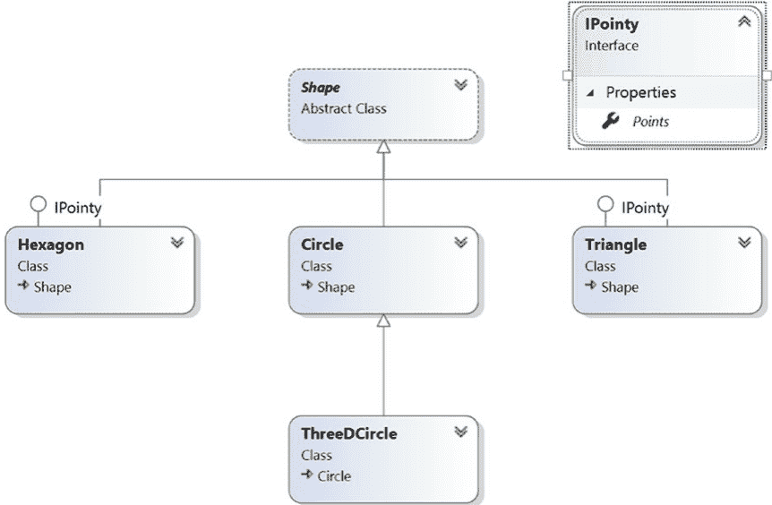
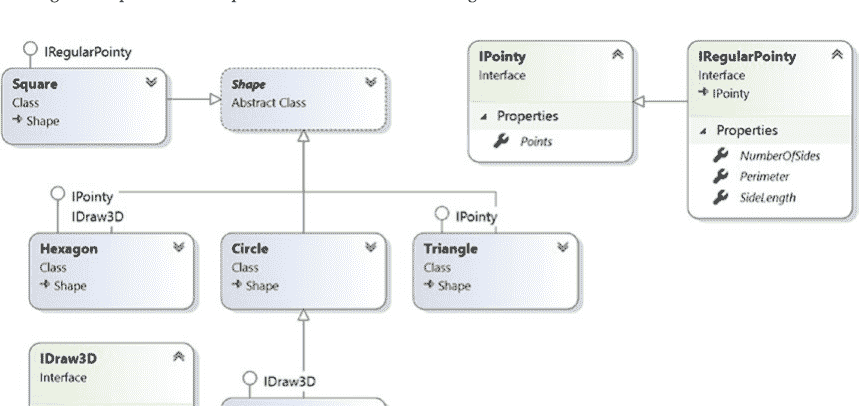
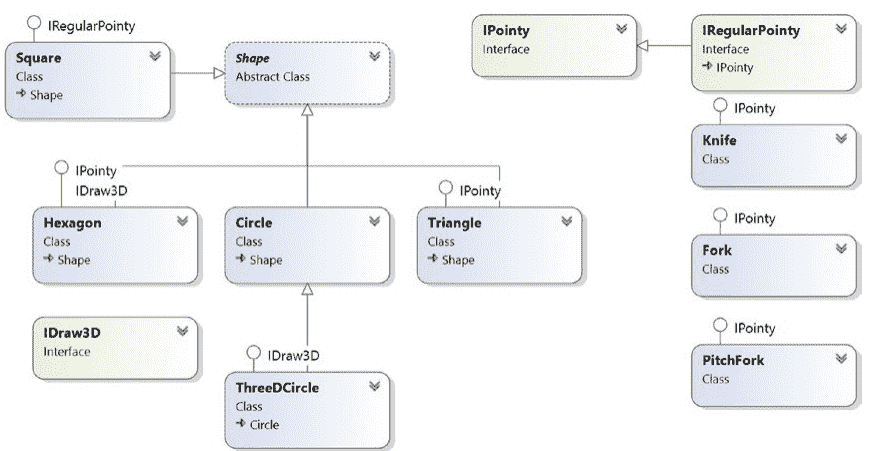
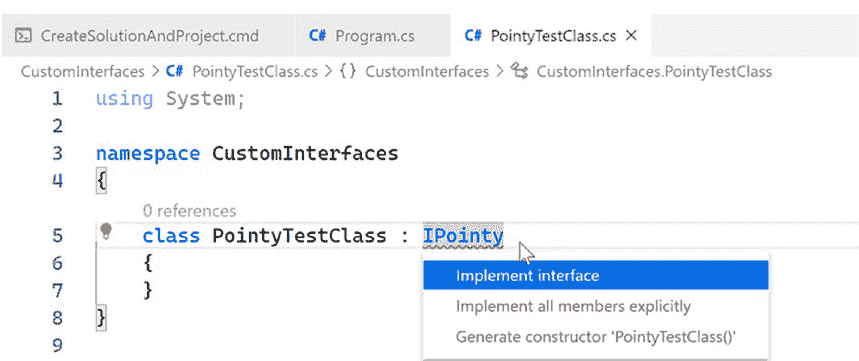
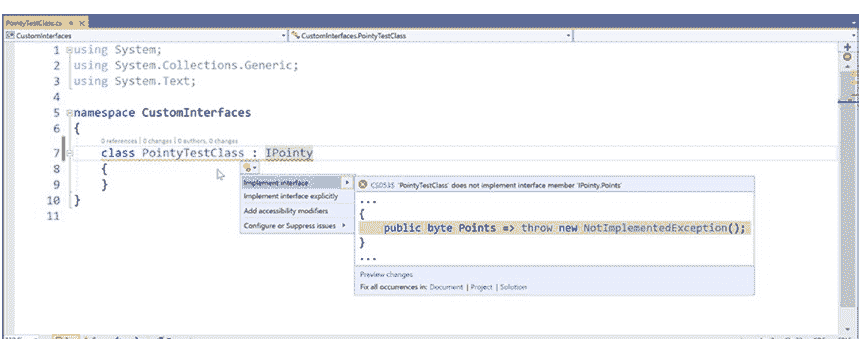
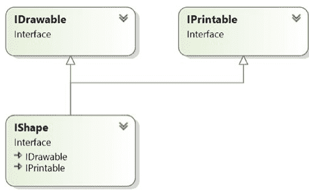

# 第 8 章

## 使用接口

本章通过研究基于接口的编程主题，在你对面向对象开发的当前理解的基础上进行扩展。在这里，你将学习如何定义和实现接口，并理解构建支持多种行为的类型的好处。在此过程中，你将查看几个相关主题，例如获取接口引用、实现显式接口以及构建接口层次结构。你还将检查 .NET Core 基类库中定义的几个标准接口。还涵盖了 C# 8 中关于接口的新功能，包括默认接口方法、静态成员和访问修饰符。正如你将看到的，你的自定义类和结构可以自由实现这些预定义接口以支持多种有用的行为，例如对象克隆、对象枚举和对象排序。

### 理解接口类型

为了开始本章，请允许我提供 *接口类型* 的正式定义，该定义随着 C# 8.0 的引入而发生了变化。在 C# 8.0 之前，接口只不过是一组命名的 *抽象成员*。请回顾第 6 章，抽象方法只是纯协议，因为它们不提供默认实现。接口定义的具体成员取决于它所建模的确切行为。换句话说，接口表达了给定类或结构可能选择支持的 *行为*。此外，正如本章将看到的，一个类或结构可以支持任意数量的接口，从而在本质上支持多种行为。

在 C# 8.0 中引入的默认接口方法功能允许接口方法包含一种实现，该实现可以被实现类重写，也可以不被重写。稍后在本章中会详细介绍。

正如你可能猜到的，.NET Core 基类库随附了大量预定义的接口类型，由各种类和结构实现。例如，正如你在第 21 章中看到的，ADO.NET 随附了多个数据提供程序，允许你与特定的数据库管理系统通信。因此，在 ADO.NET 下，你可以选择多个连接对象（SqlConnection、OleDbConnection、OdbcConnection 等）。此外，第三方数据库供应商（以及许多开源项目）提供了 .NET 库来与大量其他数据库（MySQL、Oracle 等）通信，所有这些库都包含实现这些接口的对象。

尽管每个连接类都有一个独特的名字，定义在不同的命名空间中，并且在某些情况下捆绑在不同的程序集中，但所有连接类都实现了一个名为 IDbConnection 的通用接口。

```
// The IDbConnection interface defines a common
// set of members supported by all connection objects.
public interface IDbConnection : IDisposable
{
    // Methods
    IDbTransaction BeginTransaction();
    IDbTransaction BeginTransaction(IsolationLevel il);
    void ChangeDatabase(string databaseName);
    void Close();
    IDbCommand CreateCommand();
    void Open();
    // Properties
    string ConnectionString { get; set; }
    int ConnectionTimeout { get; }
    string Database { get; }
    ConnectionState State { get; }
}
```

> 注意 按惯例，.NET 接口名称以大写字母 I 为前缀。当你创建自己的自定义接口时，遵循相同的惯例被认为是最佳实践。

此时不必关心这些成员的细节。只需理解 IDbConnection 接口定义了一组适用于所有 ADO.NET 连接类的通用成员。鉴于此，你可以保证每个连接对象都支持 Open()、Close()、CreateCommand() 等成员。此外，由于接口成员始终是抽象的，每个连接对象都可以以其独特的方式实现这些方法。

随着你阅读本书的其余部分，你将接触到数十个随 .NET Core 基类库提供的接口。正如你将看到的，这些接口可以实现在你自己的自定义类和结构上，以定义与框架紧密集成的类型。此外，一旦你理解了接口类型的用处，你肯定会找到构建自己的接口的理由。

### 接口类型与抽象基类

鉴于你在第 6 章的工作，接口类型可能看起来有点像抽象基类。请回顾当一个类被标记为抽象时，它可以定义任意数量的抽象成员，为所有派生类型提供多态接口。然而，即使一个类确实定义了一组抽象成员，它也可以自由定义任意数量的构造函数、字段数据、非抽象成员（带实现）等等。接口（在 C# 8.0 之前）仅包含成员定义。现在，随着 C# 8，接口可以包含成员定义（如抽象成员）、带默认实现（类似虚方法）的成员以及静态成员。只有两个真正的差异：接口不能有非静态构造函数，并且一个类可以实现多个接口。关于第二个要点，稍后再说。

抽象父类建立的多态接口存在一个主要限制，即只有派生类型支持抽象父类定义<|message|>

```
namespace CustomInterfaces
{
    public abstract class CloneableType
    {
        // Only derived types can support this
        // "polymorphic interface." Classes in other
        // hierarchies have no access to this abstract
        // member.
        public abstract object Clone();
    }
}
```

根据这个定义，只有扩展 CloneableType 的成员才能支持 Clone() 方法。如果你创建一组不扩展该基类的新类，你就无法获得这种多态接口。另外，请记住 C# 不支持类的多重继承。因此，如果你想创建一个“是一个”（is-a）Car 且“是一个”（is-a）CloneableType 的 MiniVan，是无法做到的。

```
// Nope! Multiple inheritance is not possible in C#
// for classes.
public class MiniVan : Car, CloneableType
{
}
```

正如你可能猜到的，接口类型前来解围。接口一旦被定义，就可以被任何层次结构中的任何类或结构实现，也可以在任何命名空间或任何程序集（以任何 .NET Core 编程语言编写）中实现。如你所见，接口具有高度的多态性。以 .NET Core 标准接口 ICloneable 为例，它定义在 System 命名空间中。该接口只定义了一个名为 Clone() 的方法。

```
public interface ICloneable
{
    object Clone();
}
```

如果你仔细查看 .NET Core 基类库，会发现许多看似无关的类型（System.Array、System.Data.SqlClient.SqlConnection、System.OperatingSystem、System.String 等）都实现了这个接口。尽管这些类型没有共同的父类（除了 System.Object），但你可以通过 ICloneable 接口类型对它们进行多态处理。

首先，清空 Program.cs 中的代码，然后添加以下内容：

```
using System;
using CustomInterfaces;

Console.WriteLine("***** A First Look at Interfaces ****\n");
CloneableExample();
```

接下来，将下面这个名为 CloneMe() 的局部函数添加到你的顶级语句中。该函数接受一个 ICloneable 接口参数，任何实现了这个接口的对象都可以传入。函数代码如下：

```
static void CloneableExample()
{
    // All of these classes support the ICloneable interface.
    string myStr = "Hello";
    OperatingSystem unixOS =
        new OperatingSystem(PlatformID.Unix, new Version());

    // Therefore, they can all be passed into a method taking ICloneable.
    CloneMe(myStr);
    CloneMe(unixOS);
    static void CloneMe(ICloneable c)
    {
        // Clone whatever we get and print out the name.
        object theClone = c.Clone();
        Console.WriteLine("Your clone is a: {0}",
            theClone.GetType().Name);
    }
}
```

当你运行这个应用程序时，每个类的类名会通过从 System.Object 继承的 GetType() 方法打印到控制台。正如第 17 章将详细解释的那样，该方法允许你在运行时了解任何一个类型的组成。无论如何，前面程序的输出如下所示：

```
***** A First Look at Interfaces *****
Your clone is a: String
Your clone is a: OperatingSystem
```

抽象基类的另一个限制是，每个派生类型都必须处理一组抽象成员并提供实现。为了理解这个问题，回忆一下你在第 6 章中定义的形状层次结构。假设你在 Shape 基类中定义了一个名为 GetNumberOfPoints() 的新抽象方法，该方法允许派生类型返回渲染形状所需的点数。

```
namespace CustomInterfaces
{
    abstract class Shape
    {
        ...
        // Every derived class must now support this method!
        public abstract byte GetNumberOfPoints();
    }
}
```

很明显，最初有点的类只有 Hexagon。然而，使用这种更新后，每个派生类（Circle、Hexagon 和 ThreeDCircle）现在都必须提供这个函数的具体实现，即使这样做毫无意义。接口类型再次提供了解决方案。如果你定义一个表示“具有点”行为的接口，就可以将其直接插入 Hexagon 类型，而让 Circle 和 ThreeDCircle 保持不变。

注意：C# 8 中对接口的更改可能是我能记起的对现有语言特性所做的最重大更改。如前所述，新的接口能力使其功能显著接近抽象类，并且额外增加了一个类实现多个接口的能力。我的建议是在这些方面谨慎行事，并用常识判断。仅仅因为你可以做某事，并不意味着你应该去做。

## 定义自定义接口

现在你已经更好地理解了接口类型的整体作用，让我们看一个定义和实现自定义接口的示例。从你在第 6 章创建的 Shapes 解决方案中复制 Shape.cs、Hexagon.cs、Circle.cs 和 ThreeDCircle.cs 文件。完成后，将定义形状相关类型的命名空间重命名为 CustomInterfaces（只是为了不必在新项目中导入命名空间定义）。然后，在项目中插入一个名为 IPointy.cs 的新文件。

在语法层面，接口使用 C# 的 interface 关键字定义。与类不同，接口从不指定基类（甚至不指定 System.Object；但是，正如本章后面将要看到的，接口可以指定基接口）。在 C# 8.0 之前，接口的成员从不指定访问修饰符（因为所有接口成员都是隐式公共和抽象的）。C# 8.0 中的新特性是，还可以定义 private、internal、protected，甚至 static 成员。关于这一点后面会详细介绍。为了开始介绍，下面是一个用 C# 定义的自定义接口：

```
namespace CustomInterfaces
{
    // This interface defines the behavior of "having points."
    public interface IPointy
    {
        // Implicitly public and abstract.
        byte GetNumberOfPoints();
    }
}
```

C# 8 中的接口不能定义数据字段或非静态构造函数。因此，以下版本的 IPointy 将导致各种编译器错误：

```
// Ack! Errors abound!
public interface IPointy
{
    // Error! Interfaces cannot have data fields!
    public int numbOfPoints;
    // Error! Interfaces do not have nonstatic constructors!
    public IPointy() { numbOfPoints = 0;}
}
```

无论如何，这个最初的 IPointy 接口只定义了一个方法。接口类型还能够定义任意数量的属性原型。例如，我们可以更新 IPointy 接口，使用一个读写属性（已注释掉）和一个只读属性。Points 属性取代了 GetNumberOfPoints() 方法。

```
// The pointy behavior as a read-only property.
public interface IPointy
{
    // Implicitly public and abstract.
    //byte GetNumberOfPoints();

    // A read-write property in an interface would look like:
    //string PropName { get; set; }

    // while a write-only property in an interface would be:
    byte Points { get; }
}
```

> 注意：接口类型还可以包含事件（见第 12 章）和索引器（见第 11 章）的定义。

接口类型本身毫无用处，因为你不能像分配类或结构那样来分配接口类型。

```
// Ack! Illegal to allocate interface types.
IPointy p = new IPointy(); // Compiler error!
```

接口在被类或结构实现之前，并不能带来多大作用。这里的 IPointy 是一个表达“具有点”行为的接口。这个想法很简单：形状层次结构中的一些类有点（如 Hexagon），而另一些类（如 Circle）则没有。

## 实现接口

当一个类（或结构）选择通过支持接口来扩展其功能时，它会在类型定义中使用逗号分隔的列表来实现。请注意，直接基类必须是冒号运算符后列出的第一项。当你的类类型直接派生自 System.Object 时，你可以自由地仅列出该类支持的接口（或多个接口），因为如果你不另行说明，C# 编译器会将你的类型扩展自 System.Object。相关地，由于结构总是派生自 System.ValueType（见第 4 章），只需在结构定义之后直接列出各个接口。思考以下示例：

```
// This class derives from System.Object and
// implements a single interface.
public class Pencil : IPointy
{...}
```

```
// This class also derives from System.Object
// and implements a single interface.
public class SwitchBlade : object, IPointy
{...}
```

```
// This class derives from a custom base class
// and implements a single interface.
public class Fork : Utensil, IPointy
{...}
```


// This struct implicitly derives from System.ValueType and
// implements two interfaces.
public struct PitchFork : ICloneable, IPointy
{...}

理解这一点很重要：对于不包含默认实现的接口成员，实现接口是一个全有或全无的命题。实现类型不能选择性决定它将实现哪些成员。鉴于 IPointy 接口只定义了一个只读属性，这还算不上沉重的负担。但是，如果你实现的是一个定义了十个成员的接口（例如前面展示的 IDbConnection 接口），该类型现在就有责任充实全部十个抽象成员的细节。

例如，插入一个名为 Triangle 的新类类型，它“is-a”（是一种）Shape 并支持 IPointy。请注意，只读 Points 属性的实现（使用表达式体成员语法实现）只是返回正确的点数（三个）。

```
using System;
namespace CustomInterfaces
{
    // New Shape derived class named Triangle.
    class Triangle : Shape, IPointy
    {
        public Triangle() { }
        public Triangle(string name) : base(name) { }
        public override void Draw()
        {
            Console.WriteLine("Drawing {0} the Triangle", PetName);
        }

        // IPointy implementation.
        //public byte Points
        //{
        //    get { return 3; }
        //}
        public byte Points => 3;
    }
}
```

现在，更新你现有的 Hexagon 类型，使其也支持 IPointy 接口类型。

```
using System;
namespace CustomInterfaces
{
    // Hexagon now implements IPointy.
    class Hexagon : Shape, IPointy
    {
        public Hexagon(){ }
        public Hexagon(string name) : base(name){ }
        public override void Draw()
        {
            Console.WriteLine("Drawing {0} the Hexagon", PetName);
        }
```
```
// IPointy implementation.
public byte Points => 6;
}
```

到目前为止，概括一下：图 8-1 所示的 Visual Studio 类图使用流行的“棒棒糖”表示法展示了与 IPointy 兼容的类。请再次注意，Circle 和 ThreeDCircle 没有实现 IPointy，因为这种表现对这两个类来说没有意义。



图 8-1 形状层次结构，现在包含接口

注意：要在类设计器中显示或隐藏接口名称，请右键单击接口图标，然后选择“折叠”或“展开”选项。

## 在对象级别调用接口成员

现在你已经有了一些支持 IPointy 接口的类，接下来的问题是如何与新功能进行交互。与给定接口提供的功能进行交互的最直接方式，是在对象级别直接调用这些成员（前提是接口成员没有被显式实现；你可以在后面的“实现显式接口”一节中了解更多细节）。例如，考虑以下代码：

```
Console.WriteLine("***** Fun with Interfaces *****
");
// Call Points property defined by IPointy.
Hexagon hex = new Hexagon();
Console.WriteLine("Points: {0}", hex.Points);
Console.ReadLine();
```

在这种情况下，这种方法很有效，因为你理解 Hexagon 类型已经实现了所讨论的接口，因此拥有 Points 属性。然而，在其他情况下，你可能无法确定给定类型支持哪些接口。例如，假设你有一个包含 50 个 Shape 兼容类型的数组，其中只有部分支持 IPointy。显然，如果你尝试在未实现 IPointy 的类型上调用 Points 属性，就会收到错误。那么，你如何才能动态判断某个类或结构是否支持正确的接口呢？

在运行时确定类型是否支持特定接口的一种方法是使用显式强制转换。如果该类型不支持所请求的接口，你会收到 InvalidCastException。为了妥善处理这种可能性，可以使用结构化异常处理，如下例所示：

```
...
// Catch a possible InvalidCastException.
Circle c = new Circle("Lisa");
IPointy itfPt = null;
try
{
    itfPt = (IPointy)c;
    Console.WriteLine(itfPt.Points);
}
catch (InvalidCastException e)
{
    Console.WriteLine(e.Message);
}
Console.ReadLine();
```

虽然你也可以使用 try/catch 逻辑并寄希望于一切顺利，但最好还是先确定支持哪些接口，然后再调用接口成员。让我们看看两种实现方法。

## 获取接口引用：as 关键字

你可以使用第 6 章中介绍的 as 关键字来确定给定类型是否支持某个接口。如果该对象可以被视为指定的接口，则会返回所讨论接口的引用；否则，你将收到 null 引用。因此，在继续操作之前，一定要检查是否为 null 值。

```
...
// Can we treat hex2 as IPointy?
Hexagon hex2 = new Hexagon("Peter");
IPointy itfPt2 = hex2 as IPointy;
if(itfPt2 != null)
{
    Console.WriteLine("Points: {0}", itfPt2.Points);
}
```
```
else
{
    Console.WriteLine("OOPS! Not pointy...");
}
Console.ReadLine();
```

请注意，使用 as 关键字时，你不需要使用 try/catch 逻辑；如果引用不为 null，你就知道所调用的是有效的接口引用。

## 获取接口引用：is 关键字（7.0 更新）

你还可以使用 is 关键字来检查已实现的接口（第 6 章中也首次讨论过）。如果所讨论的对象与指定接口不兼容，你将得到 false。如果在语句中提供了变量名，则该类型会被赋值到该变量中，从而无需进行类型检查和强制转换。前面的示例在这里更新为：

```
Console.WriteLine("***** Fun with Interfaces *****
");
...
if(hex2 is IPointy itfPt3)
{
    Console.WriteLine("Points: {0}", itfPt3.Points);
}
else
{
    Console.WriteLine("OOPS! Not pointy...");
}
Console.ReadLine();
```

## 默认实现（8.0 新增）

如前所述，C# 8.0 增加了让接口方法和属性拥有默认实现的能力。添加一个名为 IRegularPointy 的新接口，用于表示规则形状的多边形。代码如下所示：

```
namespace CustomInterfaces
{
    interface IRegularPointy : IPointy
    {
        int SideLength { get; set; }
        int NumberOfSides { get; set; }
        int Perimeter => SideLength * NumberOfSides;
    }
}
```

向项目中添加一个名为 Square.cs 的新类，继承 Shape 基类，并实现 IRegularPointy 接口，如下所示：

```
namespace CustomInterfaces
{
    class Square: Shape,IRegularPointy
    {
        public Square() { }
        public Square(string name) : base(name) { }
        //Draw comes from the Shape base class
        public override void Draw()
        {
            Console.WriteLine("Drawing a square");
        }

        //This comes from the IPointy interface
        public byte Points => 4;
        //These come from the IRegularPointy interface
        public int SideLength { get; set; }
        public int NumberOfSides { get; set; }
        //Note that the Perimeter property is not implemented
    }
}
```

在这里，我们无意中引入了在接口中使用默认实现的第一个“棘手之处”。Perimeter 属性定义在 IRegularPointy 接口上，但并未在 Square 类中定义，因此无法通过 Square 的实例访问它。为了直观地看到这一点，创建一个新的 Square 类实例，并将相关值输出到控制台，如下所示：

```
Console.WriteLine("\n**** Fun with Interfaces ****\n");
...
var sq = new Square("Boxy")
    {NumberOfSides = 4, SideLength = 4};
sq.Draw();
//This won’t compile
//Console.WriteLine($"{sq.PetName} has {sq.NumberOfSides} of length {sq.SideLength} and a perimeter of {sq.Perimeter}");
```

相反，必须将 Square 实例显式强制转换为 IRegularPointy 接口（因为实现就在该接口中），然后才能访问 Perimeter 属性。将代码更新为以下内容：

```
Console.WriteLine($"{sq.PetName} has {sq.NumberOfSides} of length {sq.SideLength} and a perimeter of {((IRegularPointy)sq).Perimeter}");
```

解决此问题的一种方法是始终面向类型的接口进行编码。将 Square 实例的定义改为 IRegularPointy，而不是 Square，如下所示：

```
IRegularPointy sq = new Square("Boxy") {NumberOfSides = 4, SideLength = 4};
```

这种方法的问题（就我们的情况而言）是，Draw() 方法和 PetName 属性并未在接口上定义，从而导致编译错误。


虽然这是一个简单的例子，但它确实展示了默认接口的一个问题。在将此功能用于你的代码之前，请确保衡量调用代码必须知道实现存在的位置所带来的影响。

## 静态构造函数和成员（新增于 8.0）

C# 8.0 中对接口的另一个新增功能是能够拥有静态构造函数和成员，其功能与类定义上的静态成员相同，但定义在接口上。用一个示例静态属性和一个静态构造函数更新 IRegularPointy 接口。

```
interface IRegularPointy : IPointy
{
    int SideLength { get; set; }
    int NumberOfSides { get; set; }
    int Perimeter => SideLength * NumberOfSides;

    //Static members are also allowed in C# 8
    static string ExampleProperty { get; set; }

    static IRegularPointy() => ExampleProperty = "Foo";
}
```

静态构造函数必须无参数，并且只能访问静态属性和方法。要访问接口静态属性，将以下代码添加到顶层语句中：

```
Console.WriteLine($"Example property: {IRegularPointy.ExampleProperty}");
IRegularPointy.ExampleProperty = "Updated";
Console.WriteLine($"Example property: {IRegularPointy.ExampleProperty}");
```

注意静态属性必须从接口调用，而不是实例变量。

## 接口作为参数

由于接口是有效类型，你可以构造接受接口作为参数的方法，如本章前面 CloneMe() 方法所示。对于当前示例，假设你已定义了另一个名为 IDraw3D 的接口。

```
namespace CustomInterfaces
{
    // Models the ability to render a type in stunning 3D.
    public interface IDraw3D
    {
        void Draw3D();
    }
}
```

接下来，假设你的三个形状中有两个（ThreeDCircle 和 Hexagon）已配置为支持此新行为。

```
// Circle supports IDraw3D.
class ThreeDCircle : Circle, IDraw3D
{
...
public void Draw3D()
    => Console.WriteLine("Drawing Circle in 3D!"); }
}
```

```
// Hexagon supports IPointy and IDraw3D.
class Hexagon : Shape, IPointy, IDraw3D
{
...
public void Draw3D()
    => Console.WriteLine("Drawing Hexagon in 3D!");
}
```

图 8-2 展示了更新后的 Visual Studio 类图。



图 8-2. 更新后的形状层次结构

如果现在定义一个以 IDraw3D 接口作为参数的方法，你可以有效地传入任何实现 IDraw3D 的对象。如果尝试传入不支持必要接口的类型，你会收到编译时错误。考虑在 Program 类中定义的以下方法：

```
// I'll draw anyone supporting IDraw3D.
static void DrawIn3D(IDraw3D itf3d)
{
    Console.WriteLine("- > Drawing IDraw3D compatible type");
    itf3d.Draw3D();
}
```

你现在可以测试 Shape 数组中的项目是否支持此新接口，如果支持，就将其传入 DrawIn3D() 方法进行处理。

```
Console.WriteLine("***** Fun with Interfaces *****
");
Shape[] myShapes = { new Hexagon(), new Circle(),
    new Triangle("Joe"), new Circle("JoJo") };
for(int i = 0; i < myShapes.Length; i++)
{
    // Can I draw you in 3D?
    if (myShapes[i] is IDraw3D s)
    {
        DrawIn3D(s);
    }
}
```

以下是更新后应用程序的输出。注意只有 Hexagon 对象以 3D 打印出来，因为 Shape 数组的其他成员未实现 IDraw3D 接口。

```
***** Fun with Interfaces *****
...
-> Drawing IDraw3D compatible type
Drawing Hexagon in 3D!
```

## 接口作为返回值

接口也可以用作方法返回值。例如，你可以编写一个方法，接受 Shape 对象数组并返回第一个支持 IPointy 的项目的引用。

```
// This method returns the first object in the
// array that implements IPointy.
static IPointy FindFirstPointyShape(Shape[] shapes)
{
    foreach (Shape s in shapes)
    {
        if (s is IPointy ip)
        {
            return ip;
        }
    }
    return null;
}
```

你可以按如下方式与此方法交互：

```
Console.WriteLine("***** Fun with Interfaces *****
");
// Make an array of Shapes.
Shape[] myShapes = { new Hexagon(), new Circle(),
    new Triangle("Joe"), new Circle("JoJo")};

// Get first pointy item.
IPointy firstPointyItem = FindFirstPointyShape(myShapes);
// To be safe, use the null conditional operator.
Console.WriteLine("The item has {0} points",
    firstPointyItem?.Points);
```

## 接口类型数组

请记住，同一个接口可以由众多类型实现，即使它们不在同一个类层次结构中，并且除了 System.Object 之外没有共同的父类。这可以产生一些强大的编程结构。例如，假设你在当前项目中开发了三种新的类类型，用于建模厨房用具（通过 Knife 和 Fork 类）和另一种建模园艺设备（à la PitchFork）。这些类的相关代码如下所示，更新后的类图如图 8-3 所示：

```
//Fork.cs
namespace CustomInterfaces
{
    class Fork : IPointy
    {
        public byte Points => 4;
    }
}
//PitchFork.cs
namespace CustomInterfaces
{
    class PitchFork : IPointy
    {
        public byte Points => 3;
    }
}
//Knife.cs.cs
namespace CustomInterfaces
{
    class Knife : IPointy
    {
        public byte Points => 1;
    }
}
```



图 8-3. 请记住，接口可以“插入”到类层次结构任何部分的任何类型中

如果定义了 PitchFork、Fork 和 Knife 类型，你现在可以定义一个 IPointy 兼容对象的数组。由于这些成员都支持相同的接口，你可以遍历数组并将每个项目视为 IPointy 兼容对象，而不管类层次结构的整体多样性如何。

```
// This array can only contain types that
// implement the IPointy interface.
IPointy[] myPointyObjects = {new Hexagon(), new Knife(),
    new Triangle(), new Fork(), new PitchFork()};

foreach(IPointy i in myPointyObjects)
{
    Console.WriteLine("Object has {0} points.", i.Points);
}
Console.ReadLine();
```

为了突出此示例的重要性，请记住这一点：当你有一个给定接口的数组时，数组可以包含实现该接口的任何类或结构。

## 使用自动方式实现接口

尽管基于接口的编程是一种强大的技术，但实现接口可能需要大量的输入。鉴于接口是一组命名的抽象成员，你需要在支持该行为的每个类型上输入每个接口方法的定义和实现。因此，如果你想支持定义了总共五个方法和三个属性的接口，你需要处理全部八个成员（否则你会收到编译器错误）。

正如你所希望的，Visual Studio 和 Visual Studio Code 都支持各种工具，使实现接口的任务负担更小。通过一个简单的测试，在当前项目中插入一个最终类，命名为 PointyTestClass。当你向类类型添加接口（如 IPointy 或任何接口）时，你可能注意到当你完成输入接口名称时（或当你在代码窗口中将鼠标光标定位在接口名称上时），Visual Studio 和 Visual Studio Code 都会添加一个灯泡，该灯泡也可以通过 Ctrl+句点 (.) 键组合调用。当你单击灯泡时，你将看到一个下拉列表，允许你实现接口（参见图 8-4 和 8-5）。



图 8-4. 使用 Visual Studio Code 自动实现接口



图 8-5. 使用 Visual Studio 自动实现接口

注意你会看到两个选项，其中第二个（显式接口实现）将在下一节中讨论。目前，选择第一个选项，你会看到 Visual Studio/Visual Studio Code 已为你生成了存根代码以供更新。（注意默认实现会抛出 System.NotImplementedException，这显然可以删除。）


```
namespace CustomInterfaces
{
    class PointyTestClass : IPointy
    {
        public byte Points => throw new NotImplementedException();
    }
}
```

注意 Visual Studio / Visual Studio Code 也支持提取接口重构，可通过快速操作菜单中的提取接口选项使用。这允许你从现有类定义中提取新的接口定义。例如，你可能在编写一个类进行到一半时才意识到可以将行为泛化为接口，从而为替代实现打开可能性。

## 显式接口实现

如本章前面所示，一个类或结构可以实现任意数量的接口。鉴于此，始终存在可能实现包含相同成员的接口，从而产生名称冲突。为了说明你可以以各种方式解决此问题的方式，创建一个名为 InterfaceNameClash 的新控制台应用程序项目。现在设计三个接口，表示实现类型可以将其输出渲染到的各种位置。

```
namespace InterfaceNameClash
{
    // Draw image to a form.
    public interface IDrawToForm
    {
        void Draw();
    }
}
```

```
namespace InterfaceNameClash
{
    // Draw to buffer in memory.
    public interface IDrawToMemory
    {
        void Draw();
    }
}
```

```
namespace InterfaceNameClash
{
    // Render to the printer.
    public interface IDrawToPrinter
    {
        void Draw();
    }
}
```

请注意，每个接口都定义了一个名为 Draw() 的方法，签名相同。如果现在想在名为 Octagon 的单个类类型上支持这些接口中的每一个，编译器将允许以下定义：

```
using System;
namespace InterfaceNameClash
{
    class Octagon : IDrawToForm, IDrawToMemory, IDrawToPrinter
    {
        public void Draw()
        {
            // Shared drawing logic.
            Console.WriteLine("Drawing the Octagon...");
        }
    }
}
```

虽然代码可以干净地编译，但你确实存在一个可能的问题。简单来说，提供 Draw() 方法的单一实现并不能让你根据从 Octagon 对象获取的是哪个接口而采取独特的行动。例如，以下代码将调用相同的 Draw() 方法，而不管你获取的是哪个接口：

```
using System;
using InterfaceNameClash;

Console.WriteLine("***** Fun with Interface Name Clashes *****");
// All of these invocations call the
// same Draw() method!
Octagon oct = new Octagon();

// Shorthand notation if you don't need
// the interface variable for later use.
((IDrawToPrinter)oct).Draw();

// Could also use the "is" keyword.
if (oct is IDrawToMemory dtm)
{
    dtm.Draw();
}

Console.ReadLine();
```

显然，渲染图像到窗口所需的代码类型与渲染图像到网络打印机或内存区域所需的代码大不相同。当你实现具有相同成员的多个接口时，可以使用显式接口实现语法解决这种名称冲突。考虑对 Octagon 类型的以下更新：

```
class Octagon : IDrawToForm, IDrawToMemory, IDrawToPrinter
{
    // Explicitly bind Draw() implementations
    // to a given interface.
```

```
void IDrawToForm.Draw()
{
    Console.WriteLine("Drawing to form...");
}
void IDrawToMemory.Draw()
{
    Console.WriteLine("Drawing to memory...");
}
void IDrawToPrinter.Draw()
{
    Console.WriteLine("Drawing to a printer...");
}
}
```

如你所见，显式实现接口成员时，一般模式如下：

```
returnType InterfaceName.MethodName(params){}
```

请注意，使用此语法时，你不提供访问修饰符；显式实现的成员自动为私有。例如，以下是非法语法：

```
// Error! No access modifier!
public void IDrawToForm.Draw()
{
    Console.WriteLine("Drawing to form...");
}
```

由于显式实现的成员始终隐式为私有，这些成员不再可从对象级别访问。事实上，如果你对 Octagon 类型应用点运算符，你会发现 IntelliSense 不会显示任何 Draw() 成员。预期中，你必须使用显式转换来访问所需功能。之前的顶层语句代码已经在使用显式转换，因此它与显式接口一起工作。

```
Console.WriteLine("***** Fun with Interface Name Clashes *****\n");
Octagon oct = new Octagon();

// We now must use casting to access the Draw()
// members.
IDrawToForm itfForm = (IDrawToForm)oct;
itfForm.Draw();

// Shorthand notation if you don't need
// the interface variable for later use.
((IDrawToPrinter)oct).Draw();

// Could also use the "is" keyword.
if (oct is IDrawToMemory dtm)
{
    dtm.Draw();
}
Console.ReadLine();
```

虽然此语法在需要解决名称冲突时非常有帮助，但你也可以使用显式接口实现仅仅隐藏对象级别的更“高级”成员。这样，当对象使用者应用点运算符时，使用者将只看到类型的整体功能的一个子集。然而，需要更高级行为的人可以通过显式转换提取所需的接口。

## 设计接口层次结构

接口可以按接口层次结构排列。与类层次结构类似，当一个接口扩展现有接口时，它继承父接口（或父接口）定义的抽象成员。在 C# 8 之前，派生接口从不继承真正的实现。相反，派生接口只是用额外的抽象成员扩展其自己的定义。在 C# 8 中，派生接口继承默认实现，同时扩展定义并可能添加新的默认实现。

接口层次结构在你想要扩展现有接口的功能而不破坏现有代码库时很有用。为了说明这一点，创建一个名为 InterfaceHierarchy 的新控制台应用程序项目。现在，让我们设计一组新的以渲染为中心的接口，使得 IDrawable 是家族树的根。

```
namespace InterfaceHierarchy
{
    public interface IDrawable
    {
        void Draw();
    }
}
```

鉴于 IDrawable 定义了基本绘图行为，你现在可以创建一个派生接口，用修改格式的渲染能力扩展此接口。以下是示例：

```
namespace InterfaceHierarchy
{
    public interface IAdvancedDraw : IDrawable
    {
        void DrawInBoundingBox(int top, int left, int bottom, int right);
        void DrawUpsideDown();
    }
}
```

根据此设计，如果一个类要实现 IAdvancedDraw，它现在将被要求实现继承链上定义的每个成员（具体来说是 Draw()、DrawInBoundingBox() 和 DrawUpsideDown() 方法）。

```
using System;
namespace InterfaceHierarchy
{
    public class BitmapImage : IAdvancedDraw
    {
        public void Draw()
        {
            Console.WriteLine("Drawing...");
        }
```

```
public void DrawInBoundingBox(int top, int left, int bottom, int right)
{
    Console.WriteLine("Drawing in a box...");
}

public void DrawUpsideDown()
{
    Console.WriteLine("Drawing upside down!");
}
}
```

现在，当你使用 BitmapImage 时，你可以在对象级别调用每个方法（因为它们都是公共的），也可以通过转换显式提取对每个受支持接口的引用。

```
using System;
using InterfaceHierarchy;

Console.WriteLine("***** Simple Interface Hierarchy *****");

// Call from object level.
BitmapImage myBitmap = new BitmapImage();
myBitmap.Draw();
myBitmap.DrawInBoundingBox(10, 10, 100, 150);
myBitmap.DrawUpsideDown();

// Get IAdvancedDraw explicitly.
if (myBitmap is IAdvancedDraw iAdvDraw)
{
    iAdvDraw.DrawUpsideDown();
}
Console.ReadLine();
```

## 具有默认实现的接口层次结构（新 8.0）

当接口层次结构也包含默认实现时，下游接口可以选择继承基接口的实现或创建新的默认实现。将 IDrawable 接口更新为以下内容：

```
public interface IDrawable
{
    void Draw();
    int TimeToDraw() => 5;
}
```


接下来，将顶层语句更新为以下内容：

```
Console.WriteLine("***** Simple Interface Hierarchy *****");
...
if (myBitmap is IAdvancedDraw iAdvDraw)
{
    iAdvDraw.DrawUpsideDown();
    Console.WriteLine($"Time to draw: {iAdvDraw.TimeToDraw()}");
}
Console.ReadLine();
```

这段代码不仅可以编译，而且为`TimeToDraw()`方法输出了值5。这是因为默认实现会自动传递给派生接口。将`BitMapImage`转换为`IAdvancedDraw`接口后，可以访问`TimeToDraw()`方法，尽管`BitMapImage`实例本身无法访问默认实现。为了验证这一点，请输入以下代码并查看编译错误：

```
//This does not compile
myBitmap.TimeToDraw();
```

如果下游接口想要提供自己的默认实现，它必须隐藏上游实现。例如，如果`IAdvancedDraw`的`TimeToDraw()`方法需要15个绘图单位，请将接口更新为以下定义：

```
public interface IAdvancedDraw : IDrawable
{
    void DrawInBoundingBox(
        int top, int left, int bottom, int right);
    void DrawUpsideDown();
    new int TimeToDraw() => 15;
}
```

当然，`BitMapImage`类也可以自由实现`TimeToDraw()`方法。与`IAdvancedDraw`的`TimeToDraw()`方法不同，类只需实现该方法，无需隐藏它。

```
public class BitmapImage : IAdvancedDraw
{
    ...
    public int TimeToDraw() => 12;
}
```

当将`BitmapImage`实例转换为`IAdvancedDraw`或`IDrawable`接口时，该实例上的方法仍然会被执行。请将此代码添加到顶层语句中：

```
//Always calls method on instance:
Console.WriteLine("***** Calling Implemented TimeToDraw *****");
Console.WriteLine($"Time to draw: {myBitmap.TimeToDraw()}");
Console.WriteLine($"Time to draw: {((IDrawable) myBitmap).TimeToDraw()}");
Console.WriteLine($"Time to draw: {((IAdvancedDraw) myBitmap).TimeToDraw()}");
```

结果如下：

```
***** Simple Interface Hierarchy *****
...
***** Calling Implemented TimeToDraw *****
Time to draw: 12
Time to draw: 12
Time to draw: 12
```

## 使用接口类型实现多重继承

与类类型不同，接口可以扩展多个基接口，从而允许你设计一些强大而灵活的抽象。创建一个名为`MiInterfaceHierarchy`的新控制台应用程序项目。以下是另一组接口，它们对各种渲染和形状抽象进行建模。请注意，`IShape`接口同时扩展了`IDrawable`和`IPrintable`。

```
//IDrawable.cs
namespace MiInterfaceHierarchy
{
    // Multiple inheritance for interface types is A-okay.
    interface IDrawable
    {
        void Draw();
    }
}

//IPrintable.cs
namespace MiInterfaceHierarchy
{
    interface IPrintable
    {
        void Print();
        void Draw(); // <-- Note possible name clash here!
    }
}

//IShape.cs
namespace MiInterfaceHierarchy
{
    // Multiple interface inheritance. OK!
    interface IShape : IDrawable, IPrintable
    {
        int GetNumberOfSides();
    }
}
```

图8-6展示了当前的接口层次结构。



# 图8-6. 与类不同，接口可以扩展多种接口类型

此时，最关键的问题是：“如果一个类支持`IShape`，它需要实现多少个方法？”答案是：视情况而定。如果你想为`Draw()`方法提供一个简单的实现，只需要提供三个成员，如以下`Rectangle`类型所示：

```
using System;

namespace MiInterfaceHierarchy
{
    class Rectangle : IShape
    {
        public int GetNumberOfSides() => 4;
        public void Draw() => Console.WriteLine("Drawing...");
        public void Print() => Console.WriteLine("Printing...");
    }
}
```

如果你希望为每个`Draw()`方法提供特定的实现（在这种情况下这最合理），可以使用显式接口实现来解决名称冲突，如以下`Square`类型所示：

```
namespace MiInterfaceHierarchy
{
    class Square : IShape
    {
        // Using explicit implementation to handle member name clash.
        void IPrintable.Draw()
        {
            // Draw to printer ...
        }
        void IDrawable.Draw()
        {
            // Draw to screen ...
        }
    }
}
```

```
public void Print()
{
    // Print ...
}

public int GetNumberOfSides() => 4;
}
}
```

理想情况下，此时你应该对使用C#语法定义和实现自定义接口的过程感到更加得心应手。老实说，基于接口的编程可能需要一段时间才能适应，所以如果你实际上仍然有点摸不着头脑，这完全是一种正常的反应。

但是，请注意，接口是.NET Core框架的一个基本方面。无论你正在开发哪种类型的应用程序（基于Web、桌面GUI、数据访问库等），使用接口都将是过程中的一部分。总结到目前为止的内容，请记住接口在以下情况下非常有用：

-   你有一个单一层次结构，其中只有一部分派生类型支持共同行为。
-   你需要对跨多个层次结构的共同行为进行建模，而这些层次结构除了`System.Object`之外没有共同的父类。

既然你已经深入研究了构建和实现自定义接口的细节，本章的其余部分将研究.NET Core基类库中包含的几个预定义接口。正如你将看到的，你可以在自定义类型上实现标准的.NET Core接口，以确保它们无缝集成到框架中。

## IEnumerable和IEnumerator接口

开始研究实现现有.NET Core接口的过程，我们首先来看看`IEnumerable`和`IEnumerator`的作用。回想一下，C#支持一个名为`foreach`的关键字，允许你遍历任何数组类型的内容。

```
// Iterate over an array of items.
int[] myArrayOfInts = {10, 20, 30, 40};

foreach(int i in myArrayOfInts)
{
    Console.WriteLine(i);
}
```

虽然看起来只有数组类型可以使用这种构造，但事实是，任何支持名为`GetEnumerator()`的方法的类型都可以被`foreach`构造处理。为了说明这一点，首先创建一个名为`CustomEnumerator`的新控制台应用程序项目。接下来，将第7章`SimpleException`示例中定义的`Car.cs`和`Radio.cs`文件复制到新项目中。确保将类的命名空间更新为`CustomEnumerator`。

现在，插入一个名为`Garage`的新类，它将一组`Car`对象存储在`System.Array`中。

```
using System.Collections;

namespace CustomEnumerator
{
    // Garage contains a set of Car objects.
    public class Garage
    {
        private Car[] carArray = new Car[4];

        // Fill with some Car objects upon startup.
        public Garage()
        {
            carArray[0] = new Car("Rusty", 30);
            carArray[1] = new Car("Clunker", 55);
            carArray[2] = new Car("Zippy", 30);
            carArray[3] = new Car("Fred", 30);
        }
    }
}
```

理想情况下，使用`foreach`构造遍历`Garage`对象的子项会很方便，就像遍历数据值数组一样。

```
using System;
using CustomEnumerator;

// This seems reasonable ...
Console.WriteLine("***** Fun with IEnumerable / IEnumerator ****\n");
Garage carLot = new Garage();

// Hand over each car in the collection?
foreach (Car c in carLot)
{
    Console.WriteLine("{0} is going {1} MPH",
        c.PetName, c.CurrentSpeed);
}
Console.ReadLine();
```

遗憾的是，编译器会告知你`Garage`类并未实现名为`GetEnumerator()`的方法。该方法由`IEnumerable`接口正式定义，该接口位于`System.Collections`命名空间中。

注意 在第10章中，你将了解泛型以及`System.Collections.Generic`命名空间的作用。正如你将看到的，该命名空间包含`IEnumerable`/`IEnumerator`的泛型版本，它们提供了一种更类型安全的方式来遍历项目。


支持此行为的类或结构体表明它们可以向调用方（在此示例中，即 foreach 关键字本身）公开包含的项。以下是此标准接口的定义：

// This interface informs the caller
// that the object's items can be enumerated.
public interface IEnumerable
{
    IEnumerator GetEnumerator();
}

如你所见，GetEnumerator() 方法返回对另一个名为 System.Collections.IEnumerator 的接口的引用。此接口提供了使调用方能够遍历 IEnumerable 兼容容器所包含的内部对象的的基础结构。

```
// This interface allows the caller to
// obtain a container's items.
public interface IEnumerator
{
    bool MoveNext(); // Advance the internal position of the cursor.
    object Current { get; } // Get the current item (read-only property).
    void Reset(); // Reset the cursor before the first member.
}
```

如果你想更新 Garage 类型以支持这些接口，你可以走长路并手动实现每个方法。虽然你完全可以提供 GetEnumerator()、MoveNext()、Current 和 Reset() 的自定义版本，但有更简单的方法。由于 System.Array 类型（以及许多其他集合类）已经实现了 IEnumerable 和 IEnumerator，你可以简单地将请求委托给 System.Array，如下所示（注意你需要在代码文件中导入 System.Collections 命名空间）：

```
using System.Collections;
...
public class Garage : IEnumerable
{
    // System.Array already implements IEnumerator!
    private Car[] carArray = new Car[4];

    public Garage()
    {
        carArray[0] = new Car("FeeFee", 200);
        carArray[1] = new Car("Clunker", 90);
        carArray[2] = new Car("Zippy", 30);
        carArray[3] = new Car("Fred", 30);
    }

    // Return the array object's IEnumerator.
    public IEnumerator GetEnumerator()
        => carArray.GetEnumerator();
}
```

在你更新了 Garage 类型后，你可以安全地在 C# foreach 构造中使用该类型。此外，由于 GetEnumerator() 方法已公开定义，对象使用者也可以与 IEnumerator 类型交互。

```
// Manually work with IEnumerator.
IEnumerator carEnumerator = carLot.GetEnumerator();
carEnumerator.MoveNext();
Car myCar = (Car)carEnumerator.Current;
Console.WriteLine("{0} is going {1} MPH", myCar.PetName, myCar.CurrentSpeed);
```

然而，如果你更喜欢隐藏 IEnumerable 在对象级别的功能，只需使用显式接口实现即可。

```
// Return the array object's IEnumerator.
IEnumerator IEnumerable.GetEnumerator()
    => carArray.GetEnumerator();
```

这样做后，普通对象使用者将找不到 Garage 的 GetEnumerator() 方法，而 foreach 构造会在必要时在后台获取接口。

## 使用 yield 关键字构建迭代器方法

通过迭代器构建可与 foreach 循环一起工作的类型还有另一种方法。简单来说，迭代器是指定容器内部项在被 foreach 处理时应如何返回的成员。为了说明这一点，创建一个名为 CustomEnumeratorWithYield 的新控制台应用程序项目，并插入来自前一个示例的 Car、Radio 和 Garage 类型（再次将命名空间定义重命名为当前项目）。现在，按如下方式改造当前的 Garage 类型：

```
public class Garage : IEnumerable
{
    ...
    // Iterator method.
    public IEnumerator GetEnumerator()
    {
        foreach (Car c in carArray)
        {
            yield return c;
        }
    }
}
```

请注意，此 GetEnumerator() 实现使用内部 foreach 逻辑遍历子项，并使用 yield return 语法将每个 Car 返回给调用方。yield 关键字用于指定要返回给调用方 foreach 构造的值（或值）。当到达 yield return 语句时，容器中的当前位置会被保存，并在下一次调用迭代器时从该位置重新开始执行。

迭代器方法不要求使用 foreach 关键字来返回其内容。也可以按如下方式定义此迭代器方法：

```
public IEnumerator GetEnumerator()
{
    yield return carArray[0];
    yield return carArray[1];
    yield return carArray[2];
    yield return carArray[3];
}
```

在此实现中，请注意 GetEnumerator() 方法在每次通过时都显式地向调用方返回一个新值。对于此示例这样做意义不大，因为如果你向 carArray 成员变量添加更多对象，你的 GetEnumerator() 方法现在就会不同步。尽管如此，当你想从方法返回本地数据以供 foreach 语法处理时，此语法可能很有用。

## 使用局部函数进行 Guard 子句（新 7.0）

GetEnumerator() 方法中的代码在第一次迭代项（或访问任何元素）之前不会执行。这意味着如果在 yield 语句之前发生异常，它不会在方法首次调用时抛出，而只会在第一次调用 MoveNext() 时抛出。

要测试这一点，将 GetEnumerator 方法更新为如下：

```
public IEnumerator GetEnumerator()
{
    //This will not get thrown until MoveNext() is called
    throw new Exception("This won't get called");
    foreach (Car c in carArray)
    {
        yield return c;
    }
}
```

如果你像这样调用函数并且不做其他任何事，异常永远不会被抛出：

```
using System.Collections;
...
Console.WriteLine("***** Fun with the Yield Keyword ****\n");
Garage carLot = new Garage();
IEnumerator carEnumerator = carLot.GetEnumerator();

Console.ReadLine();
```

直到调用 MoveNext() 时代码才会执行，并且异常被抛出。根据程序的需求，这可能完全没问题。但也可能不是。你的 GetEnumerator 方法可能有一个需要在方法首次调用时执行的 guard 子句。例如，假设列表是从数据库收集的。你可能希望在方法调用时检查数据库连接是否可以打开，而不是在列表被迭代时检查。或者你可能希望检查迭代器方法（接下来介绍）的输入参数是否有效。

回想一下第 4 章中的 C# 7 局部函数功能；局部函数是其他函数内部的私有函数。通过将 yield return 移入从方法主体返回的局部函数中，在返回局部函数之前的顶层语句中的代码会立即执行。局部函数在调用 MoveNext() 时执行。

将方法更新为如下：

```
public IEnumerator GetEnumerator()
{
    //This will get thrown immediately
    throw new Exception("This will get called");

    return ActualImplementation();

    //this is the local function and the actual IEnumerator implementation
    IEnumerator ActualImplementation()
    {
        foreach (Car c in carArray)
        {
            yield return c;
        }
    }
}
```

通过更新调用代码来测试这一点：

```
Console.WriteLine("***** Fun with the Yield Keyword ****\n");
Garage carLot = new Garage();
try
{
    //Error at this time
    var carEnumerator = carLot.GetEnumerator();
}
catch (Exception e)
{
    Console.WriteLine($"Exception occurred on GetEnumerator");
}
Console.ReadLine();
```

在对 GetEnumerator() 方法进行更新后，异常会立即抛出，而不是在调用 MoveNext() 时抛出。

## 构建命名迭代器

值得注意的是，yield 关键字在技术上可以在任何方法中使用，而不管其名称如何。这些方法（在技术上称为命名迭代器）也很独特，因为它们可以接受任意数量的参数。在构建命名迭代器时，请注意该方法将返回 IEnumerable 接口，而不是预期的 IEnumerator 兼容类型。为了说明这一点，你可以在 Garage 类型中添加以下方法（使用局部函数封装迭代功能）：


```csharp
public IEnumerable GetTheCars(bool returnReversed)
{
    // Do some error checking here
    return ActualImplementation();

    IEnumerable ActualImplementation()
    {
        // Return the items in reverse.
        if (returnReversed)
        {
            for (int i = carArray.Length; i != 0; i--)
            {
                yield return carArray[i - 1];
            }
        }
        else
        {
            // Return the items as placed in the array.
            foreach (Car c in carArray)
            {
                yield return c;
            }
        }
    }
}
```

注意，这个新方法允许调用者按顺序获取子项，如果传入参数值为 `true`，还能按相反顺序获取。现在你可以像下面这样与新方法交互（请务必注释掉`GetEnumerator()`方法中的`throw new exception`语句）：

```csharp
Console.WriteLine("***** Fun with the Yield Keyword *****\n");
Garage carLot = new Garage();

// Get items using GetEnumerator().
foreach (Car c in carLot)
{
    Console.WriteLine("{0} is going {1} MPH",
        c.PetName, c.CurrentSpeed);
}

Console.WriteLine();

// Get items (in reverse!) using named iterator.
foreach (Car c in carLot.GetTheCars(true))
{
    Console.WriteLine("{0} is going {1} MPH",
        c.PetName, c.CurrentSpeed);
}
Console.ReadLine();
```

你可能也同意，命名迭代器是有用的构造，因为单个自定义容器可以定义多种方式来请求返回的集合。

那么，来总结一下构建可枚举对象的内容。记住，要让自定义类型与C#的`foreach`关键字配合使用，容器必须定义一个名为`GetEnumerator()`的方法，该方法已由`IEnumerable`接口类型正式定义。这个方法的实现通常只是委托给内部保存子对象的成员；不过，也可以使用`yield return`语法来提供多个“命名迭代器”方法。

## ICloneable 接口

你可能还记得第6章的内容，`System.Object`定义了一个名为`MemberwiseClone()`的方法。该方法用于获取当前对象的浅拷贝。对象用户不能直接调用此方法，因为它是受保护的。然而，给定对象可以在克隆过程中自行调用此方法。为了说明这一点，创建一个名为`CloneablePoint`的新控制台应用程序项目，其中定义一个名为`Point`的类。

```csharp
using System;

namespace CloneablePoint
{
    // A class named Point.
    public class Point
    {
        public int X { get; set; }
        public int Y { get; set; }

        public Point(int xPos, int yPos) { X = xPos; Y = yPos; }
        public Point() { }

        // Override Object.ToString().
        public override string ToString() => $"X = {X}; Y = {Y}";
    }
}
```

鉴于你已经了解了引用类型和值类型（见第4章），你应该知道，如果将某个引用变量赋值给另一个引用变量，那么就有两个引用指向内存中的同一个对象。因此，下面的赋值操作会导致堆上有两个引用指向同一个`Point`对象；使用其中任何一个引用进行修改都会影响堆上的同一个对象：

```csharp
Console.WriteLine("***** Fun with Object Cloning *****\n");
// Two references to same object!
Point p1 = new Point(50, 50);
Point p2 = p1;
p2.X = 0;
Console.WriteLine(p1);
Console.WriteLine(p2);
Console.ReadLine();
```

当你希望自定义类型能够向调用者返回其自身的相同副本时，可以实现标准的`ICloneable`接口。如本章开头所示，该类型定义了一个名为`Clone()`的方法。

```csharp
public interface ICloneable
{
    object Clone();
}
```

显然，`Clone()`方法的实现因类而异。不过，基本功能往往是相同的：将成员变量的值复制到同一类型的新对象实例中，并将其返回给用户。为了说明这一点，请思考下面`Point`类的更新：

```csharp
// The Point now supports "clone-ability."
public class Point : ICloneable
{
    public int X { get; set; }
    public int Y { get; set; }

    public Point(int xPos, int yPos) { X = xPos; Y = yPos; }
    public Point() { }

    // Override Object.ToString().
    public override string ToString() => $"X = {X}; Y = {Y}";

    // Return a copy of the current object.
    public object Clone() => new Point(this.X, this.Y);
}
```

这样，你就可以创建`Point`类型的完全独立副本，如下代码所示：

```csharp
Console.WriteLine("**** Fun with Object Cloning ****\n");
...
// Notice Clone() returns a plain object type.
// You must perform an explicit cast to obtain the derived type.
Point p3 = new Point(100, 100);
Point p4 = (Point)p3.Clone();

// Change p4.X (which will not change p3.X).
p4.X = 0;

// Print each object.
Console.WriteLine(p3);
Console.WriteLine(p4);
Console.ReadLine();
```

虽然`Point`的当前实现已经符合要求，但你还可以稍微简化一下。由于`Point`类型不包含任何内部引用类型变量，你可以像下面这样简化`Clone()`方法的实现：

```csharp
// Copy each field of the Point member by member.
public object Clone() => this.MemberwiseClone();
```

不过要注意，如果`Point`确实包含任何引用类型成员变量，`MemberwiseClone()`会复制那些对象的引用（即浅拷贝）。如果你希望支持真正的深拷贝，则需要在克隆过程中为任何引用类型变量创建新实例。接下来看一个示例。

## 一个更详细的克隆示例

现在假设`Point`类包含一个类型为`PointDescription`的引用类型成员变量。该类维护点的友好名称以及一个表示为`System.Guid`的标识号（全局唯一标识符 [GUID] 是一个在统计上唯一的128位数字）。以下是实现：

```csharp
using System;

namespace CloneablePoint
{
    // This class describes a point.
    public class PointDescription
    {
        public string PetName { get; set; }
        public Guid PointID { get; set; }

        public PointDescription()
        {
            PetName = "No-name";
            PointID = Guid.NewGuid();
        }
    }
}
```

对`Point`类本身的初步更新包括修改`ToString()`以考虑这些新的状态数据，以及定义和创建`PointDescription`引用类型。为了允许外部为`Point`设置一个昵称，你还需要更新传递给重载构造函数的参数。

```csharp
public class Point : ICloneable
{
    public int X { get; set; }
    public int Y { get; set; }
    public PointDescription desc = new PointDescription();

    public Point(int xPos, int yPos, string petName)
    {
        X = xPos;
        Y = yPos;
        desc.PetName = petName;
    }

    public Point(int xPos, int yPos)
    {
        X = xPos;
        Y = yPos;
    }

    public Point() { }

    // Override Object.ToString().
    public override string ToString()
        => $"X = {X}; Y = {Y}; Name = {desc.PetName}\nID = {desc.PointID}\n";

    // Return a copy of the current object.
    public object Clone() => this.MemberwiseClone();
}
```

注意你还没有更新`Clone()`方法。因此，当对象用户使用当前实现请求克隆时，会得到浅拷贝（逐成员复制）。为了说明这一点，假设你已将调用代码更新如下：

```csharp
Console.WriteLine("***** Fun with Object Cloning *****\n");
...
Console.WriteLine("Cloned p3 and stored new Point in p4");
Point p3 = new Point(100, 100, "Jane");
Point p4 = (Point)p3.Clone();

Console.WriteLine("Before modification:");
Console.WriteLine("p3: {0}", p3);
Console.WriteLine("p4: {0}", p4);
p4.desc.PetName = "My new Point";
p4.X = 9;

Console.WriteLine("\nChanged p4.desc.PetName and p4.X");
Console.WriteLine("After modification:");
Console.WriteLine("p3: {0}", p3);
Console.WriteLine("p4: {0}", p4);
Console.ReadLine();
```

注意在下面的输出中，虽然值类型确实已经被修改，但内部引用类型保持着相同的值，因为它们“指向”内存中的同一个对象（具体来说，注意两个对象的昵称现在都是“My new Point”）。

```text
***** Fun with Object Cloning *****
Cloned p3 and stored new Point in p4
Before modification:
p3: X = 100; Y = 100; Name = Jane;
ID = 133d66a7-0837-4bd7-95c6-b22ab0434509

p4: X = 100; Y = 100; Name = Jane;
ID = 133d66a7-0837-4bd7-95c6-b22ab0434509
```


修改了 p4.desc.petName 和 p4.X
修改后：
p3: X = 100; Y = 100; Name = My new Point;
ID = 133d66a7-0837-4bd7-95c6-b22ab0434509

p4: X = 9; Y = 100; Name = My new Point;
ID = 133d66a7-0837-4bd7-95c6-b22ab0434509

要让你的 `Clone()` 方法对内部引用类型进行完整的深拷贝，你需要配置由 `MemberwiseClone()` 返回的对象，以处理当前点的名称（`System.Guid` 类型实际上是一个结构体，因此数值数据确实会被复制）。下面是一种可能的实现：

```
// Now we need to adjust for the PointDescription member.
public object Clone()
{
    // First get a shallow copy.
    Point newPoint = (Point)this.MemberwiseClone();

    // Then fill in the gaps.
    PointDescription currentDesc = new PointDescription();
    currentDesc.PetName = this.desc.PetName;
    newPoint.desc = currentDesc;
    return newPoint;
}
```

如果你再次运行应用程序并查看输出（如下所示），你会看到从 `Clone()` 返回的 `Point` 确实复制了其内部引用类型成员变量（注意昵称现在对 p3 和 p4 都是唯一的）。

```
**** Fun with Object Cloning ****
Cloned p3 and stored new Point in p4
Before modification:
p3: X = 100; Y = 100; Name = Jane;
ID = 51f64f25-4b0e-47ac-ba35-37d263496406

p4: X = 100; Y = 100; Name = Jane;
ID = 0d3776b3-b159-490d-b022-7f3f60788e8a

Changed p4.desc.petName  and p4.X
After modification:
p3: X = 100; Y = 100; Name = Jane;
ID = 51f64f25-4b0e-47ac-ba35-37d263496406

p4: X = 9; Y = 100; Name = My new Point;
ID = 0d3776b3-b159-490d-b022-7f3f60788e8a
```

总结一下克隆过程：如果你的类或结构体只包含值类型，那么使用 `MemberwiseClone()` 来实现 `Clone()` 方法。但是，如果你有一个自定义类型，其中包含其他引用类型，你可能需要创建一个新对象，并考虑每个引用类型成员变量，以实现“深拷贝”。

## IComparable 接口

`System.IComparable` 接口指定了一种行为，允许对象根据某个指定的键进行排序。以下是其正式定义：

```
// This interface allows an object to specify its
// relationship between other like objects.
public interface IComparable
{
    int CompareTo(object o);
}
```

注意：此接口的泛型版本（`IComparable<T>`）提供了一种更类型安全的方式来处理对象之间的比较。你将在第 10 章中学习泛型。

新建一个名为 `ComparableCar` 的控制台应用程序项目，从第 7 章的 `SimpleException` 示例中复制 `Car` 和 `Radio` 类，并将每个文件的命名空间重命名为 `ComparableCar`。更新 `Car` 类，添加一个新属性来表示每辆车的唯一 ID，并修改构造函数：

```
using System;
using System.Collections;

namespace ComparableCar
{
    public class Car
    {
    ...
        public int CarID {get; set;}
        public Car(string name, int currSp, int id)
        {
            CurrentSpeed = currSp;
            PetName = name;
            CarID = id;
        }
    ...
    }
}
```

现在假设你有一个 `Car` 对象数组，如下所示：

```
using System;
using ComparableCar;
Console.WriteLine("***** Fun with Object Sorting ****\n");

// Make an array of Car objects.
Car[] myAutos = new Car[5];
myAutos[0] = new Car("Rusty", 80, 1);
myAutos[1] = new Car("Mary", 40, 234);
myAutos[2] = new Car("Viper", 40, 34);
myAutos[3] = new Car("Mel", 40, 4);
myAutos[4] = new Car("Chucky", 40, 5);

Console.ReadLine();
```

`System.Array` 类定义了一个名为 `Sort()` 的静态方法。当你对内部类型（`int`、`short`、`string` 等）的数组调用此方法时，可以按数字/字母顺序对数组中的项进行排序，因为这些内部数据类型实现了 `IComparable`。但是，如果你将 `Car` 类型的数组传递给 `Sort()` 方法会怎样呢？如下所示：

```
// Sort my cars? Not yet!
Array.Sort(myAutos);
```

如果运行此测试，你会得到一个运行时异常，因为 `Car` 类不支持所需的接口。当你构建自定义类型时，可以实现 `IComparable` 来允许对你的类型数组进行排序。当你充实 `CompareTo()` 的细节时，由你决定排序操作的基础是什么。对于 `Car` 类型，内部 `CarID` 似乎是合乎逻辑的候选者。

```
// The iteration of the Car can be ordered
// based on the CarID.
public class Car : IComparable
{
...
    // IComparable implementation.
    int IComparable.CompareTo(object obj)
    {
        if (obj is Car temp)
        {
            if (this.CarID > temp.CarID)
            {
                return 1;
            }
            if (this.CarID < temp.CarID)
            {
                return -1;
            }
            return 0;
        }
        throw new ArgumentException("Parameter is not a Car!");
    }
}
```

如你所见，`CompareTo()` 背后的逻辑是基于特定的数据点，将传入对象与当前实例进行比较。`CompareTo()` 的返回值用于确定此类型是小于、大于还是等于与之比较的对象（参见表 8-1）。

### 表 8-1. CompareTo 返回值

| 返回值 | 描述 |
|---|---|
| 任何小于零的数 | 此实例在排序顺序中位于指定对象之前。 |
| 零 | 此实例等于指定对象。 |
| 任何大于零的数 | 此实例在排序顺序中位于指定对象之后。 |

鉴于 C# 的 `int` 数据类型（这只是 `System.Int32` 的简写）实现了 `IComparable`，你可以简化前面 `CompareTo()` 的实现。你可以像下面这样实现 `Car` 的 `CompareTo()`：

```
int IComparable.CompareTo(object obj)
{
    if (obj is Car temp)
    {
        return this.CarID.CompareTo(temp.CarID);
    }
    throw new ArgumentException("Parameter is not a Car!");
}
```

无论采用哪种方式，为了让你的 `Car` 类型了解如何与同类对象进行比较，你可以编写以下用户代码：

```
// Exercise the IComparable interface.
// Make an array of Car objects.
...
// Display current array.
Console.WriteLine("Here is the unordered set of cars:");
foreach(Car c in myAutos)
{
    Console.WriteLine("{0} {1}", c.CarID, c.PetName);
}

// Now, sort them using IComparable!
Array.Sort(myAutos);
Console.WriteLine();

// Display sorted array.
Console.WriteLine("Here is the ordered set of cars:");
foreach(Car c in myAutos)
{
    Console.WriteLine("{0} {1}", c.CarID, c.PetName);
}
Console.ReadLine();
```

以下是前面代码清单的输出：

```
**** Fun with Object Sorting ****
Here is the unordered set of cars:
1 Rusty
234 Mary
34 Viper
4 Mel
5 Chucky

Here is the ordered set of cars:
1 Rusty
4 Mel
5 Chucky
34 Viper
234 Mary
```

## 使用 IComparer 指定多种排序顺序

在此版本的 `Car` 类型中，你使用汽车的 ID 作为排序顺序的基础。另一种设计可能会使用汽车的昵称作为排序算法的基础（按字母顺序列出汽车）。现在，如果你想构建一个既能按 ID 排序又能按昵称排序的 `Car`，该怎么办？如果你对这种行为感兴趣，你需要了解另一个标准接口 `IComparer`，它定义在 `System.Collections` 命名空间中，如下所示：

```
// A general way to compare two objects.
interface IComparer
{
    int Compare(object o1, object o2);
}
```

注意：此接口的泛型版本（`IComparer<T>`）提供了一种更类型安全的方式来处理对象之间的比较。你将在第 10 章中学习泛型。

与 `IComparable` 接口不同，`IComparer` 通常不实现在你要排序的类型（即 `Car`）上。相反，你可以在任意数量的帮助类上实现此接口，每个排序顺序（昵称、汽车 ID 等）对应一个帮助类。目前，`Car` 类型已经知道如何根据内部汽车 ID 与其他汽车进行比较。因此，允许对象用户按昵称对 `Car` 对象数组进行排序，需要额外的实现 `IComparer` 的帮助类。代码如下（请确保在代码文件中导入 `System.Collections` 命名空间）：

```
using System;
using System.Collections;
```

```
namespace ComparableCar
{
    // This helper class is used to sort an array of Cars by pet name.
```


public class PetNameComparer : IComparer
{
    // Test the pet name of each object.
    int IComparer.Compare(object o1, object o2)
    {
        if (o1 is Car t1 && o2 is Car t2)
        {
            return string.Compare(t1.PetName, t2.PetName,
                StringComparison.OrdinalIgnoreCase);
        }
        else
        {
            throw new ArgumentException("Parameter is not a Car!");
        }
    }
}

对象用户代码可以使用这个辅助类。System.Array 有多个重载的 Sort() 方法，其中一个恰好接受实现 IComparer 的对象。

```
...
// Now sort by pet name.
Array.Sort(myAutos, new PetNameComparer());

// Dump sorted array.
Console.WriteLine("Ordering by pet name:");
foreach(Car c in myAutos)
{
    Console.WriteLine("{0} {1}", c.CarID, c.PetName);
}
...
```

## Custom Properties and Custom Sort Types

值得指出的是，你可以使用自定义静态属性来帮助对象用户按特定数据点对 Car 类型进行排序。假设 Car 类添加了一个名为 SortByPetName 的只读静态属性，它返回一个实现 IComparer 接口的对象实例（本例中为 PetNameComparer；请确保导入 System.Collections）。

```
// We now support a custom property to return
// the correct IComparer interface.
public class Car : IComparable
{
...
// Property to return the PetNameComparer.
public static IComparer SortByPetName
    => (IComparer)new PetNameComparer();
}
```

对象用户代码现在可以使用一个强关联的属性按宠物名称排序，而不是“必须知道”使用独立的 PetNameComparer 类类型。

```
// Sorting by pet name made a bit cleaner.
Array.Sort(myAutos, Car.SortByPetName);
```

理想情况下，到此时你不仅理解如何定义和实现自己的接口，而且还理解其用途。可以肯定的是，接口存在于每个主要的 .NET Core 命名空间中，并且你将在本书的剩余部分继续使用各种标准接口。

## Summary

接口可以定义为抽象成员的有名集合。通常将接口视为可能由给定类型支持的行为。当两个或多个类实现相同的接口时，你可以以相同的方式处理每个类型（基于接口的多态），即使这些类型定义在唯一的类层次结构中。

C# 提供了 interface 关键字来允许你定义新的接口。如你所见，一个类型可以使用逗号分隔的列表支持任意多个接口。此外，允许构建从多个基接口派生的接口。

除了构建自定义接口之外，.NET Core 库还定义了几个标准（即框架提供的）接口。如你所见，你可以自由构建实现这些预定义接口的自定义类型，以获得克隆、排序和枚举等多种期望特性。
