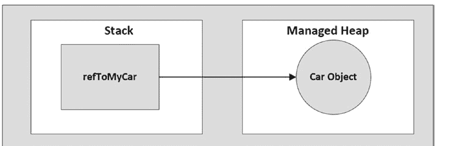
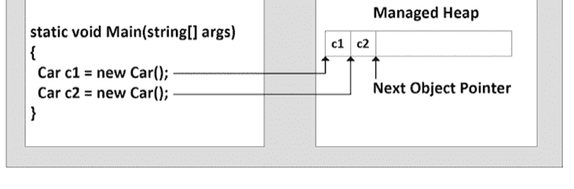
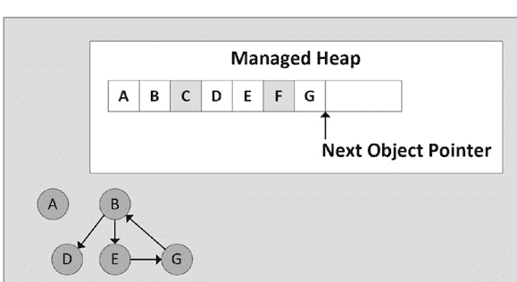
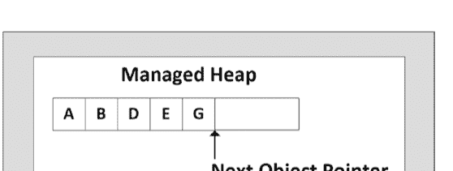
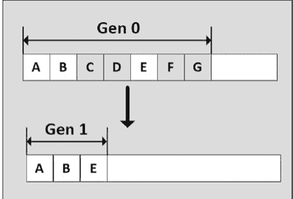

# CHAPTER 9

# Understanding Object Lifetime

到本书的这一点，你已经学习了大量使用 C# 构建自定义类类型的方法。现在你将看到运行时如何通过垃圾回收（GC）管理已分配的类实例（又称对象）。C# 程序员永远不会直接从内存中释放托管对象（请回想 C# 语言中没有 delete 关键字）。相反，.NET Core 对象被分配到称为托管堆的内存区域，在那里它们将在“未来的某个时间”由垃圾收集器自动销毁。

在你了解收集过程的核心细节后，你将学习如何使用 System.GC 类类型以编程方式与垃圾收集器交互（这通常是你大多数项目中不需要做的事情）。接下来，你将研究虚拟 System.Object.Finalize() 方法和 IDisposable 接口如何用于构建以可预测和及时的方式释放内部非托管资源的类。

你还将深入研究 .NET 4.0 中引入的垃圾收集器的一些功能，包括后台垃圾收集和使用泛型 System.Lazy<> 类的延迟实例化。到完成本章时，你将对 .NET Core 对象如何由运行时管理有坚实的理解。

## Classes, Objects, and References

为了为本章涵盖的主题定框架，重要的是进一步澄清类、对象和引用变量之间的区别。请回想类只不过是一个蓝图，描述此类型的实例在内存中看起来和感觉如何。当然，类是在代码文件中定义的（在 C# 中按惯例使用 *.cs 扩展名）。考虑以下在名为 SimpleGC 的新 C# 控制台应用程序项目中定义的简单 Car 类：

```
namespace SimpleGC
{
    // Car.cs
    public class Car
    {
        public int CurrentSpeed {get; set;}
        public string PetName {get; set;}

        public Car(){}
        public Car(string name, int speed)
        {
            PetName = name;
            CurrentSpeed = speed;
        }
    }
```

```
public override string ToString()
    => $"{PetName} is going {CurrentSpeed} MPH";
}
}
```

在定义类之后，你可以使用 C# new 关键字分配任意数量的对象。然而，请理解 new 关键字返回的是堆上对象的引用，而不是实际对象本身。如果你将引用变量声明为方法作用域中的局部变量，它会存储在栈上以供应用程序进一步使用。当你想要在对象上调用成员时，使用 C# 点运算符应用于存储的引用，如下所示：

```
using System;
using SimpleGC;
Console.WriteLine("***** GC Basics *****");

// Create a new Car object on the managed heap.
// We are returned a reference to the object
// ("refToMyCar").
Car refToMyCar = new Car("Zippy", 50);

// The C# dot operator (.) is used to invoke members
// on the object using our reference variable.
Console.WriteLine(refToMyCar.ToString());
Console.ReadLine();
```

图 9-1 说明了类、对象和引用的关系。



图 9-1. 对托管堆上对象的引用

注意：请回想第 4 章中结构是值类型，始终直接分配在栈上，永远不会放置在 .NET Core 托管堆上。堆分配只发生在你创建类实例时。

## The Basics of Object Lifetime

当你构建 C# 应用程序时，你可以正确地假设 .NET Core 运行时环境将在无需你直接干预的情况下处理托管堆。事实上，.NET Core 内存管理的黄金法则是简单的。

规则：使用 new 关键字将类实例分配到托管堆上，然后忘记它。

一旦实例化，垃圾收集器将在对象不再需要时销毁它。下一个明显的问题，当然是“垃圾收集器如何确定对象不再需要？”简短（即不完整）的答案是，垃圾收集器仅在对象无法被代码库的任何部分访问时才将其从堆中移除。假设你在 Program 类中有一个方法按如下方式分配一个本地 Car 对象：

```
static void MakeACar()
{
    // If myCar is the only reference to the Car object, it *may* be destroyed when this method returns.
    Car myCar = new Car();
}
```

请注意，这个 Car 引用（myCar）是在 MakeACar() 方法内直接创建的，并且未通过返回值或 ref/out 参数传递到定义范围之外。因此，一旦此方法调用完成，myCar 引用就不再可达，与之关联的 Car 对象现在成为垃圾收集的候选对象。然而，请理解你不能保证此对象会在 MakeACar() 完成后立即从内存中回收。你此时只能假设当运行时执行下一次垃圾收集时，myCar 对象可以被安全销毁。

正如你肯定会发现的，在垃圾回收环境中编程大大简化了你的应用程序开发。鲜明对比的是，C++ 程序员痛苦地意识到，如果他们未能手动删除堆分配的对象，内存泄漏就不远了。事实上，追踪内存泄漏是编程在非托管环境中最耗时（和最乏味）的方面之一。通过允许垃圾收集器负责销毁对象，内存管理的负担已从你的肩上转移到运行时的肩上。

## The CIL of new

当 C# 编译器遇到 new 关键字时，它会在方法实现中发出 CIL newobj 指令。如果你编译当前示例代码并使用 ildasm.exe 调查生成的程序集，你会在 MakeACar() 方法中找到以下 CIL 语句：

```
.method assembly hidebysig static
    void '<Main>$g__MakeACar|0_0'() cil managed
{
    // Code size       8 (0x8)
    .maxstack 1
    .locals init (class SimpleGC.Car V_0)
    IL_0000: nop
    IL_0001: newobj     instance void SimpleGC.Car::.ctor()
```


```
IL_0006: stloc.0
IL_0007: ret
} // end of method '<Program>$'::'<Main>$'g__MakeACar|0_0'
```

在检查确定对象何时从托管堆中移除的确切规则之前，让我们更详细地了解一下 CIL `newobj` 指令的作用。首先，要明白托管堆不仅仅是运行时访问的随机内存块。.NET Core 垃圾回收器是堆的相当整洁的管理者，因为它会（在必要时）压缩空内存块以进行优化。

为了协助这一工作，托管堆维护一个指针（通常称为下一个对象指针或新对象指针），用于精确定位下一个对象的位置。也就是说，`newobj` 指令告诉运行时执行以下核心操作：

1. 计算要分配的对象所需的内存总量（包括数据成员和基类所需的内存）。
2. 检查托管堆，确保确实有足够的空间来容纳要分配的对象。如果有，则调用指定的构造函数，最终向调用者返回内存中新对象的引用，该引用的地址恰好与下一个对象指针的最后位置相同。
3. 最后，在向调用者返回引用之前，将下一个对象指针向前推进，指向托管堆上的下一个可用槽位。

图 9-2 说明了基本过程。



图 9-2. 在托管堆上分配对象的详细信息

当您的应用程序忙于分配对象时，托管堆上的空间最终可能会被占满。在处理 `newobj` 指令时，如果运行时确定托管堆没有足够的内存来分配请求的类型，它将执行垃圾回收以尝试释放内存。因此，垃圾回收的下一条规则也非常简单。

**规则：** 如果托管堆没有足够的内存来分配请求的对象，则将发生垃圾回收。

然而，垃圾回收具体如何发生，取决于您的应用程序使用的垃圾回收类型。您将在本章稍后部分了解这些差异。

## 将对象引用设置为 null

C/C++ 程序员经常将指针变量设置为 null，以确保它们不再引用非托管内存。鉴于此，您可能想知道在 C# 中将对象引用赋值为 null 的最终结果是什么。例如，假设 `MakeACar()` 子例程现已更新如下：

```
static void MakeACar()
{
    Car myCar = new Car();
    myCar = null;
}
```

当您将对象引用赋值为 null 时，编译器会生成 CIL 代码，确保该引用（在此示例中为 myCar）不再指向任何对象。如果您再次使用 ildasm.exe 查看修改后的 `MakeACar()` 的 CIL 代码，您会发现 `ldnull` 操作码（将 null 值推送到虚拟执行栈上），后跟 `stloc.0` 操作码（将 null 引用设置到变量上）。

```
.method assembly hidebysig static
    void '<Main>$g__MakeACar|0_0'() cil managed
{
    // Code size       10 (0xa)
    .maxstack  1
    .locals init (class SimpleGC.Car V_0)
    IL_0000: nop
    IL_0001: newobj     instance void SimpleGC.Car::.ctor()
    IL_0006: stloc.0
    IL_0007: ldnull
    IL_0008: stloc.0
    IL_0009: ret
} // end of method '<Program>$'::'<Main>$g__MakeACar|0_0'
```

然而，您必须理解的是，将引用赋值为 null 绝不会强制垃圾回收器在该确切时刻启动并从堆中移除对象。您唯一完成的事情是显式切断了引用与其先前指向的对象之间的连接。鉴于此，在 C# 中将引用设置为 null 的后果远不如在其他基于 C 的语言中那样重大；但是，这样做当然不会造成任何伤害。

## 确定对象是否存活

现在，回到垃圾回收器如何确定对象何时不再需要的话题。垃圾回收器使用以下信息来确定对象是否存活：

- **栈根：** 由编译器和栈遍历器提供的栈变量
- **垃圾回收句柄：** 指向可从代码或运行时引用的托管对象的句柄
- **静态数据：** 应用程序域中可引用其他对象的静态对象

在垃圾回收过程中，运行时将调查托管堆上的对象，以确定它们是否仍可被应用程序访问。为此，运行时将构建一个*对象图*，它表示堆上每个可达的对象。对象图将在第 20 章讨论对象序列化时进行详细说明。目前，只需理解对象图用于记录所有可达对象。此外，请注意垃圾回收器永远不会对同一对象进行两次图形化，从而避免了 COM 编程中出现的讨厌的循环引用计数问题。

假设托管堆包含一组名为 A、B、C、D、E、F 和 G 的对象。在垃圾回收期间，将检查这些对象（以及它们可能包含的任何内部对象引用）。构建图形后，不可达的对象（您可以假设是对象 C 和 F）被标记为垃圾。图 9-3 描绘了刚才描述场景的可能对象图（您可以使用“依赖于”或“需要”来阅读方向箭头；例如，E 依赖于 G 和 B，A 不依赖任何东西，等等）。



图 9-3. 构建对象图以确定哪些对象可由应用程序根访问。

在对象被标记为终止（在此例中为 C 和 F，因为它们未在对象图中被计入）后，它们将从内存中被清除。此时，堆上的剩余空间被压缩，这反过来导致运行时修改底层指针集以引用正确的内存位置（这是自动且透明地完成的）。最后但同样重要的是，下一个对象指针被重新调整以指向下一个可用槽位。图 9-4 说明了由此产生的重新调整。



图 9-4. 一个干净且压缩后的堆

**注意：** 严格来说，垃圾回收器使用两个不同的堆，其中一个专门用于存储大型对象。由于重新定位大型对象可能涉及性能损失，因此在回收周期中较少查询此堆。在 .NET Core 中，大型堆可以按需压缩，或在达到绝对或百分比内存使用率的可选硬限制时进行压缩。

## 理解对象代次

当运行时尝试定位不可达对象时，它并不会逐字检查托管堆上的每个对象。显然，这样做会耗费大量时间，尤其是在较大（即现实世界）的应用程序中。

为了帮助优化该过程，堆上的每个对象都被分配到一个特定的“代次”。代次背后的想法很简单：对象在堆上存在的时间越长，它就越有可能留在那里。例如，定义桌面应用程序主窗口的类将一直保留在内存中，直到程序终止。相反，刚刚被放置在堆上的对象（例如在方法作用域内分配的对象）可能很快变得不可达。鉴于这些假设，堆上的每个对象属于以下代次之一：

- **第 0 代：** 标识一个从未被标记为回收的新分配对象（大型对象除外，它们最初被放置在第 2 代集合中）。大多数对象在第 0 代被垃圾回收回收，并且不会存活到第 1 代。
- **第 1 代：** 标识一个已存活过一次垃圾回收的对象。此代次还充当短生命周期对象和长生命周期对象之间的缓冲区。
- **第 2 代：** 标识一个已存活过多次垃圾回收器清除的对象，或一个从第 2 代集合开始的大型对象。

**注意：** 第 0 代和第 1 代被称为短暂代次。如下一节所述，您将看到垃圾回收过程确实会区别对待短暂代次。

垃圾回收器将首先调查所有第 0 代对象。如果标记和清除（或更简单地说，摆脱）这些对象产生了所需的内存量，则任何存活的对象都会被提升到第 1 代。要了解对象的代次如何影响回收过程，请思考图 9-5，它描绘了一组存活的第 0 代对象（A、B 和 E）在所需内存被回收后如何被提升。




## 图 9-5. 在垃圾回收中幸存的第 0 代对象会被提升到第 1 代

如果所有第 0 代对象都已被评估，但仍需要额外的内存，那么接下来会检查第 1 代对象的可达性并相应地进行收集。幸存下来的第 1 代对象随后会被提升到第 2 代。如果垃圾回收器仍然需要额外的内存，则会评估第 2 代对象。此时，如果第 2 代对象在垃圾回收中幸存下来，它将仍然是第 2 代对象，因为对象世代有预定义的上限。

关键在于，通过为堆上的对象分配代际值，较新的对象（如局部变量）会被快速移除，而较老的对象（如程序的主窗口）则不会经常被“打扰”。

当系统物理内存不足、托管堆上分配的内存超过可接受的阈值，或者在应用程序代码中调用 GC.Collect() 时，便会触发垃圾回收。

如果这一切看起来有些神奇，并且比亲自管理内存要好，请记住，垃圾回收的过程并非没有代价。垃圾回收的时机以及何时回收什么通常不受开发人员控制，尽管垃圾回收肯定可以受到好的或坏的影响。当垃圾回收执行时，会占用 CPU 周期，并可能影响应用程序的性能。接下来的章节将探讨不同类型的垃圾回收。

## 短期代和段

如前所述，第 0 代和第 1 代是短命的，被称为短期代。这些代分配在称为短期段的内存段中。随着垃圾回收的发生，垃圾回收获取的新段成为新的短期段，而包含存活超过第 1 代对象的段则成为新的第 2 代段。

短期段的大小因多种因素而异，例如垃圾回收类型（将在下节介绍）和系统的位数。表 9-1 显示了短期段的不同大小。

### 表 9-1. 短期段大小

| 垃圾回收类型 | 32 位 | 64 位 |
|---|---|---|
| 工作站 | 16 MB | 256 MB |
| 服务器 | 64 MB | 4 GB |
| 服务器（>4 个逻辑 CPU） | 32 MB | 2 GB |
| 服务器（>8 个逻辑 CPU） | 16 MB | 1 GB |

## 垃圾回收类型

运行时提供两种垃圾回收类型：

- *工作站垃圾回收：* 专为客户端应用程序设计，是独立应用程序的默认设置。工作站 GC 可以是后台的（将在下节介绍）或非并发的。
- *服务器垃圾回收：* 专为需要高吞吐量和可扩展性的服务器应用程序设计。服务器 GC 可以是后台的或非并发的，就像工作站 GC 一样。

注意 这些名称表明工作站和服务器应用程序的默认设置，但垃圾回收方法可以通过机器的 runtimeconfig.json 或系统环境变量进行配置。除非计算机只有一个处理器，否则它将始终使用工作站垃圾回收。

工作站 GC 发生在触发垃圾回收的同一线程上，并保持与触发时相同的优先级。这可能会导致与应用程序中的其他线程竞争。服务器 GC 发生在多个设置为 THREAD_PRIORITY_HIGHEST 优先级级别的专用线程上（线程将在第 15 章介绍）。每个 CPU 都有一个专用堆和专用线程来执行垃圾回收。这可能导致服务器垃圾回收变得非常资源密集。

## 后台垃圾回收

从 .NET 4.0 开始（并在 .NET Core 中继续），垃圾回收器能够在清理托管堆上的对象时处理线程挂起问题，使用后台垃圾回收。尽管名称如此，但这并不意味着所有垃圾回收现在都发生在额外的后台执行线程上。相反，如果对非短期代中的对象进行后台垃圾回收，.NET Core 运行时现在能够使用专用后台线程收集短期代上的对象。

相关地，.NET 4.0 及更高版本的垃圾回收已得到改进，进一步减少了与垃圾回收细节相关的给定线程必须挂起的时间。这些更改的最终结果是，清理第 0 代或第 1 代中未使用对象的过程已得到优化，可以带来更好的程序运行时性能（这对于需要较小且可预测的 GC 停止时间的实时系统尤为重要）。

但请理解，这种新垃圾回收模型的引入对您如何构建 .NET Core 应用程序没有影响。出于所有实际目的，您只需让垃圾回收器执行其工作，无需直接干预（并且很高兴微软的人员正在以透明的方式改进收集过程）。

## System.GC 类型

mscorlib.dll 程序集提供了一个名为 System.GC 的类类型，允许您使用一组静态成员以编程方式与垃圾回收器交互。现在请注意，您很少（如果有的话）需要在代码中直接使用这个类。通常，只有在创建内部使用非托管资源的类时，您才会使用 System.GC 的成员。例如，如果您正在构建一个使用 .NET Core 平台调用协议调用基于 Windows 的 C API 的类，或者可能因为某些非常底层且复杂的 COM 互操作逻辑。表 9-2 提供了一些更有趣的成员概要（完整细节请参阅 .NET Framework SDK 文档）。

### 表 9-2. System.GC 类型的部分成员

| System.GC 成员 | 描述 |
|---|---|
| AddMemoryPressure() RemoveMemoryPressure() | 允许您指定一个数值，表示调用对象在垃圾回收过程中的“紧急程度”。请注意，这些方法应同步改变压力，因此绝不要移除超过您已添加的总量的压力。 |
| Collect() | 强制 GC 执行垃圾回收。此方法已重载，可指定要回收的代以及回收模式（通过 GCCollectionMode 枚举）。 |
| CollectionCount() | 返回一个数值，表示给定代已被清理的次数。 |
| GetGeneration() | 返回对象当前所属的代。 |
| GetTotalMemory() | 返回当前托管堆上分配的估计内存量（以字节为单位）。一个布尔参数指定调用是否应在返回前等待垃圾回收发生。 |
| MaxGeneration | 返回目标系统支持的代的最大数量。在 Microsoft .NET 4.0 下，有三种可能的代：0、1 和 2。 |
| SuppressFinalize() | 设置一个标志，指示不应为指定对象调用其 Finalize() 方法。 |
| WaitForPendingFinalizers() | 挂起当前线程，直到所有可终结对象都已完成终结。此方法通常在对 GC.Collect() 的调用之后直接调用。 |

为了说明如何使用 System.GC 类型获取各种以垃圾回收为中心的细节，请将 SimpleGC 项目的顶层语句更新为以下内容，其中使用了 GC 的几个成员：

```
using System;

Console.WriteLine("**** Fun with System.GC ****");

// Print out estimated number of bytes on heap.
Console.WriteLine("Estimated bytes on heap: {0}",
    GC.GetTotalMemory(false));

// MaxGeneration is zero based, so add 1 for display
// purposes.
Console.WriteLine("This OS has {0} object generations.\n",
    (GC.MaxGeneration + 1));

Car refToMyCar = new Car("Zippy", 100);
Console.WriteLine(refToMyCar.ToString());
```


// 输出 refToMyCar 对象的代数。
Console.WriteLine("refToMyCar 的代数为：{0}",
    GC.GetGeneration(refToMyCar));
Console.ReadLine();

运行后，你应该会看到类似以下的输出：

```
**** Fun with System.GC ****

Estimated bytes on heap: 75760
This OS has 3 object generations.

Zippy is going 100 MPH
Generation of refToMyCar is: 0
```

下一节将进一步探讨表 9-2 中的其他方法。

## 强制进行垃圾回收

再次强调，垃圾回收器的全部目的就是代表你管理内存。不过，在某些少见情况下，通过编程方式使用 GC.Collect() 强制进行垃圾回收可能会有所帮助。以下是两种可能需要与回收过程交互的常见情况：

- 应用程序即将进入一段不希望被可能发生的垃圾回收中断的代码。
- 应用程序刚刚完成了大量对象的分配，并且希望尽快释放尽可能多的已占用内存。

如果你判断让垃圾回收器检查不可达对象可能会有所帮助，就可以显式触发垃圾回收，如下所示：

```
// Force a garbage collection and wait for
// each object to be finalized.
GC.Collect();
GC.WaitForPendingFinalizers();
```

手动强制进行垃圾回收时，应始终调用 GC.WaitForPendingFinalizers()。通过这种方式，你可以放心，所有可终结对象（下一节将介绍）都有机会在程序继续执行前完成必要的清理工作。在底层，GC.WaitForPendingFinalizers() 会在回收过程中挂起调用线程。这是一件好事，因为它可以确保你的代码不会调用当前正在销毁的对象上的方法！

GC.Collect() 方法还可以接收一个数值，用于标识要执行垃圾回收的最老代。例如，如果要指示运行时仅检查第 0 代对象，可以编写如下代码：

```
// Only investigate generation 0 objects.
GC.Collect(0);
GC.WaitForPendingFinalizers();
```

此外，Collect() 方法还可以接收 GCCollectionMode 枚举值作为第二个参数，以便精确调整运行时强制进行垃圾回收的方式。此枚举定义了以下值：

```
public enum GCCollectionMode
{
    Default,  // Forced is the current default.
    Forced,   // Tells the runtime to collect immediately!
    Optimized // Allows the runtime to determine whether the current time is optimal to reclaim objects.
}
```

与任何垃圾回收一样，调用 GC.Collect() 会提升仍然存活的对象所在的代。为了说明这一点，假设你已将顶级语句更新如下：

```
Console.WriteLine("***** Fun with System.GC *****");

// Print out estimated number of bytes on heap.
Console.WriteLine("Estimated bytes on heap: {0}",
    GC.GetTotalMemory(false));

// MaxGeneration is zero based.
Console.WriteLine("This OS has {0} object generations.\n",
    (GC.MaxGeneration + 1));
Car refToMyCar = new Car("Zippy", 100);
Console.WriteLine(refToMyCar.ToString());

// Print out generation of refToMyCar.
Console.WriteLine("\nGeneration of refToMyCar is: {0}",
    GC.GetGeneration(refToMyCar));

// Make a ton of objects for testing purposes.
object[] tonsOfObjects = new object[50000];
for (int i = 0; i < 50000; i++)
{
    tonsOfObjects[i] = new object();
}

// Collect only gen 0 objects.
Console.WriteLine("Force Garbage Collection");
GC.Collect(0, GCCollectionMode.Forced);
GC.WaitForPendingFinalizers();
```

```
// Print out generation of refToMyCar.
Console.WriteLine("Generation of refToMyCar is: {0}",
    GC.GetGeneration(refToMyCar));

// See if tonsOfObjects[9000] is still alive.
if (tonsOfObjects[9000] != null)
{
    Console.WriteLine("Generation of tonsOfObjects[9000] is: {0}", GC.GetGeneration(tonsOfObjects[9000]));
}
else
{
    Console.WriteLine("tonsOfObjects[9000] is no longer alive.");
}

// Print out how many times a generation has been swept.
Console.WriteLine("\nGen 0 has been swept {0} times",
    GC.CollectionCount(0));
Console.WriteLine("Gen 1 has been swept {0} times",
    GC.CollectionCount(1));
Console.WriteLine("Gen 2 has been swept {0} times",
    GC.CollectionCount(2));
Console.ReadLine();
```

在这里，我特意创建了一个包含大量 object 类型元素的数组（确切地说是 50,000 个），用于测试。以下是程序的输出：

```
**** Fun with System.GC ****

Estimated bytes on heap: 75760
This OS has 3 object generations.

Zippy is going 100 MPH
Generation of refToMyCar is: 0
Forcing Garbage Collection
Generation of refToMyCar is: 1
Generation of tonsOfObjects[9000] is: 1

Gen 0 has been swept 1 times
Gen 1 has been swept 0 times
Gen 2 has been swept 0 times
```

到这里，希望你已经对对象生命周期的细节更加熟悉了。下一节将进一步考察垃圾回收过程，介绍如何构建可终结对象以及可释放对象。请注意，只有在构建内部维护非托管资源的 C# 类时，通常才需要使用以下技术。

## 构建可终结对象

在第 6 章中，你了解到 .NET Core 的最高基类 System.Object 定义了一个名为 Finalize() 的虚方法。此方法的默认实现不执行任何操作。

```
// System.Object
public class Object
{
    ...
    protected virtual void Finalize() {}
}
```

当你为自定义类重写 Finalize() 时，就为该类型建立了一个专门的位置，用于执行任何必要的清理逻辑。由于此成员定义为 protected，因此无法通过点运算符从类实例直接调用对象的 Finalize() 方法。相反，垃圾回收器会在从内存中移除对象之前调用对象的 Finalize() 方法（如果该对象支持此方法）。

注意：在结构类型上重写 Finalize() 是非法的。鉴于结构是值类型，最初就不会在堆上分配，因此也不会进行垃圾回收，这一点完全合理！不过，如果你创建的结构包含需要清理的非托管资源，可以实现 IDisposable 接口（稍后介绍）。请记住第 4 章中的内容：ref 结构和只读 ref 结构不能实现接口，但可以实现 Dispose() 方法。

当然，Finalize() 的调用最终会在“自然”的垃圾回收过程中发生，也可能在你通过 GC.Collect() 以编程方式强制回收时发生。在 .NET 的早期版本中（不是 .NET Core），应用程序关闭时会调用每个对象的终结器。在 .NET Core 中，即使应用程序关闭，也没有办法强制执行终结器。

现在，尽管开发人员的直觉可能会告诉你应当这样做，但绝大多数 C# 类都不需要任何显式清理逻辑或自定义终结器。原因很简单：如果你的类只使用其他托管对象，那么所有对象最终都会被垃圾回收。只有在使用非托管资源（例如原始操作系统文件句柄、原始非托管数据库连接、非托管内存块或其他非托管资源）时，才需要设计一个能够自行清理的类。在 .NET Core 平台下，非托管资源通常通过平台调用服务（PInvoke）直接调用操作系统 API 来获取，或者是在一些复杂的 COM 互操作场景中获取。鉴于此，请考虑下面这条垃圾回收规则。

规则：重写 Finalize() 的唯一充分理由，是你的 C# 类通过 PInvoke 或复杂的 COM 互操作任务使用了非托管资源（通常通过 System.Runtime.InteropServices.Marshal 类型定义的各种成员）。原因在于，在这些场景中，你操作的是运行时无法管理的内存。


# 重写 System.Object.Finalize()

在极少数情况下，如果你构建了一个使用非托管资源的 C# 类，你显然希望确保底层内存以可预测的方式被释放。假设你创建了一个名为 SimpleFinalize 的新 C# 控制台应用程序项目，并插入了一个名为 MyResourceWrapper 的类，该类使用非托管资源（无论那是什么），并且你想重写 Finalize()。在 C# 中这样做的奇怪之处在于，你不能使用预期的 override 关键字来完成它。

```
using System;
namespace SimpleFinalize
{
    class MyResourceWrapper
    {
        // Compile-time error!
        protected override void Finalize(){ }
    }
}
```

相反，当你想要配置自定义 C# 类类型以重写 Finalize() 方法时，你会使用类似 C++ 的析构函数语法来实现相同的效果。采用这种替代的重写虚拟方法形式的原因是，当 C# 编译器处理终结器语法时，它会自动在隐式重写的 Finalize() 方法中添加大量必需的基础结构（稍后会显示）。

C# 终结器看起来与构造函数相似，因为它们与定义它们的类同名。此外，终结器前面加上波浪号符号（~）。然而，与构造函数不同，终结器永远不会使用访问修饰符（它们隐式为 protected），不接受参数，并且不能重载（每个类只有一个终结器）。

以下是 MyResourceWrapper 的自定义终结器，在被调用时会发出系统蜂鸣声。显然，这个示例仅用于教学目的。实际的终结器除了释放任何非托管资源之外不会做更多的事情，并且不会与其他托管对象交互，即使是当前对象引用的对象，因为你不能假设在垃圾收集器调用你的 Finalize() 方法时它们仍然存活。

```
using System;
// Override System.Object.Finalize() via finalizer syntax.
class MyResourceWrapper
{
    // Clean up unmanaged resources here.
    // Beep when destroyed (testing purposes only!)
    ~MyResourceWrapper() => Console.Beep();
}
```

如果你使用 ildasm.exe 检查这个 C# 析构函数，你会看到编译器插入了一些必要的错误检查代码。首先，你的 Finalize() 方法范围内的代码语句被放置在 try 块中（参见第 7 章）。相关的 finally 块确保无论 try 范围内是否遇到异常，你的基类的 Finalize() 方法始终会执行。

```
.method family hidebysig virtual instance void
Finalize() cil managed
{
    .override [System.Runtime]System.Object::Finalize
// Code size      17 (0x11)
.maxstack  1
.try
{
    IL_0000:  call   void [System.Console]System.Console::Beep()
    IL_0005:  nop
    IL_0006:  leave.s   IL_0010
} // end .try
finally
{
    IL_0008:  ldarg.0
    IL_0009:  call   instance void [System.Runtime]System.Object::Finalize()
    IL_000e:  nop
    IL_000f:  endfinally
} // end handler
IL_0010:  ret
} // end of method MyResourceWrapper::Finalize
```

如果你然后测试 MyResourceWrapper 类型，你会发现当终结器执行时系统会发出蜂鸣声。

```
using System;
using SimpleFinalize;

Console.WriteLine("***** Fun with Finalizers *****\n");
Console.WriteLine("Hit return to create the objects ");
Console.WriteLine("then force the GC to invoke Finalize()");
//Depending on the power of your system,
//you might need to increase these values
CreateObjects(1_000_000);
//Artificially inflate the memory pressure
GC.AddMemoryPressure(2147483647);
GC.Collect(0, GCCollectionMode.Forced);
GC.WaitForPendingFinalizers();
Console.ReadLine();

static void CreateObjects(int count)
{
    MyResourceWrapper[] tonsOfObjects =
        new MyResourceWrapper[count];
    for (int i = 0; i < count; i++)
    {
        tonsOfObjects[i] = new MyResourceWrapper();
    }
    tonsOfObjects = null;
}
```

注意 要保证这个小型控制台应用程序在 .NET Core 中强制进行垃圾回收的唯一方法是创建大量对象到内存中，然后将它们设为 null。如果运行此示例应用程序，请确保按 Ctrl+C 键组合来停止程序执行和所有蜂鸣声！

## 详细说明终结过程

必须始终记住 Finalize() 方法的作用是确保 .NET Core 对象在被垃圾回收时可以清理非托管资源。因此，如果你构建的类不使用非托管内存（这是最常见的情况），终结就几乎没有用处。事实上，如果可能的话，你应该设计类型以避免支持 Finalize() 方法，原因很简单：终结需要时间。

当你在托管堆上分配对象时，运行时会自动确定你的对象是否支持自定义 Finalize() 方法。如果是，则对象被标记为可终结，并且指向该对象的指针存储在名为终结队列的内部队列上。终结队列是垃圾收集器维护的一个表，指向在从堆中移除之前必须终结的每个对象。

当垃圾收集器确定是时候从内存中释放对象时，它会检查终结队列上的每个条目，并将对象从堆复制到另一个托管结构，即终结可达表（通常缩写为 freachable，发音为“eff-reachable”）。此时，会生成一个单独的线程，在下一次垃圾回收时为 freachable 表上的每个对象调用 Finalize() 方法。鉴于此，真正终结一个对象至少需要两次垃圾回收。

总之，虽然对象的终结确实确保对象可以清理非托管资源，但它本质上仍然是非确定性的，并且由于幕后的额外处理，速度明显较慢。

## 构建可释放对象

正如你所见，终结器可用于在垃圾收集器启动时释放非托管资源。然而，鉴于许多非托管对象是“珍贵物品”（例如原始数据库或文件句柄），在等待垃圾回收发生之前尽快释放它们可能是有价值的。作为重写 Finalize() 的替代方案，你的类可以实现 IDisposable 接口，该接口定义了单个名为 Dispose() 的方法，如下所示：

```
public interface IDisposable
{
    void Dispose();
}
```

当你实现 IDisposable 接口时，假设是当对象使用者使用完对象时，对象使用者在对象引用超出作用域之前手动调用 Dispose()。这样，对象可以在不被放置在终结队列上而产生开销，也无需等待垃圾收集器触发类的终结逻辑的情况下执行必要的非托管资源清理。

注意 非 ref 结构体和类类型都可以实现 IDisposable（与重写 Finalize() 仅保留给类类型不同），因为对象使用者（而不是垃圾收集器）调用 Dispose() 方法。可释放的 ref 结构体在第 4 章中有所介绍。

为了说明此接口的使用，创建一个名为 SimpleDispose 的新 C# 控制台应用程序项目。以下是更新后的 MyResourceWrapper 类，现在实现 IDisposable，而不是重写 System.Object.Finalize()：

```
using System;
namespace SimpleDispose
{
    // Implementing IDisposable.
    class MyResourceWrapper : IDisposable
    {
        // The object user should call this method
        // when they finish with the object.
        public void Dispose()
        {
            // Clean up unmanaged resources...
            // Dispose other contained disposable objects...
            // Just for a test.
            Console.WriteLine("***** In Dispose! *****");
        }
    }
}
```

请注意，Dispose() 方法不仅负责释放类型自己的非托管资源，还可以调用任何其他包含的可释放方法的 Dispose()。与 Finalize() 不同，在 Dispose() 方法中与其它托管对象通信是完全安全的。原因很简单：垃圾收集器对 IDisposable 接口一无所知，永远不会调用 Dispose()。因此，当对象使用者调用此方法时，对象仍在托管堆上积极运行，并且可以访问所有其他堆分配的对象。调用逻辑，如下所示，相当直接：

```
using System;
using System.IO;
using SimpleDispose;
Console.WriteLine("***** Fun with Dispose *****\n");
// Create a disposable object and call Dispose()
// to free any internal resources.
MyResourceWrapper rw = new MyResourceWrapper();
rw.Dispose();
Console.ReadLine();
```

当然，在尝试对对象调用 Dispose() 之前，你会希望确保该类型支持 IDisposable 接口。虽然你通常可以通过查阅文档来知道哪些基类库类型实现了 IDisposable，但也可以使用第 6 章中讨论的 is 或 as 关键字以编程方式进行检查。


```csharp
Console.WriteLine("***** Fun with Dispose *****\n");
MyResourceWrapper rw = new MyResourceWrapper();
if (rw is IDisposable)
{
    rw.Dispose();
}
Console.ReadLine();
```

这个示例又揭示了关于内存管理的另一条规则。

**规则：** 如果你直接创建的对象支持 IDisposable，最好调用其 Dispose()。你应该做的假设是，如果类设计者选择支持 Dispose() 方法，该类型就有一些清理工作要做。如果你忘记了，内存最终会被清理掉（所以不要惊慌），但可能比必要的时间更长。

前一条规则有一个例外。基类库中许多实现了 IDisposable 接口的类型提供了 Dispose() 方法的（有些令人困惑的）别名，试图让以处置为中心的 方法对定义的类型来说听起来更自然。举例来说，虽然 System.IO.FileStream 类实现了 IDisposable（因此支持 Dispose() 方法），但它也定义了以下用于相同目的的 Close() 方法：

```csharp
// Assume you have imported
// the System.IO namespace...
static void DisposeFileStream()
{
    FileStream fs = new FileStream("myFile.txt", FileMode.OpenOrCreate);

    // Confusing, to say the least!
    // These method calls do the same thing!
    fs.Close();
    fs.Dispose();
}
```

虽然“关闭”一个文件比“处置”一个文件感觉更自然，但这种清理方法的重复可能会令人困惑。对于少数提供别名的类型，只要记住，如果一个类型实现了 IDisposable，调用 Dispose() 总是安全的。

## 重用 C# using 关键字

当你处理实现了 IDisposable 的托管对象时，通常会使用结构化异常处理来确保在运行时出现异常时调用该类型的 Dispose() 方法，如下所示：

```csharp
Console.WriteLine("***** Fun with Dispose *****\n");
MyResourceWrapper rw = new MyResourceWrapper();
try
{
    // Use the members of rw.
}
finally
{
    // Always call Dispose(), error or not.
    rw.Dispose();
}
```

虽然这是一个很好的防御性编程示例，但事实是，很少有开发人员喜欢将每个可释放类型都包装在 try/finally 块中只是为了确保调用 Dispose() 方法。为了以更不显眼的方式实现相同的结果，C# 支持一种特殊的语法，看起来像这样：

```csharp
Console.WriteLine("***** Fun with Dispose *****\n");
// Dispose() is called automatically when the using scope exits.
using(MyResourceWrapper rw = new MyResourceWrapper())
{
    // Use rw object.
}
```

如果你使用 ildasm.exe 查看了上述顶层语句的 CIL 代码，你会发现 using 语法确实扩展为 try/finally 逻辑，并带有预期的 Dispose() 调用：

```cil
.method private hidebysig static void
    '<Main>$' (string[] args) cil managed
{
...
    .try
    {
    } // end .try
    finally
    {
        IL_0019:  callvirt   instance void [System.Runtime]System.IDisposable::Dispose()
    } // end handler
} // end of method '<Program>$'::'<Main>$'
```

> **注意：** 如果你尝试“使用”一个未实现 IDisposable 的对象，你将收到编译器错误。

虽然这种语法消除了手动将可释放对象包装在 try/finally 逻辑中的需要，但 C# using 关键字不幸现在有了双重含义（导入命名空间和调用 Dispose() 方法）。尽管如此，当你处理支持 IDisposable 接口的类型时，这种语法结构将确保“正在使用”的对象在 using 块退出后自动调用其 Dispose() 方法。

另外，请注意，可以在一个 using 范围内声明多个相同类型的对象。正如你所期望的，编译器会注入代码来对每个声明的对象调用 Dispose()。

```csharp
// Use a comma-delimited list to declare multiple objects to dispose.
using(MyResourceWrapper rw = new MyResourceWrapper(), rw2 = new MyResourceWrapper())
{
    // Use rw and rw2 objects.
}
```

### Using 声明（C# 8.0 新增）

C# 8.0 新增了 using 声明。using 声明是以 using 关键字为前缀的变量声明。这在功能上与上一节介绍的语法相同，只是没有用大括号 ({}) 标记的显式代码块。

向你的类添加以下方法：

```csharp
private static void UsingDeclaration()
{
    // This variable will be in scope until the end of the method.
    using var rw = new MyResourceWrapper();
    // Do something here.
    Console.WriteLine("About to dispose.");
    // Variable is disposed at this point.
}
```

接下来，将以下调用添加到顶层语句中：

```csharp
Console.WriteLine("***** Fun with Dispose *****\n");
...
Console.WriteLine("Demonstrate using declarations");
UsingDeclaration();
Console.ReadLine();
```

如果你用 ILDASM 检查新方法，你会（不出所料）发现与之前相同的代码。

```cil
.method private hidebysig static
    void UsingDeclaration() cil managed
{
    ...
    .try
    {
        ...
    } // end .try
    finally
    {
        IL_0018: callvirt instance void
            [System.Runtime]System.IDisposable::Dispose()
        ...
    } // end handler
    IL_001f: ret
} // end of method Program::UsingDeclaration
```

这个新特性本质上是编译器魔法，节省了几个击键。 使用时要小心，因为新语法不如之前的语法明确。

## 构建可终结和可释放的类型

到目前为止，你已经看到了构建清理内部非托管资源的类的两种不同方法。一方面，你可以使用终结器。使用这种技术，你可以安心地知道对象在被垃圾回收时会自动清理自己（无论何时），无需用户交互。另一方面，你可以实现 IDisposable，为对象用户提供一种在完成时尽快清理对象的方法。然而，如果调用者忘记调用 Dispose()，非托管资源可能会无限期地保留在内存中。

正如你可能怀疑的那样，将这两种技术融合到单个类定义中是可能的。这样做，你可以获得两种模型的优点。如果对象用户确实记得调用 Dispose()，你可以通过调用 GC.SuppressFinalize() 来通知垃圾回收器绕过终结过程。如果对象用户忘记调用 Dispose()，对象最终会被终结并有机会释放内部资源。好消息是，对象的内部非托管资源无论如何都会被释放。

以下是 MyResourceWrapper 的下一个迭代，它现在是可终结和可释放的，定义在名为 FinalizableDisposableClass 的 C# 控制台应用程序项目中：

```csharp
using System;

namespace FinalizableDisposableClass
{
    // A sophisticated resource wrapper.
    public class MyResourceWrapper : IDisposable
    {
        // The garbage collector will call this method if the object user forgets to call Dispose().
        ~MyResourceWrapper()
        {
            // Clean up any internal unmanaged resources.
            // Do not call Dispose() on any managed objects.
        }
        // The object user will call this method to clean up resources ASAP.
        public void Dispose()
        {
            // Clean up unmanaged resources here.
            // Call Dispose() on other contained disposable objects.
            // No need to finalize if user called Dispose(), so suppress finalization.
            GC.SuppressFinalize(this);
        }
    }
}
```

请注意，此 Dispose() 方法已更新为调用 GC.SuppressFinalize()，这会通知运行时在该对象被垃圾回收时不再有必要调用析构函数，因为非托管资源已经通过 Dispose() 逻辑释放。

### 正式的处置模式

MyResourceWrapper 的当前实现确实工作得相当好；然而，你仍有一些小缺点。首先，Finalize() 和 Dispose() 方法各自必须清理相同的非托管资源。这可能导致重复代码，这可能会变得难以维护。理想情况下，你应该定义一个私有辅助函数，由任一方法调用。


接下来，你希望确保 Finalize() 方法不会尝试释放任何托管对象，而 Dispose() 方法应该这样做。最后，你还希望确保对象使用者可以安全地多次调用 Dispose() 而不会出错。目前，Dispose() 方法没有任何此类保护。

为了解决这些设计问题，Microsoft 定义了一种正式的、规范的释放模式，在健壮性、可维护性和性能之间取得了平衡。下面是 MyResourceWrapper 的最终（并带注释）版本，它使用了这种官方模式：

```
class MyResourceWrapper : IDisposable
{
    // Used to determine if Dispose() has already been called.
    private bool disposed = false;

    public void Dispose()
    {
        // Call our helper method.
        // Specifying "true" signifies that the object user triggered the cleanup.
        CleanUp(true);

        // Now suppress finalization.
        GC.SuppressFinalize(this);
    }

    private void CleanUp(bool disposing)
    {
        // Be sure we have not already been disposed!
        if (!this.disposed)
        {
            // If disposing equals true, dispose all managed resources.
            if (disposing)
            {
                // Dispose managed resources.
            }
            // Clean up unmanaged resources here.
        }
        disposed = true;
    }
    ~MyResourceWrapper()
    {
        // Call our helper method.
        // Specifying "false" signifies that the GC triggered the cleanup.
        CleanUp(false);
    }
}
```

请注意，MyResourceWrapper 现在定义了一个名为 CleanUp() 的私有辅助方法。通过指定 true 作为参数，你表示对象使用者已启动清理，因此应清理所有托管和非托管资源。然而，当垃圾回收器启动清理时，你在调用 CleanUp() 时指定 false，以确保内部可释放对象不会被释放（因为你不能假设它们仍在内存中！）。最后但同样重要的是，在退出 CleanUp() 之前将 bool 成员变量 disposed 设置为 true，以确保 Dispose() 可以多次调用而不会出错。

> 注意 在对象已被“释放”之后，客户端仍然可以对其调用成员，因为它仍在内存中。因此，一个健壮的资源包装类还需要用额外的编码逻辑更新类的每个成员，效果相当于：“如果我已被释放，则不执行任何操作并从成员中返回。”

要测试 MyResourceWrapper 的最终迭代，请将你的 Program.cs 文件更新为以下内容：

```
using System;
using FinalizableDisposableClass;

Console.WriteLine("***** Dispose() / Destructor Combo Platter *****");

// Call Dispose() manually. This will not call the finalizer.
MyResourceWrapper rw = new MyResourceWrapper();
rw.Dispose();

// Don't call Dispose(). This will trigger the finalizer when the object gets GCd.
MyResourceWrapper rw2 = new MyResourceWrapper();
```

请注意，你正在显式地对 rw 对象调用 Dispose()，因此析构函数调用被抑制。然而，你“忘记”对 rw2 对象调用 Dispose() 了；不用担心——当对象被垃圾回收时，终结器仍会执行。

至此，你对运行时如何通过垃圾回收管理你的对象的调查就结束了。虽然关于收集过程还有一些额外的（有些晦涩的）细节我在这里没有涉及（例如弱引用和对象复活），但你现在已经处于一个完美的位置，可以自行进一步探索。为了结束本章，你将研究一个名为对象延迟实例化的编程特性。

## 理解延迟对象实例化

当你创建类时，你可能偶尔需要为代码中的某个特定成员变量做准备，而该变量可能永远不需要，因为对象使用者可能不会调用使用它的那个方法（或属性）。这很合理。然而，如果该成员变量需要大量内存来实例化，这可能会有问题。

例如，假设你正在编写一个封装数字音乐播放器操作的类。除了预期的 Play()、Pause() 和 Stop() 方法之外，你还希望提供返回 Song 对象集合的能力（通过名为 AllTracks 的类），它代表设备上的每个数字音乐文件。

如果你想跟随操作，创建一个名为 LazyObjectInstantiation 的新控制台应用程序项目，并定义以下类类型：

```
//Song.cs
namespace LazyObjectInstantiation
{
    // Represents a single song.
    class Song
    {
        public string Artist { get; set; }
```

```
public string TrackName { get; set; }
    public double TrackLength { get; set; }
}
}

//AllTracks.cs
using System;
namespace LazyObjectInstantiation
{
    // Represents all songs on a player.
    class AllTracks
    {
        // Our media player can have a maximum
        // of 10,000 songs.
        private Song[] _allSongs = new Song[10000];

        public AllTracks()
        {
            // Assume we fill up the array
            // of Song objects here.
            Console.WriteLine("Filling up the songs!");
        }
    }
}

//MediaPlayer.cs
using System;
namespace LazyObjectInstantiation
{
    // The MediaPlayer has-an AllTracks object.
    class MediaPlayer
    {
        // Assume these methods do something useful.
        public void Play() { /* Play a song */ }
        public void Pause() { /* Pause the song */ }
        public void Stop() { /* Stop playback */ }
        private AllTracks _allSongs = new AllTracks();

        public AllTracks GetAllTracks()
        {
            // Return all of the songs.
            return _allSongs;
        }
    }
}
```

MediaPlayer 的当前实现假设对象使用者将想要通过 GetAllTracks() 方法获取歌曲列表。好吧，如果对象使用者不需要获取此列表会怎样？在当前实现中，AllTracks 成员变量仍将被分配，从而在内存中创建 10,000 个 Song 对象，如下所示：

```
using System;
using LazyObjectInstantiation;

Console.WriteLine("***** Fun with Lazy Instantiation *****
");

// This caller does not care about getting all songs,
// but indirectly created 10,000 objects!
MediaPlayer myPlayer = new MediaPlayer();
myPlayer.Play();

Console.ReadLine();
```

很明显，你宁愿不创建 10,000 个没人会使用的对象，因为这会给 .NET Core 垃圾回收器带来很大的压力。虽然你可以手动添加一些代码以确保 _allSongs 对象仅在被使用时才创建（也许使用工厂方法设计模式），但有更简单的方法。

基类库提供了一个有用的泛型类 Lazy<>，定义在 mscorlib.dll 的 System 命名空间中。此类允许你定义在代码库实际使用它之前不会被创建的数据。由于这是一个泛型类，你必须指定首次使用时要创建的项的类型，该类型可以是 .NET Core 基类库中的任何类型，也可以是你自己编写的自定义类型。要启用 AllTracks 成员变量的延迟实例化，你只需将 MediaPlayer 代码更新为以下内容：

```
// The MediaPlayer has-an Lazy<AllTracks> object.
class MediaPlayer
{
...
    private Lazy<AllTracks> _allSongs = new Lazy<AllTracks>();
    public AllTracks GetAllTracks()
    {
        // Return all of the songs.
        return _allSongs.Value;
    }
}
```

除了你现在将 AllTracks 成员变量表示为 Lazy<> 类型之外，请注意之前 GetAllTracks() 方法的实现也已更新。具体来说，你必须使用 Lazy<> 类的只读 Value 属性来获取实际存储的数据（在本例中，维护 10,000 个 Song 对象的 AllTracks 对象）。

通过这个简单的更新，请注意以下更新后的代码将仅在确实调用 GetAllTracks() 时才间接分配 Song 对象：

```
Console.WriteLine("***** Fun with Lazy Instantiation *****
");

// No allocation of AllTracks object here!
MediaPlayer myPlayer = new MediaPlayer();
myPlayer.Play();
```


```csharp
// Allocation of AllTracks happens when you call GetAllTracks().
MediaPlayer yourPlayer = new MediaPlayer();
AllTracks yourMusic = yourPlayer.GetAllTracks();

Console.ReadLine();
```

> **注意：** 延迟对象实例化不仅有助于减少不必要对象的分配。如果某个成员具有昂贵的创建代码（例如调用远程方法、与关系数据库通信等），也可以使用此技术。

## 自定义延迟数据的创建

当你声明一个 `Lazy<>` 变量时，实际的内部数据类型是使用默认构造函数创建的，如下所示：

```csharp
// Default constructor of AllTracks is called when the Lazy<>
// variable is used.
private Lazy<AllTracks> _allSongs = new Lazy<AllTracks>();
```

虽然这在某些情况下可能没问题，但如果 AllTracks 类有一些额外的构造函数，并且你想要确保调用正确的构造函数呢？此外，当你创建 `Lazy<>` 变量时，如果除了简单创建 AllTracks 对象之外还有一些额外的工作要做呢？幸运的是，`Lazy<>` 类允许你指定一个泛型委托作为可选参数，该委托将指定在包装类型创建期间要调用的方法。

所讨论的泛型委托的类型是 `System.Func<>`，它可以指向一个方法，该方法返回由相关 `Lazy<>` 变量创建的相同数据类型，并且可以接受最多 16 个参数（这些参数使用泛型类型参数进行类型化）。在大多数情况下，你不需要指定要传递给 `Func<>` 所指向方法的任何参数。此外，为了大大简化所需 `Func<>` 的使用，我建议使用 lambda 表达式（请参阅第 12 章以学习或复习委托/lambda 关系）。

考虑到这一点，以下是 MediaPlayer 的最终版本，它在创建包装的 AllTracks 对象时添加了一些自定义代码。请记住，此方法必须在退出前返回 `Lazy<>` 包装类型的新实例，并且你可以使用任何你选择的构造函数（这里，你仍然在调用 AllTracks 的默认构造函数）。

```csharp
class MediaPlayer
{
    ...
    // Use a lambda expression to add additional code
    // when the AllTracks object is made.
    private Lazy<AllTracks> _allSongs =
        new Lazy<AllTracks>( () =>
        {
            Console.WriteLine("Creating AllTracks object!");
            return new AllTracks();
        }
    );

    public AllTracks GetAllTracks()
    {
        // Return all of the songs.
        return _allSongs.Value;
    }
}
```

太棒了！我希望你能看到 `Lazy<>` 类的用处。本质上，这个泛型类允许你确保昂贵的对象仅在对象使用者需要时才分配。

## 总结

本章的重点是揭开垃圾回收过程的神秘面纱。如你所见，垃圾回收器仅在无法从托管堆获取必要内存时（或当开发者调用 `GC.Collect()` 时）运行。当发生回收时，你可以放心，微软的回收算法已经通过使用对象代、用于对象终结的辅助线程以及专用于承载大对象的托管堆进行了优化。

本章还说明了如何使用 System.GC 类类型以编程方式与垃圾回收器交互。如前所述，你唯一真正需要这样做的时候是在构建操作非托管资源的可终结或可释放类类型时。

回想一下，可终结类型是提供了析构函数（有效地重写 Finalize() 方法）以在垃圾回收时清理非托管资源的类。另一方面，可释放对象是实现了 IDisposable 接口的类（或非引用结构），对象使用者在使用完这些对象后应调用该接口。最后，你了解了结合这两种方法的官方“释放”模式。

本章最后介绍了一个名为 `Lazy<>` 的泛型类。如你所见，你可以使用此类将昂贵（就内存消耗而言）对象的创建延迟到调用者实际需要时。这样做可以帮助减少托管堆上存储的对象数量，并确保仅在调用者实际需要时才创建昂贵的对象。
