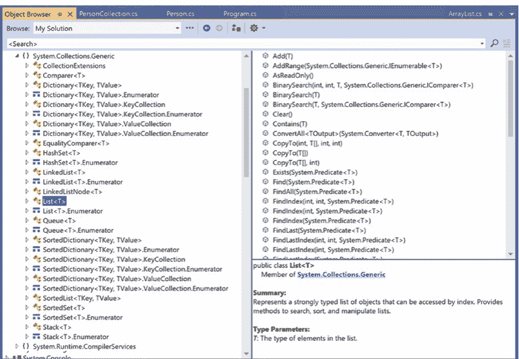

## 第 10 章

### 集合与泛型

你使用 .NET Core 平台创建的任何应用程序都将需要处理在内存中维护和操作一组数据点的问题。这些数据点可以来自各种位置，包括关系数据库、本地文本文件、XML 文档、Web 服务调用，或者可能是用户提供的输入。

当 .NET 平台首次发布时，程序员经常使用 System.Collections 命名空间的类来存储和交互应用程序中使用的数据位。在 .NET 2.0 中，C# 编程语言得到增强，支持称为泛型的特性；随着这一变化，基类库中引入了一个新的命名空间：System.Collections.Generic。

本章将概述 .NET Core 基类库中的各种集合（泛型和非泛型）命名空间和类型。如你将看到的，泛型容器通常比非泛型容器更受青睐，因为它们通常提供更大的类型安全性和性能优势。在学习了如何创建和操作框架中的泛型项之后，本章其余部分将探讨如何构建自己的泛型方法和泛型类型。在此过程中，你将了解约束的作用（以及相应的 C# `where` 关键字），这些约束允许你构建极其类型安全的类。

## 集合类的动机

你可以用来保存应用程序数据的最原始容器无疑是数组。如你在第 4 章中所见，C# 数组允许你定义一组具有固定上限的相同类型项（包括 System.Object 数组，它本质上表示任何类型数据的数组）。另外，回想第 4 章，所有 C# 数组变量都从 System.Array 类中获得了大量功能。作为快速回顾，请考虑以下代码，它创建了一个文本数据数组并以各种方式操作其内容：

```csharp
// Make an array of string data.
string[] strArray = {"First", "Second", "Third"};

// Show number of items in array using Length property.
Console.WriteLine("This array has {0} items.", strArray.Length);
Console.WriteLine();

// Display contents using enumerator.
foreach (string s in strArray)
{
    Console.WriteLine("Array Entry: {0}", s);
}
Console.WriteLine();

// Reverse the array and print again.
Array.Reverse(strArray);
foreach (string s in strArray)
{
    Console.WriteLine("Array Entry: {0}", s);
}

Console.ReadLine();
```

虽然基本数组对于管理少量固定大小的数据很有用，但还有很多其他时候你需要更灵活的数据结构，例如动态增长和收缩的容器，或者只能容纳满足特定条件的对象的容器（例如，仅从特定基类派生的对象或仅实现特定接口的对象）。当你使用简单数组时，请始终记住它们的“固定大小”创建的。如果你创建一个包含三项的数组，你只能得到三项；因此，以下代码将导致运行时异常（准确地说，是 IndexOutOfRangeException）：

```csharp
// Make an array of string data.
string[] strArray = { "First", "Second", "Third" };

// Try to add a new item at the end?? Runtime error!
strArray[3] = "new item?";
...
```

> **注意：** 实际上可以使用泛型 `Resize<T>()` 方法来更改数组的大小。但是，这会导致数据被复制到新的数组对象中，并且可能效率低下。

为了帮助克服简单数组的局限性，.NET Core 基类库附带了多个包含集合类的命名空间。与简单的 C# 数组不同，集合类在插入或移除项时会动态调整自身大小。此外，许多集合类提供了更高的类型安全性，并针对以内存高效的方式处理包含的数据进行了高度优化。在阅读本章时，你会很快注意到集合类可以属于两大类之一。

- 非泛型集合（主要在 System.Collections 命名空间中）
- 泛型集合（主要在 System.Collections.Generic 命名空间中）

非泛型集合通常设计为操作 System.Object 类型，因此是松散类型的容器（但是，一些非泛型集合只操作特定类型的数据，例如字符串对象）。相比之下，泛型集合更加类型安全，因为你在创建时必须指定它们包含的“类型的类型”。如你将看到的，任何泛型项的明显标志是用尖括号标记的“类型参数”（例如，`List<T>`）。本章稍后将详细介绍泛型（包括它们提供的许多好处）。现在，让我们检查 System.Collections 和 System.Collections.Specialized 命名空间中的一些关键非泛型集合类型。


## System.Collections 命名空间

在 .NET 平台首次发布时，程序员经常使用 `System.Collections` 命名空间中的非泛型集合类，该命名空间包含一组用于管理和组织大量内存数据的类。表 10-1 列出了该命名空间中一些较为常用的集合类及其实现的核心接口。

表 10-1. System.Collections 的有用类型

| System.Collections 类 | 用途 | 实现的关键接口 |
|---|---|---|
| ArrayList | 表示按顺序排列的对象动态集合 | IList、ICollection、IEnumerable 和 ICloneable |
| BitArray | 管理紧凑的位值数组，这些位值以布尔值表示，其中 true 表示该位为开（1），false 表示该位为关（0） | ICollection、IEnumerable 和 ICloneable |
| Hashtable | 表示基于键的哈希码组织的键值对集合 | IDictionary、ICollection、IEnumerable 和 ICloneable |
| Queue | 表示标准的先进先出（FIFO）对象集合 | ICollection、IEnumerable 和 ICloneable |
| SortedList | 表示按键排序且可通过键和索引访问的键值对集合 | IDictionary、ICollection、IEnumerable 和 ICloneable |
| Stack | 后进先出（LIFO）堆栈，提供推送、弹出（和查看）功能 | ICollection、IEnumerable 和 ICloneable |

这些集合类实现的接口为它们的整体功能提供了巨大洞察。表 10-2 记录了这些关键接口的整体性质，其中一些你已在第 8 章中亲自使用过。

表 10-2. System.Collections 类支持的关键接口

| System.Collections 接口 | 用途 |
|---|---|
| ICollection | 为所有非泛型集合类型定义一般特性（例如大小、枚举和线程安全性） |
| ICloneable | 允许实现对象向调用方返回自身的副本 |
| IDictionary | 允许非泛型集合对象使用键值对表示其内容 |
| IEnumerable | 返回实现 IEnumerator 接口的对象（见下一条目） |
| IEnumerator | 支持对集合项进行 foreach 式迭代 |
| IList | 提供在顺序对象列表中添加、移除和索引项的行为 |

## 示例说明：使用 ArrayList

根据你的经验，你可能对使用（或实现）某些经典数据结构（如堆栈、队列和列表）有第一手经验。如果没有，本章稍后介绍泛型对应类时，我会进一步说明它们之间的差异。在此之前，这里有一段使用 ArrayList 对象的示例代码：

```
// 必须导入 System.Collections 才能访问 ArrayList。
using System.Collections;
ArrayList strArray = new ArrayList();
strArray.AddRange(new string[] { "First", "Second", "Third" });

// 显示 ArrayList 中的项数。
System.Console.WriteLine("This collection has {0} items.", strArray.Count);
System.Console.WriteLine();

// 添加新项并显示当前数量。
strArray.Add("Fourth!");
System.Console.WriteLine("This collection has {0} items.", strArray.Count);

// 显示内容。
foreach (string s in strArray)
{
    System.Console.WriteLine("Entry: {0}", s);
}
System.Console.WriteLine();
```

请注意，你可以随时添加（或移除）项，容器会自动相应地调整自身大小。

正如你所料，ArrayList 类除了 Count 属性以及 AddRange() 和 Add() 方法外，还有许多有用的成员，因此请务必查阅 .NET Core 文档以获取完整详细信息。与此相关的是，System.Collections 的其他类（Stack、Queue 等）在 .NET Core 帮助系统中也有完整文档。

然而，需要指出的是，你的大多数 .NET Core 项目很可能不会使用 System.Collections 命名空间中的集合类！可以肯定的是，如今更常见的是使用 System.Collections.Generic 命名空间中的泛型对应类。鉴于此，我将不再评论（或提供代码示例）System.Collections 中剩余的非泛型类。

## System.Collections.Specialized 命名空间概览

System.Collections 并不是唯一包含非泛型集合类的 .NET Core 命名空间。System.Collections.Specialized 命名空间定义了许多（请原谅这种重复）专门的集合类型。表 10-3 记录了这个以集合为中心的特定命名空间中一些更有用的类型，所有这些类型都是非泛型的。

### 表 10-3. System.Collections.Specialized 的有用类

| System.Collections.Specialized 类型 | 用途 |
|---|---|
| HybridDictionary | 此类在集合较小时使用 ListDictionary 实现 IDictionary，当集合变大时切换到 Hashtable。 |
| ListDictionary | 当你需要管理少量（十个左右）可能随时间变化的项时，此类非常有用。此类使用单向链表来维护其数据。 |
| StringCollection | 此类提供了一种管理大量字符串数据的最优方式。 |
| BitVector32 | 此类提供了一个简单结构，可在 32 位内存中存储布尔值和小整数。 |

除了这些具体类类型之外，该命名空间还包含许多额外的接口和抽象基类，你可以将它们作为创建自定义集合类的起点。虽然这些“专门”类型在某些情况下可能正是你的项目所需，但我不会在此评论它们的用法。同样，在许多情况下，你可能会发现 System.Collections.Generic 命名空间提供了具有类似功能且额外受益的类。

> 注意 .NET Core 基类库中还有另外两个以集合为中心的命名空间（System.Collections.ObjectModel 和 System.Collections.Concurrent）。本章稍后在你熟悉泛型主题后，将探讨前一个命名空间。System.Collections.Concurrent 提供非常适合多线程环境的集合类（有关多线程的信息，请参阅第 15 章）。

## 非泛型集合的问题

诚然，多年来许多成功的 .NET 和 .NET Core 应用程序都是使用这些非泛型集合类（和接口）构建的，但历史表明，使用这些类型可能会导致许多问题。

第一个问题是，使用 System.Collections 和 System.Collections.Specialized 类可能会导致代码性能不佳，尤其是在操作数值数据（例如值类型）时。稍后你将看到，当你将结构存储到任何设计为操作 System.Object 的非泛型集合类中时，CoreCLR 必须执行大量内存传输操作，这可能会损害运行时执行速度。

第二个问题是，大多数非泛型集合类不是类型安全的，因为（再次强调）它们是为操作 System.Object 而开发的，因此它们可以包含任何内容。如果开发人员需要创建高度类型安全的集合（例如，一个只能容纳实现特定接口的对象的容器），唯一真正的选择是手动创建新的集合类。这样做虽然不太费力，但有点繁琐。

在你了解如何在程序中使用泛型之前，先仔细研究非泛型集合类的问题会有所帮助；这将有助于你更好地理解泛型首先旨在解决的问题。如果你愿意跟着做，请创建一个名为 IssuesWithNonGenericCollections 的新控制台应用程序项目。接下来，确保在 Program.cs 文件顶部导入 System 和 System.Collections 命名空间，并清除其余代码。

```
using System;
using System.Collections;
```

## 性能问题

你可能还记得第 4 章，.NET Core 平台支持两大类数据：值类型和引用类型。鉴于 .NET Core 定义了两大类类型，你偶尔可能需要将一种类别的变量表示为另一种类别的变量。为此，C# 提供了一种称为装箱的简单机制，用于将值类型的数据存储在引用变量中。假设你已在名为 SimpleBoxUnboxOperation 的方法中创建了一个类型为 int 的局部变量。如果在应用程序执行过程中，你要将此值类型表示为引用类型，则需要将值装箱，如下所示：

```
static void SimpleBoxUnboxOperation()
{
    // 创建一个 ValueType（int）变量。
    int myInt = 25;

    // 将 int 装箱到对象引用中。
    object boxedInt = myInt;
}
```

装箱可以正式定义为将值类型显式赋值给 System.Object 变量的过程。当你装箱一个值时，CoreCLR 会在堆上分配一个新对象，并将值类型的值（本例中为 25）复制到该实例中。返回给你的是对新分配的基于堆的对象的引用。

通过拆箱也可以进行相反的操作。拆箱是将对象引用中保存的值转换回堆栈上相应值类型的过程。从语法上讲，拆箱操作看起来像普通的强制转换操作。然而，其语义却大不相同。CoreCLR 首先验证接收的数据类型是否与装箱类型等价，如果等价，则将值复制回基于堆栈的局部变量中。例如，由于 boxedInt 的底层类型确实是 int，以下拆箱操作会成功执行：

```
static void SimpleBoxUnboxOperation()
{
    // 创建一个 ValueType（int）变量。
    int myInt = 25;

    // 将 int 装箱到对象引用中。
    object boxedInt = myInt;

    // 将引用拆箱回相应的 int。
    int unboxedInt = (int)boxedInt;
}
```


当 C# 编译器遇到装箱/拆箱语法时，会发出包含 box/unbox 操作码的 CIL 代码。如果使用 ildasm.exe 检查编译后的程序集，会发现以下内容：

```csharp
.method assembly hidebysig static
    void '<Main>$g__SimpleBoxUnboxOperation|0_0'() cil managed
{
    .maxstack  1
    .locals init (int32 V_0, object V_1, int32 V_2)
    IL_0000:  nop
    IL_0001:  ldc.i4.s   25
    IL_0003:  stloc.0
    IL_0004:  ldloc.0
    IL_0005:  box        [System.Runtime]System.Int32
    IL_000a:  stloc.1
    IL_000b:  ldloc.1
    IL_000c:  unbox.any  [System.Runtime]System.Int32
    IL_0011:  stloc.2
    IL_0012:  ret
} // end of method '<Program>$'::'<Main>$g__SimpleBoxUnboxOperation|0_0'
```

请记住，与执行典型强制转换不同，拆箱必须拆箱为适当的数据类型。如果尝试将数据拆箱为错误的数据类型，将抛出 InvalidCastException 异常。为了完全安全，应将每个拆箱操作包装在 try/catch 逻辑中；但是，对每个拆箱操作都这样做会非常费力。请看下面的代码更新，它会抛出错误，因为你试图将已装箱的 int 拆箱为 long：

```csharp
static void SimpleBoxUnboxOperation()
{
    // Make a ValueType (int) variable.
    int myInt = 25;

    // Box the int into an object reference.
    object boxedInt = myInt;

    // Unbox in the wrong data type to trigger
    // runtime exception.
    try
    {
        long unboxedLong = (long)boxedInt;
    }
    catch (InvalidCastException ex)
    {
        Console.WriteLine(ex.Message);
    }
}
```

乍一看，装箱/拆箱似乎是一个相当平淡无奇的语言特性，更多是学术性的而非实用性的。毕竟，你很少需要像这里所示，将局部值类型存储到局部对象变量中。然而，事实证明装箱/拆箱过程非常有用，因为它允许你假定所有内容都可以视为 System.Object，而 CoreCLR 会替你处理与内存相关的细节。

让我们看看这些技术的实际用途。我们将研究 System.Collections.ArrayList 类，并使用它来保存一批数值（栈分配）数据。ArrayList 类的相关成员如下所列。注意，它们的原型都是针对 System.Object 数据操作的。现在考虑 Add()、Insert() 和 Remove() 方法，以及类索引器。

```csharp
public class ArrayList : IList, ICloneable
{
...
    public virtual int Add(object? value);
    public virtual void Insert(int index, object? value);
    public virtual void Remove(object? obj);
    public virtual object? this[int index] { get; set; }
}
```

ArrayList 的设计初衷是操作对象，也就是表示堆上分配的数据，因此以下代码能够编译并执行而不抛出错误，似乎有些奇怪：

```csharp
static void WorkWithArrayList()
{
    // Value types are automatically boxed when
    // passed to a method requesting an object.
    ArrayList myInts = new ArrayList();
    myInts.Add(10);
    myInts.Add(20);
    myInts.Add(35);
}
```

尽管你将数值数据直接传递给需要对象的方法，运行时会自动替你装箱基于栈的数据。之后，如果想使用类型索引器从 ArrayList 中检索项，必须使用强制转换操作将堆上分配的对象拆箱为栈上分配的整数。请记住，ArrayList 的索引器返回的是 System.Object，而不是 System.Int32。

```csharp
static void WorkWithArrayList()
{
    // Value types are automatically boxed when
    // passed to a member requesting an object.
    ArrayList myInts = new ArrayList();
    myInts.Add(10);
    myInts.Add(20);
    myInts.Add(35);

    // Unboxing occurs when an object is converted back to
    // stack-based data.
    int i = (int)myInts[0];

    // Now it is reboxed, as WriteLine() requires object types!
    Console.WriteLine("Value of your int: {0}", i);
}
```

再次注意，栈分配的 System.Int32 在调用 ArrayList.Add() 之前被装箱，以便可以作为所需的 System.Object 传入。还要注意，一旦通过强制转换操作从 ArrayList 检索到 System.Object，就会将其拆箱回 System.Int32，而仅在传递给 Console.WriteLine() 方法时再次装箱，因为此方法操作的是 System.Object 变量。

从程序员的角度来看，装箱和拆箱很方便，但这种简化的栈/堆内存传输方式也带来了性能问题（在执行速度和代码大小方面）以及缺乏类型安全的负担。要理解性能问题，请思考装箱和拆箱一个简单整数必须发生的这些步骤：

- 1. 必须在托管堆上分配一个新对象。
- 2. 必须将基于栈的数据值转移到该内存位置。
- 3. 拆箱时，必须将存储在基于堆的对象中的值转移回栈。
- 4. 现在堆上不再使用的对象将（最终）被垃圾回收。

尽管这个特定的 WorkWithArrayList() 方法在性能方面不会造成重大瓶颈，但如果一个 ArrayList 包含数千个整数，并且你的程序经常操作这些整数，你肯定能感受到影响。在理想情况下，你可以在容器中操作基于栈的数据而没有任何性能问题。理想情况下，如果不必费心使用 try/catch 作用域从这个容器中取出数据，那就太好了（这正是泛型让你实现的目标）。

## 类型安全的问题

在介绍拆箱操作时，我提到了类型安全的问题。请记住，拆箱时必须将数据转换为装箱前声明的相同数据类型。然而，在无泛型的世界中，你还需要记住类型安全的另一个方面：System.Collections 中的大多数类通常可以容纳任何内容，因为它们的成员被设计为操作 System.Object。例如，此方法构建了一个包含随机不相关数据的 ArrayList：

```csharp
static void ArrayListOfRandomObjects()
{
    // The ArrayList can hold anything at all.
    ArrayList allMyObjects = new ArrayList();
    allMyObjects.Add(true);
    allMyObjects.Add(new OperatingSystem(PlatformID.MacOSX, new Version(10, 0)));
    allMyObjects.Add(66);
    allMyObjects.Add(3.14);
}
```

在某些情况下，你需要一个极其灵活的容器，可以容纳任何东西（如此处所示）。然而，大多数时候，你希望得到一个类型安全的容器，它只能操作特定类型的数据点。例如，你可能需要一个只能容纳数据库连接、位图或兼容 IPointy 的对象的容器。

在泛型出现之前，解决这种类型安全问题的唯一方法是手动创建自定义（强类型）集合类。假设你想创建一个只能包含 Person 类型对象的自定义集合。

```csharp
namespace IssuesWithNonGenericCollections
{
    public class Person
    {
        public int Age { get; set; }
        public string FirstName { get; set; }
        public string LastName { get; set; }

        public Person() { }

        public Person(string firstName, string lastName, int age)
        {
            Age = age;
            FirstName = firstName;
            LastName = lastName;
        }

        public override string ToString()
        {
            return $"Name: {FirstName} {LastName}, Age: {Age}";
        }
    }
}
```

要构建一个只能容纳 Person 对象的集合，可以在名为 PersonCollection 的类中定义一个 System.Collections.ArrayList 成员变量，并将所有成员配置为操作强类型的 Person 对象，而不是 System.Object 类型。这里有一个简单的示例（生产级的自定义集合可以支持许多额外的成员，并且可能扩展 System.Collections 或 System.Collections.Specialized 命名空间中的抽象基类）：

```csharp
using System.Collections;

namespace IssuesWithNonGenericCollections
{
    public class PersonCollection : IEnumerable
    {
        private ArrayList arPeople = new ArrayList();

        // Cast for caller.
        public Person GetPerson(int pos) => (Person)arPeople[pos];

        // Insert only Person objects.
        public void AddPerson(Person p)
        {
            arPeople.Add(p);
        }

        public void ClearPeople()
        {
            arPeople.Clear();
        }
    }
}
```


```
public int Count => arPeople.Count;

// Foreach enumeration support.
IEnumerator IEnumerable.GetEnumerator() => arPeople.GetEnumerator();
}
```

请注意，PersonCollection 类实现了 IEnumerable 接口，这允许对每个包含的项进行类似 foreach 的迭代。还请注意，你的 GetPerson() 和 AddPerson() 方法已被原型化为仅对 Person 对象操作，而不是位图、字符串、数据库连接或其他项操作。定义了这些类型后，你现在可以确保类型安全，因为 C# 编译器能够确定任何尝试插入不兼容数据类型的操作。更新 Program.cs 中的 using 语句如下，并在当前代码末尾添加 UserPersonCollection() 方法：

```
using System;
using System.Collections;
using IssuesWithNonGenericCollections;
//Top level statements in Program.cs
static void UsePersonCollection()
{
    Console.WriteLine("**** Custom Person Collection ****\n");
    PersonCollection myPeople = new PersonCollection();
    myPeople.AddPerson(new Person("Homer", "Simpson", 40));
    myPeople.AddPerson(new Person("Marge", "Simpson", 38));
    myPeople.AddPerson(new Person("Lisa", "Simpson", 9));
    myPeople.AddPerson(new Person("Bart", "Simpson", 7));
    myPeople.AddPerson(new Person("Maggie", "Simpson", 2));

    // This would be a compile-time error!
    // myPeople.AddPerson(new Car());

    foreach (Person p in myPeople)
    {
        Console.WriteLine(p);
    }
}
```

虽然自定义集合确实能确保类型安全，但这种方法会让你处于必须为每种想要包含的唯一数据类型创建（几乎相同）自定义集合的境地。因此，如果你需要一个只能操作派生自 Car 基类的类的自定义集合，你需要构建一个高度相似的集合类。

```
using System.Collections;
public class CarCollection : IEnumerable
{
    private ArrayList arCars = new ArrayList();

    // Cast for caller.
    public Car GetCar(int pos) => (Car) arCars[pos];
```

```
// Insert only Car objects.
public void AddCar(Car c)
{
    arCars.Add(c);
}

public void ClearCars()
{
    arCars.Clear();
}

public int Count => arCars.Count;

// Foreach enumeration support.
IEnumerator IEnumerable.GetEnumerator() => arCars.GetEnumerator();
}
```

然而，自定义集合类并不能解决装箱/拆箱惩罚的问题。即使你创建一个名为 IntCollection 的自定义集合，设计为仅对 System.Int32 项操作，你也必须分配某种类型的对象来保存数据（例如 System.Array 和 ArrayList）。

```
using System.Collections;
public class IntCollection : IEnumerable
{
    private ArrayList arInts = new ArrayList();

    // Get an int (performs unboxing!).
    public int GetInt(int pos) => (int)arInts[pos];

    // Insert an int (performs boxing)! 
    public void AddInt(int i)
    {
        arInts.Add(i);
    }

    public void ClearInts()
    {
        arInts.Clear();
    }

    public int Count => arInts.Count;

    IEnumerator IEnumerable.GetEnumerator() => arInts.GetEnumerator();
}
```

无论你选择哪种类型来保存整数，使用非泛型容器都无法逃脱装箱困境。

## 初识泛型集合

当你使用泛型集合类时，你纠正了之前所有的问题，包括装箱/拆箱惩罚和缺乏类型安全。此外，构建自定义（泛型）集合类的需求变得非常罕见。与其必须构建可以包含人员、汽车和整数的唯一类，你可以使用泛型集合类并指定类型。在 Program.cs 类顶部添加以下 using 语句：

```
using System.Collections.Generic;
```

考虑以下方法（添加到 Program.cs 底部），它使用泛型 List<T> 类（位于 System.Collections.Generic 命名空间中）以强类型方式包含各种类型的数据（暂时不必担心泛型语法的细节）：

```
static void UseGenericList()
{
    Console.WriteLine("***** Fun with Generics *****
");

    // This List<> can hold only Person objects.
    List<Person> morePeople = new List<Person>();
    morePeople.Add(new Person("Frank", "Black", 50));
    Console.WriteLine(morePeople[0]);

    // This List<> can hold only integers.
    List<int> moreInts = new List<int>();
    moreInts.Add(10);
    moreInts.Add(2);
    int sum = moreInts[0] + moreInts[1];

    // Compile-time error! Can't add Person object
    // to a list of ints!
    // moreInts.Add(new Person());
}
```

第一个 List<T> 对象只能包含 Person 对象。因此，当你从容器中取出项时，无需执行强制转换，这使得这种方法更具类型安全。第二个 List<T> 只能包含整数，所有这些都分配在栈上；换句话说，与非泛型 ArrayList 相比，不存在隐藏的装箱或拆箱。以下是泛型容器相对于其非泛型对应项提供的简短优势列表：

- 泛型提供更好的性能，因为在存储值类型时不会产生装箱或拆箱惩罚。
- 泛型是类型安全的，因为它们只能包含你指定的类型。
- 泛型大大减少了构建自定义集合类型的需求，因为你在创建泛型容器时指定了“类型的类型”。

## 泛型类型参数的作用

你可以在 .NET Core 基类库中找到泛型类、接口、结构和委托，这些可能属于任何 .NET Core 命名空间的一部分。还请注意，泛型的用途远不止定义集合类。毫无疑问，你将在本书其余部分看到许多不同的泛型用于各种原因。

> 注意 只有类、结构、接口和委托可以被泛型化；枚举类型不能。

当你在 .NET Core 文档或 Visual Studio 对象浏览器中看到列出的泛型项时，你会注意到一对尖括号，里面夹着一个字母或其他标记。图 10-1 显示了 Visual Studio 对象浏览器显示位于 System.Collections.Generic 命名空间中的多个泛型项，包括高亮的 List<T> 类。



图 10-1. 支持类型参数的泛型项

正式地说，你称这些标记为类型参数；然而，用更友好的术语，你可以简单地称它们为占位符。你可以将符号 <T> 读作“的 T”。因此，你可以将 IEnumerable<T> 读作“IEnumerable 的 T”或换句话说，“类型 T 的 IEnumerable”。

> 注意 类型参数（占位符）的名称无关紧要，由创建泛型项的开发人员决定。然而，通常 T 用于表示类型，TKey 或 K 用于键，TValue 或 V 用于值。

当你创建泛型对象、实现泛型接口或调用泛型成员时，由你来为类型参数提供值。你将在本章以及其余文本中看到许多示例。然而，为了铺垫基础，让我们看看与泛型类型和成员交互的基础知识。

## 为泛型类/结构指定类型参数

当你创建泛型类或结构的实例时，你在声明变量时以及在调用构造函数时指定类型参数。正如你在前面的代码示例中看到的，UseGenericList() 定义了两个 List<T> 对象。

```
// This List<> can hold only Person objects.
List<Person> morePeople = new List<Person>();
// This List<> can hold only integers.
List<int> moreInts = new List<int>();
```

你可以将前一段代码中的第一行读作“一个 List<> 的 T，其中 T 是 Person 类型。”或者，更简单地说，你可以读作“一个人员对象的列表。”在你指定泛型项的类型参数后，它就不能更改了（记住，泛型都是关于类型安全的）。当你为泛型类或结构指定类型参数时，占位符的所有出现都会被你的提供值替换。

如果你使用 Visual Studio 对象浏览器查看泛型 List<T> 类的完整声明，你会看到占位符 T 在 List<T> 类型的定义中被广泛使用。以下是部分列表：

```
// A partial listing of the List<T> class.
namespace System.Collections.Generic
{
    public class List<T> : IList<T>, IList, IReadOnlyList<T>
    {
    ...
        public void Add(T item);
        public void AddRange(IEnumerable<T> collection);
        public ReadOnlyCollection<T> AsReadOnly();
        public int BinarySearch(T item);
        public bool Contains(T item);
        public void CopyTo(T[] array);
        public int FindIndex(System.Predicate<T> match);
        public T FindLast(System.Predicate<T> match);
        public bool Remove(T item);
        public int RemoveAll(System.Predicate<T> match);
        public T[] ToArray();
        public bool TrueForAll(System.Predicate<T> match);
        public T this[int index] { get; set; }
    }
}
```


当你创建指定了 Person 对象的 List<T> 时，就好像 List<T> 类型被定义如下：

```
namespace System.Collections.Generic
{
    public class List<Person>
        : IList<Person>, IList, IReadOnlyList<Person>
    {
    ...
        public void Add(Person item);
        public void AddRange(IEnumerable<Person> collection);
        public ReadOnlyCollection<Person> AsReadOnly();
        public int BinarySearch(Person item);
        public bool Contains(Person item);
        public void CopyTo(Person[] array);
        public int FindIndex(System.Predicate<Person> match);
        public Person FindLast(System.Predicate<Person> match);
        public bool Remove(Person item);
        public int RemoveAll(System.Predicate<Person> match);
        public Person[] ToArray();
        public bool TrueForAll(System.Predicate<Person> match);
        public Person this[int index] { get; set; }
    }
}
```

当然，当你创建泛型 List<T> 变量时，编译器并不会真的创建 List<T> 类的新实现。相反，它只会处理你实际调用的泛型类型的成员。

## 为泛型成员指定类型参数

非泛型类或结构支持泛型方法是没有问题的。在这些情况下，你还需要在调用方法时指定占位符值。例如，System.Array 支持几个泛型方法。具体来说，非泛型静态 Sort() 方法现在有一个名为 Sort<T>() 的泛型对应方法。考虑下面的代码片段，其中 T 的类型是 int：

```
int[] myInts = { 10, 4, 2, 33, 93 };

// Specify the placeholder to the generic
// Sort<T>() method.
Array.Sort<int>(myInts);

foreach (int i in myInts)
{
    Console.WriteLine(i);
}
```

## 为泛型接口指定类型参数

在构建需要支持各种框架行为（如克隆、排序和枚举）的类或结构时，实现泛型接口是常见的做法。在第 8 章中，你学习了许多非泛型接口，如 IComparable、IEnumerable、IEnumerator 和 IComparer。回想一下，非泛型 IComparable 接口是这样定义的：

```
public interface IComparable
{
    int CompareTo(object obj);
}
```

在第 8 章中，你还在 Car 类上实现了这个接口，以支持在标准数组中进行排序。然而，由于参数是一个通用的 System.Object，代码需要几次运行时检查和强制转换操作。

```
public class Car : IComparable
{
    ...
    // IComparable implementation.
    int IComparable.CompareTo(object obj)
    {
        if (obj is Car temp)
        {
            return this.CarID.CompareTo(temp.CarID);
        }
        throw new ArgumentException("Parameter is not a Car!");
    }
}
```

现在假设你使用这个接口的泛型版本。

```
public interface IComparable<T>
{
    int CompareTo(T obj);
}
```

在这种情况下，你的实现代码将大大简化。

```
public class Car : IComparable<Car>
{
    ...
    // IComparable<T> implementation.
    int IComparable<Car>.CompareTo(Car obj)
    {
        if (this.CarID > obj.CarID)
        {
            return 1;
        }
        if (this.CarID < obj.CarID)
        {
            return -1;
        }
        return 0;
    }
}
```

这里，你不需要检查传入的参数是否为 Car，因为它只能是 Car！如果有人传入不兼容的数据类型，你会收到编译时错误。既然你已经更好地掌握了如何与泛型项交互，以及类型参数（又称占位符）的作用，接下来就可以研究 System.Collections.Generic 命名空间中的类和接口了。

## System.Collections.Generic 命名空间

当你构建 .NET Core 应用程序并需要一种管理内存数据的方式时，System.Collections.Generic 中的类很可能会满足需求。在本章开头，我简要提到了非泛型集合类实现的一些核心非泛型接口。毫不意外的是，System.Collections.Generic 命名空间为其中许多接口定义了泛型替代版本。

事实上，你会发现许多泛型接口扩展了它们对应的非泛型接口。这看起来可能有些奇怪；然而，这样做可以让实现类也支持它们非泛型同族中的遗留功能。例如，IEnumerable<T> 扩展了 IEnumerable。表 10-4 记录了你在使用泛型集合类时会遇到的核心泛型接口。

表 10-4. System.Collections.Generic 的类所支持的关键接口

| System.Collections.Generic 接口 | 用途 |
|---|---|
| ICollection<T> | 为所有泛型集合类型定义一般特征（例如大小、枚举和线程安全性）。 |
| IComparer<T> | 定义比较两个对象的方式。 |
| IDictionary<TKey, TValue> | 允许泛型集合对象使用键值对来表示其内容。 |
| IEnumerable<T> / IAsyncEnumerable<T> | 为给定对象返回 IEnumerator<T> 接口。IAsyncEnumerable（C# 8.0 新增）将在第 15 章介绍。 |
| IEnumerator<T> | 启用对泛型集合的 foreach 样式迭代。 |
| IList<T> | 提供在顺序对象列表中添加、移除和索引项的行为。 |
| ISet<T> | 为集合的抽象提供基础接口。 |

System.Collections.Generic 命名空间还定义了几个实现这些关键接口中许多接口的类。表 10-5 描述了该命名空间的一些常用类、它们实现的接口及其基本功能。

表 10-5. System.Collections.Generic 的类

| 泛型类 | 支持的关键接口 | 用途 |
|---|---|---|
| Dictionary<TKey, TValue> | ICollection<T>, IDictionary<TKey, TValue>, IEnumerable<T> | 表示键和值的泛型集合。 |
| LinkedList<T> | ICollection<T>, IEnumerable<T> | 表示双向链表。 |
| List<T> | ICollection<T>, IEnumerable<T>, IList<T> | 一个可动态调整大小的顺序列表。 |
| Queue<T> | ICollection（不是笔误！这是非泛型集合接口。）、IEnumerable<T> | 这是先进先出列表的泛型实现。 |
| SortedDictionary<TKey, TValue> | ICollection<T>, IDictionary<TKey, TValue>, IEnumerable<T> | 这是有序键值对集合的泛型实现。 |
| SortedSet<T> | ICollection<T>, IEnumerable<T>, ISet<T> | 表示按排序顺序维护且无重复对象的集合。 |
| Stack<T> | ICollection（不是笔误！这是非泛型集合接口。）、IEnumerable<T> | 这是后进先出列表的泛型实现。 |

System.Collections.Generic 命名空间还定义了许多与特定容器配合使用的辅助类和结构。例如，LinkedListNode<T> 类型表示泛型 LinkedList<T> 中的一个节点，当尝试使用不存在的键从容器中获取项时会引发 KeyNotFoundException 异常，等等。请务必查阅 .NET Core 文档以了解 System.Collections.Generic 命名空间的全部详细信息。

无论如何，你的下一个任务是学习如何使用其中一些泛型集合类。但在那之前，请允许我介绍一个 C# 语言功能（最初在 .NET 3.5 中引入），它简化了向泛型（和非泛型）集合容器填充数据的方式。

## 理解集合初始化语法

在第 4 章中，你学习了对象初始化语法，它允许你在构造新变量时设置属性。与此密切相关的是集合初始化语法。这个 C# 语言功能使得你能够使用类似于填充基本数组的语法，向许多容器（如 ArrayList 或 List<T>）填充项。创建一个名为 FunWithCollectionInitialization 的新 .NET Core 控制台应用程序。清除 Program.cs 中生成的代码，并添加以下 using 语句：

```
using System;
using System.Collections;
using System.Collections.Generic;
using System.Drawing;
```

> 注意 你只能对支持 Add() 方法的类应用集合初始化语法，该方法由 ICollection<T>/ICollection 接口正式定义。


考虑以下示例：

```
// Init a standard array.
int[] myArrayOfInts = { 0, 1, 2, 3, 4, 5, 6, 7, 8, 9 };
```

```
// Init a generic List<> of ints.
List<int> myGenericList = new List<int> { 0, 1, 2, 3, 4, 5, 6, 7, 8, 9 };
```

```
// Init an ArrayList with numerical data.
ArrayList myList = new ArrayList { 0, 1, 2, 3, 4, 5, 6, 7, 8, 9 };
```

如果你的容器管理的是类或结构的集合，你可以将对象初始化语法与集合初始化语法混合使用，以获得实用的代码。你可能还记得第5章中的Point类，它定义了名为X和Y的两个属性。如果你想构建一个Point对象的泛型`List<T>`，可以编写以下代码：

```
List<Point> myListOfPoints = new List<Point>
{
    new Point { X = 2, Y = 2 },
    new Point { X = 3, Y = 3 },
    new Point { X = 4, Y = 4 }
};

foreach (var pt in myListOfPoints)
{
    Console.WriteLine(pt);
}
```

同样，这种语法的好处是你可以节省大量的按键输入。虽然嵌套的花括号在格式不佳时可能难以阅读，但想象一下，如果没有集合初始化语法，填充以下`List<T>`的Rectangle对象需要多少代码。

```
List<Rectangle> myListOfRects = new List<Rectangle>
{
    new Rectangle {
        Height = 90, Width = 90,
        Location = new Point { X = 10, Y = 10 }},
    new Rectangle {
        Height = 50, Width = 50,
        Location = new Point { X = 2, Y = 2 }},
};
foreach (var r in myListOfRects)
{
    Console.WriteLine(r);
}
```

## 使用 List<T> 类

创建一个名为FunWithGenericCollections的新控制台应用程序项目。添加一个名为Person.cs的新文件，并添加以下代码（与之前的Person类相同）：

```
namespace FunWithGenericCollections
{
    public class Person
    {
        public int Age {get; set;}
        public string FirstName {get; set;}
        public string LastName {get; set;}

        public Person(){}
        public Person(string firstName, string lastName, int age)
        {
            Age = age;
            FirstName = firstName;
            LastName = lastName;
        }

        public override string ToString()
        {
            return $"Name: {FirstName} {LastName}, Age: {Age}";
        }
    }
}
```

清除`Program.cs`中生成的代码，并添加以下using语句：

```
using System;
using System.Collections.Generic;
using FunWithGenericCollections;
```

你要研究的第一个泛型类是`List<T>`，在本章中你已经见过一两次了。`List<T>`类注定是你在`System.Collections.Generic`命名空间中最常用的类型，因为它允许你动态调整容器内容的大小。为了说明这种类型的基本用法，请思考`Program`类中的以下方法，它利用`List<T>`操作本章前面展示的一组`Person`对象；你可能还记得这些`Person`对象定义了三个属性（`Age`、`FirstName`和`LastName`）以及一个自定义的`ToString()`实现：

```
static void UseGenericList()
{
    // Make a List of Person objects, filled with
    // collection/object init syntax.
    List<Person> people = new List<Person>()
    {
        new Person {FirstName="Homer", LastName="Simpson", Age=47},
        new Person {FirstName="Marge", LastName="Simpson", Age=45},
        new Person {FirstName="Lisa", LastName="Simpson", Age=9},
        new Person {FirstName="Bart", LastName="Simpson", Age=8}
    };
}
```

```
// Print out # of items in List.
Console.WriteLine("Items in list: {0}", people.Count);

// Enumerate over list.
foreach (Person p in people)
{
    Console.WriteLine(p);
}

// Insert a new person.
Console.WriteLine("\n->Inserting new person.");
people.Insert(2, new Person { FirstName = "Maggie", LastName = "Simpson", Age = 2 });
Console.WriteLine("Items in list: {0}", people.Count);

// Copy data into a new array.
Person[] arrayOfPeople = people.ToArray();
foreach (Person p in arrayOfPeople)
{
    Console.WriteLine("First Names: {0}", p.FirstName);
}
```

在这里，你使用集合初始化语法来填充你的`List<T>`对象，作为多次调用`Add()`的简写表示法。打印出集合中的项数（并枚举每个项）后，你调用`Insert()`。如你所见，`Insert()`允许你在指定索引处将新项插入`List<T>`中。

最后，注意对`ToArray()`方法的调用，它根据原始`List<T>`的内容返回一个`Person`对象数组。从这个数组中，你使用数组的索引器语法再次循环遍历这些项。如果从顶级语句调用此方法，你将得到以下输出：

```
**** Fun with Generic Collections ****
Items in list: 4
Name: Homer Simpson, Age: 47
Name: Marge Simpson, Age: 45
Name: Lisa Simpson, Age: 9
Name: Bart Simpson, Age: 8

->Inserting new person.
Items in list: 5
First Names: Homer
First Names: Marge
First Names: Maggie
First Names: Lisa
First Names: Bart
```

`List<T>`类定义了许多其他有用的成员，因此请务必查阅文档以获取更多信息。接下来，让我们看看更多泛型集合，特别是`Stack<T>`、`Queue<T>`和`SortedSet<T>`。这将帮助你更好地理解如何保存自定义应用程序数据的基本选择。

## 使用 Stack<T> 类

`Stack<T>`类表示以“后进先出”方式维护项的集合。正如你所料，`Stack<T>`定义了名为`Push()`和`Pop()`的成员，用于将项添加到栈中或从栈中移除项。以下方法创建了一个`Person`对象栈：

```
static void UseGenericStack()
{
    Stack<Person> stackOfPeople = new();
    stackOfPeople.Push(new Person { FirstName = "Homer", LastName = "Simpson", Age = 47 });
    stackOfPeople.Push(new Person { FirstName = "Marge", LastName = "Simpson", Age = 45 });
    stackOfPeople.Push(new Person { FirstName = "Lisa", LastName = "Simpson", Age = 9 });

    // Now look at the top item, pop it, and look again.
    Console.WriteLine("First person is: {0}", stackOfPeople.Peek());
    Console.WriteLine("Popped off {0}", stackOfPeople.Pop());
    Console.WriteLine("\nFirst person is: {0}", stackOfPeople.Peek());
    Console.WriteLine("Popped off {0}", stackOfPeople.Pop());
    Console.WriteLine("\nFirst person item is: {0}", stackOfPeople.Peek());
    Console.WriteLine("Popped off {0}", stackOfPeople.Pop());

    try
    {
        Console.WriteLine("\n\nFirst person is: {0}", stackOfPeople.Peek());
        Console.WriteLine("Popped off {0}", stackOfPeople.Pop());
    }
    catch (InvalidOperationException ex)
    {
        Console.WriteLine("\nError! {0}", ex.Message);
    }
}
```

在这里，你构建了一个包含三个人的栈，按名字顺序添加：Homer、Marge和Lisa。当你查看栈时，总是先看到顶部的对象；因此，第一次调用`Peek()`会显示第三个`Person`对象。经过一系列`Pop()`和`Peek()`调用后，栈最终为空，此时再调用`Peek()`和`Pop()`会引发系统异常。你可以在这里看到输出：

```
**** Fun with Generic Collections ****
First person is: Name: Lisa Simpson, Age: 9
Popped off Name: Lisa Simpson, Age: 9

First person is: Name: Marge Simpson, Age: 45
Popped off Name: Marge Simpson, Age: 45

First person item is: Name: Homer Simpson, Age: 47
Popped off Name: Homer Simpson, Age: 47

Error! Stack empty.
```

## 使用 Queue<T> 类

队列是一种确保按“先进先出”方式访问项的容器。遗憾的是，我们人类整天都要排队：银行排队、电影院排队、早晨咖啡馆排队。当你需要模拟一种先到先得（即先进先出）处理项的场景时，你会发现`Queue<T>`类非常合适。除了支持的接口提供的功能外，`Queue`还定义了如表10-6所示的关键成员。

### 表10-6. Queue<T>类型的成员

| 选定的Queue<T>成员 | 用途 |
|---|---|
| Dequeue() | 移除并返回Queue<T>开头的对象 |
| Enqueue() | 将对象添加到Queue<T>的末尾 |
| Peek() | 返回Queue<T>开头的对象但不移除它 |

现在让我们实际使用这些方法。你可以再次利用你的`Person`类，构建一个`Queue<T>`对象来模拟排队等咖啡的人群。

```
static void UseGenericQueue()
{
    // Make a Q with three people.
    Queue<Person> peopleQ = new();
    peopleQ.Enqueue(new Person {FirstName= "Homer", LastName="Simpson", Age=47});
    peopleQ.Enqueue(new Person {FirstName= "Marge", LastName="Simpson", Age=45});
    peopleQ.Enqueue(new Person {FirstName= "Lisa", LastName="Simpson", Age=9});

    // Peek at first person in Q.
    Console.WriteLine("{0} is first in line!", peopleQ.Peek().FirstName);

    // Remove each person from Q.
    GetCoffee(peopleQ.Dequeue());
    GetCoffee(peopleQ.Dequeue());
    GetCoffee(peopleQ.Dequeue());
    // Try to de-Q again?
    try
    {
        GetCoffee(peopleQ.Dequeue());
    }
    catch(InvalidOperationException e)
    {
        Console.WriteLine("Error! {0}", e.Message);
    }
    //Local helper function
    static void GetCoffee(Person p)
    {
        Console.WriteLine("{0} got coffee!", p.FirstName);
    }
}
```


在这里，你可以使用 `Queue<T>` 类的 `Enqueue()` 方法向其中插入三个项。调用 `Peek()` 可以查看（但不移除）当前队列中的第一项。最后，调用 `Dequeue()` 会将该项从队列中移除，并将其送入 `GetCoffee()` 辅助函数进行处理。请注意，如果试图从空队列中移除项，将会抛出运行时异常。以下是调用此方法时得到的输出：

```
***** Fun with Generic Collections *****
Homer is first in line!
Homer got coffee!
Marge got coffee!
Lisa got coffee!
Error! Queue empty.
```

## 使用 SortedSet<T> 类

`SortedSet<T>` 类非常有用，因为它会在插入或移除项时自动确保集合中的项保持排序。不过，你需要通过构造函数参数传入一个实现了泛型 `IComparer<T>` 接口的对象，来明确告知 `SortedSet<T>` 类希望如何对对象进行排序。

首先创建一个名为 `SortPeopleByAge` 的新类，它实现 `IComparer<T>`，其中 T 的类型为 Person。回顾一下，该接口定义了一个名为 `Compare()` 的方法，你可以在其中编写所需的任意比较逻辑。以下是该类的简单实现：

```
using System.Collections.Generic;

namespace FunWithGenericCollections
{
    class SortPeopleByAge : IComparer<Person>
    {
        public int Compare(Person firstPerson, Person secondPerson)
        {
            if (firstPerson?.Age > secondPerson?.Age)
            {
                return 1;
            }
            if (firstPerson?.Age < secondPerson?.Age)
            {
                return -1;
            }
            return 0;
        }
    }
}
```

现在添加下面这个新方法，演示如何使用 `SortedSet<Person>`：

```
static void UseSortedSet()
{
    // Make some people with different ages.
    SortedSet<Person> setOfPeople = new SortedSet<Person>(new SortPeopleByAge())
    {
        new Person {FirstName= "Homer", LastName="Simpson", Age=47},
        new Person {FirstName= "Marge", LastName="Simpson", Age=45},
        new Person {FirstName= "Lisa", LastName="Simpson", Age=9},
        new Person {FirstName= "Bart", LastName="Simpson", Age=8}
    };

    // Note the items are sorted by age!
    foreach (Person p in setOfPeople)
    {
        Console.WriteLine(p);
    }
    Console.WriteLine();

    // Add a few new people, with various ages.
    setOfPeople.Add(new Person { FirstName = "Saku", LastName = "Jones", Age = 1 });
    setOfPeople.Add(new Person { FirstName = "Mikko", LastName = "Jones", Age = 32 });

    // Still sorted by age!
    foreach (Person p in setOfPeople)
    {
        Console.WriteLine(p);
    }
}
```

当你运行应用程序时，对象列表将始终根据 `Age` 属性的值进行排序，无论你插入或移除对象的顺序如何。

```
***** Fun with Generic Collections *****
Name: Bart Simpson, Age: 8
Name: Lisa Simpson, Age: 9
Name: Marge Simpson, Age: 45
Name: Homer Simpson, Age: 47

Name: Saku Jones, Age: 1
Name: Bart Simpson, Age: 8
Name: Lisa Simpson, Age: 9
Name: Mikko Jones, Age: 32
Name: Marge Simpson, Age: 45
Name: Homer Simpson, Age: 47
```

## 使用 Dictionary<TKey, TValue> 类

另一个实用的泛型集合是 `Dictionary<TKey, TValue>` 类型，它允许你保存任意数量的对象，并通过唯一键来引用这些对象。因此，与其使用数字标识符从 `List<T>` 中获取项（例如“给我第二个对象”），你可以使用唯一的文本键（例如“给我键为 Homer 的对象”）。

与其他集合对象类似，你可以手动调用泛型 `Add()` 方法来填充 `Dictionary<TKey, TValue>`。不过，你也可以使用集合初始化语法来填充 `Dictionary<TKey, TValue>`。请注意，在填充此集合对象时，键名必须唯一。如果你错误地多次指定相同的键，将会收到运行时异常。

考虑下面这个方法，它用各种对象填充 `Dictionary<K, V>`。注意，创建 `Dictionary<TKey, TValue>` 对象时，需要将键类型（TKey）和基础对象类型（TValue）作为构造函数参数指定。在本例中，你使用 `string` 数据类型作为键，使用 `Person` 类型作为值。另外请注意，你可以将对象初始化语法与集合初始化语法结合起来。

```
private static void UseDictionary()
{
    // Populate using Add() method
    Dictionary<string, Person> peopleA = new Dictionary<string, Person>();
    peopleA.Add("Homer", new Person { FirstName = "Homer", LastName = "Simpson", Age = 47 });
    peopleA.Add("Marge", new Person { FirstName = "Marge", LastName = "Simpson", Age = 45 });
    peopleA.Add("Lisa", new Person { FirstName = "Lisa", LastName = "Simpson", Age = 9 });

    // Get Homer.
    Person homer = peopleA["Homer"];
    Console.WriteLine(homer);

    // Populate with initialization syntax.
    Dictionary<string, Person> peopleB = new Dictionary<string, Person>()
    {
        { "Homer", new Person { FirstName = "Homer", LastName = "Simpson", Age = 47 } },
        { "Marge", new Person { FirstName = "Marge", LastName = "Simpson", Age = 45 } },
        { "Lisa", new Person { FirstName = "Lisa", LastName = "Simpson", Age = 9 } }
    };

    // Get Lisa.
    Person lisa = peopleB["Lisa"];
    Console.WriteLine(lisa);
}
```

还可以使用一种与此类容器相关的初始化语法来填充 `Dictionary<TKey, TValue>`（不出意料，这被称为字典初始化）。与上一个代码示例中填充 `personB` 对象的语法类似，你仍然需要为集合对象定义一个初始化范围；不过，你可以使用索引器指定键，并将其赋值给一个新对象，如下所示：

```
// Populate with dictionary initialization syntax.
Dictionary<string, Person> peopleC = new Dictionary<string, Person>()
{
    ["Homer"] = new Person { FirstName = "Homer", LastName = "Simpson", Age = 47 },
    ["Marge"] = new Person { FirstName = "Marge", LastName = "Simpson", Age = 45 },
    ["Lisa"] = new Person { FirstName = "Lisa", LastName = "Simpson", Age = 9 }
};
```

## System.Collections.ObjectModel 命名空间

现在你已经了解了如何使用主要的泛型类，接下来我们将简要介绍另一个以集合为中心的命名空间：`System.Collections.ObjectModel`。这是一个相对较小的命名空间，包含少数几个类。表 10-7 列出了你绝对应该了解的两个类。

### 表 10-7. System.Collections.ObjectModel 的有用成员

| System.Collections.ObjectModel 类型 | 含义 |
|---|---|
| ObservableCollection<T> | 表示一个动态数据集合，当添加项、移除项或刷新整个列表时提供通知 |
| ReadOnlyObservableCollection<T> | 表示 ObservableCollection<T> 的只读版本 |

`ObservableCollection<T>` 类的用处在于，它能够在内容以某种方式发生变化时通知外部对象（正如你可能猜到的，`ReadOnlyObservableCollection<T>` 的用法类似，但本质上是只读的）。

## 使用 ObservableCollection<T>

创建一个名为 `FunWithObservableCollections` 的新控制台应用程序项目，并将 `System.Collections.ObjectModel` 命名空间导入到你的初始 C# 代码文件中。在很多方面，使用 `ObservableCollection<T>` 与使用 `List<T>` 是相同的，因为这两个类都实现了相同的核心接口。`ObservableCollection<T>` 类的独特之处在于，该类支持一个名为 `CollectionChanged` 的事件。每当插入新项、移除（或重新定位）当前项或修改整个集合时，该事件都会触发。

与任何事件一样，`CollectionChanged` 是通过委托定义的，在本例中委托是 `NotifyCollectionChangedEventHandler`。该委托可以调用任何以 `object` 作为第一个参数、以 `NotifyCollectionChangedEventArgs` 作为第二个参数的方法。请考虑以下代码，它填充了一个包含 `Person` 对象的可观察集合，并连接了 `CollectionChanged` 事件：

```
using System;
using System.Collections.ObjectModel;
using System.Collections.Specialized;
using FunWithObservableCollections;

// Make a collection to observe
//and add a few Person objects.
ObservableCollection<Person> people = new ObservableCollection<Person>()
{
    new Person{ FirstName = "Peter", LastName = "Murphy", Age = 52 },
    new Person{ FirstName = "Kevin", LastName = "Key", Age = 48 },
};

// Wire up the CollectionChanged event.
people.CollectionChanged += people_CollectionChanged;
```

```
static void people_CollectionChanged(object sender,
    System.Collections.Specialized.NotifyCollectionChangedEventArgs e)
{
    throw new NotImplementedException();
}
```

传入的 NotifyCollectionChangedEventArgs 参数定义了两个重要的属性，OldItems 和 NewItems，它们会给出在事件触发前集合中当前存在的项目列表以及参与更改的新项目。然而，你只应在正确的情况下检查这些列表。请回忆 CollectionChanged 事件会在项目被添加、移除、重新定位或重置时触发。要发现是哪种操作触发了事件，可以使用 NotifyCollectionChangedEventArgs 的 Action 属性。Action 属性可以与 NotifyCollectionChangedAction 枚举的以下任何成员进行测试：

```
public enum NotifyCollectionChangedAction
{
    Add = 0,
    Remove = 1,
    Replace = 2,
    Move = 3,
    Reset = 4,
}
```

下面是 CollectionChanged 事件处理程序的实现，它会在项目被插入到当前集合中或从中移除时遍历旧集合和新集合（注意使用 System.Collections.Specialized）：

```
using System.Collections.Specialized;
...
static void people_CollectionChanged(object sender,
    NotifyCollectionChangedEventArgs e)
{
    // What was the action that caused the event?
    Console.WriteLine("Action for this event: {0}", e.Action);

    // They removed something.
    if (e.Action == NotifyCollectionChangedAction.Remove)
    {
        Console.WriteLine("Here are the OLD items:");
        foreach (Person p in e.OldItems)
        {
            Console.WriteLine(p.ToString());
        }
        Console.WriteLine();
    }

    // They added something.
    if (e.Action == NotifyCollectionChangedAction.Add)
    {
        // Now show the NEW items that were inserted.
        Console.WriteLine("Here are the NEW items:");
```

```
foreach (Person p in e.NewItems)
{
    Console.WriteLine(p.ToString());
}
}
```

现在，更新你的调用代码以添加和移除一个项目。

```
// Now add a new item.
people.Add(new Person("Fred", "Smith", 32));
// Remove an item.
people.RemoveAt(0);
```

运行程序时，你会看到类似以下的输出：

```
Action for this event: Add
Here are the NEW items:
Name: Fred Smith, Age: 32

Action for this event: Remove
Here are the OLD items:
Name: Peter Murphy, Age: 52
```

这就结束了对各种集合中心命名空间的检查。为了结束本章，你现在将研究如何构建你自己的自定义泛型方法和自定义泛型类型。

## Creating Custom Generic Methods

虽然大多数开发人员通常使用基类库中的现有泛型类型，但也可以构建自己的泛型成员和自定义泛型类型。让我们看看如何将自定义泛型融入自己的项目中。第一步是构建一个泛型 swap 方法。首先创建一个名为 CustomGenericMethods 的新控制台应用程序。

当你构建自定义泛型方法时，你获得了传统方法重载的超强版本。在第 2 章中，你了解到重载是定义多个版本的单个方法的行为，其区别在于参数的数量或类型。

虽然重载是面向对象语言中的一个有用特性，但一个问题是，你很容易最终得到大量本质上做相同事情的方法。例如，假设你需要构建一些可以利用简单的 swap 例程交换两块数据的方法。你可能会首先编写一个可以对整数进行操作的新静态类，如下所示：

```
using System;
namespace CustomGenericMethods
{
    static class SwapFunctions
    {
        // Swap two integers.
        static void Swap(ref int a, ref int b)
    {
```

```
int temp = a;
    a = b;
    b = temp;
}
}
```

到目前为止，一切顺利。但现在假设你还需要交换两个 Person 对象；这将需要编写 Swap() 的新版本。

```
// Swap two Person objects.
static void Swap(ref Person a, ref Person b)
{
    Person temp = a;
    a = b;
    b = temp;
}
```

毫无疑问，你可以看到这是怎么回事。如果还需要交换浮点数、位图、汽车、按钮等，你将不得不构建更多的方法，这将成为维护的噩梦。你可以构建一个单一的（非泛型）方法，使其在 object 参数上操作，但随后你会面临本章前面检查过的所有问题，包括装箱、拆箱、缺乏类型安全、显式强制转换等等。

每当你有一组重载方法仅因传入参数而不同时，这就是泛型可以让你的生活更轻松的线索。考虑以下可以交换任意两个 T 的泛型 Swap<T>() 方法：

```
// This method will swap any two items.
// as specified by the type parameter <T>.
static void Swap<T>(ref T a, ref T b)
{
    Console.WriteLine("You sent the Swap() method a {0}", typeof(T));
    T temp = a;
    a = b;
    b = temp;
}
```

注意泛型方法是通过在方法名之后但在参数列表之前指定类型参数来定义的。在这里，你声明 Swap<T>() 方法可以对任何两个类型为 <T> 的参数进行操作。为了增加一些趣味，你还使用 C# 的 typeof() 运算符将提供的占位符的类型名打印到控制台。现在考虑以下调用代码，它交换整数和字符串：

```
Console.WriteLine("***** Fun with Custom Generic Methods *****
");

// Swap 2 ints.
int a = 10, b = 90;
Console.WriteLine("Before swap: {0}, {1}", a, b);
SwapFunctions.Swap<int>(ref a, ref b);
Console.WriteLine("After swap: {0}, {1}", a, b);
Console.WriteLine();
```

```
// Swap 2 strings.
string s1 = "Hello", s2 = "There";
Console.WriteLine("Before swap: {0} {1}!", s1, s2);
SwapFunctions.Swap<string>(ref s1, ref s2);
Console.WriteLine("After swap: {0} {1}!", s1, s2);

Console.ReadLine();
```

输出看起来像这样：

```
***** Fun with Custom Generic Methods *****
Before swap: 10, 90
You sent the Swap() method a System.Int32
After swap: 90, 10

Before swap: Hello There!
You sent the Swap() method a System.String
After swap: There Hello!
```

这种方法的最大好处是，你只需要维护一个版本的 Swap<T>()，但它可以以类型安全的方式对任何给定类型的任意两个项目进行操作。更好的是，基于栈的项目保持在栈上，而基于堆的项目保持在堆上！

## Inference of Type Parameters

当你调用 Swap<T> 等泛型方法时，可以选择省略类型参数，前提是（且仅当）泛型方法需要参数，因为编译器可以根据成员参数推断类型参数。例如，你可以通过将以下代码添加到顶层语句中来交换两个 System.Boolean 值：

```
// Compiler will infer System.Boolean.
bool b1 = true, b2 = false;
Console.WriteLine("Before swap: {0}, {1}", b1, b2);
SwapFunctions.Swap(ref b1, ref b2);
Console.WriteLine("After swap: {0}, {1}", b1, b2);
```

即使编译器可以根据用于声明 b1 和 b2 的数据类型发现正确的类型参数，你也应该养成始终显式指定类型参数的习惯。

```
SwapFunctions.Swap<bool>(ref b1, ref b2);
```

这使得你的 fellow 程序员清楚地知道此方法确实是泛型的。此外，类型参数的推断仅在泛型方法至少有一个参数时才有效。例如，假设你在 Program 类中有以下泛型方法：

```
static void DisplayBaseClass<T>()
{
    // BaseType is a method used in reflection,
    // which will be examined in Chapter 17
    Console.WriteLine("Base class of {0} is: {1}.", typeof(T), typeof(T).BaseType);
}
```

在这种情况下，你必须在调用时提供类型参数。

```
// Must supply type parameter if
// the method does not take params.
DisplayBaseClass<int>();
DisplayBaseClass<string>();

// Compiler error! No params? Must supply placeholder!
// DisplayBaseClass();
Console.ReadLine();
```

当然，泛型方法不必像这些示例中那样是静态的。非泛型方法的所有规则和选项也适用。

## Creating Custom Generic Structures and Classes

现在你已经了解了如何定义和调用泛型方法，是时候将注意力转向在名为 GenericPoint 的新控制台应用程序项目中构建泛型结构（构建泛型类的过程是相同的）的构造。假设你已经构建了一个泛型 Point 结构，它支持单个类型参数，表示 (x, y) 坐标的底层存储。调用者然后可以按如下方式创建 Point<T> 类型：

```
// Point using ints.
Point<int> p = new Point<int>(10, 10);

// Point using double.
Point<double> p2 = new Point<double>(5.4, 3.3);

// Point using strings.
Point<string> p3 = new Point<string>("" ,"3");
```

使用字符串创建点乍一看可能有点奇怪，但考虑虚数的情形。然后使用字符串作为点 X 和 Y 的值可能有意义。无论如何，它展示了泛型的威力。下面是 Point<T> 的完整定义：

```
namespace GenericPoint
{
    // A generic Point structure.
    public struct Point<T>
    {
        // Generic state data.
        private T _xPos;
        private T _yPos;

        // Generic constructor.
        public Point(T xVal, T yVal)
        {
            _xPos = xVal;
            _yPos = yVal;
        }
    }
}
```


// 通用属性。
public T X
{
    get => _xPos;
    set => _xPos = value;
}

public T Y
{
    get => _yPos;
    set => _yPos = value;
}

public override string ToString() => $"[{_xPos}, {_yPos}]"
}
}

如你所见，Point<T> 在字段数据、构造函数参数和属性定义的定义中利用了其类型参数。

## 使用泛型的默认值表达式

随着泛型的引入，C# 的 default 关键字获得了双重身份。除了在 switch 结构中使用之外，它还可以用于将类型参数设置为其默认值。这很有帮助，因为泛型类型在前期并不知道实际的占位符，这意味着它无法安全地假设默认值会是什么。类型参数的默认值如下：

- 数值类型默认为 0。
- 引用类型默认为 null。
- 结构体的字段设置为 0（对于值类型）或 null（对于引用类型）。

要重置 Point<T> 的实例，你可以直接将 X 和 Y 值设置为 0。这假设调用者只会提供数值数据。那字符串版本呢？这就是 default(T) 语法派上用场的地方。default 关键字会将变量重置为变量数据类型的默认值。添加一个名为 ResetPoint() 的方法如下：

// 将字段重置为类型参数的默认值。
// C# 中的 "default" 关键字是重载的。
// 当与泛型一起使用时，它表示类型参数的
// 默认值。
public void ResetPoint()
{
    _xPos = default(T);
    _yPos = default(T);
}
```

现在你已经有了 ResetPoint() 方法，可以充分使用 Point<T> 结构的方法了。

```
using System;
using GenericPoint;

Console.WriteLine("***** Fun with Generic Structures *****");
// 使用 int 的 Point。
Point<int> p = new Point<int>(10, 10);
Console.WriteLine("p.ToString()={0}", p.ToString());
p.ResetPoint();
Console.WriteLine("p.ToString()={0}", p.ToString());
Console.WriteLine();

// 使用 double 的 Point。
Point<double> p2 = new Point<double>(5.4, 3.3);
Console.WriteLine("p2.ToString()={0}", p2.ToString());
p2.ResetPoint();
Console.WriteLine("p2.ToString()={0}", p2.ToString());
Console.WriteLine();

// 使用字符串的 Point。
Point<string> p3 = new Point<string>("i", "3i");
Console.WriteLine("p3.ToString()={0}", p3.ToString());
p3.ResetPoint();
Console.WriteLine("p3.ToString()={0}", p3.ToString());
Console.ReadLine();
```

以下是输出结果：

```
***** Fun with Generic Structures *****
p.ToString()=[10, 10]
p.ToString()=[0, 0]

p2.ToString()=[5.4, 3.3]
p2.ToString()=[0, 0]

p3.ToString()=[i, 3i]
p3.ToString()=[, ]
```

## 默认字面量表达式（新特性 7.1）

除了设置属性的默认值之外，C# 7.1 还引入了默认字面量表达式。这消除了在 default 语句中指定变量类型的需求。将 ResetPoint() 方法更新为如下：

```
public void ResetPoint()
{
    _xPos = default;
    _yPos = default;
}
```

default 表达式不仅限于简单变量，还可以应用于复杂类型。例如，要创建并初始化 Point 结构，你可以编写如下代码：

```
Point<string> p4 = default;
Console.WriteLine("p4.ToString()={0}", p4.ToString());
Console.WriteLine();
Point<int> p5 = default;
Console.WriteLine("p5.ToString()={0}", p5.ToString());
```

## 使用泛型的模式匹配（新特性 7.1）

C# 7.1 中的另一个更新是能够对泛型进行模式匹配。以下方法检查 Point 实例基于的数据类型（或许不完整，但足以展示概念）：

```
static void PatternMatching<T>(Point<T> p)
{
    switch (p)
    {
        case Point<string> pString:
            Console.WriteLine("Point is based on strings");
            return;
        case Point<int> pInt:
            Console.WriteLine("Point is based on ints");
            return;
    }
}
```

要使用模式匹配代码，请将顶层语句更新为如下：

```
Point<string> p4 = default;
Point<int> p5 = default;
PatternMatching(p4);
PatternMatching(p5);
```

## 约束类型参数

正如本章所述，任何泛型项至少有一个类型参数，你需要在与泛型类型或成员交互时指定它。这本身就允许你构建一些类型安全的代码；然而，你也可以使用 where 关键字对给定类型参数必须是什么样子的要求变得极其具体。

使用此关键字，你可以为给定类型参数添加一组约束，C# 编译器将在编译时检查这些约束。具体而言，你可以按表 10-8 所描述的方式约束类型参数。

## 表 10-8. 泛型类型参数的可能约束

| 泛型约束 | 实际含义 |
|---|---|
| where T : struct | 类型参数 <T> 必须在其继承链中具有 System.ValueType（即 <T> 必须是结构体）。 |
| where T : class | 类型参数 <T> 必须不在其继承链中具有 System.ValueType（即 <T> 必须是引用类型）。 |
| where T : new() | 类型参数 <T> 必须具有默认构造函数。这在你的泛型类型必须创建类型参数的实例时很有帮助，因为你无法假设自定义构造函数的格式。注意，此约束必须列在多重约束类型的最后。 |
| where T : NameOfBaseClass | 类型参数 <T> 必须派生自 NameOfBaseClass 指定的类。 |
| where T : NameOfInterface | 类型参数 <T> 必须实现 NameOfInterface 指定的接口。你可以用逗号分隔的列表指定多个接口。 |

除非你需要构建一些极其类型安全的自定义集合，否则你可能永远不需要在 C# 项目中使用 where 关键字。无论如何，以下几个（部分）代码示例说明了如何使用 where 关键字。

## 使用 where 关键字的示例

首先假设你创建了一个自定义泛型类，并且你希望确保类型参数具有默认构造函数。这在自定义泛型类需要创建 T 的实例时很有用，因为默认构造函数是所有类型都可能共有的唯一构造函数。此外，以这种方式约束 T 让你可以进行编译时检查；如果 T 是引用类型，程序员记得在类定义中重新定义默认值（你可能还记得，当你定义自己的构造函数时，默认构造函数会在类中被移除）。

```
// MyGenericClass 派生自 object，而
// 包含的项必须具有默认 ctor。
public class MyGenericClass<T> where T : new()
{
    ...
}
```

注意 where 子句指定了正在被约束的类型参数，后跟冒号运算符。在冒号运算符之后，你列出每个可能的约束（在本例中为默认构造函数）。这里是另一个示例：

// MyGenericClass 派生自 object，而
// 包含的项必须是实现 IDrawable 的类
// 并且必须支持默认 ctor。
public class MyGenericClass<T> where T : class, IDrawable, new()
{
    ...
}
```

在本例中，T 有三个要求。它必须是引用类型（不是结构体），用 class 标记表示。其次，T 必须实现 IDrawable 接口。第三，它还必须具有默认构造函数。多个约束以逗号分隔的列表列出；然而，你应该注意 new() 约束必须始终列在最后！因此，以下代码将无法编译：

// 错误！new() 约束必须列在最后！
public class MyGenericClass<T> where T : new(), class, IDrawable
{
    ...
}
```

如果你曾经创建自定义泛型集合类并指定多个类型参数，你可以使用单独的 where 子句为每个参数指定唯一的一组约束。

```
// <K> 必须扩展 SomeBaseClass 并具有默认 ctor，
// 而 <T> 必须是结构体并实现
// 泛型 IComparable 接口。
public class MyGenericClass<K, T> where K : SomeBaseClass, new()
    where T : struct, IComparable<T>
{
    ...
}
```

你很少会遇到需要构建完整的自定义泛型集合类的情况；然而，你也可以在泛型方法上使用 where 关键字。例如，如果你想指定你的泛型 Swap<T>() 方法只能在结构体上操作，你将像这样更新该方法：

// 此方法将交换任何结构体，但不交换类。
static void Swap<T>(ref T a, ref T b) where T : struct
{
    ...
}
```

注意，如果你以这种方式约束 Swap() 方法，你将不再能够交换字符串对象（如示例代码所示），因为 string 是引用类型。

## 操作符约束的缺失

我想在本章结束时再做一个关于泛型方法和约束的评论。当创建泛型方法时，如果你在类型参数上应用任何 C# 运算符（+、-、*、== 等），你会收到编译器错误。例如，想象一个可以对泛型类型进行加、减、乘、除的类的用处。

```
// 编译器错误！不能对类型参数应用
// 运算符！
public class BasicMath<T>
{
    public T Add(T arg1, T arg2)
    { return arg1 + arg2; }
    public T Subtract(T arg1, T arg2)
    { return arg1 - arg2; }
}
```


```csharp
public T Multiply(T arg1, T arg2)
{ return arg1 * arg2; }
public T Divide(T arg1, T arg2)
{ return arg1 / arg2; }
}
```

不幸的是，前面的 `BasicMath` 类无法编译。虽然这看起来像是[content]

```csharp
public T Multiply(T arg1, T arg2)
{ return arg1 * arg2; }
public T Divide(T arg1, T arg2)
{ return arg1 / arg2; }
}
```

不幸的是，前面的 `BasicMath` 类无法编译。虽然这可能看起来像是一个重大的限制，但你需要记住泛型就是泛型。当然，数值数据可以使用 C# 的二进制运算符进行操作。然而，为了论证起见，如果 `<T>` 是一个自定义类或结构类型，编译器可能会假设该类支持 `+`、`-`、`*` 和 `/` 运算符。理想情况下，C# 应该允许泛型类型受支持的运算符约束，如以下示例所示：

```csharp
// Illustrative code only!
public class BasicMath<T> where T : operator +, operator -,
    operator *, operator /
{
    public T Add(T arg1, T arg2)
    { return arg1 + arg2; }
    public T Subtract(T arg1, T arg2)
    { return arg1 - arg2; }
    public T Multiply(T arg1, T arg2)
    { return arg1 * arg2; }
    public T Divide(T arg1, T arg2)
    { return arg1 / arg2; }
}
```

唉，在当前版本的 C# 中，运算符约束不受支持。然而，通过定义一个支持这些运算符的接口是可以实现所需效果的（尽管需要多做一些工作），C# 接口可以定义运算符！然后指定泛型类的接口约束。无论如何，这就结束了本书对构建自定义泛型类型的初步介绍。在第 12 章，我将再次探讨泛型主题，同时研究委托类型。

## Summary

本章首先通过检查 `System.Collections` 和 `System.Collections.Specialized` 中的非泛型集合类型开始，包括与许多非泛型容器相关的各种问题，包括缺乏类型安全以及装箱和拆箱操作带来的运行时开销。如前所述，正是由于这些原因，现代的 .NET 程序通常会使用 `System.Collections.Generic` 和 `System.Collections.ObjectModel` 中找到的泛型集合类。

正如你所见，一个泛型项允许你指定在对象创建时（对于泛型方法而言是在调用时）指定的占位符（类型参数）。虽然你最常只是使用 .NET 基类库中提供的泛型类型，但你也可以创建自己的泛型类型（和泛型方法）。在这样做时，你可以选择指定任意数量的约束（使用 `where` 关键字）以提高类型安全级别，并确保你在已知类型的操作上执行操作，这些类型保证表现出某些基本功能。

最后提醒一下，泛型在 .NET 基类库的众多位置中都可以找到。在这里，你特别关注了泛型集合。然而，随着你继续阅读本书的其余部分（以及在你自己探索平台时），你肯定会发现位于给定命名空间中的泛型类、结构和委托。此外，还要注意非泛型类的泛型成员！
