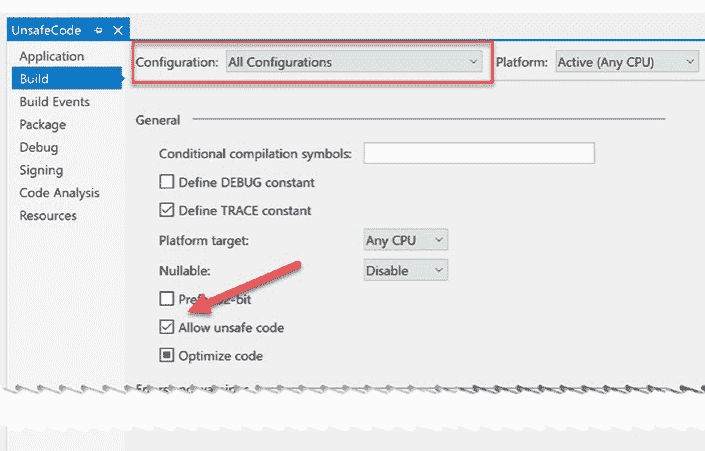
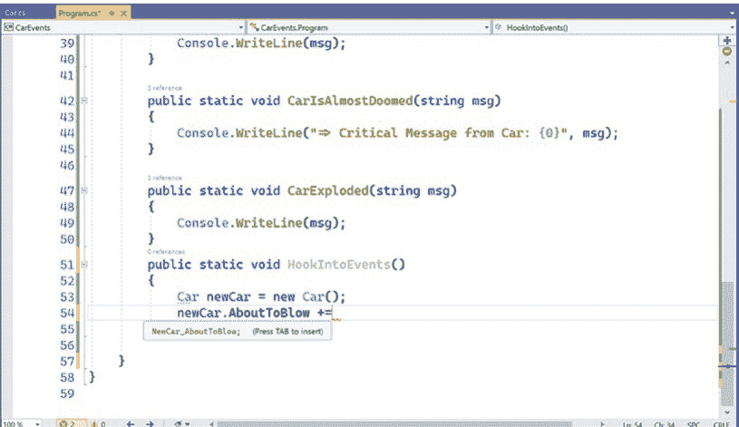
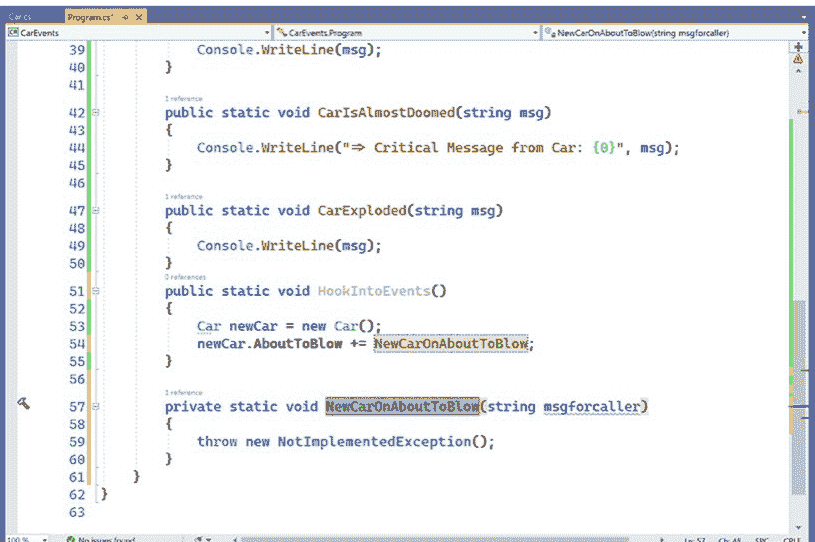

## CHAPTER 11

## Advanced C# Language Features

在本章中，你将通过研究几个更高级的主题来加深对 C# 编程语言的理解。首先，你将学习如何实现和使用索引器方法。这种 C# 机制使你能够构建自定义类型，使用类似数组的语法访问内部子项。在学习如何构建索引器方法后，你将看到如何重载各种运算符（`+`、`-`、`<`、`>` 等）以及如何为你的类型创建自定义显式和隐式转换例程（你也会学习为什么可能想要这样做）。

接下来，你将研究在处理 LINQ 为中心的 API 时特别有用的主题（尽管你可以在 LINQ 上下文之外使用它们）——具体来说是扩展方法和匿名类型。

最后，你将学习如何创建一个“不安全”代码上下文以直接操作非托管指针。虽然在 C# 应用程序中使用指针确实是不常见的活动，但了解如何操作在涉及复杂互操作场景的某些情况下会有所帮助。

## Understanding Indexer Methods

作为程序员，你肯定熟悉使用索引运算符（`[]`）访问简单数组中包含的各个项的过程。这里有一个示例：

```csharp
// Loop over incoming command-line arguments
// using index operator.
for (int i = 0; i < args.Length; i++)
{
    Console.WriteLine("Args: {0}", args[i]);
}

// Declare an array of local integers.
int[] myInts = { 10, 9, 100, 432, 9874 };

// Use the index operator to access each element.
for (int j = 0; j < myInts.Length; j++)
{
    Console.WriteLine("Index {0} = {1}", j, myInts[j]);
}
Console.ReadLine();
```

这段代码绝不是什么重大新闻。然而，C# 语言提供了设计自定义类和结构的能力，使其可以像标准数组一样被索引，通过定义索引器方法。当你创建自定义集合类（泛型或非泛型）时，此功能最有用。

在研究如何实现自定义索引器之前，让我们先通过一个实际例子来看看它是如何工作的。假设你已为第 10 章中开发的自定义 `PersonCollection` 类型添加了对索引器方法的支持（具体来说是 `IssuesWithNonGenericCollections` 项目）。虽然你尚未添加索引器，但请观察以下在名为 `SimpleIndexer` 的新控制台应用程序项目中的使用情况：

```csharp
using System;
using System.Collections.Generic;
using System.Data;
using SimpleIndexer;

// Indexers allow you to access items in an array-like fashion.
Console.WriteLine("***** Fun with Indexers *****\n");

PersonCollection myPeople = new PersonCollection();

// Add objects with indexer syntax.
myPeople[0] = new Person("Homer", "Simpson", 40);
myPeople[1] = new Person("Marge", "Simpson", 38);
myPeople[2] = new Person("Lisa", "Simpson", 9);
myPeople[3] = new Person("Bart", "Simpson", 7);
myPeople[4] = new Person("Maggie", "Simpson", 2);

// Now obtain and display each item using indexer.
for (int i = 0; i < myPeople.Count; i++)
{
    Console.WriteLine("Person number: {0}", i);
    Console.WriteLine("Name: {0} {1}",
        myPeople[i].FirstName, myPeople[i].LastName);
    Console.WriteLine("Age: {0}", myPeople[i].Age);
    Console.WriteLine();
}
```

正如你所见，索引器允许你像操作标准数组一样操作内部子对象的集合。现在大问题来了：如何配置 `PersonCollection` 类（或任何自定义类或结构）以支持此功能？索引器表示为略微修改的 C# 属性定义。在最简单的形式中，索引器使用 `this[]` 语法创建。以下是 `PersonCollection` 类所需的更新：

```csharp
using System.Collections;

namespace SimpleIndexer
{
    // Add the indexer to the existing class definition.
    public class PersonCollection : IEnumerable
    {
        private ArrayList arPeople = new ArrayList();
        ...
        // Custom indexer for this class.
```

```csharp
public Person this[int index]
{
    get => (Person)arPeople[index];
    set => arPeople.Insert(index, value);
}
}
```

除了使用 `this` 关键字和方括号外，索引器看起来就像任何其他 C# 属性声明。例如，`get` 范围的作用是向调用者返回正确的对象。在这里，你通过将请求委托给 `ArrayList` 对象的索引器来实现这一点，因为该类也支持索引器。`set` 范围负责添加新的 `Person` 对象；这是通过调用 `ArrayList` 的 `Insert()` 方法实现的。

索引器是另一种形式的语法糖，因为此功能也可以通过“正常”的公共方法如 `AddPerson()` 或 `GetPerson()` 实现。尽管如此，当你在自定义集合类型上支持索引器方法时，它们能很好地融入 .NET Core 基类库的结构中。

虽然在构建自定义集合时创建索引器方法很常见，但请记住，泛型类型开箱即用地为你提供了此功能。考虑以下使用 `Person` 对象泛型 `List<T>` 的方法。请注意，你可以直接使用 `List<T>` 的索引器。这里有一个示例：

```csharp
using System.Collections.Generic;

static void UseGenericListOfPeople()
{
    List<Person> myPeople = new List<Person>();
    myPeople.Add(new Person("Lisa", "Simpson", 9));
    myPeople.Add(new Person("Bart", "Simpson", 7));

    // Change first person with indexer.
    myPeople[0] = new Person("Maggie", "Simpson", 2);

    // Now obtain and display each item using indexer.
    for (int i = 0; i < myPeople.Count; i++)
    {
        Console.WriteLine("Person number: {0}", i);
        Console.WriteLine("Name: {0} {1}", myPeople[i].FirstName, myPeople[i].LastName);
        Console.WriteLine("Age: {0}", myPeople[i].Age);
        Console.WriteLine();
    }
}
```

## Indexing Data Using String Values

当前的 `PersonCollection` 类定义了一个索引器，允许调用者使用数值来标识子项。请理解，这并不是索引器方法的必要条件。假设你更愿意使用 `System.Collections.Generic.Dictionary<TKey, TValue>`


而不是ArrayList。鉴于Dictionary类型允许使用键（例如人的名字）访问所包含的类型，你可以按如下方式定义索引器：

```csharp
using System.Collections;
using System.Collections.Generic;

namespace SimpleIndexer
{
    public class PersonCollectionStringIndexer : IEnumerable
    {
        private Dictionary<string, Person> listPeople = new Dictionary<string, Person>();

        // This indexer returns a person based on a string index.
        public Person this[string name]
        {
            get => (Person)listPeople[name];
            set => listPeople[name] = value;
        }

        public void ClearPeople()
        {
            listPeople.Clear();
        }

        public int Count => listPeople.Count;

        IEnumerator IEnumerable.GetEnumerator() => listPeople.GetEnumerator();
    }
}
```

现在，调用方将能够与所包含的Person对象进行交互，如下所示：

```csharp
Console.WriteLine("***** Fun with Indexers *****");

PersonCollectionStringIndexer myPeopleStrings =
    new PersonCollectionStringIndexer();

myPeopleStrings["Homer"] =
    new Person("Homer", "Simpson", 40);
myPeopleStrings["Marge"] =
    new Person("Marge", "Simpson", 38);

// Get "Homer" and print data.
Person homer = myPeopleStrings["Homer"];
Console.ReadLine();
```

同样，如果你直接使用泛型Dictionary<TKey, TValue>类型，你可以直接获得索引器方法的功能，而无需构建支持字符串索引器的自定义非泛型类。尽管如此，请理解任何索引器的数据类型将取决于支持的集合类型如何允许调用方检索子项。

## 重载索引器方法

索引器方法可以在单个类或结构体上重载。因此，如果允许调用方使用数值索引或字符串值访问子项是合理的，你可以为单个类型定义多个索引器。例如，在ADO.NET（.NET原生的数据库访问API）中，DataSet类支持一个名为Tables的属性，该属性返回强类型的DataTableCollection类型。事实证明，DataTableCollection定义了三个索引器来获取和设置DataTable对象——一个按序号位置，另外两个按友好字符串名称和可选的包含命名空间，如下所示：

```csharp
public sealed class DataTableCollection : InternalDataCollectionBase
{
    ...
    // Overloaded indexers!
    public DataTable this[int index] { get; }
    public DataTable this[string name] { get; }
    public DataTable this[string name, string tableNamespace] { get; }
}
```

基类库中的类型支持索引器方法是很常见的。因此，即使你当前的项目不需要为你的类和结构体构建自定义索引器，也要意识到许多类型已经支持这种语法。

## 多维索引器

你还可以创建接受多个参数的索引器方法。假设你有一个自定义集合，将子项存储在二维数组中。如果是这种情况，你可以按如下方式定义索引器方法：

```csharp
public class SomeContainer
{
    private int[,] my2DintArray = new int[10, 10];

    public int this[int row, int column]
    { /* get or set value from 2D array */ }
}
```

同样，除非你正在构建高度风格化的自定义集合类，否则你不需要构建多维索引器。然而，ADO.NET再次展示了这种构造的有用性。ADO.NET DataTable本质上是一个行和列的集合，很像一张方格纸或Microsoft Excel电子表格的总体结构。

虽然DataTable对象通常由相关的“数据适配器”代为填充，但以下代码演示了如何手动创建一个包含三列（每条记录的名字、姓氏和年龄）的内存中DataTable。请注意，一旦你向DataTable添加了一行，你就使用多维索引器来深入第一（也是唯一）行的每一列。（如果你在跟着做，你需要将System.Data命名空间导入到代码文件中。）

```csharp
static void MultiIndexerWithDataTable()
{
    // Make a simple DataTable with 3 columns.
    DataTable myTable = new DataTable();
    myTable.Columns.Add(new DataColumn("FirstName"));
    myTable.Columns.Add(new DataColumn("LastName"));
    myTable.Columns.Add(new DataColumn("Age"));

    // Now add a row to the table.
    myTable.Rows.Add("Mel", "Appleby", 60);

    // Use multidimension indexer to get details of first row.
    Console.WriteLine("First Name: {0}", myTable.Rows[0][0]);
    Console.WriteLine("Last Name: {0}", myTable.Rows[0][1]);
    Console.WriteLine("Age : {0}", myTable.Rows[0][2]);
}
```

请注意，你将从第21章开始深入了解ADO.NET，因此如果之前的一些代码看起来不熟悉，请不要担心。这个示例的重点是索引器方法可以支持多维，并且如果使用得当，可以简化你在自定义集合中与所包含子对象交互的方式。

## 接口类型上的索引器定义

可以在给定的.NET Core接口类型上定义索引器，以允许支持类型提供自定义实现。下面是一个简单示例，该接口定义了一个使用数值索引器获取字符串对象的协议：

```csharp
public interface IStringContainer
{
    string this[int index] { get; set; }
}
```

有了这个接口定义，任何实现该接口的类或结构体现在都必须支持使用数值操作子项的读写索引器。以下是此类类的部分实现：

```csharp
class SomeClass : IStringContainer
{
    private List<string> myStrings = new List<string>();

    public string this[int index]
    {
        get => myStrings[index];
        set => myStrings.Insert(index, value);
    }
}
```

这结束了本章的第一个主要主题。现在让我们检查一个语言特性，它允许你构建自定义类或结构体，使其对C#的内置运算符做出独特响应。接下来，请允许我介绍运算符重载的概念。

## 理解运算符重载

与任何编程语言一样，C#拥有一组预设的标记（token），用于对内置类型执行基本操作。例如，你知道+运算符可以应用于两个整数，产生一个更大的整数。

```csharp
// The + operator with ints.
int a = 100;
int b = 240;
int c = a + b; // c is now 340
```

再说一次，这并非什么大新闻，但你有没有停下来注意到同一个+运算符如何应用于大多数C#内置数据类型？例如，考虑以下代码：

```csharp
// + operator with strings.
string s1 = "Hello";
string s2 = " world!";
string s3 = s1 + s2; // s3 is now "Hello World!"
```

+运算符根据所提供的数据类型（本例中为字符串或整数）以特定方式运作。当+运算符应用于数值类型时，结果是操作数之和。然而，当+运算符应用于字符串类型时，结果是字符串连接。

C#语言使你有能力构建自定义类和方法，使其对同一组基本标记（如+运算符）也做出独特响应。虽然并非所有可能的C#运算符都可以重载，但许多都可以，如表11-1所示。

### 表11-1. C#运算符的可重载性

| C# Operator | Overloadability |
|---|---|
| +, -, !, ~, ++, --, true, false | These unary operators can be overloaded. C# demands that if true or false is overloaded, both must be overloaded. |
| +, -, *, /, %, &, \|, ^, <<, >> | These binary operators can be overloaded. |
| ==, !=, <, >, <=, >= | These comparison operators can be overloaded. C# demands that “like” operators (i.e., < and >, <= and >=, == and !=) are overloaded together. |
| [] | The [] operator cannot be overloaded. As you saw earlier in this chapter, however, the indexer construct provides the same functionality. |
| () | The () operator cannot be overloaded. As you will see later in this chapter, however, custom conversion methods provide the same functionality. |
| +=, -=, *=, /=, %=, &=, \|=, ^=, <<=, >>= | Shorthand assignment operators cannot be overloaded; however, you receive them as a freebie when you overload the related binary operator. |


# 重载二进制运算符

为了说明重载二进制运算符的过程，假设以下简单的 Point 类已在名为 OverloadedOps 的新控制台应用程序项目中定义：

```
using System;
namespace OverloadedOps
{
    // Just a simple, everyday C# class.
    public class Point
    {
        public int X {get; set;}
        public int Y {get; set;}

        public Point(int xPos, int yPos)
        {
            X = xPos;
            Y = yPos;
        }
        public override string ToString()
        => $"[{this.X}, {this.Y}]";
    }
}
```

现在，从逻辑上讲，“添加” Points 是有意义的。例如，如果你将两个 Point 变量相加，你应该会得到一个新的 Point，其 X 和 Y 值之和。当然，从一个 Point 中减去另一个 Point 也可能很有帮助。理想情况下，你希望能够编写以下代码：

```
using System;
using OverloadedOps;

// Adding and subtracting two points?
Console.WriteLine("***** Fun with Overloaded Operators *****");

// Make two points.
Point ptOne = new Point(100, 100);
Point ptTwo = new Point(40, 40);
Console.WriteLine("ptOne = {0}", ptOne);
Console.WriteLine("ptTwo = {0}", ptTwo);
// Add the points to make a bigger point?
Console.WriteLine("ptOne + ptTwo: {0} ", ptOne + ptTwo);

// Subtract the points to make a smaller point?
Console.WriteLine("ptOne - ptTwo: {0} ", ptOne - ptTwo);
Console.ReadLine();
```

然而，以你现在的 Point 而言，你将收到编译时错误，因为 Point 类型不知道如何响应 + 或 - 运算符。为了使自定义类型能够对固有运算符做出独特响应，C# 提供了 operator 关键字，你只能将其与 static 关键字结合使用。当你重载二进制运算符（例如 + 和 -）时，你通常会传入两个参数，其类型与定义类相同（本例中为 Point），如下面的代码更新所示：

```
// A more intelligent Point type.
public class Point
{
...
    // Overloaded operator +.
    public static Point operator + (Point p1, Point p2)
        => new Point(p1.X + p2.X, p1.Y + p2.Y);

    // Overloaded operator -.
    public static Point operator - (Point p1, Point p2)
        => new Point(p1.X - p2.X, p1.Y - p2.Y);
}
```

operator + 背后的逻辑很简单，即根据传入 Point 参数的字段之和返回一个新的 Point 对象。因此，当你编写 pt1 + pt2 时，在内部你可以设想对静态 operator + 方法的以下隐藏调用：

```
// Pseudo-code: Point p3 = Point.operator+ (p1, p2)
Point p3 = p1 + p2;
```

同样，p1-p2 映射到以下内容：

```
// Pseudo-code: Point p4 = Point.operator- (p1, p2)
Point p4 = p1 - p2;
```

有了此更新后，你的程序现在可以编译，并且你会发现可以添加和减去 Point 对象，如以下输出所示：

```
***** Fun with Overloaded Operators *****
ptOne = [100, 100]
ptTwo = [40, 40]
ptOne + ptTwo: [140, 140]
ptOne - ptTwo: [60, 60]
```

当你重载二进制运算符时，你不必传入两个相同类型的参数。如果有意义的话，其中一个参数可以不同。例如，这里有一个重载的 operator +，允许调用者获得基于数值调整的新 Point：

```
public class Point
{
...
    public static Point operator + (Point p1, int change)
        => new Point(p1.X + change, p1.Y + change);

    public static Point operator + (int change, Point p1)
        => new Point(p1.X + change, p1.Y + change);
}
```

请注意，如果你希望参数按任意顺序传入，你需要这两种方法版本（即，你不能只定义其中一种方法并期望编译器自动支持另一种）。你现在可以按如下方式使用这些新的 operator + 版本：

```
// Prints [110, 110].
Point biggerPoint = ptOne + 10;
Console.WriteLine("ptOne + 10 = {0}", biggerPoint);

// Prints [120, 120].
Console.WriteLine("10 + biggerPoint = {0}", 10 + biggerPoint);
Console.WriteLine();
```

## 那么 += 和 -= 运算符呢？

如果你是从 C++ 背景转到 C#，你可能会惋惜失去重载简写赋值运算符（+=、-= 等）的能力。不要绝望。就 C# 而言，如果类型重载了相关的二进制运算符，简写赋值运算符会自动模拟。因此，鉴于 Point 结构已经重载了 + 和 - 运算符，你可以编写以下内容：

```
// Overloading binary operators results in a freebie shorthand operator.
...
// Freebie +=
Point ptThree = new Point(90, 5);
Console.WriteLine("ptThree = {0}", ptThree);
Console.WriteLine("ptThree += ptTwo: {0}", ptThree += ptTwo);

// Freebie -=
Point ptFour = new Point(0, 500);
Console.WriteLine("ptFour = {0}", ptFour);
Console.WriteLine("ptFour -= ptThree: {0}", ptFour -= ptThree);
Console.ReadLine();
```

## 重载一元运算符

C# 还允许你重载各种一元运算符，例如 ++ 和 --。当你重载一元运算符时，你也必须使用 operator 关键字与 static 关键字一起使用；然而，在这种情况下，你只需传入一个与定义类/结构相同类型的单个参数。例如，如果你使用以下重载运算符更新 Point：

```
public class Point
{
...
// Add 1 to the X/Y values for the incoming Point.
public static Point operator ++(Point p1)
=> new Point(p1.X+1, p1.Y+1);

// Subtract 1 from the X/Y values for the incoming Point.
public static Point operator --(Point p1)
=> new Point(p1.X-1, p1.Y-1);
}
```

你就可以像这样递增和递减 Point 的 x 和 y 值：

```
...
// Applying the ++ and -- unary operators to a Point.
Point ptFive = new Point(1, 1);
Console.WriteLine("+ +ptFive = {0}", ++ptFive);  // [2, 2]
Console.WriteLine("--ptFive = {0}", --ptFive);  // [1, 1]

// Apply same operators as postincrement/decrement.
Point ptSix = new Point(20, 20);
Console.WriteLine("ptSix++ = {0}", ptSix++);    // [20, 20]
Console.WriteLine("ptSix-- = {0}", ptSix--);    // [21, 21]
Console.ReadLine();
```

请注意，在前面的代码示例中，你以两种不同的方式应用自定义 ++ 和 -- 运算符。在 C++ 中，可以分别重载前置和后置递增/递减运算符。在 C# 中则不可能。然而，递增/递减的返回值会自动“正确”处理，无需额外成本（即，对于重载的 ++ 运算符，pt++ 在表达式中的值是未修改对象的价值，而 ++pt 则在表达式中使用前先应用新值）。

## 重载相等运算符

正如你在第 6 章中所回忆的那样，可以重写 System.Object.Equals() 来在引用类型之间执行基于值（而非基于引用）的比较。如果你选择重写 Equals()（以及通常相关的 System.Object.GetHashCode() 方法），重载相等运算符（== 和 !=）就很简单了。为了说明，这里是更新后的 Point 类型：

```
// This incarnation of Point also overloads the == and != operators.
public class Point
{
...
public override bool Equals(object o)
    => o.ToString() == this.ToString();

public override int GetHashCode()
    => this.ToString().GetHashCode();

// Now let's overload the == and != operators.
public static bool operator ==(Point p1, Point p2)
    => p1.Equals(p2);

public static bool operator !=(Point p1, Point p2)
    => !p1.Equals(p2);
}
```

请注意，operator == 和 operator != 的实现只是调用了重写的 Equals() 方法来完成大部分工作。鉴于此，你现在可以按如下方式使用你的 Point 类：

```
// Make use of the overloaded equality operators.
...
Console.WriteLine("ptOne == ptTwo : {0}", ptOne == ptTwo);
Console.WriteLine("ptOne != ptTwo : {0}", ptOne != ptTwo);
Console.ReadLine();
```

正如你所见，使用众所周知的 == 和 != 运算符比较两个对象是相当直观的，而不是调用 Object.Equals()。如果你为某个类重载相等运算符，请记住 C# 要求如果你重写 == 运算符，也必须重写 != 运算符（如果你忘记了，编译器会提醒你）。

## 重载比较运算符

在第 8 章中，你学习了如何实现 IComparable 接口来比较两个相似对象的关系。事实上，你也可以为同一类重载比较运算符（<、>、<= 和 >=）。与相等运算符一样，C# 要求如果你重载 <，也必须重载 >。<= 和 >= 运算符也适用。如果 Point 类型重载了这些比较运算符，对象用户现在就可以比较 Points，如下所示：

```
// Using the overloaded < and > operators.
...
Console.WriteLine("ptOne < ptTwo : {0}", ptOne < ptTwo);
Console.WriteLine("ptOne > ptTwo : {0}", ptOne > ptTwo);
Console.ReadLine();
```

假设你已经实现了 IComparable 接口（或更好的是，其泛型等价物），重载比较运算符就很简单了。以下是更新后的类定义：

```
// Point is also comparable using the comparison operators.
public class Point : IComparable<Point>
{
...
public int CompareTo(Point other)
{
    if (this.X > other.X && this.Y > other.Y)
    {
        return 1;
    }
    if (this.X < other.X && this.Y < other.Y)
    {
        return -1;
    }
    return 0;
}
```


```csharp
public static bool operator <(Point p1, Point p2)
    => p1.CompareTo(p2) < 0;

public static bool operator >(Point p1, Point p2)
    => p1.CompareTo(p2) > 0;

public static bool operator <=(Point p1, Point p2)
    => p1.CompareTo(p2) <= 0;

public static bool operator >=(Point p1, Point p2)
    => p1.CompareTo(p2) >= 0;
}
```

## 关于运算符重载的最终思考

正如你所看到的，C# 提供了构建类型的能力，使这些类型能够以独特的方式响应各种内置的、众所周知的运算符。不过，在你着手修改所有类以支持此类行为之前，必须确保你准备重载的运算符在现实世界中具有某种合乎逻辑的意义。

例如，假设你为 `MiniVan` 类重载了乘法运算符。那么，两个 `MiniVan` 对象相乘究竟意味着什么？没有太大意义。事实上，团队成员看到下面这种 `MiniVan` 对象的用法时，可能会感到困惑：

```csharp
// 什么？！这完全不符合直觉……
MiniVan newVan = myVan * yourVan;
```

通常，只有在构建原子数据类型时，重载运算符才有用。向量、矩阵、文本、点、形状、集合等，都是适合重载运算符的候选类型。而人员、经理、汽车、数据库连接和网页则不适合。经验法则是：如果重载运算符让用户更难理解某个类型的功能，就不要重载它。请明智地使用此功能。

## 理解自定义类型转换

现在，让我们研究一个与运算符重载密切相关的主题：自定义类型转换。为了展开讨论，我们先快速回顾一下数值数据与相关类类型之间的显式转换和隐式转换概念。

## 回顾：数值转换

对于内置数值类型（`sbyte`、`int`、`float` 等），当你尝试将较大的值存储到较小的容器中时，就需要执行显式转换，因为这可能导致数据丢失。基本上，这是在告诉编译器：“别管我，我知道自己在做什么。”相反，当你尝试将较小的类型放入不会导致数据丢失的目标类型中时，就会自动发生隐式转换。

```csharp
int a = 123;
long b = a;    // 从 int 到 long 的隐式转换。
int c = (int) b; // 从 long 到 int 的显式转换。
```

## 回顾：相关类类型之间的转换

如第 6 章所示，类类型可以通过经典继承建立关联（即“is-a”关系）。在这种情况下，C# 的转换过程允许你沿着类层次结构向上转换和向下转换。例如，派生类始终可以隐式转换为基类。不过，如果你想将基类类型存储到派生类变量中，就必须执行显式转换，如下所示：

```csharp
// 两个相关的类类型。
class Base{}
class Derived : Base{}

// 从派生类到基类的隐式转换。
Base myBaseType;
myBaseType = new Derived();
// 必须显式转换，才能将基类引用存储到
// 派生类类型中。
Derived myDerivedType = (Derived)myBaseType;
```

这种显式转换之所以有效，是因为 `Base` 和 `Derived` 类通过经典继承相关联，并且 `myBaseType` 是作为 `Derived` 的实例构造的。但是，如果 `myBaseType` 是 `Base` 的实例，那么转换就会引发 `InvalidCastException`。如果无法确定转换是否会失败，则应使用 `as` 关键字，正如第 6 章中所讨论的那样。下面是经过修改的示例：

```csharp
// 从派生类到基类的隐式转换。
Base myBaseType2 = new();
// 引发 InvalidCastException
//Derived myDerivedType2 = (Derived)myBaseType2 as Derived;
// 不会引发异常，myDerivedType2 为 null
Derived myDerivedType2 = myBaseType2 as Derived;
```

不过，如果你有两个处于不同继承层次结构中的类类型，除了 `System.Object` 之外没有共同的父类，但又需要在它们之间进行转换，该怎么办？由于它们没有通过经典继承建立关联，常规的类型转换操作无法提供帮助（而且你还会得到编译器错误！）

类似地，考虑值类型（结构）。假设你有两个名为 `Square` 和 `Rectangle` 的结构。由于结构无法利用经典继承（它们始终是密封的），因此没有自然的方式在这两个看似相关的类型之间进行转换。

虽然你可以在结构中创建辅助方法（例如 `Rectangle.ToSquare()`），但 C# 允许你构建自定义转换例程，使你的类型能够响应 `()` 转换运算符。因此，如果正确配置这些结构，就可以使用下面的语法在它们之间执行显式转换：

```csharp
// 将 Rectangle 转换为 Square！
Rectangle rect = new Rectangle
{
    Width = 3,
    Height = 10
}
Square sq = (Square)rect;
```

## 创建自定义转换例程

首先，创建一个名为 `CustomConversions` 的新控制台应用程序项目。C# 提供了 `explicit` 和 `implicit` 两个关键字，你可以使用它们来控制类型在尝试转换时的响应方式。假设你有以下结构定义：

```csharp
using System;

namespace CustomConversions
{
    public struct Rectangle
    {
        public int Width {get; set;}
        public int Height {get; set;}

        public Rectangle(int w, int h)
        {
            Width = w;
            Height = h;
        }

        public void Draw()
        {
            for (int i = 0; i < Height; i++)
            {
                for (int j = 0; j < Width; j++)
                {
                    Console.Write("*");
                }
                Console.WriteLine();
            }
        }

        public override string ToString()
            => $"[Width = {Width}; Height = {Height}]";
    }
}

using System;

namespace CustomConversions
{
    public struct Square
    {
        public int Length {get; set;}
        public Square(int l) : this()
        {
            Length = l;
        }

        public void Draw()
        {
            for (int i = 0; i < Length; i++)
            {
                for (int j = 0; j < Length; j++)
                {
                    Console.Write("*");
                }
                Console.WriteLine();
            }
        }

        public override string ToString() => $"[Length = {Length}]";

        // Rectangle 可以显式转换为 Square。
        public static explicit operator Square(Rectangle r)
        {
            Square s = new Square {Length = r.Height};
            return s;
        }
    }
}
```

请注意，此版本的 `Square` 类型定义了一个显式转换运算符。与重载运算符的过程类似，转换例程也使用 C# 的 `operator` 关键字，并结合 `explicit` 或 `implicit` 关键字，同时必须定义为静态成员。输入参数是要转换的实体，而运算符类型则是转换目标实体的类型。

在本例中，假设正方形（一种所有边长度都相等的几何图形）可以根据矩形的高度获得。因此，你可以将 `Rectangle` 转换为 `Square`，如下所示：

```csharp
using System;
using CustomConversions;

Console.WriteLine("***** Fun with Conversions *****
");
// 创建一个 Rectangle。
Rectangle r = new Rectangle(15, 4);
Console.WriteLine(r.ToString());
r.Draw();

Console.WriteLine();

// 将 r 转换为 Square，
// 转换依据是 Rectangle 的高度。
Square s = (Square)r;
Console.WriteLine(s.ToString());
s.Draw();
Console.ReadLine();
```

输出如下：

```text
**** Fun with Conversions ****
[Width = 15; Height = 4]

***************
***************
***************
***************

[Length = 4]
****
****
****
****
```

虽然在同一作用域中将 `Rectangle` 转换为 `Square` 可能并没有太大帮助，但假设你有一个被设计为接收 `Square` 参数的函数：

```csharp
// 此方法需要 Square 类型。
static void DrawSquare(Square sq)
{
    Console.WriteLine(sq.ToString());
    sq.Draw();
}
```

利用 `Square` 类型上的显式转换操作，现在可以通过显式转换将 `Rectangle` 类型传入进行处理，如下所示：

```csharp
// 将 Rectangle 转换为 Square，以调用方法。
Rectangle rect = new Rectangle(10, 5);
DrawSquare((Square)rect);
Console.ReadLine();
```

## Square 类型的其他显式转换

现在你已经可以将 `Rectangle` 显式转换为 `Square`，接下来让我们研究几种其他的显式转换。由于正方形的各边具有对称性，因此提供一个显式转换例程可能会很有帮助，这样调用者就可以将整数类型转换为 `Square`（当然，正方形的边长将等于输入的整数）。同样，如果更新 `Square`，使调用者能够将 `Square` 转换为 `int`，又会怎样呢？下面是调用代码：

```csharp
// 将 int 转换为 Square。
Square sq2 = (Square)90;
Console.WriteLine("sq2 = {0}", sq2);
```


// 将正方形转换为 int。
int side = (int)sq2;
Console.WriteLine("Side length of sq2 = {0}", side);
Console.ReadLine();

下面是对 Square 类的更新：

```
public struct Square
{
...
    public static explicit operator Square(int sideLength)
    {
        Square newSq = new Square {Length = sideLength};
        return newSq;
    }

    public static explicit operator int (Square s) => s.Length;
}
```

说实话，将 Square 转换为整数可能不是最直观（或最有用）的操作（毕竟，很有可能你只需将这些值传递给构造函数即可）。不过，这确实指出了有关自定义转换例程的一个重要事实：如果你编写了语法正确的代码，编译器并不关心你要转换成什么类型，或从什么类型转换而来。

因此，与运算符重载一样，仅仅因为你可以为给定类型创建显式转换操作，并不意味着你就应该这样做。通常，在创建结构类型时，这项技术最有帮助，因为结构无法参与经典的继承（而在继承关系中，类型转换是自动提供的）。

## 定义隐式转换例程

到目前为止，你已经创建了各种自定义显式转换操作。那么，下面的隐式转换该如何处理呢？

```
...
Square s3 = new Square {Length = 83};

// 尝试进行隐式转换？
Rectangle rect2 = s3;

Console.ReadLine();
```

这段代码无法编译，因为你尚未为 Rectangle 类型提供隐式转换例程。这里的关键在于：如果显式转换函数和隐式转换函数的返回类型或参数集没有区别，那么在同一类型上定义它们是非法的。这看起来似乎是一种限制；然而，另一个关键点是：当某个类型定义了隐式转换例程时，调用方仍然可以使用显式转换语法，这是合法的！

是不是有些困惑？为了说明这一点，让我们使用 C# 的 implicit 关键字向 Rectangle 结构添加一个隐式转换例程（注意，下面的代码假设生成的 Rectangle 的宽度是将 Square 的边长乘以 2 得到的）：

```
public struct Rectangle
{
...
    public static implicit operator Rectangle(Square s)
    {
        Rectangle r = new Rectangle
        {
            Height = s.Length,
            Width = s.Length * 2 // 假设新 Rectangle 的长度为（Length x 2）。
        };
        return r;
    }
}
```

完成此更新后，你现在就可以在类型之间进行转换，如下所示：

```
...
// 隐式转换成功！
Square s3 = new Square { Length= 7};

Rectangle rect2 = s3;
Console.WriteLine("rect2 = {0}", rect2);

// 显式转换语法仍然有效！
Square s4 = new Square {Length = 3};
Rectangle rect3 = (Rectangle)s4;

Console.WriteLine("rect3 = {0}", rect3);
Console.ReadLine();
```

至此，我们对自定义转换例程的定义就介绍完了。与运算符重载一样，请记住，这种语法实际上只是“普通”成员函数的简写形式，从这个角度来看，它始终是可选的。不过，如果使用得当，自定义结构可以使用得更加自然，因为它们可以被当作通过继承关联的真正类类型来处理。

## 理解扩展方法

.NET 3.5 引入了扩展方法的概念。扩展方法允许你向类或结构添加新的方法或属性，而无需以任何直接方式修改原始类型。那么，这项功能在哪些情况下会有帮助呢？请考虑以下几种可能性。

首先，假设你有一个已经投入生产的类。随着时间的推移，你发现这个类应该支持一些新的成员。如果你直接修改当前的类定义，就有可能破坏与旧代码库的向后兼容性，因为这些代码可能并未使用最新、最完善的类定义进行编译。确保向后兼容的一种方法，是从现有父类派生出一个新的子类；但是，这样一来你就需要维护两个类。正如我们所知，代码维护是软件工程师工作中最不光彩的部分。

现在考虑另一种情况。假设你有一个结构（或者可能是一个密封类），并希望添加新的成员，使其能够在系统中表现出多态性。由于结构和密封类无法被扩展，你唯一的选择就是将成员添加到类型本身，这再次有可能破坏向后兼容性！

使用扩展方法，你可以在不进行子类化、也不直接修改类型的情况下修改类型。需要注意的是，只有当扩展方法已在当前项目中被引用并可供使用时，新的功能才会提供给相应类型。

## 定义扩展方法

定义扩展方法时，第一个限制是：它们必须定义在静态类中（参见第 5 章）；因此，每个扩展方法都必须使用 static 关键字声明。第二点是：所有扩展方法都通过在相关方法的第一个参数（并且只能是第一个参数）上使用 this 关键字作为修饰符来标记。这个“使用 this 修饰的”参数代表被扩展的项目。

为了演示这一点，请创建一个名为 ExtensionMethods 的新控制台应用程序项目。现在，假设你正在编写一个名为 MyExtensions 的类，其中定义了两个扩展方法。第一个方法允许任何对象使用一个名为 DisplayDefiningAssembly() 的新方法。该方法利用 System.Reflection 命名空间中的类型，显示包含相关类型的程序集名称。

> 注意 你将在第 17 章中正式学习反射 API。如果你刚接触这个主题，只需了解反射允许你在运行时发现程序集、类型以及类型成员的结构。

第二个扩展方法名为 ReverseDigits()，允许任何 int 获取一个数字顺序颠倒的新版本。例如，如果一个值为 1234 的整数调用 ReverseDigits()，返回的整数将被设置为 4321。请考虑下面的类实现（如果你正在跟随示例操作，请务必导入 System.Reflection 命名空间）：

```
using System;
using System.Reflection;

namespace MyExtensionMethods
{
    static class MyExtensions
    {
        // 此方法允许任何对象显示其所属的程序集
        // 所在位置。
        public static void DisplayDefiningAssembly(this object obj)
        {
            Console.WriteLine("{0} lives here: => {1}\n",
                obj.GetType().Name,
                Assembly.GetAssembly(obj.GetType()).GetName().Name);
        }

        // 此方法允许任何整数颠倒其数字。
        // 例如，56 将返回 65。
        public static int ReverseDigits(this int i)
        {
            // 将 int 转换为字符串，然后
            // 获取所有字符。
            char[] digits = i.ToString().ToCharArray();

            // 现在颠倒数组中的元素。
            Array.Reverse(digits);

            // 放回字符串中。
            string newDigits = new string(digits);

            // 最后，将修改后的字符串作为 int 返回。
            return int.Parse(newDigits);
        }
    }
}
```

再次注意，每个扩展方法的第一个参数都在定义参数类型之前使用 this 关键字进行了修饰。扩展方法的第一个参数始终代表被扩展的类型。由于 DisplayDefiningAssembly() 被设计为扩展 System.Object，因此现在每种类型都有了这个新成员，因为 Object 是 .NET Core 平台中所有类型的父类型。然而，ReverseDigits() 被设计为仅扩展整数类型；因此，如果整数以外的任何类型尝试调用此方法，你将收到编译时错误。

> 注意 请理解，给定的扩展方法可以有多个参数，但只有第一个参数可以使用 this 进行修饰。其他参数会被视为普通输入参数，供方法使用。

## 调用扩展方法

现在，你已经准备好了这些扩展方法。请考虑下面的代码示例，它将扩展方法应用于基类库中的各种类型：

```
using System;
using MyExtensionMethods;

Console.WriteLine("***** Fun with Extension Methods ****\n");

// int 获得了新的身份！
int myInt = 12345678;
myInt.DisplayDefiningAssembly();

// DataSet 也一样！
System.Data.DataSet d = new System.Data.DataSet();
d.DisplayDefiningAssembly();

// 使用新的整数功能。
Console.WriteLine("Value of myInt: {0}", myInt);
Console.WriteLine("Reversed digits of myInt: {0}",
    myInt.ReverseDigits());

Console.ReadLine();
```


以下是输出：

```
***** Fun with Extension Methods *****
Int32 lives here: => System.Private.CoreLib

DataSet lives here: => System.Data.Common

Value of myInt: 12345678
Reversed digits of myInt: 87654321
```

## 导入扩展方法

当你定义一个包含扩展方法的类时，它无疑会定义在某个命名空间内。如果该命名空间不同于使用扩展方法的命名空间，则需要使用预期的 C# using 关键字。这样做之后，你的代码文件就可以访问被扩展类型的所有扩展方法。这一点很重要，因为如果你没有显式导入正确的命名空间，那么这些扩展方法对于该 C# 代码文件是不可用的。

实际上，虽然表面上看扩展方法似乎是全局性的，但它们实际上仅限于定义它们的命名空间或导入它们的命名空间。回想一下，你将 MyExtensions 类包装到了名为 MyExtensionMethods 的命名空间中，如下所示：

```
namespace MyExtensionMethods
{
    static class MyExtensions
    {
        ...
    }
}
```

要使用该类中的扩展方法，你需要显式导入 MyExtensionMethods 命名空间，就像我们在用于演练示例的顶级语句中所做的那样。

## 扩展实现特定接口的类型

到目前为止，你已经了解了如何通过扩展方法使用新功能来扩展类（以及间接扩展遵循相同语法的结构）。也可以定义只能扩展实现了相应接口的类或结构的扩展方法。例如，你可以说这样的话：“如果一个类或结构实现了 IEnumerable<T>，那么该类型将获得以下新成员。”当然，你也可以要求某个类型支持任何接口，包括你自己的自定义接口。

为了说明这一点，创建一个名为 InterfaceExtensions 的新控制台应用程序项目。这里的目标是向任何实现 IEnumerable 的类型添加一个新方法，这将包括任何数组和许多非泛型集合类（回想第 10 章，泛型 IEnumerable<T> 接口扩展了非泛型 IEnumerable 接口）。将以下扩展类添加到你的新项目中：

```
using System;

namespace InterfaceExtensions
{
    static class AnnoyingExtensions
    {
        public static void PrintDataAndBeep(
            this System.Collections.IEnumerable iterator)
        {
            foreach (var item in iterator)
            {
                Console.WriteLine(item);
                Console.Beep();
            }
        }
    }
}
```

鉴于 PrintDataAndBeep() 方法可以被任何实现 IEnumerable 的类或结构使用，你可以通过以下代码进行测试：

```
using System;
using System.Collections.Generic;
using InterfaceExtensions;

Console.WriteLine("***** Extending Interface Compatible Types *****
");

// System.Array implements IEnumerable!
string[] data =
    { "Wow", "this", "is", "sort", "of", "annoying",
      "but", "in", "a", "weird", "way", "fun!"};
data.PrintDataAndBeep();

Console.WriteLine();

// List<T> implements IEnumerable!
List<int> myInts = new List<int>() {10, 15, 20};
myInts.PrintDataAndBeep();

Console.ReadLine();
```

这结束了你对 C# 扩展方法的探讨。请记住，无论何时你想要扩展某个类型的功能，但出于多态性的目的不想子类化（或者如果类型是密封的而无法子类化），这个语言特性都会很有用。稍后你将在本书中看到，扩展方法在 LINQ API 中扮演着关键角色。事实上，你将会看到，在 LINQ API 中，最常见的被扩展对象之一就是实现（惊讶吧！）泛型版本 IEnumerable 的类或结构。

## 扩展方法 GetEnumerator 支持（9.0 新增）

在 C# 9.0 之前，要对类使用 foreach，必须在类上直接定义 GetEnumerator() 方法。从 C# 9.0 开始，foreach 语句会检查类上的扩展方法，如果找到 GetEnumerator() 方法，就会使用该方法获取该类的 IEnumerator。要查看实际效果，请添加一个名为 ForEachWithExtensionMethods 的新控制台应用程序，并添加第 8 章中 Car 和 Garage 类的简化版本。

```
//Car.cs
using System;

namespace ForEachWithExtensionMethods
{
    class Car
    {
        // Car properties.
        public int CurrentSpeed {get; set;} = 0;
        public string PetName {get; set;} = "";

        // Constructors.
        public Car() {}
        public Car(string name, int speed)
        {
            CurrentSpeed = speed;
            PetName = name;
        }

        // See if Car has overheated.
    }
}
```

```
//Garage.cs
namespace ForEachWithExtensionMethods
{
    class Garage
    {
        public Car[] CarsInGarage { get; set; }

        // Fill with some Car objects upon startup.
        public Garage()
        {
            CarsInGarage = new Car[4];
            CarsInGarage[0] = new Car("Rusty", 30);
            CarsInGarage[1] = new Car("Clunker", 55);
            CarsInGarage[2] = new Car("Zippy", 30);
            CarsInGarage[3] = new Car("Fred", 30);
        }
    }
}
```

注意，Garage 类并没有实现 IEnumerable，也没有 GetEnumerator() 方法。GetEnumerator() 方法是通过 GarageExtensions 类添加的，如下所示：using System.Collections;

```
namespace ForEachWithExtensionMethods
{
    static class GarageExtensions
    {
        public static IEnumerator GetEnumerator(this Garage g)
            => g.CarsInGarage.GetEnumerator();
    }
}
```

测试这一新功能的代码与第 8 章中用于测试 GetEnumerator() 方法的代码相同。将 Program.cs 更新为以下内容：

```
using System;
using ForEachWithExtensionMethods;

Console.WriteLine("***** Support for Extension Method GetEnumerator *****
");
Garage carLot = new Garage();

// Hand over each car in the collection?
foreach (Car c in carLot)
{
    Console.WriteLine("{0} is going {1} MPH",
        c.PetName, c.CurrentSpeed);
}
```

你会看到代码正常工作，向控制台打印汽车列表及其速度。

```
***** Support for Extension Method GetEnumerator *****

Rusty is going 30 MPH
Clunker is going 55 MPH
Zippy is going 30 MPH
Fred is going 30 MPH
```

注意，这一新功能有一个潜在缺点，即原本不应被 foreach 迭代的类现在也可以被 foreach 迭代了。

## 理解匿名类型

作为一名面向对象的程序员，你知道定义类来表示你试图建模的给定项的状态和功能的好处。当然，每当你需要定义一个旨在跨项目重用，并通过一组方法、事件、属性和自定义构造函数提供许多功能的类时，创建一个新的 C# 类是常见的做法。

然而，在其他时候，你只是想定义一个类来建模一组封装的（并且以某种方式相关的）数据点，而不需要任何关联的方法、事件或其他专门功能。此外，如果这种类型只被程序中的少量方法使用怎么办？当你非常清楚这个类只会在少数地方使用时，还要像下面那样定义一个完整的类定义，那就相当麻烦了。为了强调这一点，下面是你需要创建一个遵循典型基于值的语义的“简单”数据类型时可能需要做的工作的粗略概要：

```
class SomeClass
{
    // Define a set of private member variables...

    // Make a property for each member variable...

    // Override ToString() to account for key member variables...

    // Override GetHashCode() and Equals() to work with value-based equality...
}
```

如你所见，这并不一定那么简单。你不仅需要编写相当多的代码，而且系统中还要多维护一个类。对于这样的临时数据，即时创建一个自定义数据类型会很有用。例如，假设你需要构建一个接收一组传入参数的自定义方法。你希望使用这些参数来创建一个新的数据类型，以供该方法作用域使用。此外，你希望使用典型的 ToString() 方法快速打印这些数据，也许还可以使用 System.Object 的其他成员。你可以使用匿名类型语法来实现这一点。

## 定义匿名类型

定义匿名类型时，需要使用 var 关键字（参见第 3 章）并结合对象初始化语法（参见第 5 章）。你必须使用 var 关键字，因为编译器会在编译时自动生成一个新的类定义（并且你永远不会在 C# 代码中看到这个类的名称）。初始化语法用于告诉编译器为新创建的类型创建私有后备字段和（只读）属性。

为了说明这一点，创建一个名为 AnonymousTypes 的新控制台应用程序项目。现在，向你的 Program 类中添加以下方法，该方法使用传入的参数数据即时构造一个新类型：

```
static void BuildAnonymousType( string make, string color, int currSp )
{
    // Build anonymous type using incoming args.
    var car = new { Make = make, Color = color, Speed = currSp };

    // Note you can now use this type to get the property data!
    Console.WriteLine("You have a {0} {1} going {2} MPH", car.Color, car.Make, car.Speed);
}
```


```csharp
// Anonymous types have custom implementations of each virtual
// method of System.Object. For example:
Console.WriteLine("ToString() == {0}", car.ToString());
}
```

注意匿名类型也可以像这里展示的那样内联创建，而不仅仅是将其代码包装在函数中：

```csharp
Console.WriteLine("***** Fun with Anonymous Types *****\n");
```

```csharp
// Make an anonymous type representing a car.
var myCar = new { Color = "Bright Pink", Make = "Saab", CurrentSpeed = 55 };
```

```csharp
// Now show the color and make.
Console.WriteLine("My car is a {0} {1}.", myCar.Color, myCar.Make);
```

```csharp
// Now call our helper method to build anonymous type via args.
BuildAnonymousType("BMW", "Black", 90);
```

```csharp
Console.ReadLine();
```

因此，在这一点上，只需理解匿名类型允许你以极少的开销快速模拟数据的“形状”。这种技术本质上只是一种在运行时快速创建新数据类型的手段，它通过属性支持最基本的封装，并且遵循基于值的语义。为了理解最后一点，让我们看看 C# 编译器在编译时如何构建匿名类型，以及具体如何重写 System.Object 的成员。

## 匿名类型的内部表示

所有匿名类型都自动派生自 System.Object，因此支持该基类提供的每个成员。鉴于此，你可以在隐式类型的 myCar 对象上调用 ToString()、GetHashCode()、Equals() 或 GetType()。假设你的 Program 类定义了以下静态辅助函数：

```csharp
static void ReflectOverAnonymousType(object obj)
{
    Console.WriteLine("obj is an instance of: {0}", obj.GetType().Name);
    Console.WriteLine("Base class of {0} is {1}", obj.GetType().Name, obj.GetType().BaseType);
    Console.WriteLine("obj.ToString() == {0}", obj.ToString());
    Console.WriteLine("obj.GetHashCode() == {0}", obj.GetHashCode());
    Console.WriteLine();
}
```

现在假设你调用此方法，将 myCar 对象作为参数传入，如下所示：

```csharp
Console.WriteLine("***** Fun with Anonymous Types *****\n");

// Make an anonymous type representing a car.
var myCar = new { Color = "Bright Pink", Make = "Saab",
    CurrentSpeed = 55 };

// Reflect over what the compiler generated.
ReflectOverAnonymousType(myCar);
...

Console.ReadLine();
```

输出将如下所示：

```text
***** Fun with Anonymous Types *****
obj is an instance of: <>f__AnonymousType0`3
Base class of <>f__AnonymousType0`3 is System.Object
obj.ToString() = { Color = Bright Pink, Make = Saab, CurrentSpeed = 55 }
obj.GetHashCode() = -564053045
```

首先，注意在此示例中，myCar 对象的类型为 `<>f__AnonymousType0`3`（你的名称可能不同）。请记住，分配的类型名称完全由编译器决定，并且在你的 C# 代码库中无法直接访问。

也许最重要的是，注意使用对象初始化语法定义的每个名称-值对都映射到一个同名只读属性和一个对应的私有仅初始化支持字段。以下 C# 代码近似表示用于表示 myCar 对象的编译器生成的类（再次可使用 ilasm.exe 验证）：

```text
private sealed class <>f__AnonymousType0`3<'<Color>j__TPar',
'<Make>j__TPar', <CurrentSpeed>j__TPar>
extends [System.Runtime][System.Object]
{
    // init-only fields.
    private initonly <Color>j__TPar <Color>i__Field;
    private initonly <CurrentSpeed>j__TPar <CurrentSpeed>i__Field;
    private initonly <Make>j__TPar <Make>i__Field;

    // Default constructor.
    public <>f__AnonymousType0(<Color>j__TPar Color,
        <Make>j__TPar Make, <CurrentSpeed>j__TPar CurrentSpeed);
    // Overridden methods.
    public override bool Equals(object value);
    public override int GetHashCode();
    public override string ToString();
```

```text
// Read-only properties.
<Color>j__TPar Color { get; }
<CurrentSpeed>j__TPar CurrentSpeed { get; }
<Make>j__TPar Make { get; }
}
```

## ToString() 和 GetHashCode() 的实现

所有匿名类型都自动派生自 System.Object，并提供了 Equals()、GetHashCode() 和 ToString() 的重写版本。ToString() 实现只是从每个名称-值对构建一个字符串。以下是一个示例：

```csharp
public override string ToString()
{
    StringBuilder builder = new StringBuilder();
    builder.Append("{ Color = ");
    builder.Append(this.<Color>i__Field);
    builder.Append(", Make = ");
    builder.Append(this.<Make>i__Field);
    builder.Append(", CurrentSpeed = ");
    builder.Append(this.<CurrentSpeed>i__Field);
    builder.Append(" }");
    return builder.ToString();
}
```

GetHashCode() 实现使用匿名类型的每个成员变量作为输入计算哈希值，输入到 System.Collections.Generic.EqualityComparer<T> 类型。使用此 GetHashCode() 实现，如果（且仅如果）它们具有相同的一组属性并且这些属性被赋予相同的值，则两个匿名类型将产生相同的哈希值。鉴于此实现，匿名类型非常适合包含在 Hashtable 容器中。

## 匿名类型的相等语义

虽然重写的 ToString() 和 GetHashCode() 方法的实现很直接，但你可能会想知道 Equals() 方法是如何实现的。例如，如果你定义了两个“匿名汽车”变量并指定相同的名称-值对，这两个变量会被认为相等吗？为了亲眼看到结果，请使用以下新方法更新你的 Program 类型：

```csharp
static void EqualityTest()
{
    // Make 2 anonymous classes with identical name/value pairs.
    var firstCar = new { Color = "Bright Pink", Make = "Saab", CurrentSpeed = 55 };
    var secondCar = new { Color = "Bright Pink", Make = "Saab", CurrentSpeed = 55 };

    // Are they considered equal when using Equals()?
    if (firstCar.Equals(secondCar))
    {
        Console.WriteLine("Same anonymous object!");
    }
}
```

```csharp
else
{
    Console.WriteLine("Not the same anonymous object!");
}

// Are they considered equal when using ==?
if (firstCar == secondCar)
{
    Console.WriteLine("Same anonymous object!");
}
else
{
    Console.WriteLine("Not the same anonymous object!");
}

// Are these objects the same underlying type?
if (firstCar.GetType().Name == secondCar.GetType().Name)
{
    Console.WriteLine("We are both the same type!");
}
else
{
    Console.WriteLine("We are different types!");
}

// Show all the details.
Console.WriteLine();
ReflectOverAnonymousType(firstCar);
ReflectOverAnonymousType(secondCar);
}
```

当你调用此方法时，输出可能会有些令人惊讶。

```text
My car is a Bright Pink Saab.
You have a Black BMW going 90 MPH
ToString() == { Make = BMW, Color = Black, Speed = 90 }

Same anonymous object!
Not the same anonymous object!
We are both the same type!

obj is an instance of: <>f__AnonymousType`3
Base class of <>f__AnonymousType`3 is System.Object
obj.ToString() == { Color = Bright Pink, Make = Saab, CurrentSpeed = 55 }
obj.GetHashCode() == -925496951

obj is an instance of: <>f__AnonymousType`3
Base class of <>f__AnonymousType`3 is System.Object
obj.ToString() == { Color = Bright Pink, Make = Saab, CurrentSpeed = 55 }
obj.GetHashCode() == -925496951
```

运行此测试代码时，你会看到第一个调用 Equals() 的条件测试返回 true，因此消息“Same anonymous object!”会打印到屏幕上。这是因为编译器生成的 Equals() 方法在测试相等性时使用基于值的语义（例如，检查正在比较的对象的每个字段的值）。

然而，第二个使用 C# 相等运算符 (`==`) 的条件测试会打印出“Not the same anonymous object!”乍一看这可能有点违反直觉。结果是由于匿名类型没有接收 C# 相等运算符 (`==` 和 `!=`) 的重载版本。鉴于此，当你使用 C# 相等运算符（而不是 Equals() 方法）测试匿名类型的相等性时，正在测试的是引用，而不是对象维护的值。

最后，在最后一个条件测试中（你检查底层类型名称），你会发现匿名类型是同一编译器生成的类类型的实例（在此示例中为 `<>f__AnonymousType`3`），因为 firstCar 和 secondCar 具有相同的属性（Color、Make 和 CurrentSpeed）。

这说明了一个重要但微妙的点：编译器仅在匿名类型包含唯一的匿名类型名称时才生成新的类定义。因此，如果你在同一程序集中声明相同的匿名类型（再次意味着相同的名称），编译器只生成一个匿名类型定义。

## 包含匿名类型的匿名类型

可以创建由其他匿名类型组成的匿名类型。例如，假设你想模拟一个由时间戳、价格点和所购买的汽车组成的采购订单。以下是表示此类实体的新（稍微复杂一些的）匿名类型：

```csharp
// Make an anonymous type that is composed of another.
var purchaseItem = new {
    TimeBought = DateTime.Now,
    ItemBought = new { Color = "Red", Make = "Saab", CurrentSpeed = 55 },
    Price = 34.000
};

ReflectOverAnonymousType(purchaseItem);
```

此时，你应该理解定义匿名类型的语法，但你可能仍然想知道在何处（何时）使用这种新语言特性。坦率地说，匿名类型声明应谨慎使用，通常仅在利用 LINQ 技术集时使用（参见第 13 章）。鉴于匿名类型的众多限制，你永远不想仅仅为了使用匿名类型而放弃使用强类型类/结构的使用，这些限制包括以下内容：

- 你不控制匿名类型的名称。
- 匿名类型始终扩展 System.Object。
- 匿名类型的字段和属性始终是只读的。
- 匿名类型不能支持事件、自定义方法、自定义运算符或自定义重写。
- 匿名类型始终是隐式密封的。
- 匿名类型始终使用默认构造函数创建。

然而，使用 LINQ 技术集编程时，你会发现，在许多情况下，当你想快速模拟实体的整体形状而不是其功能时，这种语法会很有帮助。


# 使用指针类型

现在来看本章的最后一个主题，对于大多数 .NET Core 项目来说，这很可能是所有 C# 特性中使用频率最低的一个。

注意 在接下来的示例中，我假设你具备一定的 C++ 指针操作背景。如果并非如此，你可以完全跳过本主题。在大多数 C# 应用程序中，使用指针并不是常见任务。

在第 4 章中，你了解到 .NET Core 平台定义了两种主要的数据类别：值类型和引用类型。然而，说实话，还有第三种类别：指针类型。要使用指针类型，你需要一些特定的运算符和关键字，它们允许你绕过 .NET 5 运行时的内存管理方案，自行掌控内存（参见表 11-2）。

## 表 11-2. 以指针为中心的 C# 运算符和关键字

| 运算符/关键字 | 用途说明 |
|---|---|
| * | 此运算符用于创建指针变量（即表示内存中直接位置的变量）。与 C++ 一样，该运算符也用于指针间接引用。 |
| & | 此运算符用于获取变量在内存中的地址。 |
| -> | 此运算符用于访问由指针表示的类型中的字段（C# 点运算符的不安全版本）。 |
| [] | 此运算符（在不安全上下文中）允许你对指针变量指向的槽位进行索引（如果你是 C++ 程序员，你会想起指针变量与 [] 运算符之间的相互作用）。 |
| ++, -- | 在不安全上下文中，递增和递减运算符可应用于指针类型。 |
| +, - | 在不安全上下文中，加法和减法运算符可应用于指针类型。 |
| ==, !=, <, >, <=, >= | 在不安全上下文中，比较和相等运算符可应用于指针类型。 |
| stackalloc | 在不安全上下文中，stackalloc 关键字可用于直接在栈上分配 C# 数组。 |
| fixed | 在不安全上下文中，fixed 关键字可用于临时固定变量，以便找到其地址。 |

现在，在深入细节之前，让我再次指出，你几乎不需要使用指针类型。尽管 C# 确实允许你下降到指针操作级别，但请理解，.NET Core 运行时完全不了解你的意图。因此，如果你错误地管理了指针，后果将由你自己负责。鉴于这些警告，究竟何时才需要用到指针类型呢？有两种常见情况。

- 你希望通过直接操作 .NET 5 运行时管理之外的内存来优化应用程序的特定部分。
- 你在调用基于 C 的 .dll 或 COM 服务器的方法，这些方法要求指针类型作为参数。即使在这种情况下，你通常也可以使用 System.IntPtr 类型以及 System.Runtime.InteropServices.Marshal 类型的成员来绕过指针类型。

当你决定使用这一 C# 语言特性时，需要让项目支持“不安全代码”，以告知 C# 编译器你的意图。创建一个名为 UnsafeCode 的新控制台应用程序项目，并通过向 UnsafeCode.csproj 文件中添加以下内容来让项目支持不安全代码：

```
<PropertyGroup>
  <AllowUnsafeBlocks>true</AllowUnsafeBlocks>
</PropertyGroup>
```

Visual Studio 提供了用于设置此属性的图形界面。访问项目的“属性”页面，导航到“生成”选项卡，在顶部选择“所有配置”，然后勾选“允许不安全代码”复选框。参见图 11-1。



图 11-1. 使用 Visual Studio 启用不安全代码

# unsafe 关键字

当你想在 C# 中使用指针时，必须使用 unsafe 关键字明确声明一个“不安全代码”块（任何未使用 unsafe 关键字标记的代码都会自动被视为“安全”代码）。例如，以下 Program 类在安全的顶级语句中声明了一个不安全代码范围：

```
using System;
using UnsafeCode;

Console.WriteLine("***** Calling method with unsafe code *****");

unsafe
{
    // Work with pointer types here!
}
// Can't work with pointers here!
```

除了在方法内声明不安全代码范围外，你还可以构建“不安全”的结构、类、类型成员和参数。以下是一些可供思考的示例（无需在当前项目中定义 Node 或 Node2 类型）：

```
// This entire structure is "unsafe" and can
// be used only in an unsafe context.
unsafe struct Node
{
    public int Value;
    public Node* Left;
    public Node* Right;
}
```

```
// This struct is safe, but the Node2* members
// are not. Technically, you may access "Value" from
// outside an unsafe context, but not "Left" and "Right".
public struct Node2
{
    public int Value;

    // These can be accessed only in an unsafe context!
    public unsafe Node2* Left;
    public unsafe Node2* Right;
}
```

方法（静态或实例级别）也可以标记为不安全。例如，假设你知道某个静态方法将使用指针逻辑。为了确保该方法只能从不安全上下文中调用，你可以按如下方式定义该方法：

```
static unsafe void SquareIntPointer(int* myIntPointer)
{
    // Square the value just for a test.
    *myIntPointer *= *myIntPointer;
}
```

该方法的配置要求调用方按如下方式调用 SquareIntPointer()：

```
unsafe
{
    int myInt = 10;

    // OK, because we are in an unsafe context.
    SquareIntPointer(&myInt);
    Console.WriteLine("myInt: {0}", myInt);
}
```

```
int myInt2 = 5;

// Compiler error! Must be in unsafe context!
SquareIntPointer(&myInt2);
Console.WriteLine("myInt: {0}", myInt2);
```

如果你不想强制调用方将调用包装在不安全上下文中，可以使用 unsafe 块包装所有顶级语句。如果你使用 Main() 方法作为入口点，则可以用 unsafe 关键字更新 Main()。在这种情况下，以下代码可以编译：

```
static unsafe void Main(string[] args)
{
    int myInt2 = 5;
    SquareIntPointer(&myInt2);
    Console.WriteLine("myInt: {0}", myInt2);
}
```

如果运行此版本代码，你将看到以下输出：

```
myInt: 25
```

> 注意 需要记住的是，选择“unsafe”（不安全）这个词是有原因的。直接访问栈和使用指针可能会给应用程序以及运行它的机器带来意外问题。如果你必须使用不安全代码，请格外谨慎。

# 使用 * 和 & 运算符

在建立不安全上下文之后，你便可以使用 * 运算符构建指向数据类型的指针，并使用 & 运算符获取所指向内容的地址。与 C 或 C++ 不同，在 C# 中，* 运算符仅应用于基础类型，而不是作为每个指针变量名的前缀。例如，考虑以下代码，它展示了声明指向整数变量的指针的正确和错误方式：

```
// No! This is incorrect under C#!
int *pi, *pj;
```

```
// Yes! This is the way of C#.
int* pi, pj;
```

考虑以下不安全方法：

```
static unsafe void PrintValueAndAddress()
{
    int myInt;

    // Define an int pointer, and
    // assign it the address of myInt.
    int* ptrToMyInt = &myInt;

    // Assign value of myInt using pointer indirection.
    *ptrToMyInt = 123;

    // Print some stats.
    Console.WriteLine("Value of myInt {0}", myInt);
    Console.WriteLine("Address of myInt {0:X}", (int)&ptrToMyInt);
}
```

如果你从不安全块中运行此方法，你将看到以下输出：

```
**** Print Value And Address ****
Value of myInt 123
Address of myInt 90F7E698
```

# 一个不安全（和安全）的交换函数

当然，像前面的示例那样，仅仅为了给局部变量赋值而声明指针是完全没有必要的，也不怎么实用。为了说明不安全代码的一个更实际的示例，假设你想使用指针算术构建一个交换函数。

```
unsafe static void UnsafeSwap(int* i, int* j)
{
    int temp = *i;
    *i = *j;
    *j = temp;
}
```

非常像 C 语言，你不觉得吗？然而，鉴于你之前的工作，你应该知道可以使用 C# 的 ref 关键字编写以下安全版本的交换算法：


```csharp
static void SafeSwap(ref int i, ref int j)
{
    int temp = i;
    i = j;
    j = temp;
}
```

每个方法的功用都相同，从而强化了直接指针操作在 C# 中并非强制性任务的观点。下面是使用安全顶层语句的调用逻辑，并带有一个不安全上下文：

```csharp
Console.WriteLine("***** Calling method with unsafe code *****");

// Values for swap.
int i = 10, j = 20;

// Swap values "safely."
Console.WriteLine("\n***** Safe swap *****");
Console.WriteLine("Values before safe swap: i = {0}, j = {1}", i, j);
SafeSwap(ref i, ref j);
Console.WriteLine("Values after safe swap: i = {0}, j = {1}", i, j);

// Swap values "unsafely."
Console.WriteLine("\n***** Unsafe swap *****");
Console.WriteLine("Values before unsafe swap: i = {0}, j = {1}", i, j);
unsafe { UnsafeSwap(&i, &j); }

Console.WriteLine("Values after unsafe swap: i = {0}, j = {1}", i, j);
Console.ReadLine();
```

## 通过指针访问字段（-> 运算符）

现在假设你定义了一个简单的、安全 Point 结构，如下所示：

```csharp
struct Point
{
    public int x;
    public int y;

    public override string ToString() => $"({x}, {y})";
}
```

如果你声明一个指向 Point 类型的指针，就需要使用指针字段访问运算符（用 `->` 表示）来访问其公共成员。如表 11-2 所示，这是标准（安全）点运算符（`.`）的不安全版本。事实上，使用指针间接运算符（`*`），可以取消引用一个指针以再次应用点运算符记法。请查看以下不安全方法：

```csharp
static unsafe void UsePointerToPoint()
{
    // Access members via pointer.
    Point point;
    Point* p = &point;
    p->x = 100;
    p->y = 200;
    Console.WriteLine(p->ToString());

    // Access members via pointer indirection.
    Point point2;
    Point* p2 = &point2;
    (*p2).x = 100;
    (*p2).y = 200;
    Console.WriteLine((*p2).ToString());
}
```

## stackalloc 关键字

在不安全上下文中，你可能需要声明一个直接从调用栈分配内存的局部变量（因此不受 .NET Core 垃圾回收的影响）。为此，C# 提供了 `stackalloc` 关键字，它是 C 运行时库中 `_alloca` 函数的 C# 等价物。下面是一个简单示例：

```csharp
static unsafe string UnsafeStackAlloc()
{
    char* p = stackalloc char[52];
    for (int k = 0; k < 52; k++)
    {
        p[k] = (char)(k + 65);
    }
    return new string(p);
}
```

## 通过 fixed 关键字固定类型

正如你在前一个示例中所看到的，在不安全上下文中分配一块内存可以通过 `stackalloc` 关键字来完成。鉴于此操作的本质，所分配的内存会在分配方法返回后立即被清理（因为内存是从栈中获取的）。然而，假设一个更复杂的示例。在我们检查 `->` 运算符时，你创建了一个名为 Point 的值类型。与所有值类型一样，一旦执行作用域终止，所分配的内存就会从栈中弹出。为论证起见，假设 Point 实际上被定义为引用类型，如下所示：

```csharp
class PointRef // <= Renamed and retyped.
{
    public int x;
    public int y;
    public override string ToString() => $"({x}, {y})";
}
```

如你所知，如果调用方声明一个 Point 类型的变量，内存会在垃圾回收的堆上分配。由此产生的问题是“如果不安全上下文想要与此对象（或堆上的任何对象）交互会怎样？”鉴于垃圾回收可能随时发生，想象一下在堆扫描进行时访问 Point 成员时所遇到的问题。理论上，不安全上下文可能试图与一个不再可访问或在经历代际回收后在堆上重新定位的成员进行交互（这显然是个问题）。

为了从不安全上下文中锁定引用类型变量在内存中的位置，C# 提供了 `fixed` 关键字。fixed 语句将指针设置为托管类型，并在代码执行期间“固定”该变量。没有 fixed，指向托管变量的指针将毫无用处，因为垃圾回收可能会不可预测地重新定位变量。（事实上，C# 编译器不允许你在 fixed 语句之外将指针设置为托管变量。）

因此，如果你创建一个 PointRef 对象并想与它的成员交互，你必须编写以下代码（否则会收到编译器错误）：

```csharp
unsafe static void UseAndPinPoint()
{
    PointRef pt = new PointRef
    {
        x = 5,
        y = 6
    };

    // Pin pt in place so it will not
    // be moved or GC-ed.
    fixed (int* p = &pt.x)
    {
        // Use int* variable here!
    }

    // pt is now unpinned, and ready to be GC-ed once
    // the method completes.
    Console.WriteLine("Point is: {0}", pt);
}
```

简而言之，`fixed` 关键字允许你构建一个锁定引用变量在内存中的语句，使得其地址在语句（或作用域块）持续期间保持不变。只要你在不安全代码的上下文中与引用类型交互，固定引用就是必须的。

## sizeof 关键字

最后一个需要考虑的不安全相关的 C# 关键字是 `sizeof`。与 C++ 一样，C# 的 `sizeof` 关键字用于获取固有数据类型以字节为单位的大小，但对于自定义类型则不行，除非在不安全上下文中。例如，以下方法不需要声明为“unsafe”，因为 `sizeof` 关键字的所有参数都是固有类型：

```csharp
static void UseSizeOfOperator()
{
    Console.WriteLine("The size of short is {0}.", sizeof(short));
    Console.WriteLine("The size of int is {0}.", sizeof(int));
    Console.WriteLine("The size of long is {0}.", sizeof(long));
}
```

然而，如果你想获取自定义 Point 结构的大小，你需要按如下方式更新此方法（注意已添加 unsafe 关键字）：

```csharp
unsafe static void UseSizeOfOperator()
{
    ...
    unsafe {
        Console.WriteLine("The size of Point is {0}.", sizeof(Point));
    }
}
```

这就结束了对 C# 编程语言中一些更高级特性的介绍。为了确保我们都在同一页面上，我必须再次说，大多数 .NET 项目可能永远不需要直接使用这些特性（尤其是指针）。不过，正如你将在后续章节中看到的那样，一些主题在处理 LINQ API 时非常有用，如果不是必需的话，最值得注意的是扩展方法和匿名类型。

## 摘要

本章的目的是加深你对 C# 编程语言的理解。首先，你研究了各种高级类型构造技术（索引器方法、重载运算符和自定义转换例程）。

接下来，你检查了扩展方法和匿名类型的角色。正如你在第 13 章中会更详细地看到的那样，这些特性在处理 LINQ 为中心的 API 时很有用（尽管如果你认为有用，你可以在代码中的任何地方使用它们）。请记住，匿名方法允许你快速模拟类型的“形状”，而扩展方法允许你在无需子类化的情况下为类型添加新功能。

你在本章的剩余部分检查了一组鲜为人知的关键字（`sizeof`、`unsafe` 等），并在此过程中学习了如何使用原始指针类型。正如在检查指针类型时所强调的那样，你的大多数 C# 应用程序永远不需要使用它们。

## 委托、事件和 Lambda 表达式

到目前为止，在本书中，你开发的大多数应用程序都将各种代码片段添加到 Program.cs 作为顶层语句，这些语句以某种方式向给定对象发送请求。然而，许多应用程序要求对象能够使用回调机制向创建它的实体进行回调。虽然回调机制可以在任何应用程序中使用，但它们对于图形用户界面尤其关键，因为控件（例如按钮）需要在正确的情况下调用外部方法（当按钮被点击时、当鼠标进入按钮表面时等）。

在 .NET Core 平台下，委托类型是定义和响应应用程序中回调的首选方式。本质上，.NET Core 委托类型是一个类型安全对象，它“指向”稍后可以调用的方法或方法列表。与传统的 C++ 函数指针不同，委托是具有内置多播支持的类。

注意：在 .NET 的早期版本中，委托公开了使用 BeginInvoke()/EndInvoke() 的异步方法调用。虽然这些方法仍由编译器生成，但在 .NET Core 下不受支持。这是因为委托使用的 IAsyncResult()/BeginInvoke() 模式已被基于任务的 async 模式取代。有关异步执行，请参阅第 15 章。

在本章中，你将学习如何创建和操作委托类型，然后你将研究 C# 的 event 关键字，它简化了使用委托类型的过程。在此过程中，你还将检查 C# 的几个委托中心和事件中心的语言特性，包括匿名方法和方法组转换。

我通过检查 lambda 表达式来结束本章。使用 C# lambda 运算符（`=>`），你可以在任何需要强类型委托的地方指定代码语句块（以及要传递给这些代码语句的参数）。正如你将看到的，lambda 表达式不过是匿名方法的伪装，并提供了一种简化使用委托的方法。此外，自 .NET Framework 4.6 及更高版本以来，相同的操作也可以用于使用简洁语法实现单语句方法或属性。


## 理解委托类型

在正式定义委托之前，我们先来了解一些背景。历史上，Windows API 经常使用 C 风格的函数指针来创建称为回调函数（或简称回调）的实体。借助回调，程序员可以配置一个函数，使其向应用程序中的另一个函数报告（回调）信息。通过这种方式，Windows 开发人员能够处理按钮单击、鼠标移动、菜单选择，以及内存中两个实体之间的一般双向通信。

在 .NET 和 .NET Core 框架中，回调通过委托以类型安全、面向对象的方式实现。委托是一种类型安全的对象，它指向应用程序中的另一个方法（也可能是方法列表），并且可以在之后调用。具体来说，委托维护以下三项重要信息：

- 它所调用的方法的地址
- 此方法的参数（如果有）
- 此方法的返回类型（如果有）

> 注意 .NET Core 委托可以指向静态方法或实例方法。

创建委托对象并向其提供必要信息后，它便可以在运行时动态调用所指向的方法。

## 在 C# 中定义委托类型

如果想在 C# 中创建委托类型，需要使用 `delegate` 关键字。委托类型的名称可以任意指定。不过，必须定义委托，使其与它将要指向的方法签名相匹配。例如，下面的委托类型（名为 `BinaryOp`）可以指向任何返回整数并接受两个整数作为输入参数的方法（稍后将在本章中自行构建和使用此委托，所以请先记住这个例子）：

```
// This delegate can point to any method,
// taking two integers and returning an integer.
public delegate int BinaryOp(int x, int y);
```

当 C# 编译器处理委托类型时，它会自动生成一个继承自 `System.MulticastDelegate` 的密封类。该类与其基类 `System.Delegate` 一起，为委托提供必要的基础结构，以便保存稍后要调用的方法列表。例如，如果使用 `ilasm.exe` 检查 `BinaryOp` 委托，就会发现如下所示的详细信息（如果想亲自验证，稍后将构建这个完整示例）：

```
// --------------------------------------------------
// TypDefName: SimpleDelegate.BinaryOp
// Extends   : System.MulticastDelegate
// Method #1
// --------------------------------------------------
// MethodName: .ctor
// ReturnType: Void
```
//          2 Arguments
//              Argument #1: Object
//              Argument #2: I
// Method #2
// ------------------------------------------------------------
//          MethodName: Invoke
//          ReturnType: I4
//          2 Arguments
//              Argument #1: I4
//              Argument #2: I4
//          2 Parameters
//              (1) ParamToken : Name : x flags: [none]
//              (2) ParamToken : Name : y flags: [none] //
// Method #3
// ------------------------------------------------------------
//          MethodName: BeginInvoke
//          ReturnType: Class System.IAsyncResult
//          4 Arguments
//              Argument #1: I4
//              Argument #2: I4
//              Argument #3: Class System.AsyncCallback
//              Argument #4: Object
//          4 Parameters
//              (1) ParamToken : Name : x flags: [none]
//              (2) ParamToken : Name : y flags: [none]
//              (3) ParamToken : Name : callback flags: [none]
//              (4) ParamToken : Name : object flags: [none]
//
// Method #4
// ------------------------------------------------------------
//          MethodName: EndInvoke
//          ReturnType: I4 (int32)
//          1 Arguments
//              Argument #1: Class System.IAsyncResult
//          1 Parameters
//              (1) ParamToken : Name : result flags: [none]
```

如你所见，编译器生成的 `BinaryOp` 类定义了三个公共方法。`Invoke()` 是 .NET Core 中的关键方法，因为它用于以同步方式调用委托对象维护的每个方法，也就是说，调用方必须等待调用完成后才能继续执行。奇怪的是，C# 代码可能不需要显式调用同步的 `Invoke()` 方法。正如你马上将看到的，当使用适当的 C# 语法时，`Invoke()` 会在幕后被调用。

注意：虽然 `BeginInvoke()` 和 `EndInvoke()` 会被生成，但在 .NET Core 下运行代码时不受支持。这可能会令人沮丧，因为使用它们时不会收到编译器错误，而是会在运行时收到错误。

那么，编译器究竟如何知道如何定义 `Invoke()` 方法呢？要理解这一过程，下面给出了编译器生成的 `BinaryOp` 类类型的核心部分（粗体斜体标记的是由已定义委托类型指定的项目）：

```
sealed class BinaryOp : System.MulticastDelegate
{
    public int Invoke(int x, int y);
    ...
}
```

首先请注意，为 `Invoke()` 方法定义的参数和返回类型与 `BinaryOp` 委托的定义完全匹配。

再来看另一个例子。假设你定义了一个委托类型，它可以指向任何返回字符串并接收三个 `System.Boolean` 输入参数的方法。

```
public delegate string MyDelegate (bool a, bool b, bool c);
```

这一次，编译器生成的类展开如下：

```
sealed class MyDelegate : System.MulticastDelegate
{
    public string Invoke(bool a, bool b, bool c);
    ...
}
```

委托还可以“指向”包含任意数量 `out` 或 `ref` 参数的方法（以及使用 `params` 关键字标记的数组参数）。例如，假设存在以下委托类型：

```
public delegate string MyOtherDelegate(
    out bool a, ref bool b, int c);
```

`Invoke()` 方法的签名与预期一致。

总而言之，C# 委托类型定义会生成一个密封类，其中包含一个由编译器生成的方法；该方法的参数类型和返回类型基于委托声明。下面的伪代码近似表示了其基本模式：

```
// This is only pseudo-code!
public sealed class DelegateName : System.MulticastDelegate
{
    public delegateReturnValue Invoke(allDelegateInputRefAndOutParams);
}
```

## System.MulticastDelegate 和 System.Delegate 基类

因此，当使用 C# 的 `delegate` 关键字构建类型时，实际上是在间接声明一个继承自 `System.MulticastDelegate` 的类类型。该类为派生类提供访问权限，使其能够访问一个列表，其中包含委托对象所维护的方法地址；此外，它还提供了多个用于与调用列表交互的方法

（以及一些重载运算符）。下面列出了 `System.MulticastDelegate` 的部分成员：

```
public abstract class MulticastDelegate : Delegate
{
    // Returns the list of methods "pointed to."
    public sealed override Delegate[] GetInvocationList();

    // Overloaded operators.
    public static bool operator ==
        (MulticastDelegate d1, MulticastDelegate d2);
    public static bool operator !=
        (MulticastDelegate d1, MulticastDelegate d2);

    // Used internally to manage the list of methods maintained by the delegate.
    private IntPtr _invocationCount;
    private object _invocationList;
}
```

`System.MulticastDelegate` 从其父类 `System.Delegate` 获取了更多功能。下面是该类定义的部分内容：

```
public abstract class Delegate : ICloneable, ISerializable
{
    // Methods to interact with the list of functions.
    public static Delegate Combine(params Delegate[] delegates);
    public static Delegate Combine(Delegate a, Delegate b);
    public static Delegate Remove(
        Delegate source, Delegate value);
    public static Delegate RemoveAll(
        Delegate source, Delegate value);

    // Overloaded operators.
    public static bool operator ==(Delegate d1, Delegate d2);
    public static bool operator !=(Delegate d1, Delegate d2);

    // Properties that expose the delegate target.
    public MethodInfo Method { get; }
    public object Target { get; }
}
```

现在需要理解的是，你永远不能在代码中直接继承这些基类（这样做会导致编译器错误）。不过，当使用 `delegate` 关键字时，你实际上已经间接创建了一个“属于” `MulticastDelegate` 的类。表 12-1 记录了所有委托类型共有的核心成员。


# 表 12-1。System.MulticastDelegate/System.Delegate 的部分成员

| 成员 | 实际含义 |
|---|---|
| Method | 此属性返回一个 `System.Reflection.MethodInfo` 对象，该对象表示委托所维护的静态方法的详细信息。 |
| Target | 如果要调用的方法是在对象级别定义的（而不是静态方法），Target 将返回一个对象，该对象表示委托所维护的方法。如果 Target 返回的值等于 `null`，则要调用的方法是静态成员。 |
| Combine() | 此静态方法将一个方法添加到委托所维护的列表中。在 C# 中，可以使用重载的 `+=` 运算符来触发此方法，这是一种简写形式。 |
| GetInvocationList() | 此方法返回一个 `System.Delegate` 对象数组，其中每个对象都表示一个可能被调用的方法。 |
| Remove() / RemoveAll() | 这些静态方法从委托的调用列表中移除一个方法（或所有方法）。在 C# 中，可以通过重载的 `-=` 运算符间接调用 `Remove()` 方法。 |

## 最简单的委托示例

当然，委托在初次接触时可能会造成一些困惑。因此，为了让大家开始了解委托，我们来看一个简单的控制台应用程序（名为 SimpleDelegate）。该程序使用了之前见过的 BinaryOp 委托类型。下面是完整代码，随后将进行分析：

```
//SimpleMath.cs
namespace SimpleDelegate
{
    // This class contains methods BinaryOp will
    // point to.
    public class SimpleMath
    {
        public static int Add(int x, int y) => x + y;
        public static int Subtract(int x, int y) => x - y;
    }
}

//Program.cs
using System;
using SimpleDelegate;

Console.WriteLine("***** Simple Delegate Example *****");

// Create a BinaryOp delegate object that
// "points to" SimpleMath.Add().
BinaryOp b = new BinaryOp(SimpleMath.Add);

// Invoke Add() method indirectly using delegate object.
Console.WriteLine("10 + 10 is {0}", b(10, 10));
Console.ReadLine();
```

```
//Additional type definitions must be placed at the end of the
// top-level statements
// This delegate can point to any method,
// taking two integers and returning an integer.
public delegate int BinaryOp(int x, int y);
```

> 注意：回顾第 3 章，其他类型声明（本例中的 BinaryOp 委托）必须放在所有顶级语句之后。

再次注意 BinaryOp 委托类型的声明格式：它指定 BinaryOp 委托对象可以指向任何接受两个整数并返回一个整数的方法（被指向的方法的实际名称并不重要）。这里创建了一个名为 SimpleMath 的类，该类定义了两个符合 BinaryOp 委托所定义模式的静态方法。

当你想要将目标方法分配给某个委托对象时，只需将方法名称传递给委托的构造函数即可。

```
// Create a BinaryOp delegate object that
// "points to" SimpleMath.Add().
BinaryOp b = new BinaryOp(SimpleMath.Add);
```

此时，你可以使用类似直接调用函数的语法，调用委托所指向的成员。

```
// Invoke() is really called here!
Console.WriteLine("10 + 10 is {0}", b(10, 10));
```

在底层，运行时会调用派生自 MulticastDelegate 的类中由编译器生成的 Invoke() 方法。如果在 il dasm.exe 中打开程序集，并检查 Main() 方法中的 CIL 代码，就可以自行验证这一点。

```
.method private hidebysig static void Main(string[] args) cil managed
{
...
    callvirt   instance int32 BinaryOp::Invoke(int32, int32)
}
```

C# 不要求你在代码中显式调用 Invoke()。由于 BinaryOp 可以指向接受两个参数的方法，因此下面的代码语句同样是允许的：

```
Console.WriteLine("10 + 10 is {0}", b.Invoke(10, 10));
```

请回想一下，.NET Core 委托是类型安全的。因此，如果你尝试创建一个指向不符合该模式的方法的委托对象，就会收到编译时错误。为了说明这一点，假设 SimpleMath 类现在定义了一个名为 SquareNumber() 的附加方法，该方法接受一个整数作为输入。

```
public class SimpleMath
{
    public static int SquareNumber(int a) => a * a;
}
```

由于 BinaryOp 委托只能指向接受两个整数并返回一个整数的方法，所以下面的代码是非法的，无法编译：

```
// Compiler error! Method does not match delegate pattern!
BinaryOp b2 = new BinaryOp(SimpleMath.SquareNumber);
```

## 调查委托对象

让我们通过在 Program 类中创建一个静态方法（名为 DisplayDelegateInfo()）来扩展当前示例。此方法将打印委托对象所维护的方法名称，以及定义该方法的类的名称。为此，你将遍历由 GetInvocationList() 返回的 System.Delegate 数组，并调用每个对象的 Target 和 Method 属性。

```
static void DisplayDelegateInfo(Delegate delObj)
{
    // Print the names of each member in the
    // delegate's invocation list.
    foreach (Delegate d in delObj.GetInvocationList())
    {
        Console.WriteLine("Method Name: {0}", d.Method);
        Console.WriteLine("Type Name: {0}", d.Target);
    }
}
```

假设你已经更新 Main() 方法，以调用这个新的辅助方法，如下所示：

```
BinaryOp b = new BinaryOp(SimpleMath.Add);
DisplayDelegateInfo(b);
```

你将得到如下输出：

```
***** Simple Delegate Example *****
Method Name: Int32 Add(Int32, Int32)
Type Name:
10 + 10 is 20
```

注意，在调用 Target 属性时，当前并没有显示目标类（SimpleMath）的名称。原因在于 BinaryOp 委托指向的是静态方法，因此没有可供引用的对象！不过，如果将 Add() 和 Subtract() 方法更新为非静态方法（只需删除 static 关键字），就可以创建 SimpleMath 类的实例，并使用对象引用指定要调用的方法。

```
using System;
using SimpleDelegate;
```

```
Console.WriteLine("***** Simple Delegate Example *****");
```

```
// Delegates can also point to instance methods as well.
SimpleMath m = new SimpleMath();
BinaryOp b = new BinaryOp(m.Add);
```

```
// Show information about this object.
DisplayDelegateInfo(b);

Console.WriteLine("10 + 10 is {0}", b(10, 10));
Console.ReadLine();
```

在这种情况下，你将得到如下输出：

```
**** Simple Delegate Example ****
Method Name: Int32 Add(Int32, Int32)
Type Name: SimpleDelegate.SimpleMath
10 + 10 is 20
```

## 使用委托发送对象状态通知

显然，前面的 SimpleDelegate 示例纯粹是为了说明问题，因为没有充分理由仅仅为了实现两个数字相加而定义一个委托。为了展示委托类型更实际的用途，我们将使用委托定义一个 Car 类，使其能够向外部实体通知当前的引擎状态。为此，需要执行以下步骤：

- 1. 定义一个新的委托类型，用于向调用方发送通知。
- 2. 在 Car 类中声明一个该委托类型的成员变量。
- 3. 在 Car 类中创建一个辅助函数，使调用方能够指定要回调的方法。
- 4. 实现 Accelerate() 方法，使其在适当的情况下调用委托的调用列表。

首先，创建一个名为 CarDelegate 的新控制台应用程序项目。现在，定义一个新的 Car 类，初始代码如下：

```
using System;
using System.Linq;

namespace CarDelegate
{
public class Car
{
    // Internal state data.
    public int CurrentSpeed { get; set; }
    public int MaxSpeed { get; set; } = 100;
    public string PetName { get; set; }

    // Is the car alive or dead?
    private bool _carIsDead;

    // Class constructors.
    public Car() {}
    public Car(string name, int maxSp, int currSp)
```


```
{
    CurrentSpeed = currSp;
    MaxSpeed = maxSp;
    PetName = name;
}
}
```

现在，考虑以下更新，这些更新解决了前三个要点：

```
public class Car
{

    // 1) Define a delegate type.
    public delegate void CarEngineHandler(string msgForCaller);

    // 2) Define a member variable of this delegate.
    private CarEngineHandler _listOfHandlers;

    // 3) Add registration function for the caller.
    public void RegisterWithCarEngine(CarEngineHandler methodToCall)
    {
        _listOfHandlers = methodToCall;
    }
}
```

注意，在此示例中，你直接在 Car 类的作用域内定义委托类型，这当然不是必须的，但有助于强化委托与该类自然配合的理念。委托类型 CarEngineHandler 可以指向任何接受单个字符串作为输入并以 void 作为返回值的 方法。

接下来，注意你声明了一个委托类型的私有成员变量（名为 _listOfHandlers）以及一个辅助函数（名为 RegisterWithCarEngine()），该函数允许调用方将方法分配给委托的调用列表。

> 注意 严格来说，你本可以将委托成员变量定义为 public，从而避免创建额外的注册方法的需求。然而，通过将委托成员变量定义为 private，你是在强制执行封装服务并提供更类型安全的解决方案。你将在本章后面讨论 C# event 关键字时，重新审视 public 委托成员变量的风险。

此时，你需要创建 Accelerate() 方法。回想一下，这里要实现的是允许 Car 对象向任何已订阅的监听器发送引擎相关消息。以下是更新内容：

```
// 4) Implement the Accelerate() method to invoke the delegate's
// invocation list under the correct circumstances.
public void Accelerate(int delta)
{
    // If this car is "dead," send dead message.
    if (_carIsDead)
    {
        _listOfHandlers?.Invoke("Sorry, this car is dead...");
    }
    else
    {
        CurrentSpeed += delta;

        // Is this car "almost dead"?
        if (10 == (MaxSpeed - CurrentSpeed))
        {
            _listOfHandlers?.Invoke("Careful buddy! Gonna blow!");
        }
        if (CurrentSpeed >= MaxSpeed)
        {
            _carIsDead = true;
        }
        else
        {
            Console.WriteLine("CurrentSpeed = {0}", CurrentSpeed);
        }
    }
}
```

注意，你在尝试调用 _listOfHandlers 成员变量维护的方法时使用了空传播语法。原因在于，调用方的工作是通过调用 RegisterWithCarEngine() 辅助方法来分配这些对象。如果调用方未调用此方法并且你尝试调用委托的调用列表，你将在运行时触发 NullReferenceException。现在你已经建立了委托基础设施，观察对 Program 类的更新，如下所示：

```
using System;
using CarDelegate;

Console.WriteLine("***** Delegates as event enablers *****\n");

// First, make a Car object.
Car c1 = new Car("SlugBug", 100, 10);

// Now, tell the car which method to call
// when it wants to send us messages.
c1.RegisterWithCarEngine(
    new Car.CarEngineHandler(OnCarEngineEvent));

// Speed up (this will trigger the events).
Console.WriteLine("***** Speeding up *****");
for (int i = 0; i < 6; i++)
{
    c1.Accelerate(20);
}
Console.ReadLine();

// This is the target for incoming events.
static void OnCarEngineEvent(string msg)
{
    Console.WriteLine("\n*** Message From Car Object ***");
    Console.WriteLine("=> {0}", msg);
    Console.WriteLine("*******************\n");
}
```

代码首先简单地创建了一个新的 Car 对象。由于你有兴趣了解引擎事件，下一步是调用自定义注册函数 RegisterWithCarEngine()。回想一下，此方法期望传入一个嵌套的 CarEngineHandler 委托的实例，并且与任何委托一样，你将“要指向的方法”指定为构造函数参数。此示例的诀窍在于，所讨论的方法位于 Program 类中！再次注意，OnCarEngineEvent() 方法与相关委托完全匹配，因为它接受字符串作为输入并返回 void。考虑当前示例的输出：

```
***** Delegates as event enablers *****
***** Speeding up *****
CurrentSpeed = 30
CurrentSpeed = 50
CurrentSpeed = 70

*** Message From Car Object ***
=> Careful buddy! Gonna blow!
*******************

CurrentSpeed = 90
*** Message From Car Object ***
=> Sorry, this car is dead...
*******************
```

## Enabling Multicasting

回想一下，.NET Core 委托具有内置的多播能力。换句话说，委托对象可以维护要调用的方法列表，而不仅仅是单个方法。当你想要向委托对象添加多个方法时，只需使用重载的 += 运算符，而不是直接赋值即可。要在 Car 类上启用多播，你可以更新 RegisterWithCarEngine() 方法，如下所示：

```
public class Car
{
    // Now with multicasting support!
    // Note we are now using the += operator, not
    // the assignment operator (=).
    public void RegisterWithCarEngine(
        CarEngineHandler methodToCall)
    {
        _listOfHandlers += methodToCall;
    }
    ...
}
```

当你在委托对象上使用 += 运算符时，编译器会将其解析为对静态 Delegate.Combine() 方法的调用。事实上，你可以直接调用 Delegate.Combine()；然而，+= 运算符提供了一个更简单的替代方案。无需修改当前的 RegisterWithCarEngine() 方法，但这里有一个使用 Delegate.Combine() 而不是 += 运算符的示例：

```
public void RegisterWithCarEngine(CarEngineHandler methodToCall)
{
    if (_listOfHandlers == null)
    {
        _listOfHandlers = methodToCall;
    }
    else
    {
        _listOfHandlers =
            Delegate.Combine(_listOfHandlers, methodToCall)
            as CarEngineHandler;
    }
}
```

无论如何，调用方现在可以为相同的回调通知注册多个目标。在这里，第二个处理程序仅出于显示目的将传入的消息打印为大写：

```
Console.WriteLine("***** Delegates as event enablers *****\n");

// First, make a Car object.
Car c1 = new Car("SlugBug", 100, 10);

// Register multiple targets for the notifications.
c1.RegisterWithCarEngine(
    new Car.CarEngineHandler(OnCarEngineEvent));
c1.RegisterWithCarEngine(
    new Car.CarEngineHandler(OnCarEngineEvent2));

// Speed up (this will trigger the events).
Console.WriteLine("***** Speeding up *****");
for (int i = 0; i < 6; i++)
{
    c1.Accelerate(20);
}
Console.ReadLine();

// We now have TWO methods that will be called by the Car
// when sending notifications.
static void OnCarEngineEvent(string msg)
{
    Console.WriteLine("\n*** Message From Car Object ***");
    Console.WriteLine("=> {0}", msg);
    Console.WriteLine("***********************************\n");
}

static void OnCarEngineEvent2(string msg)
{
    Console.WriteLine("=> {0}", msg.ToUpper());
}
```

## Removing Targets from a Delegate’s Invocation List

Delegate 类还定义了一个静态 Remove() 方法，允许调用方动态地从委托对象的调用列表中移除方法。这使得调用方能够在运行时“取消订阅”给定通知变得简单。虽然你可以在代码中直接调用 Delegate.Remove()，但 C# 开发者可以使用 -= 运算符作为便捷的简写表示法。让我们向 Car 类添加一个新方法，允许调用方从调用列表中移除方法。

```
public class Car
{
    ...
    public void UnRegisterWithCarEngine(CarEngineHandler methodToCall)
    {
        _listOfHandlers -= methodToCall;
    }
}
```

有了对 Car 类的当前更新，你可以通过更新调用代码如下来停止接收第二个处理程序的引擎通知：

```
Console.WriteLine("***** Delegates as event enablers *****\n");

// First, make a Car object.
Car c1 = new Car("SlugBug", 100, 10);
c1.RegisterWithCarEngine(
    new Car.CarEngineHandler(OnCarEngineEvent));

// This time, hold onto the delegate object,
// so we can unregister later.
Car.CarEngineHandler handler2 =
    new Car.CarEngineHandler(OnCarEngineEvent2);
c1.RegisterWithCarEngine(handler2);

// Speed up (this will trigger the events).
Console.WriteLine("***** Speeding up *****");
for (int i = 0; i < 6; i++)
{
    c1.Accelerate(20);
}

// Unregister from the second handler.
c1.UnRegisterWithCarEngine(handler2);
```


```csharp
// We won't see the "uppercase" message anymore!
Console.WriteLine("***** Speeding up *****");
for (int i = 0; i < 6; i++)
{
    c1.Accelerate(20);
}

Console.ReadLine();
```

这段代码的一个区别是，这次你创建了一个 `Car.CarEngineHandler` 对象，并将其存储在一个局部变量中，以便稍后可以使用该对象来取消注册通知。因此，当你第二次加速 `Car` 对象时，由于你已经从委托的调用列表中移除了这个目标，你将不再看到传入消息数据的大写版本。

## 方法组转换语法

在之前的 CarDelegate 示例中，你显式创建了 `Car.CarEngineHandler` 委托对象的实例，以注册和取消注册引擎通知。

```csharp
Console.WriteLine("***** Delegates as event enablers *****");

Car c1 = new Car("SlugBug", 100, 10);
c1.RegisterWithCarEngine(new Car.CarEngineHandler(OnCarEngineEvent));

Car.CarEngineHandler handler2 =
    new Car.CarEngineHandler(OnCarEngineEvent2);
c1.RegisterWithCarEngine(handler2);
...
```

可以肯定的是，如果你需要调用 `MulticastDelegate` 或 `Delegate` 的任何继承成员，手动创建委托变量是最直接的方式。然而，在大多数情况下，你并不真正需要保留委托对象。相反，你通常只需要使用委托对象将方法名作为构造函数参数传入。

为简化起见，C# 提供了一种称为方法组转换的快捷方式。该功能允许你在调用以委托为参数的方法时，直接提供方法名，而不是委托对象。

> **注意** 正如你将在本章后面看到的，你也可以使用方法组转换语法来简化如何注册 C# 事件。

为了说明这一点，请考虑对 `Program` 类进行以下更新，该类使用方法组转换来注册和取消注册引擎通知：

```csharp
...
Console.WriteLine("***** Method Group Conversion *****");
Car c2 = new Car();

// Register the simple method name.
c2.RegisterWithCarEngine(OnCarEngineEvent);

Console.WriteLine("***** Speeding up *****");
for (int i = 0; i < 6; i++)
{
    c2.Accelerate(20);
}

// Unregister the simple method name.
c2.UnRegisterWithCarEngine(OnCarEngineEvent);

// No more notifications!
for (int i = 0; i < 6; i++)
{
    c2.Accelerate(20);
}

Console.ReadLine();
```

注意，你并没有直接分配关联的委托对象，而只是指定了一个与委托期望的签名匹配的方法（在本例中，是一个返回 `void` 并接收单个 `string` 的方法）。要明白，C# 编译器仍然会确保类型安全。因此，如果 `OnCarEngineEvent()` 方法不接收 `string` 且不返回 `void`，你就会收到编译错误。

## 理解泛型委托

在第10章中，我提到过 C# 允许你定义泛型委托类型。例如，假设你想定义一个可以调用任何返回 `void` 并接收单个参数的方法的委托类型。如果所讨论的参数可能不同，你可以使用类型参数来建模。为了说明这一点，请考虑一个名为 `GenericDelegate` 的新控制台应用程序项目中的以下代码：

```csharp
Console.WriteLine("***** Generic Delegates *****");

// Register targets.
MyGenericDelegate<string> strTarget =
    new MyGenericDelegate<string>(StringTarget);
strTarget("Some string data");

// Using the method group conversion syntax
MyGenericDelegate<int> intTarget = IntTarget;
intTarget(9);
Console.ReadLine();

static void StringTarget(string arg)
{
    Console.WriteLine("arg in uppercase is: {0}", arg.ToUpper());
}

static void IntTarget(int arg)
{
    Console.WriteLine("++arg is: {0}", ++arg);
}
```

```csharp
// This generic delegate can represent any method
// returning void and taking a single parameter of type T.
public delegate void MyGenericDelegate<T>(T arg);
```

注意，`MyGenericDelegate<T>` 定义了一个类型参数，表示传递给委托目标的参数。创建此类型的实例时，你需要指定类型参数的值，以及委托将调用的方法名。因此，如果你指定了 `string` 类型，就需要向目标方法发送一个 `string` 值。

```csharp
// Create an instance of MyGenericDelegate<T>
// with string as the type parameter.
MyGenericDelegate<string> strTarget = StringTarget;
strTarget("Some string data");
```

鉴于 `strTarget` 对象的格式，`StringTarget()` 方法现在必须接收一个 `string` 作为参数。

```csharp
static void StringTarget(string arg)
{
    Console.WriteLine(
        "arg in uppercase is: {0}", arg.ToUpper());
}
```

## 泛型 Action<> 和 Func<> 委托

在本章中，你已经看到，当你想在应用程序中使用委托来实现回调时，通常需要遵循以下步骤：

- 1. 定义一个与所指向方法格式匹配的自定义委托。
- 2. 创建自定义委托的实例，将方法名作为构造函数参数传入。
- 3. 通过对委托对象调用 `Invoke()` 来间接调用方法。

当你采用这种方法时，通常最终会得到几个自定义委托，这些委托除了当前手头的任务之外可能永远不会被使用（例如，`MyGenericDelegate<T>`、`CarEngineHandler` 等）。当然，你的项目确实可能需要一个自定义的、唯一命名的委托类型，但其他时候委托类型的具体名称并不重要。在许多情况下，你只是想要“某个委托”，它接收一组参数，并且可能有除 `void` 之外的返回值。在这些情况下，你可以使用框架内置的 `Action<>` 和 `Func<>` 委托类型。为了说明它们的用处，请创建一个名为 `ActionAndFuncDelegates` 的新控制台应用程序项目。

泛型 `Action<>` 委托定义在 `System` 命名空间中，你可以使用这个泛型委托来“指向”一个接收最多 16 个参数（应该足够了！）并返回 `void` 的方法。现在请记住，由于 `Action<>` 是一个泛型委托，你还需要指定每个参数的基础类型。

更新你的 `Program` 类，定义一个接收三个（左右）不同参数的新静态方法。下面是一个示例：

```csharp
// This is a target for the Action<> delegate.
static void DisplayMessage(string msg, ConsoleColor txtColor, int printCount)
{
    // Set color of console text.
    ConsoleColor previous = Console.ForegroundColor;
    Console.ForegroundColor = txtColor;

    for (int i = 0; i < printCount; i++)
    {
        Console.WriteLine(msg);
    }

    // Restore color.
    Console.ForegroundColor = previous;
}
```

现在，与其手动构建自定义委托来将程序流传递给 `DisplayMessage()` 方法，你可以使用现成的 `Action<>` 委托，如下所示：

```csharp
Console.WriteLine("***** Fun with Action and Func *****");

// Use the Action<> delegate to point to DisplayMessage.
Action<string, ConsoleColor, int> actionTarget =
    DisplayMessage;
actionTarget("Action Message!", ConsoleColor.Yellow, 5);

Console.ReadLine();
```

如你所见，使用 `Action<>` 委托可以免去你定义自定义委托类型的麻烦。但是，请记住，`Action<>` 委托类型只能指向返回 `void` 的方法。如果你想要指向一个确实有返回值的方法（并且不想自己费心编写自定义委托），可以使用 `Func<>`。

泛型 `Func<>` 委托可以指向（与 `Action<>` 一样）接收最多 16 个参数并具有自定义返回值的方法。为了说明，请向 `Program` 类添加以下新方法：

```csharp
// Target for the Func<> delegate.
static int Add(int x, int y)
{
    return x + y;
}
```

在本章前面，我让你构建了一个自定义的 `BinaryOp` 委托来“指向”加法和减法方法。但是，你可以使用一个总共接收三个类型参数的 `Func<>` 版本来简化你的工作。请注意，`Func<>` 的最后一个类型参数始终是方法的返回值。为了巩固这一点，假设 `Program` 类还定义了以下方法：

```csharp
static string SumToString(int x, int y)
{
    return (x + y).ToString();
}
```


现在，调用代码可以像这样调用这些方法中的每一个：

```
Func<int, int, int> funcTarget = Add;
int result = funcTarget.Invoke(40, 40);
Console.WriteLine("40 + 40 = {0}", result);
```

```
Func<int, int, string> funcTarget2 = SumToString;
string sum = funcTarget2(90, 300);
Console.WriteLine(sum);
```

无论如何，既然 Action<> 和 Func<> 可以省去手动定义自定义委托的步骤，你可能会想知道是否应该一直使用它们。与编程的许多方面一样，答案是“看情况”。在许多情况下，Action<> 和 Func<> 将是首选做法（无意双关）。然而，如果你需要一个自定义名称的委托，并认为它有助于更好地表达你的问题领域，那么构建自定义委托就像写一条代码语句一样简单。在阅读本文剩余内容时，你会看到这两种做法。

> 注意 许多重要的 .NET Core API 大量使用了 Action<> 和 Func<> 委托，包括并行编程框架和 LINQ（以及其他）。

以上是对委托类型的初步介绍。接下来，让我们转向相关的主题：C# event关键字。

## 理解 C# 事件

委托是有趣的结构，它们使内存中的对象能够进行双向对话。然而，直接使用原始委托可能需要编写一些样板代码（定义委托、声明必要的成员变量、创建自定义的注册和注销方法以保持封装性等）。

此外，当你将原始委托用作应用程序的回调机制时，如果你没有将类的委托成员变量定义为 private，调用者就可以直接访问委托对象。在这种情况下，调用者可以将变量重新赋值为新的委托对象（实际上删除了当前要调用的函数列表），更糟的是，调用者可以直接调用委托的调用列表。为了演示这个问题，创建一个名为 PublicDelegateProblem 的新控制台应用程序，并为之前的 CarDelegate 示例中的 Car 类添加以下重写（以及简化）的版本：

```
namespace PublicDelegateproblem
{
    public class Car
    {
        public delegate void CarEngineHandler(string msgForCaller);

        // Now a public member!
        public CarEngineHandler ListOfHandlers;

        // Just fire out the Exploded notification.
        public void Accelerate(int delta)
```

```
{
    if (ListOfHandlers != null)
    {
        ListOfHandlers("Sorry, this car is dead...");
    }
}
}
```

请注意，现在不再有通过自定义注册方法封装的私有委托成员变量。因为这些成员确实是公共的，调用者可以直接访问 listOfHandlers 成员变量，将其重新赋值为新的 CarEngineHandler 对象，并随时调用该委托。

```
using System;
using PublicDelegateProblem;

Console.WriteLine("***** Agh! No Encapsulation! *****
");
// Make a Car.
Car myCar = new Car();
// We have direct access to the delegate!
myCar.ListOfHandlers = CallWhenExploded;
myCar.Accelerate(10);

// We can now assign to a whole new object...
// confusing at best.
myCar.ListOfHandlers = CallHereToo;
myCar.Accelerate(10);

// The caller can also directly invoke the delegate!
myCar.ListOfHandlers.Invoke("hee, hee, hee...");
Console.ReadLine();

static void CallWhenExploded(string msg)
{
    Console.WriteLine(msg);
}

static void CallHereToo(string msg)
{
    Console.WriteLine(msg);
}
```

暴露公共委托成员破坏了封装性，这不仅会导致代码难以维护（和调试），还可能使你的应用程序面临潜在的安全风险！下面是当前示例的输出：

```
***** Agh! No Encapsulation! *****
Sorry, this car is dead...
Sorry, this car is dead...
hee, hee, hee...
```

显然，你不会希望其他应用程序有权更改委托所指向的对象，或在未经你允许的情况下调用这些成员。因此，通常都会将委托成员变量声明为 private。

## C# event关键字

作为一种快捷方式，C# 提供了 event 关键字，这样你就不必构建自定义方法来向委托的调用列表中添加或移除方法。当编译器处理 event 关键字时，它会自动为你提供注册和注销方法，以及你的委托类型所需的任何成员变量。这些委托成员变量始终被声明为 private，因此不会直接从触发事件的对象中暴露出去。可以肯定，event 关键字可以用来简化自定义类向外部对象发送通知的方式。

定义事件需要两个步骤。首先，你需要定义一个委托类型（或重用现有的委托类型），用于保存在事件触发时将要调用的方法列表。接下来，你需要根据相关的委托类型声明一个事件（使用 C# 的 event 关键字）。

为了说明 event 关键字，创建一个名为 CarEvents 的新控制台应用程序。在此版本的 Car 类中，你将定义两个事件：AboutToBlow 和 Exploded。这些事件与名为 CarEngineHandler 的单一委托类型相关联。以下是对 Car 类的初步更新：

```
using System;

namespace CarEvents
{
    public class Car
    {
    ...
    // This delegate works in conjunction with the
    // Car's events.
    public delegate void CarEngineHandler(string msgForCaller);

    // This car can send these events.
    public event CarEngineHandler Exploded;
    public event CarEngineHandler AboutToBlow;
    ...
    }
}
```

向调用者发送事件很简单，只需按名称指定事件，并提供相关委托所定义的任何必要参数。为了确保调用者确实已注册该事件，在调用委托的方法集合之前，需要先检查事件是否为 null。考虑到这些要点，下面是 Car 的 Accelerate() 方法的新版本：

```
public void Accelerate(int delta)
{
    // If the car is dead, fire Exploded event.
    if (_carIsDead)
    {
        Exploded?.Invoke("Sorry, this car is dead...");
    }
}
```

```
else
{
    CurrentSpeed += delta;

    // Almost dead?
    if (10 == MaxSpeed - CurrentSpeed)
    {
        AboutToBlow?.Invoke("Careful buddy! Gonna blow!");
    }

    // Still OK!
    if (CurrentSpeed >= MaxSpeed)
    {
        _carIsDead = true;
    }
    else
    {
        Console.WriteLine("CurrentSpeed = {0}", CurrentSpeed);
    }
}
```

至此，你已经配置了 Car 发送两个自定义事件，而无需定义自定义注册函数或声明委托成员变量。稍后你会看到这个新汽车类的用法，但首先让我们更详细地了解一下事件架构。

## 事件的底层原理

当编译器处理 C# 的 event 关键字时，它会生成两个隐藏方法，一个带有 add_ 前缀，另一个带有 remove_ 前缀。每个前缀后跟 C# 事件的名称。例如，Exploded 事件会生成两个隐藏方法：add_Exploded() 和 remove_Exploded()。如果你查看 add_AboutToBlow() 背后的 CIL 指令，会发现它调用了 Delegate.Combine() 方法。请看部分 CIL 代码：

```
.method public hidebysig specialname instance void  add_AboutToBlow(
    class [System.Runtime]System.EventHandler`1<class CarEvents.CarEventArgs> 'value') cil managed
{
...
    IL_000b: call class [System.Runtime]System.Delegate [System.Runtime]System.
    Delegate::Combine(class [System.Runtime]System.Delegate, class [System.Runtime]System.
    Delegate)
...
} // end of method Car::add_AboutToBlow
```

正如你所预料的那样，remove_AboutToBlow() 会代表你调用 Delegate.Remove()。

```
.method public hidebysig specialname instance void  remove_AboutToBlow (
    class [System.Runtime]System.EventHandler`1<class CarEvents.CarEventArgs> 'value') cil managed
{
...
```


```il
IL_000b: call class [System.Runtime]System.Delegate [System.Runtime]System.Delegate::Remove(class [System.Runtime]System.Delegate, class [System.Runtime]System.Delegate)
...
}
```

最后，表示事件本身的 CIL 代码使用 .addon 和 .removeon 指令将正确的 add_XXX() 和 remove_XXX() 方法的名称映射到需要调用的方法。

```il
.event class [System.Runtime]System.EventHandler`1<class CarEvents.CarEventArgs> AboutToBlow
{
.addon instance void CarEvents.Car::add_AboutToBlow(
    class [System.Runtime]System.EventHandler`1<class CarEvents.CarEventArgs>)
.removeon instance void CarEvents.Car::remove_AboutToBlow(
    class [System.Runtime]System.EventHandler`1<class CarEvents.CarEventArgs>)
} // end of event Car::AboutToBlow
```

现在你已经了解了如何构建一个可以发送 C# 事件的类，并且意识到事件本质上只是节省输入时间的机制，下一个重要问题是如何在调用方一侧监听传入的事件。

## 监听传入事件

C# 事件也简化了注册调用方事件处理器的过程。调用方无需指定自定义的辅助方法，直接使用 += 和 -= 运算符即可，后台会触发正确的 add_XXX() 或 remove_XXX() 方法。当你想要注册事件时，请遵循以下模式：

```csharp
// NameOfObject.NameOfEvent +=
//   new RelatedDelegate(functionToCall);
//
Car.CarEngineHandler d =
  new Car.CarEngineHandler(CarExplodedEventHandler);
myCar.Exploded += d;
```

当你想要从事件源中取消订阅时，使用 -= 运算符，使用以下模式：

```csharp
// NameOfObject.NameOfEvent -=
//   new RelatedDelegate(functionToCall);
//
myCar.Exploded -= d;
```

请注意，你也可以使用方法组转换语法与事件一起使用：

```csharp
Car.CarEngineHandler d = CarExplodedEventHandler;
myCar.Exploded += d;
```

鉴于这些非常可预测的模式，下面是重构后的调用代码，现在使用 C# 事件注册语法：

```csharp
Console.WriteLine("***** Fun with Events *****");
Car c1 = new Car("SlugBug", 100, 10);

// Register event handlers.
c1.AboutToBlow += CarIsAlmostDoomed;
c1.AboutToBlow += CarAboutToBlow;

Car.CarEngineHandler d = CarExploded;
c1.Exploded += d;

Console.WriteLine("***** Speeding up *****");
for (int i = 0; i < 6; i++)
{
    c1.Accelerate(20);
}

// Remove CarExploded method
// from invocation list.
c1.Exploded -= d;

Console.WriteLine("\n***** Speeding up *****");
for (int i = 0; i < 6; i++)
{
    c1.Accelerate(20);
}
Console.ReadLine();

static void CarAboutToBlow(string msg)
{
    Console.WriteLine(msg);
}

static void CarIsAlmostDoomed(string msg)
{
    Console.WriteLine("=> Critical Message from Car: {0}", msg);
}

static void CarExploded(string msg)
{
    Console.WriteLine(msg);
}
```

## 使用 Visual Studio 简化事件注册

Visual Studio 有助于事件处理器的注册过程。当你在事件注册期间应用 += 语法时，你会发现一个 IntelliSense 窗口显示出来，提示你按 Tab 键自动完成关联的委托实例，见图 12-1，该实例使用方法组转换语法捕获。

Figure 12-1. Delegate selection IntelliSense

按 Tab 键后，IDE 会自动生成新方法，如图 12-2 所示。





Figure 12-2. Delegate target format IntelliSense

请注意，存根代码的格式是委托目标的正确格式，请注意此方法已声明为 static，因为事件是在 static 方法中注册的。

```csharp
static void NewCar_AboutToBlow(string msg)
{
    throw new NotImplementedException();
}
```

IntelliSense 可用于所有 .NET Core 事件、你的自定义事件以及基类库中的所有事件。鉴于它可以帮你省去在帮助系统中搜索以确定事件应使用哪个正确的委托以及委托目标方法的格式的麻烦，此 IDE 功能可以节省大量时间。

## 创建自定义事件参数

说实话，你可以对 Car 类的当前迭代做一个最后的改进，以反映微软推荐的事件模式。当你开始探索基类库中给定类型的事件时，你会发现底层委托的第一个参数是 System.Object，而第二个参数是 System.EventArgs 的后代。

System.Object 参数代表发送事件的对象引用，例如 Car，而第二个参数代表有关事件本身的信息。System.EventArgs 基类代表不发送任何自定义信息的事件。

```csharp
public class EventArgs
{
    public static readonly EventArgs Empty;
    public EventArgs();
}
```

对于简单的事件，你可以直接传递 EventArgs 的实例。然而，当你想要传递自定义数据时，你应该构建一个派生自 EventArgs 的合适类。对于此示例，假设你有一个名为 CarEventArgs 的类，它维护一个表示发送给接收者的消息的字符串。

```csharp
using System;

namespace CarEvents
{
    public class CarEventArgs : EventArgs
    {
        public readonly string msg;
        public CarEventArgs(string message)
        {
            msg = message;
        }
    }
}
```

有了它，你现在需要按如下方式更新 CarEngineHandler 委托类型的定义，事件保持不变：

```csharp
public class Car
{
    public delegate void CarEngineHandler(object sender, CarEventArgs e);
    ...
}
```

这里，在 Accelerate() 方法内部触发事件时，你现在需要提供对当前 Car 的引用，通过 this 关键字，并提供 CarEventArgs 类型的实例。例如，考虑以下部分更新：

```csharp
public void Accelerate(int delta)
{
    // If the car is dead, fire Exploded event.
    if (carIsDead)
    {
        Exploded?.Invoke(this, new CarEventArgs("Sorry, this car is dead..."));
    }
    ...
}
```

在调用方一侧，你所需要做的就是更新你的事件处理程序以接收传入的参数并通过只读字段获取消息。以下是一个示例：

```csharp
static void CarAboutToBlow(object sender, CarEventArgs e)
{
    Console.WriteLine($"{sender} says: {e.msg}");
}
```

如果接收方想要与发送事件的对象交互，可以显式地将 System.Object 强制转换。从此引用中，你可以使用发送事件通知的对象的任何公共成员。

```csharp
static void CarAboutToBlow(object sender, CarEventArgs e)
{
    // Just to be safe, perform a
    // runtime check before casting.
    if (sender is Car c)
    {
        Console.WriteLine(
            $"Critical Message from {c.PetName}: {e.msg}");
    }
}
```

## 通用 EventHandler<T> 委托

鉴于如此多的自定义委托以 object 作为第一个参数，以 EventArgs 后代作为第二个参数，你可以通过使用通用 EventHandler<T> 类型进一步简化前面的示例，其中 T 是你的自定义 EventArgs 类型。考虑对 Car 类的以下更新，注意你不再需要定义自定义委托类型了：

```csharp
public class Car
{
    ...
    public event EventHandler<CarEventArgs> Exploded;
    public event EventHandler<CarEventArgs> AboutToBlow;
}
```

调用代码然后可以在你之前指定 CarEngineHandler 的任何地方使用 EventHandler<CarEventArgs>，或者再次使用方法组转换。

```csharp
Console.WriteLine("***** Prim and Proper Events *****");

// Make a car as usual.
Car c1 = new Car("SlugBug", 100, 10);

// Register event handlers.
c1.AboutToBlow += CarIsAlmostDoomed;
c1.AboutToBlow += CarAboutToBlow;

EventHandler<CarEventArgs> d = CarExploded;
c1.Exploded += d;
...
```

太好了！此时，你已经看到了在 C# 语言中使用委托和事件的核心方面。虽然你可以用这些信息满足几乎所有的回调需求，但本章将以对一些最终简化的介绍作为结尾，特别是匿名方法和 lambda 表达式。

## 理解 C# 匿名方法

正如你所见，当调用方想要监听传入事件时，它必须在类或结构中定义一个自定义方法，其签名与关联的委托匹配。以下是一个示例：

```csharp
SomeType t = new SomeType();

// Assume "SomeDelegate" can point to methods taking no
// args and returning void.
t.SomeEvent += new SomeDelegate(MyEventHandler);

// Typically only called by the SomeDelegate object.
static void MyEventHandler()
{
    // Do something when event is fired.
}
```


当你仔细想想，方法如 MyEventHandler() 通常并不打算被程序中除调用委托之外的任何部分调用。就生产力而言，手动定义一个单独的方法供委托对象调用有点麻烦（尽管绝不是致命问题）。

为了解决这个问题，可以在事件注册时将事件直接关联到一段代码语句。正式地说，这样的代码被称为匿名方法。为了说明语法，首先创建一个名为 AnonymousMethods 的新控制台应用程序，并将 Car.cs 和 CarEventArgs.cs 类从 CarEvents 项目复制到新项目中（确保将其命名空间更改为 AnonymousMethods）。更新 Program.cs 文件的代码以匹配以下内容，该代码使用匿名方法而不是专门命名的事件处理程序来处理从 Car 类发送的事件：

```
using System;
using AnonymousMethods;

Console.WriteLine("***** Anonymous Methods *****\n");
Car c1 = new Car("SlugBug", 100, 10);

// Register event handlers as anonymous methods.
c1.AboutToBlow += delegate
{
    Console.WriteLine("Eek! Going too fast!");
};

c1.AboutToBlow += delegate(object sender, CarEventArgs e)
{
    Console.WriteLine("Message from Car: {0}", e.msg);
};

c1.Exploded += delegate(object sender, CarEventArgs e)
{
    Console.WriteLine("Fatal Message from Car: {0}", e.msg);
};

// This will eventually trigger the events.
for (int i = 0; i < 6; i++)
{
    c1.Accelerate(20);
}
Console.ReadLine();
```

注意 匿名方法的最后一个大括号必须以分号结束。如果未这样做，将收到编译错误。

再次注意，调用代码不再需要定义特定的静态事件处理程序，如 CarAboutToBlow() 或 CarExploded()。相反，未命名（即匿名）方法在调用者使用 += 语法处理事件时内联定义。匿名方法的基本语法与以下伪代码匹配：

```
SomeType t = new SomeType();
t.SomeEvent += delegate (optionallySpecifiedDelegateArgs)
{ /* statements */ };
```

在处理前一个代码示例中的第一个 AboutToBlow 事件时，注意你没有指定从委托传递的参数。

```
c1.AboutToBlow += delegate
{
    Console.WriteLine("Eek! Going too fast!");
};
```

严格来说，你不需要接收特定事件发送的传入参数。但是，如果你想使用可能的传入参数，你需要指定委托类型原型化的参数（如 AboutToBlow 和 Exploded 事件的第二个处理中所示）。这里有一个例子：

```
c1.AboutToBlow += delegate(object sender, CarEventArgs e)
{
    Console.WriteLine("Critical Message from Car: {0}", e.msg);
};
```

## 访问局部变量

匿名方法很有趣，因为它们可以访问定义它们的方法的局部变量。正式地说，这样的变量被称为匿名方法的外部变量。关于匿名方法作用域与定义方法作用域之间交互的以下重要点应提及：

- 匿名方法不能访问定义方法的 ref 或 out 参数。
- 匿名方法不能具有与外部方法中的局部变量同名的局部变量。
- 匿名方法可以访问外部类作用域中的实例变量（或静态变量，如适用）。
- 匿名方法可以声明与外部类成员变量同名的局部变量（局部变量具有不同的作用域并隐藏外部类成员变量）。

假设你的顶级语句定义了一个名为 aboutToBlowCounter 的局部整数。在处理 AboutToBlow 事件的匿名方法中，你将把此计数器递增一，并在语句完成前打印出计数。

```
Console.WriteLine("***** Anonymous Methods *****\n");
int aboutToBlowCounter = 0;

// Make a car as usual.
Car c1 = new Car("SlugBug", 100, 10);

// Register event handlers as anonymous methods.
c1.AboutToBlow += delegate
{
    aboutToBlowCounter++;
    Console.WriteLine("Eek! Going too fast!");
};

c1.AboutToBlow += delegate(object sender, CarEventArgs e)
{
    aboutToBlowCounter++;
    Console.WriteLine("Critical Message from Car: {0}", e.msg);
};
...
// This will eventually trigger the events.
for (int i = 0; i < 6; i++)
{
    c1.Accelerate(20);
}

Console.WriteLine("AboutToBlow event was fired {0} times.",
    aboutToBlowCounter);
Console.ReadLine();
```

运行此更新后的代码后，你会发现最终的 Console.WriteLine() 报告 AboutToBlow 事件被触发了两次。

## 使用 static 与匿名方法（新 9.0）

前面的示例演示了匿名方法与在方法本身作用域之外声明的变量的交互。虽然这可能是你想要的，但它破坏了封装，并可能在你的程序中引入意外的副作用。回顾第 4 章，局部函数可以通过将其设置为 static 来与包含代码隔离，如以下示例所示：

```
static int AddWrapperWithStatic(int x, int y)
{
    //Do some validation here
    return Add(x,y);
    static int Add(int x, int y)
    {
        return x + y;
    }
}
```

C# 9.0 新增，匿名方法也可以标记为 static 以保留封装并确保方法不能在包含代码中引入任何副作用。例如，参见此处更新的匿名方法：

```
c1.AboutToBlow += static delegate
{
    //This causes a compile error because it is marked static
    aboutToBlowCounter++;
    Console.WriteLine("Eek! Going too fast!");
};
```

前面的代码将无法编译，因为匿名方法试图访问在其作用域之外声明的变量。

## 使用匿名方法的丢弃（新 9.0）

丢弃在第 3 章中引入，已在 C# 9.0 中更新以用作匿名方法的输入参数，但有一个例外。由于下划线 (_) 在 C# 的早期版本中是合法的变量标识符，因此必须使用两个或更多丢弃与匿名方法一起使用才能被视为丢弃。

例如，以下代码为一个接受两个整数并返回另一个的 Func 创建了委托。此实现忽略传入的任何变量并返回 42：

```
Console.WriteLine("******** Discards with Anonymous Methods ********");

Func<int,int,int> constant = delegate (int _, int _) {return 42;};
Console.WriteLine("constant(3,4)={0}",constant(3,4));
```

## 理解 Lambda 表达式

为了结束你对 .NET Core 事件架构的探讨，你将检查 C# lambda 表达式。正如刚才解释的，C# 支持通过使用匿名方法将一段代码语句直接分配给事件来“内联”处理事件，而不是构建一个独立的方法供底层委托调用。Lambda 表达式只不过是编写匿名方法的简洁方式，最终简化了你使用 .NET Core 委托类型的工作方式。

为了为你对 lambda 表达式的检查做准备，创建一个名为 LambdaExpressions 的新控制台应用程序项目。首先，考虑泛型 List<T> 类的 FindAll() 方法。当你需要从集合中提取子集时可以调用此方法，其原型如下：

```
// Method of the System.Collections.Generic.List<T>
public List<T> FindAll(Predicate<T> match)
```

如你所见，此方法返回一个表示数据子集的新 List<T>。还请注意，FindAll() 的唯一参数是 System.Predicate<T> 类型的泛型委托。此委托类型可以指向任何返回 bool 的方法，并将单个类型参数作为唯一输入参数。

```
// This delegate is used by FindAll() method
// to extract out the subset.
public delegate bool Predicate<T>(T obj);
```


当你调用 `FindAll()` 时，`List<T>` 中的每个项都会传递给由 `Predicate<T>` 对象指向的方法。该方法的实现会执行一些计算，以查看传入的数据是否符合必要的条件，并返回 `true` 或 `false`。如果该方法返回 `true`，则该项将被添加到表示子集的新的 `List<T>` 中（明白了吗？）。

在看到 lambda 表达式如何简化使用 `FindAll()` 的工作之前，让我们先用长格式的记法来解决这个问题，直接使用委托对象。 在你的 `Program` 类型内添加一个方法（命名为 `TraditionalDelegateSyntax()`），该方法与 `System.Predicate<T>` 类型交互，以在整数的 `List<T>` 中发现偶数。

```csharp
using System;
using System.Collections.Generic;
using LambdaExpressions;

Console.WriteLine("***** Fun with Lambdas *****");
TraditionalDelegateSyntax();
Console.ReadLine();

static void TraditionalDelegateSyntax()
{
    // Make a list of integers.
    List<int> list = new List<int>();
    list.AddRange(new int[] { 20, 1, 4, 8, 9, 44 });

    // Call FindAll() using traditional delegate syntax.
    Predicate<int> callback = IsEvenNumber;
    List<int> evenNumbers = list.FindAll(callback);

    Console.WriteLine("Here are your even numbers:");
    foreach (int evenNumber in evenNumbers)
    {
        Console.Write("{0}\t", evenNumber);
    }
    Console.WriteLine();
}

// Target for the Predicate<> delegate.
static bool IsEvenNumber(int i)
{
    // Is it an even number?
    return (i % 2) == 0;
}
```

这里，你有一个方法（`IsEvenNumber()`），它负责测试传入的整数参数是否通过 C# 取模运算符 `%` 为偶数还是奇数。如果执行你的应用程序，你会发现数字 20、4、8 和 44 被打印到控制台。

虽然这种传统的处理委托的方法表现符合预期，但 `IsEvenNumber()` 方法仅在有限的情况下被调用——具体来说就是在你调用 `FindAll()` 时，这就留下了一个完整的函数定义带来的负担。虽然你可以将其设为局部函数，但如果你改用匿名方法，你的代码会变得干净得多。考虑以下 `Program` 类的新方法：

```csharp
static void AnonymousMethodSyntax()
{
    // Make a list of integers.
    List<int> list = new List<int>();
    list.AddRange(new int[] { 20, 1, 4, 8, 9, 44 });

    // Now, use an anonymous method.
    List<int> evenNumbers =
        list.FindAll(delegate(int i) { return (i % 2) == 0; });

    Console.WriteLine("Here are your even numbers:");
    foreach (int evenNumber in evenNumbers)
    {
        Console.Write("{0}\t", evenNumber);
    }
    Console.WriteLine();
}
```

在这种情况下，而不是直接创建一个 `Predicate<T>` 委托对象然后编写一个独立的方法，你可以匿名内联一个方法。虽然这是一个朝着正确方向迈出的一步，但你仍然需要使用 `delegate` 关键字（或强类型的 `Predicate<T>`），并且必须确保参数列表完全匹配。

```csharp
List<int> evenNumbers = list.FindAll(
    delegate(int i)
    {
        return (i % 2) == 0;
    }
);
```

Lambda 表达式可以进一步简化对 `FindAll()` 的调用。当你使用 lambda 语法时，底层委托对象的痕迹完全消失。考虑以下 `Program` 类的新方法：

```csharp
static void LambdaExpressionSyntax()
{
    // Make a list of integers.
    List<int> list = new List<int>();
    list.AddRange(new int[] { 20, 1, 4, 8, 9, 44 });

    // Now, use a C# lambda expression.
    List<int> evenNumbers = list.FindAll(i => (i % 2) == 0);

    Console.WriteLine("Here are your even numbers:");
    foreach (int evenNumber in evenNumbers)
    {
        Console.Write("{0}\t", evenNumber);
    }
    Console.WriteLine();
}
```

在这种情况下，请注意传递给 `FindAll()` 方法的代码语句，它实际上是一个 lambda 表达式。在此示例迭代中，`Predicate<T>` 委托（或 `delegate` 关键字）的痕迹完全不存在。你指定的只是 lambda 表达式。

```text
i => (i % 2) == 0
```

在分解此语法之前，首先要明白 lambda 表达式可以在任何你会使用匿名方法或强类型委托的地方使用（通常按键次数更少）。在底层，C# 编译器会将表达式翻译成使用 `Predicate<T>` 委托类型的标准匿名方法（可使用 `ildasm.exe` 或 `reflector.exe` 验证）。具体来说，以下代码语句：

```csharp
// This lambda expression...
List<int> evenNumbers = list.FindAll(i => (i % 2) == 0);
```

会被编译成以下近似的 C# 代码：

```csharp
// ...becomes this anonymous method.
List<int> evenNumbers = list.FindAll(delegate(int i)
{
    return (i % 2) == 0;
});
```

## Dissecting a Lambda Expression

Lambda 表达式是通过先定义参数列表，然后是 `=>` 标记（C# 中 lambda 演算的 lambda 运算符标记），然后是一组将处理这些参数的语句（或单个语句）来编写的。从高层次来看，lambda 表达式可以理解如下：

```text
ArgumentsToProcess => StatementsToProcessThem
```

在 `LambdaExpressionSyntax()` 方法中，分解如下：

```csharp
// "i" is our parameter list.
// "(i % 2) == 0" is our statement set to process "i".
List<int> evenNumbers = list.FindAll(i => (i % 2) == 0);
```

Lambda 表达式的参数可以是显式类型或隐式类型。目前，表示 `i` 参数的底层数据类型（整数）是隐式确定的。编译器可以根据整个 lambda 表达式的上下文和底层委托推断出 `i` 是一个整数。然而，也可以通过将数据类型和变量名用一对括号括起来，显式定义表达式中每个参数的类型，如下所示：

```csharp
// Now, explicitly state the parameter type.
List<int> evenNumbers = list.FindAll((int i) => (i % 2) == 0);
```

正如你所见，如果 lambda 表达式只有一个隐式类型的参数，则可以省略参数列表中的括号。如果你希望对 lambda 参数的使用保持一致，你始终可以将参数列表用括号括起来，从而得到以下表达式：

```csharp
List<int> evenNumbers = list.FindAll((i) => (i % 2) == 0);
```

最后，请注意，目前表达式尚未用括号括起来（你当然已经将取模语句括起来以确保它先执行，然后再进行相等性测试）。Lambda 表达式也允许将语句按如下方式括起来：

```csharp
// Now, wrap the expression as well.
List<int> evenNumbers = list.FindAll((i) => ((i % 2) == 0));
```

现在你已经看到了构建 lambda 表达式的各种方法，如何以人类友好的方式阅读此 lambda 语句？抛开原始数学，下列解释很合适：

```csharp
// My list of parameters (in this case, a single integer named i)
// will be processed by the expression (i % 2) == 0.
List<int> evenNumbers = list.FindAll((i) => ((i % 2) == 0));
```

## Processing Arguments Within Multiple Statements

第一个 lambda 表达式是一个最终求值为布尔值的单条语句。然而，正如你所知，许多委托目标必须执行多条代码语句。因此，C# 允许你通过使用标准的花括号指定代码块来构建包含多条语句的 lambda 表达式。考虑对 `LambdaExpressionSyntax()` 方法的以下示例更新：

```csharp
static void LambdaExpressionSyntax()
{
    // Make a list of integers.
    List<int> list = new List<int>();
    list.AddRange(new int[] { 20, 1, 4, 8, 9, 44 });

    // Now process each argument within a group of
    // code statements.
    List<int> evenNumbers = list.FindAll((i) =>
    {
        Console.WriteLine("value of i is currently: {0}", i);
        bool isEven = ((i % 2) == 0);
        return isEven;
    });

    Console.WriteLine("Here are your even numbers:");
    foreach (int evenNumber in evenNumbers)
    {
        Console.Write("{0}\t", evenNumber);
    }
    Console.WriteLine();
}
```

在这种情况下，参数列表（再次是一个名为 `i` 的单个整数）正在被一组代码语句处理。除了对 `Console.WriteLine()` 的调用之外，取模语句已被拆分为两个代码语句以提高可读性。假设本节中你查看的每个方法都是从顶层语句中调用的：


```
Console.WriteLine("***** Fun with Lambdas *****");
TraditionalDelegateSyntax();
AnonymousMethodSyntax();
Console.WriteLine();
LambdaExpressionSyntax();
Console.ReadLine();
```

你将看到以下输出：

```
***** Fun with Lambdas *****
Here are your even numbers:
20      4       8       44
Here are your even numbers:
20      4       8       44
value of i is currently: 20
value of i is currently: 1
value of i is currently: 4
value of i is currently: 8
value of i is currently: 9
value of i is currently: 44
Here are your even numbers:
20      4       8       44
```

## Lambda Expressions with Multiple (or Zero) Parameters

本章迄今为止你所看到的 lambda 表达式处理单个参数。这并不是必须的，因为 lambda 表达式可以处理多个参数（或零个）。为了说明多个参数的第一个场景，添加以下 SimpleMath 类的实现：

```
public class SimpleMath
{
    public delegate void MathMessage(string msg, int result);
    private MathMessage _mmDelegate;

    public void SetMathHandler(MathMessage target)
    {
        _mmDelegate = target;
    }

    public void Add(int x, int y)
    {
        _mmDelegate?.Invoke("Adding has completed!", x + y);
    }
}
```

请注意 MathMessage 委托类型期望两个参数。要将它们表示为 lambda 表达式，Main() 方法可以写成如下形式：

```
// Register with delegate as a lambda expression.
SimpleMath m = new SimpleMath();
m.SetMathHandler((msg, result) =>
{Console.WriteLine("Message: {0}, Result: {1}", msg, result);});

// This will execute the lambda expression.
m.Add(10, 10);
Console.ReadLine();
```

这里，你利用了类型推断，因为为了简洁，两个参数没有被强类型化。然而，你也可以按如下方式调用 SetMathHandler()：

```
m.SetMathHandler((string msg, int result) =>
{Console.WriteLine("Message: {0}, Result: {1}", msg, result);});
```

最后，如果你使用 lambda 表达式与不接受任何参数的委托交互，你可以通过提供一对空括号作为参数来实现。因此，假设你已定义了以下委托类型：

```
public delegate string VerySimpleDelegate();
```

你可以按如下方式处理调用的结果：

```
// Prints "Enjoy your string!" to the console.
VerySimpleDelegate d = new VerySimpleDelegate(() => { return "Enjoy your string!"; });
Console.WriteLine(d());
```

使用新的表达式语法，上一行可以写成这样：

```
VerySimpleDelegate d2 =
    new VerySimpleDelegate(() => "Enjoy your string!");
```

也可以缩短为：

```
VerySimpleDelegate d3 = () => "Enjoy your string!";
```

### Using static with Lambda Expressions (New 9.0)

由于 lambda 表达式是委托的简写，可以理解 lambdas 也支持 static 关键字（C# 9.0 起），以及 discards（下一节介绍）。将以下内容添加到你的顶层语句中：

```
var outerVariable = 0;

Func<int, int, bool> DoWork = (x, y) =>
{
    outerVariable++;
    return true;
};
DoWork(3, 4);
Console.WriteLine("Outer variable now = {0}", outerVariable);
```

执行此代码时，输出如下：

```
***** Fun with Lambdas *****

Outer variable now = 1
```

如果你将 lambda 更新为 static，你将收到编译错误，因为表达式试图更新外部作用域中声明的变量。

```
var outerVariable = 0;

Func<int, int, bool> DoWork = static (x, y) =>
{
    // Compile error since it’s accessing an outer variable
    // outerVariable++;
    return true;
};
```

### Discards with Lambda Expressions (New 9.0)

与委托（以及 C# 9.0）一样，如果不需要输入变量，lambda 表达式的输入变量可以被 discards 替换。与委托相同的限制也适用。由于下划线 (`_`) 在 C# 之前的版本中是合法的变量标识符，因此必须使用两个或多个 discards 与 lambda 表达式一起使用。

```
var outerVariable = 0;

Func<int, int, bool> DoWork = (_, _) =>
{
    outerVariable++;
    return true;
};
DoWork(3, 4);
Console.WriteLine("Outer variable now = {0}", outerVariable);
```

### Retrofitting the CarEvents Example Using Lambda Expressions

鉴于 lambda 表达式的全部原因是为了提供一种干净、简洁的方式来定义匿名方法（从而间接简化使用委托的工作），让我们使用 lambda 表达式语法改造本章前面创建的 CarEventArgs 项目。以下是该项目 Program 类的简化版本，它使用 lambda 表达式语法（而不是原始委托）挂钩到 Car 对象发送的每个事件：

```
using System;
using CarEventsWithLambdas;

Console.WriteLine("***** More Fun with Lambdas *****");

// Make a car as usual.
Car c1 = new Car("SlugBug", 100, 10);

// Hook into events with lambdas!
c1.AboutToBlow += (sender, e) =>
    { Console.WriteLine(e.msg); };
c1.Exploded += (sender, e) => { Console.WriteLine(e.msg); };

// Speed up (this will generate the events).
Console.WriteLine("\n***** Speeding up *****");
for (int i = 0; i < 6; i++)
{
    c1.Accelerate(20);
}
Console.ReadLine();
```

### Lambdas and Expression-Bodied Members (Updated 7.0)

现在你已经了解了 lambda 表达式及其工作原理，应该能更清楚地了解表达式体成员在底层是如何工作的。如第 4 章所述，自 C# 6 起，允许使用 => 运算符来简化成员实现。具体来说，如果你有一个方法或属性（另外还有自定义运算符或转换例程；参见第 11 章），其实现仅由一行代码组成，则不需要通过大括号定义作用域。你可以利用 lambda 运算符并编写表达式体成员。在 C# 7 中，你也可以对类构造函数、终结器（第 9 章介绍）和属性成员的 get 和 set 访问器使用此语法。

请注意，这个新的缩写语法可以在任何地方使用，即使你的代码与委托或事件无关。例如，如果你要构建一个简单的类来加两个数字，你可能会写如下代码：

```
class SimpleMath
{
    public int Add(int x, int y)
    {
        return x + y;
    }

    public void PrintSum(int x, int y)
    {
        Console.WriteLine(x + y);
    }
}
```

或者，你现在可以写如下代码：

```
class SimpleMath
{
    public int Add(int x, int y) => x + y;
    public void PrintSum(int x, int y) => Console.WriteLine(x + y);
}
```

理想情况下，到此时，你可以看到 lambda 表达式的整体作用，并理解它们如何提供一种“函数式方式”来处理匿名方法和委托类型。虽然 lambda 运算符 (=>) 可能需要一段时间才能习惯，但请始终记住 lambda 表达式可以分解为以下简单等式：

```
ArgumentsToProcess =>
{
    //StatementsToProcessThem
}
```

或者，如果使用 => 运算符实现单行类型成员，则如下所示：

```
TypeMember => SingleCodeStatement
```

值得指出的是，LINQ 编程模型也大量使用 lambda 表达式来帮助简化你的编码工作。你将在第 13 章开始研究 LINQ。

## Summary

在本章中，你研究了多个对象如何参与双向对话的几种方式。首先，你查看了 C# delegate 关键字，它用于间接构造派生自 System.MulticastDelegate 的类。正如你所见，委托对象维护了在被告知时要调用的方法。

然后你研究了 C# event 关键字，当与委托类型一起使用时，它可以简化向等待调用者发送事件通知的过程。如通过生成的 CIL 所示，.NET 事件模型映射到 System.Delegate/System.MulticastDelegate 类型上的隐藏调用。在这种意义上，C# event 关键字是完全可选的，因为它只是为你节省了一些输入时间。此外，你已经看到 C# 6.0 的空条件运算符简化了如何安全地向任何感兴趣方触发事件。

本章还探讨了 C# 语言特性——匿名方法。使用这种语法结构，你可以直接将一段代码语句与给定事件关联起来。正如你所见，匿名方法可以自由忽略事件发送的参数，并可以访问定义方法的“外部变量”。你还研究了使用方法组转换以简化方式注册事件的方法。

最后，你通过查看 C# lambda 运算符 => 结束了本章。正如所示，这种语法是编写匿名方法的简洁简写，其中一组参数可以传递给一组语句进行处理。.NET Core 平台中任何接受委托对象作为参数的方法都可以替换为相关的 lambda 表达式，这通常会大大简化你的代码库。


