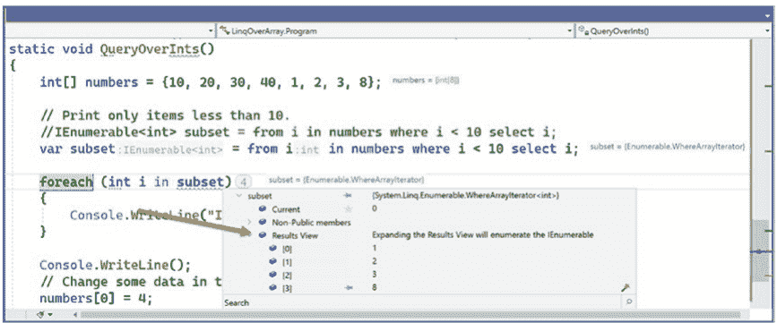

## 第 13 章 LINQ to Objects

无论你使用 .NET Core 平台创建哪种类型的应用程序，程序在运行过程中都必然需要访问某种形式的数据。确切地说，数据可以位于许多位置，包括 XML 文件、关系数据库、内存集合以及基元数组。从历史角度来看，根据数据所在的位置，程序员需要使用不同且互不相关的 API。语言集成查询（Language Integrated Query，LINQ）技术集最初随 .NET 3.5 引入，它提供了一种简洁、对称且强类型化的方式，用于访问各种数据存储。在本章中，你将通过重点学习 LINQ to Objects，开始探索 LINQ。

在正式深入 LINQ to Objects 之前，本章的第一部分将快速回顾支持 LINQ 的关键 C# 编程构造。在学习本章的过程中，你会发现，隐式类型的局部变量、对象初始化语法、Lambda 表达式、扩展方法和匿名类型都非常有用（有时甚至是必需的）。

完成对这些支持性基础设施的回顾后，本章的其余部分将向你介绍 LINQ 编程模型及其在 .NET 平台中的作用。在这里，你将学习查询运算符和查询表达式的作用。借助它们，你可以定义语句，查询数据源并生成所需的结果集。在此过程中，你将构建大量 LINQ 示例，这些示例会与数组以及各种集合类型（包括泛型集合和非泛型集合）中的数据进行交互，同时还将了解构成 LINQ to Objects API 的程序集、命名空间和类型。

> 注意 本章中的信息是本书后续部分和章节的基础，包括并行 LINQ（第 15 章）以及 Entity Framework Core（第 22 和第 23 章）。

### LINQ 专用编程构造

从较高层次来看，LINQ 可以理解为一种强类型查询语言，直接嵌入 C# 的语法中。使用 LINQ，你可以构建任意数量的表达式，这些表达式的外观和使用方式类似于数据库 SQL 查询。不过，LINQ 查询可以应用于多种数据存储，包括与实际关系数据库毫无关系的数据存储。

> 注意 尽管 LINQ 查询看起来可能类似于 SQL 查询，但二者的语法并不完全相同。事实上，许多 LINQ 查询的格式似乎与对应的数据库查询完全相反！如果你试图将 LINQ 直接映射到 SQL，肯定会感到沮丧。为了保持头脑清醒，我建议你尽量将 LINQ 查询视为独特的语句，只不过它们“碰巧看起来”像 SQL。

LINQ 最初随 .NET 平台 3.5 版本引入时，C# 和 VB 语言都增加了许多用于支持 LINQ 技术集的新编程构造。具体来说，C# 语言使用了以下以 LINQ 为核心的功能：

- 隐式类型的局部变量
- 对象/集合初始化语法
- Lambda 表达式
- 扩展方法
- 匿名类型

这些功能已经在本书的各个章节中进行了详细介绍。不过，为了开始后续内容，我们还是快速依次回顾每项功能，以确保大家都处于正确的学习状态。

> 注意 由于以下各节回顾的是本书其他地方已经讲过的内容，因此我没有为这些内容包含 C# 代码项目。

#### 局部变量的隐式类型

在第 3 章中，你学习了 C# 的 `var` 关键字。该关键字允许你定义局部变量，而无需显式指定其底层数据类型。不过，这类变量仍然是强类型的，因为编译器会根据初始赋值确定正确的数据类型。回顾一下第 3 章中的代码示例：

```
static void DeclareImplicitVars()
{
    // Implicitly typed local variables.
    var myInt = 0;
    var myBool = true;
    var myString = "Time, marches on...";

    // Print out the underlying type.
    Console.WriteLine("myInt is a: {0}", myInt.GetType().Name);
    Console.WriteLine("myBool is a: {0}",
        myBool.GetType().Name);
    Console.WriteLine("myString is a: {0}",
        myString.GetType().Name);
}
```

使用 LINQ 时，这项语言功能非常有用，而且通常是必需的。正如你将在本章中看到的，许多 LINQ 查询会返回一系列数据类型，而这些类型直到编译时才能确定。由于底层数据类型在应用程序编译之前无法确定，因此显然无法显式声明变量！

#### 对象和集合初始化语法

第 5 章介绍了对象初始化语法的作用。它允许你创建类或结构变量，并一次性设置其任意数量的公共属性。这样就形成了一种紧凑（同时仍然清晰易读）的语法，可用于准备好对象以供使用。还要回顾第 9 章的内容：C# 语言允许你使用类似的语法来初始化对象集合。请看下面的代码片段，它使用集合初始化语法填充一个 `List<T>`，其中包含多个 `Rectangle` 对象；每个 `Rectangle` 对象都维护两个 `Point` 对象，用于表示一个 (x,y) 位置：

```
List<Rectangle> myListOfRects = new List<Rectangle>
{
    new Rectangle {TopLeft = new Point { X = 10, Y = 10 },
                    BottomRight = new Point { X = 200, Y = 200}},
    new Rectangle {TopLeft = new Point { X = 2, Y = 2 },
                    BottomRight = new Point { X = 100, Y = 100}},
    new Rectangle {TopLeft = new Point { X = 5, Y = 5 },
                    BottomRight = new Point { X = 90, Y = 75}}
};
```

虽然你从未被强制要求使用集合/对象初始化语法，但这样做可以使代码库更加紧凑。此外，这种语法与局部变量的隐式类型结合使用时，可以声明匿名类型；而匿名类型在创建 LINQ 投影时非常有用。稍后将在本章中学习 LINQ 投影。

#### Lambda 表达式

C# Lambda 运算符（`=>`）已在第 12 章中进行了完整介绍。回顾一下，该运算符允许你构建 Lambda 表达式，只要调用的方法需要将强类型委托作为参数，就可以使用这种表达式。Lambda 大大简化了委托的使用方式，因为它减少了必须手动编写的代码量。回顾一下，Lambda 表达式可以分解为以下形式：

```
( ArgumentsToProcess ) => { StatementsToProcessThem }
```

在第 12 章中，我通过三种不同的方法演示了如何使用泛型 `List<T>` 类的 `FindAll()` 方法。在使用原始的 `Predicate<T>` 委托和 C# 匿名方法之后，你最终得到了下面这个使用 Lambda 表达式的（极其简洁的）迭代过程：

```
static void LambdaExpressionSyntax()
{
    // Make a list of integers.
    List<int> list = new List<int>();
    list.AddRange(new int[] { 20, 1, 4, 8, 9, 44 });

    // C# lambda expression.
    List<int> evenNumbers = list.FindAll(i => (i % 2) == 0);

    Console.WriteLine("Here are your even numbers:");
    foreach (int evenNumber in evenNumbers)
    {
        Console.Write("{0}\t", evenNumber);
    }
    Console.WriteLine();
}
```

处理 LINQ 的底层对象模型时，Lambda 将非常有用。你很快会了解到，C# LINQ 查询运算符实际上只是调用名为 `System.Linq.Enumerable` 的类中真实方法的一种简写形式。这些方法通常需要委托（尤其是 `Func<>` 委托）作为参数，用于处理数据并生成正确的结果集。使用 Lambda，你可以精简代码，并让编译器推断底层委托。

#### 扩展方法

C# 扩展方法允许你在不创建子类的情况下，为现有类附加新功能。此外，扩展方法还允许你为密封类和结构添加新功能，因为这些类型从一开始就无法被继承。回顾第 11 章的内容：编写扩展方法时，第一个参数需要使用 `this` 关键字修饰，用于标记要扩展的类型。还要注意，扩展方法必须始终定义在静态类中，因此也必须使用 `static` 关键字声明。下面是一个示例：

```
namespace MyExtensions
{
    static class ObjectExtensions
    {
        // Define an extension method to System.Object.
        public static void DisplayDefiningAssembly(
            this object obj)
        {
            Console.WriteLine("{0} lives here:\n\t->{1}\n", obj.GetType().Name,
                Assembly.GetAssembly(obj.GetType()));
        }
    }
}
```

要使用此扩展功能，应用程序必须导入定义该扩展方法的命名空间（并且可能还需要添加对外部程序集的引用）。完成这些操作后，只需导入定义扩展方法的命名空间，然后就可以编写代码了。

```
// Since everything extends System.Object, all classes and structures
// can use this extension.
int myInt = 12345678;
myInt.DisplayDefiningAssembly();

System.Data.DataSet d = new System.Data.DataSet();
d.DisplayDefiningAssembly();
```

使用 LINQ 时，你很少（如果有的话）需要手动构建自己的扩展方法。不过，在创建 LINQ 查询表达式时，你会使用 Microsoft 已经定义的大量扩展方法。事实上，每个 C# LINQ 查询运算符都是对底层扩展方法进行手动调用的一种简写形式，而这些扩展方法通常定义在 `System.Linq.Enumerable` 实用类中。


## 匿名类型

我想快速回顾的最后一个 C# 语言特性是匿名类型，它曾在第 11 章中探讨过。该特性允许编译器在编译时基于一组提供的名-值对生成新的类定义，从而快速地对数据的“形状”进行建模。回想一下，这种类型将基于值语义进行组合，并且 System.Object 的每个虚方法都会被相应重写。若要定义匿名类型，请声明一个隐式类型变量，并使用对象初始化语法指定数据的形状。

```
// Make an anonymous type that is composed of another.
var purchaseItem = new {
    TimeBought = DateTime.Now,
    ItemBought =
        new {Color = "Red", Make = "Saab", CurrentSpeed = 55},
    Price = 34.000};
```

当您想要动态地投影出新形式的数据时，LINQ 会频繁使用匿名类型。例如，假设您有一个 Person 对象集合，并希望使用 LINQ 获取每个人的年龄和社会安全号码信息。使用 LINQ 投影，您可以让编译器生成一个包含这些信息的新匿名类型。

## 理解 LINQ 的作用

以上便是对使 LINQ 得以施展魔力的 C# 语言特性的快速回顾。然而，为什么一开始要引入 LINQ 呢？作为软件开发人员，我们很难否认大量编程时间都花费在获取和操作数据上。提到“数据”，我们很容易立刻想到关系数据库中的信息。然而，另一个常见的数据存放位置是 XML 文档或简单的文本文件。

除了这两个常见的信息存放位置，数据还存在于许多其他地方。例如，假设您有一个包含 300 个整数的数组或泛型 List<T> 类型，并且想要获取满足给定条件的子集（例如，容器中的奇数或偶数成员、仅质数、仅大于 50 的不重复数字）。或者，您可能正在使用反射 API，并且需要仅获取 Types 数组中每个派生自某个父类的类的元数据描述。确实，数据无处不在。

在 .NET 3.5 之前，与各种类型的数据交互需要程序员使用非常不同的 API。例如，请考虑表 13-1，它展示了用于访问各种类型数据的几种常见 API（我相信您还能想到许多其他示例）。

表 13-1. 操作各种类型数据的方式

| 您想要的数据 | 如何获取它 |
|---|---|
| 关系数据 | System.Data.dll、System.Data.SqlClient.dll 等 |
| XML 文档数据 | System.Xml.dll |
| 元数据表 | System.Reflection 命名空间 |
| 对象集合 | System.Array 以及 System.Collections/System.Collections.Generic 命名空间 |

当然，这些数据处理方法并没有错。事实上，您完全可以（也将会）直接使用 ADO.NET、XML 命名空间、反射服务以及各种集合类型。然而，根本问题在于这些 API 各自为政，在集成方面提供的支持很少。诚然，（例如）可以将 ADO.NET DataSet 保存为 XML，然后通过 System.Xml 命名空间对其进行操作，但尽管如此，数据处理仍然相当不对称。

LINQ API 试图提供一种一致、对称的方式，让程序员能够从广义上获取和操作“数据”。使用 LINQ，您可以直接在 C# 编程语言中创建称为“查询表达式”的构造。这些查询表达式基于众多查询运算符，这些运算符被刻意设计得在外观和感觉上与 SQL 表达式相似（但不完全相同）。

然而，关键在于查询表达式可用于与多种类型的数据交互——甚至包括与关系数据库无关的数据。严格来说，“LINQ”是用于描述这种整体数据访问方法的术语。但是，根据您应用 LINQ 查询的位置，您会遇到各种术语，例如：

- LINQ to Objects：该术语指的是将 LINQ 查询应用于数组和集合的行为。
- LINQ to XML：该术语指的是使用 LINQ 操作和查询 XML 文档的行为。
- LINQ to Entities：LINQ 的这一方面允许您在 ADO.NET Entity Framework (EF) Core API 中使用 LINQ 查询。
- 并行 LINQ（又称 PLINQ）：这允许对 LINQ 查询返回的数据进行并行处理。

如今，LINQ 已成为 .NET Core 基类库、托管语言以及 Visual Studio 本身不可或缺的一部分。

## LINQ 表达式是强类型的

还需要重点指出的是，LINQ 查询表达式（不同于传统的 SQL 语句）是强类型的。因此，C# 编译器会严格把关，确保这些表达式在语法上是良构的。Visual Studio 等工具可以使用元数据来实现 IntelliSense、自动完成等有用功能。

## 核心 LINQ 程序集

要使用 LINQ to Objects，您必须确保每个包含 LINQ 查询的 C# 代码文件都导入了 System.Linq 命名空间。请确保以下 using 语句出现在每个使用 LINQ 的代码文件中：

```
using System.Linq;
```

## 将 LINQ 查询应用于基本数组

为了开始研究 LINQ to Objects，让我们构建一个将 LINQ 查询应用于各种数组对象的应用程序。创建一个名为 LinqOverArray 的控制台应用程序项目，并在 Program 类中定义一个名为 QueryOverStrings() 的静态辅助方法。在此方法中，创建一个包含六个左右您喜欢的项的字符串数组（这里，我列出了我库中的一批视频游戏）。确保至少有两个条目包含数值，并且有几个条目包含嵌入空格。

```
static void QueryOverStrings()
{
    // Assume we have an array of strings.
    string[] currentVideoGames = {"Morrowind", "Uncharted 2", "Fallout 3", "Daxter", "System Shock 2"};
}
```

现在，更新 Program.cs 以调用 QueryOverStrings()。

```
Console.WriteLine("***** Fun with LINQ to Objects ****\n");
QueryOverStrings();
Console.ReadLine();
```

当您拥有任何数据数组时，通常需要根据给定需求提取项的子集。也许您只想获取包含数字的子项（例如 System Shock 2、Uncharted 2 和 Fallout 3）、具有一定字符数的子项，或者不包含嵌入空格的子项（例如 Morrowind 或 Daxter）。虽然您肯定可以使用 System.Array 类型的成员并花费一些力气来完成此类任务，但 LINQ 查询表达式可以大大简化此过程。

假设您希望从数组中仅获取包含嵌入空格的项，并且希望这些项按字母顺序列出，则可以构建以下 LINQ 查询表达式：

```
static void QueryOverStrings()
{
    // Assume we have an array of strings.
    string[] currentVideoGames = {"Morrowind", "Uncharted 2", "Fallout 3", "Daxter", "System Shock 2"};

    // Build a query expression to find the items in the array
    // that have an embedded space.
    IEnumerable<string> subset =
        from g in currentVideoGames
        where g.Contains(" ")
        orderby g
        select g;

    // Print out the results.
    foreach (string s in subset)
    {
        Console.WriteLine("Item: {0}", s);
    }
}
```

请注意，这里创建的查询表达式使用了 from、in、where、orderby 和 select 这些 LINQ 查询运算符。在本章后面，您将深入了解查询表达式语法的详细内容。然而，即使现在，您也应该能够粗略地将此语句理解为“给我 currentVideoGames 中包含空格的项，并按字母顺序排列。”

在这里，每个匹配搜索条件的项都被命名为 g（如“game”中的 g）；不过，任何有效的 C# 变量名都可以。

```
IEnumerable<string> subset =
    from game in currentVideoGames
    where game.Contains(" ")
    orderby game
    select game;
```

请注意，返回的序列保存在名为 subset 的变量中，其类型实现了 IEnumerable<T> 的泛型版本，其中 T 为 System.String 类型（毕竟，您查询的是字符串数组）。获得结果集后，您只需使用标准的 foreach 结构打印出每个项。如果运行应用程序，您将看到以下输出：

```
***** Fun with LINQ to Objects *****
Item: Fallout 3
Item: System Shock 2
Item: Uncharted 2
```

## 再次使用扩展方法

前面（以及本章其余部分）使用的 LINQ 语法称为 LINQ 查询表达式，这是一种类似于 SQL 但略有不同的格式。还有另一种使用扩展方法的语法，本书中的大多数示例都将使用这种语法。

创建一个名为 QueryOverStringsWithExtensionMethods() 的新方法，并输入以下代码：

```
static void QueryOverStringsWithExtensionMethods()
{
    // Assume we have an array of strings.
    string[] currentVideoGames = {"Morrowind", "Uncharted 2", "Fallout 3", "Daxter", "System Shock 2"};

    // Build a query expression to find the items in the array
    // that have an embedded space.
    IEnumerable<string> subset =
        currentVideoGames.Where(g => g.Contains(" ")).OrderBy(g => g).Select(g => g);

    // Print out the results.
    foreach (string s in subset)
    {
        Console.WriteLine("Item: {0}", s);
    }
}
```

除了以粗体显示的那行代码外，其他内容都与之前的方法相同。这里使用了扩展方法语法。这种语法在每个方法中使用 lambda 表达式来定义操作。例如，Where() 方法中的 lambda 定义了条件（值包含空格）。与查询表达式语法一样，lambda 中用于表示被评估值的字母是任意的；我本可以使用 v 来表示视频游戏（video games）。


虽然结果相同（运行此方法会产生与之前使用查询表达式的方法相同的输出），但你很快会看到，结果集的类型略有不同。在大多数（如果不是几乎所有）场景中，这种差异不会造成任何问题，并且这两种格式可以互换使用。

## 再次尝试：不使用 LINQ

需要明确的是，LINQ 从来都不是强制性的。如果你愿意，完全可以放弃 LINQ，改用 `if` 语句和 `for` 循环等编程基础结构来获得相同的结果集。下面的方法与 `QueryOverStrings()` 方法产生相同的结果，但实现方式更加冗长：

```
static void QueryOverStringsLongHand()
{
    // Assume we have an array of strings.
    string[] currentVideoGames = {"Morrowind", "Uncharted 2", "Fallout 3", "Daxter", "System Shock 2"};

    string[] gamesWithSpaces = new string[5];

    for (int i = 0; i < currentVideoGames.Length; i++)
    {
        if (currentVideoGames[i].Contains(" "))
        {
            gamesWithSpaces[i] = currentVideoGames[i];
        }
    }

    // Now sort them.
    Array.Sort(gamesWithSpaces);

    // Print out the results.
    foreach (string s in gamesWithSpaces)
    {
        if( s != null)
        {
            Console.WriteLine("Item: {0}", s);
        }
    }
    Console.WriteLine();
}
```

虽然我相信你可以想到改进上述方法的方式，但事实仍然是，LINQ 查询可以大幅简化从数据源中提取新数据子集的过程。你不需要构建嵌套循环、复杂的 `if/else` 逻辑、临时数据类型等；只要创建一个合适的 LINQ 查询，C# 编译器就会替你完成这些繁琐工作。

## 反射 LINQ 结果集

现在，假设 `Program` 类定义了一个名为 `ReflectOverQueryResults()` 的附加辅助函数，用于输出 LINQ 结果集的各种详细信息（注意，该参数是 `System.Object`，以适应多种结果集类型）。

```
static void ReflectOverQueryResults(object resultSet, string queryType = "Query Expressions")
{
    Console.WriteLine($"***** Info about your query using {queryType} *****");
    Console.WriteLine("resultSet is of type: {0}", resultSet.GetType().Name);
    Console.WriteLine("resultSet location: {0}", resultSet.GetType().Assembly.GetName().Name);
}
```

将 `QueryOverStrings()` 方法的核心部分更新为以下内容：

```
// Build a query expression to find the items in the array
// that have an embedded space.
IEnumerable<string> subset =
    from g in currentVideoGames
    where g.Contains(" ")
    orderby g
    select g;
```

```
ReflectOverQueryResults(subset);
```

```
// Print out the results.
foreach (string s in subset)
{
    Console.WriteLine("Item: {0}", s);
}
```

运行应用程序时，你会看到 `subset` 变量实际上是泛型 `OrderedEnumerable<TElement, TKey>` 类型的实例（表示为 `OrderedEnumerable`2`），这是位于 `System.Linq.dll` 程序集中的一个内部抽象类型。

```
***** Info about your query using Query Expressions*****
resultSet is of type: OrderedEnumerable`2
resultSet location: System.Linq
```

对 `QueryOverStringsWithExtensionMethods()` 方法执行相同的修改，但需要为第二个参数添加 `"Extension Methods"`。

```
// Build a query expression to find the items in the array
// that have an embedded space.
IEnumerable<string> subset =
    currentVideoGames
    .Where(g => g.Contains(" "))
    .OrderBy(g => g)
    .Select(g => g);
```

```
ReflectOverQueryResults(subset,"Extension Methods");
```

```
// Print out the results.
foreach (string s in subset)
{
    Console.WriteLine("Item: {0}", s);
}
```

运行应用程序时，你会看到 `subset` 变量是 `SelectIPartitionIterator` 类型的实例。如果从查询中移除 `Select(g=>g)`，那么它将重新变为 `OrderedEnumerable<TElement, TKey>` 类型的实例。这一切意味着什么？对于大多数开发者来说，几乎没有什么意义（甚至完全没有意义）。它们都派生自 `IEnumerable<T>`，都可以以相同的方式进行迭代，也都可以根据其中的值创建列表或数组。

```
**** Info about your query using Extension Methods ****
resultSet is of type: SelectIPartitionIterator`2
resultSet location: System.Linq
```

## LINQ 与隐式类型的局部变量

虽然当前示例程序相对容易让人确定，结果集可以作为字符串对象的枚举来捕获（例如 `IEnumerable<string>`），但我猜，你并不清楚 `subset` 实际上是 `OrderedEnumerable<TElement, TKey>` 类型。

由于 LINQ 结果集可以使用各种以 LINQ 为中心的命名空间中的许多类型来表示，因此定义用于保存结果集的正确类型会很繁琐，因为在许多情况下，底层类型可能并不明显，甚至无法从你的代码库中直接访问（正如你将看到的，在某些情况下，该类型是在编译时生成的）。

为了进一步说明这一点，请考虑 `Program` 类中定义的以下附加辅助方法：

```
static void QueryOverInts()
{
    int[] numbers = {10, 20, 30, 40, 1, 2, 3, 8};

    // Print only items less than 10.
    IEnumerable<int> subset = from i in numbers where i < 10 select i;

    foreach (int i in subset)
    {
        Console.WriteLine("Item: {0}", i);
    }
    ReflectOverQueryResults(subset);
}
```

在本例中，`subset` 变量的底层类型完全不同。这一次，实现 `IEnumerable<int>` 接口的是一个名为 `WhereArrayIterator<T>` 的底层类。

```
Item: 1
Item: 2
Item: 3
Item: 8

**** Info about your query ****
resultSet is of type: WhereArrayIterator`1
resultSet location: System.Linq
```

鉴于 LINQ 查询的确切底层类型显然并不容易确定，因此前面的示例将查询结果表示为 `IEnumerable<T>` 变量，其中 `T` 是返回序列中数据的类型（`string`、`int` 等）。不过，这样做仍然相当繁琐。更麻烦的是，由于 `IEnumerable<T>` 扩展了非泛型的 `IEnumerable` 接口，因此也可以按如下方式将 LINQ 查询的结果捕获为：

```
System.Collections.IEnumerable subset =
    from i in numbers
    where i < 10
    select i;
```

幸运的是，在处理 LINQ 查询时，隐式类型可以大幅简化代码。

```
static void QueryOverInts()
{
    int[] numbers = {10, 20, 30, 40, 1, 2, 3, 8};

    // Use implicit typing here...
    var subset = from i in numbers where i < 10 select i;

    // ...and here.
    foreach (var i in subset)
    {
        Console.WriteLine("Item: {0} ", i);
    }
    ReflectOverQueryResults(subset);
}
```

经验法则是：捕获 LINQ 查询结果时，你通常应该始终使用隐式类型。不过请记住，在大多数情况下，真正的返回值是一个实现了泛型 `IEnumerable<T>` 接口的类型。

至于该类型在底层究竟是什么（`OrderedEnumerable<TElement, TKey>`、`WhereArrayIterator<T>` 等），并不重要，也没有必要去查明。正如前面的代码示例所示，你可以直接在 `foreach` 结构中使用 `var` 关键字来迭代获取的数据。

## LINQ 与扩展方法

虽然当前示例没有要求你直接编写任何扩展方法，但实际上，你一直在后台无缝地使用它们。LINQ 查询表达式可以用于迭代实现了泛型 `IEnumerable<T>` 接口的数据容器。不过，`System.Array` 类类型（用于表示字符串数组和整数数组）并没有实现这一契约。

```
// The System.Array type does not seem to implement the
// correct infrastructure for query expressions!
public abstract class Array : ICloneable, IList,
    IStructuralComparable, IStructuralEquatable
{
    ...
}
```


虽然 System.Array 并未直接实现 IEnumerable<T> 接口，但它通过静态 System.Linq.Enumerable 类间接获得了该类型所需的功能（以及许多其他以 LINQ 为核心的成员）。

这个实用类定义了许多泛型扩展方法（例如 Aggregate<T>()、First<T>()、Max<T>() 等），System.Array（以及其他类型）会在后台获取这些方法。因此，如果对局部变量 currentVideoGames 使用点运算符，就会发现许多在 System.Array 正式定义中找不到的成员。

## 延迟执行的作用

关于 LINQ 查询表达式，还有一点很重要：当它们返回一个序列时，只有在你遍历该序列时，查询才会真正执行。严格来说，这称为延迟执行。这种方式的好处是，你可以对同一个容器多次应用相同的 LINQ 查询，并确信每次都能获取最新、最准确的结果。请看对 QueryOverInts() 方法所做的以下修改：

```
static void QueryOverInts()
{
    int[] numbers = { 10, 20, 30, 40, 1, 2, 3, 8 };

    // 获取小于十的数字。
    var subset = from i in numbers where i < 10 select i;

    // 在此处执行 LINQ 语句！
    foreach (var i in subset)
    {
        Console.WriteLine("{0} < 10", i);
    }
    Console.WriteLine();
    // 更改数组中的一些数据。
    numbers[0] = 4;

    // 再次执行！
    foreach (var j in subset)
    {
        Console.WriteLine("{0} < 10", j);
    }

    Console.WriteLine();
    ReflectOverQueryResults(subset);
}
```

> 注意：当 LINQ 语句选择单个元素时（使用 First/FirstOrDefault、Single/SingleOrDefault 或任何聚合方法），查询会立即执行。First、FirstOrDefault、Single 和 SingleOrDefault 将在下一节介绍。聚合方法将在本章后面介绍。

如果再次运行该程序，就会得到以下输出。请注意，第二次遍历请求的序列时，会发现一个额外的成员，因为你将数组中的第一个元素设为小于十的值。

```
1 < 10
2 < 10
3 < 10
8 < 10

4 < 10
1 < 10
2 < 10
3 < 10
8 < 10
```

Visual Studio 的一个实用功能是：如果在 LINQ 查询求值之前设置断点，就可以在调试会话中查看其内容。只需将鼠标光标悬停在 LINQ 结果集变量上（图 13-1 中的 subset）。此时，展开“Results View”（结果视图）选项，即可选择立即对查询求值。



图 13-1 调试 LINQ 表达式

## 立即执行的作用

如果需要在 foreach 逻辑范围之外对返回序列的 LINQ 表达式求值，可以调用 Enumerable 类型定义的各种扩展方法，例如 ToArray<T>()、ToDictionary<TSource, TKey>() 和 ToList<T>()。这些方法会在调用时立即执行 LINQ 查询，从而获取数据快照。完成此操作后，就可以独立处理该数据快照。

此外，如果只需要单个元素，查询也会立即执行。First() 返回序列中的第一个成员（应始终与 orderby 一起使用）。如果没有可返回的项，例如原始序列为空或 where 子句筛除了所有元素，FirstOrDefault() 会返回列表中元素类型的默认值。Single() 也会返回序列中的第一个成员（依据 orderby 排序；如果没有 orderby 子句，则依据元素顺序）。与名称相似的对应方法一样，如果序列中没有任何项（或 where 子句筛除了所有记录），SingleOrDefault() 会返回元素类型的默认值。FirstOrDefault() 与 SingleOrDefault() 的区别在于：如果查询将返回多个元素，SingleOrDefault() 会引发异常。

```
static void ImmediateExecution()
{
    Console.WriteLine();
    Console.WriteLine("Immediate Execution");
    int[] numbers = { 10, 20, 30, 40, 1, 2, 3, 8 };

    // 获取序列顺序中的第一个元素
    int number = (from i in numbers select i).First();
    Console.WriteLine("First is {0}", number);

    // 获取查询顺序中的第一个元素
    number = (from i in numbers orderby i select i).First();
    Console.WriteLine("First is {0}", number);

    // 获取与查询匹配的那个元素
    number = (from i in numbers where i > 30 select i).Single();
    Console.WriteLine("Single is {0}", number);

    try
    {
        // 如果有多个元素通过查询，则引发异常
        number = (from i in numbers where i > 10 select i).Single();
    }
    catch (Exception ex)
    {
        Console.WriteLine("An exception occurred: {0}", ex.Message);
    }
    // 立即获取数据，类型为 int[]。
    int[] subsetAsIntArray =
        (from i in numbers where i < 10 select i).ToArray<int>();

    // 立即获取数据，类型为 List<int>。
    List<int> subsetAsListOfInts =
        (from i in numbers where i < 10 select i).ToList<int>();
}
```

注意，整个 LINQ 表达式都用括号括起来，以便将其转换为正确的底层类型（无论该类型是什么），从而调用 Enumerable 的扩展方法。

还要回想一下第 10 章的内容：如果 C# 编译器能够明确推断出泛型的类型参数，就无需指定该类型参数。因此，也可以像下面这样调用 ToArray<T>()（或者 ToList<T>()）：

```
int[] subsetAsIntArray =
    (from i in numbers where i < 10 select i).ToArray();
```

当你需要将 LINQ 查询的结果返回给外部调用方时，立即执行的用处显而易见。巧合的是，这正是本章接下来要讨论的主题。

## 返回 LINQ 查询的结果

可以在类（或结构）中定义一个字段，其值为 LINQ 查询的结果。不过，要做到这一点，不能使用隐式类型（因为 var 关键字不能用于字段），并且 LINQ 查询的目标不能是实例级数据，因此必须是静态数据。鉴于这些限制，你很少需要编写如下代码：

```
class LINQBasedFieldsAreClunky
{
    private static string[] currentVideoGames =
        {"Morrowind", "Uncharted 2",
        "Fallout 3", "Daxter", "System Shock 2"};

    // 这里不能使用隐式类型！必须知道 subset 的类型！
    private IEnumerable<string> subset =
        from g in currentVideoGames
        where g.Contains(" ")
        orderby g
        select g;

    public void PrintGames()
    {
        foreach (var item in subset)
        {
            Console.WriteLine(item);
        }
    }
}
```

LINQ 查询通常定义在方法或属性的作用域内。此外，为了简化编程，通常会使用 var 关键字，将结果集存储在隐式类型的局部变量中。回想一下第 3 章的内容：隐式类型变量不能用于定义类或结构的参数、返回值或字段。

鉴于这一点，你可能会想，究竟该如何将查询结果返回给外部调用方？答案是：视情况而定。如果结果集包含强类型数据，例如字符串数组或 Cars 的 List<T>，就可以不使用 var 关键字，而改用适当的 IEnumerable<T> 或 IEnumerable 类型（同样，IEnumerable<T> 扩展了 IEnumerable）。请看下面这个名为 LinqRetValues 的新控制台应用程序示例：

```
using System;
using System.Collections.Generic;
using System.Linq;

Console.WriteLine("***** LINQ 返回值 ****\n");
IEnumerable<string> subset = GetStringSubset();

foreach (string item in subset)
{
    Console.WriteLine(item);
}
```


```
Console.ReadLine();

static IEnumerable<string> GetStringSubset()
{
    string[] colors = {"Light Red", "Green", "Yellow", "Dark Red", "Red", "Purple"};
    // Note subset is an IEnumerable<string>-compatible object.
    IEnumerable<string> theRedColors = from c in colors where c.Contains("Red") select c;
    return theRedColors;
}
```

结果符合预期。

```
Light Red
Dark Red
Red
```

## 通过立即执行返回 LINQ 结果

这个示例之所以能按预期工作，仅仅是因为 `GetStringSubset()` 的返回值以及该方法中的 LINQ 查询都是强类型的。如果你使用 `var` 关键字来定义 subset 变量，那么只有当方法仍然被声明为返回 `IEnumerable<string>`（并且隐式类型的局部变量实际上与指定的返回类型兼容）时，才允许返回该值。

因为操作 `IEnumerable<T>` 有点不方便，你可以使用立即执行。例如，你可以不返回 `IEnumerable<string>`，而是直接返回 `string[]`，只要将序列转换为强类型的数组。请看 `Program` 类的这个新方法，它正是这样做的：

```
static string[] GetStringSubsetAsArray()
{
    string[] colors = {"Light Red", "Green", "Yellow", "Dark Red", "Red", "Purple"};

    var theRedColors = from c in colors where c.Contains("Red") select c;

    // Map results into an array.
    return theRedColors.ToArray();
}
```

这样一来，调用者可以完全不知道结果来自 LINQ 查询，而只是像预期那样处理字符串数组。下面是一个示例：

```
foreach (string item in GetStringSubsetAsArray())
{
    Console.WriteLine(item);
}
```

当试图向调用者返回 LINQ 投影的结果时，立即执行也至关重要。本章稍后你将研究这个主题。接下来，让我们看看如何将 LINQ 查询应用于泛型和非泛型集合对象。

## 将 LINQ 查询应用到集合对象

除了从简单的数据数组中提取结果外，LINQ 查询表达式还可以操作 `System.Collections.Generic` 命名空间中的成员（例如 `List<T>` 类型）所包含的数据。创建一个名为 `LinqOverCollections` 的新控制台应用程序项目，并定义一个基本的 `Car` 类，该类维护当前速度、颜色、制造商和昵称，如以下代码所示：

```
namespace LinqOverCollections
{
    class Car
    {
        public string PetName {get; set;} = "";
        public string Color {get; set;} = "";
        public int Speed {get; set;}
        public string Make {get; set;} = "";
    }
}
```

现在，在顶层语句中，定义一个 `Car` 类型的局部变量 `List<T>`，并使用对象初始化语法向列表中填充几个新的 `Car` 对象。

```
using System;
using System.Collections;
using System.Collections.Generic;
using System.Linq;
using LinqOverCollections;

Console.WriteLine("**** LINQ over Generic Collections ****\n");

// Make a List<> of Car objects.
List<Car> myCars = new List<Car>() {
    new Car{ PetName = "Henry", Color = "Silver", Speed = 100, Make = "BMW"},
    new Car{ PetName = "Daisy", Color = "Tan", Speed = 90, Make = "BMW"},
    new Car{ PetName = "Mary", Color = "Black", Speed = 55, Make = "VW"},
    new Car{ PetName = "Clunker", Color = "Rust", Speed = 5, Make = "Yugo"},
    new Car{ PetName = "Melvin", Color = "White", Speed = 43, Make = "Ford"}
};

Console.ReadLine();
```

### 访问包含的子对象

对泛型容器应用 LINQ 查询与对简单数组应用 LINQ 查询没有区别，因为 LINQ to Objects 可用于任何实现 `IEnumerable<T>` 的类型。这一次，你的目标是构建一个查询表达式，仅从 `myCars` 列表中选择速度大于 55 的 `Car` 对象。

获得子集后，你将通过调用 `PetName` 属性打印每个 `Car` 对象的名称。假设你有以下辅助方法（接受 `List<Car>` 参数），并从顶层语句调用它：

```
static void GetFastCars(List<Car> myCars)
{
    // Find all Car objects in the List<>, where the Speed is
    // greater than 55.
    var fastCars = from c in myCars where c.Speed > 55 select c;

    foreach (var car in fastCars)
    {
        Console.WriteLine("{0} is going too fast!", car.PetName);
    }
}
```

请注意，你的查询表达式只从 `List<T>` 中获取 `Speed` 属性大于 55 的那些项。如果运行应用程序，你会发现只有 Henry 和 Daisy 这两项符合搜索条件。

如果要构建更复杂的查询，你可能只想查找速度值大于 90 的 BMW 汽车。要做到这一点，只需使用 C# 的 `&&` 运算符构建一个复合布尔表达式。

```
static void GetFastBMWs(List<Car> myCars)
{
    // Find the fast BMWs!
    var fastCars = from c in myCars where c.Speed > 90 && c.Make == "BMW" select c;
    foreach (var car in fastCars)
    {
        Console.WriteLine("{0} is going too fast!", car.PetName);
    }
}
```

在这种情况下，唯一打印出来的名字是 Henry。

### 将 LINQ 查询应用于非泛型集合

回顾一下，LINQ 的查询运算符被设计为可与任何实现 `IEnumerable<T>` 的类型（直接实现或通过扩展方法实现）一起工作。鉴于 `System.Array` 已经提供了这种必要的基础设施，你可能会惊讶地发现 `System.Collections` 中的传统（非泛型）容器却没有。幸运的是，仍然可以使用泛型 `Enumerable.OfType<T>()` 扩展方法来迭代非泛型集合中包含的数据。

当从非泛型集合对象（例如 `ArrayList`）调用 `OfType<T>()` 时，只需指定容器中项的类型，即可提取一个兼容的 `IEnumerable<T>` 对象。在代码中，你可以使用隐式类型变量来存储此数据点。

请考虑以下新方法，它向 `ArrayList` 填充一组 `Car` 对象（确保将 `System.Collections` 命名空间导入到你的 `Program.cs` 文件中）：

```
static void LINQOverArrayList()
{
    Console.WriteLine("***** LINQ over ArrayList *****");
    // Here is a nongeneric collection of cars.
    ArrayList myCars = new ArrayList() {
        new Car{ PetName = "Henry", Color = "Silver", Speed = 100, Make = "BMW"},
        new Car{ PetName = "Daisy", Color = "Tan", Speed = 90, Make = "BMW"},
        new Car{ PetName = "Mary", Color = "Black", Speed = 55, Make = "VW"},
        new Car{ PetName = "Clunker", Color = "Rust", Speed = 5, Make = "Yugo"},
        new Car{ PetName = "Melvin", Color = "White", Speed = 43, Make = "Ford"}
    };

    // Transform ArrayList into an IEnumerable<T>-compatible type.
    var myCarsEnum = myCars.OfType<Car>();

    // Create a query expression targeting the compatible type.
    var fastCars = from c in myCarsEnum where c.Speed > 55 select c;
    foreach (var car in fastCars)
    {
        Console.WriteLine("{0} is going too fast!", car.PetName);
    }
}
```

与前面的示例一样，当从顶层语句调用此方法时，基于 LINQ 查询的格式，它将仅显示 Henry 和 Daisy 这两个名字。

### 使用 OfType<T>() 过滤数据

如你所知，非泛型类型可以包含任意组合的项，因为这些容器（再次以 `ArrayList` 为例）的成员被设计为接收 `System.Object` 类型。例如，假设一个 `ArrayList` 包含多种项，其中只有一部分是数值。如果你想获得只包含数值数据的子集，可以使用 `OfType<T>()`，因为它会在迭代期间过滤掉类型与给定类型不同的每个元素。

```
static void OfTypeAsFilter()
{
    // Extract the ints from the ArrayList.
    ArrayList myStuff = new ArrayList();
    myStuff.AddRange(new object[] { 10, 400, 8, false, new Car(), "string data" });
    var myInts = myStuff.OfType<int>();

    // Prints out 10, 400, and 8.
    foreach (int i in myInts)
    {
        Console.WriteLine("Int value: {0}", i);
    }
}
```

到目前为止，你已经有机会将 LINQ 查询应用于数组、泛型集合和非泛型集合。这些容器既包含 C# 原始类型（整数、字符串数据），也包含自定义类。下一个任务是了解许多额外的 LINQ 运算符，这些运算符可用于构建更复杂、更有用的查询。


## 调查 C# LINQ 查询运算符

C# 开箱即用地定义了相当数量的查询运算符。表 13-2 记录了一些最常用的查询运算符。除了表 13-2 中显示的部分运算符列表之外，System.Linq.Enumerable 类还提供了一组方法，这些方法没有直接的 C# 查询运算符简写表示法，而是作为扩展方法公开。这些通用方法可以被调用以以各种方式转换结果集（Reverse<>(), ToArray<>(), ToList<>(), 等等）。有些用于从结果集中提取单例，其他执行各种集合操作（Distinct<>(), Union<>(), Intersect<>(), 等等），还有一些聚合结果（Count<>(), Sum<>(), Min<>(), Max<>(), 等等）。

## 表 13-2. 常见 LINQ 查询运算符

| Query Operators | Meaning in Life |
|---|---|
| from, in | 用于定义任何 LINQ 表达式的基础，从而允许你从合适的容器中提取数据子集。 |
| where | 用于定义从容器中提取哪些项目的限制。 |
| select | 用于从容器中选择一个序列。 |
| join, on, equals, into | 基于指定的键执行连接。请记住，这些“连接”不需要与关系数据库中的数据有任何关系。 |
| orderby, ascending, descending | 允许将结果子集按升序或降序排序。 |
| groupby | 按指定值对数据进行分组后产生子集。 |

要开始深入研究更复杂的 LINQ 查询，请创建一个名为 FunWithLinqExpressions 的新控制台应用程序项目。接下来，你需要定义一个数组或集合作为示例数据。对于此项目，你将创建一个 ProductInfo 对象的数组，定义在以下代码中：

```csharp
namespace FunWithLinqExpressions
{
    class ProductInfo
    {
        public string Name { get; set; } = "";
        public string Description { get; set; } = "";
        public int NumberInStock { get; set; } = 0;

        public override string ToString()
            => $"Name={Name}, Description={Description}, Number in Stock={NumberInStock}";
    }
}
```

现在在你的调用代码中用一批 ProductInfo 对象填充一个数组。

```csharp
Console.WriteLine("***** Fun with Query Expressions ****\n");

// This array will be the basis of our testing...
ProductInfo[] itemsInStock = new[] {
    new ProductInfo{ Name = "Mac's Coffee", Description = "Coffee with TEETH", NumberInStock = 24},
    new ProductInfo{ Name = "Milk Maid Milk", Description = "Milk cow's love", NumberInStock = 100},
    new ProductInfo{ Name = "Pure Silk Tofu", Description = "Bland as Possible", NumberInStock = 120},
    new ProductInfo{ Name = "Crunchy Pops", Description = "Cheezy, peppery goodness", NumberInStock = 2},
    new ProductInfo{ Name = "RipOff Water", Description = "From the tap to your wallet", NumberInStock = 100},
    new ProductInfo{ Name = "Classic Valpo Pizza", Description = "Everyone loves pizza!", NumberInStock = 73}
};

// We will call various methods here!
Console.ReadLine();
```

## 基本选择语法

由于 LINQ 查询表达式的语法正确性在编译时得到验证，你需要记住这些运算符的顺序至关重要。最简单地说，每个 LINQ 查询表达式都是使用 from、in 和 select 运算符构建的。以下是需要遵循的通用模板：

```csharp
var result =
    from matchingItem in container
    select matchingItem;
```

from 运算符之后的元素表示与 LINQ 查询条件匹配的项目，可以命名为你选择的任何名称。in 运算符之后的元素表示要搜索的数据容器（数组、集合、XML 文档等）。

这是一个简单的查询，唯一做的就是选择容器中的每个项目（行为类似于数据库 Select * SQL 语句）。请考虑以下内容：

```csharp
static void SelectEverything(ProductInfo[] products)
{
    // Get everything!
    Console.WriteLine("All product details:");
    var allProducts = from p in products select p;

    foreach (var prod in allProducts)
    {
        Console.WriteLine(prod.ToString());
    }
}
```

说实话，这个查询表达式并不是完全有用，因为你的子集与传入参数中的数据完全相同。如果你愿意，你可以使用以下选择语法仅提取每个汽车的名称值：

```csharp
static void ListProductNames(ProductInfo[] products)
{
    // Now get only the names of the products.
    Console.WriteLine("Only product names:");
    var names = from p in products select p.Name;

    foreach (var n in names)
    {
        Console.WriteLine("Name: {0}", n);
    }
}
```

## 获取数据的子集

要从容器中获取特定子集，可以使用 where 运算符。如此操作时，通用模板现在变为以下代码：

```csharp
var result =
    from item
    in container
    where BooleanExpression
    select item;
```

请注意，where 运算符期望一个解析为布尔值的表达式。例如，要从 ProductInfo[] 参数中仅提取库存超过 25 件的项目，你可以编写以下代码：

```csharp
static void GetOverstock(ProductInfo[] products)
{
    Console.WriteLine("The overstock items!");

    // Get only the items where we have more than
    // 25 in stock.
    var overstock =
        from p
        in products
        where p.NumberInStock > 25
        select p;

    foreach (ProductInfo c in overstock)
    {
        Console.WriteLine(c.ToString());
    }
}
```

如本章前面所示，当你构建 where 子句时，允许使用任何有效的 C# 运算符来构建复杂表达式。例如，回忆一下这个仅提取时速至少为 100 英里的宝马的查询：

```csharp
// Get BMWs going at least 100 MPH.
var onlyFastBMWs =
    from c
    in myCars
    where c.Make == "BMW" && c.Speed >= 100
    select c;
```

## 投影新的数据类型

你还可以从现有数据源投影新的数据形式。假设你想获取传入的 ProductInfo[] 参数，并获得仅包含每个项目的名称和描述的结果集。为此，你可以定义一个 select 语句，该语句动态生成新的匿名类型。

```csharp
static void GetNamesAndDescriptions(ProductInfo[] products)
{
    Console.WriteLine("Names and Descriptions:");
    var nameDesc =
        from p
        in products
        select new { p.Name, p.Description };

    foreach (var item in nameDesc)
    {
        // Could also use Name and Description properties
        // directly.
        Console.WriteLine(item.ToString());
    }
}
```

请始终记住，当你有一个使用投影的 LINQ 查询时，你无法知道底层数据类型，因为这是在编译时确定的。在这些情况下，var 关键字是强制性的。此外，请记住你不能创建具有隐式类型返回值的 方法。因此，以下方法将无法编译：

```csharp
static var GetProjectedSubset(ProductInfo[] products)
{
    var nameDesc =
        from p in products select new { p.Name, p.Description };
    return nameDesc; // Nope!
}
```

当你需要将投影数据返回给调用方时，一种方法是使用 ToArray() 扩展方法将查询结果转换为 System.Array 对象。因此，如果你将查询表达式更新如下：

```csharp
// Return value is now an Array.
static Array GetProjectedSubset(ProductInfo[] products)
{
    var nameDesc =
        from p in products select new { p.Name, p.Description };

    // Map set of anonymous objects to an Array object.
    return nameDesc.ToArray();
}
```

你可以按如下方式调用并处理数据：

```csharp
Array objs = GetProjectedSubset(itemsInStock);
foreach (object o in objs)
{
    Console.WriteLine(o); // Calls ToString() on each anonymous object.
}
```

请注意，你必须使用文字 System.Array 对象，而不能使用 C# 数组声明语法，因为你不知道底层类型，因为你正在操作编译器生成的匿名类！另请注意，你没有为泛型 ToArray<T>() 方法指定类型参数，因为你同样不知道底层数据类型，直到编译时，这对于你的目的来说为时已晚。

明显的问题是你失去了任何强类型，因为 Array 对象中的每个项目都被假定为 Object 类型。尽管如此，当你需要返回一个 LINQ 结果集，该结果集是投影到匿名类型的操作结果时，将数据转换为 Array 类型（或通过 Enumerable 类型的其他成员使用其他合适的容器）是强制性的。

## 投影到不同的数据类型

除了投影到匿名类型之外，你还可以将 LINQ 查询的结果投影到另一个具体类型。这允许静态类型化并使用 IEnumerable<T> 作为结果集。首先，创建一个 ProductInfo 类的较小版本。

```csharp
namespace FunWithLinqExpressions
{
    class ProductInfoSmall
    {
        public string Name { get; set; } = "";
        public string Description { get; set; } = "";
        public override string ToString()
            => $"Name={Name}, Description={Description}";
    }
}
```

下一步是将查询结果投影到 ProductInfoSmall 对象的集合中，而不是匿名类型。向你的类添加以下方法：

```csharp
static void GetNamesAndDescriptionsTyped(
    ProductInfo[] products)
{
    Console.WriteLine("Names and Descriptions:");
    IEnumerable<ProductInfoSmall> nameDesc =
        from p
        in products
        select new ProductInfoSmall
        { Name = p.Name, Description = p.Description };

    foreach (ProductInfoSmall item in nameDesc)
    {
        Console.WriteLine(item.ToString());
    }
}
```


使用 LINQ 投影时，你可以选择使用哪种方法（匿名对象或强类型对象）。你所做的决定完全取决于你的业务需求。

## 使用 Enumerable 获取计数

当你投影新的数据批时，你可能需要确切地知道序列中返回了多少项。任何时候你需要确定 LINQ 查询表达式返回的项目数，只需使用 `Enumerable` 类的 `Count()` 扩展方法即可。例如，以下方法将查找本地数组中长度大于六个字符的所有字符串对象：

```csharp
static void GetCountFromQuery()
{
    string[] currentVideoGames = { "Morrowind", "Uncharted 2", "Fallout 3", "Daxter", "System Shock 2" };

    // Get count from the query.
    int numb = (from g in currentVideoGames where g.Length > 6 select g).Count();

    // Print out the number of items.
    Console.WriteLine("{0} items honor the LINQ query.", numb);
}
```

## 反转结果集

你可以使用 `Enumerable` 类的 `Reverse()` 扩展方法非常简单地反转结果集中的项目。例如，以下方法以相反的顺序选择来自传入的 `ProductInfo[]` 参数的所有项目：

```csharp
static void ReverseEverything(ProductInfo[] products)
{
    Console.WriteLine("Product in reverse:");
    var allProducts = from p in products select p;
    foreach (var prod in allProducts.Reverse())
    {
        Console.WriteLine(prod.ToString());
    }
}
```

## 排序表达式

正如你在本章的初始示例中看到的，查询表达式可以采用 `orderby` 运算符按特定值对子集中的项目进行排序。默认情况下，顺序为升序；因此，按字符串排序将是字母顺序，按数值数据排序将是从低到高，等等。如果你需要以降序查看结果，只需包含 `descending` 运算符即可。考虑以下方法：

```csharp
static void AlphabetizeProductNames(ProductInfo[] products)
{
    // Get names of products, alphabetized.
    var subset = from p in products orderby p.Name select p;

    Console.WriteLine("Ordered by Name:");
    foreach (var p in subset)
    {
        Console.WriteLine(p.ToString());
    }
}
```

虽然升序是默认值，但你可以通过使用 `ascending` 运算符使你的意图更清晰。

```csharp
var subset = from p in products orderby p.Name ascending select p;
```

如果你想按降序获取项目，可以通过 `descending` 运算符实现。

```csharp
var subset = from p in products orderby p.Name descending select p;
```

## LINQ 作为更好的 Venn 图工具

`Enumerable` 类支持一组扩展方法，允许你使用两个（或更多）LINQ 查询作为基础来查找数据的并集、差集、连接和交集。首先，考虑 `Except()` 扩展方法，它将返回一个 LINQ 结果集，其中包含两个容器之间的差异，在本例中为值 Yugo。

```csharp
static void DisplayDiff()
{
    List<string> myCars =
        new List<string> { "Yugo", "Aztec", "BMW" };
    List<string> yourCars =
        new List<string> { "BMW", "Saab", "Aztec" };

    var carDiff =
        (from c in myCars select c)
        .Except(from c2 in yourCars select c2);

    Console.WriteLine("Here is what you don't have, but I do:");
    foreach (string s in carDiff)
    {
        Console.WriteLine(s); // Prints Yugo.
    }
}
```

`Intersect()` 方法将返回一个结果集，其中包含一组容器中的公共数据项。例如，以下方法返回序列 Aztec 和 BMW：

```csharp
static void DisplayIntersection()
{
    List<string> myCars = new List<string> { "Yugo", "Aztec", "BMW" };
    List<string> yourCars = new List<string> { "BMW", "Saab", "Aztec" };

    // Get the common members.
    var carIntersect =
        (from c in myCars select c)
        .Intersect(from c2 in yourCars select c2);

    Console.WriteLine("Here is what we have in common:");
    foreach (string s in carIntersect)
    {
        Console.WriteLine(s); // Prints Aztec and BMW.
    }
}
```

`Union()` 方法，如你所猜，它返回一个结果集，其中包含一批 LINQ 查询的所有成员。像任何正确的并集一样，如果某个公共成员出现多次，你将不会找到重复值。因此，以下方法将打印出值 Yugo、Aztec、BMW 和 Saab：

```csharp
static void DisplayUnion()
{
    List<string> myCars =
        new List<string> { "Yugo", "Aztec", "BMW" };
    List<string> yourCars =
        new List<string> { "BMW", "Saab", "Aztec" };

    // Get the union of these containers.
    var carUnion =
        (from c in myCars select c)
        .Union(from c2 in yourCars select c2);

    Console.WriteLine("Here is everything:");
    foreach (string s in carUnion)
    {
        Console.WriteLine(s); // Prints all common members.
    }
}
```

最后，`Concat()` 扩展方法返回一个结果集，该结果集是 LINQ 结果集的直接连接。例如，以下方法打印出结果 Yugo、Aztec、BMW、BMW、Saab 和 Aztec：

```csharp
static void DisplayConcat()
{
    List<string> myCars =
        new List<string> { "Yugo", "Aztec", "BMW" };
    List<string> yourCars =
        new List<string> { "BMW", "Saab", "Aztec" };

    var carConcat =
        (from c in myCars select c)
        .Concat(from c2 in yourCars select c2);

    // Prints:
    // Yugo Aztec BMW BMW Saab Aztec.
    foreach (string s in carConcat)
    {
        Console.WriteLine(s);
    }
}
```

## 删除重复项

当你调用 `Concat()` 扩展方法时，你很可能会在获取的结果中得到冗余条目，在某些情况下这正是你想要的。然而，在其他情况下，你可能想删除数据中的重复条目。为此，只需调用 `Distinct()` 扩展方法，如下所示：

```csharp
static void DisplayConcatNoDups()
{
    List<string> myCars =
        new List<string> { "Yugo", "Aztec", "BMW" };
    List<string> yourCars =
        new List<string> { "BMW", "Saab", "Aztec" };

    var carConcat =
        (from c in myCars select c)
        .Concat(from c2 in yourCars select c2);

    // Prints:
    // Yugo Aztec BMW Saab.
    foreach (string s in carConcat.Distinct())
    {
        Console.WriteLine(s);
    }
}
```

## LINQ 聚合操作

LINQ 查询也可以设计为对结果集执行各种聚合操作。`Count()` 扩展方法就是这样一个聚合示例。其他可能性包括使用 `Enumerable` 类的 `Max()`、`Min()`、`Average()` 或 `Sum()` 成员获取值的平均值、最大值、最小值或总和。

这里有一个简单的示例：

```csharp
static void AggregateOps()
{
    double[] winterTemps = { 2.0, -21.3, 8, -4, 0, 8.2 };

    // Various aggregation examples.
    Console.WriteLine("Max temp: {0}",
        (from t in winterTemps select t).Max());

    Console.WriteLine("Min temp: {0}",
        (from t in winterTemps select t).Min());

    Console.WriteLine("Average temp: {0}",
        (from t in winterTemps select t).Average());

    Console.WriteLine("Sum of all temps: {0}",
        (from t in winterTemps select t).Sum());
}
```

这些示例应该能让你足够熟悉 LINQ 查询表达式的构建过程。虽然还有一些你尚未检查的额外运算符，但当你学习相关 LINQ 技术时，你将在本文本的后面看到更多示例。为了结束你对 LINQ 的首次了解，本章的其余部分将深入探讨 C# LINQ 查询运算符与底层对象模型之间的细节。

## LINQ 查询语句的内部表示

到目前为止，你已经介绍了使用各种 C# 查询运算符（例如 `from`、`in`、`where`、`orderby` 和 `select`）构建查询表达式的过程。此外，你还发现 LINQ to Objects API 的某些功能只能通过调用 `Enumerable` 类的扩展方法来访问。事实是，当 LINQ 查询被编译时，C# 编译器会将所有 C# LINQ 运算符翻译成对 `Enumerable` 类方法的调用。

`Enumerable` 的许多方法都已原型化为接受委托作为参数。许多方法需要一个名为 `Func<>` 的通用委托，该委托在你检查第 10 章中的通用委托时已向你介绍。考虑 `Enumerable` 的 `Where()` 方法，当你使用 C# `where` LINQ 查询运算符时会在你的名义下调用它。

```csharp
// Overloaded versions of the Enumerable.Where<T>() method.
// Note the second parameter is of type System.Func<>.
public static IEnumerable<TSource> Where<TSource>(
    this IEnumerable<TSource> source,
    System.Func<TSource, int, bool> predicate)

public static IEnumerable<TSource> Where<TSource>(
    this IEnumerable<TSource> source,
    System.Func<TSource, bool> predicate)
```

`Func<>` 委托（顾名思义）代表一个给定函数模式，具有最多 16 个参数和一个返回值。如果你使用 Visual Studio 对象浏览器检查此类型，你会注意到 `Func<>` 委托的各种形式。这里有一个例子：

```csharp
// The various formats of the Func<> delegate.
public delegate TResult Func<T1, T2, T3, T4, TResult>(
    T1 arg1, T2 arg2, T3 arg3, T4 arg4)

public delegate TResult Func<T1, T2, T3, TResult>(
    T1 arg1, T2 arg2, T3 arg3)

public delegate TResult Func<T1, T2, TResult>(
    T1 arg1, T2 arg2)

public delegate TResult Func<T1, TResult>(T1 arg1)

public delegate TResult Func<TResult>()
```

由于许多 `System.Linq.Enumerable` 成员在调用时需要委托作为输入，你可以手动创建新的委托类型并编写必要的目标方法，使用 C# 匿名方法，或定义适当的 lambda 表达式。无论你采用哪种方法，结果都是相同的。

虽然使用 C# LINQ 查询运算符构建 LINQ 查询表达式无疑是最简单的方法，但让我们逐步介绍这些可能的每种方法，只是为了让你了解 C# 查询运算符与底层 `Enumerable` 类型之间的联系。


## 使用查询运算符构建查询表达式（回顾）

首先，创建一个名为 `LinqUsingEnumerable` 的新控制台应用程序项目。`Program` 类将定义一系列静态辅助方法，每个方法都在顶层语句中被调用，以说明构建 LINQ 查询表达式的各种方式。

第一个方法 `QueryStringsWithOperators()` 提供了构建查询表达式的最直接方式，并且与本章前面 `LinqOverArray` 示例中显示的代码相同。

```csharp
using System.Linq;

static void QueryStringsWithOperators()
{
    Console.WriteLine("***** Using Query Operators *****");

    string[] currentVideoGames = { "Morrowind", "Uncharted 2", "Fallout 3", "Daxter", "System Shock 2" };

    var subset = from game in currentVideoGames
                 where game.Contains(" ")
                 orderby game
                 select game;

    foreach (string s in subset)
    {
        Console.WriteLine("Item: {0}", s);
    }
}
```

使用 C# 查询运算符构建查询表达式的明显好处是，`Func<>` 委托和对 `Enumerable` 类型的调用都被隐藏起来，因为 C# 编译器的任务是执行此转换。可以肯定，使用各种查询运算符（`from`、`in`、`where` 或 `orderby`）构建 LINQ 表达式是最常见、最直接的方法。

## 使用 Enumerable 类型和 Lambda 表达式构建查询表达式

请记住，这里使用的 LINQ 查询运算符只是调用 `Enumerable` 类型定义的各种扩展方法的简写形式。考虑以下 `QueryStringsWithEnumerableAndLambdas()` 方法，它在处理本地字符串数组的同时直接使用 `Enumerable` 扩展方法：

```csharp
static void QueryStringsWithEnumerableAndLambdas()
{
    Console.WriteLine("***** Using Enumerable / Lambda Expressions *****");

    string[] currentVideoGames = { "Morrowind", "Uncharted 2", "Fallout 3", "Daxter", "System Shock 2" };

    // Build a query expression using extension methods
    // granted to the Array via the Enumerable type.
    var subset = currentVideoGames
        .Where(game => game.Contains(" "))
        .OrderBy(game => game)
        .Select(game => game);

    // Print out the results.
    foreach (var game in subset)
    {
        Console.WriteLine("Item: {0}", game);
    }
    Console.WriteLine();
}
```

在这里，你首先在 `currentVideoGames` 字符串数组上调用 `Where()` 扩展方法。

请回忆，`Array` 类通过 `Enumerable` 提供的扩展方法获得此方法。`Enumerable.Where()` 方法需要一个 `System.Func<T1, TResult>` 委托参数。此委托的第一个类型参数表示要处理的与 `IEnumerable<T>` 兼容的数据（本例中为字符串数组），而第二个类型参数表示方法结果数据，该数据从输入到 lambda 表达式的单个语句中获得。

`Where()` 方法的返回值在此代码示例中被隐藏，但在其内部你正在操作一个 `OrderedEnumerable` 类型。从此对象中，你调用泛型 `OrderBy()` 方法，该方法也需要一个 `Func<>` 委托参数。这次，你只是通过合适的 lambda 表达式依次传递每个项目。调用 `OrderBy()` 的结果是初始数据的新的有序序列。

最后，你在从 `OrderBy()` 返回的序列上调用 `Select()` 方法，这会产生最终的数据集，该数据集存储在名为 `subset` 的隐式类型变量中。

可以肯定，这种“长格式” LINQ 查询比之前的 C# LINQ 查询运算符示例更复杂一些。部分复杂性无疑是由于使用点运算符将调用链接在一起造成的。以下是相同的查询，每个步骤都分解为离散块（正如你可能猜到的，你可以以各种方式分解整体查询）：

```csharp
static void QueryStringsWithEnumerableAndLambdas2()
{
    Console.WriteLine("***** Using Enumerable / Lambda Expressions *****");

    string[] currentVideoGames = { "Morrowind", "Uncharted 2", "Fallout 3", "Daxter", "System Shock 2" };

    // Break it down!
    var gamesWithSpaces = currentVideoGames.Where(game => game.Contains(" "));
    var orderedGames = gamesWithSpaces.OrderBy(game => game);
    var subset = orderedGames.Select(game => game);

    foreach (var game in subset)
    {
        Console.WriteLine("Item: {0}", game);
    }
    Console.WriteLine();
}
```

正如你可能同意的那样，直接使用 `Enumerable` 类的方法构建 LINQ 查询表达式比使用 C# 查询运算符要冗长得多。此外，由于 `Enumerable` 的方法需要委托作为参数，你通常需要编写 lambda 表达式以允许输入数据由底层委托目标处理。

## 使用 Enumerable 类型和匿名方法构建查询表达式

鉴于 C# lambda 表达式只是使用匿名方法的简写表示法，请考虑在 `QueryStringsWithAnonymousMethods()` 辅助函数中创建的第三个查询表达式，如下所示：

```csharp
static void QueryStringsWithAnonymousMethods()
{
    Console.WriteLine("***** Using Anonymous Methods *****");

    string[] currentVideoGames = { "Morrowind", "Uncharted 2", "Fallout 3", "Daxter", "System Shock 2" };

    // Build the necessary Func<> delegates using anonymous methods.
    Func<string, bool> searchFilter = delegate(string game) { return game.Contains(" "); };
    Func<string, string> itemToProcess = delegate(string s) { return s; };

    // Pass the delegates into the methods of Enumerable.
    var subset = currentVideoGames
        .Where(searchFilter)
        .OrderBy(itemToProcess)
        .Select(itemToProcess);

    // Print out the results.
    foreach (var game in subset)
    {
        Console.WriteLine("Item: {0}", game);
    }
    Console.WriteLine();
}
```

此查询表达式的迭代甚至更冗长，因为你手动创建了 `Enumerable` 类的 `Where()`、`OrderBy()` 和 `Select()` 方法使用的 `Func<>` 委托。好的一面是，匿名方法语法确实将所有委托处理包含在单个方法定义中。尽管如此，此方法在功能上等同于前面各节中创建的 `QueryStringsWithEnumerableAndLambdas()` 和 `QueryStringsWithOperators()` 方法。

## 使用 Enumerable 类型和原始委托构建查询表达式

最后，如果你想使用冗长的方法构建查询表达式，你可以避免使用 lambda/匿名方法语法，并直接为每个 `Func<>` 类型创建委托目标。以下是查询表达式的最终迭代，建模在名为 `VeryComplexQueryExpression` 的新类类型中：

```csharp
class VeryComplexQueryExpression
{
    public static void QueryStringsWithRawDelegates()
    {
        Console.WriteLine("***** Using Raw Delegates *****");

        string[] currentVideoGames = { "Morrowind", "Uncharted 2", "Fallout 3", "Daxter", "System Shock 2" };

        // Build the necessary Func<> delegates.
        Func<string, bool> searchFilter =
            new Func<string, bool>(Filter);
        Func<string, string> itemToProcess =
            new Func<string, string>(ProcessItem);

        // Pass the delegates into the methods of Enumerable.
        var subset =
            currentVideoGames
                .Where(searchFilter)
                .OrderBy(itemToProcess)
                .Select(itemToProcess);

        // Print out the results.
        foreach (var game in subset)
        {
            Console.WriteLine("Item: {0}", game);
        }
        Console.WriteLine();
    }

    // Delegate targets.
    public static bool Filter(string game)
    {
        return game.Contains(" ");
    }

    public static string ProcessItem(string game)
    {
        return game;
    }
}
```

你可以通过在 `Program` 类的顶层语句中调用此方法来测试此字符串处理逻辑的迭代，如下所示：

```csharp
VeryComplexQueryExpression.QueryStringsWithRawDelegates();
```

如果你现在运行应用程序来测试每种可能的方法，输出是相同的，这一点并不令人意外，无论采用哪种路径。请记住以下关于 LINQ 查询表达式在内部如何表示的要点：

- 查询表达式是使用各种 C# 查询运算符创建的。
- 查询运算符只是调用 `System.Linq.Enumerable` 类型定义的扩展方法的简写表示法。
- `Enumerable` 的许多方法需要委托（特别是 `Func<>`）作为参数。
- 任何需要委托参数的方法都可以通过 lambda 表达式代替传递。


- Lambda 表达式其实就是匿名方法的伪装形式（这大大提高了可读性）。
- 匿名方法是用简写形式分配原始委托并手动构建委托目标方法。

呼！这可能比你原本想探究的内容更深入底层一些，但我希望这次讨论能帮助你理解用户友好的 C# 查询运算符在幕后究竟做了什么。

### 小结

LINQ 是一组相关技术，旨在提供一种单一的、对称的方式来与各种形式的数据进行交互。正如本章所讲，LINQ 可以与任何实现了 `IEnumerable<T>` 接口的类型交互，包括简单数组以及泛型和非泛型数据集合。

如你所见，使用 LINQ 技术需要借助多种 C# 语言特性。例如，由于 LINQ 查询表达式可以返回任意数量的结果集，通常使用 var 关键字来表示底层数据类型。此外，lambda 表达式、对象初始化语法和匿名类型都可以用来构建功能强大且简洁的 LINQ 查询。

更重要的是，你已经看到 C# LINQ 查询运算符实际上是对 System.Linq.Enumerable 类型的静态成员进行调用的简写形式。如所示，Enumerable 的大多数成员都基于 Func<T> 委托类型运作，这些委托可以将字面方法地址、匿名方法或 lambda 表达式作为输入来计算查询。
