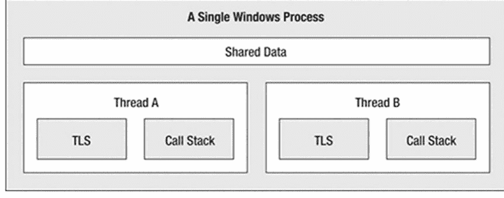
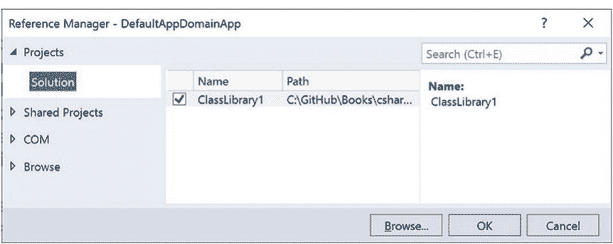

## 第 14 章：进程、AppDomain 与加载上下文

在本章中，你将深入探究程序集如何被运行时承载，并理解进程、应用程序域和对象上下文之间的关系。

简而言之，*应用程序域*（或简称 *AppDomain*）是给定进程内的逻辑细分区域，用于承载一组相关的 .NET Core 程序集。你将看到，AppDomain 进一步细分为*上下文边界*，用于将具有相似需求的 .NET Core 对象分组。通过上下文的概念，运行时可以确保具有特殊要求的对象得到恰当处理。

虽然你的许多日常编程任务可能不会直接涉及进程、AppDomain 或对象上下文，但在使用众多 .NET Core API（包括多线程、并行处理和对象序列化）时，理解这些主题非常重要。

### Windows 进程的角色

“进程”的概念在 .NET/.NET Core 平台发布之前很久就已经存在于基于 Windows 的操作系统中。简单来说，*进程*就是一个正在运行的程序。然而，从正式角度讲，进程是一个操作系统级别的概念，用于描述一组资源（如外部代码库和主线程）以及运行中应用程序所使用的必要内存分配。对于每个加载到内存中的 .NET Core 应用程序，操作系统都会创建一个独立且隔离的进程，供其在整个生命周期中使用。

使用这种应用程序隔离方法，会得到一个更加健壮和稳定的运行时环境，因为一个进程的失败不会影响另一个进程的运行。此外，一个进程中的数据不能被另一个进程直接访问，除非你使用特定工具，如 `System.IO.Pipes` 或 `MemoryMappedFile` 类。有鉴于此，你可以将进程视为运行中应用程序的固定、安全边界。

每个 Windows 进程都被分配一个唯一的进程标识符（PID），并且操作系统可以根据需要（也可以通过编程方式）独立加载和卸载它。你可能知道，Windows 任务管理器实用程序的“进程”选项卡（在 Windows 上通过 Ctrl+Shift+Esc 组合键激活）允许你查看给定计算机上正在运行的进程的各种统计信息。“详细信息”选项卡允许你查看分配的 PID 和映像名称（见图 14-1）。

图 14-1. Windows 任务管理器

### 线程的角色

每个 Windows 进程都包含一个作为应用程序入口点的初始“线程”。第 15 章将详细讨论在 .NET Core 平台下构建多线程应用程序的细节；但是，为了便于理解本章的内容，你需要了解一些基本定义。首先，线程是进程内的一条执行路径。从正式角度讲，由进程入口点创建的第一个线程称为主线程。任何 .NET Core 程序（控制台应用程序、Windows 服务、WPF 应用程序等）都通过 Main() 方法或包含顶级语句的文件标记其入口点。当此代码被调用时，主线程会自动创建。

只包含一个主执行线程的进程本质上是线程安全的，因为在给定的时间点上只有一个线程可以访问应用程序中的数据。然而，单线程进程（尤其是基于 GUI 的进程）如果这个唯一的线程正在执行复杂操作（如打印冗长的文本文件、执行数学密集型计算，或尝试连接数千里之外的远程服务器），通常会显得有些无响应。

鉴于单线程应用程序的这一潜在缺点，.NET Core 支持的操作系统（以及 .NET Core 平台本身）使得主线程可以通过少量 API 函数（如 CreateThread）生成额外的辅助线程（也称为工作线程）。

每个线程（主线程或辅助线程）都成为进程中的一条唯一执行路径，并且可以并发访问进程内所有共享的数据点。

你可能已经猜到，开发人员通常会创建额外的线程来帮助提高程序的整体响应性。多线程进程给人一种许多活动同时发生的错觉。例如，应用程序可以生成一个工作线程来执行繁重的工作单元（再次以打印大型文本文件为例）。当这个辅助线程忙于工作时，主线程仍然能响应用户输入，这使整个进程有可能提供更高的性能。然而，实际情况可能并非如此：在单个进程中使用过多线程实际上会降低性能，因为 CPU 必须在进程中的活动线程之间切换（这会耗费时间）。

在某些机器上，多线程通常只是操作系统提供的一种假象。搭载单个（非超线程）CPU 的机器无法真正同时处理多个线程。相反，单个 CPU 会根据线程的优先级等因素，在一个时间单位（称为时间片）内执行一个线程。当一个线程的时间片用完时，现有线程会被挂起，以允许另一个线程执行其业务。为了让线程在被挤出执行流之前记住之前发生的事情，每个线程都被赋予写入线程本地存储（TLS）的能力，并被提供一个独立的调用堆栈，如图 14-2 所示。



图 14-2. Windows 进程/线程关系

如果你对线程这个话题还不熟悉，不必纠结于细节。在现阶段，只需记住线程是 Windows 进程内的一条唯一执行路径。每个进程都有一个主线程（通过可执行文件的入口点创建），并且可能包含通过编程方式创建的其他线程。

### 使用 .NET Core 与进程交互

虽然进程和线程并不是什么新事物，但在 .NET Core 平台下与这些原语交互的方式已经发生了相当大的变化（并且是向更好的方向变化）。为了给理解多线程程序集的构建（见第 15 章）铺平道路，让我们首先了解如何使用 .NET Core 基类库与进程交互。

System.Diagnostics 命名空间定义了若干类型，允许你以编程方式与进程以及各种诊断相关类型（如系统事件日志和性能计数器）交互。在本章中，你只关心表 14-1 中定义的以进程为中心的类型。


# 表14-1 System.Diagnostics 命名空间的部分成员

| System.Diagnostics 命名空间中与进程相关的类型 | 生命中的意义 |
|---|---|
| Process | Process 类提供对本地和远程进程的访问，并允许你以编程方式启动和停止进程。 |
| ProcessModule | 该类型表示加载到进程中的模块（*.dll 或 *.exe）。请注意，ProcessModule 类型可以表示任何模块——基于 COM 的、基于 .NET 的，或传统的基于 C 的二进制文件。 |
| ProcessModuleCollection | 这提供了一个强类型的 ProcessModule 对象集合。 |
| ProcessStartInfo | 这指定了通过 Process.Start() 方法启动进程时使用的一组值。 |
| ProcessThread | 该类型表示给定进程内的一个线程。请注意，ProcessThread 是用于诊断进程线程集的类型，而不是用于在进程内生成新执行线程的类型。 |
| ProcessThreadCollection | 这提供了一个强类型的 ProcessThread 对象集合。 |

System.Diagnostics.Process 类允许你分析给定计算机（本地或远程）上运行的进程。Process 类还提供了一些成员，允许你以编程方式启动和终止进程、查看（或修改）进程的优先级级别，以及获取给定进程中的活动线程和/或已加载模块的列表。表14-2列出了 System.Diagnostics.Process 的一些关键属性。

## 表14-2 Process 类型的选择属性

| 属性 | 生命中的意义 |
|---|---|
| ExitTime | 此属性获取与已终止进程关联的时间戳（以 DateTime 类型表示）。 |
| Handle | 此属性返回操作系统为关联进程分配的句柄（以 IntPtr 表示）。这在构建需要与非托管代码通信的 .NET 应用程序时非常有用。 |
| Id | 此属性获取关联进程的 PID。 |
| MachineName | 此属性获取关联进程所运行计算机的名称。 |
| MainWindowTitle | MainWindowTitle 获取进程主窗口的标题（如果进程没有主窗口，你将收到一个空字符串）。 |
| Modules | 此属性提供对强类型 ProcessModuleCollection 类型的访问，该类型表示当前进程中加载的模块（*.dll 或 *.exe）集合。 |
| ProcessName | 此属性获取进程的名称（正如你所料，即应用程序本身的名称）。 |
| Responding | 此属性获取一个值，指示进程的用户界面是否正在响应用户输入（或当前是否“挂起”）。 |
| StartTime | 此属性获取关联进程的启动时间（通过 DateTime 类型表示）。 |
| Threads | 此属性获取关联进程中正在运行的线程集合（通过 ProcessThread 对象的集合表示）。 |

除了刚才检查的属性之外，System.Diagnostics.Process 还定义了一些有用的方法（见表14-3）。

## 表14-3 Process 类型的选择方法

| 方法 | 生命中的意义 |
|---|---|
| CloseMainWindow() | 此方法通过向其主窗口发送关闭消息来关闭具有用户界面的进程。 |
| GetCurrentProcess() | 此静态方法返回一个新的 Process 对象，该对象表示当前活动的进程。 |
| GetProcesses() | 此静态方法返回在给定计算机上运行的新 Process 对象数组。 |
| Kill() | 此方法立即停止关联的进程。 |
| Start() | 此方法启动一个进程。 |

## 枚举正在运行的进程

为了说明操作 Process 对象的过程（请原谅这个冗余说法），创建一个名为 ProcessManipulator 的 C# 控制台应用程序项目，并在 Program.cs 类中定义以下静态辅助方法（请确保在你的代码文件中导入 System.Diagnostics 和 System.Linq 命名空间）：

```
static void ListAllRunningProcesses()
{
    // Get all the processes on the local machine, ordered by
    // PID.
    var runningProcs =
        from proc
        in Process.GetProcesses(".")
        orderby proc.Id
        select proc;

    // Print out PID and name of each process.
    foreach(var p in runningProcs)
    {
        string info = $"-> PID: {p.Id}\tName: {p.ProcessName}";
        Console.WriteLine(info);
    }
    Console.WriteLine("***********************************\n");
}
```

静态的 Process.GetProcesses() 方法返回一个 Process 对象数组，这些对象表示目标计算机上正在运行的进程（这里显示的点表示本地计算机）。获取到 Process 对象数组后，你就可以调用表14-2和表14-3中列出的任何成员。在这里，你只是按 PID 排序并显示每个进程的 PID 和名称。更新顶层语句如下：

```
using System;
using System.Diagnostics;
using System.Linq;
```

```
Console.WriteLine("**** Fun with Processes ****\n");
ListAllRunningProcesses();
Console.ReadLine();
```

运行应用程序时，你将看到本地计算机上所有进程的名称和 PID。以下是我当前机器上的一些部分输出（你的输出很可能不同）：

```
**** Fun with Processes ****
-> PID: 0      Name: Idle
-> PID: 4      Name: System
-> PID: 104    Name: Secure System
-> PID: 176    Name: Registry
-> PID: 908    Name: svchost
-> PID: 920    Name: smss
-> PID: 1016   Name: csrss
-> PID: 1020   Name: NVDisplay.Container
-> PID: 1104   Name: wininit
-> PID: 1112   Name: csrss
********************************
```

## 调查特定进程

除了获取给定计算机上所有正在运行的进程的完整列表之外，静态的 Process.GetProcessById() 方法允许你通过关联的 PID 获取单个 Process 对象。如果你请求访问一个不存在的 PID，将会抛出 ArgumentException 异常。例如，如果你有兴趣获取一个表示 PID 为 30592 的进程的 Process 对象，你可以编写以下代码：

```
// If there is no process with the PID of 30592, a runtime exception will be thrown.
static void GetSpecificProcess()
{
    Process theProc = null;
    try
    {
        theProc = Process.GetProcessById(30592);
    }
    catch(ArgumentException ex)
    {
        Console.WriteLine(ex.Message);
    }
}
```

此时，你已经学会了如何获取所有进程的列表，以及通过 PID 查找获取机器上的特定进程。虽然发现 PID 和进程名称有一定用处，但 Process 类还允许你发现给定进程中使用的一组当前线程和库。让我们看看如何做到这一点。

## 调查进程的线程集

线程集由强类型的 ProcessThreadCollection 集合表示，该集合包含若干单独的 ProcessThread 对象。为了说明，请将以下额外的静态辅助函数添加到当前应用程序中：

```
static void EnumThreadsForPid(int pID)
{
    Process theProc = null;
    try
    {
        theProc = Process.GetProcessById(pID);
    }
    catch(ArgumentException ex)
    {
        Console.WriteLine(ex.Message);
        return;
    }

    // List out stats for each thread in the specified process.
    Console.WriteLine(
        "Here are the threads used by: {0}", theProc.ProcessName);
    ProcessThreadCollection theThreads = theProc.Threads;

    foreach(ProcessThread pt in theThreads)
    {
        string info =
            $"-> Thread ID: {pt.Id}\tStart Time: {pt.StartTime.ToShortTimeString()}\tPriority: {pt.PriorityLevel}";
        Console.WriteLine(info);
    }
    Console.WriteLine("***********************************\n");
}
```

如你所见，System.Diagnostics.Process 类型的 Threads 属性提供了对 ProcessThreadCollection 类的访问。在这里，你打印的是客户端指定进程中每个线程的分配线程 ID、启动时间和优先级级别。现在，更新程序的顶层语句，提示用户输入要调查的 PID，如下所示：

```
// Prompt user for a PID and print out the set of active threads.
Console.WriteLine("***** Enter PID of process to investigate *****");
Console.Write("PID: ");
string pID = Console.ReadLine();
int theProcID = int.Parse(pID);

EnumThreadsForPid(theProcID);
Console.ReadLine();
```


运行程序时，你现在可以输入机器上任意进程的 PID，并查看该进程使用的线程。以下输出显示了我的机器上 PID 为 3804 的进程使用的线程部分列表，该进程恰好正在托管 Edge：

```
***** Enter PID of process to investigate *****
PID: 3804
Here are the threads used by: msedge
-> Thread ID: 3464      Start Time: 01:20 PM      Priority: Normal
-> Thread ID: 19420     Start Time: 01:20 PM      Priority: Normal
-> Thread ID: 17780     Start Time: 01:20 PM      Priority: Normal
-> Thread ID: 22380     Start Time: 01:20 PM      Priority: Normal
-> Thread ID: 27580     Start Time: 01:20 PM      Priority: -4
...
********************************
```

ProcessThread 类型除了 Id、StartTime 和 PriorityLevel 之外还有其他感兴趣的成员。表 14-4 记录了一些感兴趣的成员。

## 表 14-4. ProcessThread 类型的选定成员

| Member | Meaning in Life |
|---|---|
| CurrentPriority | Gets the current priority of the thread |
| Id | Gets the unique identifier of the thread |
| IdealProcessor | Sets the preferred processor for this thread to run on |
| PriorityLevel | Gets or sets the priority level of the thread |
| ProcessorAffinity | Sets the processors on which the associated thread can run |
| StartAddress | Gets the memory address of the function that the operating system called that started this thread |
| StartTime | Gets the time that the operating system started the thread |
| ThreadState | Gets the current state of this thread |
| TotalProcessorTime | Gets the total amount of time that this thread has spent using the processor |
| WaitReason | Gets the reason that the thread is waiting |

在继续阅读之前，请注意 ProcessThread 类型并不是在 .NET Core 平台下用于创建、挂起或终止线程的实体。相反，ProcessThread 是用于获取正在运行进程中活动 Windows 线程的诊断信息的一种手段。再次说明，你将在第 15 章中研究如何使用 System.Threading 命名空间构建多线程应用程序。

## 调查进程的模块集

接下来，让我们看看如何遍历给定进程中托管的已加载模块的数量。谈到进程时，模块是一个通用术语，用来描述由特定进程托管的给定 *.dll（或 *.exe 本身）。当你通过 Process.Modules 属性访问 ProcessModuleCollection 时，你可以枚举进程中托管的所有模块：基于 .NET Core、基于 COM 或传统的基于 C 的库。

请思考以下额外的辅助函数，它将根据 PID 枚举特定进程中的模块：

```
static void EnumModsForPid(int pID)
{
    Process theProc = null;
    try
    {
        theProc = Process.GetProcessById(pID);
    }
    catch(ArgumentException ex)
    {
        Console.WriteLine(ex.Message);
        return;
    }

    Console.WriteLine("Here are the loaded modules for: {0}",
        theProc.ProcessName);
    ProcessModuleCollection theMods = theProc.Modules;
    foreach(ProcessModule pm in theMods)
    {
        string info = $"-> Mod Name: {pm.ModuleName}";
        Console.WriteLine(info);
    }
    Console.WriteLine("***********************************\n");
}
```

要查看一些可能的输出，让我们检查托管当前示例程序（ProcessManipulator）的进程的已加载模块。为此，运行应用程序，通过任务管理器识别分配给 ProcessManipulator.exe 的 PID，并将此值传递给 EnumModsForPid() 方法。一旦你这样做，你可能会惊讶地看到一个简单的控制台应用程序项目所使用的 *.dll 列表（GDI32.dll、USER32.dll、ole32.dll 等）。以下输出是已加载模块的部分列表（为简洁而编辑）：

```
Here are (some of) the loaded modules for: ProcessManipulator
Here are the loaded modules for: ProcessManipulator
-> Mod Name: ProcessManipulator.exe
-> Mod Name: ntdll.dll
-> Mod Name: KERNEL32.DLL
-> Mod Name: KERNELBASE.dll
-> Mod Name: USER32.dll
-> Mod Name: win32u.dll
-> Mod Name: GDI32.dll
-> Mod Name: gdi32full.dll
-> Mod Name: msvcp_win.dll
-> Mod Name: ucrtbase.dll
-> Mod Name: SHELL32.dll
-> Mod Name: ADVAPI32.dll
-> Mod Name: msvcrt.dll
-> Mod Name: sechost.dll
-> Mod Name: RPCRT4.dll
-> Mod Name: IMM32.DLL
-> Mod Name: hostfxr.dll
-> Mod Name: hostpolicy.dll
-> Mod Name: coreclr.dll
-> Mod Name: ole32.dll
-> Mod Name: combase.dll
-> Mod Name: OLEAUT32.dll
-> Mod Name: bcryptPrimitives.dll
-> Mod Name: System.Private.CoreLib.dll
...
********************************
```

## 以编程方式启动和停止进程

这里检查的 System.Diagnostics.Process 类的最后两个方面是 Start() 和 Kill() 方法。正如其名称所示，这些成员分别提供以编程方式启动和终止进程的方式。例如，考虑以下静态 StartAndKillProcess() 辅助方法。

> **注意** 根据操作系统的安全设置，你可能需要以管理员权限运行才能启动新进程。

```
static void StartAndKillProcess()
{
    Process proc = null;

    // Launch Edge, and go to Facebook!
    try
    {
        proc = Process.Start(@"C:\Program Files (x86)\Microsoft\Edge\Application\msedge.exe", "www.facebook.com");
    }
    catch (InvalidOperationException ex)
    {
        Console.WriteLine(ex.Message);
    }

    Console.Write("--> Hit enter to kill {0}...", proc.ProcessName);
    Console.ReadLine();

    // Kill all of the msedge.exe processes.
    try
    {
        foreach (var p in Process.GetProcessesByName("MsEdge"))
        {
            p.Kill(true);
        }
    }
    catch (InvalidOperationException ex)
    {
        Console.WriteLine(ex.Message);
    }
}
```

静态 Process.Start() 方法已被重载多次。至少，你需要指定要启动的进程的路径和文件名。此示例使用 Start() 方法的一个变体，允许你指定要传递到程序入口点的任何附加参数，在本例中是要加载的网页。

调用 Start() 方法后，你将获得对新激活进程的引用。当你想终止进程时，只需调用实例级 Kill() 方法即可。在此示例中，由于 Microsoft Edge 启动了大量进程，你正在循环遍历以杀死所有已启动的进程。你还将对 Start() 和 Kill() 的调用包装在 try/catch 块中以处理任何 InvalidOperationException 错误。当调用 Kill() 方法时尤其重要，因为如果在调用 Kill() 之前进程已被终止，将会引发此错误。

> **注意** 当使用 .NET Framework（.NET Core 之前）时，Process.Start() 方法允许使用完整路径和文件名或操作系统的快捷方式（例如 msedge）来启动进程。随着 .NET Core 和跨平台支持，你必须指定完整路径和文件名。操作系统关联可以通过下一节中介绍的 ProcessStartInfo 来利用。

## 使用 ProcessStartInfo 类控制进程启动

Process.Start() 方法还允许你传入 System.Diagnostics.ProcessStartInfo 类型，以指定有关给定进程应如何启动的额外信息。以下是 ProcessStartInfo 的部分定义（请参阅文档了解完整详细信息）：

```
public sealed class ProcessStartInfo : object
{
    public ProcessStartInfo();
    public ProcessStartInfo(string fileName);
    public ProcessStartInfo(string fileName, string arguments);
    public string Arguments { get; set; }
    public bool CreateNoWindow { get; set; }
    public StringDictionary EnvironmentVariables { get; }
    public bool ErrorDialog { get; set; }
    public IntPtr ErrorDialogParentHandle { get; set; }
    public string FileName { get; set; }
    public bool LoadUserProfile { get; set; }
    public SecureString Password { get; set; }
    public bool RedirectStandardError { get; set; }
    public bool RedirectStandardInput { get; set; }
    public bool RedirectStandardOutput { get; set; }
    public Encoding StandardErrorEncoding { get; set; }
    public Encoding StandardOutputEncoding { get; set; }
    public bool UseShellExecute { get; set; }
    public string Verb { get; set; }
```


```
public string[] Verbs { get; }
public ProcessWindowStyle WindowStyle { get; set; }
public string WorkingDirectory { get; set; }
}
```

为了说明如何微调进程启动方式，这里有一个修改版的 StartAndKillProcess() 方法，它将使用 Windows 关联的 MsEdge 加载 Microsoft Edge 并导航到 www.facebook.com：

```
static void StartAndKillProcess()
{
    Process proc = null;

    // Launch Microsoft Edge, and go to Facebook, with maximized window.
    try
    {
        ProcessStartInfo startInfo = new
            ProcessStartInfo("MsEdge", "www.facebook.com");
        startInfo.UseShellExecute = true;
        proc = Process.Start(startInfo);
    }
    catch (InvalidOperationException ex)
    {
        Console.WriteLine(ex.Message);
    }
    ...
}
```

在 .NET Core 中，UseShellExecute 属性默认为 false，而在早期版本的 .NET 中，该属性默认为 true。这就是为什么这里显示的旧版 Process.Start() 在不使用 ProcessStartInfo 并将 UseShellExecute 属性设为 true 的情况下不再有效：

```
Process.Start("msedge")
```

## 借助 ProcessStartInfo 使用操作系统谓词

除了使用操作系统快捷方式启动应用程序之外，你还可以利用 ProcessStartInfo 的文件关联功能。在 Windows 上，如果右键单击 Word 文档，会出现编辑或打印该文档的选项。让我们使用 ProcessStartInfo 来确定可用的谓词，然后用它们来操作进程。

使用以下代码创建一个新方法：

```
static void UseApplicationVerbs()
{
    int i = 0;
    //adjust this path and name to a document on your machine
    ProcessStartInfo si =
        new ProcessStartInfo("@..\TestPage.docx");
    foreach (var verb in si.Verbs)
    {
        Console.WriteLine($" {i++}. {verb}");
    }
}
```

```
si.WindowStyle = ProcessWindowStyle.Maximized;
si.Verb = "Edit";
si.UseShellExecute = true;
Process.Start(si);
}
```

运行这段代码时，第一部分会打印出 Word 文档所有可用的谓词，如下所示：

```
**** Fun with Processes ****
0. Edit
1. OnenotePrintto
2. Open
3. OpenAsReadOnly
4. Print
5. Printto
6. ViewProtected
```

将 WindowStyle 设置为 Maximized 后，谓词被设置为 Edit，这将打开文档并进入编辑模式。如果将谓词设置为 Print，文档将直接发送到打印机。

现在你已经理解了 Windows 进程的作用以及如何通过 C# 代码与它们交互，可以着手研究 .NET 应用程序域的概念了。

> 注意：应用程序运行的目录取决于你运行示例应用程序的方式。如果你使用 CLI 命令 dotnet run，当前目录与项目文件所在目录相同。如果你使用 Visual Studio，当前目录将是已编译程序集的目录，即 .\bin\debug\net5.0。你需要相应调整 Word 文档的路径。

## 理解 .NET 应用程序域

在 .NET 和 .NET Core 平台上，可执行文件并不像传统非托管应用程序那样直接寄宿在 Windows 进程内。相反，.NET 和 .NET Core 可执行文件由进程内一个称为应用程序域的逻辑分区承载。这种对传统 Windows 进程的分区带来几个好处，其中包括：

- AppDomain 是 .NET Core 平台与操作系统无关特性的一个关键方面，因为这种逻辑划分抽象掉了底层操作系统在表示已加载可执行文件方面的差异。
- AppDomain 在处理能力和内存方面的开销远低于完整进程。因此，CoreCLR 加载和卸载应用程序域的速度比常规进程快得多，并能大幅提高服务器应用程序的可伸缩性。

AppDomain 与进程内的其他 AppDomain 完全隔离。鉴于此，请注意运行在一个 AppDomain 中的应用程序无法获取另一个 AppDomain 中的任何数据（全局变量或静态字段），除非它们使用分布式编程协议。

注意：.NET Core 中 AppDomain 的支持已发生变化。在 .NET Core 中，只有一个 AppDomain。不再支持创建新的 AppDomain，因为它们需要运行时支持，而且创建成本通常很高。ApplicationLoadContext（本章后面介绍）在 .NET Core 中提供程序集隔离。

## System.AppDomain 类

AppDomain 类在 .NET Core 中基本上已被弃用。虽然剩余支持的大部分设计目的是使从 .NET 4.x 迁移到 .NET Core 更容易，但剩余功能仍然可以提供价值，如接下来两节所述。

## 与默认应用程序域交互

你的应用程序可以通过静态的 AppDomain.CurrentDomain 属性访问默认应用程序域。一旦你获得了这个访问点，就可以使用 AppDomain 的方法和属性来执行一些运行时诊断。

要了解如何与默认应用程序域交互，请先创建一个名为 DefaultAppDomainApp 的新控制台应用程序项目。现在，用以下逻辑更新你的 Program.cs 类，该逻辑将利用 AppDomain 类的多个成员，简单显示默认应用程序域的一些详细信息：

```
using System;
using System.IO;
using System.Linq;
using System.Reflection;
using System.Runtime.Loader;

Console.WriteLine("***** Fun with the default AppDomain ****\n");
DisplayDADStats();
Console.ReadLine();

static void DisplayDADStats()
{
    // Get access to the AppDomain for the current thread.
    AppDomain defaultAD = AppDomain.CurrentDomain;
    // Print out various stats about this domain.
    Console.WriteLine("Name of this domain: {0}",
        defaultAD.FriendlyName);
    Console.WriteLine("ID of domain in this process: {0}",
        defaultAD.Id);
    Console.WriteLine("Is this the default domain?: {0}",
        defaultAD.IsDefaultAppDomain());
    Console.WriteLine("Base directory of this domain: {0}",
        defaultAD.BaseDirectory);
    Console.WriteLine("Setup Information for this domain:");
    Console.WriteLine("\t Application Base: {0}",
        defaultAD.SetupInformation.ApplicationBase);
    Console.WriteLine("\t Target Framework: {0}",
        defaultAD.SetupInformation.TargetFrameworkName);
}
```

此示例的输出如下所示：

```
**** Fun with the default AppDomain ****
Name of this domain: DefaultAppDomainApp
ID of domain in this process: 1
Is this the default domain?: True
Base directory of this domain: C:\GitHub\Books\csharp8-wf\Code\Chapter_14\
DefaultAppDomainApp\DefaultAppDomainApp\bin\Debug\net5.0\
Setup Information for this domain:
    Application Base: C:\GitHub\Books\csharp8-wf\Code\Chapter_14\DefaultAppDomainApp\
DefaultAppDomainApp\bin\Debug\net5.0\
    Target Framework: .NETCoreApp,Version=v5.0
```

请注意，默认应用程序域的名称将与其中包含的可执行文件的名称相同（在本例中为 DefaultAppDomainApp.exe）。另请注意，基目录值（将用于探测外部所需的私有程序集）映射到已部署可执行文件的当前位置。

## 枚举已加载的程序集

还可以使用实例级的 GetAssemblies() 方法发现给定应用程序域中所有已加载的 .NET Core 程序集。该方法将返回一个 Assembly 对象数组（将在第 17 章介绍）。要做到这一点，你需要先在代码文件中添加 System.Reflection 命名空间（如本节前面所做的那样）。

为了说明这一点，请在 Program 类中定义一个名为 ListAllAssembliesInAppDomain() 的新方法。该辅助方法将获取所有已加载的程序集，并打印每个程序集的友好名称和版本。

```
static void ListAllAssembliesInAppDomain()
{
    // Get access to the AppDomain for the current thread.
    AppDomain defaultAD = AppDomain.CurrentDomain;

    // Now get all loaded assemblies in the default AppDomain.
    Assembly[] loadedAssemblies = defaultAD.GetAssemblies();
    Console.WriteLine("**** Here are the assemblies loaded in {0} ****\n", defaultAD.FriendlyName);
    foreach(Assembly a in loadedAssemblies)
    {
        Console.WriteLine("$-> Name, Version: {a.GetName().Name}:{a.GetName().Version} ");
    }
}
```

假设你已经更新顶层语句以调用这个新成员，你将看到承载可执行文件的应用程序域当前正在使用以下 .NET Core 库：

```
**** Here are the assemblies loaded in DefaultAppDomainApp ****
-> Name, Version: System.Private.CoreLib:5.0.0.0
-> Name, Version: DefaultAppDomainApp:1.0.0.0
-> Name, Version: System.Runtime:5.0.0.0
```


```
-> Name, Version: System.Console:5.0.0.0
-> Name, Version: System.Threading:5.0.0.0
-> Name, Version: System.Text.Encoding.Extensions:5.0
```

现在明白了，已加载程序集的列表会在你编写新的 C# 代码时随时发生变化。例如，假设你已更新 `ListAllAssembliesInAppDomain()` 方法，使其使用 LINQ 查询，按名称对已加载程序集进行排序，如下所示：

```
using System.Linq;
static void ListAllAssembliesInAppDomain()
{
    // Get access to the AppDomain for the current thread.
    AppDomain defaultAD = AppDomain.CurrentDomain;

    // Now get all loaded assemblies in the default AppDomain.
    var loadedAssemblies =
        defaultAD.GetAssemblies().OrderBy(x=>x.GetName().Name);
    Console.WriteLine("***** Here are the assemblies loaded in {0} ****\n", defaultAD.FriendlyName);
    foreach(Assembly a in loadedAssemblies)
    {
        Console.WriteLine($"-> Name, Version: {a.GetName().Name}:{a.GetName().Version}" );
    }
}
```

如果再次运行程序，你会看到 `System.Linq.dll` 也已加载到内存中。

```
** Here are the assemblies loaded in DefaultAppDomainApp **
-> Name, Version: DefaultAppDomainApp:1.0.0.0
-> Name, Version: System.Console:5.0.0.0
-> Name, Version: System.Linq:5.0.0
-> Name, Version: System.Private.CoreLib:5.0.0.0
-> Name, Version: System.Runtime:5.0.0.0
-> Name, Version: System.Text.Encoding.Extensions:5.0.0.0
-> Name, Version: System.Threading:5.0.0
```

## 使用应用程序加载上下文进行程序集隔离

正如你刚才所见，AppDomain 是用于托管 .NET Core 程序集的逻辑分区。此外，一个应用程序域还可以进一步细分为多个加载上下文边界。从概念上讲，加载上下文为加载、解析以及可能卸载一组程序集创建了一个作用域。简而言之，.NET Core 加载上下文提供了一种方式，使单个 AppDomain 能够为给定对象建立一个“特定位置”。

> 注意 虽然理解进程和应用程序域非常重要，但大多数 .NET Core 应用程序永远不需要你处理对象上下文。我只是加入了这部分概述材料，以便呈现更完整的图景。

`AssemblyLoadContext` 类提供了将额外程序集加载到各自上下文中的能力。为了演示，首先添加一个名为 `ClassLibrary1` 的类库项目并将其添加到当前解决方案中。使用 .NET Core CLI，在包含当前解决方案的目录中执行以下命令：

```
dotnet new classlib -lang c# -n ClassLibrary1 -o .\ClassLibrary1 -f net5.0
dotnet sln .\chapter14_AllProjects.sln add .\ClassLibrary1
```

接下来，通过执行以下 CLI 命令，从 `DefaultAppDomainApp` 添加对 `ClassLibrary1` 项目的引用：

```
dotnet add DefaultAppDomainApp reference ClassLibrary1
```

如果你使用的是 Visual Studio，在解决方案资源管理器中右键单击解决方案节点，选择 添加 ▶ 新建项目，并添加一个名为 `ClassLibrary1` 的 .NET Core 类库。这将创建项目并将其添加到解决方案中。接下来，通过右键单击 `DefaultAppDomainApp` 项目并选择 添加 ▶ 引用 来添加对该新项目的引用。在左侧栏中选择 项目 ▶ 解决方案，并选中 `ClassLibrary1` 复选框，如图 14-3 所示。



图 14-3. 在 Visual Studio 中添加项目引用

在此新的类库中，添加一个 `Car` 类，如下所示：

```
namespace ClassLibrary1
{
    public class Car
    {
        public string PetName { get; set; }
        public string Make { get; set; }
        public int Speed { get; set; }
    }
}
```

有了这个新程序集后，添加以下 using 语句：

```
using System.IO;
using System.Runtime.Loader;
```

接下来你将添加的方法需要 `System.IO` 和 `System.Runtime.Loader` using 语句，而你已在 `Program.cs` 中添加了它们。该方法如下所示：

```
static void LoadAdditionalAssembliesDifferentContexts()
{
    var path =
        Path.Combine(AppDomain.CurrentDomain.BaseDirectory,
            "ClassLibrary1.dll");
    AssemblyLoadContext lc1 =
        new AssemblyLoadContext("NewContext1",false);
    var cl1 = lc1.LoadFromAssemblyPath(path);
    var c1 = cl1.CreateInstance("ClassLibrary1.Car");

    AssemblyLoadContext lc2 =
        new AssemblyLoadContext("NewContext2",false);
    var cl2 = lc2.LoadFromAssemblyPath(path);
    var c2 = cl2.CreateInstance("ClassLibrary1.Car");
    Console.WriteLine("*** Loading Additional Assemblies in Different Contexts ***");
    Console.WriteLine($"Assembly1.Equals(Assembly2) {cl1.Equals(cl2)}");
    Console.WriteLine($"Assembly1 == Assembly2 {cl1 == cl2}");
    Console.WriteLine($"Class1.Equals(Class2) {c1.Equals(c2)}");
    Console.WriteLine($"Class1 == Class2 {c1 == c2}");
}
```

第一行使用静态 `Path.Combine` 方法构建 `ClassLibrary1` 程序集的目录。

> 注意 你可能会想，为什么要为一个将动态加载的程序集创建引用。这是为了确保在项目构建时，`ClassLibrary1` 程序集也会构建，并且与 `DefaultAppDomainApp` 位于同一目录中。这只是本示例的便利做法。动态加载的程序集无需引用。

接下来，代码创建了一个名为 `NewContext1` 的新 `AssemblyLoadContext`（方法的第一个参数）并且不支持卸载（第二个参数）。此 `LoadContext` 用于加载 `ClassLibrary1` 程序集，然后创建 `Car` 类的实例。如果其中一些代码对你来说是新的，它将在第 19 章中更详细地解释。该过程使用新的 `AssemblyLoadContext` 重复，然后比较程序集和类的相等性。当你运行此新方法时，你会看到以下输出：

```
*** Loading Additional Assemblies in Different Contexts ***
Assembly1.Equals(Assembly2) False
Assembly1 == Assembly2 False
Class1.Equals(Class2) False
Class1 == Class2 False
```

这证明同一个程序集已被加载两次到应用程序域中。类也是不同的，正如预期的那样。

接下来，添加一个新方法，该方法将从同一个 `AssemblyLoadContext` 加载程序集。

```
static void LoadAdditionalAssembliesSameContext()
{
    var path =
        Path.Combine(AppDomain.CurrentDomain.BaseDirectory,
            "ClassLibrary1.dll");
    AssemblyLoadContext lc1 =
        new AssemblyLoadContext(null,false);
    var cl1 = lc1.LoadFromAssemblyPath(path);
    var c1 = cl1.CreateInstance("ClassLibrary1.Car");
    var cl2 = lc1.LoadFromAssemblyPath(path);
    var c2 = cl2.CreateInstance("ClassLibrary1.Car");
    Console.WriteLine("*** Loading Additional Assemblies in Same Context ***");
    Console.WriteLine($"Assembly1.Equals(Assembly2) {cl1.Equals(cl2)}");
    Console.WriteLine($"Assembly1 == Assembly2 {cl1 == cl2}");
    Console.WriteLine($"Class1.Equals(Class2) {c1.Equals(c2)}");
    Console.WriteLine($"Class1 == Class2 {c1 == c2}");
}
```

此代码的主要区别在于只创建了一个 `AssemblyLoadContext`。现在，当 `ClassLibrary1` 程序集被加载两次时，第二个程序集只是指向第一个程序集实例的指针。运行代码会产生以下输出：

```
*** Loading Additional Assemblies in Same Context ***
Assembly1.Equals(Assembly2) True
Assembly1 == Assembly2 True
Class1.Equals(Class2) False
Class1 == Class2 False
```

## 总结进程、AppDomain 和加载上下文

到目前为止，你应该对 .NET Core 程序集如何由运行时托管有了更清晰的认识。如果之前的页面对你来说似乎过于底层，请不必担心。在大多数情况下，.NET Core 会自动代表你处理进程、应用程序域和加载上下文的细节。好消息是，这些信息为理解 .NET Core 平台下的多线程编程提供了坚实的基础。


## 总结

本章的重点是考察 .NET Core 平台究竟如何托管 .NET Core 应用程序。如你所见，Windows 进程这一长期存在的概念在底层已被修改，以适应 CoreCLR 的需求。单个进程（可以通过 System.Diagnostics.Process 类型以编程方式操作）现在由一个应用程序域组成，该应用程序域表示进程内的隔离且独立的边界。

应用程序域能够托管和执行任意数量的相关程序集。此外，单个应用程序域可以包含任意数量的加载上下文，以进一步隔离程序集。利用这一额外的类型隔离层级，CoreCLR 可以确保特殊需求对象得到正确处理。
