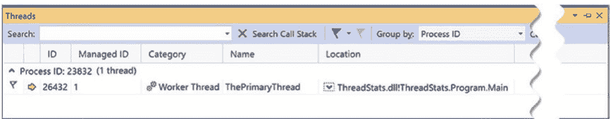

## 第15章 多线程、并行与异步编程

没有人喜欢使用一个执行时反应迟钝的应用程序。而且，也没有人喜欢在应用程序中启动一个任务（可能是通过单击工具栏项发起的）却导致程序的其他部分无法尽可能快地响应。在 .NET（以及 .NET Core）发布之前，构建能够执行多任务的应用程序通常需要编写使用 Windows 线程 API 的复杂 C++ 代码。幸运的是，.NET/.NET Core 平台为你提供了多种方式，使你能够构建在独特的执行路径上执行复杂操作的程序，而且痛苦点要少得多。

本章首先定义“多线程应用程序”的整体性质。接下来，你将了解自 .NET 1.0 以来就存在的原始线程命名空间，特别是 System.Threading。在这里，你将研究许多类型（Thread、ThreadStart 等），这些类型允许你显式创建额外的执行线程并同步共享资源，从而有助于确保多个线程能够以非易变的方式共享数据。

本章的其余部分将介绍 .NET Core 开发人员可以用来构建多线程软件的三种较新技术，具体是任务并行库（TPL）、并行 LINQ（PLINQ）以及相对较新的（自 C# 6 起）C# 内置异步关键字（async 和 await）。正如你将看到的，这些特性可以极大地简化构建响应式多线程软件应用程序的方式。

### 进程/AppDomain/上下文/线程的关系

在第14章中，线程被定义为可执行应用程序中的一条执行路径。虽然许多 .NET Core 应用程序可以快乐而高效地过着单线程的生活，但程序集的主线程（当应用程序的入口点执行时由运行时生成）可以随时创建辅助执行线程来执行额外的工作单元。通过创建额外的线程，你可以构建响应更快的应用程序（但在单核机器上不一定执行得更快）。

System.Threading 命名空间随 .NET 1.0 一起发布，提供了一种构建多线程应用程序的方法。Thread 类可能是核心类型，因为它代表给定的线程。如果要以编程方式获取当前正在执行某个成员的线程的引用，只需调用静态的 Thread.CurrentThread 属性，如下所示：

```
static void ExtractExecutingThread()
{
    // Get the thread currently
    // executing this method.
    Thread currThread = Thread.CurrentThread;
}
```

请记住，在 .NET Core 中只有一个 AppDomain。即使无法创建额外的 AppDomain，应用程序的 AppDomain 在任何给定时间也可以有大量线程在其中执行。要获取托管应用程序的 AppDomain 的引用，请调用静态的 Thread.GetDomain() 方法，如下所示：

```
static void ExtractAppDomainHostingThread()
{
    // Obtain the AppDomain hosting the current thread.
    AppDomain ad = Thread.GetDomain();
}
```

单个线程也可以在任何给定时间被移入一个执行上下文，并且可以根据 .NET Core 运行时的需要被重新定位到新的执行上下文中。当你想获取某个线程恰好正在其中执行的当前执行上下文时，可以使用静态的 Thread.CurrentThread.ExecutionContext 属性，如下所示：

```
static void ExtractCurrentThreadExecutionContext()
{
    // Obtain the execution context under which the
    // current thread is operating.
    ExecutionContext ctx =
        Thread.CurrentThread.ExecutionContext;
}
```

同样，.NET Core 运行时负责监督线程移入（和移出）执行上下文。作为 .NET Core 开发人员，你通常完全不必操心某个线程最终会落在哪里。尽管如此，你还是应该了解获取底层原语的各种方式。

### 并发问题

多线程编程的众多“乐趣”（读作：痛苦之处）之一在于，你几乎无法控制底层操作系统或运行时如何使用其线程。例如，如果你编写一段创建新执行线程的代码，你无法保证该线程会立即执行。相反，这样的代码只是指示操作系统/运行时尽快执行该线程（通常是在线程调度程序轮到它的时候）。

此外，由于线程可以根据运行时的需要在应用程序和上下文边界之间移动，你必须注意应用程序的哪些方面是线程易变的（例如，受多线程访问影响）以及哪些操作是原子的（线程易变操作是危险的！）。

为了说明这个问题，假设一个线程正在调用某个特定对象的方法。现在假设线程调度程序指示该线程暂停其活动，以允许另一个线程访问同一对象的同一方法。

如果原始线程尚未完成其操作，第二个进入的线程可能会看到一个处于部分修改状态的对象。此时，第二个线程基本上是在读取虚假数据，这必然会导致极其奇怪（且难以发现）的 bug，这些 bug 甚至更难重现和调试。

另一方面，原子操作在多线程环境中始终是安全的。遗憾的是，.NET Core 基类库中很少有保证是原子的操作。即使是向成员变量赋值这一操作也不是原子的！除非 .NET Core 文档明确说明某个操作是原子的，否则你必须假定它是线程易变的并采取预防措施。

### 线程同步的作用

至此，应该清楚多线程程序本身是相当易变的，因为许多线程可以（或多或少）在同一时间操作共享资源。为了保护应用程序的资源免受可能的破坏，.NET Core 开发人员必须使用任意数量的线程原语（例如锁、监视器以及 [Synchronization] 特性或语言关键字支持）来控制正在执行的线程之间的访问。

尽管 .NET Core 平台无法使构建健壮的多线程应用程序的困难完全消失，但这一过程已经大大简化。使用 System.Threading 命名空间中定义的类型、任务并行库以及 C# 的 async 和 await 语言关键字，你可以以极少的麻烦和困扰来处理多个线程。

在深入研究 System.Threading 命名空间、TPL 以及 C# 的 async 和 await 关键字之前，你将首先了解如何使用 .NET Core 委托类型以异步方式调用方法。尽管自 .NET 4.6 起，新的 C# async 和 await 关键字确实为异步委托提供了一种更简单的替代方案，但了解如何使用这种方法与代码交互仍然很重要（相信我，生产环境中有大量使用异步委托的代码）。

### System.Threading 命名空间

在 .NET 和 .NET Core 平台上，System.Threading 命名空间提供了能够直接构建多线程应用程序的类型。除了提供允许你与 .NET Core 运行时线程交互的类型外，该命名空间还定义了允许访问 .NET Core 运行时维护的线程池的类型、一个简单的（非基于 GUI 的）Timer 类，以及许多用于提供对共享资源的同步访问的类型。表 15-1 列出了该命名空间的一些重要成员。（请务必查阅 .NET Core SDK 文档以了解完整细节。）

表 15-1. System.Threading 命名空间的核心类型

| 类型 | 含义 |
|------|------|
| Interlocked | 该类型为多个线程共享的变量提供原子操作。 |
| Monitor | 该类型使用锁和等待/信号提供线程对象的同步。C# 的 lock 关键字在底层使用 Monitor 对象。 |
| Mutex | 此同步原语可用于应用程序域边界之间的同步。 |
| ParameterizedThreadStart | 此委托允许线程调用接受任意数量参数的方法。 |
| Semaphore | 此类型允许你限制可以同时访问资源的线程数。 |
| Thread | 此类型表示在 .NET Core 运行时内执行的线程。使用此类型，你可以在原始 AppDomain 中生成额外的线程。 |
| ThreadPool | 此类型允许你在给定进程内与 .NET Core 运行时维护的线程池进行交互。 |


### 表 15-1.（续）

| 类型 | 在生活中的含义 |
|---|---|
| ThreadPriority | 此枚举表示线程的优先级级别（Highest、Normal 等）。 |
| ThreadStart | 此委托用于指定给定线程要调用的方法。与 ParameterizedThreadStart 委托不同，ThreadStart 的目标必须始终具有相同的原型。 |
| ThreadState | 此枚举指定线程可能采用的有效状态（Running、Aborted 等）。 |
| Timer | 此类型提供按指定间隔执行方法的机制。 |
| TimerCallback | 此委托类型与 Timer 类型一起使用。 |

## System.Threading.Thread 类

System.Threading 命名空间中所有类型中最原始的是 Thread。此类代表 AppDomain 内给定执行路径的面向对象包装器。此类型还定义了多个方法（静态和实例级别），允许您在当前 AppDomain 中创建新线程，以及挂起、停止和销毁线程。请考虑表 15-2 中关键静态成员的列表。

### 表 15-2. Thread 类的关键静态成员

| 静态成员 | 在生活中的含义 |
|---|---|
| ExecutionContext | 此只读属性返回与逻辑执行线程相关信息，包括安全、调用、同步、本地化和事务上下文。 |
| CurrentThread | 此只读属性返回对当前运行线程的引用。 |
| Sleep() | 此方法使当前线程暂停指定的时间。 |

Thread 类还支持多个实例级成员，其中一些显示在表 15-3 中。

### 表 15-3. Thread 类的选定实例级成员

| 实例级成员 | 在生活中的含义 |
|---|---|
| IsAlive | 返回一个布尔值，指示此线程是否已启动（尚未终止或中止）。 |
| IsBackground | 获取或设置一个值，指示此线程是否为“后台线程”（稍后详细介绍）。 |
| Name | 允许您为线程建立一个友好的文本名称。 |
| Priority | 获取或设置线程的优先级，该优先级可以从 ThreadPriority 枚举中分配值。 |
| ThreadState | 获取此线程的状态，该状态可以从 ThreadState 枚举中分配值。 |
| Abort() | 指示 .NET Core 运行时尽快终止线程。 |
| Interrupt() | 中断（例如唤醒）当前线程使其从合适的等待期中退出。 |
| Join() | 阻塞调用线程，直到指定的线程（在其上调用 Join() 的线程）退出。 |
| Resume() | 恢复先前已挂起的线程。 |
| Start() | 指示 .NET Core 运行时尽快执行线程。 |
| Suspend() | 挂起线程。如果线程已挂起，则调用 Suspend() 无效。 |

> 注意 中止或挂起活动线程通常被认为是不好的主意。当您这样做时，存在（尽管很小）线程可能在被干扰或终止时“泄漏”其工作量的风险。

## 获取有关当前执行线程的统计信息

请记住，可执行程序集的入口点（即顶级语句或 Main() 方法）在主执行线程上运行。为了说明 Thread 类型的基本用法，假设您有一个名为 ThreadStats 的新控制台应用程序项目。如您所知，静态 Thread.CurrentThread 属性检索表示当前执行线程的 Thread 对象。一旦您获得了当前线程，您就可以打印出各种统计信息，如下所示：

```csharp
// Be sure to import the System.Threading namespace.
using System;
using System.Threading;
Console.WriteLine("***** Primary Thread stats ****\n");

// Obtain and name the current thread.
Thread primaryThread = Thread.CurrentThread;
primaryThread.Name = "ThePrimaryThread";

// Print out some stats about this thread.
Console.WriteLine("ID of current thread: {0}",
    primaryThread.ManagedThreadId);
Console.WriteLine("Thread Name: {0}",
    primaryThread.Name);
Console.WriteLine("Has thread started?: {0}",
    primaryThread.IsAlive);
Console.WriteLine("Priority Level: {0}",
    primaryThread.Priority);
Console.WriteLine("Thread State: {0}",
    primaryThread.ThreadState);
Console.ReadLine();
```

以下是当前输出：

```text
***** Primary Thread stats *****
ID of current thread: 1
Thread Name: ThePrimaryThread
Has thread started?: True
Priority Level: Normal
Thread State: Running
```

### Name 属性

请注意，Thread 类支持一个名为 Name 的属性。如果您不设置此值，Name 将返回一个空字符串。但是，一旦您为给定的 Thread 对象分配一个友好的字符串名称，您就可以大大简化调试工作。如果您使用 Visual Studio，您可以在调试会话期间访问线程窗口（程序运行时选择 Debug ► Windows ► Threads）。如您从图 15-1 所见，您可以快速识别要诊断的线程。



图 15-1. 使用 Visual Studio 调试线程

### Priority 属性

接下来，请注意 Thread 类型定义了一个名为 Priority 的属性。默认情况下，所有线程的优先级级别均为 Normal。但是，您可以使用 Priority 属性和相关的 System.Threading.ThreadPriority 枚举在线程生命周期的任何时间更改它，如下所示：

```csharp
public enum ThreadPriority
{
    Lowest,
    BelowNormal,
    Normal, // Default value.
    AboveNormal,
    Highest
}
```

如果您将线程的优先级级别分配为默认值（ThreadPriority.Normal）以外的其他值，请理解您无法直接控制线程调度程序在线程之间切换的时间。线程的优先级级别向 .NET Core 运行时提供有关线程活动重要性的提示。因此，具有 ThreadPriority.Highest 值的线程不一定保证获得最高优先级。

同样，如果线程调度程序忙于特定任务（例如同步对象、切换线程或移动线程），优先级级别很可能会相应更改。但是，在所有条件相同的情况下，.NET Core 运行时将读取这些值并指示线程调度程序如何最好地分配时间片。具有相同线程优先级的线程应各自获得相同的时间来执行其工作。

在大多数情况下，您很少（如果有的话）需要直接更改线程的优先级级别。理论上，可以提高一组线程的优先级级别，从而阻止低优先级线程在其所需级别执行（因此请谨慎使用）。

## 手动创建辅助线程

当您想要以编程方式创建额外的线程来执行某些工作单元时，使用 System.Threading 命名空间的类型时请遵循以下可预测的过程：

1. 创建一个方法作为新线程的入口点。
2. 创建一个新的 ParameterizedThreadStart（或 ThreadStart）委托，将步骤 1 中定义的方法的地址传递给构造函数。
3. 创建一个 Thread 对象，将 ParameterizedThreadStart/ThreadStart 委托作为构造函数参数传递。
4. 建立任何初始线程特征（名称、优先级等）。
5. 调用 Thread.Start() 方法。这会在可能的情况下尽快在步骤 2 中创建的委托引用的方法处启动线程。

如步骤 2 所述，您可以使用两种不同的委托类型来“指向”辅助线程将执行的 方法。ThreadStart 委托可以指向任何不带参数且不返回任何内容的方法。当方法设计为在后台简单运行而无需进一步交互时，此委托可能很有帮助。

ThreadStart 的限制是您无法传入参数进行处理。但是，ParameterizedThreadStart 委托类型允许单个 System.Object 类型的参数。鉴于任何东西都可以表示为 System.Object，您可以通过自定义类或结构传入任意数量的参数。请注意，ThreadStart 和 ParameterizedThreadStart 委托只能指向返回 void 的方法。

### 使用 ThreadStart 委托工作

为了说明构建多线程应用程序的过程（以及展示这样做的有用性），假设您有一个名为 SimpleMultiThreadApp 的控制台应用程序项目，允许最终用户选择应用程序是否将使用单个主线程执行其职责，或者是否将使用两个单独的执行线程拆分其工作负载。

假设您已导入 System.Threading 命名空间，您首先要定义一个方法来执行（可能的）辅助线程的工作。为了专注于构建多线程程序的机制，此方法将简单地将一系列数字打印到控制台窗口，每次循环暂停大约两秒钟。以下是 Printer 类的完整定义：

```csharp
using System;
using System.Threading;

namespace SimpleMultiThreadApp
{
    public class Printer
    {
        public void PrintNumbers()
```


```
{
    // Display Thread info.
    Console.WriteLine("-> {0} is executing PrintNumbers()",
        Thread.CurrentThread.Name);

    // Print out numbers.
    Console.Write("Your numbers: ");
    for(int i = 0; i < 10; i++)
    {
        Console.Write("{0}, ", i);
        Thread.Sleep(2000);
    }
    Console.WriteLine();
}
}
```

现在，在 Program.cs 中，你将添加顶层语句，首先提示用户确定应用程序的工作将使用一个还是两个线程。如果用户请求单个线程，你将简单地在主线程中调用 PrintNumbers() 方法。然而，如果用户指定两个线程，你将创建一个指向 PrintNumbers() 的 ThreadStart 委托，将此委托对象传递给新的 Thread 对象的构造函数中，并调用 Start() 来通知 .NET Core 运行时该线程已准备好处理。以下是完整的实现：

```
using System;
using System.Threading;
using SimpleMultiThreadApp;

Console.WriteLine("***** The Amazing Thread App *****");
Console.Write("Do you want [1] or [2] threads? ");
string threadCount = Console.ReadLine();

// Name the current thread.
Thread primaryThread = Thread.CurrentThread;
primaryThread.Name = "Primary";

// Display Thread info.
Console.WriteLine("-> {0} is executing Main()",
Thread.CurrentThread.Name);

// Make worker class.
Printer p = new Printer();

switch(threadCount)
{
case "2":
    // Now make the thread.
    Thread backgroundThread =
        new Thread(new ThreadStart(p.PrintNumbers));
    backgroundThread.Name = "Secondary";
    backgroundThread.Start();
    break;
case "1":
    p.PrintNumbers();
    break;
default:
    Console.WriteLine("I don't know what you want...you get 1 thread.");
    goto case "1";
}
// Do some additional work.
Console.WriteLine("This is on the main thread, and we are finished.");
Console.ReadLine();
```

现在，如果你使用单个线程运行此程序，你会发现最终的消息框要等到整个数字序列全部打印到控制台后才会显示消息。由于你在每次打印数字后显式暂停约两秒，这会导致用户体验不佳。然而，如果你选择两个线程，消息框会立即显示，因为有一个唯一的 Thread 对象负责将数字打印到控制台。

## 使用 ParameterizedThreadStart 委托

回想一下，ThreadStart 委托只能指向返回 void 且不带参数的方法。虽然在某些情况下这可能足够，但如果你想将数据传递给在次要线程上执行的方法，你将需要使用 ParameterizedThreadStart 委托类型。为了说明这一点，创建一个名为 AddWithThreads 的新控制台应用程序项目并导入 System.Threading 命名空间。现在，由于 ParameterizedThreadStart 可以指向任何接受 System.Object 参数的方法，你将创建一个包含要相加的数字的自定义类型，如下所示：

```
namespace AddWithThreads
{
    class AddParams
    {
        public int a, b;

        public AddParams(int numb1, int numb2)
        {
            a = numb1;
            b = numb2;
        }
    }
}
```

接下来，在 Program 类中创建一个方法，该方法接受 AddParams 参数并打印两个数字的和，如下所示：

```
void Add(object data)
{
    if (data is AddParams ap)
    {
        Console.WriteLine("ID of thread in Add(): {0}",
            Thread.CurrentThread.ManagedThreadId);

        Console.WriteLine("{0} + {1} is {2}",
            ap.a, ap.b, ap.a + ap.b);
    }
}
```

Program.cs 中的代码很简单。只需使用 ParameterizedThreadStart 而不是 ThreadStart，如下所示：

```
using System;
using System.Threading;
using AddWithThreads;

Console.WriteLine("***** Adding with Thread objects *****");
Console.WriteLine("ID of thread in Main(): {0}",
    Thread.CurrentThread.ManagedThreadId);

// Make an AddParams object to pass to the secondary thread.
AddParams ap = new AddParams(10, 10);
Thread t = new Thread(new ParameterizedThreadStart(Add));
t.Start(ap);

// Force a wait to let other thread finish.
Thread.Sleep(5);
Console.ReadLine();
```

## AutoResetEvent 类

在这些最初的示例中，没有干净的方法来知道次要线程何时完成其工作。在上一个示例中，使用任意时间调用了 Sleep 以让另一个线程完成。一种简单且线程安全的方式来强制一个线程等待另一个线程完成是使用 AutoResetEvent 类。在需要等待的线程中，创建此类的一个实例并将 false 传递给构造函数以表示你尚未收到通知。然后，在你愿意等待的点，调用 WaitOne() 方法。以下是 Program.cs 类的更新，它将使用静态级别的 AutoResetEvent 成员变量执行此操作：

```
AutoResetEvent _waitHandle = new AutoResetEvent(false);

Console.WriteLine("***** Adding with Thread objects *****");
Console.WriteLine("ID of thread in Main(): {0}",
    Thread.CurrentThread.ManagedThreadId);
AddParams ap = new AddParams(10, 10);
Thread t = new Thread(new ParameterizedThreadStart(Add));
t.Start(ap);

// Wait here until you are notified!
_waitHandle.WaitOne();
Console.WriteLine("Other thread is done!");

Console.ReadLine();
...
```

当另一个线程完成其工作负载时，它将在同一个 AutoResetEvent 类型实例上调用 Set() 方法。

```
void Add(object data)
{
    if (data is AddParams ap)
    {
        Console.WriteLine("ID of thread in Add(): {0}",
            Thread.CurrentThread.ManagedThreadId);

        Console.WriteLine("{0} + {1} is {2}",
            ap.a, ap.b, ap.a + ap.b);

        // Tell other thread we are done.
        _waitHandle.Set();
    }
}
```

## 前台线程和后台线程

现在你已经了解了如何使用 System.Threading 命名空间以编程方式创建新的执行线程，让我们正式区分前台线程和后台线程：

- *前台线程*可以阻止当前应用程序终止。.NET Core 运行时不会关闭应用程序（即卸载托管的 AppDomain），直到所有前台线程都结束。
- *后台线程*（有时称为*守护线程*）被 .NET Core 运行时视为可有可无的执行路径，可以在任何时间点被忽略（即使它们当前正在处理某个工作单元）。因此，如果所有前台线程都已终止，所有后台线程会在应用程序域卸载时自动被杀死。

需要注意的是，前台线程和后台线程*不是*与主线程和工作线程同义的。默认情况下，通过 Thread.Start() 方法创建的每个线程都是前台线程。再次说明，这意味着 AppDomain 不会在所有执行线程完成其工作单元之前卸载。在大多数情况下，这正是你需要的行为。

为了举例说明，假设你想在次要线程上调用 Printer.PrintNumbers()，该线程应表现得像后台线程。再次说明，这意味着 Thread 类型指向的方法（通过 ThreadStart 或 ParameterizedThreadStart 委托）在所有前台线程完成工作后应能够安全地停止。配置此类线程非常简单，只需将 IsBackground 属性设置为 true，如下所示：

```
Console.WriteLine("***** Background Threads *****");
Printer p = new Printer();
Thread bgroundThread =
    new Thread(new ThreadStart(p.PrintNumbers));

// This is now a background thread.
bgroundThread.IsBackground = true;
bgroundThread.Start();
```

请注意，此代码*没有*调用 Console.ReadLine() 来强制控制台在你按下 Enter 键之前保持可见。因此，当你运行应用程序时，它会立即关闭，因为 Thread 对象已配置为后台线程。鉴于应用程序的入口点


（此处所示的顶层语句或 Main() 方法）会触发主前台线程的创建，一旦入口点的逻辑执行完毕，AppDomain 就会在次要线程完成其工作之前卸载。

然而，如果你注释掉设置 IsBackground 属性的那一行，你会发现每个数字都会打印到控制台，因为所有前台线程必须完成其工作后，AppDomain 才会从托管进程中卸载。

在大多数情况下，将线程配置为后台类型在处理非关键任务的 worker 线程时很有帮助，该任务在程序的主要任务完成后就不再需要。例如，你可以构建一个应用程序，每隔几分钟 ping 一次邮件服务器以查找新邮件，更新当前天气状况，或执行其他非关键任务。

## 并发问题

当你构建多线程应用程序时，你的程序需要确保任何共享数据都受到保护，以防止众多线程更改其值。鉴于 AppDomain 中的所有线程都可以并发访问应用程序的共享数据，如果多个线程访问同一数据点会发生什么情况？由于线程调度程序会随机强制线程暂停其工作，如果线程 A 在完全完成其工作之前被挤开会怎样？线程 B 现在正在读取不稳定的数据。

为了说明并发问题，让我们再构建一个名为 MultiThreadedPrinting 的控制台应用程序项目。此应用程序将再次使用之前创建的 Printer 类，但这次 PrintNumbers() 方法将强制当前线程暂停一个随机生成的时间。

```
using System;
using System.Threading;

namespace MultiThreadedPrinting
{
    public class Printer
    {
        public void PrintNumbers()
        {
            // Display Thread info.
            Console.WriteLine("{0} is executing PrintNumbers()", Thread.CurrentThread.Name);

            // Print out numbers.
            for (int i = 0; i < 10; i++)
            {
                // Put thread to sleep for a random amount of time.
                Random r = new Random();
                Thread.Sleep(1000 * r.Next(5));
                Console.Write("{0}, ", i);
            }
            Console.WriteLine();
        }
    }
}
```

调用代码负责创建一个包含十个（唯一命名）Thread 对象的数组，每个对象都在同一个 Printer 对象上进行调用，如下所示：

```
using System;
using System.Threading;
using MultiThreadedPrinting;

Console.WriteLine("*****Synchronizing Threads *****
");

Printer p = new Printer();

// Make 10 threads that are all pointing to the same
// method on the same object.
Thread[] threads = new Thread[10];
for (int i = 0; i < 10; i++)
{
    threads[i] = new Thread(new ThreadStart(p.PrintNumbers))
    {
        Name = $"Worker thread #{i}"
    };
}
// Now start each one.
foreach (Thread t in threads)
{
    t.Start();
}
Console.ReadLine();
```

在查看一些测试运行之前，让我们回顾一下问题。AppDomain 中的主线程开始时生成了十个次要 worker 线程。每个 worker 线程都被告知在同一个 Printer 实例上的 PrintNumbers() 方法上进行调用。鉴于你没有采取任何预防措施来锁定该对象的共享资源（控制台），当前线程在 PrintNumbers() 方法能够打印完整结果之前被挤开的可能性很大。因为你不知道这是否会发生，也不知道何时会发生，所以你注定会得到不可预测的结果。例如，你可能会发现此处所示的输出：

```
*****Synchronizing Threads *****
-> Worker thread #3 is executing PrintNumbers()
-> Worker thread #0 is executing PrintNumbers()
-> Worker thread #1 is executing PrintNumbers()
-> Worker thread #2 is executing PrintNumbers()
-> Worker thread #4 is executing PrintNumbers()
-> Worker thread #5 is executing PrintNumbers()
-> Worker thread #6 is executing PrintNumbers()
-> Worker thread #7 is executing PrintNumbers()
-> Worker thread #8 is executing PrintNumbers()
-> Worker thread #9 is executing PrintNumbers()
0, 0, 0, 0, 1, 0, 1, 0, 1, 0, 0, 0, 1, 0, 1, 1, 2, 3, 1, 2, 2, 2, 1, 2, 1, 1, 2, 2, 3, 3, 4,
3, 3, 2, 2, 3, 4, 3, 4, 5, 4, 5, 4, 4, 3, 6, 7, 2, 3, 4, 4, 4, 5, 6, 5, 3, 5, 8, 9,
6, 7, 4, 5, 6, 6, 5, 5, 5, 8, 5, 6, 7, 8, 7, 7, 6, 6, 6, 8, 9,
8, 7, 7, 7, 7, 9,
6, 8, 9,
8, 9,
9, 9,
8, 8, 7, 8, 9,
9,
9,
```

现在再运行几次应用程序并检查输出。它每次很可能都不同。

> Note 如果你无法生成不可预测的输出，请将线程数从 10 增加到 100（例如）或在程序中引入另一个 Thread.Sleep() 调用。最终，你将遇到并发问题。

这里显然存在一些问题。由于每个线程都在告诉 Printer 打印数字数据，线程调度程序很乐意在后台交换线程。结果是输出不一致。你需要一种方法以编程方式强制对共享资源进行同步访问。正如你所猜测的，System.Threading 命名空间提供了几种以同步为中心的类。C# 编程语言还提供了一个关键字，用于在多线程应用程序中同步共享数据。

## 使用 C# lock 关键字进行同步

你可以用来自同步对共享资源访问的第一种技术是 C# lock 关键字。此关键字允许你定义必须在线程之间同步的语句范围。通过这样做，传入的线程无法中断当前线程，从而防止其完成工作。lock 关键字要求你指定一个令牌（对象引用），线程必须获取该令牌才能进入 lock 范围。当你尝试锁定私有实例级方法时，可以简单地传递对当前类型的引用，如下所示：

```
private void SomePrivateMethod()
{
    // Use the current object as the thread token.
    lock(this)
    {
        // All code within this scope is thread safe.
    }
}
```

然而，如果你在公共成员内的代码区域进行锁定，更安全的做法（也是最佳实践）是声明一个私有对象成员变量作为锁令牌，如下所示：

```
public class Printer
{
    // Lock token.
    private object threadLock = new object();
```

```
public void PrintNumbers()
{
    // Use the lock token.
    lock (threadLock)
    {
        ...
    }
}
```

无论如何，如果你检查 PrintNumbers() 方法，你可以看到线程竞争访问的共享资源是控制台窗口。将与 Console 类型的所有交互置于 lock 范围内，如下所示：

```
public void PrintNumbers()
{
    // Use the private object lock token.
    lock (threadLock)
    {
        // Display Thread info.
        Console.WriteLine("-> {0} is executing PrintNumbers()", Thread.CurrentThread.Name);
        // Print out numbers.
        Console.Write("Your numbers: ");
        for (int i = 0; i < 10; i++)
        {
            Random r = new Random();
            Thread.Sleep(1000 * r.Next(5));
            Console.Write("{0}, ", i);
        }
        Console.WriteLine();
    }
}
```

这样做时，你有效地设计了一个方法，允许当前线程完成其任务。一旦线程进入 lock 范围，锁令牌（在本例中是对当前对象的引用）就会在锁在退出 lock 范围后释放之前对其他线程不可访问。因此，如果线程 A 已获得锁令牌，其他线程在线程 A 放弃锁令牌之前无法进入使用相同锁令牌的任何范围。

> Note 如果你尝试锁定静态方法中的代码，只需声明一个私有静态对象成员变量作为锁令牌即可。

如果现在运行应用程序，你可以看到每个线程都有充足的机会完成其工作。

```
****Synchronizing Threads ****
-> Worker thread #0 is executing PrintNumbers()
Your numbers: 0, 1, 2, 3, 4, 5, 6, 7, 8, 9,
-> Worker thread #1 is executing PrintNumbers()
```


Your numbers: 0, 1, 2, 3, 4, 5, 6, 7, 8, 9,  
-> Worker thread #3 is executing PrintNumbers()

Your numbers: 0, 1, 2, 3, 4, 5, 6, 7, 8, 9,  
-> Worker thread #2 is executing PrintNumbers()

Your numbers: 0, 1, 2, 3, 4, 5, 6, 7, 8, 9,  
-> Worker thread #4 is executing PrintNumbers()

Your numbers: 0, 1, 2, 3, 4, 5, 6, 7, 8, 9,  
-> Worker thread #5 is executing PrintNumbers()

Your numbers: 0, 1, 2, 3, 4, 5, 6, 7, 8, 9,  
-> Worker thread #7 is executing PrintNumbers()

Your numbers: 0, 1, 2, 3, 4, 5, 6, 7, 8, 9,  
-> Worker thread #6 is executing PrintNumbers()

Your numbers: 0, 1, 2, 3, 4, 5, 6, 7, 8, 9,  
-> Worker thread #8 is executing PrintNumbers()

Your numbers: 0, 1, 2, 3, 4, 5, 6, 7, 8, 9,  
-> Worker thread #9 is executing PrintNumbers()

Your numbers: 0, 1, 2, 3, 4, 5, 6, 7, 8, 9,

## Synchronization Using the System.Threading.Monitor Type

The C# lock statement is a shorthand notation for working with the System.Threading.Monitor class. Once processed by the C# compiler, a lock scope resolves to the following (which you can verify using ildasm.exe):

```csharp
public void PrintNumbers()
{
    Monitor.Enter(threadLock);
    try
    {
        // Display Thread info.
        Console.WriteLine("-> {0} is executing PrintNumbers()",
            Thread.CurrentThread.Name);

        // Print out numbers.
        Console.Write("Your numbers: ");
        for (int i = 0; i < 10; i++)
        {
            Random r = new Random();
            Thread.Sleep(1000 * r.Next(5));
            Console.Write("{0}, ", i);
        }
        Console.WriteLine();
    }
    finally
    {
        Monitor.Exit(threadLock);
    }
}
```

First, notice that the Monitor.Enter() method is the ultimate recipient of the thread token you specified as the argument to the lock keyword. Next, all code within a lock scope is wrapped within a try block. The corresponding finally block ensures that the thread token is released (via the Monitor.Exit() method), regardless of any possible runtime exception. If you were to modify the MultiThreadPrinting program to make direct use of the Monitor type (as just shown), you would find the output is identical.

Now, given that the lock keyword seems to require less code than making explicit use of the System.Threading.Monitor type, you might wonder about the benefits of using the Monitor type directly. The short answer is control. If you use the Monitor type, you can instruct the active thread to wait for some duration of time (via the static Monitor.Wait() method), inform waiting threads when the current thread is completed (via the static Monitor.Pulse() and Monitor.PulseAll() methods), and so on.

As you would expect, in a great number of cases, the C# lock keyword will fit the bill. However, if you are interested in checking out additional members of the Monitor class, consult the .NET Core documentation.

## Synchronization Using the System.Threading.Interlocked Type

Although it is always hard to believe, until you look at the underlying CIL code, assignments and simple arithmetic operations are not atomic. For this reason, the System.Threading namespace provides a type that allows you to operate on a single point of data atomically with less overhead than with the Monitor type. The Interlocked class defines the key static members shown in Table 15-4.

**Table 15-4. Select Static Members of the System.Threading.Interlocked Type**

| Member | Meaning in Life |
|---|---|
| CompareExchange() | Safely tests two values for equality and, if equal, exchanges one of the values with a third |
| Decrement() | Safely decrements a value by 1 |
| Exchange() | Safely swaps two values |
| Increment() | Safely increments a value by 1 |

Although it might not seem like it from the onset, the process of atomically altering a single value is quite common in a multithreaded environment. Assume you have code that increments an integer member variable named intVal. Rather than writing synchronization code such as the following:

```csharp
int intVal = 5;
object myLockToken = new();
lock(myLockToken)
{
    intVal++;
}
```

you can simplify your code via the static Interlocked.Increment() method. Simply pass in the variable to increment by reference. Do note that the Increment() method not only adjusts the value of the incoming parameter but also returns the new value.

```csharp
intVal = Interlocked.Increment(ref intVal);
```

In addition to Increment() and Decrement(), the Interlocked type allows you to atomically assign numerical and object data. For example, if you want to assign the value of a member variable to the value 83, you can avoid the need to use an explicit lock statement (or explicit Monitor logic) and use the Interlocked.Exchange() method, like so:

```csharp
Interlocked.Exchange(ref myInt, 83);
```

Finally, if you want to test two values for equality and change the point of comparison in a thread-safe manner, you can leverage the Interlocked.CompareExchange() method as follows:

```csharp
public void CompareAndExchange()
{
    // If the value of i is currently 83, change i to 99.
    Interlocked.CompareExchange(ref i, 99, 83);
}
```

## Programming with Timer Callbacks

Many applications have the need to call a specific method during regular intervals of time. For example, you might have an application that needs to display the current time on a status bar via a given helper function. As another example, you might want to have your application call a helper function every so often to perform noncritical background tasks such as checking for new email messages. For situations such as these, you can use the System.Threading.Timer type in conjunction with a related delegate named TimerCallback.

To illustrate, assume you have a Console Application project (TimerApp) that will print the current time every second until the user presses a key to terminate the application. The first obvious step is to write the method that will be called by the Timer type (be sure to import System.Threading into your code file).

```csharp
using System;
using System.Threading;

Console.WriteLine("***** Working with Timer type *****");
Console.ReadLine();

static void PrintTime(object state)
{
    Console.WriteLine("Time is: {0}",
        DateTime.Now.ToLongTimeString());
}
```

Notice the PrintTime() method has a single parameter of type System.Object and returns void. This is not optional, given that the TimerCallback delegate can only call methods that match this signature. The value passed into the target of your TimerCallback delegate can be any type of object (in the case of the email example, this parameter might represent the name of the Microsoft Exchange Server to interact with during the process). Also note that given that this parameter is indeed a System.Object, you can pass in multiple arguments using a System.Array or custom class/structure.

The next step is to configure an instance of the TimerCallback delegate and pass it into the Timer object. In addition to configuring a TimerCallback delegate, the Timer constructor allows you to specify the optional parameter information to pass into the delegate target (defined as a System.Object), the interval to poll the method, and the amount of time to wait (in milliseconds) before making the first call. Here is an example:

```csharp
Console.WriteLine("***** Working with Timer type *****");

// Create the delegate for the Timer type.
TimerCallback timeCB = new TimerCallback(PrintTime);
```

```csharp
// Establish timer settings.
Timer t = new Timer(
    timeCB,      // The TimerCallback delegate object.
    null,        // Any info to pass into the called method (null for no info).
    0,           // Amount of time to wait before starting (in milliseconds).
    1000);       // Interval of time between calls (in milliseconds).

Console.WriteLine("Hit Enter key to terminate...");
Console.ReadLine();
```

In this case, the PrintTime() method will be called roughly every second and will pass in no additional information to said method. Here is the output:

```text
**** Working with Timer type ****
Hit key to terminate...
Time is: 6:51:48 PM
Time is: 6:51:49 PM
Time is: 6:51:50 PM
Time is: 6:51:51 PM
Time is: 6:51:52 PM
Press any key to continue . . .
```

If you did want to send in some information for use by the delegate target, simply substitute the null value of the second constructor parameter with the appropriate information, like so:

```csharp
// Establish timer settings.
Timer t = new Timer(timeCB, "Hello From C# 9.0", 0, 1000);
```

You can then obtain the incoming data as follows:

```csharp
static void PrintTime(object state)
{
    Console.WriteLine("Time is: {0}, Param is: {1}",
        DateTime.Now.ToLongTimeString(), state.ToString());
}
```

## Using a Stand-Alone Discard (New 7.0)

In the previous example, the Timer variable is not used in any execution path, so it can be replaced with a discard, as follows:

```csharp
var _ = new Timer(
    timeCB,  // The TimerCallback delegate object.
    null,    // Any info to pass into the called method
             // (null for no info).
    0,       // Amount of time to wait before starting
             // (in milliseconds).
    1000);   // Interval of time between calls
             // (in milliseconds).
```


## 理解线程池

本章接下来要探讨的线程相关主题是运行时线程池的作用。启动新线程是有代价的，因此为了效率，线程池会保留已创建（但未激活）的线程，直到需要时使用。为了让你能够与这个等待线程池交互，System.Threading 命名空间提供了 ThreadPool 类类型。

如果要将方法调用排队，由池中的工作线程处理，可以使用 ThreadPool.QueueUserWorkItem() 方法。该方法已被重载，允许你指定一个可选的 System.Object 作为自定义状态数据，以及一个 WaitCallback 委托的实例。

```
public static class ThreadPool
{
    ...
    public static bool QueueUserWorkItem(WaitCallback callBack);
    public static bool QueueUserWorkItem(WaitCallback callBack,
        object state);
}
```

WaitCallback 委托可以指向任何以 System.Object 作为唯一参数（表示可选状态数据）且不返回值的方法。请注意，如果在调用 QueueUserWorkItem() 时未提供 System.Object，.NET Core 运行时会自动传递 null 值。为了说明如何将方法排队供 .NET Core 运行时线程池使用，请思考下面的程序（位于名为 ThreadPoolApp 的控制台应用程序中），它再次使用了 Printer 类型。不过在这种情况下，你没有手动创建 Thread 对象数组；而是将池的成员分配给 PrintNumbers() 方法。

```
using System;
using System.Threading;
using ThreadPoolApp;

Console.WriteLine("***** Fun with the .NET Core Runtime Thread Pool ****\n");

Console.WriteLine("Main thread started. ThreadID = {0}",
    Thread.CurrentThread.ManagedThreadId);

Printer p = new Printer();

WaitCallback workItem = new WaitCallback(PrintTheNumbers);

// Queue the method ten times.
for (int i = 0; i < 10; i++)
{
    ThreadPool.QueueUserWorkItem(workItem, p);
}
Console.WriteLine("All tasks queued");
Console.ReadLine();

static void PrintTheNumbers(object state)
{
    Printer task = (Printer)state;
    task.PrintNumbers();
}
```

此时，你可能想知道使用 .NET Core 运行时维护的线程池是否比显式创建 Thread 对象更有利。考虑利用线程池的这些好处：

-   线程池通过最小化必须创建、启动和停止的线程数量来高效管理线程。
-   通过使用线程池，你可以专注于业务问题，而不是应用程序的线程基础设施。

但是，在某些情况下，手动线程管理更受青睐。下面是一个例子：

-   如果需要前台线程或必须设置线程优先级。池化线程始终是后台线程，具有默认优先级（ThreadPriority.Normal）。
-   如果需要具有固定身份的线程来中止、挂起或按名称发现它。

这就结束了你对 System.Threading 命名空间的探讨。可以肯定的是，理解本章迄今为止介绍的主题（尤其是在研究并发问题时）在创建多线程应用程序时将极具价值。有了这个基础，你现在将把注意力转向 .NET 4.0 中引入并延续到 .NET Core 的几个新的线程相关主题。首先，你将研究另一种线程模型——任务并行库（Task Parallel Library）的作用。

## 使用任务并行库进行并行编程

在本章的这一部分，你已经研究了 System.Threading 命名空间中允许你构建多线程软件的对象。从 .NET 4.0 开始，微软引入了一种新的多线程应用程序开发方法，使用称为任务并行库（TPL）的并行编程库。通过使用 System.Threading.Tasks 的类型，你可以构建细粒度、可扩展的并行代码，而无需直接处理线程或线程池。

但这并不是说，在使用 TPL 时你不需要使用 System.Threading 的类型。这两种线程工具包可以自然协同工作。尤其因为 System.Threading 命名空间仍然提供了你之前研究过的大部分同步原语（Monitor、Interlocked 等）。然而，你很可能会发现你更倾向于使用 TPL 而不是原始的 System.Threading 命名空间，因为同样的任务集可以用更直接的方式执行。

### System.Threading.Tasks 命名空间

总的来说，System.Threading.Tasks 的类型被称为任务并行库。TPL 将使用运行时线程池，自动动态地将应用程序的工作负载分配到可用的 CPU 上。TPL 处理工作分区、线程调度、状态管理和其他底层细节。结果是，你可以在屏蔽直接处理线程的许多复杂性的同时，最大化 .NET Core 应用程序的性能。

### Parallel 类的作用

TPL 的一个关键类是 System.Threading.Tasks.Parallel。该类包含的方法允许你以并行方式遍历数据集合（具体地说，是实现 IEnumerable<T> 的对象），主要通过两个静态方法：Parallel.For() 和 Parallel.ForEach()，每个方法都定义了众多重载版本。

这些方法允许你编写将以并行方式处理的一组代码语句。在概念上，这些语句与你通常在常规循环结构（通过 C# 的 for 或 foreach 关键字）中编写的逻辑相同。好处是 Parallel 类将代表你从线程池中获取线程（并管理并发性）。

这两种方法都要求你指定一个与 IEnumerable 或 IEnumerable<T> 兼容的容器，该容器保存你需要并行处理的数据。容器可以是简单数组、非泛型集合（如 ArrayList）、泛型集合（如 List<T>），也可以是 LINQ 查询的结果。

此外，你需要使用 System.Func<T> 和 System.Action<T> 委托来指定将调用以处理数据的目标方法。你在第 13 章研究 LINQ to Objects 时已经遇到过 Func<T> 委托。回想一下，Func<T> 表示一个可以有给定返回值和可变数量参数的方法。Action<T> 委托与 Func<T> 类似，因为它允许你指向一个接受若干参数的方法。但是，Action<T> 指定的方法只能返回 void。

虽然你可以调用 Parallel.For() 和 Parallel.ForEach() 方法并传递强类型的 Func<> 或 Action<T> 委托对象，但你可以通过使用合适的 C# 匿名方法或 lambda 表达式来简化编程。

### 使用 Parallel 类的数据并行性

使用 TPL 的第一种方式是执行数据并行。简单来说，这个术语指的是使用 Parallel.For() 或 Parallel.ForEach() 方法以并行方式遍历数组或集合的任务。假设你需要执行一些劳动密集型的文件 I/O 操作。具体来说，你需要将大量 *.jpg 文件加载到内存中，将它们上下翻转，并将修改后的图像数据保存到新位置。

在此示例中，你将看到如何使用图形用户界面执行相同的整体任务，因此你可以研究使用“匿名委托”允许辅助线程更新主用户界面线程（也称为 UI 线程）。

> 注意 在构建多线程图形用户界面（GUI）应用程序时，辅助线程永远不能直接访问用户界面控件。原因是控件（按钮、文本框、标签、进度条等）与创建它们的线程具有线程关联性。在下面的示例中，我将说明一种允许辅助线程以线程安全方式访问 UI 项的方法。当你研究 C# 的 async 和 await 关键字时，你会看到一种更简化的方法。

为了说明这一点，创建一个名为 DataParallelismWithForEach 的新 Windows Presentation Foundation 应用程序（模板缩写为 WPF App (.NET Core)）。要使用 CLI 创建项目并将其添加到本章的解决方案中，请输入以下命令：

```
dotnet new wpf -lang c# -n DataParallelismWithForEach -o .\DataParallelismWithForEach -f net5.0
dotnet sln .\Chapter15_AllProjects.sln add .\DataParallelismWithForEach
```

> 注意 此版本的 .NET Core 中，Windows Presentation Foundation (WPF) 仅适用于 Windows，并将在第 24-28 章中详细讨论。如果你没有使用过 WPF，本示例所需的全部内容都已列出。如果你只想跟随一个已完成的解决方案，可以在第 15 章文件夹中找到 DataParallelismWithForEach。WPF 开发可以与 Visual Studio Code 配合使用，尽管没有设计器支持。为了获得更丰富的开发体验，我建议你使用 Visual Studio 2019 来处理本章中的 WPF 示例。


双击解决方案资源管理器中的 MainWindow.xaml 文件，并将 XAML 替换为以下内容：

```
<Window x:Class="DataParallelismWithForEach.MainWindow"
    xmlns="http://schemas.microsoft.com/winfx/2006/xaml/presentation"
    xmlns:x="http://schemas.microsoft.com/winfx/2006/xaml"
    xmlns:d="http://schemas.microsoft.com/expression/blend/2008"

    xmlns:local="clr-namespace:DataParallelismWithForEach"
    mc:Ignorable="d"
    Title="Fun with TPL" Height="400" Width="800">
    <Grid>
        <Grid.RowDefinitions>
            <RowDefinition Height="Auto"/>
            <RowDefinition Height="*"/>
            <RowDefinition Height="Auto"/>
        </Grid.RowDefinitions>
        <Label Grid.Row="0" Grid.Column="0">
            Feel free to type here while the images are processed...
        </Label>
        <TextBox Grid.Row="1" Grid.Column="0" Margin="10,10,10,10"/>
        <Grid Grid.Row="2" Grid.Column="0">
            <Grid.ColumnDefinitions>
                <ColumnDefinition Width="Auto"/>
                <ColumnDefinition Width="*"/>
                <ColumnDefinition Width="Auto"/>
            </Grid.ColumnDefinitions>
            <Button Name="cmdCancel" Grid.Row="0" Grid.Column="0" Margin="10,10,0,10"
                Click="cmdCancel_Click">
                Cancel
            </Button>
            <Button Name="cmdProcess" Grid.Row="0" Grid.Column="2" Margin="0,10,10,10"
                Click="cmdProcess_Click">
                Click to Flip Your Images!
            </Button>
        </Grid>
    </Grid>
</Window>
```

同样，不用纠结这些标记的含义或工作原理；你马上就要花大量时间学习 WPF。该应用程序的 GUI 由一个多行 TextBox 和一个按钮（名为 cmdProcess）组成。文本区域的作用是让你在后台执行工作时输入数据，从而展示并行任务的非阻塞特性。

对于此示例，需要一个额外的 NuGet 包（System.Drawing.Common）。要将其添加到项目中，请在命令行（与你的解决方案文件位于同一目录）或 Visual Studio 的包管理器控制台中输入以下一行（全部在同一行）：

```
dotnet add DataParallelismWithForEach package System.Drawing.Common
```

打开 MainWindow.xaml.cs 文件（在 Visual Studio 中双击它——你可能需要展开 MainWindow.xaml 旁边的节点），然后在文件顶部添加以下 using 语句：

```
// Be sure you have these namespaces! (System.Threading.Tasks should already be there from the default template)
using System;
using System.Drawing;
using System.Threading.Tasks;
using System.Threading;
using System.Windows;
using System.IO;
```

注意：你应该更新传入以下 Directory.GetFiles() 方法调用的字符串，使其指向你计算机上包含一些图像文件的路径（例如存放家庭照片的个人文件夹）。为了方便你，我已将一些示例图像（随 Windows 操作系统附带）包含在解决方案目录中。

```
public partial class MainWindow : Window
{
    public MainWindow()
    {
        InitializeComponent();
    }

    private void cmdCancel_Click(object sender, EventArgs e)
    {
        // This will be updated shortly
    }

    private void cmdProcess_Click(object sender, EventArgs e)
    {
        ProcessFiles();
        this.Title = "Processing Complete";
    }

    private void ProcessFiles()
    {
        // Load up all *.jpg files, and make a new folder for the
        // modified data.
        //Get the directory path where the file is executing
        //For VS 2019 debugging, the current directory will be <projectdirectory>\bin\debug\net5.0-windows
        //For VS Code or "dotnet run", the current directory will be <projectdirectory>
        var basePath = Directory.GetCurrentDirectory();
        var pictureDirectory =
            Path.Combine(basePath, "TestPictures");
        var outputDirectory =
            Path.Combine(basePath, "ModifiedPictures");
```

```
//Clear out any existing files
if (Directory.Exists(outputDirectory))
{
    Directory.Delete(outputDirectory, true);
}
Directory.CreateDirectory(outputDirectory);
string[] files = Directory.GetFiles(pictureDirectory,
    "*.jpg", SearchOption.AllDirectories);

// Process the image data in a blocking manner.
foreach (string currentFile in files)
{
    string filename =
        System.IO.Path.GetFileName(currentFile);
    // Print out the ID of the thread processing the current image.
    this.Title = $"Processing {filename} on thread {Thread.CurrentThread.ManagedThreadId}";
    using (Bitmap bitmap = new Bitmap(currentFile))
    {
        bitmap.RotateFlip(RotateFlipType.Rotate180FlipNone);
        bitmap.Save(System.IO.Path.Combine(
            outputDirectory, filename));
    }
}
```

> 注意：如果你收到错误，指出 Path 在 System.IO.Path 和 System.Windows.Shapes.Path 之间存在歧义引用，请移除 System.Windows.Shapes 的 using，或者为 Path 添加 System.IO：System.IO.Path.Combine(...)。

注意，ProcessFiles() 方法将旋转指定目录下的每个 *.jpg 文件。目前，所有工作都在可执行文件的主线程上进行。因此，如果单击按钮，程序将看起来像挂起一样。此外，窗口的标题也会显示同一个主线程正在处理文件，因为我们只有一个执行线程。

为了尽可能利用多 CPU 处理文件，你可以将当前的 foreach 循环重写为使用 Parallel.ForEach()。回想一下，这个方法已被多次重载；然而，在最简单的形式中，你必须指定一个与 IEnumerable<T> 兼容的对象，该对象包含要处理的项（即 files 字符串数组），以及一个 Action<T> 委托，该委托指向将执行工作的那个方法。

下面是相关更新，使用 C# lambda 运算符代替字面量的 Action<T> 委托对象。注意，你当前已经注释掉了显示执行当前图像文件的线程 ID 的那行代码。请参阅下一部分以了解原因。

```
// Process the image data in a parallel manner!
Parallel.ForEach(files, currentFile =>
{
    string filename = Path.GetFileName(currentFile);
```

```
// This code statement is now a problem! See next section.
// this.Title = $"Processing {filename} on thread
//     {Thread.CurrentThread.ManagedThreadId}"
// Thread.CurrentThread.ManagedThreadId);

using (Bitmap bitmap = new Bitmap(currentFile))
{
    bitmap.RotateFlip(RotateFlipType.Rotate180FlipNone);
    bitmap.Save(Path.Combine(outputDirectory, filename));
}
);
```

## 在辅助线程上访问 UI 元素

你会注意到，我已注释掉了之前更新主窗口标题以显示当前执行线程 ID 的那行代码。如前所述，GUI 控件与其创建线程具有“线程关联性”。如果辅助线程尝试访问它们未直接创建的控件，那么在调试软件时，你必然会遇到运行时错误。另一方面，如果你运行该应用程序（通过 Ctrl+F5），你可能根本不会发现原始代码有任何问题。

> 注意：让我重申前面的观点：当你调试多线程应用程序时，有时可以捕获到当辅助线程“触碰”在主线程上创建的控件时出现的错误。但是，很多时候当你运行应用程序时，它可能看起来运行正常（或者可能立即出错）。在你采取预防措施（将在下一节讨论）之前，你的应用程序在这种情况下有可能引发运行时错误。

你可以使用的一种方法，让这些辅助线程以线程安全的方式访问控件，是另一种以委托为中心的技术，具体来说是匿名委托。WPF 中的 Control 父类定义了一个 Dispatcher 对象，该对象管理线程的工作项。该对象有一个名为 Invoke() 的方法，它接受一个 System.Delegate 作为输入。当你处于涉及辅助线程的编码环境中时，可以调用此方法，以线程安全的方式更新给定控件的 UI。现在，虽然你可以直接编写所有必需的委托代码，但大多数开发人员使用表达式语法作为简单替代。以下是针对先前注释掉的代码语句的相关更新：

```
// Eek! This will not work anymore!
//this.Title = $"Processing {filename} on thread {Thread.CurrentThread.ManagedThreadId}";

// Invoke on the Form object, to allow secondary threads to access controls
// in a thread-safe manner.
Dispatcher?.Invoke(() =>
{
    this.Title = $"Processing {filename}";
});
using (Bitmap bitmap = new Bitmap(currentFile))
{
```


```csharp
bitmap.RotateFlip(RotateFlipType.Rotate180FlipNone);
bitmap.Save(Path.Combine(outputDirectory, filename));
}
```

现在，如果你运行程序，TPL 确实会将工作负载分发到线程池中的多个线程，使用尽可能多的 CPU。然而，由于标题始终从主线程更新，标题更新代码不再显示当前线程，并且在所有图像处理完成之前，如果你在文本框中输入内容，你将看不到任何内容！原因在于主 UI 线程仍然被阻塞，等待所有其他线程完成其工作。

## Task 类

Task 类允许你轻松地在一个次要线程上调用一个方法，并且可以用作使用异步委托的简单替代方案。按如下方式更新你的 Button 控件的 Click 处理程序：

```csharp
private void cmdProcess_Click(object sender, EventArgs e)
{
    // Start a new "task" to process the files.
    Task.Factory.StartNew(() => ProcessFiles());
    // Can also be written this way
    // Task.Factory.StartNew(ProcessFiles);
}
```

Task 的 Factory 属性返回一个 TaskFactory 对象。当你调用其 StartNew() 方法时，你传入一个 Action<T> 委托（在这里，使用合适的 lambda 表达式隐藏），该委托指向要在异步方式下调用的方法。通过这个小的更新，你现在会发现窗口的标题将显示线程池中哪个线程正在处理给定的文件，更好的是，文本区域能够接收输入，因为 UI 线程不再被阻塞。

## 处理取消请求

对当前示例的一个改进是提供一种让用户通过第二个恰当地命名的 Cancel 按钮停止图像数据处理的方法。值得庆幸的是，Parallel.For() 和 Parallel.ForEach() 方法都支持使用取消令牌进行取消。当你在 Parallel 上调用方法时，你可以传入一个 ParallelOptions 对象，而该对象反过来包含一个 CancellationTokenSource 对象。

首先，在你的 Form 派生类中定义以下新的私有成员变量，类型为 CancellationTokenSource，命名为 _cancelToken：

```csharp
public partial class MainWindow : Window
{
    // New Window-level variable.
    private CancellationTokenSource _cancelToken = new CancellationTokenSource();
    ...
}
```

将 Cancel 按钮 Click 事件更新为以下代码：

```csharp
private void cmdCancel_Click(object sender, EventArgs e)
{
    // This will be used to tell all the worker threads to stop!
    _cancelToken.Cancel();
}
```

现在，真正的修改需要在 ProcessFiles() 方法内进行。考虑最终的实现：

```csharp
private void ProcessFiles()
{
    // Use ParallelOptions instance to store the CancellationToken.
    ParallelOptions parOpts = new ParallelOptions();
    parOpts.CancellationToken = _cancelToken.Token;
    parOpts.MaxDegreeOfParallelism = System.Environment.ProcessorCount;

    // Load up all *.jpg files, and make a new folder for the modified data.
    string[] files = Directory.GetFiles(@".\TestPictures", "*.jpg", SearchOption.AllDirectories);
    string outputDirectory = @".\ModifiedPictures";
    Directory.CreateDirectory(outputDirectory);

    try
    {
        // Process the image data in a parallel manner!
        Parallel.ForEach(files, parOpts, currentFile =>
        {
            parOpts.CancellationToken.ThrowIfCancellationRequested();

            string filename = Path.GetFileName(currentFile);
            Dispatcher?.Invoke(() =>
            {
                this.Title = $"Processing {filename} on thread {Thread.CurrentThread.ManagedThreadId}";
            });
            using (Bitmap bitmap = new Bitmap(currentFile))
            {
                bitmap.RotateFlip(RotateFlipType.Rotate180FlipNone);
                bitmap.Save(Path.Combine(outputDirectory, filename));
            }
        });
        Dispatcher?.Invoke(() => this.Title = "Done!");
    }
    catch (OperationCanceledException ex)
    {
        Dispatcher?.Invoke(() => this.Title = ex.Message);
    }
}
```

注意你开始方法时通过配置一个 ParallelOptions 对象，将 CancellationToken 属性设置为使用 CancellationTokenSource 令牌。还要注意当你调用 Parallel.ForEach() 方法时，你将 ParallelOptions 对象作为第二个参数传入。

在循环逻辑的范围内，你对令牌调用 ThrowIfCancellationRequested()，这将确保如果用户点击 Cancel 按钮，所有线程将停止，并且你将通过运行时异常收到通知。当你捕获 OperationCanceledException 错误时，你将把主窗口的文本设置为错误消息。

## 使用 Parallel 类进行任务并行

除了数据并行之外，TPL 还可以使用 Parallel.Invoke() 方法轻松启动任意数量的异步任务。这种方法比使用 System.Threading 中的成员更直接；然而，如果你需要更多地控制任务的执行方式，你可以放弃使用 Parallel.Invoke() 并直接使用 Task 类，就像你在前一个示例中所做的那样。

为了说明任务并行，创建一个名为 MyEBookReader 的新控制台应用程序，并确保在 Program.cs 顶部导入 System.Threading、System.Text、System.Threading.Tasks、System.Linq 和 System.Net 命名空间（此示例是对 .NET Core 文档中有用的示例的修改）。在这里，你将从 Project Gutenberg（www.gutenberg.org）获取一本公开可用的电子书，然后并行执行一组耗时的任务。

书籍在 GetBook() 方法中下载，显示如下：

```csharp
using System;
using System.Linq;
using System.Threading;
using System.Threading.Tasks;
using System.Net;
using System.Text;

string _theEBook = "";
GetBook();
Console.WriteLine("Downloading book...");
Console.ReadLine();

void GetBook()
{
    WebClient wc = new WebClient();
    wc.DownloadStringCompleted += (s, eArgs) =>
    {
        _theEBook = eArgs.Result;
        Console.WriteLine("Download complete.");
        GetStats();
    };

    // The Project Gutenberg EBook of A Tale of Two Cities, by Charles Dickens
    // You might have to run it twice if you’ve never visited the site before, since the first
    // time you visit there is a message box that pops up, and breaks this code.
    wc.DownloadStringAsync(new Uri("http://www.gutenberg.org/files/98/98-8.txt"));
}
```

WebClient 类是 System.Net 的成员。此类提供用于向 URI 标识的资源发送数据和从该资源接收数据的方法。事实证明，其中许多方法都有异步版本，例如 DownloadStringAsync()。此方法将自动从 .NET Core Runtime 线程池启动一个新线程。当 WebClient 完成获取数据后，它将触发 DownloadStringCompleted 事件，你在这里使用 C# lambda 表达式进行处理。如果调用此方法的同步版本（DownloadString()），“Downloading” 消息要到下载完成才会被显示。

接下来，GetStats() 方法被实现为提取 _theEBook 变量中包含的各个单词，然后将字符串数组传递给几个辅助函数进行处理，如下所示：

```csharp
void GetStats()
{
    // Get the words from the ebook.
    string[] words = _theEBook.Split(new char[]
    { ' ', '\u000A', ',', '.', ';', ':', '-', '?', '/' },
        StringSplitOptions.RemoveEmptyEntries);

    // Now, find the ten most common words.
    string[] tenMostCommon = FindTenMostCommon(words);

    // Get the longest word.
    string longestWord = FindLongestWord(words);

    // Now that all tasks are complete, build a string to show all stats.
    StringBuilder bookStats = new StringBuilder("Ten Most Common Words are:\n");
    foreach (string s in tenMostCommon)
    {
        bookStats.AppendLine(s);
    }

    bookStats.AppendFormat("Longest word is: {0}", longestWord);
    bookStats.AppendLine();
    Console.WriteLine(bookStats.ToString(), "Book info");
}
```

FindTenMostCommon() 方法使用 LINQ 查询来获取字符串数组中最常出现的字符串对象列表，而 FindLongestWord() 定位，嗯，最长的单词。

```csharp
string[] FindTenMostCommon(string[] words)
{
    var frequencyOrder = from word in words
                          where word.Length > 6
                          group word by word into g
                          orderby g.Count() descending
                          select g.Key;
    string[] commonWords = (frequencyOrder.Take(10)).ToArray();
    return commonWords;
}

string FindLongestWord(string[] words)
{
    return (from w in words orderby w.Length descending select w).FirstOrDefault();
}
```


如果要运行此项目，执行所有任务可能需要花费大量时间，这取决于机器的 CPU 数量和整体处理器速度。最终，你应该会看到此处显示的输出：

```
Downloading book...
Download complete.
Ten Most Common Words are:
Defarge
himself
Manette
through
nothing
business
another
looking
prisoner
Cruncher
Longest word is: undistinguishable
```

你可以通过并行调用 FindTenMostCommon() 和 FindLongestWord() 方法来确保你的应用程序使用主机上所有可用的 CPU。为此，按如下方式修改你的 GetStats() 方法：

```
void GetStats()
{
    // Get the words from the ebook.
    string[] words = _theEBook.Split(
        new char[] { ' ', '\u000A', ',', '.', ';', ':', '-', '?', '/' },
        StringSplitOptions.RemoveEmptyEntries);
    string[] tenMostCommon = null;
    string longestWord = string.Empty;

    Parallel.Invoke(
        () =>
        {
            // Now, find the ten most common words.
            tenMostCommon = FindTenMostCommon(words);
        },
        () =>
        {
            // Get the longest word.
            longestWord = FindLongestWord(words);
        });

    // Now that all tasks are complete, build a string to show all stats.
    ...
}
```

Parallel.Invoke() 方法期望一个 Action<> 委托的参数数组，你已通过 lambda 表达式间接提供了它们。同样，虽然输出是相同的，但好处是 TPL 现在将使用机器上所有可能的处理器在可能的情况下并行调用每个方法。

## Parallel LINQ Queries (PLINQ)

为了结束你对 TPL 的了解，请注意，你还可以将并行任务合并到你的 .NET Core 应用程序中的另一种方式。如果你愿意，你可以使用一组扩展方法来构建一个 LINQ 查询，该查询将以并行方式执行其工作负载（如果可能）。恰当地说，设计为并行运行的 LINQ 查询被称为 PLINQ 查询。

与使用 Parallel 类编写的并行代码一样，PLINQ 也有在必要时忽略你并行处理集合的请求的选择。PLINQ 框架已在许多方面进行了优化，其中包括确定查询是否实际上会在同步方式下运行得更快。

在运行时，PLINQ 分析查询的整体结构，如果查询可能从并行化中受益，它将并发运行。但是，如果并行化查询会损害性能，PLINQ 只是按顺序运行查询。如果 PLINQ 在可能昂贵的并行算法和廉价的顺序算法之间做出选择，它默认选择顺序算法。

必要的扩展方法位于 System.Linq 命名空间的 ParallelEnumerable 类中。表 15-5 记录了一些有用的 PLINQ 扩展。

### Table 15-5. Select Members of the ParallelEnumerable Class

| Member | Meaning in Life |
|---|---|
| AsParallel() | Specifies that the rest of the query should be parallelized, if possible |
| WithCancellation() | Specifies that PLINQ should periodically monitor the state of the provided cancellation token and cancel execution if it is requested |
| WithDegreeOfParallelism() | Specifies the maximum number of processors that PLINQ should use to parallelize the query |
| ForAll() | Enables results to be processed in parallel without first merging back to the consumer thread, as would be the case when enumerating a LINQ result using the foreach keyword |

要查看 PLINQ 的实际效果，请创建一个名为 PLINQDataProcessingWithCancellation 的控制台应用程序并导入 System.Linq、System.Threading 和 System.Threading.Tasks 命名空间（如果尚未导入）。处理开始时，程序将启动一个新的 Task，该 Task 执行一个 LINQ 查询，调查一个大型整数数组，查找仅满足 x % 3 == 0 为 true 的项。以下是该查询的非并行版本：

```
using System;
using System.Linq;
using System.Threading;
using System.Threading.Tasks;

Console.WriteLine("Start any key to start processing");
Console.ReadKey();

Console.WriteLine("Processing");
Task.Factory.StartNew(ProcessIntData);
Console.ReadLine();

void ProcessIntData()
{
    // Get a very large array of integers.
    int[] source = Enumerable.Range(1, 10_000_000).ToArray();

    // Find the numbers where num % 3 == 0 is true, returned
    // in descending order.
    int[] modThreeIsZero = (
        from num in source
        where num % 3 == 0
        orderby num descending
        select num).ToArray();
    Console.WriteLine($"Found { modThreeIsZero.Count()} numbers that match query!");
}
```

### Opting in to a PLINQ Query

如果你想通知 TPL 以并行方式（如果可能）执行此查询，你将希望使用 AsParallel() 扩展方法，如下所示：

```
int[] modThreeIsZero = (
    from num in source.AsParallel()
    where num % 3 == 0
    orderby num descending select num).ToArray();
```

请注意 LINQ 查询的整体格式与你在前几章中看到的相同。然而，通过包含对 AsParallel() 的调用，TPL 将尝试将工作负载传递给任何可用的 CPU。

### Cancelling a PLINQ Query

也可以使用 CancellationTokenSource 对象在正确条件下（通常是由于用户干预）通知 PLINQ 查询停止处理。声明一个名为 _cancelToken 的类级 CancellationTokenSource 对象并更新顶级语句方法以从用户获取输入。以下是相关的代码更新：

```
CancellationTokenSource _cancelToken =
    new CancellationTokenSource();

do
{
    Console.WriteLine("Start any key to start processing");
    Console.ReadKey();
    Console.WriteLine("Processing");
    Task.Factory.StartNew(ProcessIntData);
    Console.Write("Enter Q to quit: ");
    string answer = Console.ReadLine();

    // Does user want to quit?
    if (answer.Equals("Q",
        StringComparison.OrdinalIgnoreCase))
    {
        _cancelToken.Cancel();
        break;
    }
}
while (true);

Console.ReadLine();
```

现在，通过链接 WithCancellation() 扩展方法并传入令牌，通知 PLINQ 查询它应该留意传入的取消请求。此外，你将希望将此 PLINQ 查询包装在适当的 try/catch 范围内并处理可能的异常。以下是 ProcessIntData() 方法的最终版本：

```
void ProcessIntData()
{
    // Get a very large array of integers.
    int[] source = Enumerable.Range(1, 10_000_000).ToArray();

    // Find the numbers where num % 3 == 0 is true, returned
    // in descending order.
    int[] modThreeIsZero = null;
    try
    {
        modThreeIsZero = (from num in source.AsParallel().WithCancellation(_cancelToken.Token)
                          where num % 3 == 0
                          orderby num descending
                          select num).ToArray();
        Console.WriteLine();
        Console.WriteLine($"Found {modThreeIsZero.Count()} numbers that match query!");
    }
    catch (OperationCanceledException ex)
    {
        Console.WriteLine(ex.Message);
    }
}
```

运行此程序时，你需要快速按 Q 并输入以查看来自取消令牌的消息。在我的开发机器上，我大约有一秒钟的时间在它自行完成之前退出。

## Async Calls with the async/await

我已在本章（相当冗长）中涵盖了大量材料。毫无疑问，在任何框架中构建、调试和理解复杂的 multithreaded 应用程序都是具有挑战性的。虽然 TPL、PLINQ 和委托类型可以在一定程度上简化问题（尤其是与其它平台和语言相比），但开发人员仍需要了解各种高级技术的内部细节。

自 .NET 4.5 发布以来，C# 编程语言已更新了两个新关键字，进一步简化了编写异步代码的过程。与本章中的所有示例相反，当你使用新的 async 和 await 关键字时，编译器将代表你生成大量线程代码，使用 System.Threading 和 System.Threading.Tasks 命名空间的众多成员。

### A First Look at the C# async and await Keywords (Updated 7.1, 9.0)

C# 的 async 关键字用于限定方法、lambda 表达式或匿名方法应以异步方式自动调用。是的，这是真的。只需标记一个方法


使用 async 修饰符时，.NET Core 运行时将会创建一个新的执行线程来处理手头的任务。此外，当您调用异步方法时，await 关键字会自动暂停当前线程的任何进一步活动，直到任务完成，从而使调用线程可以继续执行。

为了说明这一点，创建一个名为 FunWithCSharpAsync 的控制台应用程序，并将 System.Threading、System.Threading.Tasks 和 System.Collections.Generic 命名空间导入 Program.cs。添加一个名为 DoWork() 的方法，它强制调用线程等待五秒钟。到目前为止的情况如下：

```
using System;
using System.Collections.Generic;
using System.Threading;
using System.Threading.Tasks;

Console.WriteLine(" Fun With Async ==>");
Console.WriteLine(DoWork());
Console.WriteLine("Completed");
Console.ReadLine();

static string DoWork()
{
    Thread.Sleep(5_000);
    return "Done with work!";
}
```

现在，根据你在本章中学习的内容，你知道如果运行该程序，你需要等待五秒才能进行其他任何操作。如果这是一个图形应用程序，整个屏幕将一直锁定，直到工作完成。

如果你使用本章前面展示的任何技术来让程序响应更快，那么你还有大量工作要做。然而，自 .NET 4.5 起，你可以编写以下 C# 代码：

```
...
string message = await DoWorkAsync();
Console.WriteLine(message);
...

static string DoWork()
{
    Thread.Sleep(5_000);
    return "Done with work!";
}
static async Task<string> DoWorkAsync()
{
    return await Task.Run(() =>
    {
        Thread.Sleep(5_000);
        return "Done with work!";
    });
}
```

如果你使用 Main() 方法作为入口点（而不是顶级语句），则需要将该方法标记为 async，这是 C# 7.1 中引入的。

```
static async Task Main(string[] args)
{
...
string message = await DoWorkAsync();
Console.WriteLine(message);
...
}
```

> 注意 从 C# 7.1 开始，可以使用 async 装饰 Main() 方法。在 C# 9.0 中，顶级语句隐式地支持 async。

注意在调用异步方法时，await 关键字位于方法名前。这一点很重要：如果你用 async 关键字修饰了一个方法，但其中至少没有一处以 await 为核心的方法调用，那么你本质上构建的是一个同步方法调用（实际上，编译器会给出一个关于此效果的警告）。

现在，注意你需要使用 System.Threading.Tasks 命名空间中的 Task 类来重构你的 Main()（如果你使用 Main() 的话）和 DoWork() 方法（后者被添加为 DoWorkAsync()）。基本上，你不是直接返回一个具体的返回值（在当前示例中是一个字符串对象），而是返回一个 Task<T> 对象，其中泛型类型参数 T 是底层的实际返回值（到现在为止还跟得上吗？）。如果方法没有返回值（如 Main() 方法），那么你只使用 Task 而不是 Task<T>。

DoWorkAsync() 的实现现在直接返回一个 Task<T> 对象，即 Task.Run() 的返回值。Run() 方法接受一个 Func<> 或 Action<> 委托，而你在本书的这一点上应该知道，可以使用 lambda 表达式来简化生活。基本上，你的新版本 DoWorkAsync() 本质上是在表达以下内容：

> 当你调用我时，我会运行一个新任务。这个任务会让调用线程休眠五秒，当它完成时，会给我一个字符串返回值。我会把这个字符串放入一个新的 Task<string> 对象中，并返回给调用者。

将这个新版本的 DoWorkAsync() 实现转换成更自然（富有诗意）的语言后，你会对 await 标记的真正作用有所了解。这个关键字总是修饰返回 Task 对象的方法。当逻辑流到达 await 标记时，调用线程会在此方法中挂起，直到调用完成。如果你运行这个版本的应用程序，你会发现“Completed”消息先于“Done with work!”消息出现。如果这是一个图形应用程序，用户可以在 DoWorkAsync() 方法执行期间继续使用 UI。

## SynchronizationContext 与 async/await

SynchronizationContext 的官方定义是一个提供无同步自由线程上下文的基类。虽然这个最初的定义不是很有描述性，但官方文档接着说明：

> 该类实现的同步模型的目的是允许公共语言运行时的内部异步/同步操作在不同同步模型下正确运行。

这句话，加上你对多线程的了解，阐明了这个问题。回想一下，GUI 应用程序（WinForms、WPF）不允许辅助线程直接访问控件，而必须委托这种访问。我们已经在 WPF 示例中看到了 Dispatcher 对象。对于不使用 WPF 的控制台应用程序，这种限制并不存在。这些就是所提到的不同同步模型。考虑到这一点，让我们更深入地探究 SynchronizationContext。

SynchronizationContext 是一种提供虚方法 Post 的类型，该方法接受一个要异步执行的委托。这为框架提供了一种模式，使其能够适当地处理异步请求（对于 WPF/WinForms 进行分派，对于非 GUI 应用程序直接执行等）。它提供了一种将工作单元排队到上下文中的方式，并跟踪未完成的异步操作的数量。

正如我们之前讨论的，当委托被排队异步运行时，它会被调度到单独的线程上运行。这个细节由 .NET Core 运行时处理。这通常使用 .NET Core 运行时的托管线程池来完成，但也可以通过自定义实现来覆盖。

虽然这些管道工作可以通过代码手动管理，但 async/await 模式完成了大部分繁重的工作。当异步方法被等待时，它会利用目标框架的 SynchronizationContext 和 TaskScheduler 实现。例如，如果你在 WPF 应用程序中使用 async/await，WPF 框架会管理委托的分派，并在等待的任务完成时回调到状态机中，以便安全地更新控件。

## ConfigureAwait 的作用

既然你对 SynchronizationContext 有了更好的理解，是时候介绍 ConfigureAwait() 方法的作用了。默认情况下，等待一个 Task 会利用同步上下文。在开发 GUI 应用程序（WinForms、WPF）时，这正是你想要的行为。然而，如果你编写的是非 GUI 应用程序代码，在不需要时排队原始上下文的开销可能会导致应用程序出现性能问题。

为了实际看到这一点，请将你的顶级语句更新为以下内容：

```
Console.WriteLine(" Fun With Async ==>");
//Console.WriteLine(DoWork());
string message = await DoWorkAsync();
Console.WriteLine(message);
```

```
string message1 = await DoWorkAsync().ConfigureAwait(false);
Console.WriteLine(message1);
```

原始代码块使用框架（在本例中为 .NET Core 运行时）提供的 SynchronizationContext。这等效于调用 ConfigureAwait(true)。第二个示例忽略了当前上下文和调度器。

.NET Core 团队的指导建议是，当开发应用程序代码（WinForms、WPF 等）时，请保持默认行为不变。如果你编写的是非应用程序代码（例如库代码），则使用 ConfigureAwait(false)。唯一的例外是 ASP.NET Core（在第 9 部分中介绍）。ASP.NET Core 不会创建自定义 SynchronizationContext；因此，ConfigureAwait(false) 并不会带来它在其他框架中所提供的好处。

## 异步方法的命名约定

当然，你注意到了名称从 DoWork() 变为 DoWorkAsync()，但为什么要这样改呢？假设新版本的方法仍然命名为 DoWork()；然而，调用代码却这样实现：

```
//Oops! No await keyword here!
string message = DoWork();
```


注意你确实使用 `async` 关键字标记了该方法，但你在调用 `DoWorkAsync()` 方法之前没有使用 `await` 关键字作为前缀。此时你会遇到编译错误，因为 `DoWorkAsync()` 的返回值为 `Task` 对象，而你正尝试将其直接赋给一个 `string` 变量。记住，`await` 标记会提取 `Task` 对象内部包含的返回结果。由于你没有使用该标记，因此出现了类型不匹配。

> 注：可“await”的方法只是返回 `Task` 或 `Task<T>` 的方法。

鉴于返回 `Task` 对象的 方法现在可通过 `async` 和 `await` 标记以非阻塞方式调用，微软建议作为最佳实践，任何返回 `Task` 的方法都应以 `Async` 后缀命名。这样，了解命名约定的开发者会在视觉上收到提醒，如果他们打算在异步上下文中调用该方法，则需要 `await` 关键字。

> 注：GUI 控件的事件处理程序（如按钮点击处理程序）以及使用 `async`/`await` 关键字的 MVC 风格应用中的 action 方法不遵循此命名约定（按惯例——请原谅冗余！）。

## Void 异步方法

目前，你的 `DoWorkAsync()` 方法返回一个 `Task`，该 `Task` 包含调用方将通过 `await` 关键字透明获取的“真实数据”。然而，如果你想构建一个返回 `void` 的异步方法呢？其实现方式取决于该方法是否需要被 await（例如在 fire-and-forget 场景中）。

### 可 Await 的 Void 异步方法

如果你的异步方法需要可被 await，你使用非泛型的 `Task` 类并省略任何返回语句，如下所示：

```csharp
static async Task MethodReturningTaskOfVoidAsync()
{
    await Task.Run(() => { /* Do some work here... */
        Thread.Sleep(4_000);
    });
    Console.WriteLine("Void method completed");
}
```

该方法的调用方随后会这样使用 `await` 关键字：

```csharp
await MethodReturningTaskOfVoidAsync();
Console.WriteLine("Void method complete");
```

### “Fire-and-Forget” Void 异步方法

如果你的方法需要异步但不需要可被 await，并且用于 fire-and-forget 情况，请添加 `async` 关键字与 `void`，而不是 `Task` 返回类型。这通常用于日志记录等情况，你不希望日志记录工作延迟你的其余代码。

```csharp
static async void MethodReturningVoidAsync()
{
    await Task.Run(() => { /* Do some work here... */
        Thread.Sleep(4_000);
    });
    Console.WriteLine("Fire and forget void method completed");
}
```

该方法的调用方随后不会使用 `await` 关键字，如下所示：

```csharp
MethodReturningVoidAsync();
Console.WriteLine("Void method complete");
```

## 具有多个 Awaits 的异步方法

完全允许单个异步方法在其实现中具有多个 `await` 上下文。以下代码完全可以接受：

```csharp
static async Task MultipleAwaits()
{
    await Task.Run(() => { Thread.Sleep(2_000); });
    Console.WriteLine("Done with first task!");

    await Task.Run(() => { Thread.Sleep(2_000); });
    Console.WriteLine("Done with second task!");

    await Task.Run(() => { Thread.Sleep(2_000); });
    Console.WriteLine("Done with third task!");
}
```

再次，这里每个任务所做的不过是让当前线程暂停一段时间；然而，任何工作单元都可以用这些任务表示（调用 Web 服务、读取数据库等）

另一个选项是不分别 await 每个任务，而是将它们一起 await。这是一个更可能出现的场景，其中有三件事（检查邮件、更新服务器、下载文件）必须成批完成，但可以并行进行。以下是使用 `Task.WhenAll()` 方法更新后的代码：

```csharp
static async Task MultipleAwaits()
{
    var task1 = Task.Run(() =>
    {
        Thread.Sleep(2_000);
        Console.WriteLine("Done with first task!");
    });

    var task2 = Task.Run(() =>
    {
        Thread.Sleep(1_000);
        Console.WriteLine("Done with second task!");
    });

    var task3 = Task.Run(() =>
    {
        Thread.Sleep(1_000);
        Console.WriteLine("Done with third task!");
    });
    await Task.WhenAll(task1, task2, task3);
}
```

现在运行程序时，你会看到三个任务按 Sleep 时间最低的顺序触发。

```
Fun With Async ===>
Done with work!
Void method completed
Done with second task!
Done with third task!
Done with first task!
Completed
```

还有一个 `WhenAny()`，它返回已完成的任务。为了演示 `WhenAny()`，将 `MultipleAwaits` 的最后一行改为如下：

```csharp
await Task.WhenAny(task1, task2, task3);
```

这样做后，输出变为如下：

```
Fun With Async ===>
Done with work!
Void method completed
Done with second task!
Completed
Done with third task!
Done with first task!
```

## 从非异步方法调用异步方法

之前的每个示例都使用 `async` 关键字在异步方法执行时将线程返回给调用代码。回顾一下，你只能在标记为 `async` 的方法中使用 `await` 关键字。如果不能（或不愿）将方法标记为 `async` 该怎么办？

幸运的是，还有其他方法可以调用异步方法。如果你根本不使用 `await` 关键字，该方法中的代码会在不返回调用者的情况下继续执行异步方法之后。如果需要等待异步方法完成（这就是使用 `await` 关键字时的情况），有两种方法。

第一种是简单地在 `Task<T>` 上使用 `Result` 属性，或在 `Task`/`Task<T>` 方法上使用 `Wait`。记住，返回值的异步方法必须在异步时返回 `Task<T>`，而没有返回值的异步方法在异步时返回 `Task`。如果方法失败，将返回 `AggregateException`。

你也可以调用 `GetAwaiter().GetResult()`，它在异步方法中完成与 `await` 关键字相同的操作，并以与 `async`/`await` 相同的方式传播异常。然而，这些方法在文档中被标记为“不供外部使用”，这意味着它们将来可能会更改或消失。`GetAwaiter().GetResult()` 方法适用于有返回值的 方法和没有返回值的 方法。

> 注：你是在 `Task<T>` 上使用 `Result` 还是 `GetAwaiter().GetResult()` 由你决定，大多数开发者根据异常处理来决定。如果你的方法返回 `Task`，你必须使用 `GetAwaiter().GetResult()` 或 `Wait()`。

例如，你可以这样调用 `DoWorkAsync()` 方法：

```csharp
Console.WriteLine(DoWorkAsync().Result);
Console.WriteLine(DoWorkAsync().GetAwaiter().GetResult());
```

要暂停执行直到返回类型为 void 的异步方法返回，只需在 `Task` 上调用 `Wait()`，如下所示：

```csharp
MethodReturningTaskOfVoidAsync().Wait();
```

## 在 catch 和 finally 块中使用 Await

C# 6 引入了在 `catch` 和 `finally` 块中放置 `await` 调用的能力。方法本身必须为 `async` 才能这样做。以下代码示例演示了该功能：

```csharp
static async Task<string> MethodWithTryCatch()
{
    try
    {
        //Do some work
        return "Hello";
    }
    catch (Exception ex)
    {
        await LogTheErrors();
        throw;
    }
    finally
    {
        await DoMagicCleanUp();
    }
}
```

## 泛化异步返回类型（新 7.0）

在 C# 7 之前，异步方法的唯一返回选项是 `Task`、`Task<T>` 和 `void`。C# 7 允许额外的返回类型，只要它们遵循异步模式。一个具体的例子是 `ValueTask`。要亲眼看到这一点，创建如下代码：

```csharp
static async ValueTask<int> ReturnAnInt()
{
    await Task.Delay(1_000);
    return 5;
}
```

`ValueTask` 的规则与 `Task` 相同，因为 `ValueTask` 只是针对值类型的 `Task`，而不是强制在堆上分配对象。

## 局部函数（新 7.0）

局部函数在第 4 章中引入，并在第 8 章中与迭代器一起使用。它们对于异步方法也可能有益。为了演示其好处，你首先需要看到问题。添加一个名为 `MethodWithProblems()` 的新方法并添加以下代码：

```csharp
static async Task MethodWithProblems(int firstParam, int secondParam)
{
    Console.WriteLine("Enter");
    await Task.Run(() =>
    {
        //Call long running method
        Thread.Sleep(4_000);
        Console.WriteLine("First Complete");
        //Call another long running method that fails because
        //the second parameter is out of range
        Console.WriteLine("Something bad happened");
    });
}
```

场景是第二个长时间运行的任务因无效输入数据而失败。你可以（并且应该）在方法开头添加检查，但由于整个方法是异步的，没有保证检查何时执行。在调用代码继续之前，最好立即进行检查。在以下更新中，检查以同步方式完成，然后私有函数异步执行：

```csharp
static async Task MethodWithProblemsFixed(int firstParam, int secondParam)
{
    Console.WriteLine("Enter");
    if (secondParam < 0)
    {
        Console.WriteLine("Bad data");
        return;
    }

    await actualImplementation();

    async Task actualImplementation()
    {
        await Task.Run(() =>
        {
            //Call long running method
            Thread.Sleep(4_000);
            Console.WriteLine("First Complete");
            //Call another long running method that fails because
            //the second parameter is out of range
```


```
Console.WriteLine("Something bad happened");
});
}
}
```

## 取消 async/await 操作

使用 async/await 模式同样可以实现取消操作，而且比使用 Parallel.ForEach 简单得多。为了演示这一点，我们将使用本章前面创建的同一个 WPF 项目。你可以重新使用该项目，也可以向解决方案中添加一个新的 WPF 应用（.NET Core），然后通过执行以下 CLI 命令将 System.Drawing.Common 包添加到项目中：

```
dotnet new wpf -lang c# -n PictureHandlerWithAsyncAwait -o .\PictureHandlerWithAsyncAwait -f net5.0
dotnet sln .\chapter15_AllProjects.sln add .\PictureHandlerWithAsyncAwait
dotnet add PictureHandlerWithAsyncAwait package System.Drawing.Common
```

如果使用 Visual Studio，请在“解决方案资源管理器”中右键单击解决方案名称，选择“添加 ▶ 项目”，并将其命名为 PictureHandlerWithAsyncAwait。请确保将新项目设置为启动项目：右键单击新项目名称，然后选择“设置为启动项目”。添加 System.Drawing.Common NuGet 包。

```
dotnet add PictureHandlerWithAsyncAwait package System.Drawing.Common
```

替换 XAML，使其与之前的 WPF 项目一致，但将标题改为 Picture Handler with Async/Await。

在 MainWindow.xaml.cs 文件中，确保包含以下 using 语句：

```
using System;
using System.IO;
using System.Threading;
using System.Threading.Tasks;
using System.Windows;
using System.Drawing;
```

接下来，为 CancellationToken 添加一个类级变量，并添加 Cancel 按钮的事件处理程序：

```
private CancellationTokenSource _cancelToken = null;
private void cmdCancel_Click(object sender, EventArgs e)
{
    _cancelToken.Cancel();
}
```

处理过程与前面的示例相同：获取图片目录，创建输出目录，获取图片文件，旋转图片，然后将其保存到新目录中。不同之处在于，这个新版本将使用异步方法执行操作，并且方法签名会接受 CancellationToken 作为参数。输入以下代码：

```
private async void cmdProcess_Click(object sender, EventArgs e)
{
    _cancelToken = new CancellationTokenSource();
    var basePath = Directory.GetCurrentDirectory();
    var pictureDirectory =
        Path.Combine(basePath, "TestPictures");
    var outputDirectory =
        Path.Combine(basePath, "ModifiedPictures");
    //Clear out any existing files
    if (Directory.Exists(outputDirectory))
    {
        Directory.Delete(outputDirectory, true);
    }
    Directory.CreateDirectory(outputDirectory);
    string[] files = Directory.GetFiles(
        pictureDirectory, "*.jpg", SearchOption.AllDirectories);
    try
    {
        foreach(string file in files)
        {
            try
            {
                await ProcessFile(
                    file, outputDirectory,_cancelToken.Token);
            }
            catch (OperationCanceledException ex)
            {
                Console.WriteLine(ex);
                throw;
            }
        }
    catch (OperationCanceledException ex)
    {
        Console.WriteLine(ex);
        throw;
    }
    catch (Exception ex)
    {
        Console.WriteLine(ex);
        throw;
    }
    _cancelToken = null;
    this.Title = "Processing complete";
}
```

完成初始设置后，代码会遍历文件，并针对每个文件异步调用 ProcessFile()。对 ProcessFile() 的调用被 try/catch 块包围，同时 CancellationToken 会传递给 ProcessFile() 方法。如果在 CancellationTokenSource 上执行 Cancel()（例如用户单击 Cancel 按钮时），就会抛出 OperationCanceledException。

> 注意 try/catch 代码可以位于调用链中的任何位置（你很快就会看到）。究竟是在第一次调用处放置它，还是在异步方法本身中放置它，完全取决于个人偏好和应用程序需求。

最后要添加的方法是 ProcessFile() 方法。

```
private async Task ProcessFile(string currentFile,
    string outputDirectory, CancellationToken token)
{
    string filename = Path.GetFileName(currentFile);
    using (Bitmap bitmap = new Bitmap(currentFile))
    {
        try
        {
            await Task.Run(() =>
            {
                Dispatcher?.Invoke(() =>
                {
                    this.Title = $"Processing {filename}";
                });
                bitmap.RotateFlip(RotateFlipType.Rotate180FlipNone);
                bitmap.Save(Path.Combine(outputDirectory, filename));
            }
            ,token);
        }
        catch (OperationCanceledException ex)
        {
            Console.WriteLine(ex);
            throw;
        }
    }
}
```

## 异步流（新增于 8.0）

C# 8.0 新增了异步创建和使用流的功能（第 20 章将介绍流）。返回异步流的方法：

- 使用 async 修饰符声明
- 返回 IAsyncEnumerable<T>
- 包含 yield return 语句（第 8 章将介绍），用于返回异步流中的连续元素

请看下面的示例：

```
public static async IAsyncEnumerable<int> GenerateSequence()
{
    for (int i = 0; i < 20; i++)
    {
        await Task.Delay(100);
        yield return i;
    }
}
```

该方法声明为 async，返回 IAsyncEnumerable<int>，并使用 yield return 从序列中返回整数。要调用此方法，请将以下代码添加到调用代码中：

```
await foreach (var number in GenerateSequence())
{
    Console.WriteLine(number);
}
```

## async 和 await 总结

本节包含了许多示例，以下是本节的要点：

- 方法（以及 lambda 表达式或匿名方法）可以使用 async 关键字标记，从而使方法能够以非阻塞方式执行工作。
- 使用 async 关键字标记的方法（以及 lambda 表达式或匿名方法）会同步运行，直到遇到 await 关键字。
- 单个异步方法可以包含多个 await 上下文。
- 遇到 await 表达式时，调用线程会被挂起，直到等待的任务完成。在此期间，控制权会返回给方法的调用方。
- await 关键字会隐藏返回的 Task 对象，使其看起来像是直接返回底层返回值。没有返回值的方法只需返回 void。
- 参数检查和其他错误处理应在方法的主体部分完成，而实际的异步部分应移到私有函数中。
- 对于栈变量，ValueTask 比 Task 对象更高效，后者可能会导致装箱和拆箱。
- 按照命名约定，需要异步调用的方法应使用 Async 后缀标记。

## 总结

本章首先考察了 System.Threading 命名空间的作用。正如你所了解的，当应用程序创建额外的执行线程时，结果是程序可以同时（至少看起来是同时）执行多个任务。你还研究了几种保护线程敏感代码块的方法，以确保共享资源不会变成不可用的无效数据单元。

随后，本章研究了 .NET 4.0 引入的多线程开发新模型，具体包括任务并行库和 PLINQ。最后，我们介绍了 async 和 await 关键字的作用。正如你所看到的，这些关键字在后台使用了 TPL 框架中的许多类型；不过，编译器会代替你完成大部分工作，以创建复杂的线程处理和同步代码。
