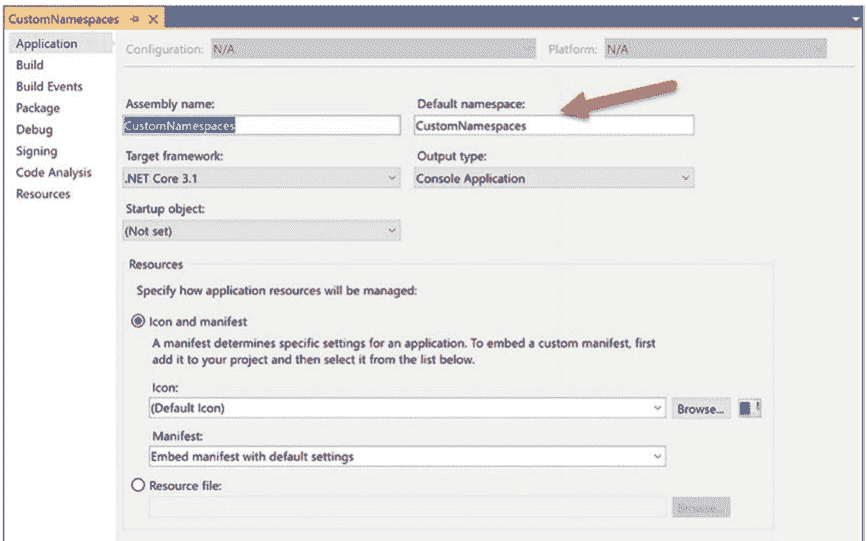
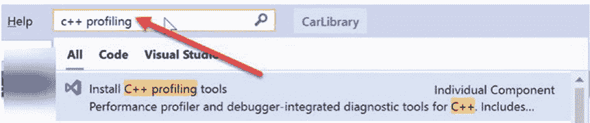
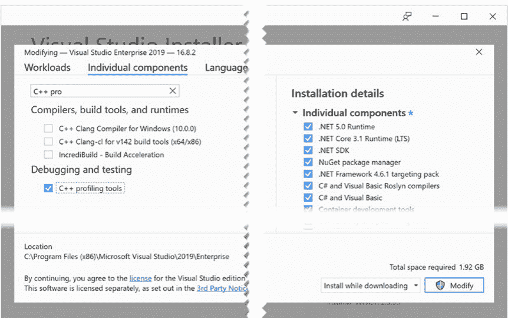
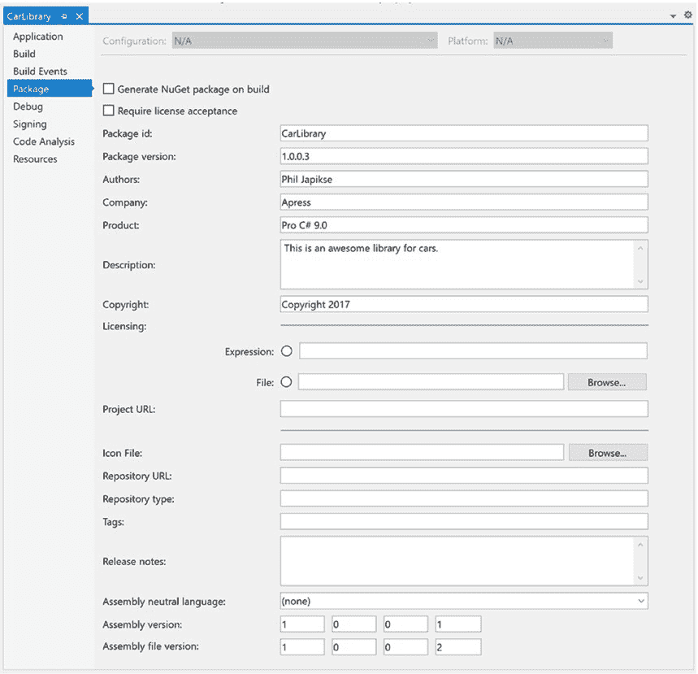

## 第 16 章

## 构建和配置类库

到目前为止，本书中的大多数示例都创建了“独立”的可执行应用程序，其中所有编程逻辑都打包在单个程序集（*.dll）中，并使用 dotnet.exe（或以程序集命名的 dotnet.exe 副本）执行。这些程序集使用的功能主要来自 .NET Core 基类库。虽然某些简单的 .NET Core 程序只使用基类库就可以构建，但你（或你的团队成员）很可能会经常将可复用的编程逻辑隔离到自定义类库（*.dll 文件）中，以便在多个应用程序之间共享。

在本章中，你将首先学习如何将类型划分到 .NET Core 命名空间中的详细信息。接下来，你将深入了解 .NET Core 中的类库、.NET Core 与 .NET Standard 之间的区别、应用程序配置、发布 .NET Core 控制台应用程序，以及如何将类库打包成可复用的 NuGet 包。

## 定义自定义命名空间

在深入了解类库部署和配置之前，首先需要学习如何将自定义类型打包到 .NET Core 命名空间中。到目前为止，在本书中你一直在构建利用 .NET Core 世界中现有命名空间（尤其是 System）的测试小程序。然而，当你构建包含许多类型的大型应用程序时，将相关类型分组到自定义命名空间中会很有帮助。在 C# 中，这是通过 namespace 关键字实现的。在创建共享程序集时，明确地定义自定义命名空间更加重要，因为其他开发人员需要引用该类库，并导入你的自定义命名空间，才能使用其中的类型。自定义命名空间还可以通过将自定义类与其他可能具有相同名称的自定义类隔离开来，避免名称冲突。

为了亲自了解这些问题，首先创建一个名为 CustomNamespaces 的新 .NET Core 控制台应用程序项目。现在，假设你正在开发一组名为 Square、Circle 和 Hexagon 的几何类。鉴于它们具有相似性，你希望将它们分组到 CustomNamespaces.exe 程序集内名为 MyShapes 的唯一命名空间中。

虽然 C# 编译器可以轻松处理包含多个类型的单个 C# 代码文件，但在团队环境中工作时，这可能会带来问题。如果你正在处理 Circle 类型，而你的同事需要处理 Hexagon 类，那么你们要么必须轮流编辑这个庞大的文件，要么就要面对难以解决（至少非常耗时）的合并冲突。


更好的做法是将每个类放在自己的文件中，每个文件都有命名空间定义。为了确保每个类型都被打包到同一个逻辑组中，只需将给定的类定义包装在同一个命名空间作用域中，如下所示：

```
namespace MyShapes
{
    // Circle class
    public class Circle { /* Interesting methods... */ }
}
```

```
// Hexagon.cs
namespace MyShapes
{
    // Hexagon class
    public class Hexagon { /* More interesting methods... */ }
}
```

```
// Square.cs
namespace MyShapes
{
    // Square class
    public class Square { /* Even more interesting methods...*/}
}
```

Guidance 认为每个代码文件中只包含一个类是一种最佳实践。虽然之前的一些示例没有这样做，但那是为了教学上的简便。从本书后续内容开始，我的意图是始终将每个类分离到自己的文件中。

注意 MyShapes 命名空间如何充当这些类的概念上的“容器”。当另一个命名空间（例如 CustomNamespaces）想要使用另一个命名空间中的类型时，你可以使用 using 关键字，就像使用 .NET Core 基类库的命名空间一样，如下所示：

```
// Bring in a namespace from the base class libraries.
using System;
// Make use of types defined the MyShapes namespace.
using MyShapes;

Hexagon h = new Hexagon();
Circle c = new Circle();
Square s = new Square();
```

对于此示例，假设定义 MyShapes 命名空间的 C# 文件是同一个控制台应用程序项目的一部分；换句话说，所有文件都被编译成单个程序集。如果你将 MyShapes 命名空间定义在外部程序集中，在成功编译之前你还需要添加对该库的引用。你将在本章学习使用外部库构建应用程序的所有细节。

## 使用完全限定名解决名称冲突

从技术上讲，你并不是必须使用 C# using 关键字来引用外部命名空间中定义的类型。你可以使用类型的完全限定名，其定义如你可能在第 1 章回忆的那样，是类型名称加上定义它的命名空间前缀。以下是示例：

```
// Note we are not importing MyShapes anymore!
using System;

MyShapes.Hexagon h = new MyShapes.Hexagon();
MyShapes.Circle c = new MyShapes.Circle();
MyShapes.Square s = new MyShapes.Square();
```

通常，没有必要使用完全限定名。不仅需要更多的击键，而且在代码大小或执行速度方面没有任何区别。事实上，在 CIL 代码中，类型始终使用完全限定名定义。在这种情况下，C# using 关键字只是一个节省输入时间的工具。

然而，完全限定名在处理使用多个包含同名类型的命名空间时可能很有帮助（有时是必要的），以避免潜在的名称冲突。假设你有一个名为 My3DShapes 的新命名空间，它定义了以下三个类，能够以惊人的 3D 效果渲染形状：

```
// Another shape-centric namespace.
//Circle.cs
namespace My3DShapes
{
    // 3D Circle class.
    public class Circle { }
}
//Hexagon.cs
namespace My3DShapes
{
    // 3D Hexagon class.
    public class Hexagon { }
}
//Square.cs
namespace My3DShapes
{
    // 3D Square class.
    public class Square { }
}
```

如果你按如下所示更新顶层语句，你会收到多个编译时错误，因为两个命名空间都定义了同名类：

```
// Ambiguities abound!
using System;
using MyShapes;
using My3DShapes;

// Which namespace do I reference?
Hexagon h = new Hexagon(); // Compiler error!
```

```
Circle c = new Circle();  // Compiler error!
Square s = new Square();  // Compiler error!
```

歧义可以通过使用类型的完全限定名来解决，如下所示：

```
// We have now resolved the ambiguity.
My3DShapes.Hexagon h = new My3DShapes.Hexagon();
My3DShapes.Circle c = new My3DShapes.Circle();
MyShapes.Square s = new MyShapes.Square();
```

## 使用别名解决名称冲突

C# using 关键字还允许你为类型的完全限定名创建别名。当你这样做时，你定义了一个在编译时被替换为类型全名的标记。定义别名提供了第二种解决名称冲突的方法。以下是示例：

```
using System;
using MyShapes;
using My3DShapes;
```

```
// Resolve the ambiguity using a custom alias.
using The3DHexagon = My3DShapes.Hexagon;
```

```
// This is really creating a My3DShapes.Hexagon class.
The3DHexagon h2 = new The3DHexagon();
...
```

这种替代的 using 语法还允许你为冗长的命名空间创建别名。较长的基类库命名空间之一是 System.Runtime.Serialization.Formatters.Binary，它包含一个名为 BinaryFormatter 的成员。如果你愿意，可以按如下方式创建 BinaryFormatter 的实例：

```
using bfHome = System.Runtime.Serialization.Formatters.Binary;
bfHome.BinaryFormatter b = new bfHome.BinaryFormatter();
...
```

以及使用传统的 using 指令：

```
using System.Runtime.Serialization.Formatters.Binary;
BinaryFormatter b = new BinaryFormatter();
...
```

在游戏的这个阶段，你无需关心 BinaryFormatter 类的用途（你将在第 20 章检查这个类）。现在，只需记住 C# using 关键字可用于为冗长的完全限定名定义别名，或更常见地，用于解决导入多个定义了同名类型的命名空间时可能出现的名字冲突。

> Note 请注意，过度使用 C# 别名可能导致代码库混乱。如果团队中的其他程序员不知道你的自定义别名，他们可能会假设别名指的是基类库中的类型，并在文档中找不到这些标记时感到非常困惑！

## 创建嵌套命名空间

在组织你的类型时，你可以自由地在其他命名空间内定义命名空间。基类库在许多地方都这样做，以提供更深层次的类型组织。例如，IO 命名空间嵌套在 System 中，形成 System.IO。

.NET Core 项目模板将 Program.cs 中的初始代码添加到以项目命名的命名空间中。此基本命名空间称为根命名空间。在此示例中，.NET Core 模板创建的根命名空间是 CustomNamespaces，如下所示：

```
namespace CustomNamespaces
{
    class Program
    {
    ...
    }
}
```

> Note 当用顶层语句替换 Program/Main() 组合时，你不能为这些顶层语句分配命名空间。

要将 MyShapes 和 My3DShape 命名空间嵌套在根命名空间内，有两个选项。第一个是简单地嵌套 namespace 关键字，如下所示：

```
namespace CustomNamespaces
{
    namespace MyShapes
    {
        // Circle class
        public class Circle
        {
            /* Interesting methods... */
        }
    }
}
```

另一个选项（更常见）是使用命名空间定义中的“点表示法”，如下所示：

```
namespace CustomNamespaces.MyShapes
{
    // Circle class
    public class Circle
    {
        /* Interesting methods... */
    }
}
```

命名空间不必直接包含任何类型。这允许开发人员使用命名空间提供进一步的范围级别。

鉴于你现在已将 My3DShape 命名空间嵌套在 CustomNamespaces 根命名空间内，你需要更新任何现有的 using 指令和类型别名，如下所示（假设你已将所有示例类更新为嵌套在根命名空间下）：

```
using The3DHexagon = CustomNamespaces.My3DShape.Hexagon;
using CustomNamespaces.MyShapes;
```

Guidance 一种常见做法是按目录对文件分组在命名空间中。如图所示，文件在目录结构中的位置对命名空间没有影响。然而，它使命名空间结构对其他开发人员更清晰（和具体）。因此，许多开发人员和代码 linting 工具期望命名空间与文件夹结构匹配。

## 更改 Visual Studio 的根命名空间

如前所述，当你使用 Visual Studio（或 .NET Core CLI）创建新的 C# 项目时，你应用程序的根命名空间名称将与项目名称相同。从现在开始，当你使用 Visual Studio 通过 Project ► Add New Item 菜单选项插入新的代码文件时，类型将自动包装在根命名空间中。如果你想更改根命名空间的名称，只需通过项目属性窗口的 Application 选项卡访问“Default namespace”选项即可（见图 16-1）。



Figure 16-1. Configuring the default namespace


> 注意 Visual Studio 属性页仍将根命名空间称为默认命名空间。你接下来会看到我为什么称其为根命名空间。

如果不使用 Visual Studio（即使使用 Visual Studio），你也可以通过更新项目（*.csproj）文件来配置根命名空间。对于 .NET Core 项目，在 Visual Studio 中编辑项目文件非常简单，只需在解决方案资源管理器中双击项目文件（或右键单击解决方案资源管理器中的项目文件并选择“编辑项目文件”）。文件打开后，通过在主 PropertyGroup 中添加 RootNamespace 节点来更新它，如下所示：

```
<Project Sdk="Microsoft.NET.Sdk">

  <PropertyGroup>
    <OutputType>Exe</OutputType>
    <TargetFramework>net5.0</TargetFramework>
    <RootNamespace>CustomNamespaces2</RootNamespace>
  </PropertyGroup>

</Project>
```

到目前为止，一切顺利。现在你已经了解了一些关于如何将自定义类型打包到组织良好的命名空间中的细节，让我们快速回顾一下 .NET Core 程序集的好处和格式。之后，你将深入了解创建、部署和配置自定义类库的细节。

## .NET Core 程序集的作用

.NET Core 应用程序是通过组合任意数量的程序集构建而成的。简单来说，程序集是由 .NET Core 运行时托管的、带版本号的、自描述的二进制文件。现在，尽管 .NET Core 程序集具有与以前 Windows 二进制文件相同的扩展名（*.exe 或 *.dll），但在内部它们与这些文件几乎没有共同之处。在展开最后这句话之前，让我们先考虑一下程序集格式提供的一些好处。

### 程序集促进代码重用

在之前的章节中构建控制台应用程序项目时，你可能会觉得所有应用程序的功能都包含在你正在构建的可执行程序集中。你的应用程序利用了始终可访问的 .NET Core 基础类库中包含的众多类型。

正如你可能知道的，代码库（也称为类库）是一个包含旨在被外部应用程序使用的类型的 *.dll。当你创建可执行程序集时，在创建应用程序时无疑会利用众多系统提供的和自定义代码库。请注意，代码库不必采用 *.dll 文件扩展名。完全有可能（尽管非常不常见）可执行程序集使用外部可执行文件中定义的类型。在这种情况下，被引用的 *.exe 也可被视为代码库。

无论代码库如何打包，.NET Core 平台都允许你以语言无关的方式重用类型。例如，你可以用 C# 创建一个代码库，并在任何其他 .NET Core 编程语言中重用该库。不仅可以将类型分配到不同语言，还可以从中派生。C# 中定义的基础类可以由 Visual Basic 编写的类扩展。

F# 中定义的接口可以由 C# 中定义的结构体实现，等等。重点是，当你开始将单个单体可执行文件拆分为多个 .NET Core 程序集时，你实现了 *语言中立* 的代码重用形式。

### 程序集建立类型边界

请记住，类型的 *完全限定名* 是由类型命名空间（例如 System）加上其名称（例如 Console）组成。严格来说，类型所在的程序集进一步确定了类型的身份。例如，如果你有两个唯一命名的程序集（比如 MyCars.dll 和 YourCars.dll），它们都定义了包含名为 SportsCar 的类的命名空间（CarLibrary），在 .NET Core 世界中它们被视为唯一的类型。

### 程序集是可版本化的单元

.NET Core 程序集被分配一个四部分的数字版本号，形式为 <major>.<minor>.<build>.<revision>。如果未显式提供版本号，则根据默认的 .NET Core 项目设置，程序集会自动分配 1.0.0.0 的版本。此编号允许同一台机器上和谐共存多个版本的同一程序集。

### 程序集是自描述的

程序集被视为 *自描述的*，部分原因是它们在程序集的 *清单* 中记录了使其正常运行所需访问的每个外部程序集。请回顾第 1 章，清单是描述程序集本身（名称、版本、所需外部程序集等）的元数据块。

除了清单数据外，程序集还包含描述每个包含类型的组成（成员名称、实现的接口、基类、构造函数等）的元数据。由于程序集有如此详细的文档，.NET Core 运行时在解析其位置时 *不会* 咨询 Windows 系统注册表（这与微软传统的 COM 编程模型大相径庭）。与注册表的分离是使 .NET Core 应用程序能够在 Windows 以外的其他操作系统上运行以及在同一台机器上支持多个版本的 .NET Core 的因素之一。

正如你在本章中会发现的，.NET Core 运行时使用了一种全新的方案来解析外部代码库的位置。

## 了解 .NET Core 程序集的格式

现在你已经了解了 .NET Core 程序集提供的一些好处，让我们换个角度，更好地了解程序集在内部是如何组成的。从结构上讲，.NET Core 程序集（*.dll 或 *.exe）由以下元素组成：

- 操作系统（例如 Windows）文件头
- CLR 文件头
- CIL 代码
- 类型元数据
- 程序集清单
- 可选的嵌入资源

虽然前两个元素（操作系统和 CLR 头）是你通常可以忽略的数据块，但它们也值得简要考虑。以下是每个元素的概述。

## 安装 C++ 配置文件工具

接下来的几个部分使用了一个名为 dumpbin.exe 的实用程序，它随 C++ 配置文件工具一起提供。要安装它们，输入 C++ 配置文件工具到快速搜索栏中，然后单击提示安装工具，如图 16-2 所示。



图 16-2. 从快速启动安装 C++ 配置文件工具

这将打开 Visual Studio 安装程序并选中该工具。或者，你也可以自行启动 Visual Studio 安装程序并选择图 16-3 中所示的组件。



图 16-3. 安装 C++ 配置文件工具

## 操作系统（Windows）文件头

操作系统文件头确立了程序集可以被目标操作系统（在以下示例中为 Windows）加载和操作这一事实。此头数据还标识要由操作系统托管的应用程序类型（基于控制台、基于 GUI 或 *.dll 代码库）。

使用 dumpbin.exe 实用程序（通过开发人员命令提示符）以 /headers 标志打开 CarLibrary.dll 文件，如下所示：

```
dumpbin /headers CarLibrary.dll
```

这将显示程序集的操作系统头信息（构建为 Windows 时显示如下）。以下是 CarLibrary.dll 的（部分）Windows 头信息：

```
Dump of file carlibrary.dll
PE signature found
File Type: DLL

FILE HEADER VALUES
    14C machine (x86)
    3 number of sections
BB89DC3D time date stamp
    0 file pointer to symbol table
    0 number of symbols
E0 size of optional header
2022 characteristics
    Executable
    Application can handle large (>2GB) addresses
    DLL
...
```

现在，请记住，大多数 .NET Core 程序员永远不需要关心 .NET Core 程序集嵌入的头格式。除非你恰好在构建新的 .NET Core 语言编译器（在这种情况下你会关心此类信息），否则你可以愉快地对头数据的肮脏细节一无所知。但请注意，当操作系统将二进制映像加载到内存中时，会在幕后使用此信息。

## CLR 文件头

CLR 头是所有 .NET Core 程序集必须支持（并且由于 C# 编译器而确实支持）以便由 .NET Core 运行时托管的数据块。简而言之，此头定义了众多标志，使运行时能够理解托管文件的布局。例如，存在标识元数据和资源在文件中的位置的标志、程序集构建时针对的运行时版本、（可选）公钥的值等等。再次执行 dumpbin.exe 并使用 /clrheader 标志。

```
dumpbin /clrheader CarLibrary.dll
```


下面展示了给定 .NET Core 程序集的内部 CLR 头信息：

```
Dump of file CarLibrary.dll
File Type: DLL

    clr Header:

        48 cb
        2.05 runtime version
        2158 [ B7C] RVA [size] of MetaData Directory
            1 flags
                IL Only
        0 entry point token
        0 [    0] RVA [size] of Resources Directory
        0 [    0] RVA [size] of StrongNameSignature Directory
        0 [    0] RVA [size] of CodeManagerTable Directory
        0 [    0] RVA [size] of VTableFixups Directory
        0 [    0] RVA [size] of ExportAddressTableJumps Directory
        0 [    0] RVA [size] of ManagedNativeHeader Directory

Summary

        2000 .reloc
        2000 .rsrc
        2000 .text
```

再说一次，作为 .NET Core 开发人员，你无需关心程序集 CLR 头信息的繁琐细节。只需了解每个 .NET Core 程序集都包含这些数据，当映像数据加载到内存时，.NET Core 运行时会幕后使用这些数据。现在，请你把注意力转向一些在日常编程任务中更有用的信息。

## CIL 代码、类型元数据和程序集清单

本质上，程序集包含 CIL 代码，如你所记得的，CIL 是一种与平台和 CPU 无关的中间语言。在运行时，内部的 CIL 会由即时（JIT）编译器根据平台和 CPU 特定的指令即时编译。基于这种设计，.NET Core 程序集确实可以在多种架构、设备和操作系统上执行。（即使你不了解 CIL 编程语言的细节，也能愉快而富有成效地生活；不过，第 19 章仍将介绍 CIL 的语法和语义。）

程序集还包含元数据，这些元数据完整描述了程序集所包含类型的格式，以及该程序集引用的外部类型的格式。.NET Core 运行时使用这些元数据来解析二进制文件中类型（及其成员）的位置、在内存中布局类型，并促进远程方法调用。在第 17 章讲解反射服务时，你将了解 .NET 元数据格式的细节。

程序集还必须包含关联的清单（也称为程序集元数据）。清单记录了程序集中的每个模块，确定了程序集的版本，并记录了当前程序集引用的任何外部程序集。在本章中，你将看到 CLR 在定位外部程序集引用的过程中广泛使用了程序集的清单。

## 可选程序集资源

最后，.NET Core 程序集可以包含任意数量的嵌入资源，例如应用程序图标、图像文件、声音片段或字符串表。实际上，.NET Core 平台支持只包含本地化资源的附属程序集。如果你希望基于特定区域性（英语、德语等）划分资源以构建国际化软件，这会非常有用。构建附属程序集的主题不在本书范围之内。如果你感兴趣，请查阅 .NET Core 文档了解附属程序集和本地化的信息。

## 类库与控制台应用程序

到目前为止，本书中的示例几乎全是 .NET Core 控制台应用程序。如果你是一位当前正在阅读本书的 .NET 开发人员，它们类似于 .NET 控制台应用程序，主要区别在于配置过程（将在后面介绍），当然，还有它们运行在 .NET Core 上。控制台应用程序有单一入口点（要么是指定的 Main() 方法，要么是顶级语句），可以与控制台交互，并且可以由操作系统直接启动。.NET Core 与 .NET 控制台应用程序的另一个区别是，.NET Core 中的控制台应用程序使用 .NET Core 应用程序主机（dotnet.exe）启动。

另一方面，类库没有入口点，因此不能直接启动。它们用于封装逻辑、自定义类型等，并被其他类库和/或控制台应用程序引用。换句话说，类库用于包含“.NET Core 程序集的作用”一节中讨论的内容。

## .NET Standard 与 .NET Core 类库

.NET Core 类库在 .NET Core 上运行，.NET 类库在 .NET 上运行。非常简单明了。然而，这也带来一个问题。假设你的组织有一个庞大的 .NET 代码库，你和你的团队可能已经在此基础上开发了多年。很可能你和你的团队多年来构建的应用程序使用了大量共享代码。也许是集中式日志记录、报告或特定领域的功能。

现在，你（和你的组织）希望将所有新开发迁移到 .NET Core。那所有这些共享代码怎么办？将所有遗留代码重写为 .NET Core 程序集的工作量可能相当大，而且在你所有的应用程序都迁移到 .NET Core 之前，你将不得不维护两个版本（一个 .NET 版本和一个 .NET Core 版本）。这会让生产力戛然而止。

幸运的是，.NET Core 的建设者已经考虑过这种情况。.NET Standard 是随 .NET Core 引入的一种新型类库项目，可以被 .NET 和 .NET Core 应用程序引用。不过，在你满怀期待之前，.NET (Core) 5 有一个问题。稍后会详细介绍。

每个 .NET Standard 版本都定义了一组通用 API，所有 .NET 版本（.NET、.NET Core、Xamarin 等）都必须支持这些 API 才能符合该标准。例如，如果你将一个类库构建为 .NET Standard 2.0 项目，它可以被 .NET 4.6.1+ 和 .NET Core 2.0+ 引用（此外还有各种版本的 Xamarin、Mono、通用 Windows 平台和 Unity）。

这意味着你可以将代码从 .NET 类库迁移到 .NET Standard 2.0 类库中，并且这些类库可以被 .NET Core 和 .NET 应用程序共享。这比维护同一代码的重复副本（每个框架一份）要好得多。

现在说说这个问题。每个 .NET Standard 版本都代表其所支持框架的最低公共标准。这意味着版本越低，你在类库中能做的事情就越少。虽然 .NET (Core) 5 和 .NET Core 3.1 都可以引用 .NET Standard 2.0 库，但你无法在 .NET Standard 2.0 库中使用大量的 C# 8.0（或任何 C# 9.0）功能。要获得完整的 C# 8.0 和 C# 9.0 支持，你必须使用 .NET Standard 2.1。而 .NET 4.8（原始 .NET Framework 的最新/最终版本）最高只支持到 .NET Standard 2.0。这仍然是在较新应用程序中利用现有代码的好机制，但并不是银弹。

## 配置应用程序

虽然可以把你 .NET Core 应用程序所需的所有信息都保存在源代码中，但在大多数重要的应用程序中，能够在运行时更改某些值至关重要。这通常通过随应用程序一起提供的配置文件来完成。

> 注意 以前的 .NET Framework 主要依赖名为 app.config（对于 ASP.NET 应用程序是 web.config）的 XML 文件。虽然基于 XML 的配置文件仍然可以使用，但配置 .NET Core 应用程序的主要方法是使用 JavaScript Object Notation（JSON）文件，如下节所示。配置将在 WPF 和 ASP.NET Core 相关章节中深入讨论。

为了说明这个过程，创建一个名为 FunWithConfiguration 的新 .NET Core 控制台应用程序，并向项目添加以下包引用：

```
dotnet new console -lang c# -n FunWithConfiguration -o .\FunWithConfiguration -f net5.0
dotnet add FunWithConfiguration package Microsoft.Extensions.Configuration.Json
```

这会向你的项目添加对基于 JSON 文件的 .NET Core 配置子系统（及其依赖项）的引用。要利用这一点，首先在项目中添加一个名为 appsettings.json 的新 JSON 文件。更新项目文件，确保在构建项目时该文件始终被复制到输出目录。

```
<ItemGroup>
    <None Update="appsettings.json">
        <CopyToOutputDirectory>Always</CopyToOutputDirectory>
    </None>
</ItemGroup>
```

最后，将文件更新为以下内容：

```
{
  "CarName": "Suzy"
}
```

> 注意 如果你不熟悉 JSON，它是一种名称-值对格式，每个对象都用花括号括起来。整个文件可以被读作一个单独的对象，子对象也用花括号标记。在本书后面，你将处理更复杂的 JSON 文件。

最后一步是读取配置文件并获取 CarName 值。将 Program.cs 中的 using 语句更新为以下内容：

```
using System;
using System.IO;
using Microsoft.Extensions.Configuration;
```


将 `Main()` 方法更新为以下内容：

```
static void Main(string[] args)
{
    IConfiguration config = new ConfigurationBuilder()
        .SetBasePath(Directory.GetCurrentDirectory())
        .AddJsonFile("appsettings.json", true, true)
        .Build();
}
```

新的配置系统从 `ConfigurationBuilder` 开始。通过它，你可以添加多个文件、设置属性（例如配置文件所在的位置），然后最终将配置构建为 `IConfiguration` 的实例。

获得 `IConfiguration` 实例后，调用它的方式与在 .NET 4.8 中基本相同。将以下代码添加到 `Main()` 方法的末尾，然后运行应用，你将在控制台中看到输出的值：

```
Console.WriteLine($"My car's name is {config["CarName"]}");
Console.ReadLine();
```

除了 JSON 文件之外，还有用于支持环境变量、Azure Key Vault、命令行参数等功能的配置包。有关更多信息，请参考 .NET Core 文档。

## 构建和使用 .NET Core 类库

要开始探索 .NET Core 类库的世界，你将首先创建一个包含少量公共类型的 *.dll 程序集（名为 CarLibrary）。首先，创建本章的解决方案。如果尚未创建，请创建一个名为 CarLibrary 的类库，并将其添加到本章的解决方案中。

```
dotnet new sln -n Chapter16_AllProjects
dotnet new classlib -lang c# -n CarLibrary -o .\CarLibrary -f net5.0
dotnet sln .\Chapter16_AllProjects.sln add .\CarLibrary
```

第一条命令会在当前目录中创建一个名为 Chapter16_AllProjects 的空解决方案文件（`-n`）。下一条命令会在名为 CarLibrary 的子目录（`-o`）中创建一个名为 CarLibrary（`-n`）的新 .NET 5.0（`-f`）类库。输出位置（`-o`）是可选的。如果省略该参数，项目将创建在与项目名称相同的子目录中。最后一条命令会将新项目添加到解决方案中。

注意 .NET Core CLI 拥有完善的帮助系统。要获取任意命令的帮助，请在命令后添加 `-h`。例如，要查看所有模板，请输入 `dotnet new -h`。要获取有关创建类库的更多信息，请输入 `dotnet new classlib -h`。

现在，你已经创建了项目和解决方案，可以在 Visual Studio（或 Visual Studio Code）中打开它，开始构建类。打开解决方案后，删除自动生成的文件 Class1.cs。

汽车类库的设计从 `EngineStateEnum` 和 `MusicMediaEnum` 枚举开始。向项目中添加两个文件，分别命名为 MusicMediaEnum.cs 和 EngineStateEnum.cs，并分别添加以下代码：

```
//MusicMediaEnum.cs
namespace CarLibrary
{
    // Which type of music player does this car have?
    public enum MusicMediaEnum
    {
        MusicCd,
        MusicTape,
        MusicRadio,
        MusicMp3
    }
}
//EngineStateEnum.cs
namespace CarLibrary
{
    // Represents the state of the engine.
    public enum EngineStateEnum
    {
        EngineAlive,
        EngineDead
    }
}
```

接下来，添加一个名为 Car 的抽象基类，通过自动属性语法定义各种状态数据。该类还包含一个名为 `TurboBoost()` 的抽象方法，该方法使用自定义枚举（`EngineStateEnum`）表示汽车发动机的当前状态。在项目中插入一个新的 C# 类文件，将其命名为 Car.cs，并包含以下代码：

```
using System;

namespace CarLibrary
{
    // The abstract base class in the hierarchy.
    public abstract class Car
    {
        public string PetName {get; set;}
        public int CurrentSpeed {get; set;}
        public int MaxSpeed {get; set;}

        protected EngineStateEnum State = EngineStateEnum.EngineAlive;
        public EngineStateEnum EngineState => State;
        public abstract void TurboBoost();

        protected Car(){}
        protected Car(string name, int maxSpeed, int currentSpeed)
        {
            PetName = name;
            MaxSpeed = maxSpeed;
            CurrentSpeed = currentSpeed;
        }
    }
}
```

现在，假设 Car 类型有两个直接派生类，分别名为 MiniVan 和 SportsCar。每个派生类都会重写抽象的 `TurboBoost()` 方法，并通过控制台消息显示适当的信息。在项目中插入两个新的 C# 类文件，分别命名为 MiniVan.cs 和 SportsCar.cs。使用相应的代码更新每个文件。

```
//SportsCar.cs
using System;
namespace CarLibrary
{
    public class SportsCar : Car
    {
        public SportsCar(){ }
        public SportsCar(
            string name, int maxSpeed, int currentSpeed)
            : base (name, maxSpeed, currentSpeed){ }

        public override void TurboBoost()
        {
            Console.WriteLine("Ramming speed! Faster is better...");
        }
    }
}
```

```
//MiniVan.cs
using System;
namespace CarLibrary
{
    public class MiniVan : Car
    {
        public MiniVan(){ }
        public MiniVan(
            string name, int maxSpeed, int currentSpeed)
            : base (name, maxSpeed, currentSpeed){ }

        public override void TurboBoost()
        {
            // Minivans have poor turbo capabilities!
            State = EngineStateEnum.EngineDead;
            Console.WriteLine("Eek! Your engine block exploded!");
        }
    }
}
```

## 探索清单

在客户端应用程序中使用 CarLibrary.dll 之前，我们先来了解一下该代码库在底层是如何组成的。假设你已经编译了该项目，请针对已编译的程序集运行 ildasm.exe。如果没有 ildasm.exe（本书前面介绍过），也可以在本书代码仓库的 Chapter 16 目录中找到它。

```
ildasm /all /METADATA /out=CarLibrary.il .\CarLibrary\bin\Debug\net5.0\CarLibrary.dll
```

反汇编结果中的 Manifest 部分以 `//Metadata version: 4.0.30319` 开头。紧接着是类库所需的所有外部程序集列表，如下所示：

```
// Metadata version: v4.0.30319
.assembly extern System.Runtime
{
    .publickeytoken = (B0 3F 5F 7F 11 D5 0A 3A )
    .ver 5:0:0:0
}
.assembly extern System.Console
{
    .publickeytoken = (B0 3F 5F 7F 11 D5 0A 3A )
    .ver 5:0:0:0
}
```

每个 `.assembly extern` 块都由 `.publickeytoken` 和 `.ver` 指令限定。只有在程序集配置了强名称时，才会出现 `.publickeytoken` 指令。`.ver` 标记定义所引用程序集的数字版本标识符。

注意 .NET Framework 的早期版本严重依赖强名称，强名称涉及公钥和私钥的组合。在 Windows 上，若要将程序集添加到全局程序集缓存（Global Assembly Cache），这是必需的；但随着 .NET Core 的出现，对强名称的需求已经大幅降低。

在外部引用之后，你会看到许多 `.custom` 标记，它们用于标识程序集级别的属性（其中一些由系统生成，此外还包括版权信息、公司名称、程序集版本等）。以下是这部分清单数据的一个（非常）不完整的列表：

```
.assembly CarLibrary
{
...
    .custom instance void ... TargetFrameworkAttribute ...
    .custom instance void ... AssemblyCompanyAttribute ...
    .custom instance void ... AssemblyConfigurationAttribute ...
    .custom instance void ... AssemblyFileVersionAttribute ...
    .custom instance void ... AssemblyProductAttribute ...
    .custom instance void ... AssemblyTitleAttribute ...
```

这些设置既可以通过 Visual Studio 的属性页进行设置，也可以编辑项目文件并添加相应的元素。在 Visual Studio 中进行编辑时，请在解决方案资源管理器中右键单击项目，选择“属性”，然后在窗口左侧栏中导航到“包”菜单。这将打开图 16-4 所示的对话框。



图 16-4。使用 Visual Studio 的“属性”窗口编辑程序集信息

向程序集添加元数据的另一种方式是直接编辑 *.csproj 项目文件。在项目文件的主 PropertyGroup 中进行以下更新，其效果与填写图 16-4 所示的表单相同。

```
<PropertyGroup>
    <TargetFramework>net5.0</TargetFramework>
    <Copyright>Copyright 2020</Copyright>
    <Authors>Phil Japikse</Authors>
    <Company>Apress</Company>
    <Product>Pro C# 9.0</Product>
    <PackageId>CarLibrary</PackageId>
    <Description>This is an awesome library for cars.</Description>
</PropertyGroup>
```


```
<AssemblyVersion>1.0.0.1</AssemblyVersion>
<FileVersion>1.0.0.2</FileVersion>
<Version>1.0.0.3</Version>
</PropertyGroup>
```

> **注意** 图16-4中其余的条目（以及项目文件列表）在从程序集生成NuGet包时使用。这将在本章后面介绍。

## 探索CIL

回顾一下，程序集并不包含平台特定的指令；相反，它包含与平台无关的公共中间语言（CIL）指令。当.NET Core运行时将程序集加载到内存中时，底层的CIL会被编译（使用JIT编译器）成目标平台可以理解的指令。例如，`SportsCar`类的`TurboBoost()`方法由以下CIL表示：

```
.method public hidebysig virtual
    instance void TurboBoost() cil managed
{
    .maxstack 8
    IL_0000: nop
    IL_0001: ldstr "Ramming speed! Faster is better..."
    IL_0006: call void [System.Console]System.Console::WriteLine(string)
    IL_000b: nop
    IL_000c: ret
}
// end of method SportsCar::TurboBoost
```

与本书中的其他CIL示例一样，大多数.NET Core开发人员不需要深入了解细节。第19章将更详细地介绍其语法和语义，这在构建需要高级服务（如程序集的运行时构造）的更复杂应用程序时可能会有所帮助。

## 探索类型元数据

在构建使用自定义.NET库的应用程序之前，先检视一下`CarLibrary.dll`程序集中类型的元数据。例如，以下是`EngineStateEnum`的TypeDef：

```
TypeDef #1 (02000002)
--------------------------------------------------
TypeDefName: CarLibrary.EngineStateEnum
Flags      : [Public] [AutoLayout] [Class] [Sealed] [AnsiClass]
Extends    : [TypeRef] System.Enum
Field #1
--------------------------------------------------
Field Name: value__
Flags      : [Public] [SpecialName] [RTSpecialName]
CallCnvntn: [FIELD]
Field type: I4

Field #2
--------------------------------------------------
Field Name: EngineAlive
Flags      : [Public] [Static] [Literal] [HasDefault]
DefltValue: (I4) 0
CallCnvntn: [FIELD]
Field type: ValueClass CarLibrary.EngineStateEnum

Field #3
--------------------------------------------------
Field Name: EngineDead
Flags      : [Public] [Static] [Literal] [HasDefault]
DefltValue: (I4) 1
CallCnvntn: [FIELD]
Field type: ValueClass CarLibrary.EngineStateEnum
```

正如下一章所解释的，程序集的元数据是.NET Core平台的一个重要元素，并且是众多技术（对象序列化、后期绑定、可扩展应用程序等）的支柱。无论如何，现在你已经查看了`CarLibrary.dll`程序集的内部，可以构建一些使用你的类型的客户端应用程序了。

## 构建C#客户端应用程序

由于`CarLibrary`的每个类型都是用`public`关键字声明的，其他.NET Core应用程序也可以使用它们。回顾一下，你也可以使用C#的`internal`关键字定义类型（实际上，这是C#类的默认访问模式）。内部类型只能由定义它们的程序集使用。外部客户端既不能看到也不能创建标记为`internal`关键字的类型。

> **注意** 此规则的例外情况是，程序集使用`InternalsVisibleTo`特性显式允许另一个程序集访问，这一点稍后会介绍。

为了使用库的功能，在与`CarLibrary`相同的解决方案中创建一个名为`CSharpCarClient`的新C#控制台应用程序项目。你可以使用Visual Studio（右键单击解决方案并选择“添加 ▶ 新建项目”）或使用命令行（三行，每行单独执行）来完成此操作。

```
dotnet new console -lang c# -n CSharpCarClient -o .\CSharpCarClient -f net5.0
dotnet add CSharpCarClient reference CarLibrary
dotnet sln .\Chapter16_AllProjects.sln add .\CSharpCarClient
```

上述命令创建了控制台应用程序，为新项目添加了对CarLibrary项目的项目引用，并将其添加到解决方案中。

> **注意** `add reference`命令创建的是项目引用。这对于开发很方便，因为`CSharpCarClient`将始终使用最新版本的`CarLibrary`。你也可以直接引用程序集。直接引用是通过引用编译后的类库来创建的。

如果你仍然在Visual Studio中打开解决方案，你会注意到新项目无需任何干预即可出现在解决方案资源管理器中。

最后一项更改是右键单击解决方案资源管理器中的`CSharpCarClient`，然后选择“设为启动项目”。如果你不使用Visual Studio，可以在项目目录中执行`dotnet run`来运行新项目。

> **注意** 你也可以在Visual Studio中设置项目引用，方法是右键单击解决方案资源管理器中的`CSharpCarClient`项目，选择“添加 ▶ 引用”，然后从项目的节点中选择`CarLibrary`项目。

此时，你可以构建客户端应用程序来使用外部类型。将你的初始C#文件更新如下：

```
using System;
// Don't forget to import the CarLibrary namespace!
using CarLibrary;

Console.WriteLine("***** C# CarLibrary Client App *****");
// Make a sports car.
SportsCar viper = new SportsCar("Viper", 240, 40);
viper.TurboBoost();

// Make a minivan.
MiniVan mv = new MiniVan();
mv.TurboBoost();

Console.WriteLine("Done. Press any key to terminate");
Console.ReadLine();
```

这段代码看起来与本书迄今开发的其他应用程序代码完全相同。唯一值得注意的是，该C#客户端应用程序现在使用了在单独的自定义库中定义的类型。运行程序并验证你是否看到消息显示。

你可能想知道引用`CarLibrary`项目时究竟发生了什么。当建立项目引用时，解决方案的构建顺序会被调整，以便依赖项目（此例中为`CarLibrary`）首先构建，然后该构建的输出会复制到父项目（`CSharpCarClient`）的输出目录中。编译后的客户端库引用编译后的类库。当客户端项目重新构建时，依赖库也会重新构建，新版本会再次复制到目标文件夹。

> **注意** 如果你使用的是Visual Studio，可以单击解决方案资源管理器中的“显示所有文件”按钮，查看所有输出文件并验证编译后的`CarLibrary`是否在那里。如果你使用的是Visual Studio Code，请在资源管理器选项卡中导航到`bin/debug/net5.0`目录。

当建立直接引用时，编译后的库也会复制到客户端库的输出目录中，但这是在建立引用时进行的。如果没有项目引用，项目可以彼此独立构建，文件可能会变得不同步。简而言之，如果你在开发依赖库（在真实软件项目中通常如此），最好是引用项目而不是项目输出。

## 构建Visual Basic客户端应用程序

回顾一下，.NET Core平台允许开发人员跨编程语言共享编译代码。为了说明.NET Core平台的语言无关性，让我们创建另一个控制台应用程序项目（`VisualBasicCarClient`），这次使用Visual Basic（请注意，每条命令都是一行命令）。

```
dotnet new console -lang vb -n VisualBasicCarClient -o .\VisualBasicCarClient -f net5.0
dotnet add VisualBasicCarClient reference CarLibrary
dotnet sln .\Chapter16_AllProjects.sln add VisualBasicCarClient
```

与C#一样，Visual Basic允许你列出当前文件中使用的每个命名空间。但是，Visual Basic提供`Imports`关键字而不是C#的`using`关键字，因此在`Program.vb`代码文件中添加以下`Imports`语句：

```
Imports CarLibrary
Module Program
    Sub Main()
    End Sub
End Module
```

请注意，`Main()`方法是在Visual Basic模块类型中定义的。简而言之，模块是Visual Basic中定义只能包含静态方法的类的一种表示法（很像C#的静态类）。无论如何，为了使用Visual Basic语法来使用`MiniVan`和`SportsCar`类型，请将你的`Main()`方法更新如下：

```
Sub Main()
    Console.WriteLine("***** VB CarLibrary Client App *****")
    ' Local variables are declared using the Dim keyword.
    Dim myMiniVan As New MiniVan()
    myMiniVan.TurboBoost()

    Dim mySportsCar As New SportsCar()
    mySportsCar.TurboBoost()
    Console.ReadLine()
End Sub
```

当你编译并运行应用程序时（确保在Visual Studio中将`VisualBasicCarClient`设置为启动项目），你将再次看到一系列显示的消息。此外，这个新的客户端应用程序在`bin\Debug\net5.0`文件夹下有自己本地副本的`CarLibrary.dll`。

## 跨语言继承的实际应用

.NET Core开发的一个诱人方面是跨语言继承的概念。为了说明这一点，让我们创建一个新的Visual Basic类，它派生自`SportsCar`（该类是用C#编写的）。首先，在你的当前Visual Basic应用程序中添加一个名为`PerformanceCar.vb`的新类文件。通过使用`Inherits`关键字从`SportsCar`类型派生，更新初始类定义。然后，使用`Overrides`关键字重写抽象的`TurboBoost()`方法，如下所示：

```
Imports CarLibrary
' This VB class is deriving from the C# SportsCar.
Public Class PerformanceCar
```


```
Inherits SportsCar
Public Overrides Sub TurboBoost()
    Console.WriteLine("Zero to 60 in a cool 4.8 seconds...")
End Sub
End Class
```

要测试这个新类类型，请按如下方式更新模块的 Main() 方法：

```
Sub Main()
...
Dim dreamCar As New PerformanceCar()

' Use Inherited property.
dreamCar.PetName = "Hank"
dreamCar.TurboBoost()
Console.ReadLine()
End Sub
```

请注意，dreamCar 对象可以调用继承链上找到的任何公共成员（例如 PetName 属性），尽管基类是在完全不同的语言和完全不同的程序集中定义的！以语言无关的方式跨程序集边界扩展类的能力是 .NET Core 开发周期的自然方面。这使得使用那些宁愿不使用 C# 构建其共享代码的个人编写的编译代码变得容易。

## 向其他程序集公开内部类型

如前所述，内部类仅对在其中定义的程序集中其他对象可见。例外情况是当显式授予另一个项目可见性时。

首先在 CarLibrary 项目中添加一个名为 MyInternalClass 的新类，并将代码更新为如下：

```
namespace CarLibrary
{
    internal class MyInternalClass
    {
    }
}
```

> 注 为什么要公开内部类型？这通常是为了单元和集成测试而做的。开发人员希望能够测试他们的代码，但不一定将其暴露在程序集边界之外。

## 使用程序集属性

第 17 章将深入介绍属性，但现在打开 CarLibrary 项目中的 Car.cs 类，并添加以下属性和 using 语句：

```
using System.Runtime.CompilerServices;
[assembly:InternalsVisibleTo("CSharpCarClient")]
namespace CarLibrary
{
}
```

InternalsVisibleTo 属性接受可以查看设置了该属性的类的项目的名称。请注意，其他项目不能“请求”此权限；必须由持有内部类型的项目授予。

> 注 .NET 的早期版本利用了 AssemblyInfo.cs 类，该类在 .NET Core 中仍然存在，但由系统自动生成，不用于开发人员使用。

现在你可以通过向 Main() 方法添加以下代码来更新 CSharpCarClient 项目：

```
var internalClassInstance = new MyInternalClass();
```

这可以完美运行。现在尝试在 VisualBasicCarClient Main 方法中做同样的事情。

```
'Will not compile
'Dim internalClassInstance = New MyInternalClass()
```

由于未授予 VisualBasicCarClient 库查看内部的权限，因此上一行代码将无法编译。

## 使用项目文件

另一种实现相同目的的方法（也可以说更符合 .NET Core 的方式）是使用 .NET Core 项目文件中的更新功能。

注释掉刚刚添加的属性并打开 CarLibrary 的项目文件。在项目文件中添加以下 ItemGroup：

```
<ItemGroup>
  <AssemblyAttribute Include="System.Runtime.CompilerServices.InternalsVisibleToAttribute">
    <_Parameter1>CSharpCarClient</_Parameter1>
  </AssemblyAttribute>
</ItemGroup>
```

这与在类上使用属性的效果相同，我认为这是一个更好的解决方案，因为其他开发人员可以在项目文件中直接看到它，而不必知道在项目中到处查找。

## NuGet 和 .NET Core

NuGet 是 .NET 和 .NET Core 的包管理器。它是一种以 .NET Core 应用程序理解的格式共享软件的机制，并且是加载 .NET Core 及其相关框架组件（ASP.NET Core、EF Core 等）的默认机制。许多组织将用于横切关注点（如日志记录和错误报告）的标准程序集打包成 NuGet 包，以便在业务应用中使用。

## 使用 NuGet 打包程序集

为了演示这一点，我们将把 CarLibrary 变成一个 NuGet 包，然后从两个客户端应用程序引用它。

NuGet 包属性可以从项目的属性页访问。右键单击 CarLibrary 项目并选择属性。导航到包页面，查看我们之前输入以自定义程序集的值。可以为 NuGet 包设置其他属性（即许可证协议接受以及项目信息，如 URL 和存储库位置）。

注意 Visual Studio 包页面 UI 中的所有值都可以手动输入到项目文件中，但你需要知道关键字。最好至少使用一次 Visual Studio 填写所有内容，然后你可以手动编辑项目文件。你也可以在 .NET Core 文档中找到所有允许的属性。

对于本示例，我们不需要设置任何其他属性，只需选中“在生成时生成 NuGet 包”复选框或更新项目文件中的以下内容：

```
<PropertyGroup>
    <TargetFramework>net5.0</TargetFramework>
    <Copyright>Copyright 2020</Copyright>
    <Authors>Phil Japikse</Authors>
    <Company>Apress</Company>
    <Product>Pro C# 9.0</Product>
    <PackageId>CarLibrary</PackageId>
    <Description>This is an awesome library for cars.</Description>
    <AssemblyVersion>1.0.0.1</AssemblyVersion>
    <FileVersion>1.0.0.2</FileVersion>
    <Version>1.0.0.3</Version>
    <GeneratePackageOnBuild>true</GeneratePackageOnBuild>
</PropertyGroup>
```

这将导致每次构建软件时都重建包。默认情况下，包将创建在 bin/Debug 或 bin/Release 文件夹中，具体取决于所选的配置。
包也可以从命令行创建，CLI 提供的选项比 Visual Studio 更多。例如，要构建包并将其放置在名为 Publish 的目录中，请在 CarLibrary 项目目录中输入以下命令。第一个命令构建程序集，第二个命令打包 NuGet 包。

```
dotnet build -c Release
dotnet pack -o .\Publish -c Debug
```

注意 Debug 是默认配置，因此不需要指定 -c Debug，但我明确包含该选项以完全清楚意图。

CarLibrary.1.0.0.3.nupkg 文件现在位于 Publish 目录中。要查看其内容，请使用任何 zip 实用程序（如 7-Zip）打开该文件，你可以看到整个内容，其中包括程序集，但也包括其他元数据。

## 引用 NuGet 包

你可能想知道在前面的示例中添加的包来自哪里。NuGet 包的位置由名为 NuGet.Config 的基于 XML 的文件控制。在 Windows 上，该文件位于 %appdata%\NuGet 目录中。这是主文件。打开它，你将看到几个包源。

```
<?xml version="1.0" encoding="utf-8"?>
<configuration>
  <packageSources>
    <add key="nuget.org" value="https://api.nuget.org/v3/index.json" protocolVersion="3" />
    <add key="Microsoft Visual Studio Offline Packages" value="C:\Program Files (x86)\Microsoft SDKs\NuGetPackages\" />
  </packageSources>
</configuration>
```

前面的文件列表显示了两个源。第一个指向 NuGet.org，这是世界上最大的 NuGet 包存储库。第二个在你的本地驱动器上，由 Visual Studio 用作包缓存。

需要注意的重要一点是，NuGet.Config 文件默认是累加的。为了在不更改整个系统列表的情况下添加其他源，你可以添加额外的 NuGet.Config 文件。每个文件对放置它的目录以及任何子目录都有效。在解决方案目录中添加一个名为 NuGet.Config 的新文件，并将内容更新为如下：

```
<?xml version="1.0" encoding="utf-8"?>
<configuration>
  <packageSources>
    <add key="local-packages" value=".\CarLibrary\Publish" />
  </packageSources>
</configuration>
```

你也可以通过在 <packageSources> 节点中添加 <clear/> 来重置包列表，如下所示：

```
<?xml version="1.0" encoding="utf-8"?>
<configuration>
  <packageSources>
    <clear />
    <add key="local-packages" value=".\CarLibrary\Publish" />
    <add key="NuGet" value="https://api.nuget.org/v3/index.json" />
  </packageSources>
</configuration>
```

注意 如果你使用 Visual Studio，则必须在更新 nuget.config 设置生效前重新启动 IDE。

从 CSharpCarClient 和 VisualBasicCarClient 项目中删除项目引用，然后像这样添加包引用（从解决方案目录）：

```
dotnet add CSharpCarClient package CarLibrary
dotnet add VisualBasicCarClient package CarLibrary
```


设置好引用后，构建解决方案并查看目标目录（bin\Debug\net5.0）中的输出，你会看到目录中有 CarLibrary.dll，而没有 CarLibrary.nupkg 文件。这是因为 .NET Core 会解包内容并将包含的程序集作为直接引用添加进来。

现在将其中一个客户端设为启动项目并运行应用程序，它的工作方式与之前完全相同。接下来，将 CarLibrary 的版本号更新为 1.0.0.4，并重新打包它。在 Publish 目录中，现在有两个 CarLibrary NuGet 包。如果重新运行 add package 命令，项目将被更新为使用新版本。如果更喜欢旧版本，add package 命令允许为特定包添加版本号。

## Publishing Console Applications (Updated .NET 5)

现在你有了 C# CarClient 应用程序（及其相关的 CarLibrary 程序集），如何将其发布给用户呢？将应用程序及其相关依赖项打包起来称为 *publishing*。发布 .NET Framework 应用程序需要在目标机器上安装框架，而 .NET Core 应用程序也可以以类似的方式发布，称为 *framework-dependent* 部署。然而，.NET Core 应用程序也可以发布为 *self-contained* 应用程序，完全不需要安装 .NET Core！

当以自包含方式发布应用程序时，必须指定目标运行时标识符。运行时标识符用于将应用程序打包给特定的操作系统。有关可用运行时标识符的完整列表，请参阅 .NET Core RID Catalog，网址为 https://docs.microsoft.com/en-us/dotnet/core/rid-catalog。

> **Note:** 发布 ASP.NET Core 应用程序是一个更复杂的过程，将在本书后面介绍。

### Publishing Framework-Dependent Applications

框架相关部署是 dotnet publish 命令的默认模式。要打包应用程序及其所需文件，只需使用 CLI 执行以下命令即可：

```
dotnet publish
```

> **Note:** publish 命令使用项目的默认配置，通常为 debug。

这会将应用程序及其支持文件（共 16 个文件）放置到 bin\Debug\net5.0\publish 目录中。检查添加到该目录的文件，你会看到两个 *.dll 文件（CarLibrary.dll 和 CSharpCarClient.dll），其中包含所有应用程序代码。需要提醒的是，CSharpCarClient.exe 文件是 dotnet.exe 的打包版本，已配置为启动 CSharpCarClient.dll。该目录中的其他文件是 .NET Core 文件，不属于 .NET Core 运行时。

要创建发布版本（将放置在 bin\Release\net5.0\publish 目录中），请输入以下命令：

```
dotnet publish -c release
```

### Publishing Self-Contained Applications

与框架相关部署类似，自包含部署包含所有应用程序代码和引用的程序集，但还包含应用程序所需的 .NET Core 运行时文件。要将应用程序作为自包含部署发布，请使用以下 CLI 命令（选择名为 selfcontained 的文件夹作为输出目标）：

```
dotnet publish -r win-x64 -c release -o selfcontained --self-contained true
```

> **Note:** 创建自包含部署时，需要运行时标识符，以便发布过程知道要连同应用程序代码一起包含哪些运行时文件。

这也会将应用程序及其支持文件（共 235 个文件）放置到 selfcontained 目录中。如果将这些文件复制到另一台 64 位 Windows 计算机上，即使未安装 .NET 5 运行时也可以运行该应用程序。

### Publishing Self-Contained Applications as a Single File

在大多数情况下，部署 235 个文件（对于一个只打印几行文本的应用程序）可能不是将应用程序分发给用户的最有效方式。幸运的是，.NET 5 大大改进了将应用程序和跨平台运行时文件发布为单个文件的能力。唯一未包含的文件是必须存在于单个 EXE 之外的本机库。

以下命令为 64 位 Windows 操作系统创建单个文件、自包含部署包，并将结果文件放置在名为 singlefile 的文件夹中。

```
dotnet publish -r win-x64 -c release -o singlefile --self-contained true -p:PublishSingleFile=true
```

当你检查创建的文件时，你会发现一个可执行文件（CSharpCarClient.exe）、一个调试文件（CSharpCarClient.pdb）和四个特定于操作系统的 DLL。虽然之前的发布过程产生了 235 个文件，但单文件版本的 CSharpCarClient.exe 大小为 54 MB！创建单文件发布将 235 个文件打包到单个文件中。文件数量减少所带来的好处是以文件大小为代价换来的。

最后说明，本机库可以与单文件一起打包。将 CSharpCarClient.csproj 文件更新为以下内容：

```
<Project Sdk="Microsoft.NET.Sdk">
  <ItemGroup>
    <PackageReference Include="CarLibrary" Version="1.0.0.3" />
  </ItemGroup>
  <PropertyGroup>
    <OutputType>Exe</OutputType>
    <TargetFramework>net5.0</TargetFramework>
    <IncludeNativeLibrariesForSelfExtract>true</IncludeNativeLibrariesForSelfExtract>
  </PropertyGroup>
</Project>
```

如果再次运行相同的命令，输出确实是单个文件。然而，这只是一种传输机制。本机文件将在应用程序在目标机器上执行时被提取到临时位置。

## How .NET Core Locates Assemblies

到目前为止，本书中构建的所有程序集都是直接相关的（除了你刚刚完成的 NuGet 示例）。你是在项目之间添加了项目引用或直接引用。在这些情况下（以及 NuGet 示例中），依赖程序集会直接复制到客户端应用程序的目标目录中。定位依赖程序集不是问题，因为它们与需要它们的应用程序位于磁盘的同一位置。

但是 .NET Core 框架呢？它们是如何定位的？以前版本的 .NET 会将框架文件安装到全局程序集缓存（GAC）中，所有 .NET 应用程序都知道如何定位框架文件。

然而，GAC 阻止了 .NET Core 的并排功能，因此没有单一的运行时和框架文件存储库。相反，构成框架的文件安装在 C:\Program Files\dotnet（在 Windows 上）中，按版本分隔。根据应用程序的版本（在 .csproj 文件中指定），必要的运行时和框架文件会从指定版本的目录中加载给应用程序。

具体来说，当启动运行时版本时，运行时主机提供一组探测路径，用于查找应用程序的依赖项。有五个探测属性（每个都是可选的），如表 16-1 所列。

**Table 16-1. Application Probing Properties**

| Option | Meaning in Life |
|---|---|
| TRUSTED_PLATFORM_ASSEMBLIES | List of platform and application assembly file paths |
| PLATFORM_RESOURCE_ROOTS | List of directory paths to search for satellite resource assemblies |
| NATIVE_DLL_SEARCH_DIRECTORIES | List of directory paths to search for unmanaged (native) libraries |
| APP_PATHS | List of directory paths to search for managed assemblies |
| APP_NI_PATHS | List of directory paths to search for native images of managed assemblies |

要查看这些属性的默认路径，创建一个名为 FunWithProbingPaths 的新 .NET Core 控制台应用程序。将顶层语句更新为以下内容：

```
using System;
using System.Linq;

Console.WriteLine("*** Fun with Probing Paths ***");
Console.WriteLine($"TRUSTED_PLATFORM_ASSEMBLIES: ");
//Use ':' on non-Windows platforms
var list = AppContext.GetData("TRUSTED_PLATFORM_ASSEMBLIES")
    .ToString().Split(';');

foreach (var dir in list)
{
    Console.WriteLine(dir);
}
Console.WriteLine();
Console.WriteLine($"PLATFORM_RESOURCE_ROOTS: {AppContext.GetData ("PLATFORM_RESOURCE_ROOTS")}");
Console.WriteLine();
```


```
Console.WriteLine($"NATIVE_DLL_SEARCH_DIRECTORIES: {AppContext.GetData ("NATIVE_DLL_SEARCH_DIRECTORIES")}");
Console.WriteLine();
Console.WriteLine($"APP_PATHS: {AppContext.GetData("APP_PATHS")}");
Console.WriteLine();
Console.WriteLine($"APP_NI_PATHS: {AppContext.GetData("APP_NI_PATHS")}");
Console.WriteLine();
Console.ReadLine();
```

运行此应用程序时，你会看到大部分值都来自 TRUSTED_PLATFORM_ASSEMBLIES 变量。除了在目标目录中为此项目创建的程序集外，你还会看到来自当前运行时目录的基类库列表，C:\Program Files\dotnet\shared\Microsoft.NETCore.App\5.0.0（你的版本号可能不同）。

每个由你的应用程序直接引用的文件都会被添加到列表中，以及为你的应用程序所需的所有运行时文件。运行时库的列表由随 .NET Core 运行时加载的一个或多个 *.deps.json 文件填充。SDK 的安装目录（用于构建软件）和运行时（用于运行软件）中都有多个此类文件。对于我们的简单示例，唯一使用的文件是 Microsoft.NETCore.App.deps.json。

随着应用程序复杂度的增长，TRUSTED_PLATFORM_ASSEMBLIES 中的文件列表也会增长。例如，如果你添加对 Microsoft.EntityFrameworkCore 包的引用，所需程序集的列表就会增长。为演示这一点，在程序包管理器控制台（与 *.csproj 文件相同目录）中输入以下命令：

```
dotnet add package Microsoft.EntityFrameworkCore
```

添加包后，重新运行应用程序，注意列出了多少更多文件。即使你只添加了一个新引用，Microsoft.EntityFrameworkCore 包也有其依赖项，这些依赖项会被添加到受信任文件列表中。

## Summary

本章研究了 .NET Core 类库（又名 .NET *.dlls）的作用。正如你所见，类库是 .NET Core 二进制文件，其中包含旨在在各种项目中重用的逻辑。

你学习了将类型划分为 .NET Core 命名空间的细节，以及 .NET Core 与 .NET Standard 之间的区别，开始了解应用程序配置，并深入研究了类库的组成。接下来你学习了如何发布 .NET Core 控制台应用程序。最后，你学习了如何使用 NuGet 打包你的应用程序。
