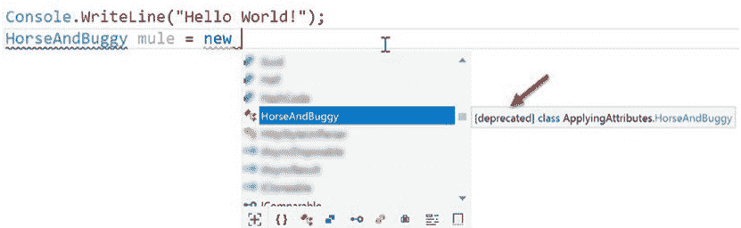
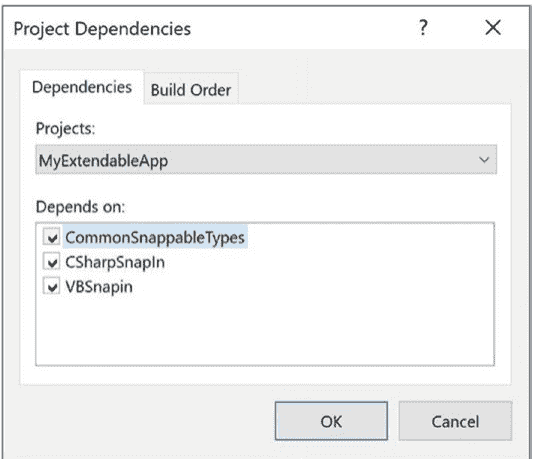

## CHAPTER 17

## Type Reflection, Late Binding, and Attribute-Based Programming

正如第 16 章所示，程序集是 .NET Core 宇宙中的基本部署单元。使用 Visual Studio（以及众多其他 IDE）的集成对象浏览器，你可以检查项目引用程序集集中的类型。此外，像 ildasm.exe 这样的外部工具允许你窥探给定 .NET Core 二进制文件的底层 CIL 代码、类型元数据和程序集清单。除了这种设计时对 .NET Core 程序集的调查之外，你还能够使用 System.Reflection 命名空间以编程方式获取相同的信息。为此，本章的第一个任务是定义反射的作用以及 .NET Core 元数据的必要性。

本章的其余部分研究了几个密切相关的主题，这些主题都依赖于反射服务。例如，你将学习 .NET Core 客户端如何采用动态加载和后期绑定来激活其在编译时不知道的类型。你还将学习如何使用系统提供的和自定义属性向 .NET Core 程序集中插入自定义元数据。为了将所有这些（看似深奥的）主题置于适当的背景下，本章最后通过演示如何构建几个“即插即用对象”来收尾，这些对象可以插入到可扩展的控制台应用程序中。

## The Necessity of Type Metadata

使用元数据完全描述类型（类、接口、结构、枚举和委托）的能力是 .NET Core 平台的关键要素。许多 .NET Core 技术，如对象序列化，需要在运行时发现类型的格式。此外，跨语言互操作性、众多编译器服务以及 IDE 的 IntelliSense 功能都依赖于类型的具体描述。

回想一下，ildasm.exe 实用程序允许你查看程序集的类型元数据。在生成的 CarLibrary.il 文件（来自第 16 章）中，导航到 METAINFO 部分以查看 CarLibrary 的所有元数据。这里包含一个小片段：

// === M E T A I N F O ===

// ===================================================
// ScopeName : CarLibrary.dll
// MVID      : {598BC2B8-19F9-46EF-B8DA-672A9E99B603}
// ===================================================
// Global functions
// ---------------------------------------------------
// Global fields
```

```
// ------------------------------------------------------------
//
// Global MemberRefs
// ------------------------------------------------------------
//
// TypeDef #1
// ------------------------------------------------------------
//    TypDefName: CarLibrary.Car
//    Flags      : [Public] [AutoLayout] [Class] [Abstract] [AnsiClass] [BeforeFieldInit]
//    Extends    : [TypeRef] System.Object
//    Field #1
// ------------------------------------------------------------
//    Field Name: value__
//    Flags     : [Private]
//    CallCnvtnt: [FIELD]
//    Field type: String
//
```

正如你所见，.NET Core 类型元数据非常冗长（实际的二进制格式要紧凑得多）。事实上，如果我要列出表示 CarLibrary.dll 程序集的整个元数据描述，它将跨越数页。鉴于此举将是浪费纸张的可悲行为，让我们只是瞥见 CarLibrary.dll 程序集的一些关键元数据描述。

> Note 不要太担心接下来几节中 .NET Core 元数据的每一段确切语法。需要吸收的更大要点是，.NET Core 元数据非常具有描述性，并且列出了给定代码库中每个内部定义（和外部引用）的类型。

## Viewing (Partial) Metadata for the EngineStateEnum Enumeration

当前程序集中定义的每个类型都使用 TypeDef #n 标记记录（其中 TypeDef 是 type definition 的缩写）。如果所描述的类型使用在单独的 .NET Core 程序集中定义的类型，则引用的类型使用 TypeRef #n 标记记录（其中 TypeRef 是 type reference 的缩写）。TypeRef 标记是指向外部程序集中引用类型的完整元数据定义的指针（如果愿意的话）。简而言之，.NET Core 元数据是一组表，清楚地列出了所有类型定义（TypeDefs）和引用类型（TypeRefs），所有这些都可以使用 ilasm.exe 检查。

就 CarLibrary.dll 而言，一个 TypeDef 是 CarLibrary.EngineStateEnum 枚举的元数据描述（你的编号可能不同；TypeDef 编号基于 C# 编译器处理文件的顺序）。

```
// TypeDef #2
// ------------------------------------------------------------
//    TypDefName: CarLibrary.EngineStateEnum
//    Flags      : [Public] [AutoLayout] [Class] [Sealed] [AnsiClass]
//    Extends    : [TypeRef] System.Enum
//    Field #1
// ------------------------------------------------------------
//    Field Name: value__
//    Flags      : [Public] [SpecialName] [RTSpecialName]
```

```
//   CallCnvtn: [FIELD]
//   Field type:  I4
//
// Field #2
// --------------------------------------------------
//   Field Name: EngineAlive
//   Flags      : [Public] [Static] [Literal] [HasDefault]
//   DefltValue: (I4) 0
//   CallCnvtn: [FIELD]
//   Field type:  ValueClass CarLibrary.EngineStateEnum
//
...
```

这里，TypDefName 标记用于建立给定类型的名称，在本例中为自定义 CarLibrary.EngineStateEnum 枚举。Extends 元数据标记用于记录给定 .NET Core 类型的基类型（在本例中为引用类型 System.Enum）。枚举的每个字段都使用 Field #n 标记标记。为了简洁起见，我只列出了部分元数据。

> Note 虽然看起来像拼写错误，但 TypDefName 没有人们期望的“e”。

## Viewing (Partial) Metadata for the Car Type

以下是 Car 类的部分转储，说明了以下内容：

- 如何以 .NET Core 元数据的形式定义字段
- 如何通过 .NET Core 元数据记录方法
- 如何在 .NET Core 元数据中表示自动属性

```
// TypeDef #1
// --------------------------------------------------
// TypDefName: CarLibrary.Car
// Flags      : [Public] [AutoLayout] [Class] [Abstract] [AnsiClass] [BeforeFieldInit]
// Extends    : [TypeRef] System.Object
// Field #1
// --------------------------------------------------
//   Field Name: <PetName>k__BackingField
//   Flags      : [Private]
//   CallCnvtn: [FIELD]
//   Field type:  String
...
Method #1
--------------------------------------------------
  MethodName: get_PetName
  Flags      : [Public] [HideBySig] [ReuseSlot] [SpecialName]
  RVA        : 0x000020d0
  ImplFlags  : [IL] [Managed]
  CallCnvtn: [DEFAULT]
```


```
hasThis
ReturnType: String
No arguments.

...
```

```
//  Method #2
//  ------------------------------------------------
//      MethodName: set_PetName
//      Flags      : [Public] [HideBySig] [ReuseSlot] [SpecialName]
//      RVA        : 0x00002058
//      ImplFlags  : [IL] [Managed]
//      CallCnvtn : [DEFAULT]
//      hasThis
//      ReturnType: Void
//      1 Arguments
//      Argument #1: String
//      1 Parameters
//          (1) ParamToken : Name : value flags: [none]
...
```

```
//  Property #1
//  ------------------------------------------------
//      Prop.Name  : PetName
//      Flags      : [none]
//      CallCnvtn: [PROPERTY]
//      hasThis
//      ReturnType: String
//      No arguments.
//      DefltValue:
//      Setter     : set_PetName
//      Getter     : get_PetName
//      0 Others
...
```

首先，请注意 Car 类的元数据标记了类型的基类（System.Object），并包含了描述该类型构造方式的各种标志（例如 [Public]、[Abstract] 等等）。方法（例如 Car 的构造函数）由其参数、返回值和名称来描述。

请注意，自动属性会导致编译器生成的私有支持字段（其名称为 <PetName>k__BackingField）以及两个编译器生成的方法（对于读写属性而言），在本例中命名为 get_PetName() 和 set_PetName()。最后，实际的属性通过 .NET Core 元数据中的 Getter/Setter 标记映射到内部的 get/set 方法。

## 检查 TypeRef

请记住，程序集的元数据不仅会描述内部类型集（Car、EngineStateEnum 等），还会描述内部类型引用的任何外部类型。例如，鉴于 CarLibrary.dll 定义了两个枚举，你会找到 System.Enum 类型的 TypeRef 块，如下所示：

// TypeRef #19
// --------------------------------------------------
// Token:          0x01000013
// ResolutionScope: 0x23000001
// TypeRefName:    System.Enum

## 记录定义程序集

CarLibrary.il 文件还允许你使用 Assembly 标记查看描述程序集本身的 .NET Core 元数据。以下是 CarLibrary.dll 清单的部分转储：

// Assembly
// --------------------------------------------------
// Token: 0x20000001
// Name : CarLibrary
// Public Key  :
// Hash Algorithm : 0x00008004
// Version: 1.0.0.1
// Major Version: 0x00000001
// Minor Version: 0x00000000
// Build Number: 0x00000000
// Revision Number: 0x00000001
// Locale: <null>
// Flags : [none] (00000000)

## 记录引用的程序集

除了 Assembly 标记和 TypeDef 与 TypeRef 块集之外，.NET Core 元数据还使用 AssemblyRef #n 标记来记录每个外部程序集。鉴于每个 .NET Core 程序集都引用 System.Runtime 基类库程序集，你会找到 System.Runtime 程序集的 AssemblyRef，如以下代码所示：

// AssemblyRef #1 (23000001)
// --------------------------------------------------
// Token: 0x23000001
// Public Key or Token: b0 3f 5f 7f 11 d5 0a 3a
// Name: System.Runtime
// Version: 5.0.0.0
// Major Version: 0x00000005
// Minor Version: 0x00000000
// Build Number: 0x00000000
// Revision Number: 0x00000000
// Locale: <null>
// HashValue Blob:
// Flags: [none] (00000000)

## 记录字符串文字

关于 .NET Core 元数据的最后一点是，你代码库中的每个字符串文字都在 User Strings 标记下记录。

```
// User Strings
// ------------------------------------------------------------
// 70000001 : (23) L"CarLibrary Version 2.0!"
// 70000031 : (13) L"Quiet time..."
// 7000004d : (11) L"Jamming {0}"
// 70000065 : (32) L"Eek! Your engine block exploded!"
// 700000a7 : (34) L"Ramming speed! Faster is better..."
```

注意 如本最后的元数据列表所示，请始终注意所有字符串都清晰地记录在程序集元数据中。如果使用字符串文字表示密码、信用卡号或其他敏感信息，这可能会产生巨大的安全后果。

你脑中接下来可能出现的疑问是（在最佳情况下）“我如何在我的应用程序中利用这些信息？” 或（在最坏情况下）“我为什么要关心元数据？” 为了回应这两种观点，请允许我介绍 .NET Core 反射服务。请注意，在本章结束之前，接下来几页中介绍的主题的实用性可能有点令人费解。所以，请坚持下去。

注意 你还会发现 METAINFO 部分显示了一些 CustomAttribute 标记，该部分记录了代码库中应用的属性。你将在本章后面了解 .NET Core 属性的作用。

## 理解反射

在 .NET Core 宇宙中，反射是运行时类型发现的过程。使用反射服务，你可以以友好的对象模型编程方式获取由 ildasm.exe 生成的相同元数据信息。例如，通过反射，你可以获取给定 *.dll 或 *.exe 程序集中包含的所有类型的列表，包括给定类型定义的方法、字段、属性和事件。你还可以动态发现给定类型支持的接口集、方法的参数以及其他相关详细信息（基类、命名空间信息、清单数据等）。

像任何命名空间一样，System.Reflection（定义在 System.Runtime.dll 中）包含几个相关的类型。表 17-1 列出了你应该熟悉的一些核心项。

### 表 17-1. System.Reflection 命名空间成员的采样

| Type | Meaning in Life |
|------|-----------------|
| Assembly | 这个抽象类包含允许你加载、调查和操作程序集的成员。 |
| AssemblyName | 这个类允许你发现程序集标识背后的众多细节（版本信息、区域性信息等）。 |
| EventInfo | 这个抽象类保存给定事件的信息。 |
| FieldInfo | 这个抽象类保存给定字段的信息。 |
| MemberInfo | 这是定义 EventInfo、FieldInfo、MethodInfo 和 PropertyInfo 类型通用行为的抽象基类。 |
| MethodInfo | 这个抽象类包含给定方法的信息。 |
| Module | 这个抽象类允许你访问多文件程序集中给定的模块。 |
| ParameterInfo | 这个类保存给定参数的信息。 |
| PropertyInfo | 这个抽象类保存给定属性的信息。 |

要了解如何利用 System.Reflection 命名空间以编程方式读取 .NET Core 元数据，你需要首先接受 System.Type 类。

## System.Type 类

System.Type 类定义了可用于检查类型元数据的成员，其中许多返回 System.Reflection 命名空间中的类型。例如，Type.GetMethods() 返回 MethodInfo 对象数组，Type.GetFields() 返回 FieldInfo 对象数组，等等。System.Type 暴露的完整成员集相当庞大；然而，表 17-2 提供了 System.Type 支持的成员的部分快照（请参阅 .NET Core 文档以获取完整详细信息）。

### 表 17-2. System.Type 的选定成员

| Member | Meaning in Life |
|--------|-----------------|
| IsAbstract | 这些属性（其中其他）允许你发现有关你所指类型的许多基本特征（例如，它是否是抽象实体、数组、嵌套类等）。 |
| IsArray |  |
| IsClass |  |
| IsCOMObject |  |
| IsEnum |  |
| IsGenericTypeDefinition |  |
| IsGenericParameter |  |
| IsInterface |  |
| IsPrimitive |  |
| IsNestedPrivate |  |
| IsNestedPublic |  |
| IsSealed |  |
| IsValueType |  |

表 17-2. （续）

| Member | Meaning in Life |
|---|---|
| GetConstructors() | 这些方法（其中其他）允许你获得表示 |
| GetEvents() | 你感兴趣的项目（接口、方法、属性等）的数组。每个 |
| GetFields() | 方法返回相关的数组（例如，GetFields() 返回 FieldInfo 数组， |
| GetInterfaces() | GetMethods() 返回 MethodInfo 数组等）。请注意，这些方法中的每一个 |
| GetMembers() | 都有单数形式（例如 GetMethod()、GetProperty() 等），允许你按名称检索特定项， |
| GetMethods() | 而不是所有相关项的数组。 |
| GetNestedTypes() |  |
| GetProperties() |  |
| FindMembers() | 此方法根据搜索条件返回 MemberInfo 数组。 |
| GetType() | 此静态方法根据字符串名称返回 Type 实例。 |
| InvokeMember() | 此方法允许对给定项进行“后期绑定”。你将在本章后面了解后期绑定。 |

## 使用 System.Object.GetType() 获取类型引用

你可以通过多种方式获得 Type 类的实例。然而，你无法使用 new 关键字直接创建 Type 对象，因为 Type 是一个抽象类。关于你的第一个选择，请记住 System.Object 定义了一个名为 GetType() 的方法，该方法返回表示当前对象的元数据的 Type 类实例。

```
// Obtain type information using a SportsCar instance.
SportsCar sc = new SportsCar();
Type t = sc.GetType();
```

显然，这种方法只有在你有编译时对想要反射的类型（本例中为 SportsCar）的了解，并且当前在内存中有该类型的实例时才有效。鉴于此限制，应该可以理解，像 ildasm.exe 这样的工具不会通过为每种类型直接调用 System.Object.GetType() 来获取类型信息，因为 ildasm.exe 并未针对你的自定义程序集编译。

## 使用 typeof() 获取类型引用

获取类型信息的下一个方法是使用 C# typeof 运算符，如下所示：

// Get the type using typeof.
Type t = typeof(SportsCar);

与 System.Object.GetType() 不同，typeof 运算符的优点在于你不需要先创建对象实例即可提取类型信息。然而，你的代码库仍必须在编译时了解你感兴趣检查的类型，因为 typeof 期望类型的强类型名称。


# 使用 System.Type.GetType() 获取类型引用

要以更灵活的方式获取类型信息，可以调用 System.Type 类的静态 GetType() 成员，并指定你感兴趣的类型完全限定字符串名称。使用这种方法，你不需要在编译时就知道你要提取元数据的类型，因为 Type.GetType() 接受一个无处不在的 System.String 实例。

> 注意 当我说调用 Type.GetType() 时你不需要编译时知识时，我指的是该方法可以接受任何字符串值（而不是强类型变量）。当然，你仍然需要以“字符串化”格式知道类型的名称！

Type.GetType() 方法已被重载以允许你指定两个布尔参数，其中一个控制如果找不到类型是否应抛出异常，另一个建立字符串的大小写敏感性。为了说明，请思考以下内容：

```
// 使用静态 Type.GetType() 方法获取类型信息
// （如果找不到 SportsCar 则不抛出异常且忽略大小写）。
Type t = Type.GetType("CarLibrary.SportsCar", false, true);
```

在前面的示例中，注意你传递给 GetType() 的字符串中没有提到包含该类型的程序集。在这种情况下，假设该类型是在当前执行的程序集中定义的。然而，当你想要获取外部程序集中类型的元数据时，字符串参数的格式使用类型的完全限定名称，后跟一个逗号，后跟包含该类型的程序集的友好名称（程序集名称不含任何版本信息），如下所示：

```
// 获取外部程序集中类型的类型信息。
Type t = Type.GetType("CarLibrary.SportsCar, CarLibrary");
```

此外，请注意传递给 Type.GetType() 的字符串可以指定加号标记（+）来表示嵌套类型。假设你想要获取嵌套在名为 JamesBondCar 的类中的枚举（SpyOptions）的类型信息。为此，你将编写以下内容：

```
// 获取当前程序集中嵌套枚举的类型信息
Type t = Type.GetType("CarLibrary.JamesBondCar+SpyOptions");
```

## 构建自定义元数据查看器

为了说明反射的基本过程（以及 System.Type 的有用性），让我们创建一个名为 MyTypeViewer 的控制台应用程序项目。此程序将显示 System.Runtime.dll 中任何类型的详细信息的方法、属性、字段和支持的接口（以及其他一些感兴趣的点），或 MyTypeViewer 本身中的类型（回想一下所有 .NET Core 应用程序都自动访问此核心框架类库）。一旦应用程序创建完毕，请确保导入 System、System.Reflection 和 System.Linq 命名空间。

```
// 需要导入此命名空间来进行任何反射！
using System;
using System.Linq;
using System.Reflection;
```

## 反射方法

将向 Program 类添加几个静态方法，每个方法都接受单个 System.Type 参数并返回 void。首先是 ListMethods()，它（正如你可能猜到的）打印传入类型定义的方法的名称。注意 Type.GetMethods() 返回一个 System.Reflection.MethodInfo 对象数组，可以用标准的 foreach 循环进行枚举，如下所示：

```
// 显示类型的名称。
static void ListMethods(Type t)
{
    Console.WriteLine("***** Methods *****");
    MethodInfo[] mi = t.GetMethods();
    foreach(MethodInfo m in mi)
    {
        Console.WriteLine("-> {0}", m.Name);
    }
    Console.WriteLine();
}
```

这里，你只是使用 MethodInfo.Name 属性打印方法的名称。正如你可能猜到的，MethodInfo 还有许多其他成员，允许你确定方法是否为静态、虚拟、泛型或抽象。此外，MethodInfo 类型允许你获取方法的返回值和参数集。你将在稍后改进 ListMethods() 的实现。

如果你愿意，你也可以构建一个合适的 LINQ 查询来枚举每个方法的名称。回想一下第 13 章，LINQ to Objects 允许你构建可应用于内存对象集合的强类型查询。作为一个经验法则，每当你发现循环或决策编程逻辑块时，你都可以使用相关的 LINQ 查询。例如，你可以用 LINQ 重写之前的方法，如下所示：

```
using System.Linq;
static void ListMethods(Type t)
{
    Console.WriteLine("***** Methods *****");
    var methodNames = from n in t.GetMethods() select n.Name;
    foreach (var name in methodNames)
    {
        Console.WriteLine("-> {0}", name);
    }
    Console.WriteLine();
}
```

## 反射字段和属性

ListFields() 的实现类似。唯一值得注意的区别是调用 Type.GetFields() 和由此产生的 FieldInfo 数组。同样，为了保持简单，你只使用 LINQ 查询打印每个字段的名称。

```
// 显示类型的字段名称。
static void ListFields(Type t)
{
    Console.WriteLine("***** Fields *****");
    var fieldNames = from f in t.GetFields() select f.Name;
    foreach (var name in fieldNames)
    {
        Console.WriteLine("->{0}", name);
    }
    Console.WriteLine();
}
```

显示类型的属性的逻辑类似。

```
// 显示类型的属性名称。
static void ListProps(Type t)
{
    Console.WriteLine("**** Properties ****");
    var propNames = from p in t.GetProperties() select p.Name;
    foreach (var name in propNames)
    {
        Console.WriteLine("->{0}", name);
    }
    Console.WriteLine();
}
```

## 反射已实现的接口

接下来，你将编写一个名为 ListInterfaces() 的方法，它将打印传入类型上支持的任何接口的名称。这里唯一需要注意的是，对 GetInterfaces() 的调用返回一个 System.Types 数组！这是有道理的，因为接口确实是类型。

```
// 显示已实现的接口。
static void ListInterfaces(Type t)
{
    Console.WriteLine("**** Interfaces ****");
    var ifaces = from i in t.GetInterfaces() select i;
    foreach(Type i in ifaces)
    {
        Console.WriteLine("->{0}", i.Name);
    }
}
```

> 注意 请注意 System.Type 的大多数“get”方法（GetMethods()、GetInterfaces() 等）已被重载以允许你指定 BindingFlags 枚举的值。这提供了对应该搜索什么的更大控制（例如，仅静态成员，仅公共成员，包含私有成员等）。请查阅文档了解详细信息。

## 显示各种零碎信息

最后但并非最不重要的一点是，你有一个最终的辅助方法，它将简单地显示有关传入类型的各种统计信息（指示类型是否为泛型、基类是什么、类型是否被密封等）。

```
// 仅为好措施。
static void ListVariousStats(Type t)
{
    Console.WriteLine("***** Various Statistics *****");
    Console.WriteLine("Base class is: {0}", t.BaseType);
    Console.WriteLine("Is type abstract? {0}", t.IsAbstract);
    Console.WriteLine("Is type sealed? {0}", t.IsSealed);
    Console.WriteLine("Is type generic? {0}", t.IsGenericTypeDefinition);
    Console.WriteLine("Is type a class type? {0}", t.IsClass);
    Console.WriteLine();
}
```

## 添加顶层语句

Program.cs 文件的顶层语句提示用户输入类型的完全限定名称。一旦你获得此字符串数据，你将其传递给 Type.GetType() 方法并将提取的 System.Type 发送到每个辅助方法。此过程重复进行，直到用户按 Q 终止应用程序。

```
Console.WriteLine("***** Welcome to MyTypeViewer *****");
string typeName = "";

do
{
    Console.WriteLine("\nEnter a type name to evaluate");
    Console.Write("or enter Q to quit: ");

    // Get name of type.
    typeName = Console.ReadLine();

    // Does user want to quit?
    if (typeName.Equals("Q",StringComparison.OrdinalIgnoreCase))
    {
        break;
    }

    // Try to display type.
    try
    {
        Type t = Type.GetType(typeName);
        Console.WriteLine("");
        ListVariousStats(t);
        ListFields(t);
        ListProps(t);
        ListMethods(t);
        ListInterfaces(t);
    }
    catch
    {
        Console.WriteLine("Sorry, can't find type");
    }
} while (true);
```


此时，MyTypeViewer.exe 已准备好进行试驾。例如，运行应用程序并输入以下完全限定名称（请注意，Type.GetType() 要求区分大小写的字符串名称）：

- System.Int32
- System.Collections.ArrayList
- System.Threading.Thread
- System.Void
- System.IO.BinaryWriter
- System.Math
- MyTypeViewer.Program

例如，以下是指定 System.Math 时的一些部分输出：

```
**** Welcome to MyTypeViewer ****
Enter a type name to evaluate
or enter Q to quit: System.Math

**** Various Statistics ****
Base class is: System.Object
Is type abstract? True
Is type sealed? True
Is type generic? False
Is type a class type? True

**** Fields ****
->PI
->E

**** Properties ****

**** Methods ****
->Acos
->Asin
->Atan
->Atan2
->Ceiling
->Cos
...
```

## 反射静态类型

如果你在之前的方法中输入 System.Console，第一个辅助方法中将抛出异常，因为 t 的值将为 null。静态类型无法使用 Type.GetType(typeName) 方法加载。相反，你必须使用另一种机制，即来自 System.Type 的 typeof 函数。如下更新程序以处理 System.Console 这种特殊情况：

```
Type t = Type.GetType(typeName);
if (t == null && typeName.Equals("System.Console",
StringComparison.OrdinalIgnoreCase))
{
    t = typeof(System.Console);
}
```

## 反射泛型类型

当你调用 Type.GetType() 来获取泛型类型的元数据描述时，必须使用一种特殊的语法，包含一个“反引号”字符（`），后跟一个数值，该数值表示类型所支持的类型参数个数。例如，如果你想打印 System.Collections.Generic.List<T> 的元数据描述，你需要向应用程序传入以下字符串：

```
System.Collections.Generic.List`1
```

这里，你使用数值 1，因为 List<T> 只有一个类型参数。然而，如果你想反射 Dictionary<TKey, TValue>，则提供数值 2，如下所示：

```
System.Collections.Generic.Dictionary`2
```

## 反射方法参数和返回值

到目前为止，一切顺利！接下来，我们将对当前应用程序进行一个小改进。具体来说，你将更新 ListMethods() 辅助函数，使其不仅列出给定方法的名称，还列出返回类型和传入参数类型。MethodInfo 类型为此提供了 ReturnType 属性和 GetParameters() 方法。在以下修改后的代码中，请注意你正在使用嵌套的 foreach 循环（不使用 LINQ）构建一个包含每个参数类型和名称的字符串：

```
static void ListMethods(Type t)
{
    Console.WriteLine("***** Methods *****");
    MethodInfo[] mi = t.GetMethods();
    foreach (MethodInfo m in mi)
    {
        // Get return type.
        string retVal = m.ReturnType.FullName;
        string paramInfo = "( ";
        // Get params.
        foreach (ParameterInfo pi in m.GetParameters())
        {
            paramInfo += string.Format("{0} {1} ", pi.ParameterType, pi.Name);
        }
        paramInfo += " )";

        // Now display the basic method sig.
        Console.WriteLine("->{0} {1} {2}", retVal, m.Name, paramInfo);
    }
    Console.WriteLine();
}
```

如果你现在运行这个更新后的应用程序，你会发现给定类型的方法更加详细了。如果向程序输入你的老朋友 System.Object，将显示以下方法：

```
**** Methods ****
->System.Type GetType ( )
->System.String ToString ( )
->System.Boolean Equals ( System.Object obj )
->System.Boolean Equals ( System.Object objA System.Object objB )
->System.Boolean ReferenceEquals ( System.Object objA System.Object objB )
->System.Int32 GetHashCode ( )
```

当前 ListMethods() 的实现很有帮助，因为你可以直接使用 System.Reflection 对象模型检查每个参数和方法返回类型。作为一个极端的捷径，请注意所有 XXXInfo 类型（MethodInfo、PropertyInfo、EventInfo 等）都重写了 ToString() 来显示所请求项的签名。因此，你也可以像下面这样实现 ListMethods()（再次使用 LINQ，你只需选择所有 MethodInfo 对象，而不是仅选择 Name 值）：

```
static void ListMethods(Type t)
{
    Console.WriteLine("**** Methods ****");
    var methodNames = from n in t.GetMethods() select n;
    foreach (var name in methodNames)
    {
        Console.WriteLine("->{0}", name);
    }
    Console.WriteLine();
}
```

有趣吧？显然，System.Reflection 命名空间和 System.Type 类允许你反射类型中许多其他方面的信息，而不仅仅是 MyTypeViewer 当前显示的内容。正如你所期望的那样，你可以获取类型的事件、获取给定成员的任何泛型参数列表，并收集许多其他细节。

然而，此时你已经创建了一个（具有一定能力的）对象浏览器。这个特定示例的主要限制是，你无法反射当前程序集（MyTypeViewer）或基类库中始终被引用的程序集（如 mscorlib.dll）之外的内容。这就引出了一个问题：“我如何构建能够加载（并反射）编译时未引用的程序集的应用程序？”很高兴你问到这。

## 动态加载程序集

有时你需要以编程方式即时加载程序集，即使清单中没有该程序集的记录。正式地说，按需加载外部程序集的行为称为动态加载。

System.Reflection 定义了一个名为 Assembly 的类。使用这个类，你可以动态加载程序集，并发现程序集本身的属性。使用 Assembly 类型，你可以动态加载程序集，也可以加载位于任意位置的程序集。本质上，Assembly 类提供了允许你以编程方式从磁盘加载程序集的方法。

为了演示动态加载，创建一个名为 ExternalAssemblyReflector 的新控制台应用程序项目。你的任务是编写代码，提示输入要动态加载的程序集名称（不带任何扩展名）。你将把 Assembly 引用传递给一个名为 DisplayTypes() 的辅助方法，该方法将简单地打印它所包含的每个类、接口、结构、枚举和委托的名称。代码出奇地简单。

```
using System;
using System.Reflection;
using System.IO; // For FileNotFoundException definition.

Console.WriteLine("***** External Assembly Viewer *****");
string asmName = "";
Assembly asm = null;
do
{
Console.WriteLine("\nEnter an assembly to evaluate");
Console.Write("or enter Q to quit: ");
// Get name of assembly.
asmName = Console.ReadLine();
// Does user want to quit?
if (asmName.Equals("Q",StringComparison.OrdinalIgnoreCase))
{
    break;
}

// Try to load assembly.
try
{
    asm = Assembly.LoadFrom(asmName);
    DisplayTypesInAsm(asm);
}
catch
{
    Console.WriteLine("Sorry, can't find assembly.");
}
} while (true);

static void DisplayTypesInAsm(Assembly asm)
{
    Console.WriteLine("\n***** Types in Assembly *****");
    Console.WriteLine("{0}", asm.FullName);
    Type[] types = asm.GetTypes();
    foreach (Type t in types)
    {
        Console.WriteLine("Type: {0}", t);
    }
    Console.WriteLine("");
}
```

如果你想反射 CarLibrary.dll，你需要将 CarLibrary.dll 二进制文件（来自上一章）复制到 ExternalAssemblyReflector 应用程序的项目目录（如果使用 Visual Studio Code）或 \bin\Debug\net5.0 目录（如果使用 Visual Studio）中，才能运行此程序。在提示时输入 **CarLibrary**（扩展名可选），输出将如下所示：

```
**** External Assembly Viewer ****
Enter an assembly to evaluate
or enter Q to quit: CarLibrary

**** Types in Assembly ****
->CarLibrary, Version=1.0.0.1, Culture=neutral, PublicKeyToken=null
Type: CarLibrary.MyInternalClass
Type: CarLibrary.EngineStateEnum
Type: CarLibrary.MusicMedia
Type: CarLibrary.Car
Type: CarLibrary.MiniVan
Type: CarLibrary.SportsCar
```

LoadFrom 方法还可以接受你要查看的程序集的绝对路径（例如，C:\MyApp\MyAsm.dll）。使用此方法，你可以传入控制台应用程序项目的完整路径。因此，如果 CarLibrary.dll 位于 C:\MyCode 下，你可以输入 C:\MyCode\CarLibrary（请注意扩展名是可选的）。

## 反射框架程序集

Assembly.Load() 方法有多个重载。其中一个变体允许你指定区域性值（用于本地化程序集），以及版本号和公钥标记值（用于框架程序集）。总的来说，标识程序集的一组项被称为*显示名称*。显示名称的格式是一个以逗号分隔的名称-值对字符串，以程序集的友好名称开头，后跟可选限定符（可以按任意顺序出现）。以下是需要遵循的模板（可选项目出现在括号中）：

```
Name (,Version = major.minor.build.revision) (,Culture = culture token) (,PublicKeyToken= public key token)
```

在构造显示名称时，约定 PublicKeyToken=null 表示需要绑定和匹配非强命名程序集。此外，Culture="" 表示匹配目标计算机的默认区域性。以下是一个示例：

```
// Load version 1.0.0.0 of CarLibrary using the default culture.
Assembly a =
    Assembly.Load("CarLibrary, Version=1.0.0.0, PublicKeyToken=null, Culture=\"\"");
// The quotes must be escaped with back slashes in C#
```

另外请注意，System.Reflection 命名空间提供了 AssemblyName 类型，它允许你在一个方便的对象变量中表示上述字符串信息。通常，此类与 System.Version 一起使用，System.Version 是程序集版本号的面向对象包装器。一旦你建立了显示名称，就可以将其传递给重载的 Assembly.Load() 方法，如下所示：

```
// Make use of AssemblyName to define the display name.
AssemblyName asmName;
asmName = new AssemblyName();
```


```
asmName.Name = "Carlibrary";
Version v = new Version("1.0.0.0");
asmName.Version = v;
Assembly a = Assembly.Load(asmName);
```

要加载 .NET Framework 程序集（不是 .NET Core），Assembly.Load() 参数应指定 PublicKeyToken 值。对于 .NET Core，由于强名称的使用减少，因此不需要。例如，假设你有一个名为 FrameworkAssemblyViewer 的新控制台应用程序项目，它引用了 Microsoft.EntityFrameworkCore 包。需要提醒的是，所有这些都可以用 .NET 5 命令行界面（CLI）完成。

```
dotnet new console -lang c# -n FrameworkAssemblyViewer -o .\FrameworkAssemblyViewer -f net5.0
dotnet sln .\Chapter17_AllProjects.sln add .\FrameworkAssemblyViewer
dotnet add .\FrameworkAssemblyViewer package Microsoft.EntityFrameworkCore -v 5.0.0
```

请记住，当你引用另一个程序集时，该程序集的副本会被复制到引用项目的输出目录中。使用 CLI 构建项目。

```
dotnet build
```

在创建项目、引用 EntityFrameworkCode 并构建项目之后，你现在可以加载它并检查它。由于该程序集中类型的数量相当大，以下应用程序仅使用简单的 LINQ 查询打印出公共枚举的名称：

```
using System;
using System.Linq;
using System.Reflection;
```

```
Console.WriteLine("***** The Framework Assembly Reflector App *****
");
```

```
// Load Microsoft.EntityFrameworkCore.dll
var displayName =
"Microsoft.EntityFrameworkCore, Version=5.0.0.0, Culture=\"\", PublicKeyToken=adb9793829d
dae60";
Assembly asm = Assembly.Load(displayName);
DisplayInfo(asm);
Console.WriteLine("Done!");
Console.ReadLine();
```

```
private static void DisplayInfo(Assembly a)
{
Console.WriteLine("***** Info about Assembly *****");
Console.WriteLine($"Asm Name: {a.GetName().Name}");
Console.WriteLine($"Asm Version: {a.GetName().Version}");
Console.WriteLine($"Asm Culture: {a.GetName().CultureInfo.DisplayName}");
Console.WriteLine("\nHere are the public enums:");

// Use a LINQ query to find the public enums.
Type[] types = a.GetTypes();
var publicEnums =
```

```
from pe in types
where pe.IsEnum && pe.IsPublic
select pe;

foreach (var pe in publicEnums)
{
    Console.WriteLine(pe);
}
```

此时，你应该了解如何使用 System.Reflection 命名空间的核心成员在运行时发现元数据。当然，我意识到尽管有“酷”的因素，你可能不会经常需要在工作中构建自定义对象浏览器。然而，请记住，反射服务是许多常见编程活动的基石，包括后期绑定。

## 理解后期绑定

简单来说，后期绑定是一种技术，你可以在运行时创建给定类型的实例并调用其成员，而无需在编译时对其存在有硬编码的知识。当你构建一个对外部程序集中类型进行后期绑定的应用程序时，你没有理由设置对该程序集的引用；因此，调用者的清单中没有该程序集的直接列表。

乍一看，很难看出后期绑定的价值。确实，如果你能“早期绑定”到一个对象（例如，添加程序集引用并使用 C# new 关键字分配类型），你应该选择这样做。原因之一是，早期绑定允许你在运行时而不是编译时确定错误。尽管如此，后期绑定在你可能构建的任何可扩展应用程序中都具有关键作用。你将在本章末尾的“构建可扩展应用程序”部分有机会构建这样一个“可扩展”程序。在此之前，让我们来看看 Activator 类的作用。

## System.Activator 类

System.Activator 类是 .NET Core 后期绑定过程的关键。对于下一个示例，你只对 Activator.CreateInstance() 方法感兴趣，该方法用于通过后期绑定创建类型的实例。此方法已被重载多次以提供相当大的灵活性。CreateInstance() 成员最简单的变体接受一个有效的 Type 对象，该对象描述你想要即时分配到内存中的实体。

创建一个名为 LateBindingApp 的新控制台应用程序项目，并通过 C# using 关键字导入 System.IO 和 System.Reflection 命名空间。现在，按如下方式更新 Program.cs 文件：

```
using System;
using System.IO;
using System.Reflection;

// This program will load an external library,
// and create an object using late binding.
Console.WriteLine("***** Fun with Late Binding *****");
// Try to load a local copy of CarLibrary.
Assembly a = null;
try
{
    a = Assembly.LoadFrom("CarLibrary");
}
catch(FileNotFoundException ex)
{
    Console.WriteLine(ex.Message);
    return;
}
if(a != null)
{
    CreateUsingLateBinding(a);
}
Console.ReadLine();
```

```
static void CreateUsingLateBinding(Assembly asm)
{
    try
    {
        // Get metadata for the Minivan type.
        Type miniVan = asm.GetType("CarLibrary.MiniVan");

        // Create a Minivan instance on the fly.
        object obj = Activator.CreateInstance(miniVan);
        Console.WriteLine("Created a {0} using late binding!", obj);
    }
    catch(Exception ex)
    {
        Console.WriteLine(ex.Message);
    }
}
```

现在，在运行此应用程序之前，你需要手动将 CarLibrary.dll 的副本放置到此新应用程序的项目文件文件夹中（如果使用 Visual Studio，则为 bin\Debug\net5.0 文件夹）。

注意 不要为此示例添加对 CarLibrary.dll 的引用！后期绑定的全部意义在于你试图创建在编译时未知的对象。

请注意，Activator.CreateInstance() 方法返回 System.Object 而不是强类型的 MiniVan。因此，如果你在 obj 变量上应用点运算符，你将无法看到 MiniVan 类的任何成员。乍一看，你可能会认为可以通过显式转换来解决此问题，如下所示：

```
// Cast to get access to the members of MiniVan?
// Nope! Compiler error!
object obj = (MiniVan)Activator.CreateInstance(minivan);
```

然而，由于你的程序没有添加对 CarLibrary.dll 的引用，你无法使用 C# using 关键字导入 CarLibrary 命名空间，因此你无法在转换操作中使用 MiniVan 类型！请记住，后期绑定的全部意义在于为没有编译时知识的对象创建实例。鉴于此，你如何调用存储在 System.Object 引用中的 MiniVan 对象的底层方法？答案，当然，是使用反射。

## 调用无参数的方法

假设你想调用 MiniVan 的 TurboBoost() 方法。正如你所回忆的，此方法将把发动机的状态设置为“dead”并显示信息消息框。第一步是使用 Type.GetMethod() 为 TurboBoost() 方法获取 MethodInfo 对象。从 resulting MethodInfo，你就可以使用 Invoke() 调用 MiniVan.TurboBoost。MethodInfo.Invoke() 要求你发送要传递给 MethodInfo 所表示的方法的所有参数。这些参数由 System.Object 类型的数组表示（因为给定方法的参数可能是任意数量的各种实体）。

由于 TurboBoost() 不需要任何参数，你只需传递 null（表示“此方法没有参数”）。按如下方式更新你的 CreateUsingLateBinding() 方法：

```
static void CreateUsingLateBinding(Assembly asm)
{
    try
    {
        // Get metadata for the Minivan type.
        Type miniVan = asm.GetType("CarLibrary.MiniVan");

        // Create the Minivan on the fly.
        object obj = Activator.CreateInstance(miniVan);
        Console.WriteLine($"Created a {obj} using late binding!");
        // Get info for TurboBoost.
        MethodInfo mi = miniVan.GetMethod("TurboBoost");

        // Invoke method ('null' for no parameters).
        mi.Invoke(obj, null);
    }
    catch(Exception ex)
    {
        Console.WriteLine(ex.Message);
    }
}
```

此时，你将在控制台中看到引擎爆炸的消息。

## 调用带参数的方法

当你想使用后期绑定调用需要参数的方法时，你应该将参数打包为松散类型的对象数组。Car 类的版本具有收音机并且具有以下方法：

```
public void TurnOnRadio(bool musicOn, MusicMediaEnum mm)
    => MessageBox.Show(musicOn ? $"Jamming {mm}" : "Quiet time...");
```

此方法接受两个参数：一个布尔值，表示汽车的音乐系统是否应打开或关闭，以及一个枚举，表示音乐播放器的类型。请回忆此枚举的结构如下：

```
public enum MusicMediaEnum
{
    musicCd,    // 0
```


```csharp
musicTape,  // 1
musicRadio, // 2
musicMp3    // 3
}
```

这是 Program 类的一个新方法，它调用了 `TurnOnRadio()`。请注意，你正在使用 `MusicMediaEnum` 枚举的底层数值来指定一个“收音机”媒体播放器。

```csharp
static void InvokeMethodWithArgsUsingLateBinding(Assembly asm)
{
    try
    {
        // First, get a metadata description of the sports car.
        Type sport = asm.GetType("CarLibrary.SportsCar");

        // Now, create the sports car.
        object obj = Activator.CreateInstance(sport);
        // Invoke TurnOnRadio() with arguments.
        MethodInfo mi = sport.GetMethod("TurnOnRadio");
        mi.Invoke(obj, new object[] { true, 2 });
    }
    catch (Exception ex)
    {
        Console.WriteLine(ex.Message);
    }
}
```

理想情况下，到这里，你应该能看出反射、动态加载和晚期绑定之间的关系。诚然，反射 API 还提供了许多这里没有涵盖的额外功能，但如果你感兴趣，你已经有足够的基础去深入探索更多细节。

不过，你或许仍然想知道，在自己的应用程序中究竟应该在何时使用这些技术。本章的结论应该会阐明这个问题；然而，接下来要探讨的主题是 .NET Core 属性的作用。

## 理解 .NET 属性的作用

正如本章开头所述，.NET Core 编译器的一个职责是为所有定义和引用的类型生成元数据描述。除了任何程序集中包含的标准元数据之外，.NET Core 平台还提供了一种方法，让程序员可以通过属性将额外的元数据嵌入到程序集中。简而言之，属性不过是代码注解，可以应用于给定的类型（类、接口、结构等）、成员（属性、方法等）、程序集或模块。

.NET Core 属性是扩展了抽象基类 `System.Attribute` 的类类型。在浏览 .NET Core 命名空间时，你会发现许多可以在应用程序中使用的预定义属性。此外，你也可以自由地通过创建一个派生自 `Attribute` 的新类型来构建自定义属性，以进一步限定类型的行为。

.NET Core 基础类库在不同命名空间中提供了各种属性。表 17-3 展示了部分预定义属性——但绝非全部。

## 表 17-3. 预定义属性的小示例

| 属性 | 含义 |
|---|---|
| `[CLSCompliant]` | 强制被标注的项目符合公共语言规范（CLS）的规则。请记住，符合 CLS 的类型保证可以在所有 .NET Core 编程语言中无缝使用。 |
| `[DllImport]` | 允许 .NET Core 代码调用任何基于非托管 C 或 C++ 的代码库，包括底层操作系统的 API。 |
| `[Obsolete]` | 标记已过时的类型或成员。如果其他程序员尝试使用此类项目，他们将收到一条编译器警告，描述其错误所在。 |

需要理解的是，当你在代码中应用属性时，嵌入的元数据基本上是没用的，直到有其他软件显式地反射这些信息。如果不是这样，嵌入在程序集中的元数据片段会被忽略，而且完全无害。

## 属性的使用者

正如你所猜测的，.NET Core Framework 附带了大量确实在关注各种属性的实用工具。C# 编译器（`csc.exe`）本身已被预先编程，以便在编译周期中检测各种属性的存在。例如，如果 C# 编译器遇到 `[CLSCompliant]` 属性，它会自动检查被标注的项目，确保其只公开符合 CLS 的构造。再举个例子，如果 C# 编译器发现某个项目带有 `[Obsolete]` 属性，它会在 Visual Studio 的“错误列表”窗口中显示一条编译器警告。

除了开发工具之外，.NET Core 基础类库中的许多方法也被预先编程，用于反射特定的属性。第 20 章将介绍 XML 和 JSON 序列化，两者都使用属性来控制序列化过程。

最后，你可以自由构建应用程序，使其编程反射你自己的自定义属性，以及 .NET Core 基础类库中的任何属性。这样做，你实际上可以创建一组能够被特定程序集理解的“关键字”。

## 在 C# 中应用属性

为了演示在 C# 中应用属性的过程，创建一个名为 `ApplyingAttributes` 的新控制台应用程序项目，并添加对 `System.Text.Json` 的引用。假设你要构建一个名为 `Motorcycle` 的类，它可以持久化为 JSON 格式。如果某个字段不应该被导出到 JSON，你可以应用 `[JsonIgnore]` 属性。

```csharp
public class Motorcycle
{
    [JsonIgnore]
    public float weightOfCurrentPassengers;
    // These fields are still serializable.
    public bool hasRadioSystem;
    public bool hasHeadSet;
    public bool hasSissyBar;
}
```

> **注意** 一个属性应用于“紧随其后”的那个项目。

此时，你不必关心对象序列化的实际过程（第 20 章会详细探讨）。只需注意，当你想应用一个属性时，属性的名称是夹在方括号之间的。

正如你可能猜到的，一个项目可以被多个属性标注。假设你有一个遗留的 C# 类类型（`HorseAndBuggy`），它被标注为具有自定义 XML 命名空间。代码库随着时间发生了变化，该类现在被认为已过时，不适合当前开发。与其从代码库中删除该类定义（并冒着破坏现有软件的风险），你可以用 `[Obsolete]` 属性来标记该类。要向单个项目应用多个属性，只需使用逗号分隔的列表，如下所示：

```csharp
using System;
using System.Xml.Serialization;

namespace ApplyingAttributes
{
    [XmlRoot(Namespace = "http://www.MyCompany.com"), Obsolete("Use another vehicle!")]
    public class HorseAndBuggy
    {
        // ...
    }
}
```

另一种方式是，你也可以通过堆叠每个属性来向单个项目应用多个属性，如下所示：

```csharp
[XmlRoot(Namespace = "http://www.MyCompany.com")]
[Obsolete("Use another vehicle!")]
public class HorseAndBuggy
{
    // ...
}
```

## C# 属性的简写表示法

如果你查看过 .NET Core 文档，你可能会注意到 `[Obsolete]` 属性的实际类名是 `ObsoleteAttribute`，而不是 `Obsolete`。按照命名约定，所有 .NET Core 属性（包括你自己创建的自定义属性）都以 `Attribute` 标记作为后缀。然而，为了简化应用属性的过程，C# 语言并不要求你输入 `Attribute` 后缀。因此，下面这个版本的 `HorseAndBuggy` 类型与之前完全相同（只是多敲了几下键盘）：

```csharp
[SerializableAttribute]
[ObsoleteAttribute("Use another vehicle!")]
public class HorseAndBuggy
{
    // ...
}
```

请注意，这是 C# 提供的一种便利。并非所有 .NET Core 语言都支持这种简写属性的语法。

## 为属性指定构造函数参数

请注意，`[Obsolete]` 属性可以接受一个看起来像构造函数参数的东西。如果在代码编辑器中右键单击该项并选择“转到定义”菜单选项来查看 `[Obsolete]` 属性的正式定义，你会发现该类确实提供了一个接收 `System.String` 的构造函数。

```csharp
public sealed class ObsoleteAttribute : Attribute
{
    public ObsoleteAttribute(string message, bool error);
    public ObsoleteAttribute(string message);
    public ObsoleteAttribute();
    public bool IsError { get; }
    public string? Message { get; }
}
```

需要理解的是，当你为属性提供构造函数参数时，属性并不会被分配到内存中，直到这些参数被另一个类型或外部工具反射。定义在属性级别的字符串数据只是作为一条元数据片段存储在程序集中。

## Obsolete 属性实战

现在 `HorseAndBuggy` 已被标记为过时，如果你想分配这个类型的一个实例：

```csharp
using System;
using ApplyingAttributes;

Console.WriteLine("Hello World!");
HorseAndBuggy mule = new HorseAndBuggy();
```

你会发现编译器发出了一条警告。该警告具体为 CS0618，消息中包含了传递给属性的信息。

`'HorseAndBuggy' is obsolete: 'Use another vehicle!'`

Visual Studio 和 Visual Studio Code 也通过 IntelliSense 提供帮助，它们通过反射获取信息。图 17-1 显示了 Visual Studio 中 Obsolete 属性的结果，图 17-2 则是使用 Visual Studio Code。请注意，两者都使用术语 “deprecated” 而非 “obsolete”。


# 图17-1：Visual Studio中特性的应用



# 图17-2：Visual Studio Code中特性的应用


理想情况下，此时你应该理解关于.NET Core特性的以下要点：

- 特性是派生自System.Attribute的类。
- 特性会产生嵌入的元数据。
- 特性在另一个代理对其进行反射之前基本上没什么用。
- 在C#中，使用方括号来应用特性。

接下来，让我们看看如何构建自己的自定义特性，以及一段用于反射嵌入元数据的自定义软件。

## 构建自定义特性

构建自定义特性的第一步是创建一个派生自System.Attribute的新类。延续本书贯穿始终的汽车主题，假设你已经创建了一个名为AttributedCarLibrary的新C#类库项目。

此程序集将定义少量车辆，每辆车都使用一个名为VehicleDescriptionAttribute的自定义特性进行描述，如下所示：

```
using System;
// A custom attribute.
public sealed class VehicleDescriptionAttribute :Attribute
{
    public string Description { get; set; }

    public VehicleDescriptionAttribute(string description)
```

```
=> Description = description;
public VehicleDescriptionAttribute(){ }
}
```

如你所见，VehicleDescriptionAttribute使用一个自动属性（Description）来维护一段字符串数据。除了派生自System.Attribute这一点之外，这个类定义没有任何独特之处。

> 注意 出于安全原因，.NET Core最佳实践是将所有自定义特性设计为密封类。实际上，Visual Studio和Visual Studio Code都提供了一个名为Attribute的代码片段，它会将一个派生自System.Attribute的新类模板插入到你的代码窗口中。你可以通过输入代码片段的名称并按Tab键来展开任何代码片段。

## 应用自定义特性

既然VehicleDescriptionAttribute派生自System.Attribute，你现在就可以按需为你的车辆标注特性了。为了测试，将以下类添加到你的新类库中：

```
//Motorcycle.cs
namespace AttributedCarLibrary
{
    // Assign description using a "named property."
    [Serializable]
    [VehicleDescription(Description = "My rocking Harley")]
    public class Motorcycle
    {
    }

//HorseAndBuggy.cs
namespace AttributedCarLibrary
{
    [Serializable]
    [Obsolete ("Use another vehicle!")]
    [VehicleDescription("The old gray mare, she ain't what she used to be...")]
    public class HorseAndBuggy
    {
    }
}

//Winnebago.cs
namespace AttributedCarLibrary
{
    [VehicleDescription("A very long, slow, but feature-rich auto")]
    public class Winnebago
    {
    }
}
```

## 命名属性语法

注意，Motorcycle的描述使用了称为命名属性的新特性语法来赋值。在第一个[VehicleDescription]特性的构造函数中，你通过Description属性设置了底层的字符串数据。如果该特性被外部代理反射，该值会被传入Description属性（只有当特性提供了可写的.NET Core属性时，命名属性语法才是合法的）。

相比之下，HorseAndBuggy和Winnebago类型没有使用命名属性语法，而是通过自定义构造函数直接传入字符串数据。无论如何，一旦编译AttributedCarLibrary程序集，就可以使用il dasm.exe查看注入到类型中的元数据描述。例如，下面显示了Winnebago类内嵌的描述：

```
// CustomAttribute #1
// --------------------------------------------------
// CustomAttribute Type: 06000005
// CustomAttributeName: AttributedCarLibrary.VehicleDescriptionAttribute :: instance void .ctor(class System.String)
// Length: 45
// Value : 01 00 28 41 20 76 65 72   79 20 6c 6f 6e 67 2c 20 > (A very long, <
//         : 73 6c 6f 77 2c 20 62 75   74 20 66 65 61 74 75 72 >slow, but feature<
//         : 65 2d 72 69 63 68 20 61   75 74 6f 00 00          >e-rich auto  <
// ctor args: ("A very long, slow, but feature-rich auto")
```

## 限制特性的使用范围

默认情况下，自定义特性可以应用于代码的几乎所有方面（方法、类、属性等）。因此，如果这样做有意义，你可以使用VehicleDescription来修饰方法、属性或字段（以及其他元素）。

```
[VehicleDescription("A very long, slow, but feature-rich auto")]
public class Winnebago
{
    [VehicleDescription("My rocking CD player")]
    public void PlayMusic(bool On)
    {
        ...
    }
}
```

在某些情况下，这正是你所需的行为。但在其他时候，你可能希望构建一个只能应用于特定代码元素的自定义特性。如果你想限制自定义特性的作用范围，就需要在自定义特性的定义上应用[AttributeUsage]特性。[AttributeUsage]特性允许你通过OR运算，从AttributeTargets枚举中提供任意值的组合，如下所示：

```
// This enumeration defines the possible targets of an attribute.
public enum AttributeTargets
{
    All, Assembly, Class, Constructor,
    Delegate, Enum, Event, Field, GenericParameter,
```

Interface, Method, Module, Parameter,
Property, ReturnValue, Struct
}

此外，[AttributeUsage]还允许你可选地设置一个命名属性（AllowMultiple），用于指定该特性是否可以多次应用于同一项（默认为false）。同样，[AttributeUsage]还允许你通过Inherited命名属性来设定该特性是否应被派生类继承（默认为true）。

为了规定[VehicleDescription]特性只能应用于类或结构体一次，你可以按如下方式更新VehicleDescriptionAttribute定义：

```
// This time, we are using the AttributeUsage attribute
// to annotate our custom attribute.
[AttributeUsage(AttributeTargets.Class | AttributeTargets.Struct, Inherited = false)]
public sealed class VehicleDescriptionAttribute : System.Attribute
{
...
}
```

这样一来，如果开发人员尝试将[VehicleDescription]特性应用于类或结构体之外的任何元素，就会收到编译时错误。

## 程序集级特性

使用[assembly:]标签还可以将特性应用于给定程序集中的所有类型。例如，假设你希望确保程序集中定义的每个公共类型的每个公共成员都符合CLS。要做到这一点，只需在任意C#源代码文件的顶部添加以下程序集级特性。请注意，所有程序集级或模块级特性都必须列在任何命名空间作用域之外！我建议在项目中添加一个名为AssemblyAttributes.cs的新文件（而不是AssemblyInfo.cs，因为AssemblyInfo.cs是自动生成的），并在其中放置程序集级特性。

> 注意 使用单独文件并没有技术上的原因；纯粹是为了代码的可维护性。将程序集特性放在单独文件中，可以清楚地表明你的项目使用了程序集级特性，以及它们的位置。

如果你在项目中添加程序集级或模块级特性，下面是推荐遵循的一种文件布局：

```
// List "using" statements first.
using System;

// Now list any assembly- or module-level attributes.
// Enforce CLS compliance for all public types in this
// assembly.
[assembly: CLSCompliant(true)]
```

如果现在添加一段不符合CLS规范的代码（例如公开了无符号数据），你就会收到编译器警告。

```
// Ulong types don't jibe with the CLS.
public class Winnebago
{
    public ulong notCompliant;
}
```

> 注意 .NET Core中有两个重要变化。第一，AssemblyInfo.cs文件现在由项目属性自动生成，不建议自定义。第二（也是相关的）变化是，许多以前的程序集级特性（Version、Company等）已被项目文件中的属性所取代。

## 使用项目文件设置程序集特性

如第16章中的InternalsVisibleToAttribute所示，程序集特性也可以添加到项目文件中。但有一个限制：只有带单个字符串参数的特性才能这样使用。这对于项目属性的“包”选项卡上可以设置的属性来说也是如此。

> 注意 在撰写本文时，MSBuild GitHub仓库上正在积极讨论添加非字符串参数支持的功能。这将使得CLSCompliant特性可以通过项目文件而不是*.cs文件来添加。

现在，请在解决方案资源管理器中右键单击项目，选择“属性”，然后点击“包”，来设置一些属性（如Authors、Description）。另外，像第16章那样添加InternalsVisibleToAttribute。你的项目文件现在看起来像这样：

```
<Project Sdk="Microsoft.NET.Sdk">

  <PropertyGroup>
    <TargetFramework>net5.0</TargetFramework>
    <Authors>Philip Japikse</Authors>
    <Company>Apress</Company>
    <Description>This is a simple car library with attributes</Description>
  </PropertyGroup>
  <ItemGroup>
    <AssemblyAttribute Include="System.Runtime.CompilerServices.InternalsVisibleToAttribute">
      <_Parameter1>CSsharpCarClient</_Parameter1>
    </AssemblyAttribute>
  </ItemGroup>
</Project>
```


编译项目后，导航到 `\obj\Debug\net5.0` 目录，并查找 `AttributedCarLibrary.AssemblyInfo.cs` 文件。打开该文件，你将看到这些属性以特性的形式存在（遗憾的是，这种格式的可读性不是很好）：

```
using System;
using System.Reflection;
```

```
[assembly: System.Runtime.CompilerServices.InternalsVisibleToAttribute("CSharpCarClient")]
[assembly: System.Reflection.AssemblyCompanyAttribute("Philip Japikse")]
[assembly: System.Reflection.AssemblyConfigurationAttribute("Debug")]
[assembly: System.Reflection.AssemblyDescriptionAttribute("This is a sample car library with attributes")]
[assembly: System.Reflection.AssemblyFileVersionAttribute("1.0.0.0")]
[assembly: System.Reflection.AssemblyInformationalVersionAttribute("1.0.0")]
[assembly: System.Reflection.AssemblyProductAttribute("AttributedCarLibrary")]
[assembly: System.Reflection.AssemblyTitleAttribute("AttributedCarLibrary")]
[assembly: System.Reflection.AssemblyVersionAttribute("1.0.0.0")]
```

最后，关于程序集特性需要说明的是，如果你希望自行管理这一过程，可以关闭 `AssemblyInfo.cs` 类的生成。

## 使用早期绑定反射特性

请记住，在其他软件通过反射读取特性的值之前，特性几乎没有任何作用。一旦发现某个特性，相关软件就可以采取任何必要的操作。现在，与其他应用程序一样，这个“其他软件”可以使用早期绑定或晚期绑定来发现自定义特性的存在。如果希望使用早期绑定，则需要客户端应用程序在编译时定义相关特性（本例中为 `VehicleDescriptionAttribute`）。由于 `AttributedCarLibrary` 程序集已将此自定义特性定义为公共类，因此早期绑定是最佳选择。

为了演示如何反射自定义特性，请向解决方案中添加一个名为 `VehicleDescriptionAttributeReader` 的新 C# 控制台应用程序项目。接下来，添加对 `AttributedCarLibrary` 项目的引用。使用 CLI 执行以下命令（每条命令必须独占一行）：

```
dotnet new console -lang c# -n VehicleDescriptionAttributeReader -o .\
VehicleDescriptionAttributeReader -f net5.0
dotnet sln .\Chapter17_AllProjects.sln add .\VehicleDescriptionAttributeReader
dotnet add VehicleDescriptionAttributeReader reference .\AttributedCarLibrary
```

使用以下代码更新 `Program.cs` 文件：

```
using System;
using AttributedCarLibrary;
```

```
Console.WriteLine("***** Value of VehicleDescriptionAttribute *****
");
ReflectOnAttributesUsingEarlyBinding();
Console.ReadLine();
```

```
static void ReflectOnAttributesUsingEarlyBinding()
```
```
{ // Get a Type representing the Winnebago. Type t = typeof(Winnebago); // Get all attributes on the Winnebago. object[] customAtts = t.GetCustomAttributes(false); // Print the description. foreach (VehicleDescriptionAttribute v in customAtts) { Console.WriteLine("-> {0}\n", v.Description); } }
```

`Type.GetCustomAttributes()` 方法返回一个对象数组，其中包含应用于 `Type` 所表示成员的全部特性（布尔参数控制搜索是否应沿继承链向上扩展）。获取特性列表后，遍历每个 `VehicleDescriptionAttribute` 类，并输出通过 `Description` 属性获得的值。

## 使用晚期绑定反射特性

前面的示例使用早期绑定输出了 `Winnebago` 类型的车辆描述数据。之所以能够做到这一点，是因为 `VehicleDescriptionAttribute` 类类型在 `AttributedCarLibrary` 程序集中被定义为公共成员。还可以使用动态加载和晚期绑定来反射特性。

向解决方案中添加一个名为 `VehicleDescriptionAttributeReaderLateBinding` 的新项目，将其设置为启动项目，并将 `AttributedCarLibrary.dll` 复制到该项目的文件夹中（如果使用 Visual Studio，则复制到 `\bin\Debug\net5.0`）。现在，按如下方式更新 `Program` 类：

```
using System; using System.Reflection; Console.WriteLine("***** Value of VehicleDescriptionAttribute ****\n"); ReflectAttributesUsingLateBinding(); Console.ReadLine(); static void ReflectAttributesUsingLateBinding() { try { // Load the local copy of AttributedCarLibrary. Assembly asm = Assembly.LoadFrom("AttributedCarLibrary"); // Get type info of VehicleDescriptionAttribute. Type vehicleDesc = asm.GetType("AttributedCarLibrary.VehicleDescriptionAttribute"); // Get type info of the Description property. PropertyInfo propDesc = vehicleDesc.GetProperty("Description");
```

```
// Get all types in the assembly.
Type[] types = asm.GetTypes();

// Iterate over each type and obtain any VehicleDescriptionAttributes.
foreach (Type t in types)
{
    object[] objs = t.GetCustomAttributes(vehicleDesc, false);

    // Iterate over each VehicleDescriptionAttribute and print
    // the description using late binding.
    foreach (object o in objs)
    {
        Console.WriteLine("-> {0}: {1}\n", t.Name,
            propDesc.GetValue(o, null));
    }
}
catch (Exception ex)
{
    Console.WriteLine(ex.Message);
}
```

如果你能够跟随本章中的示例进行操作，那么这段代码应该（大体上）是不言自明的。唯一值得注意的是 `PropertyInfo.GetValue()` 方法的使用，该方法用于触发属性的访问器。下面是当前示例的输出：

```
***** Value of VehicleDescriptionAttribute *****
-> Motorcycle: My rocking Harley

-> HorseAndBuggy: The old gray mare, she ain't what she used to be...

-> Winnebago: A very long, slow, but feature-rich auto
```

## 综合理解反射、晚期绑定和自定义特性

尽管你已经看到许多这些技术实际应用的示例，但你可能仍然会思考：在自己的程序中，何时应该使用反射、动态加载、晚期绑定和自定义特性。诚然，从编程角度来看，这些主题可能显得有些偏学术化（不过这是否算坏事，取决于你的观点）。为了帮助你将这些主题与现实场景联系起来，我们需要一个扎实的示例。暂且假设你所在的编程团队正在构建一个具有以下要求的应用程序：

产品必须能够通过额外的第三方工具进行扩展。

“可扩展”究竟是什么意思？可以考虑一下 Visual Studio IDE。当开发该应用程序时，开发人员在代码库中插入了各种“挂钩”，以便其他软件供应商能够将自定义模块“插入”（或加载）到 IDE 中。显然，Visual Studio 开发团队不可能为尚未开发的外部 .NET 程序集设置引用（因此无法使用早期绑定），那么应用程序究竟应该如何提供所需的挂钩呢？下面是一种可行的解决方案：

- 1. 首先，可扩展应用程序必须提供某种输入机制，以允许用户指定要插入的模块（例如对话框或命令行标志）。这需要使用*动态加载*。
- 2. 其次，可扩展应用程序必须能够确定模块是否支持正确的功能（例如一组必需的接口），从而判断它是否可以插入环境。这需要使用*反射*。
- 3. 最后，可扩展应用程序必须获取对所需基础设施（例如一组接口类型）的引用，并调用这些成员来触发底层功能。这可能需要使用*晚期绑定*。

简单来说，如果可扩展应用程序已经预先编程为查询特定接口，那么它就能够在运行时确定某个类型是否可以被激活。一旦通过此验证测试，相关类型可能还支持其他接口，而这些接口则为其功能提供多态结构。这正是 Visual Studio 团队采用的方法，而且尽管你可能会这样想，它一点也不难！

## 构建可扩展应用程序

在接下来的章节中，我将通过一个示例，带你了解如何构建一个能够借助外部程序集功能进行扩展的应用程序。作为路线图，可扩展应用程序包含以下程序集：

- CommonSnappableTypes.dll：此程序集包含每个插件对象都将使用的类型定义，并且 Windows Forms 应用程序会直接引用该程序集。
- CSharpSnapIn.dll：一个使用 C# 编写的插件，它利用 `CommonSnappableTypes.dll` 中的类型。
- VBSnapIn.dll：一个使用 Visual Basic 编写的插件，它利用 `CommonSnappableTypes.dll` 中的类型。
- MyExtendableApp.exe：一个控制台应用程序，可以通过各个插件的功能进行扩展。

此应用程序将使用动态加载、反射和晚期绑定，动态获得它之前并不了解的程序集所提供的功能。

> 注意 你可能会想：“我的老板从来没有要求我构建控制台应用程序。”你很可能是对的！使用 C# 构建的业务线应用程序通常属于智能客户端（WinForms 或 WPF）、Web 应用程序/RESTful 服务（ASP.NET Core），或无头进程（Azure Functions、Windows 服务等）。我们使用控制台应用程序，是为了专注于本示例中的特定概念，即动态加载、反射和晚期绑定。在本书后面的内容中，你将使用 WPF 和 ASP.NET Core 探索面向“真实”用户的应用程序。


## 构建 Multipproject ExtendableApp 解决方案

到目前为止，本书中的大多数应用程序都是独立的项目，只有少数例外（如前一个）。这样做是为了保持示例简单且专注。然而，在实际开发中，你通常会在一个解决方案中一起处理多个项目。

## 使用 CLI 创建解决方案和项目

要开始使用 CLI，输入以下命令来创建一个新的解决方案、类库和控制台应用程序，以及项目引用：

```
dotnet new sln -n Chapter17_ExtendableApp

dotnet new classlib -lang c# -n CommonSnappableTypes -o .\CommonSnappableTypes -f net5.0
dotnet sln .\Chapter17_ExtendableApp.sln add .\CommonSnappableTypes

dotnet new classlib -lang c# -n CSharpSnapIn -o .\CSharpSnapIn -f net5.0
dotnet sln .\Chapter17_ExtendableApp.sln add .\CSharpSnapIn
dotnet add CSharpSnapin reference CommonSnappableTypes

dotnet new classlib -lang vb -n VBSnapIn -o .\VBSnapIn -f net5.0
dotnet sln .\Chapter17_ExtendableApp.sln add .\VBSnapIn
dotnet add VBSnapIn reference CommonSnappableTypes

dotnet new console -lang c# -n MyExtendableApp -o .\MyExtendableApp -f net5.0
dotnet sln .\Chapter17_ExtendableApp.sln add .\MyExtendableApp
dotnet add MyExtendableApp reference CommonSnappableTypes
```

## 向项目文件添加 PostBuild 事件

当项目构建时（无论是从 Visual Studio 还是从命令行），都可以挂钩到事件。例如，我们希望在每次成功构建后，将两个 snap-in 程序集复制到控制台应用程序项目目录（使用 dotnet run 调试时）和控制台应用程序输出目录（使用 Visual Studio 调试时）。为此，我们将利用多个内置宏。

将以下标记块复制到 CSharpSnapIn.csproj 和 VBSnapIn.vbproj 文件中，该块会将编译后的程序集复制到 MyExtendableApp 项目目录以及输出目录（MyExtendableApp\bin\debug\net5.0）：

```
<Target Name="PostBuild" AfterTargets="PostBuildEvent">
    <Exec Command="copy $(TargetPath) $(SolutionDir)MyExtendableApp\$(OutDir)$(TargetFileName) /Y &copy $(TargetPath) $(SolutionDir)MyExtendableApp\$(TargetFileName) /Y" />
</Target>
```

现在，每次构建项目时，其程序集也会被复制到 MyExtendableApp 的目标目录中。

## 使用 Visual Studio 创建解决方案和项目

请记住，默认情况下，Visual Studio 会将解决方案命名为在该解决方案中创建的第一个项目。然而，你可以轻松更改解决方案的名称，如图 17-3 所示。

## 配置你的新项目

Class Library (.NET Core) C# Windows Linux macOS Library

Project name
CommonSnappableTypes

Location
C:\GitHub\Books\csharp8-wf\Code\Chapter_17

Solution
Create new solution

Solution name
ExtendableApp

Place solution and project in the same directory

Back Create

# Figure 17-3. Creating the CommonSnappableTypes project and the ExtendableApp solution

要创建 ExtendableApp 解决方案，首先选择 File ► New Project 以加载 New Project 对话框。选择 Class Library 并输入名称 CommonSnappableTypes。在点击 OK 之前，输入解决方案名称 ExtendableApp，如图 17-3 所示。

要向解决方案中添加另一个项目，在 Solution Explorer 中右键单击解决方案名称（ExtendableApp）（或点击 File ► Add ► New Project）并选择 Add ► New Project。向现有解决方案添加另一个项目时，Add New Project 对话框现在略有不同；解决方案选项不再存在，因此你将只看到项目信息（名称和位置）。将 Class Library 项目命名为 CSharpSnapIn 并点击 Create。

接下来，从 CSharpSnapIn 项目添加对 CommonSnappableTypes 项目的引用。为此在 Visual Studio 中，右键单击 CSharpSnapIn 项目并选择 Add ► Project Reference。在 Reference Manager 对话框中，从左侧选择 Projects ► Solution（如果尚未选择），并选中 CommonSnappableTypes 旁边的复选框。

对新的 Visual Basic 类库（VBSnapIn）重复此过程，该库引用 CommonSnappableTypes 项目。

要添加的最后一个项目是名为 MyExtendableApp 的 .NET Core 控制台应用程序。添加对 CommonSnappableTypes 项目的引用并将控制台应用程序设置为解决方案的启动项目。为此，在 Solution Explorer 中右键单击 MyExtendableApp 项目并选择 Set as StartUp Project。

> Note 如果你右键单击 ExtendableApp 解决方案而不是其中一个项目，上下文菜单中显示的选项是 Set StartUp Projects。除了点击 Run 时只执行一个项目外，你还可以设置多个项目同时执行。这将在后面的章节中演示。

## 设置项目构建依赖项

当 Visual Studio 被指示运行解决方案时，启动项目和所有引用的项目如果检测到更改将被构建；然而，任何未引用的项目都不会被构建。这可以通过设置项目依赖项来更改。为此，在 Solution Explorer 中右键单击解决方案，选择 Project Build Order，并在结果对话框中选择 Dependencies 选项卡并更改项目为 MyExtendableApp。

请注意 CommonSnappableTypes 项目已被选中并且复选框被禁用。这是因为它被直接引用。同样选中 CSharpSnapIn 和 VBSnapIn 项目的复选框，如图 17-4 所示。



Figure 17-4. Accessing the Project Build Order context menu

现在，每次构建 MyExtendableApp 项目时，CSharpSnapIn 和 VBSnapIn 项目也会构建。

## 添加 PostBuild 事件

打开 CSharpSnapIn 的项目属性（右键单击 Solution Explorer 并选择 Properties）并导航到 Build Events 页面（C#）。点击 Edit Post-build 按钮然后点击 Macros>>。在这里你可以查看可用的宏，它们都引用路径和/或文件名。使用这些宏在构建事件中的优势在于它们是机器无关的并且在相对路径上工作。例如，我正在 c-sharp-wf\code\chapter17 目录下工作。你可能（并且很可能）使用不同的目录。通过使用宏，MSBuild 将始终使用相对于 *.csproj 文件的正确路径。

在 PostBuild 框中输入以下内容（分两行）：

```
copy $(TargetPath) $(SolutionDir)MyExtendableApp\$(OutDir)$(TargetFileName) /Y
copy $(TargetPath) $(SolutionDir)MyExtendableApp\$(TargetFileName) /Y
```

对 VBSnapIn 项目执行相同的操作，只是属性页称为 Compile，从那里你可以点击 Build Events 按钮。

在添加这些 post-build 事件命令后，每次编译时，每个程序集都会被复制到 MyExtendableApp 的项目和输出目录中。

## 构建 CommonSnappableTypes.dll

在 CommonSnappableTypes 项目中，删除默认的 Class1.cs 文件，添加一个名为 IAppFunctionality.cs 的新接口文件，并将其更新为以下内容：

```
namespace CommonSnappableTypes
{
    public interface IAppFunctionality
    {
        void DoIt();
    }
}
```

添加一个名为 CompanyInfoAttribute.cs 的类文件并将其更新为以下内容：

```
using System;
namespace CommonSnappableTypes
{
    [AttributeUsage(AttributeTargets.Class)]
    public sealed class CompanyInfoAttribute : System.Attribute
    {
        public string CompanyName { get; set; }
        public string CompanyUrl { get; set; }
    }
}
```

IAppFunctionality 接口为所有可以被可扩展应用程序消费的 snap-in 提供了多态接口。鉴于此示例纯粹是说明性的，你提供了一个名为 DoIt() 的单个方法。

CompanyInfoAttribute 类型是一个自定义属性，可以应用于任何想要被容器 snap-in 的类类型。正如该类的定义所示，[CompanyInfo] 允许 snap-in 的开发人员提供有关组件来源的一些基本详细信息。

## 构建 C# Snap-In

在 CSharpSnapIn 项目中，删除 Class1.cs 文件并添加一个名为 CSharpModule.cs 的新文件。将代码更新为以下内容：

```
using System;
using CommonSnappableTypes;

namespace CSharpSnapIn
{
    [CompanyInfo(CompanyName = "FooBar", CompanyUrl = "www.FooBar.com")]
    public class CSharpModule : IAppFunctionality
```


```
{
    void IAppFunctionality.DoIt()
    {
        Console.WriteLine("You have just used the C# snap-in!");
    }
}
```

请注意，在支持 `IAppFunctionality` 接口时，我选择使用显式接口实现（参见第8章）。这并不是必需的；然而，其思路在于，系统中唯一需要直接与该接口类型交互的部分是宿主应用程序。通过显式实现该接口，`DoIt()` 方法不会直接从 `CSharpModule` 类型中暴露出来。

## 构建 Visual Basic 插件

接下来看 `VBSnapIn` 项目，删除 `Class1.vb` 文件，并添加一个名为 `VBSnapIn.vb` 的新文件。代码（同样）有意保持简单。

```
Imports CommonSnappableTypes

<CompanyInfo(CompanyName:="Chucky's Software", CompanyUrl1:="www.ChuckySoft.com")>
Public Class VBSnapIn
    Implements IAppFunctionality

    Public Sub DoIt() Implements CommonSnappableTypes.IAppFunctionality.DoIt
        Console.WriteLine("You have just used the VB snap in!")
    End Sub
End Class
```

请注意，在 Visual Basic 语法中应用特性需要使用尖括号（`< >`）而不是方括号（`[ ]`）。另外，请注意 `Implements` 关键字用于在给定的类或结构上实现接口类型。

## 为 ExtendableApp 添加代码

最后一个要更新的项目是 C# 控制台应用程序（`MyExtendableApp`）。将 `MyExtendableApp` 控制台应用程序添加到解决方案中并将其设置为启动项目后，添加对 `CommonSnappableTypes` 项目的引用，但不要引用 `CSharpSnapIn.dll` 或 `VBSnapIn.dll` 项目。

首先，将 `Program.cs` 类顶部的 `using` 语句更新为以下内容：

```
using System;
using System.Linq;
using System.Reflection;
using CommonSnappableTypes;
```

`LoadExternalModule()` 方法执行以下任务：

- 将选定的程序集动态加载到内存中
- 确定程序集是否包含任何实现 `IAppFunctionality` 的类型
- 使用后期绑定创建该类型

如果找到实现 `IAppFunctionality` 的类型，则调用 `DoIt()` 方法，然后将其发送到 `DisplayCompanyData()` 方法，以输出来自反射类型的附加信息。

```
static void LoadExternalModule(string assemblyName)
{
    Assembly theSnapInAsm = null;
    try
    {
        // 动态加载选定的程序集。
        theSnapInAsm = Assembly.LoadFrom(assemblyName);
    }
    catch (Exception ex)
    {
        Console.WriteLine($"加载插件时发生错误：{ex.Message}");
        return;
    }

    // 获取程序集中所有兼容 IAppFunctionality 的类。
    var theClassTypes = theSnapInAsm
        .GetTypes()
        .Where(t => t.IsClass && (t.GetInterface("IAppFunctionality") != null))
        .ToList();
    if (!theClassTypes.Any())
    {
        Console.WriteLine("没有任何类型实现 IAppFunctionality！");
    }

    // 现在，创建对象并调用 DoIt() 方法。
    foreach (Type t in theClassTypes)
    {
        // 使用后期绑定创建类型。
        IAppFunctionality itfApp = (IAppFunctionality) theSnapInAsm.CreateInstance(t.FullName, true);
        itfApp?.DoIt();
        // 显示公司信息。
        DisplayCompanyData(t);
    }
}
```

最后一项任务是显示由 `[CompanyInfo]` 特性提供的元数据。按如下方式创建 `DisplayCompanyData()` 方法。请注意，此方法接受一个 `System.Type` 参数。

```
static void DisplayCompanyData(Type t)
{
    // 获取 [CompanyInfo] 数据。
    var compInfo = t
        .GetCustomAttributes(false)
        .Where(ci => (ci is CompanyInfoAttribute));
    // 显示数据。
    foreach (CompanyInfoAttribute c in compInfo)
```

```
{
    Console.WriteLine($"关于 {c.CompanyName} 的更多信息可以在 {c.CompanyUrl} 找到");
}
```

最后，将顶层语句更新为以下内容：

```
Console.WriteLine("***** 欢迎使用 MyTypeViewer *****");
string typeName = "";
do
{
    Console.WriteLine("\n输入要加载的插件名称");
    Console.Write("或输入 0 退出：");

    // 获取类型名称。
    typeName = Console.ReadLine();

    // 用户是否想退出？
    if (typeName.Equals("0", StringComparison.OrdinalIgnoreCase))
    {
        break;
    }
    // 尝试显示类型。
    try
    {
        LoadExternalModule(typeName);
    }
    catch (Exception ex)
    {
        Console.WriteLine("抱歉，找不到插件");
    }
}
while (true);
```

太棒了！示例应用程序到此结束。我希望你能看到本章介绍的主题在现实世界中非常有用，并且不仅限于工具构建者。

## 本章小结

反射是健壮的面向对象环境中一个有趣的方面。在 .NET Core 世界中，反射服务的关键围绕 `System.Type` 类和 `System.Reflection` 命名空间展开。正如你所看到的，反射是在运行时将类型置于“放大镜”下，以理解给定项的“谁、什么、哪里、何时、为什么以及如何”的过程。

后期绑定是在不了解特定成员名称的情况下创建类型实例并调用其成员的过程。后期绑定通常是动态加载的直接结果，动态加载允许你以编程方式将 .NET Core 程序集加载到内存中。正如本章可扩展应用程序示例所示，这是工具构建者和工具使用者都使用的强大技术。

本章还探讨了基于特性的编程的作用。当你用特性修饰类型时，结果是增强了底层程序集元数据。
