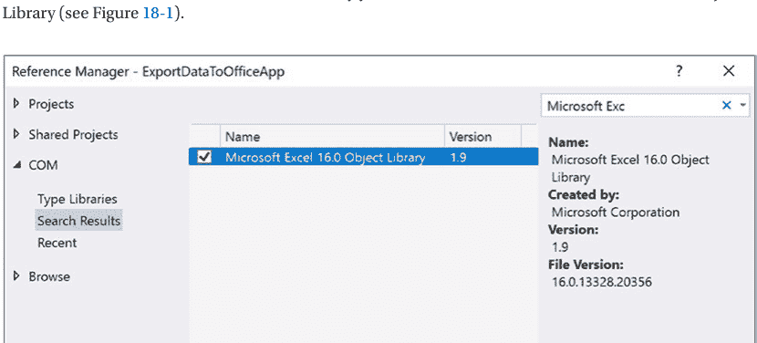

## 第 18 章

## 动态类型与动态语言运行时

.NET 4.0 为 C# 语言引入了一个新关键字，即 `dynamic`。该关键字允许你将类似脚本的行为融入强类型的类型安全、分号和花括号世界中。使用这种松散类型，你可以大大简化一些复杂的编码任务，并获得与多种兼容 .NET Core 的动态语言进行互操作的能力。

在本章中，你将了解 C# 的 `dynamic` 关键字，并理解松散类型调用如何通过动态语言运行时（DLR）映射到正确的内存对象。在理解了 DLR 提供的服务之后，你将看到使用动态类型来简化后期绑定方法调用（通过反射服务）以及与遗留 COM 库轻松通信的示例。

注意 不要将 C# 的 `dynamic` 关键字与动态程序集的概念混淆（参见第 19 章）。虽然你可以在构建动态程序集时使用 `dynamic` 关键字，但这两个概念最终是相互独立的。

## C# dynamic 关键字的作用

在第 3 章中，你了解了 `var` 关键字，它允许你定义局部变量，其底层数据类型在编译时根据初始赋值确定（回想一下，这称为隐式类型）。一旦完成初始赋值，你就拥有了一个强类型变量，任何尝试分配不兼容值的操作都会导致编译错误。

为了开始研究 C# 的 `dynamic` 关键字，创建一个名为 `DynamicKeyword` 的新控制台应用程序项目。现在，在 `Program` 类中添加以下方法，并验证如果取消注释，最后的代码语句确实会触发编译时错误：

```
static void ImplicitlyTypedVariable()
{
    // a 是 List<int> 类型。
    var a = new List<int> {90};
    // 这会导致编译时错误！
    // a = "Hello";
}
```

仅仅为了使用隐式类型而使用它，在某些人看来是不好的风格（如果你知道需要 `List<int>`，就直接声明 `List<int>`）。然而，正如你在第 13 章中所看到的，隐式类型在 LINQ 中非常有用，因为许多 LINQ 查询返回匿名类的枚举（通过投影），你无法在 C# 代码中直接声明这些类。然而，即使在这种情况下，隐式类型变量实际上仍然是强类型的。

与此相关的是，正如你在第 6 章中所学到的，`System.Object` 是 .NET Core 框架中最顶层的父类，可以表示任何东西。同样，如果你声明一个 `object` 类型的变量，你拥有的是强类型的数据；然而，它在内存中指向的内容可以根据你的引用赋值而不同。要访问对象引用在内存中指向的成员，你需要执行显式转换。

假设你有一个名为 `Person` 的简单类，它定义了两个自动属性（`FirstName` 和 `LastName`），都封装了字符串。现在，观察以下代码：

```
static void UseObjectVariable()
{
    // 假设我们有一个名为 Person 的类。
    object o = new Person() { FirstName = "Mike", LastName = "Larson" };

    // 必须将 object 转换为 Person 才能访问
    // Person 的属性。
    Console.WriteLine("Person's first name is {0}", ((Person)o).FirstName);
}
```

现在，回到 `dynamic` 关键字。从高层次来看，你可以将 `dynamic` 关键字视为 `System.Object` 的一种特殊形式，因为任何值都可以赋给 `dynamic` 数据类型。乍一看，这似乎非常令人困惑，因为你现在似乎有三种方式来定义底层类型未在代码库中直接指示的数据。例如，这个方法

```
static void PrintThreeStrings()
{
    var s1 = "Greetings";
    object s2 = "From";
    dynamic s3 = "Minneapolis";

    Console.WriteLine("s1 is of type: {0}", s1.GetType());
    Console.WriteLine("s2 is of type: {0}", s2.GetType());
    Console.WriteLine("s3 is of type: {0}", s3.GetType());
}
```

如果从 `Main()` 中调用，将打印以下内容：

```
s1 is of type: System.String
s2 is of type: System.String
s3 is of type: System.String
```

动态变量与隐式声明或通过 `System.Object` 引用声明的变量之间的巨大区别在于，它不是强类型的。换句话说，动态数据不是静态类型的。就 C# 编译器而言，使用 `dynamic` 关键字声明的数据点可以被赋予任何初始值，并且在其生命周期内可以被重新赋值为任何新的（可能不相关的）值。考虑以下方法及其输出：


```csharp
static void ChangeDynamicDataType()
{
    // Declare a single dynamic data point
    // named "t".
    dynamic t = "Hello!";
    Console.WriteLine("t is of type: {0}", t.GetType());

    t = false;
    Console.WriteLine("t is of type: {0}", t.GetType());

    t = new List<int>();
    Console.WriteLine("t is of type: {0}", t.GetType());
}
```

```
t is of type: System.String
t is of type: System.Boolean
t is of type: System.Collections.Generic.List`1[System.Int32]
```

在目前的研究中，请注意，如果你将变量 `t` 声明为 `System.Object` 类型，前面的代码也会以完全相同的方式编译和执行。然而，你很快就会看到，`dynamic` 关键字提供了许多额外的功能。

## 在动态声明的数据上调用成员

鉴于动态变量可以随时采用任何类型的身份（就像 `System.Object` 类型的变量一样），你接下来可能会想到的问题是：如何在动态变量上调用成员（属性、方法、索引器和事件等）。嗯，从语法上讲，它看起来也没有什么不同。只需将点运算符应用于动态数据变量，指定一个公共成员，并提供任何参数（如果需要）。

然而（这是一个非常重要的“然而”），编译器不会检查你所指定的成员是否有效！请记住，与定义为 `System.Object` 的变量不同，动态数据不是静态类型的。直到运行时，你才会知道你调用的动态数据是否支持指定的成员、是否传入了正确的参数、是否正确地拼写了成员，等等。因此，尽管看起来可能很奇怪，但下面的方法完全可以编译通过：

```csharp
static void InvokeMembersOnDynamicData()
{
    dynamic textData1 = "Hello";
    Console.WriteLine(textData1.ToUpper());

    // You would expect compiler errors here!
    // But they compile just fine.
    Console.WriteLine(textData1.toupper());
    Console.WriteLine(textData1.Foo(10, "ee", DateTime.Now));
}
```

注意第二次调用 `WriteLine()` 试图在动态数据点上调用名为 `toupper()` 的方法（请注意这里的大小写错误——应该是 `ToUpper()`）。如你所见，`textData1` 是 `string` 类型，因此，你知道它没有这个全小写形式的名字的方法。此外，`string` 当然也没有一个名为 `Foo()` 的方法，能接受 `int`、`string` 和 `DateTime` 对象！

尽管如此，C# 编译器仍然感到满意。然而，如果你从 `Main()` 中调用此方法，你会得到如下输出所示的运行时错误：

```
Unhandled Exception: Microsoft.CSharp.RuntimeBinder.RuntimeBinderException:
'string' does not contain a definition for 'toupper'
```

在动态数据和强类型数据上调用成员之间的另一个明显区别是，当你对一段动态数据应用点运算符时，你不会看到预期的 Visual Studio IntelliSense。IDE 将允许你输入你能想到的任何成员名称。

动态数据无法使用 IntelliSense，这是有道理的。但是，请记住，这意味着你在处理此类数据点时输入 C# 代码需要格外小心。任何拼写错误或成员大小写不正确都会引发运行时错误，具体来说是 `RuntimeBinderException` 类的实例。

`RuntimeBinderException` 表示当你试图在动态数据类型上调用一个实际上不存在的成员时（如 `toupper()` 和 `Foo()` 方法的情况）将引发的错误。如果你向确实存在的成员指定了错误的参数数据，也会引发同样的错误。

由于动态数据非常不稳定，每当你对使用 C# `dynamic` 关键字声明的变量调用成员时，你可以将调用包装在适当的 `try/catch` 块中，并以优雅的方式处理错误，如下所示：

```csharp
static void InvokeMembersOnDynamicData()
{
    dynamic textData1 = "Hello";

    try
    {
        Console.WriteLine(textData1.ToUpper());
        Console.WriteLine(textData1.toupper());
        Console.WriteLine(textData1.Foo(10, "ee", DateTime.Now));
    }
    catch (Microsoft.CSharp.RuntimeBinder.RuntimeBinderException ex)
    {
        Console.WriteLine(ex.Message);
    }
}
```

如果你再次调用此方法，你会发现对 `ToUpper()`（注意大写 T 和 U）的调用可以正常工作；但是，随后你会发现错误数据显示在控制台上。

```
HELLO
'string' does not contain a definition for 'toupper'
```

当然，将所有动态方法调用包装在 `try/catch` 块中的过程相当繁琐。如果你注意拼写和参数传递，就不需要这样做。然而，当你可能无法预先知道目标类型上是否存在某个成员时，捕获异常会很方便。

## `dynamic` 关键字的适用范围

回想一下，隐式类型数据（使用 `var` 关键字声明）只能用于成员作用域中的局部变量。`var` 关键字永远不能用作返回值、参数或类/结构的成员。然而，`dynamic` 关键字并非如此。考虑以下类定义：

```csharp
namespace DynamicKeyword
{
    class VeryDynamicClass
    {
        // A dynamic field.
        private static dynamic _myDynamicField;

        // A dynamic property.
        public dynamic DynamicProperty { get; set; }

        // A dynamic return type and a dynamic parameter type.
        public dynamic DynamicMethod(dynamic dynamicParam)
        {
            // A dynamic local variable.
            dynamic dynamicLocalVar = "Local variable";

            int myInt = 10;

            if (dynamicParam is int)
            {
                return dynamicLocalVar;
            }
            else
            {
                return myInt;
            }
        }
    }
}
```

现在你可以按预期调用公共成员；然而，由于你操作的是动态方法和属性，你无法完全确定数据类型将是什么！确切地说，`VeryDynamicClass` 定义在现实世界的应用程序中可能没什么用处，但它确实说明了可以在哪些范围内应用这个 C# 关键字。

## `dynamic` 关键字的限制

虽然可以使用 `dynamic` 关键字定义许多事物，但它的使用存在一些限制。虽然这些限制不是致命的障碍，但要知道，动态数据项在调用方法时不能使用 lambda 表达式或 C# 匿名方法。例如，即使目标方法确实接受一个委托参数，该委托接受一个字符串值并返回 `void`，以下代码也总是会导致错误：

```csharp
dynamic a = GetDynamicObject();

// Error! Methods on dynamic data can't use lambdas!
a.Method(arg => Console.WriteLine(arg));
```

要规避此限制，你需要直接使用底层委托，采用第 12 章中描述的技术。另一个限制是，动态数据点无法理解任何扩展方法（见第 11 章）。不幸的是，这还将包括来自 LINQ API 的任何扩展方法。因此，使用 `dynamic` 关键字声明的变量在 LINQ to Objects 和其他 LINQ 技术中的使用受到限制。

```csharp
dynamic a = GetDynamicObject();
// Error! Dynamic data can't find the Select() extension method!
var data = from d in a select d;
```

考虑到动态数据不是强类型、在编译时不检查、无法触发 IntelliSense，并且不能作为 LINQ 查询的目标，你完全有理由认为仅仅为了使用而使用 `dynamic` 关键字是一种糟糕的编程实践。

然而，在少数情况下，`dynamic` 关键字可以大幅减少你需要手工编写的代码量。具体来说，如果你正在构建一个大量使用后期绑定（通过反射）的 .NET Core 应用程序，`dynamic` 关键字可以为你节省输入时间。同样，如果你正在构建一个需要与旧版 COM 库（如 Microsoft Office 产品）通信的 .NET Core 应用程序，你可以通过 `dynamic` 关键字大大简化你的代码库。最后举个例子，使用 ASP.NET Core 构建的 Web 应用程序经常使用 `ViewBag` 类型，也可以通过 `dynamic` 关键字以简化的方式访问它。

> 注意：COM 交互严格来说是 Windows 的范式，会移除应用程序的跨平台能力。

就像任何“捷径”一样，你需要权衡利弊。使用 `dynamic` 关键字是在代码简洁性和类型安全之间进行权衡。虽然 C# 本质上是一种强类型语言，但你可以在每次调用的基础上选择启用（或禁用）动态行为。永远记住，你并不需要使用 `dynamic` 关键字。你总是可以通过手工编写替代代码来达到相同的最终结果（而且通常会多得多）。

## 动态语言运行时的作用

既然你现在更好地理解了“动态数据”是怎么回事，让我们来了解它是如何被处理的。自 .NET 4.0 发布以来，公共语言运行时（CLR）增加了一个互补的运行时环境，称为动态语言运行时。“动态运行时”的概念当然并不新鲜。事实上，许多编程语言如 JavaScript、LISP、Ruby 和 Python 已经使用它多年了。简而言之，动态运行时允许动态语言在运行时完全发现类型，而无需编译时检查。

> 注意：虽然 DLR 的大部分内容已被移植到 .NET Core（从 3.0 开始），但 .NET Core 5 中的 DLR 与 .NET 4.8 中的 DLR 之间尚未实现功能对等。


如果你有强类型语言（包括 C#，不使用 dynamic 类型）的背景，这种运行时的概念可能看起来不太理想。毕竟，你通常希望在可能的情况下收到编译时错误，而不是运行时错误。尽管如此，动态语言/运行时确实提供了一些有趣的功能，包括以下内容：

- 极其灵活的代码库。你可以在不对数据类型进行大量更改的情况下重构代码。
- 一种简单的方式与在不同平台和编程语言中构建的各种对象类型进行互操作。
- 一种在内存中、在运行时向类型添加或删除成员的方式。

DLR 的一个作用是使各种动态语言能够在 .NET 运行时上运行，并为它们提供与其它 .NET 代码互操作的方式。这些语言生活在一个动态的宇宙中，其中类型完全在运行时发现。尽管如此，这些语言可以访问 .NET 基础类库的丰富性。更棒的是，它们的代码库可以与 C#（或反之）互操作，这得益于 dynamic 关键字的包含。

注意 本章将不讨论如何使用 DLR 与动态语言集成。

## 表达式树的角色

DLR 使用表达式树以中立的方式捕获动态调用的含义。例如，考虑以下 C# 代码：

```
dynamic d = GetSomeData();
d.SuperMethod(12);
```

在此示例中，DLR 将自动构建一个表达式树，实质上表示：“在对象 d 上调用名为 SuperMethod 的方法，将数字 12 作为参数传递。” 此信息（正式称为有效载荷）随后传递给正确的运行时绑定器，该绑定器可能是 C# 动态绑定器，甚至（正如后面解释的那样）旧版 COM 对象。

从这里开始，该请求被映射为目标对象的所需调用结构。这些表达式树的优点（除了你无需手动创建它们之外）在于，它允许你编写固定的 C# 代码语句，而无需担心底层目标实际是什么。

## 表达式树的动态运行时查找

如前所述，DLR 将表达式树传递给目标对象；然而，这种分派会受到几个因素的影响。如果动态数据类型在内存中指向一个 COM 对象，表达式树将被发送到名为 IDispatch 的低级 COM 接口。如你可能知道，该接口是 COM 引入其自身动态服务的方式。COM 对象可以在不使用 DLR 或 C# dynamic 关键字的情况下在 .NET 应用程序中使用。然而，这样做（正如你将看到的）往往会导致 C# 编码变得更加复杂。

如果动态数据未指向 COM 对象，表达式树可能会传递给实现 IDynamicObject 接口的对象。此接口在幕后使用，以允许 IronRuby 等语言将 DLR 表达式树映射到 Ruby 特定细节。

最后，如果动态数据指向的对象既不是 COM 对象也不实现 IDynamicObject，则该对象是一个普通、日常的 .NET 对象。在这种情况下，表达式树将被分派给 C# 运行时绑定器进行处理。将表达式树映射到 .NET 特定的过程涉及反射服务。

在表达式树被某个绑定器处理后，动态数据将被解析为真正的内存中数据类型，之后将使用必要的参数调用正确的方法。现在，让我们来看一下 DLR 的一些实际用途，从简化延迟绑定的 .NET 调用开始。

## 使用动态类型简化延迟绑定调用

你可能会决定使用 dynamic 关键字的情况之一是当你使用反射服务时，特别是进行延迟绑定方法调用时。在第 17 章中，你看到了这种类型方法调用可以有用的几个示例，最常见的是当你构建某种可扩展应用程序时。当时，你学习了如何使用 Activator.CreateInstance() 方法创建对象，而你对该对象没有任何编译时知识（超出其显示名称）。然后你可以使用 System.Reflection 命名空间的类型通过延迟绑定调用成员。回想一下第 17 章中的以下示例：

```
static void CreateUsingLateBinding(Assembly asm)
{
    try
    {
        // Get metadata for the Minivan type.
        Type miniVan = asm.GetType("CarLibrary.MiniVan");

        // Create the Minivan on the fly.
        object obj = Activator.CreateInstance(miniVan);

        // Get info for TurboBoost.
        MethodInfo mi = miniVan.GetMethod("TurboBoost");

        // Invoke method ("null" for no parameters).
        mi.Invoke(obj, null);
    }
    catch (Exception ex)
    {
        Console.WriteLine(ex.Message);
    }
}
```

虽然此代码按预期工作，但你可能会同意它有点笨拙。你必须手动使用 MethodInfo 类，手动查询元数据，等等。以下是此方法的版本，现在使用 C# dynamic 关键字和 DLR：

```
static void InvokeMethodWithDynamicKeyword(Assembly asm)
{
    try
    {
        // Get metadata for the Minivan type.
        Type miniVan = asm.GetType("CarLibrary.MiniVan");

        // Create the Minivan on the fly and call method!
        dynamic obj = Activator.CreateInstance(miniVan);
        obj.TurboBoost();
    }
}
```
```
catch (Exception ex)
{
    Console.WriteLine(ex.Message);
}
```

通过使用 dynamic 关键字声明 obj 变量，反射的重活由 DLR 代为完成。

## 利用 dynamic 关键字传递参数

当你需要对带参数的方法进行延迟绑定调用时，DLR 的有用性变得更加明显。当你使用“长写法”反射调用时，参数需要打包为对象数组，传递给 MethodInfo 的 Invoke() 方法。

为了用一个新示例来说明，首先创建一个名为 LateBindingWithDynamic 的 C# 控制台应用程序项目。接下来，添加一个名为 MathLibrary 的类库项目。将 MathLibrary 项目的初始 Class1.cs 文件重命名为 SimpleMath.cs，并按如下方式实现该类：

```
namespace MathLibrary
{
    public class SimpleMath
    {
        public int Add(int x, int y)
        {
            return x + y;
        }
    }
}
```

使用以下内容更新 MathLibrary.csproj 文件（以将编译后的程序集复制到 LateBindingWithDynamic 目标目录）：

```
<Target Name="PostBuild" AfterTargets="PostBuildEvent">
    <Exec Command="copy $(TargetPath) $(SolutionDir)LateBindingWithDynamic\$(OutDir)
$(TargetFileName) /Y &&xD;&#xA;copy $(TargetPath) $(SolutionDir)LateBindingWithDynamic\
$(TargetFileName) /Y" />
</Target>
```

> 注意 如果这些项目构建事件对你来说是新的，请在第 17 章中查看该技术以获取完整细节。

现在，回到 LateBindingWithDynamic 项目，将 System.Reflection 和 Microsoft.CSharp.RuntimeBinder 命名空间导入 Program.cs 文件。接下来，将以下方法添加到 Program 类中，该方法使用典型的反射 API 调用调用 Add() 方法：

```
static void AddWithReflection()
{
    Assembly asm = Assembly.LoadFrom("MathLibrary");
    try
    {
```
// Get metadata for the SimpleMath type.
Type math = asm.GetType("MathLibrary.SimpleMath");

// Create a SimpleMath on the fly.
object obj = Activator.CreateInstance(math);

// Get info for Add.
MethodInfo mi = math.GetMethod("Add");

// Invoke method (with parameters).
object[] args = { 10, 70 };
Console.WriteLine("Result is: {0}", mi.Invoke(obj, args));
}
catch (Exception ex)
{
    Console.WriteLine(ex.Message);
}
}
```

现在，考虑使用 dynamic 关键字简化之前的逻辑，通过以下新方法：

```
private static void AddWithDynamic()
{
    Assembly asm = Assembly.LoadFrom("MathLibrary");

    try
    {
        // Get metadata for the SimpleMath type.
        Type math = asm.GetType("MathLibrary.SimpleMath");

        // Create a SimpleMath on the fly.
        dynamic obj = Activator.CreateInstance(math);

        // Note how easily we can now call Add().
        Console.WriteLine("Result is: {0}", obj.Add(10, 70));
    }
    catch (RuntimeBinderException ex)
    {
        Console.WriteLine(ex.Message);
    }
}
```

不错！如果你调用这两种方法，你将看到相同的输出。然而，使用 dynamic 关键字时，你节省了相当多的工作。使用动态定义的数据，你不再需要手动将参数打包为对象数组，查询程序集元数据，或其它此类细节。如果你正在构建一个大量使用动态加载/延迟绑定的应用程序，我相信你可以看到这些代码节省如何随着时间的推移而累积。


# 使用动态数据简化 COM 互操作性（仅限 Windows）

让我们来看看 dynamic 关键字在 COM 互操作性项目中的另一个有用案例。如果你没有太多 COM 开发背景，请注意下一个示例：编译后的 COM 库包含元数据，就像 .NET Core 库一样；然而，格式完全不同。因此，如果 .NET Core 程序需要与 COM 对象通信，首要任务就是生成所谓的 *互操作程序集*（将在下文中描述）。这样做非常简单。

> **注意** 如果你尚未安装 Visual Studio Tools for Office (VSTO) 单个组件或“Office/SharePoint 开发”工作负载，你需要安装它们才能完成本节内容。你可以重新运行安装程序以选择缺失的组件，也可以使用 Visual Studio 快速启动（Ctrl+Q）。在快速启动框中输入 **Visual Studio Tools for Office**，然后选择“安装”选项。

首先，创建一个名为 ExportDataToOfficeApp 的新控制台应用程序。在解决方案资源管理器中右键单击项目，打开“添加 COM 引用”对话框，然后选择“添加 ► COM 引用”。选择“COM”选项卡后，找到你想要使用的 COM 库，即 Microsoft Excel 16.0 Object Library（参见图 18-1）。



*图 18-1. “添加引用”对话框的“COM”选项卡将显示你计算机上所有已注册的 COM 库*

当你选择一个 COM 库后，IDE 会生成一个包含 COM 元数据的 .NET 描述的新程序集。正式地说，这些程序集被称为 *互操作性程序集*（或简称为 *互操作程序集*）。互操作程序集不包含任何实现代码，除了少量帮助将 COM 事件转换为 .NET Core 事件的代码。然而，这些互操作程序集非常有用，因为它们使你的 .NET Core 代码库免受 COM 内部复杂底层细节的影响。

在你的 C# 代码中，你可以直接针对互操作程序集进行编程，它将 .NET Core 数据类型映射为 COM 类型，反之亦然。在后台，数据在 .NET Core 与 COM 应用程序之间通过运行时可调用包装器（RCW）进行封送处理，RCW 基本上是一个动态生成的代理。这个 RCW 代理会将 .NET Core 数据类型封送并转换为 COM 类型，并将任何 COM 返回值映射为 .NET Core 等效类型。

## 主互操作程序集的作用

许多由 COM 库供应商（例如允许访问 Microsoft Office 产品对象模型的 Microsoft COM 库）创建的 COM 库都提供了“官方”互操作程序集，称为 *主互操作程序集*（PIA）。PIA 是经过优化的互操作程序集，它们清理（并可能扩展）使用“添加引用”对话框引用 COM 库时通常生成的代码。

在添加对 Microsoft Excel 16.0 Object Library 的引用后，检查解决方案资源管理器中的项目。在“依赖项”节点下，你将看到一个新节点（COM），其中包含一个名为 Interop.Microsoft.Office.Interop.Excel 的项。这就是生成的互操作文件。

## 嵌入互操作元数据

在 .NET 4.0 发布之前，当 C# 应用程序使用 COM 库（无论是否为 PIA）时，你需要确保客户端计算机上有互操作程序集的副本。这不仅增加了应用程序安装包的大小，而且安装脚本还必须检查 PIA 程序集是否确实存在，如果不存在，则安装一份副本到全局程序集缓存（GAC）中。

> **注意** 全局程序集缓存是 .NET Framework 程序集的中央存储库。.NET Core 中已不再使用它。

然而，从 .NET 4.0 及更高版本开始，你可以将互操作性数据直接嵌入编译后的应用程序中。这样一来，你就不再需要随 .NET Core 应用程序一起分发互操作程序集的副本，因为必要的互操作元数据已硬编码到你的程序中。在 .NET Core 中，嵌入 PIA 是必需的。

要使用 Visual Studio 嵌入 PIA，请展开项目下的“依赖项”节点，展开“COM”节点，右键单击 Interop.Microsoft.Office.Interop.Excel，然后选择“属性”。在“属性”对话框中，将“嵌入互操作类型”的值更改为“是”，如图 18-2 所示。

# 图 18-2. 嵌入互操作类型

要通过项目文件更改此属性，请添加 `<EmbedInteropTypes>True</EmbedInteropTypes>`，如下所示：

```
<ItemGroup>
    <COMReference Include="Microsoft.Office.Excel.dll">
        <Guid>00020813-0000-0000-c000-000000000046</Guid>
        <VersionMajor>1</VersionMajor>
        <VersionMinor>9</VersionMinor>
        <WrapperTool>tlbimp</WrapperTool>
        <Lcid>0</Lcid>
        <Isolated>false</Isolated>
        <EmbedInteropTypes>true</EmbedInteropTypes>
    </COMReference>
</ItemGroup>
```

C# 编译器将只包含你正在使用的互操作库部分。因此，如果实际的互操作库包含数百个 COM 对象的 .NET Core 描述，你只会引入 C# 代码中实际使用的子集定义。除了减少需要部署的文件大小外，你还获得了更简单的安装路径，因为无需在目标机器上安装任何缺失的 PIA。

## 常见的 COM 互操作痛点

许多 COM 库定义的方法带有可选参数，而 C# 直到 .NET 3.5 才支持可选参数。这要求你为每个可选参数的位置指定 Type.Missing 值。幸运的是，从 .NET 3.5 及更高版本（包括 .NET Core）开始，如果你未指定特定值，Type.Missing 值将在编译时自动插入。

与此相关的是，许多 COM 方法支持命名参数，正如你在第 4 章中回顾的，命名参数允许你以任何所需顺序向成员传递值。既然 C# 也支持同样的功能，那么“跳过”一组你不关心的可选参数，只设置你关心的少数几个参数就很简单了。

另一个常见的 COM 互操作痛点与许多 COM 方法设计为接受和返回一种特殊数据类型有关，这种类型称为 Variant。与 C# 的 dynamic 关键字非常相似，Variant 数据类型可以动态地赋值为任何类型的 COM 数据（字符串、接口引用、数值等）。在 dynamic 关键字出现之前，传递或接收 Variant 数据需要一些额外的周折，通常是通过大量的强制转换操作。

当你将“嵌入互操作类型”属性设置为 True 时，所有 COM Variant 类型都会自动映射为动态数据。这不仅减少了在处理底层 COM Variant 数据类型时进行不必要强制转换操作的需要，还能进一步隐藏一些 COM 复杂性，例如处理 COM 索引器。

在使用 COM Interop 和 .NET 5 时，另一个痛点是缺乏构建和运行时支持。.NET 5 版本的 MSBuild 无法解析互操作库，因此使用 COM 互操作的 .NET Core 项目无法使用 .NET Core CLI 进行编译。它们必须使用 Visual Studio 构建，编译后的可执行文件可以按预期运行。

## 使用 C# 动态数据实现 COM 互操作

为了展示 C# 可选参数、命名参数和 dynamic 关键字如何协同工作来简化 COM 互操作，你现在将构建一个使用 Microsoft Office 对象模型的应用程序。添加一个名为 Car.cs 的新类，其中包含以下代码：

```
namespace ExportDataToOfficeApp
{
    public class Car
    {
        public string Make { get; set; }
        public string Color { get; set; }
        public string PetName { get; set; }
    }
}
```

接下来，将以下 using 语句添加到 Program.cs 的顶部：

```
using System;
using System.Collections.Generic;
using System.Reflection;
using Excel = Microsoft.Office.Interop.Excel;
using ExportDataToOfficeApp;
```


注意 Excel 命名空间别名。虽然在与 COM 库交互时定义别名并不是必需的，但它为所有导入的 COM 对象提供了简短的限定符。这不仅减少了输入量，还可以解决 COM 对象名称与 .NET Core 类型冲突的问题。

// 为 Excel 对象模型创建别名。
using Excel = Microsoft.Office.Interop.Excel;

接下来，在 Program.cs 的顶层语句中创建一个 Car 记录列表：

```
List<Car> carsInStock = new List<Car>
{
    new Car {Color="Green", Make="VW", PetName="Mary"},
    new Car {Color="Red", Make="Saab", PetName="Mel"},
    new Car {Color="Black", Make="Ford", PetName="Hank"},
    new Car {Color="Yellow", Make="BMW", PetName="Davie"}
};
```

由于你使用 Visual Studio 导入了 COM 库，因此 PIA 已自动配置，以便将使用的元数据嵌入到 .NET Core 应用程序中。因此，所有 COM Variant 数据类型都实现为 dynamic 数据类型。此外，你还可以使用 C# 可选参数和命名参数。考虑以下 ExportToExcel() 的实现：

```
void ExportToExcel(List<Car> carsInStock)
{
    // Load up Excel, then make a new empty workbook.
    Excel.Application excelApp = new Excel.Application();
    excelApp.Workbooks.Add();

    // This example uses a single workSheet.
    Excel._Worksheet workSheet = (Excel._Worksheet)excelApp.ActiveSheet;

    // Establish column headings in cells.
    workSheet.Cells[1, "A"] = "Make";
    workSheet.Cells[1, "B"] = "Color";
    workSheet.Cells[1, "C"] = "Pet Name";

    // Now, map all data in List<Car> to the cells of the spreadsheet.
    int row = 1;
    foreach (Car c in carsInStock)
    {
        row++;
        workSheet.Cells[row, "A"] = c.Make;
        workSheet.Cells[row, "B"] = c.Color;
        workSheet.Cells[row, "C"] = c.PetName;
    }

    // Give our table data a nice look and feel.
    workSheet.Range["A1"].AutoFormat(Excel.XlRangeAutoFormat.xlRangeAutoFormatClassic2);

    // Save the file, quit Excel, and display message to user.
    workSheet.SaveAs($"{Environment.CurrentDirectory}\Inventory.xlsx");
```

```
excelApp.Quit();
Console.WriteLine("The Inventory.xlsx file has been saved to your app folder");
}
```

此方法首先将 Excel 加载到内存中；然而，你在计算机桌面上看不到它。对于此应用程序，你只关心使用内部 Excel 对象模型。但是，如果你确实想显示 Excel 的 UI，请使用以下额外代码行更新你的方法：

```
static void ExportToExcel(List<Car> carsInStock)
{
    // Load up Excel, then make a new empty workbook.
    Excel.Application excelApp = new Excel.Application();

    // Go ahead and make Excel visible on the computer.
    excelApp.Visible = true;
    ...
}
```

在创建空工作表后，你添加了三个列，其名称与 Car 类的属性相同。然后，你用 List<Car> 的数据填充单元格，并将文件保存为（硬编码的）名称 Inventory.xlsx。

此时，如果你运行应用程序，你将能够打开 Inventory.xlsx 文件，该文件将保存到项目的 \bin\Debug\net5.0 文件夹中。

虽然前面的代码似乎没有使用任何动态数据，但请注意 DLR 提供了很大的帮助。如果没有 DLR，代码将不得不写成这样：

```
static void ExportToExcelManual(List<Car> carsInStock)
{
    Excel.Application excelApp = new Excel.Application();
    // Must mark missing params!
    excelApp.Workbooks.Add(Type.Missing);
    // Must cast Object as _Worksheet!
    Excel._Worksheet workSheet =
        (Excel._Worksheet)excelApp.ActiveSheet;
    // Must cast each Object as Range object then call low-level Value2 property!
    ((Excel.Range)excelApp.Cells[1, "A"]).Value2 = "Make";
    ((Excel.Range)excelApp.Cells[1, "B"]).Value2 = "Color";
    ((Excel.Range)excelApp.Cells[1, "C"]).Value2 = "Pet Name";
    int row = 1;
    foreach (Car c in carsInStock)
    {
        row++;
        // Must cast each Object as Range and call low-level Value2 prop!
        ((Excel.Range)workSheet.Cells[row, "A"]).Value2 = c.Make;
        ((Excel.Range)workSheet.Cells[row, "B"]).Value2 = c.Color;
        ((Excel.Range)workSheet.Cells[row, "C"]).Value2 = c.PetName;
    }
    // Must call get_Range method and then specify all missing args!
    excelApp.get_Range("A1", Type.Missing).AutoFormat(
        Excel.XlRangeAutoFormat.xlRangeAutoFormatClassic2,
        Type.Missing, Type.Missing, Type.Missing,

```
Type.Missing, Type.Missing, Type.Missing);
// Must specify all missing optional args!
workSheet.SaveAs(
    $@"{Environment.CurrentDirectory}\InventoryManual.xlsx",
    Type.Missing, Type.Missing, Type.Missing,
    Type.Missing, Type.Missing, Type.Missing,
    Type.Missing, Type.Missing, Type.Missing);
excelApp.Quit();
Console.WriteLine("The InventoryManual.xlsx file has been saved to your app folder");
}
```

这就结束了你对 C# dynamic 关键字和 DLR 的介绍。我希望你能看到这些特性如何简化复杂的编程任务，以及（也许更重要的是）理解其中的权衡。当你选择使用 dynamic 数据时，你会失去大量类型安全，你的代码库更容易出现运行时错误。

虽然关于 DLR 还有很多要说，但本章试图专注于在日常编程中实用且有用的主题。如果你想了解有关动态语言运行时的高级特性，例如与脚本语言的集成，请务必查阅 .NET Core SDK 文档（查找主题“Dynamic Language Runtime Overview”以开始）。

## Summary

dynamic 关键字允许你定义在运行时才知道其身份的数据。当由动态语言运行时处理时，自动创建的“表达式树”将被传递给正确的动态语言绑定器，在那里有效载荷将被解包并发送到正确的对象成员。

使用 dynamic 数据和 DLR，复杂的 C# 编程任务可以被极大地简化，尤其是将 COM 库合并到你的 .NET Core 应用程序中的操作。正如本章所示，这为 COM 互操作提供了许多进一步的简化（与 dynamic 数据无关），例如将 COM 互操作数据嵌入到你的应用程序中、可选参数和命名参数。

虽然这些特性确实可以简化你的代码，但请始终记住 dynamic 数据会使你的 C# 代码类型安全大大降低且容易出现运行时错误。务必权衡在你的 C# 项目中使用 dynamic 数据的利弊，并相应地进行测试！

## Understanding CIL and the Role of Dynamic Assemblies

当你构建一个全功能的 .NET Core 应用程序时，你肯定会使用 C#（或类似的托管语言，如 Visual Basic），鉴于其固有的生产力和易用性。然而，正如你在本书开头学到的那样，托管编译器的作用是将 *.cs 代码文件翻译成 CIL 代码、类型元数据和程序集清单的术语。事实证明，CIL 是一种功能齐全的 .NET Core 编程语言，具有自己的语法、语义和编译器（ilasm.exe）。

在本章中，你将获得 .NET Core 母语的导览。在这里，你将了解 CIL 指令、CIL 属性和 CIL 操作码之间的区别。然后你将学习 .NET Core 程序集的往返工程的作用以及各种 CIL 编程工具。随后，本章将带你了解使用 CIL 语法定义命名空间、类型和成员的基础知识。本章将以对 System.Reflection.Emit 命名空间的作用的考察作为结尾，并解释如何在运行时动态构造一个程序集（带有 CIL 指令）。

当然，很少有程序员需要在日常工作中处理原始 CIL 代码。因此，我将首先通过检查几个原因来开始本章，了解这种低级 .NET Core 语言的语法和语义可能值得你花费时间。

## Motivations for Learning the Grammar of CIL

CIL 是 .NET Core 平台真正的母语。当你使用你选择的托管语言（C#、VB、F# 等）构建 .NET Core 程序集时，相关编译器会将你的源代码翻译成 CIL 的术语。像任何编程语言一样，CIL 提供了许多结构化和以实现为中心的标记。鉴于 CIL 只是一种 .NET Core 编程语言，应该不会让人感到惊讶的是，可以直接使用 CIL 和 CIL 编译器（ilasm.exe）构建你的 .NET Core 程序集。

注意 如第 1 章所述，ildasm.exe 和 ilasm.exe 都不随 .NET 5 运行时一起提供。有两种获取这些工具的方法。第一种是从 https://github.com/dotnet/runtime 上的源代码编译 .NET 5 运行时。第二种、更简单的方法是从 www.nuget.org 下载所需版本。ILDasm 在 NuGet 上的 URL 为 https://www.nuget.org/packages/Microsoft.NETCore.ILDAsm/，ILAsm.exe 为 https://www.nuget.org/packages/Microsoft.NETCore.ILAsm/。请确保选择正确的版本（对于本书你需要 5.0.0 或更高版本）。使用以下命令将 ILDasm 和 ILAsm NuGet 包添加到你的项目中：


```
dotnet add package Microsoft.NETCore.ILDasm --version 5.0.0
dotnet add package Microsoft.NETCore.ILAsm --version 5.0.0
```

这并不会真正将 ILDasm.exe 或 ILAsm.exe 添加到你的项目中，而是将它们放置在你的程序包文件夹中（在 Windows 上）：

```
%userprofile%\.nuget\packages\microsoft.netcore.ilasm\5.0.0\runtimes\native\
%userprofile%\.nuget\packages\microsoft.netcore.ildasm\5.0.0\runtimes\native\
```

我还将这两个程序的 5.0.0 版本包含在本书记的 GitHub 仓库中，第 19 章文件夹内。

现在虽然可以说很少（如果有的话！）程序员会选择直接用 CIL 构建整个 .NET Core 应用程序，但 CIL 仍然是一个极其有趣的智力追求。简单来说，你对 CIL 语法的理解越深入，就越能够进入高级 .NET Core 开发的领域。通过一些具体的例子，具备 CIL 理解能力的人能够做到以下几点：

- 反汇编现有的 .NET Core 程序集，编辑 CIL 代码，并将更新后的代码库重新编译为修改后的 .NET Core 二进制文件。例如，在某些场景下，你可能需要修改 CIL 以与某些高级 COM 功能互操作。
- 使用 System.Reflection.Emit 命名空间构建动态程序集。此 API 允许你生成一个内存中的 .NET Core 程序集，可选择将其持久化到磁盘。这是那些需要即时生成程序集的世界工具构建者所使用的有用技术。
- 理解 CTS 的某些方面，这些方面不被更高层的托管语言支持，但在 CIL 层级却存在。可以肯定的是，CIL 是唯一允许你访问 CTS 各方面的 .NET Core 语言。例如，使用原始 CIL，你可以定义全局级别的成员和字段（在 C# 中是不允许的）。

再次，为了完全明确，如果你选择不关心 CIL 代码的细节，你仍然能够掌握 C# 和 .NET Core 基础类库。在许多方面，CIL 知识类似于 C（和 C++）程序员对汇编语言的理解。那些了解底层“粘稠物”来龙去脉的人可以为手头的任务创建相当高级的解决方案，并更深入地理解底层编程（和运行时）环境。所以，如果你准备接受挑战，让我们开始检查 CIL 的细节。

> 注 了解本章并非旨在全面阐述 CIL 的语法和语义。

## 检查 CIL 指令、属性和操作码

当你开始研究 CIL 等低级语言时，你保证会发现熟悉概念的新（而且常常听起来令人望而生畏的）名称。例如，在文本的这一点上，如果向你展示以下一组项目：

```
{new, public, this, base, get, set, explicit, unsafe, enum, operator, partial}
```

你很可能会理解它们为 C# 语言的关键字（这是正确的）。然而，如果你更仔细地查看这组成员，你可能会发现虽然每个项目确实是 C# 关键字，但其语义截然不同。例如，enum 关键字定义了一个派生自 System.Enum 的类型，而 this 和 base 关键字分别允许你引用当前对象或对象的父类。unsafe 关键字用于建立一段代码块，该块不能直接被 CLR 监控，而 operator 关键字允许你构建一个隐藏的（特殊命名的）方法，当你应用特定的 C# 运算符（如加号）时会被调用。

与 C# 等高级语言形成鲜明对比，CIL 并不是简单地定义一组通用关键字。相反，被 CIL 编译器理解的标记集基于语义细分为以下三个大类：

- CIL 指令
- CIL 属性
- CIL 操作码（opcodes）

每个 CIL 标记类别都使用特定的语法表达，并且标记组合起来构建一个有效的 .NET 程序集。

### CIL 指令的作用

首先，有一组众所周知的 CIL 标记用于描述 .NET 程序集的整体结构。这些标记称为指令。CIL 指令用于告知 CIL 编译器如何定义将填充程序集的命名空间、类型和成员。

指令在语法上使用单个点（.）前缀表示（例如 .namespace、.class、.publickeytoken、.method、.assembly 等）。因此，如果你的 *.il 文件（包含 CIL 代码的文件的常规扩展名）有一个 .namespace 指令和三个 .class 指令，CIL 编译器将生成一个程序集，该程序集定义一个包含三个 .NET Core 类类型的单个 .NET Core 命名空间。

### CIL 属性的作用

在许多情况下，仅靠 CIL 指令本身不足以完全表达给定 .NET 类型或类型成员的定义。鉴于此事实，许多 CIL 指令可以通过各种 CIL 属性进一步指定，以限定指令的处理方式。例如，.class 指令可以装饰有 public 属性（以建立类型可见性）、extends 属性（以明确指定类型的基类）以及 implements 属性（以列出类型支持的接口集）。

> 注 不要将 .NET 属性（参见第 17 章）与 CIL 属性混淆，它们是两个完全不同的概念。

### CIL 操作码的作用

一旦使用各种指令和相关属性以 CIL 的形式定义了 .NET Core 程序集、命名空间和类型集，最后剩下的任务就是提供类型的实现逻辑。这是操作码的工作，也称为 opcodes。遵循其他低级语言的传统，许多 CIL 操作码往往晦涩难懂，完全无法被我们人类发音。例如，如果你需要将字符串变量加载到内存中，你不会使用名为 LoadString 的友好操作码，而是使用 ldstr。

现在，公平地说，一些 CIL 操作码确实与其 C# 对应物非常自然地映射（例如 box、unbox、throw 和 sizeof）。正如你将看到的，CIL 的操作码始终在成员实现的范围内使用，并且与 CIL 指令不同，它们从不使用点前缀编写。

### CIL 操作码/CIL助记符的区别

正如刚才解释的，操作码如 ldstr 用于实现给定类型的成员。然而，像 ldstr 这样的标记是实际二进制 CIL 操作码的 CIL 助记符。为了澄清区别，假设你已在名为 FirstSamples 的 .NET Core 控制台应用程序中编写了以下方法：

```
int Add(int x, int y)
{
    return x + y;
}
```

将两个数字相加的行为以 CIL 操作码 0X58 表示。同样，减去两个数字使用操作码 0X59 表示，而在托管堆上分配新对象则使用 0X73 操作码实现。鉴于此现实，请理解由 JIT 编译器处理的“ CIL 代码”不过是二进制数据的块。

值得庆幸的是，对于 CIL 的每个二进制操作码，都有一个对应的助记符。例如，可以使用 add 助记符而不是 0X58，sub 而不是 0X59，newobj 而不是 0X73。鉴于此操作码/助记符区别，请意识到 CIL 反编译器如 ildasm.exe 将程序集的二进制操作码翻译为其对应的 CIL 助记符。例如，这里是 ildasm.exe 为之前的 C# Add() 方法呈现的 CIL（你的确切输出可能因你的 .NET Core 版本而异）：

```
.method assembly hidebysig static int32 Add(int32 x,int32 y) cil managed
{
    // Code size 9 (0x9)
    .maxstack 2
    .locals init ([0] int32 int32 V_0)
    IL_0000: /* 00 */                 /* nop
    IL_0001: /* 02 */                 /* ldarg.0
    IL_0002: /* 03 */                 /* ldarg.1
    IL_0003: /* 58 */                 /* add
    IL_0004: /* 0A */                 /* stloc.0
    IL_0005: /* 2B */ 00              /* br.s       IL_0007
    IL_0007: /* 06 */                 /* ldloc.0
    IL_0008: /* 2A */                 /* ret
} //end of method
```

除非你正在构建一些极其底层的 .NET Core 软件（如自定义托管编译器），否则你永远不需要关心 CIL 的字面数字二进制操作码。就实际用途而言，当 .NET Core 程序员谈论“CIL 操作码”时，他们指的是友好字符串标记助记符的集合（如我在本文中以及本章其余部分所做的那样），而不是底层数值。


## 推送与弹出：CIL 的基于栈的本质

更高层的 .NET Core 语言（如 C#）力求尽可能地隐藏低级的 CIL 细节。其中一个被特别隐藏的 .NET Core 开发方面是 CIL 是一种基于栈的编程语言。回想一下在集合命名空间的检查中（参见第 10 章），`Stack<T>` 类可用于将值推送到栈上，以及弹出栈顶值以供使用。当然，CIL 开发人员不会使用类型为 `Stack<T>` 的对象来加载和卸载待求值的值；然而，同样的推送和弹出思维仍然适用。

严格来说，用于保存待求值的一组值的实体被称为虚拟执行栈。正如你将看到的，CIL 提供了若干用于将值推送到栈上的操作码；此过程称为加载。同样，CIL 还定义了额外的操作码，将栈顶值传输到内存中（如局部变量），该过程称为存储。

在 CIL 的世界里，不可能直接访问数据点，包括本地定义的变量、传入的方法参数或类型的字段数据。相反，你需要显式地将项目加载到栈上，然后再将其弹出以供以后使用（请记住这一点，因为它有助于解释为什么给定的 CIL 代码块看起来有点冗余）。

> 注意 回想一下 CIL 并非直接执行，而是按需编译。在编译 CIL 代码期间，其中许多实现冗余会被优化掉。此外，如果你为当前项目启用代码优化选项（使用 Visual Studio 项目属性窗口的 Build 选项卡），编译器还会删除各种 CIL 冗余。

要理解 CIL 如何利用基于栈的处理模型，请考虑一个简单的 C# 方法 `PrintMessage()`，它不带参数并返回 void。在此方法的实现中，你只需将局部字符串变量的值打印到标准输出流，如下所示：

```
void PrintMessage()
{
    string myMessage = "Hello.";
    Console.WriteLine(myMessage);
}
```

如果你检查 C# 编译器如何将此方法翻译为 CIL，你会首先发现 `PrintMessage()` 方法使用 `.locals` 指令为局部变量定义一个存储槽。然后使用 `ldstr`（加载字符串）和 `stloc.0` 操作码将局部字符串加载并存储在此局部变量中（可读作“将当前值存储在存储槽零的局部变量中”）。

然后使用 `ldloc.0`（“加载索引 0 的局部参数”）操作码将该值（再次在索引 0）加载到内存中，供 `System.Console.WriteLine()` 方法调用使用（使用 `call` 操作码指定）。最后，函数通过 `ret` 操作码返回。以下是 `PrintMessage()` 方法的（带注释）CIL 代码（注意我为简洁起见移除了此列表中的 `nop` 操作码）：

```
.method assembly hidebysig static void PrintMessage() cil managed
{
    .maxstack 1
    // Define a local string variable (at index 0).
    .locals init ([0] string V_0)

    // Load a string onto the stack with the value "Hello."
    ldstr "Hello."
```

```
// Store string value on the stack in the local variable.
stloc.0

// Load the value at index 0.
ldloc.0

// Call method with current value.
call void [System.Console]System.Console::WriteLine(string)
ret
}
```

> 注意 正如你所见，CIL 使用双斜杠语法支持代码注释（同样也支持 `/* ... */` 语法）。与 C# 一样，代码注释会被 CIL 编译器完全忽略。

现在你已经掌握了 CIL 指令、属性和操作码的基础知识，让我们从回环工程的主题开始，看看 CIL 编程的实际用途。

## 理解回环工程

你知道如何使用 `ilasm.exe` 查看 C# 编译器生成的 CIL 代码（参见第 1 章）。然而，你可能不知道的是，`ildasm.exe` 允许你将加载到 `ildasm.exe` 中的程序集所包含的 CIL 转储到外部文件。一旦你拥有了 CIL 代码，你就可以自由地编辑并使用 CIL 编译器 `ilasm.exe` 重新编译代码库。

严格来说，这种技术被称为回环工程，在以下特定情况下可能很有用：

- 你需要修改已不再拥有源代码的程序集。
- 你正在使用一个不够完善的 .NET Core 语言编译器，该编译器发出无效的（或完全错误的）CIL 代码，并且你想要修改代码库。
- 你正在构建一个 COM 互操作库，并且希望考虑在转换过程中丢失的一些 COM IDL 属性（如 COM `[helpstring]` 属性）。

为了说明回环过程，首先使用 .NET Core 命令行界面创建一个名为 RoundTrip 的新的 C# .NET Core 控制台应用程序。

```
dotnet new console -lang c# -n RoundTrip -o .\RoundTrip -f net5.0
```

将顶层语句更新为以下内容：

```
// A simple C# console app.
Console.WriteLine("Hello CIL code!");
Console.ReadLine();
```

使用 .NET Core CLI 编译你的程序。

```
dotnet build
```

注意 回想一下第 1 章，所有 .NET Core 程序集（类库或控制台应用）都编译为具有 `*.dll` 扩展名的程序集。它们使用 .NET Core CLI 执行。.NET Core 3+ 及更高版本的新功能是 `dotnet.exe` 文件会被复制到输出目录并重命名为与程序集名称匹配。因此，虽然看起来你的项目编译为 `RoundTrip.exe`，但它实际上编译为 `RoundTrip.dll`，并将 `dotnet.exe` 复制为 `RoundTrip.exe`，连同执行 `RoundTrip.dll` 所需的命令行参数。

接下来从解决方案文件夹级别使用以下命令对 `RoundTrip.dll` 执行 `ildasm.exe`：

```
ildasm /all /METADATA /out=..\RoundTrip\RoundTrip.il .\RoundTrip\bin\Debug\net5.0\RoundTrip.dll
```

注意 当 `ildasm.exe` 将程序集内容转储到文件时，它还会生成一个 `*.res` 文件。这些资源文件可以忽略（并在此章中删除），因为你不会使用它们。该文件包含一些低级 CLR 安全信息（以及其他内容）。

现在你可以使用你选择的文本编辑器查看 `RoundTrip.il`。以下是（略微重新格式化并带注释）的结果：

```
// Referenced assemblies.
.assembly extern System.Runtime
{
    .publickeytoken = (B0 3F 5F 7F 11 D5 0A 3A)
    .ver 5:0:0:0
}
.assembly extern System.Console
{
    .publickeytoken = (B0 3F 5F 7F 11 D5 0A 3A )
    .ver 5:0:0:0
}

// Our assembly.
.assembly RoundTrip
{
    ...
    .hash algorithm 0x00008004
    .ver 1:0:0:0
}
.module RoundTrip.dll
.imagebase 0x00400000
.file alignment 0x00000200
.stackreserve 0x00100000
.subsystem 0x0003
.corflags 0x00000001
```

```
// Definition of Program class.
.class private abstract auto ansi beforefieldinit '<Program>$'
    extends [System.Runtime]System.Object
{
    .custom instance void [System.Runtime]System.Runtime.CompilerServices.CompilerGeneratedAttribute::.ctor()
        = ( 01 00 00 00 )
    .method private hidebysig static void '<Main>$'(string[] args) cil managed
{
        // Marks this method as the entry point of the executable.
        .entrypoint
        .maxstack 8
        IL_0000: ldstr "Hello CIL code!"
        IL_0005: call void [System.Console]System.Console::WriteLine(string)
        IL_000a: nop
        IL_000b: call string [System.Console]System.Console::ReadLine()
        IL_0010: pop
        IL_0011: ret
    } // end of method '<Program>$'::'<Main>$'
} // end of class '<Program>$'
```

首先，注意 `*.il` 文件以声明当前程序集编译时引用的每个外部程序集开头。如果你的类库使用了其他引用程序集中额外的类型（超出 `System.Runtime` 和 `System.Console`），你会找到额外的 `.assembly extern` 指令。

接下来，你会找到使用各种 CIL 指令（如 `.module`、`.imagebase` 等）描述的 `RoundTrip.dll` 程序集的正式定义。

在记录外部引用程序集并定义当前程序集之后，你会找到从顶层语句创建的 `Program` 类型的定义。请注意 `.class` 指令具有各种属性（其中许多是可选的），例如此处所示的 `extends`，它标记类型的基类：

```
.class private abstract auto ansi beforefieldinit '<Program>$'
    extends [System.Runtime]System.Object
{ ... }
```

CIL 代码的大部分代表了该类的默认构造函数和自动生成的 `Main()` 方法的实现，两者都部分使用 `.method` 指令定义。一旦成员使用正确的指令和属性定义，它们就会使用各种操作码实现。

必须理解的是，在 CIL 中与 .NET Core 类型（如 `System.Console`）交互时，你始终需要使用该类型的完全限定名称。此外，该类型的完全限定名称必须始终以定义程序集的友好名称为前缀（在方括号中）。考虑以下 `Main()` 的 CIL 实现：

```
.method private hidebysig static void '<Main>$'(string[] args) cil managed
{
    // Marks this method as the entry point of the executable.
    .entrypoint
    .maxstack 8
    IL_0000: ldstr "Hello CIL code!"
    IL_0005: call void [System.Console]System.Console::WriteLine(string)
    IL_000a: nop
    IL_000b: call string [System.Console]System.Console::ReadLine()


```
IL_0010:  pop
IL_0011:  ret
} // end of method '<Program>$'::'<Main>'
```

## CIL 代码标签的作用

你肯定已经注意到，每一行实现代码都以形如 `IL_XXX:` 的标记作为前缀（例如 `IL_0000:`、`IL_0001:` 等）。这些标记称为代码标签，你可以用任何你选择的方式命名它们（只要在同一成员作用域内不重复即可）。当你使用 `ildasm.exe` 将程序集转储到文件时，它会自动生成遵循 `IL_XXX:` 命名约定的代码标签。不过，你可以更改它们，使其更具描述性。下面是一个示例：

```
.method private hidebysig static void Main(string[] args) cil managed
{
    .entrypoint
    .maxstack 8
    Nothing_1: nop
    Load_String: ldstr "Hello CIL code!"
    PrintToConsole: call void [System.Console]System.Console::WriteLine(string)
    Nothing_2: nop
    WaitFor_KeyPress: call string [System.Console]System.Console::ReadLine()
    RemoveValueFromStack: pop
    Leave_Function: ret
}
```

事实上，大多数代码标签完全是可选的。只有在编写使用各种分支或循环构造的 CIL 代码时，代码标签才是真正必需的，因为你可以通过这些代码标签指定逻辑流程的转向。就当前示例而言，你可以完全删除这些自动生成的标签，不会产生任何不良影响，如下所示：

```
.method private hidebysig static void Main(string[] args) cil managed
{
    .entrypoint
    .maxstack 8
    nop
    ldstr "Hello CIL code!"
    call void [System.Console]System.Console::WriteLine(string)
    nop
    call string [System.Console]System.Console::ReadLine()
    pop
    ret
}
```

## 与 CIL 交互：修改 *.il 文件

既然你已经对基本 CIL 文件的组成有了更好的理解，让我们完成往返实验。这里的目标非常简单：更改输出到控制台的消息。你可以做更多事情，比如添加程序集引用或创建新的类和方法，但我们会保持简单。

要进行更改，你需要修改作为 `<Main>$` 方法创建的顶级语句的当前实现。在 `*.il` 文件中找到此方法，并将消息改为“Hello from altered CIL Code!”

实际上，你刚刚更新了 CIL 代码，使其与以下 C# 类定义相对应：

```
static void Main(string[] args)
{
    Console.WriteLine("Hello from altered CIL code!");
    Console.ReadLine();
}
```

## 编译 CIL 代码

早期版本的 .NET 允许你使用 `ilasm.exe` 编译 `*.il` 文件。这种情况在 .NET Core 中发生了变化。要编译 `*.il` 文件，你必须使用 `Microsoft.NET.Sdk.IL` 项目类型，而在撰写本文时，这仍然不是标准 SDK 的一部分。

首先在机器上创建一个新目录。在此目录中，创建一个 `global.json` 文件。`global.json` 文件适用于当前目录及其以下的所有子目录。它用于定义在运行 .NET Core CLI 命令时将使用的 SDK 版本。将文件更新为以下内容：

```
{
    "msbuild-sdks": {
        "Microsoft.NET.Sdk.IL": "5.0.0-preview.1.20120.5"
    }
}
```

下一步是创建项目文件。创建一个名为 `RoundTrip.ilproj` 的文件，并将其更新为以下内容：

```
<Project Sdk="Microsoft.NET.Sdk.IL">
    <PropertyGroup>
        <OutputType>Exe</OutputType>
        <TargetFramework>net5.0</TargetFramework>
        <MicrosoftNetCoreIlasmPackageVersion>5.0.0-preview.1.20120.5</MicrosoftNetCoreIlasmPackageVersion>
        <ProduceReferenceAssembly>false</ProduceReferenceAssembly>
    </PropertyGroup>
</Project>
```

最后，将更新后的 `RoundTrip.il` 文件复制到该目录中。使用 .NET Core CLI 编译程序集：

```
dotnet build
```

你将能在常见的 `bin\debug\net5.0` 文件夹中找到生成的文件。此时，你可以运行新的应用程序。果然，你会看到更新后的消息显示在控制台窗口中。虽然这个简单示例的输出并不那么惊人，但它确实说明了 CIL 编程的一个实际用途：往返（round-tripping）。

## 理解 CIL 指令和特性

现在你已经了解了如何将 .NET Core 程序集转换为 IL，以及如何将 IL 编译为程序集，接下来可以开始研究 CIL 本身的语法和语义了。接下来的部分将引导你完成创建包含一组类型的自定义命名空间的过程。不过，为了简单起见，这些类型的成员暂时不会包含任何实现逻辑。在理解了如何创建空类型之后，你可以将注意力转向使用 CIL 操作码定义“真实”成员的过程。

## 在 CIL 中指定外部引用的程序集

在一个新目录中，从上一个示例复制 `global.json` 和 `NuGet.config` 文件。创建一个名为 `CILTypes.ilproj` 的新项目文件，并将其更新为以下内容：

```
<Project Sdk="Microsoft.NET.Sdk.IL">
  <PropertyGroup>
    <TargetFramework>net5.0</TargetFramework>
    <MicrosoftNetCoreIlasmPackageVersion>5.0.0-preview.1.20120.5</MicrosoftNetCoreIlasmPackageVersion>
    <ProduceReferenceAssembly>false</ProduceReferenceAssembly>
  </PropertyGroup>
</Project>
```

接下来，使用你喜欢的编辑器创建一个名为 `CILTypes.il` 的新文件。CIL 项目需要的第一个任务是列出当前程序集使用的外部程序集集合。在本示例中，你将只使用 `System.Runtime.dll` 中的类型。为此，需要使用 `external` 属性来限定 `.assembly` 指令。当你引用强名称程序集（如 `System.Runtime.dll`）时，还需要指定 `.publickeytoken` 和 `.ver` 指令，如下所示：

```
.assembly extern System.Runtime
{
  .publickeytoken = (B0 3F 5F 7F 11 D5 0A 3A )
  .ver 5:0:0:0
}
```

## 在 CIL 中定义当前程序集

接下来要做的是使用 `.assembly` 指令定义你感兴趣构建的程序集。在最简单的层面上，可以通过指定二进制的友好名称来定义程序集，如下所示：

```
// Our assembly.
.assembly CILTypes { }
```

虽然这确实定义了一个新的 .NET Core 程序集，但你通常会在程序集声明的作用域内放置额外的指令。对于本示例，请使用 `.ver` 指令更新你的程序集定义，使其包含版本号 1.0.0.0（请注意，每个数字标识符之间用冒号分隔，而不是 C# 中常用的点表示法），如下所示：

```
// Our assembly.
.assembly CILTypes
{
    .ver 1:0:0:0
}
```

鉴于 CILTypes 程序集是单文件程序集，你将使用以下单个 `.module` 指令完成程序集定义，该指令标记你的 .NET 二进制文件的正式名称 CILTypes.dll：

```
.assembly CILTypes
{
    .ver 1:0:0:0
}
// The module of our single-file assembly.
.module CILTypes.dll
```

除了 `.assembly` 和 `.module` 之外，还有一些 CIL 指令可以进一步限定你所编写的 .NET 二进制文件的整体结构。表 19-1 列出了一些更常见的程序集级指令。

### 表 19-1. 其他以程序集为中心的指令

| 指令 | 含义 |
|-----------|-----------------|
| .mresources | 如果你的程序集使用了内部资源（如位图或字符串表），此指令用于标识包含要嵌入资源的文件的名称。 |
| .subsystem | 此 CIL 指令用于建立程序集希望在其中执行的首选 UI。例如，值 2 表示程序集应在 GUI 应用程序中运行，而值 3 表示控制台可执行文件。 |

## 在 CIL 中定义命名空间

既然你已经定义了程序集的外观（以及所需的外部引用），就可以使用 `.namespace` 指令创建 .NET Core 命名空间（MyNamespace），如下所示：

```
// Our assembly has a single namespace.
.namespace MyNamespace {}
```

与 C# 一样，CIL 命名空间定义可以嵌套在更深层的命名空间中。这里无需定义根命名空间；但为了便于讨论，假设你想创建以下名为 MyCompany 的根命名空间：

```
.namespace MyCompany
{
    .namespace MyNamespace {}
}
```


与 C# 一样，CIL 允许你按如下方式定义嵌套命名空间：

```
// Defining a nested namespace.
.namespace MyNamespace {}
```

## 在 CIL 中定义类类型

空命名空间并没有多大意义，所以现在让我们来看看使用 CIL 定义类类型的过程。不出所料，.class 指令用于定义新类。然而，这个简单的指令可以附加许多额外的特性，以进一步限定类型的性质。为了说明这一点，在你的命名空间中添加一个名为 MyBaseClass 的公共类。与 C# 一样，如果你没有指定显式基类，你的类型将自动从 System.Object 派生。

```
.namespace MyNamespace
{
    // System.Object base class assumed.
    .class public MyBaseClass {}
}
```

当你构建一个派生自除 System.Object 之外的任何类的类类型时，需要使用 extends 特性。每当你需要引用同一程序集内定义的类型时，CIL 要求你也使用完全限定名称（但是，如果基类型在同一程序集内，你可以省略程序集的友好名称前缀）。因此，下面尝试扩展 MyBaseClass 的代码会导致编译器错误：

```
// This will not compile!
.namespace MyNamespace
{
    .class public MyBaseClass {}

    .class public MyDerivedClass
        extends MyBaseClass {}
}
```

为了正确定义 MyDerivedClass 的父类，你必须指定 MyBaseClass 的完整名称，如下所示：

```
// Better!
.namespace MyNamespace
{
    .class public MyBaseClass {}

    .class public MyDerivedClass
        extends MyNamespace.MyBaseClass {}
}
```

除了 public 和 extends 特性之外，CIL 类定义还可以使用许多额外的限定符来控制类型的可见性、字段布局等。表 19-2 展示了可以与 .class 指令一起使用的一部分（但不是全部）特性。

**表 19-2 与 .class 指令一起使用的各种特性**

| 特性 | 含义 |
|---|---|
| public, private, nested assembly, nested famandassem, nested family, nested famorassem, nested public, nested private | CIL 定义了各种用于指定给定类型可见性的特性。如你所见，原始 CIL 提供了除 C# 之外的许多可能性。如果你感兴趣，请参阅 ECMA 335 了解详情。 |
| abstract, sealed | 这两个特性可以添加到 .class 指令上，分别定义抽象类或密封类。 |
| auto, sequential, explicit | 这些特性用于指示 CLR 如何在内存中布局字段数据。对于类类型，默认的布局标志（auto）是合适的。如果你需要使用 P/Invoke 调用非托管 C 代码，更改此默认值可能会有所帮助。 |
| extends, implements | 这些特性允许你定义类型的基类（通过 extends）或在类型上实现接口（通过 implements）。 |

## 在 CIL 中定义和实现接口

尽管看起来可能很奇怪，但接口类型在 CIL 中是使用 .class 指令定义的。然而，当 .class 指令附加了 interface 特性时，该类型就会被实现为 CTS 接口类型。一旦定义了接口，就可以使用 CIL 的 implements 特性将其绑定到类或结构类型，如下所示：

```
.namespace MyNamespace
{
    // An interface definition.
    .class public interface IMyInterface {}

    // A simple base class.
    .class public MyBaseClass {}

    // MyDerivedClass now implements IMyInterface,
    // and extends MyBaseClass.
    .class public MyDerivedClass
        extends MyNamespace.MyBaseClass
        implements MyNamespace.IMyInterface {}
}
```

> 注意 extends 子句必须位于 implements 子句之前。此外，implements 子句可以包含一个以逗号分隔的接口列表。

你可能还记得第 10 章的内容，接口可以充当其他接口类型的基接口，从而构建接口层次结构。然而，与你可能认为的相反，extends 特性不能用于让接口 A 派生自接口 B。extends 特性仅用于限定类型的基类。当你想要扩展一个接口时，你还需要使用 implements 特性。下面是一个示例：

```
// Extending interfaces in terms of CIL.
.class public interface IMyInterface {}
.class public interface IMyOtherInterface
    implements MyNamespace.IMyInterface {}
```

## 在 CIL 中定义结构

如果类型扩展了 System.ValueType，则可以使用 .class 指令来定义 CTS 结构。此外，.class 指令必须使用 sealed 特性进行限定（因为结构永远不能作为其他值类型的基结构）。如果你尝试其他方式，ilasm.exe 将会发出编译器错误。

```
// A structure definition is always sealed.
.class public sealed MyStruct
    extends [System.Runtime]System.ValueType{}
```

请注意，CIL 提供了一种用于定义结构类型的简写表示法。如果你使用 value 特性，新类型将自动从 [System.Runtime]System.ValueType 派生。因此，你可以按如下方式定义 MyStruct：

```
// Shorthand notation for declaring a structure.
.class public sealed value MyStruct{}
```

## 在 CIL 中定义枚举

.NET Core 枚举（你可能还记得）派生自 System.Enum，而 System.Enum 是 System.ValueType（因此也必须是密封的）。当你想要用 CIL 定义枚举时，只需扩展 [System.Runtime]System.Enum，如下所示：

```
// An enum.
.class public sealed MyEnum
    extends [System.Runtime]System.Enum{}
```

与结构定义一样，枚举可以使用 enum 特性以简写表示法进行定义。下面是一个示例：

```
// Enum shorthand.
.class public sealed enum MyEnum{}
```

稍后你将看到如何指定枚举的名称-值对。

## 在 CIL 中定义泛型

泛型类型在 CIL 语法中也有特定的表示形式。回顾第 10 章，给定的泛型类型或泛型成员可能有一个或多个类型参数。例如，List<T> 类型有一个类型参数，而 Dictionary<TKey, TValue> 有两个。在 CIL 中，类型参数的数量使用一个后倾的单引号（\`）后跟一个表示类型参数数量的数值来指定。与 C# 一样，类型参数的实际值用尖括号括起来。

> 注意 在美国键盘上，你可以在 Tab 键上方（1 键左侧）的按键上找到 \` 字符。

例如，假设你想创建一个 List<T> 变量，其中 T 是 System.Int32 类型。在 C# 中，你需要输入以下代码：

```
void SomeMethod()
{
    List<int> myInts = new List<int>();
}
```

在 CIL 中，你需要编写以下代码（它可以出现在任何 CIL 方法作用域中）：

```
// In C#: List<int> myInts = new List<int>();
newobj instance void class [System.Collections] System.Collections.Generic.List`1<int32>::.ctor()
```

请注意，这个泛型类被定义为 List`1<int32>，因为 List<T> 有一个类型参数。然而，如果你需要定义一个 Dictionary<string, int> 类型，你可以按如下方式进行：

```
// In C#: Dictionary<string, int> d = new Dictionary<string, int>();
newobj instance void class [System.Collections] System.Collections.Generic.Dictionary`2<string,int32>::.ctor()
```

再举一个例子，如果你有一个泛型类型使用另一个泛型类型作为类型参数，你需要编写如下 CIL 代码：

```
// In C#: List<List<int>> myInts = new List<List<int>>();
newobj instance void class [mscorlib] System.Collections.Generic.List`1<class [System.Collections] System.Collections.Generic.List`1<int32>>::.ctor()
```

## 编译 CILTypes.il 文件

即使你尚未向定义的类型添加任何成员或实现代码，你也可以将此 *.il 文件编译成 .NET Core DLL 程序集（你必须这样做，因为你还没有指定 Main() 方法）。打开命令提示符并输入以下命令：

```
dotnet build
```

完成上述操作后，你现在可以将编译后的程序集打开到 ilasm.exe 中，以验证每个类型的创建情况。要了解如何向类型填充内容，你首先需要检查 CIL 的基本数据类型。

## .NET 基类库、C# 和 CIL 数据类型映射

表 19-3 说明了 .NET 基类类型如何映射到相应的 C# 关键字，以及每个 C# 关键字如何映射到原始 CIL。此外，表 19-3 还记录了用于每种 CIL 类型的简写常量表示法。稍后你将看到，这些常量经常被许多 CIL 操作码引用。


### 表 19-3. 将 .NET 基类类型映射到 C# 关键字以及 C# 关键字映射到 CIL

| .NET Core 基类类型 | C# 关键字 | CIL 表示 | CIL 常量表示法 |
|---|---|---|---|
| System.SByte | sbyte | int8 | I1 |
| System.Byte | byte | unsigned int8 | U1 |
| System.Int16 | short | int16 | I2 |
| System.UInt16 | ushort | unsigned int16 | U2 |
| System.Int32 | int | int32 | I4 |
| System.UInt32 | uint | unsigned int32 | U4 |
| System.Int64 | long | int64 | I8 |
| System.UInt64 | ulong | unsigned int64 | U8 |
| System.Char | char | char | CHAR |
| System.Single | float | float32 | R4 |
| System.Double | double | float64 | R8 |
| System.Boolean | bool | bool | BOOLEAN |
| System.String | string | string | N/A |
| System.Object | object | object | N/A |
| System.Void | void | void | VOID |

> **注意** System.IntPtr 和 System.UIntPtr 类型映射到 native int 和 native unsigned int（了解这一点很有用，因为许多 COM 互操作和 P/Invoke 场景都大量使用它们）。

## 在 CIL 中定义类型成员

正如你已经了解的，.NET Core 类型可以支持各种成员。枚举有一组名称-值对。结构和类可能具有构造函数、字段、方法、属性、静态成员等。在本书的前 18 章中，你已经看到了之前提到的项目的部分 CIL 定义，但无论如何，这里快速回顾一下各种成员如何映射到 CIL 原语。

## 在 CIL 中定义字段数据

枚举、结构和类都可以支持字段数据。在每种情况下，都会使用 .field 指令。例如，让我们为骨架 MyEnum 枚举注入一些生命，并定义以下三个名称-值对（注意值在括号内指定）：

```
.class public sealed enum MyEnum
{
    .field public static literal valuetype
    MyNamespace.MyEnum A = int32(0)
    .field public static literal valuetype
    MyNamespace.MyEnum B = int32(1)
    .field public static literal valuetype
    MyNamespace.MyEnum C = int32(2)
}
```

位于 .NET Core System.Enum 派生类型的范围内的字段使用 static 和 literal 属性限定。正如你所猜测的，这些属性将字段数据设置为可从类型本身访问的固定值（例如 MyEnum.A）。

> **注意** 分配给枚举值的数值也可以使用 0x 前缀的十六进制形式。

当然，当你想在类或结构中定义一个字段数据点时，你并不局限于 public static literal 数据点。例如，你可以更新 MyBaseClass 以支持两个私有、实例级字段数据点，设置为默认值。

```
.class public MyBaseClass
{
    .field private string stringField = "hello!"
    .field private int32 intField = int32(42)
}
```

与 C# 一样，类字段数据将自动初始化为适当默认值。如果你希望允许对象使用者在创建时为这些私有字段数据点提供自定义值，你（当然）需要创建自定义构造函数。

## 在 CIL 中定义类型构造函数

CTS 同时支持实例级和类级（静态）构造函数。就 CIL 而言，实例级构造函数使用 .ctor 标记表示，而静态级构造函数则通过 .cctor（类构造函数）表示。两个 CIL 标记都必须使用 rtspecialname（返回类型特殊名称）和 specialname 属性限定。简单来说，这些属性用于标识一个特定的 CIL 标记，该标记可以由给定的 .NET Core 语言以独特方式处理。例如，在 C# 中，构造函数不定义返回类型；然而，就 CIL 而言，构造函数的返回值确实是 void。

```
.class public MyBaseClass
{
    .field private string stringField
    .field private int32 intField

    .method public hidebysig specialname rtspecialname
        instance void .ctor(string s, int32 i) cil managed
    {
        // TODO: Add implementation code...
    }
}
```

请注意，.ctor 指令已使用 instance 属性限定（因为它不是静态构造函数）。cil managed 属性表示此方法的作用域包含 CIL 代码，而不是在平台调用请求期间可能使用的非托管代码。

## 在 CIL 中定义属性

属性和方法也有特定的 CIL 表示。作为示例，如果 MyBaseClass 被更新以支持名为 TheString 的公共属性，你将编写以下 CIL（再次注意 specialname 属性的使用）：

```
.class public MyBaseClass
{
...
    .method public hidebysig specialname
        instance string get_TheString() cil managed
    {
        // TODO: Add implementation code...
    }

    .method public hidebysig specialname
        instance void set_TheString(string 'value') cil managed
    {
        // TODO: Add implementation code...
    }

    .property instance string TheString()
    {
        .get instance string
            MyNamespace.MyBaseClass::get_TheString()
        .set instance void
            MyNamespace.MyBaseClass::set_TheString(string)
    }
}
```

就 CIL 而言，属性映射到一对以 get_ 和 set_ 为前缀的方法。.property 指令使用相关的 .get 和 .set 指令将属性语法映射到正确的“特殊命名”方法。

> **注意** 请注意，属性的 set 方法的传入参数放在单引号中，这表示在方法作用域内赋值运算符右侧使用的标记名称。

## 定义成员参数

简而言之，在 CIL 中指定参数（或多或少）与在 C# 中做此操作相同。例如，每个参数都是通过指定其数据类型，后跟参数名称来定义的。此外，与 C# 一样，CIL 提供了定义输入、输出和按引用传递参数的方法。同样，CIL 允许你定义参数数组参数（即 C# 的 params 关键字），以及可选参数。

为了说明在原始 CIL 中定义参数的过程，假设你想构建一个方法，该方法接受一个 int32（按值传递）、一个 int32（按引用传递）、一个 [mscorlib]System.Collections.ArrayList，以及一个 int32 类型的单个输出参数。就 C# 而言，此方法看起来像这样：

```
public static void MyMethod(int inputInt,
    ref int refInt, ArrayList ar, out int outputInt)
{
    outputInt = 0; // Just to satisfy the C# compiler...
}
```

如果你将此方法映射到 CIL 术语，你会发现 C# 引用参数用与参数底层数据类型后缀的与号（&）标记。输出参数也使用 & 后缀，但它们进一步使用 CIL [out] 标记限定。还请注意，如果参数是引用类型（在本例中为 [mscorlib]System.Collections.ArrayList 类型），则 class 标记前缀于数据类型（不要与 .class 指令混淆！）。

```
.method public hidebysig static void MyMethod(int32 inputInt,
    int32& refInt,
    class [System.Runtime.Extensions]System.Collections.ArrayList ar,
    [out] int32& outputInt) cil managed
{
    ...
}
```

## 检查 CIL 操作码

本章中你将检查的 CIL 代码的最后一个方面与各种操作码的作用有关。回想一下，操作码只是用于构建给定成员实现逻辑的 CIL 标记。完整的 CIL 操作码集合（数量很大）可以分为以下几个大类：

- 控制程序流的操作码
- 评估表达式的操作码
- 访问内存中值的操作码（通过参数、局部变量等）

为了提供有关通过 CIL 进行成员实现的见解，表 19-4 定义了一些与成员实现逻辑相关的更有用的操作码，按相关功能分组。

### 表 19-4. 各种实现特定的 CIL 操作码

| 操作码 | 意义 |
|---|---|
| add, sub, mul, div, rem | 这些 CIL 操作码允许你对两个值进行加、减、乘和除运算（rem 返回除法运算的余数）。 |
| and, or, not, xor | 这些 CIL 操作码允许你对两个值执行按位操作。 |
| ceq, cgt, clt | 这些 CIL 操作码允许你以各种方式比较栈上的两个值。以下是一些示例：<br> ceq: 比较相等<br> cgt: 比较大于<br> clt: 比较小于 |


## 表19-4（续）

| 操作码 | 含义 |
|---|---|
| box, unbox | 这些CIL操作码用于在引用类型和值类型之间进行转换。 |
| Ret | 该CIL操作码用于退出方法并（如有必要）向调用方返回一个值。 |
| beq, bgt, ble, blt, switch | 这些CIL操作码（以及许多其他相关操作码）用于控制方法内的分支逻辑。下面是一些示例：<br>beq：如果相等则跳转到代码标签<br>bgt：如果大于则跳转到代码标签<br>ble：如果小于或等于则跳转到代码标签<br>blt：如果小于则跳转到代码标签<br>所有以分支为中心的操作码都要求你指定一个CIL代码标签，以便在测试结果为true时跳转到该标签。 |
| Call | 该CIL操作码用于调用给定类型上的成员。 |
| newarr, newobj | 这些CIL操作码允许你（分别）在内存中分配一个新的数组或新的对象类型。 |

下一大类CIL操作码（表19-5中展示了其中一部分）用于将参数加载（推入）到虚拟执行栈上。请注意，这些特定于加载的操作码都有一个ld（load，加载）前缀。

## 表19-5. CIL的主要以栈为中心的操作码

| 操作码 | 含义 |
|---|---|
| ldarg（有多种变体） | 将方法的一个参数加载到栈上。除了通用的ldarg（它与标识参数的给定索引配合使用）之外，还有许多其他变体。例如，带有数值后缀的ldarg操作码（ldarg.0）会硬编码要加载的参数。此外，ldarg操作码的一些变体允许你使用表19-4中所示的CIL常量表示法来硬编码数据类型（ldarg_I4，用于int32），以及数据类型和值（ldarg_I4_5，用于加载值为5的int32）。 |
| ldc（有多种变体） | 将一个常量值加载到栈上。 |
| ldfld（有多种变体） | 将实例级字段的值加载到栈上。 |
| ldloc（有多种变体） | 将局部变量的值加载到栈上。 |
| ldobj | 获取基于堆的对象所收集的所有值，并将它们放到栈上。 |
| ldstr | 将一个字符串值加载到栈上。 |

除了这组特定于加载的操作码之外，CIL还提供了大量显式将栈顶值弹出的操作码。正如本章前几个示例所示，从栈中弹出一个值通常涉及将该值存储到临时本地存储器中以备进一步使用（例如作为即将进行的方法调用的参数）。因此，请注意，许多从虚拟执行栈中弹出当前值的操作码都带有st（store，存储）前缀。表19-6列出了其中的重点。

## 表19-6. 各种以弹出为中心的操作码

| 操作码 | 含义 |
|---|---|
| Pop | 移除当前位于计算栈顶部的值，但不进行存储。 |
| Starg | 将栈顶的值存储到指定索引处的方法参数中。 |
| stloc（有多种变体） | 从计算栈顶部弹出当前值，并将其存储到指定索引处的局部变量列表中。 |
| Stobj | 将指定类型的值从计算栈复制到所提供的内存地址中。 |
| Stsfld | 用计算栈中的值替换静态字段的值。 |

请注意，各种CIL操作码会隐式地从栈中弹出值以完成当前任务。例如，如果你尝试使用sub操作码来减去两个数字，那么应该清楚的是，sub必须先弹出接下来两个可用的值，然后才能执行计算。计算完成后，其结果（不出所料）会再次被推入栈中。

## .maxstack指令

当你使用原始CIL编写方法实现时，需要注意一个名为.maxstack的特殊指令。顾名思义，.maxstack规定了在执行方法期间，任意时刻可以推入栈中的变量最大数量。好消息是，.maxstack指令有一个默认值（8），对于你可能编写的大多数方法来说，这个值应该都是安全的。但是，如果你想显式指定，也可以手动计算栈上局部变量的数量并显式定义该值，如下所示：

```
.method public hidebysig instance void
    Speak() cil managed
{
    // During the scope of this method, exactly
    // 1 value (the string literal) is on the stack.
    .maxstack 1
    ldstr "Hello there..."
    call void [mscorlib]System.Console::WriteLine(string)
    ret
}
```

## 在CIL中声明局部变量

让我们首先看看如何声明一个局部变量。假设你想用CIL构建一个名为MyLocalVariables()的方法，该方法不接收参数并返回void。在该方法中，你想定义三个局部变量，类型分别为System.String、System.Int32和System.Object。在C#中，该成员将如下所示（请记住，局部作用域的变量不会获得默认值，在进一步使用之前应先将其设置为初始状态）：

```
public static void MyLocalVariables()
{
    string myStr = "CIL code is fun!";
    int myInt = 33;
    object myObj = new object();
}
```

如果你直接用CIL来构造MyLocalVariables()，可以编写如下代码：

```
.method public hidebysig static void
    MyLocalVariables() cil managed
{
    .maxstack 8
    // Define three local variables.
    .locals init (string myStr, int32 myInt, object myObj)
    // Load a string onto the virtual execution stack.
    ldstr "CIL code is fun!"
    // Pop off current value and store in local variable [0].
    stloc.0

    // Load a constant of type "i4"
    // (shorthand for int32) set to the value 33.
    ldc.i4.s 33
    // Pop off current value and store in local variable [1].
    stloc.1

    // Create a new object and place on stack.
    newobj instance void [mscorlib]System.Object::.ctor()
    // Pop off current value and store in local variable [2].
    stloc.2
    ret
}
```

在原始CIL中分配局部变量的第一步是使用.locals指令，该指令与init属性配合使用。每个变量通过其数据类型和一个可选变量名来标识。局部变量定义好之后，你可以将一个值加载到栈上（使用各种以加载为中心的操作码），然后将该值存储到局部变量中（使用各种以存储为中心的操作码）。

## 在CIL中将参数映射到局部变量

你已经看到了如何使用.locals init指令在原始CIL中声明局部变量；但是，你还没有看到如何将传入参数映射到局部方法。考虑下面这个静态C#方法：

```
public static int Add(int a, int b)
{
    return a + b;
}
```

这个看起来无害的方法在CIL方面有很多值得说明的地方。首先，必须使用ldarg（load argument，加载参数）操作码将传入参数（a和b）推入虚拟执行栈。接下来，add操作码将弹出栈中的下两个值，计算它们的和，然后将结果再次存储到栈上。最后，这个和会被弹出栈，并通过ret操作码返回给调用方。如果你使用ildasm.exe反汇编这个C#方法，会发现构建过程注入了大量额外的标记，但CIL代码的核心其实非常简单。

```
.method public hidebysig static int32 Add(int32 a,
    int32 b) cil managed
{
    .maxstack 2
    ldarg.0 // Load "a" onto the stack.
    ldarg.1 // Load "b" onto the stack.
    add     // Add both values.
    ret
}
```

## 隐藏的this引用

请注意，由于虚拟执行栈从位置0开始索引，因此两个传入参数（a和b）在CIL代码中使用其索引位置（索引0和索引1）来引用。

在检查或编写CIL代码时，有一件事需要注意：每个接收传入参数的非静态方法都会自动获得一个隐式的额外参数，该参数是对当前对象的引用（就像C#中的this关键字）。因此，如果Add()方法被定义为非静态方法，如下所示：

```
// No longer static!
public int Add(int a, int b)
{
    return a + b;
}
```

那么传入的参数a和b将使用ldarg.1和ldarg.2来加载（而不是预期的ldarg.0和ldarg.1操作码）。原因还是一样的：槽位0包含隐式的this引用。考虑下面的伪代码：

```
// This is JUST pseudocode!
.method public hidebysig static int32 AddTwoIntParams(
    MyClass_HiddenThisPointer this, int32 a, int32 b) cil managed
{
    ldarg.0 // Load MyClass_HiddenThisPointer onto the stack.
    ldarg.1 // Load "a" onto the stack.
    ldarg.2 // Load "b" onto the stack.
    ...
}
```


## 在 CIL 中表示迭代结构

C# 编程语言中的迭代结构使用 for、foreach、while 和 do 关键字表示，每个关键字在 CIL 中都有特定的表示形式。考虑以下经典的 for 循环：

```
public static void CountToTen()
{
    for(int i = 0; i < 10; i++)
    {
    }
}
```

现在，正如你可能回忆的那样，br 操作码（br、blt 等）用于在满足某些条件时控制流程的中断。在此示例中，你设置了一个条件，即当局部变量 i 等于或大于 10 时，for 循环应跳出其循环。每次迭代，值 1 都被加到 i 上，此时再次评估测试条件。

还请记住，当你使用任何 CIL 分支操作码时，你需要定义一个特定的代码标签（或两个），该标签标记在条件确实为真时要跳转到的位置。鉴于这些要点，请思考以下通过 ildasm.exe 生成的（已编辑）CIL 代码（包括自动生成的代码标签）：

```
.method public hidebysig static void CountToTen() cil managed
{
    .maxstack 2
    .locals init (int32 V_0, bool V_1)
    IL_0000: ldc.i4.0      // Load this value onto the stack.
    IL_0001: stloc.0      // Store this value at index "0".
    IL_0002: br.s IL_000b // Jump to IL_0008.
    IL_0003: ldloc.0      // Load value of variable at index 0.
    IL_0004: ldc.i4.1      // Load the value "1" on the stack.
    IL_0005: add      // Add current value on the stack at index 0.
    IL_0006: stloc.0
    IL_0007: ldloc.0      // Load value at index "0".
    IL_0008: ldc.i4.s 10  // Load value of "10" onto the stack.
    IL_0009: clt         // check less than value on the stack
    IL_000a: stloc.1      // Store result at index "1"
    IL_000b: ldloc.1      // Load value at index "1"
    IL_000c: brtrue.s IL_0002 // if true jump back to IL_0002
    IL_000d: ret
}
```

简而言之，此 CIL 代码首先定义局部 int32 并将其加载到堆栈上。此时，你在代码标签 IL_0008 和 IL_0004 之间来回跳转，每次将 i 的值增加 1 并测试 i 是否仍小于 10。如果是，则退出方法。

## 关于 CIL 的最终说明

现在你看到了从 *.IL 文件创建可执行文件的过程，你可能在想“这工作量太大了”，然后又会想“有什么好处？”对于绝大多数人来说，你永远不会从 IL 创建 .NET Core 可执行文件。然而，如果你试图深入研究没有源代码的程序集，能够理解 IL 会有所帮助。

也有商业项目可以对 .NET Core 程序集进行逆向工程并将其转换为源代码。如果你曾经使用过其中一种工具，现在你就知道它们的工作原理了！

## 理解动态程序集

可以肯定的是，用 CIL 构建复杂的 .NET Core 应用程序将是一项极其耗费精力的劳动。一方面，CIL 是一种极其表达力强的编程语言，允许你与 CTS 允许的所有编程结构进行交互。另一方面，编写原始 CIL 既繁琐又容易出错且痛苦。虽然知识就是力量，但你可能会想知道将 CIL 语法的规则牢记于心到底有多重要。答案是“视情况而定”。可以肯定的是，你的大多数 .NET Core 编程工作都不需要查看、编辑或编写 CIL 代码。然而，在掌握了 CIL 基础知识之后，你现在就可以研究动态程序集（与静态程序集相对）的世界以及 System.Reflection.Emit 命名空间的作用。

你可能首先会问“静态程序集和动态程序集到底有什么区别？”根据定义，静态程序集是从磁盘存储直接加载的 .NET 二进制文件，这意味着在 CLR 请求它们时，它们位于你的硬盘上的某个物理文件（或在多文件程序集的情况下是一组文件）中。正如你可能猜到的，每次编译 C# 源代码时，你都会得到一个静态程序集。

另一方面，动态程序集是在内存中即时创建的，使用 System.Reflection.Emit 命名空间提供的类型。System.Reflection.Emit 命名空间使得在运行时创建程序集及其模块、类型定义和 CIL 实现逻辑成为可能。完成此操作后，你就可以自由地将内存中的二进制文件保存到磁盘。这当然会产生一个新的静态程序集。可以肯定的是，使用 System.Reflection.Emit 命名空间构建动态程序集的过程确实需要对 CIL 操作码的性质有一定程度的理解。

尽管创建动态程序集是一项高级且不常见的编程任务，但在各种情况下它们可能很有用。以下是一些示例：

- 你正在构建一个 .NET 编程工具，需要根据用户输入按需生成程序集。
- 你正在构建一个程序，需要根据获得的元数据即时生成远程类型的代理。
- 你想加载一个静态程序集并在二进制映像中动态插入新类型。

让我们来看看 System.Reflection.Emit 中的类型。

## 探索 System.Reflection.Emit 命名空间

创建动态程序集需要你对 CIL 操作码有一定的熟悉程度，但 System.Reflection.Emit 命名空间的类型尽可能隐藏了 CIL 的复杂性。例如，而不是指定定义类类型的必要 CIL 指令和属性，你可以简单地使用 TypeBuilder 类。同样，如果你想定义一个新的实例级构造函数，你无需发出 specialname、rtspecialname 或 .ctor 标记；相反，你可以使用 ConstructorBuilder。表 19-7 记录了 System.Reflection.Emit 命名空间的关键成员。

## 表 19-7. System.Reflection.Emit 命名空间的选定成员

| Members | Meaning in Life |
|---|---|
| AssemblyBuilder | Used to create an assembly (*.dll or *.exe) at runtime. *.exes must call the ModuleBuilder.SetEntryPoint() method to set the method that is the entry point to the module. If no entry point is specified, a *.dll will be generated. |
| ModuleBuilder | Used to define the set of modules within the current assembly. |
| EnumBuilder | Used to create a .NET enumeration type. |
| TypeBuilder | May be used to create classes, interfaces, structures, and delegates within a module at runtime. |
| MethodBuilder LocalBuilder PropertyBuilder FieldBuilder ConstructorBuilder CustomAttributeBuilder ParameterBuilder EventBuilder | Used to create type members (such as methods, local variables, properties, constructors, and attributes) at runtime. |
| ILGenerator | Emits CIL opcodes into a given type member. |
| OpCodes | Provides numerous fields that map to CIL opcodes. This type is used in conjunction with the various members of System.Reflection.Emit.ILGenerator. |

总体而言，System.Reflection.Emit 命名空间的类型允许你在构建动态程序集期间以编程方式表示原始 CIL 标记。你将在下面的示例中看到其中许多成员；然而，ILGenerator 类型值得立即查看。

## System.Reflection.Emit.ILGenerator 的作用

顾名思义，ILGenerator 类型的角色是将 CIL 操作码注入到给定的类型成员中。然而，你不能直接创建 ILGenerator 对象，因为该类型没有公共构造函数；相反，你通过调用构建器中心类型的特定方法（例如 MethodBuilder 和 ConstructorBuilder 类型）来获得 ILGenerator 类型。以下是示例：

```
// Obtain an ILGenerator from a ConstructorBuilder
// object named "myCtorBuilder".
ConstructorBuilder myCtorBuilder = /* */;
ILGenerator myCILGen = myCtorBuilder.GetILGenerator();
```

一旦你手头有了 ILGenerator，你就可以使用多种方法发出原始 CIL 操作码。表 19-8 记录了 ILGenerator 的一些（但不是全部）方法。


# 表 19-8。ILGenerator 的各种方法

| 方法 | 实际含义 |
|---|---|
| BeginCatchBlock() | 开始一个 catch 块 |
| BeginExceptionBlock() | 开始一个异常的异常作用域 |
| BeginFinallyBlock() | 开始一个 finally 块 |
| BeginScope() | 开始一个词法作用域 |
| DeclareLocal() | 声明一个局部变量 |
| DefineLabel() | 声明一个新标签 |
| Emit() | 经过多次重载，可用于发出 CIL 操作码 |
| EmitCall() | 将 call 或 callvirt 操作码推入 CIL 流 |
| EmitWriteLine() | 发出对 Console.WriteLine() 的调用，并支持不同类型的值 |
| EndExceptionBlock() | 结束一个异常块 |
| EndScope() | 结束一个词法作用域 |
| ThrowException() | 发出用于引发异常的指令 |
| UsingNamespace() | 指定在当前活动词法作用域中计算局部变量和监视表达式时要使用的命名空间 |

ILGenerator 的关键方法是 Emit()，它与 System.Reflection.Emit.OpCodes 类类型配合使用。如本章前面所述，该类型公开了大量只读字段，这些字段映射到原始 CIL 操作码。这些成员的完整集合都记录在联机帮助中，后续页面中也会看到各种示例。

## 发出动态程序集

为了演示如何在运行时定义 .NET Core 程序集，下面介绍创建单文件动态程序集的过程。该程序集中包含一个名为 HelloWorld 的类。HelloWorld 类支持默认构造函数，以及一个用于为 string 类型私有成员变量（theMessage）赋值的自定义构造函数。此外，HelloWorld 还支持一个名为 SayHello() 的公共实例方法，该方法会向标准 I/O 流打印问候语；另一个实例方法 GetMsg() 则返回内部的私有字符串。实际上，你将以编程方式生成以下类类型：

```
// This class will be created at runtime
// using System.Reflection.Emit.
public class HelloWorld
{
    private string theMessage;
    HelloWorld() {}
    HelloWorld(string s) {theMessage = s;}

    public string GetMsg() {return theMessage;}
    public void SayHello()
    {
        System.Console.WriteLine("Hello from the HelloWorld class!");
    }
}
```

假设你已经创建了一个名为 DynamicAsmBuilder 的新控制台应用程序项目，并添加了 System.Reflection.Emit NuGet 包。接下来，导入 System.Reflection 和 System.Reflection.Emit 命名空间。在 Program 类中定义一个名为 CreateMyAsm() 的静态方法。这个方法负责完成以下工作：

- 定义动态程序集的特征（名称、版本等）
- 实现 HelloClass 类型
- 将 AssemblyBuilder 返回给调用方法

下面是完整代码，随后将进行分析：

```
static AssemblyBuilder CreateMyAsm()
{
    // Establish general assembly characteristics.
    AssemblyName assemblyName = new AssemblyName
    {
        Name = "MyAssembly",
        Version = new Version("1.0.0.0")
    };

    // Create new assembly.
    var builder = AssemblyBuilder.DefineDynamicAssembly(
        assemblyName, AssemblyBuilderAccess.Run);

    // Define the name of the module.
    ModuleBuilder module =
        builder.DefineDynamicModule("MyAssembly");
    // Define a public class named "HelloWorld".
    TypeBuilder helloWorldClass =
        module.DefineType("MyAssembly.HelloWorld",
        TypeAttributes.Public);

    // Define a private String variable named "theMessage".
    FieldBuilder msgField = helloWorldClass.DefineField(
        "theMessage",
        Type.GetType("System.String"),
        attributes: FieldAttributes.Private);

    // Create the custom ctor.
    Type[] constructorArgs = new Type[1];
    constructorArgs[0] = typeof(string);
    ConstructorBuilder constructor =
        helloWorldClass.DefineConstructor(
            MethodAttributes.Public,
            CallingConventions.Standard,
            constructorArgs);
    ILGenerator constructorIl = constructor.GetILGenerator();
    constructorIl.Emit(OpCodes.Ldarg_0);
    Type objectClass = typeof(object);
    ConstructorInfo superConstructor =
        objectClass.GetConstructor(new Type[0]);
    constructorIl.Emit(OpCodes.Call, superConstructor);
```

```
constructorIl.Emit(OpCodes.Ldarg_0);
constructorIl.Emit(OpCodes.Ldarg_1);
constructorIl.Emit(OpCodes.Stfld, msgField);
constructorIl.Emit(OpCodes.Ret);

// Create the default ctor.
helloWorldClass.DefineDefaultConstructor(
    MethodAttributes.Public);
// Now create the GetMsg() method.
MethodBuilder getMsgMethod = helloWorldClass.DefineMethod(
    "GetMsg",
    MethodAttributes.Public,
    typeof(string),
    null);
ILGenerator methodIl = getMsgMethod.GetILGenerator();
methodIl.Emit(OpCodes.Ldarg_0);
methodIl.Emit(OpCodes.Ldfld, msgField);
methodIl.Emit(OpCodes.Ret);

// Create the SayHello method.
MethodBuilder sayHiMethod = helloWorldClass.DefineMethod(
    "SayHello", MethodAttributes.Public, null, null);
methodIl = sayHiMethod.GetILGenerator();
methodIl.EmitWriteLine("Hello from the HelloWorld class!");
methodIl.Emit(OpCodes.Ret);

// "Bake" the class HelloWorld.
// (Baking is the formal term for emitting the type.)
helloWorldClass.CreateType();

return builder;
}
```

## 发出程序集和模块集合

方法体首先使用 AssemblyName 和 Version 类型（定义在 System.Reflection 命名空间中）建立程序集的最小特征集合。接下来，通过静态 AssemblyBuilder.DefineDynamicAssembly() 方法获取 AssemblyBuilder 类型。

调用 DefineDynamicAssembly() 时，必须指定要定义的程序集的访问模式。最常见的值如表 19-9 所示。

表 19-9。AssemblyBuilderAccess 枚举的常见值

| 值 | 实际含义 |
|---|---|
| RunAndCollect | 程序集会立即被卸载，并在其不再可访问后回收所占用的内存。 |
| Run | 表示动态程序集可以在内存中执行，但不能保存到磁盘。 |

下一项任务是为新程序集定义模块集合（及其名称）。DefineDynamicModule() 方法返回后，你将获得一个指向有效 ModuleBuilder 类型的引用。

```
// Create new assembly.
var builder = AssemblyBuilder.DefineDynamicAssembly(
    assemblyName, AssemblyBuilderAccess.Run);
```

## ModuleBuilder 类型的作用

ModuleBuilder 是开发动态程序集时使用的关键类型。不出所料，ModuleBuilder 支持多个成员，可以定义给定模块中包含的类型集合（类、接口、结构等），以及其中包含的嵌入资源集合（字符串表、图像等）。表 19-10 描述了其中两个以创建为中心的方法。（请注意，每个方法都会返回一个相关类型，用来表示要构造的类型。）

# 表 19-10。ModuleBuilder 类型的部分成员

| 方法 | 实际含义 |
|---|---|
| DefineEnum() | 用于发出 .NET 枚举定义 |
| DefineType() | 构造一个 TypeBuilder，使你能够定义值类型、接口和类类型（包括委托） |

需要了解的 ModuleBuilder 类的关键成员是 DefineType()。除了通过简单字符串指定类型名称外，还需要使用 System.Reflection.TypeAttributes 枚举描述类型本身的格式。表 19-11 列出了 TypeAttributes 枚举的一些（但不是全部）关键成员。

# 表 19-11。TypeAttributes 枚举的部分成员

| 成员 | 实际含义 |
|---|---|
| Abstract | 指定该类型为抽象类型 |
| Class | 指定该类型为类 |
| Interface | 指定该类型为接口 |
| NestedAssembly | 指定该类为嵌套类，具有程序集可见性，因此只有其程序集中的方法才能访问它 |
| NestedFamANDAssem | 指定该类为嵌套类，同时具有程序集和族可见性，因此只有处于其族和程序集交集中的方法才能访问它 |
| NestedFamily | 指定该类为嵌套类，具有族可见性，因此只有其自身类型及其任何子类型中的方法才能访问它 |
| NestedFamORAssem | 指定该类为嵌套类，具有族或程序集可见性，因此只有处于其族和程序集并集中的方法才能访问它 |
| NestedPrivate | 指定该类为嵌套类，具有私有可见性 |
| NestedPublic | 指定该类为嵌套类，具有公共可见性 |
| NotPublic | 指定该类不是公共类 |
| Public | 指定该类为公共类 |
| Sealed | 指定该类为具体类，不能被扩展 |
| Serializable | 指定该类可以序列化 |


## 发出 HelloClass 类型和 String 成员变量

既然你已经更好地理解了 `ModuleBuilder.CreateType()` 方法的作用，接下来我们看看如何发出公共的 HelloWorld 类类型和私有的 string 变量。

```csharp
// 定义一个名为 "HelloWorld" 的公共类。
TypeBuilder helloWorldClass =
    module.DefineType("MyAssembly.HelloWorld",
    TypeAttributes.Public);

// 定义一个名为 "theMessage" 的私有 String 变量。
FieldBuilder msgField = helloWorldClass.DefineField(
    "theMessage",
    Type.GetType("System.String"),
    attributes: FieldAttributes.Private);
```

注意 `TypeBuilder.DefineField()` 方法是如何提供对 `FieldBuilder` 类型的访问的。`TypeBuilder` 类还定义了其他方法，提供对其他“生成器”类型的访问。例如，`DefineConstructor()` 返回一个 `ConstructorBuilder`，`DefineProperty()` 返回一个 `PropertyBuilder`，以此类推。

## 发出构造函数

如前所述，`TypeBuilder.DefineConstructor()` 方法可用于为当前类型定义构造函数。但是，在实现 HelloClass 的构造函数时，你需要将原始 CIL 代码注入构造函数体中，该代码负责将传入的参数赋给内部的私有字符串。要获得 `ILGenerator` 类型，你需要从你所引用的相应“生成器”类型（此处为 `ConstructorBuilder` 类型）调用 `GetILGenerator()` 方法。

`ILGenerator` 类的 `Emit()` 方法是负责将 CIL 放入成员实现中的实体。`Emit()` 本身频繁使用 `OpCodes` 类类型，该类通过只读字段公开 CIL 的操作码集。例如，`OpCodes.Ret` 表示方法调用的返回，`OpCodes.Stfld` 对成员变量进行赋值，`OpCodes.Call` 用于调用给定方法（此处为基类构造函数）。话虽如此，请思考以下构造函数逻辑：

```csharp
// 创建接受单个字符串参数的自定义构造函数。
Type[] constructorArgs = new Type[1];
constructorArgs[0] = typeof(string);
ConstructorBuilder constructor =
    helloWorldClass.DefineConstructor(
        MethodAttributes.Public,
        CallingConventions.Standard,
        constructorArgs);
// 将必要的 CIL 发出到构造函数中。
ILGenerator constructorIl = constructor.GetILGenerator();
constructorIl.Emit(OpCodes.Ldarg_0);
Type objectClass = typeof(object);
ConstructorInfo superConstructor =
    objectClass.GetConstructor(new Type[0]);
constructorIl.Emit(OpCodes.Call, superConstructor);
// 将 this 指针加载到堆栈上。
constructorIl.Emit(OpCodes.Ldarg_0);
constructorIl.Emit(OpCodes.Ldarg_1);
// 将参数加载到虚拟堆栈上并存储到 msgField 中。
constructorIl.Emit(OpCodes.Stfld, msgField);
constructorIl.Emit(OpCodes.Ret);
```

现在，如你所知，一旦为类型定义了自定义构造函数，默认构造函数就会被静默移除。要重新定义无参数构造函数，只需按如下方式调用 `TypeBuilder` 类型的 `DefineDefaultConstructor()` 方法：

```csharp
// 创建默认构造函数。
helloWorldClass.DefineDefaultConstructor(
    MethodAttributes.Public);
```

## 发出 SayHello() 方法

最后，让我们研究一下发出 `SayHello()` 方法的过程。第一项任务是从 `helloWorldClass` 变量获取一个 `MethodBuilder` 类型。完成此操作后，你定义该方法并获取底层的 `ILGenerator` 来注入 CIL 指令，如下所示：

```csharp
// 创建 SayHello 方法。
MethodBuilder sayHiMethod = helloWorldClass.DefineMethod(
    "SayHello", MethodAttributes.Public, null, null);
methodIL = sayHiMethod.GetILGenerator();

// 写入控制台。
methodIL.EmitWriteLine("Hello from the HelloWorld class!");
methodIL.Emit(OpCodes.Ret);
```

在这里，你建立了一个公共方法（`MethodAttributes.Public`），它不接收参数且不返回任何内容（由 `DefineMethod()` 调用中包含的 `null` 条目表示）。还要注意 `EmitWriteLine()` 调用。这个 `ILGenerator` 类的辅助成员会自动向标准输出写入一行，省去了不少麻烦。

## 使用动态生成的程序集

既然你已经有了创建程序集的逻辑，接下来只需执行生成的代码即可。调用代码中的逻辑调用 `CreateMyAsm()` 方法，获取对所创建的 `AssemblyBuilder` 的引用。

接下来，你将运用一些后期绑定（见第 17 章）来创建 HelloWorld 类的实例并与其成员交互。按如下方式更新你的顶级语句：

```csharp
using System;
using System.Reflection;
using System.Reflection.Emit;

Console.WriteLine("***** The Amazing Dynamic Assembly Builder App *****");
// 使用我们的辅助函数创建程序集生成器。
AssemblyBuilder builder = CreateMyAsm();

// 获取 HelloWorld 类型。
Type hello = builder.GetType("MyAssembly.HelloWorld");

// 创建 HelloWorld 实例并调用正确的构造函数。
Console.Write("-> Enter message to pass HelloWorld class: ");
string msg = Console.ReadLine();
object[] ctorArgs = new object[1];
ctorArgs[0] = msg;
object obj = Activator.CreateInstance(hello, ctorArgs);

// 调用 SayHello 并显示返回的字符串。
Console.WriteLine("-> Calling SayHello() via late binding.");
MethodInfo mi = hello.GetMethod("SayHello");
mi.Invoke(obj, null);

// 调用方法。
mi = hello.GetMethod("GetMsg");
Console.WriteLine(mi.Invoke(obj, null));
```

实际上，你刚刚创建了一个 .NET Core 程序集，它能够在运行时创建并执行 .NET Core 程序集！至此，对 CIL 和动态程序集角色的探讨就结束了。希望本章能加深你对 .NET Core 类型系统、CIL 的语法和语义，以及 C# 编译器在编译时如何处理代码的理解。

## 小结

本章概述了 CIL 的语法和语义。与 C# 等更高级的托管语言不同，CIL 不仅仅定义了一组关键字，还提供了指令（用于定义程序集及其类型的结构）、特性（用于进一步限定给定指令）以及操作码（用于实现类型成员）。

你了解了一些以 CIL 为中心的编程工具，并学习了如何使用往返工程以新的 CIL 指令更改 .NET 程序集的内容。此后，你花时间学习了如何建立当前（及被引用）程序集、命名空间、类型和成员。最后，我以一个简单的示例收尾，该示例仅使用 CIL、命令行工具和一点手工劳动来构建 .NET 代码库和可执行文件。

最后，你初步了解了创建动态程序集的过程。使用 `System.Reflection.Emit` 命名空间，可以在运行时于内存中定义 .NET Core 程序集。正如你亲眼所见，使用此 API 需要你在一定程度上详细了解 CIL 代码的语义。虽然构建动态程序集对大多数 .NET Core 应用程序来说并不是常见任务，但对于那些需要构建支持工具和其他编程实用程序的开发者来说，它非常有用。
