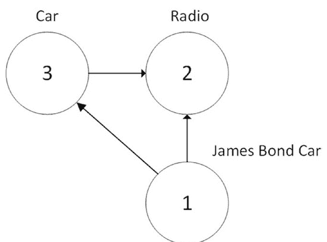

## 第 20 章

## 文件 I/O 与对象序列化

在创建桌面应用程序时，能够在用户会话之间保存信息是很常见的需求。本章将从 .NET Core Framework 的角度探讨几个与 I/O 相关的主题。首先要做的是探索 `System.IO` 命名空间中定义的核心类型，并学习如何以编程方式修改计算机的目录和文件结构。接下来的任务是探索从基于字符、基于二进制、基于字符串和基于内存的数据存储中进行读取和写入的各种方式。

在学会使用核心 I/O 类型操作文件和目录后，你将研究对象序列化这一相关主题。你可以使用对象序列化将对象的状态持久化到任何派生自 `System.IO.Stream` 的类型中，或从中检索对象状态。

> 注意：为了确保你能运行本章中的每个示例，请以管理员权限启动 Visual Studio（只需右键单击 Visual Studio 图标并选择“以管理员身份运行”）。如果不这样做，当访问计算机文件系统时，你可能会遇到运行时安全异常。

## 探索 System.IO 命名空间

在 .NET Core 框架中，`System.IO` 命名空间是基类库中专门用于基于文件（和基于内存）的输入和输出（I/O）服务的区域。与任何命名空间一样，`System.IO` 定义了一组类、接口、枚举、结构和委托，其中大部分可以在 mscorlib.dll 中找到。除了 mscorlib.dll 中包含的类型外，System.dll 程序集还定义了 `System.IO` 命名空间的其他成员。

`System.IO` 命名空间中的许多类型专注于对物理目录和文件的编程式操作。此外，还有一些类型支持从字符串缓冲区以及原始内存位置读取数据和向其写入数据。表 20-1 概述了核心（非抽象）类，提供了 `System.IO` 功能的路由图。


## 表 20-1. System.IO 命名空间的主要成员

| 非抽象 I/O 类类型 | 作用 |
|---|---|
| BinaryReader<br>BinaryWriter | 这些类允许你以二进制值的形式存储和检索基本数据类型（整数、布尔值、字符串等）。 |
| BufferedStream | 此类为字节流提供临时存储，你可以稍后将其提交到存储中。 |
| Directory<br>DirectoryInfo | 使用这些类来操作计算机的目录结构。Directory 类型通过静态成员公开功能，而 DirectoryInfo 类型通过有效的对象引用公开类似功能。 |
| DriveInfo | 此类提供有关给定计算机所用驱动器的详细信息。 |
| File<br>FileInfo | 使用这些类来操作计算机的文件集。File 类型通过静态成员公开功能，而 FileInfo 类型通过有效的对象引用公开类似功能。 |
| FileStream | 此类以字节流形式表示数据，提供随机文件访问（例如，查找功能）。 |
| FileSystemWatcher | 此类允许你监视指定目录中外部文件的修改。 |
| MemoryStream | 此类提供对存储在内存中而非物理文件中的流式数据的随机访问。 |
| Path | 此类以平台中立的方式对包含文件或目录路径信息的 System.String 类型执行操作。 |
| StreamWriter<br>StreamReader | 使用这些类向文件存储（或从文件检索）文本信息。这些类型不支持随机文件访问。 |
| StringWriter<br>StringReader | 与 StreamReader/StreamWriter 类类似，这些类也处理文本信息。不过，底层存储是字符串缓冲区，而不是物理文件。 |

除了这些具体的类类型之外，System.IO 还定义了若干枚举以及一组抽象类（如 Stream、TextReader 和 TextWriter），为所有派生类定义了共享的多态接口。本章将介绍其中许多类型。

## Directory(Info) 和 File(Info) 类型

System.IO 提供了四个类，允许你操作单个文件，并与计算机的目录结构进行交互。前两种类型 Directory 和 File 使用各种静态成员公开创建、删除、复制和移动操作。密切相关的 FileInfo 和 DirectoryInfo 类型则公开类似的功能作为实例级方法（因此，你必须使用 new 关键字来分配它们）。Directory 和 File 类直接扩展 System.Object，而 DirectoryInfo 和 FileInfo 派生自抽象类型 FileSystemInfo。

FileInfo 和 DirectoryInfo 通常是获取文件或目录完整详细信息（如创建时间或读/写能力）的更好选择，因为它们的成员往往返回强类型对象。相比之下，Directory 和 File 类成员往往返回简单的字符串值，而不是强类型对象。然而，这只是一个指导原则；在许多情况下，你可以使用 File/FileInfo 或 Directory/DirectoryInfo 完成相同的工作。

## 抽象基类 FileSystemInfo

DirectoryInfo 和 FileInfo 类型从抽象基类 FileSystemInfo 继承了许多行为。在大多数情况下，你可以使用 FileSystemInfo 类的成员来发现给定文件或目录的一般特征（如创建时间、各种属性等）。表 20-2 列出了一些核心属性。

### 表 20-2. FileSystemInfo 属性

| 属性 | 作用 |
|---|---|
| Attributes | 获取或设置与当前文件关联的属性，该属性由 FileAttributes 枚举表示（例如，文件或目录是只读、加密、隐藏还是压缩？） |
| CreationTime | 获取或设置当前文件或目录的创建时间 |
| Exists | 确定给定文件或目录是否存在 |
| Extension | 检索文件的扩展名 |
| FullName | 获取目录或文件的完整路径 |
| LastAccessTime | 获取或设置当前文件或目录上次访问的时间 |
| LastWriteTime | 获取或设置当前文件或目录上次写入的时间 |
| Name | 获取当前文件或目录的名称 |

FileSystemInfo 还定义了 Delete() 方法。派生类型实现此方法以从硬盘删除给定文件或目录。此外，你可以在获取属性信息之前调用 Refresh()，以确保当前文件（或目录）的统计信息不会过期。

## 使用 DirectoryInfo 类型

你将研究的第一个可创建的 I/O 相关类型是 DirectoryInfo 类。该类包含一组用于创建、移动、删除和枚举目录及子目录的成员。除了其基类（FileSystemInfo）提供的功能外，DirectoryInfo 还提供了表 20-3 中详细说明的关键成员。

### 表 20-3. DirectoryInfo 类型的关键成员

| 成员 | 作用 |
|---|---|
| Create() | 在给定路径名时创建目录（或一组子目录） |
| CreateSubdirectory() |  |
| Delete() | 删除目录及其所有内容 |
| GetDirectories() | 返回 DirectoryInfo 对象数组，表示当前目录中的所有子目录 |
| GetFiles() | 检索 FileInfo 对象数组，表示给定目录中的一组文件 |
| MoveTo() | 将目录及其内容移动到新路径 |
| Parent | 检索此目录的父目录 |
| Root | 获取路径的根部分 |

你可以通过将特定目录路径作为构造函数参数来开始使用 DirectoryInfo 类型。如果你想访问当前工作目录（正在执行的应用程序的目录），请使用点（.）表示法。以下是一些示例：

```
// Bind to the current working directory.
DirectoryInfo dir1 = new DirectoryInfo(".");
// Bind to C:\Windows,
// using a verbatim string.
DirectoryInfo dir2 = new DirectoryInfo(@"C:\Windows");
```

在第二个示例中，你假定传入构造函数的路径（C:\Windows）已存在于物理计算机上。但是，如果你尝试与不存在的目录交互，则会抛出 System.IO.DirectoryNotFoundException。因此，如果你指定一个尚未创建的目录，则需要先调用 Create() 方法，然后再继续，如下所示：

```
// Bind to a nonexistent directory, then create it.
DirectoryInfo dir3 = new DirectoryInfo(@"C:\MyCode\Testing");
dir3.Create();
```

前面示例中使用的路径语法是面向 Windows 的。如果你正在为不同平台开发 .NET Core 应用程序，则应该使用 Path.VolumeSeparatorChar 和 Path.DirectorySeparatorChar 构造，它们将根据平台生成相应的字符。将之前的代码更新为以下内容：

```
DirectoryInfo dir3 = new DirectoryInfo(
$@"C{Path.VolumeSeparatorChar}{Path.DirectorySeparatorChar}MyCode{Path.DirectorySeparatorChar}Testing");
```

创建 DirectoryInfo 对象后，你可以使用从 FileSystemInfo 继承的任何属性来检查底层目录的内容。要查看实际效果，请创建一个名为 DirectoryApp 的新控制台应用程序项目，并更新你的 C# 文件以导入 System 和 System.IO。用以下新的静态方法更新你的 Program 类，该方法创建一个映射到 C:\Windows（如有必要，请调整你的路径）的新 DirectoryInfo 对象，并显示一些有趣的统计信息：

```
using System;
using System.IO;

Console.WriteLine("***** Fun with Directory(Info) *****
");
ShowWindowsDirectoryInfo();
Console.ReadLine();

static void ShowWindowsDirectoryInfo()
{
    // Dump directory information. If you are not on Windows, plug in another directory
    DirectoryInfo dir = new DirectoryInfo($"@"C{Path.VolumeSeparatorChar}{Path.DirectorySeparatorChar}Windows");
    Console.WriteLine("***** Directory Info *****");
    Console.WriteLine("FullName: {0}", dir.FullName);
    Console.WriteLine("Name: {0}", dir.Name);
    Console.WriteLine("Parent: {0}", dir.Parent);
    Console.WriteLine("Creation: {0}", dir.CreationTime);
    Console.WriteLine("Attributes: {0}", dir.Attributes);
    Console.WriteLine("Root: {0}", dir.Root);
    Console.WriteLine("***************************\n");
}
```

虽然你的输出可能有所不同，但你应该会看到类似以下内容：

```
***** Fun with Directory(Info) *****
***** Directory Info *****
FullName: C:\Windows
Name: Windows
Parent:
Creation: 3/19/2019 00:37:22
Attributes: Directory
Root: C:\
***************************
```

## 使用 DirectoryInfo 类型枚举文件

除了获取现有目录的基本详细信息外，你还可以扩展当前示例以使用 DirectoryInfo 类型的一些方法。首先，你可以利用 GetFiles() 方法获取位于 C:\Windows\Web\Wallpaper 目录中的所有 *.jpg 文件的信息。

注意 如果你不在 Windows 计算机上，请改造此代码以读取你计算机上某个目录中的文件。请记住使用 Path.VolumeSeparatorChar 和 Path.DirectorySeparatorChar 值，以使你的代码跨平台兼容。


`GetFiles()`方法返回一个`FileInfo`对象数组，其中每个对象都公开了某个特定文件的详细信息（本章稍后会介绍`FileInfo`类型的完整细节）。在`Program`类中创建以下静态方法：

```csharp
static void DisplayImageFiles()
{
    DirectoryInfo dir = new
        DirectoryInfo(@"C:\Windows\Web\Wallpaper");
    // Get all files with a *.jpg extension.
    FileInfo[] imageFiles =
        dir.GetFiles("*.jpg", SearchOption.AllDirectories);

    // How many were found?
    Console.WriteLine("Found {0} *.jpg files\n", imageFiles.Length);

    // Now print out info for each file.
    foreach (FileInfo f in imageFiles)
    {
        Console.WriteLine("****************************");
        Console.WriteLine("File name: {0}", f.Name);
        Console.WriteLine("File size: {0}", f.Length);
        Console.WriteLine("Creation: {0}", f.CreationTime);
        Console.WriteLine("Attributes: {0}", f.Attributes);
        Console.WriteLine("****************************\n");
    }
}
```

请注意，调用`GetFiles()`时需要指定搜索选项；这样做是为了搜索根目录下的所有子目录。运行应用程序后，你将看到所有匹配搜索模式的文件列表。

## 使用 DirectoryInfo 类型创建子目录

你可以使用`DirectoryInfo.CreateSubdirectory()`方法以编程方式扩展目录结构。此方法既可以创建单个子目录，也可以在一次函数调用中创建多个嵌套子目录。下面的方法演示了如何使用该方法：在应用程序执行目录（用`.`表示）中创建一些自定义子目录，从而扩展应用程序的目录结构：

```csharp
static void ModifyAppDirectory()
{
    DirectoryInfo dir = new DirectoryInfo(".");

    // Create \MyFolder off application directory.
    dir.CreateSubdirectory("MyFolder");

    // Create \MyFolder2\Data off application directory.
    dir.CreateSubdirectory(
        $@"MyFolder2{Path.DirectorySeparatorChar}Data");
}
```

你不必捕获`CreateSubdirectory()`方法的返回值，但应注意，在执行成功时，该方法会返回一个表示新创建项目的`DirectoryInfo`对象。请考虑对前面方法进行如下修改：

```csharp
static void ModifyAppDirectory()
{
    DirectoryInfo dir = new DirectoryInfo(".");

    // Create \MyFolder off initial directory.
    dir.CreateSubdirectory("MyFolder");

    // Capture returned DirectoryInfo object.
    DirectoryInfo myDataFolder = dir.CreateSubdirectory(
        $@"MyFolder{Path.DirectorySeparatorChar}Data");

    // Prints path to ..\MyFolder2\Data.
    Console.WriteLine("New Folder is: {0}", myDataFolder);
}
```

如果你从顶级语句中调用此方法，然后使用 Windows 资源管理器检查 Windows 目录，就会看到新建的子目录已经存在。

## 使用 Directory 类型

你已经看到了`DirectoryInfo`类型的实际应用；现在可以开始了解`Directory`类型了。在大多数情况下，`Directory`的静态成员仿照了`DirectoryInfo`所定义的实例成员提供的功能。不过请记住，`Directory`的成员通常返回字符串数据，而不是强类型的`FileInfo`/`DirectoryInfo`对象。

现在来看看`Directory`类型的一些功能。下面这个最终的辅助函数使用`Directory.GetLogicalDrives()`方法显示当前计算机上所有映射驱动器的名称，并使用静态的`Directory.Delete()`方法删除之前创建的`\MyFolder`和`\MyFolder2\Data`子目录。

```csharp
static void FunWithDirectoryType()
{
    // List all drives on current computer.
    string[] drives = Directory.GetLogicalDrives();
    Console.WriteLine("Here are your drives:");
    foreach (string s in drives)
    {
        Console.WriteLine("--> {0} ", s);
    }

    // Delete what was created.
    Console.WriteLine("Press Enter to delete directories");
    Console.ReadLine();
    try
    {
        Directory.Delete("MyFolder");
        // The second parameter specifies whether you
        // wish to destroy any subdirectories.
        Directory.Delete("MyFolder2", true);
    }
    catch (IOException e)
    {
        Console.WriteLine(e.Message);
    }
}
```

## 使用 DriveInfo 类类型

`System.IO`命名空间提供了一个名为`DriveInfo`的类。与`Directory.GetLogicalDrives()`类似，静态的`DriveInfo.GetDrives()`方法允许你发现计算机驱动器的名称。不过，与`Directory.GetLogicalDrives()`不同，`DriveInfo`还提供了许多其他详细信息（例如驱动器类型、可用空间和卷标）。请考虑以下`Program`类，该类定义在名为`DriveInfoApp`的新控制台应用程序项目中：

```csharp
using System;
using System.IO;

// Get info regarding all drives.
DriveInfo[] myDrives = DriveInfo.GetDrives();
// Now print drive stats.
foreach (DriveInfo d in myDrives)
{
    Console.WriteLine("Name: {0}", d.Name);
    Console.WriteLine("Type: {0}", d.DriveType);

    // Check to see whether the drive is mounted.
    if (d.IsReady)
    {
        Console.WriteLine("Free space: {0}", d.TotalFreeSpace);
        Console.WriteLine("Format: {0}", d.DriveFormat);
        Console.WriteLine("Label: {0}", d.VolumeLabel);
    }
    Console.WriteLine();
}
Console.ReadLine();
```

下面是可能的输出：

```text
***** Fun with DriveInfo *****
Name: C:\
Type: Fixed
Free space: 284131119104
Format: NTFS
Label: OS

Name: M:\
Type: Network
Free space: 4711871942656
Format: NTFS
Label: DigitalMedia
```

到这里，你已经了解了`Directory`、`DirectoryInfo`和`DriveInfo`类的一些核心行为。接下来，你将学习如何创建、打开、关闭和销毁填充给定目录的文件。

## 使用 FileInfo 类

如前面`DirectoryApp`示例所示，`FileInfo`类允许你获取硬盘上现有文件的详细信息（例如创建时间、大小和文件属性），并帮助你创建、复制、移动和销毁文件。除了从`FileSystemInfo`继承的功能集合外，你还可以找到一些`FileInfo`类特有的核心成员，这些成员列在表20-4中。

表20-4。FileInfo 核心成员

| 成员 | 用途 |
|---|---|
| AppendText() | 创建一个`StreamWriter`对象（稍后介绍），用于向文件追加文本 |
| CopyTo() | 将现有文件复制到新文件 |
| Create() | 创建一个新文件，并返回一个`FileStream`对象（稍后介绍），用于操作新创建的文件 |
| CreateText() | 创建一个用于写入新文本文件的`StreamWriter`对象 |
| Delete() | 删除`FileInfo`实例绑定的文件 |
| Directory | 获取父目录的实例 |
| DirectoryName | 获取父目录的完整路径 |
| Length | 获取当前文件的大小 |
| MoveTo() | 将指定文件移动到新位置，并可选择指定新的文件名 |
| Name | 获取文件名 |
| Open() | 以各种读写及共享权限打开文件 |
| OpenRead() | 创建一个只读的`FileStream`对象 |
| OpenText() | 创建一个`StreamReader`对象（稍后介绍），用于读取现有文本文件 |
| OpenWrite() | 创建一个只写的`FileStream`对象 |

请注意，`FileInfo`类的大多数方法都会返回特定的 I/O 对象（例如`FileStream`和`StreamWriter`），这些对象允许你以各种格式开始向关联文件写入数据，或从中读取数据。稍后你就会了解这些类型；不过，在查看实际示例之前，先了解使用`FileInfo`类类型获取文件句柄的各种方式会很有帮助。

## FileInfo.Create() 方法

下面的示例都位于名为`SimpleFileIO`的控制台应用程序中。创建文件句柄的一种方式是使用`FileInfo.Create()`方法，如下所示：

```csharp
using System;
using System.IO;

Console.WriteLine("***** Simple IO with the File Type ****\n");
// Change to a folder on your machine that you have read/write access to, or run as administrator
var fileName = $@"C{Path.VolumeSeparatorChar}{Path.DirectorySeparatorChar}temp{Path.DirectorySeparatorChar}Test.dat";
// Make a new file on the C drive.
FileInfo f = new FileInfo(fileName);
FileStream fs = f.Create();

// Use the FileStream object...

// Close down file stream.
fs.Close();
```

> 注意 根据用户权限和系统配置，这些示例可能需要以管理员身份运行 Visual Studio。

请注意，`FileInfo.Create()`方法返回一个`FileStream`对象，该对象公开了针对底层文件的同步和异步写入/读取操作（稍后会详细介绍）。需要注意的是，`FileInfo.Create()`返回的`FileStream`对象授予所有用户完整的读写访问权限。

还要注意，在完成对当前`FileStream`对象的使用后，必须确保关闭该句柄，以释放底层非托管流资源。由于`FileStream`实现了`IDisposable`，因此你可以使用 C# 的`using`作用域，让编译器生成资源清理逻辑（详情请参阅第8章），如下所示：

```csharp
var fileName = $@"C{Path.VolumeSeparatorChar}{Path.DirectorySeparatorChar}Test.dat";
...
// wrap the file stream in a using statement
// Defining a using scope for file I/O
FileInfo f1 = new FileInfo(fileName);
using (FileStream fs1 = f1.Create())
{
    // Use the FileStream object...
}
f1.Delete();
```

> 注意 本章中的几乎所有示例都包含`using`语句。本可以使用新的 using 声明语法，但在本次重写中选择不使用，以便让示例专注于我们正在研究的`System.IO`组件。


## The FileInfo.Open() Method

你可以使用 FileInfo.Open() 方法来打开现有文件，以及以比使用 FileInfo.Create() 更精确的方式创建新文件。这之所以可行，是因为 Open() 通常接受多个参数来精确指定要操作的文件的迭代方式。一旦对 Open() 的调用完成，你将获得一个 FileStream 对象。请考虑以下逻辑：

```
var fileName = $@"C:{Path.VolumeSeparatorChar}{Path.DirectorySeparatorChar}Test.dat";
...
// Make a new file via FileInfo.Open().
FileInfo f2 = new FileInfo(fileName);
using(FileStream fs2 = f2.Open(FileMode.OpenOrCreate,
    FileAccess.ReadWrite, FileShare.None))
{
    // Use the FileStream object...
}
f2.Delete();
```

这个重载的 Open() 方法版本需要三个参数。Open() 方法的第一个参数指定 I/O 请求的一般类型（例如，创建新文件、打开现有文件、追加到文件），你使用 FileMode 枚举来指定，如下所示：

```
public enum FileMode
{
    CreateNew,
    Create,
    Open,
    OpenOrCreate,
    Truncate,
    Append
}
```

### Table 20-5. Members of the FileMode Enumeration

| Member | Meaning in Life |
|---|---|
| CreateNew | 通知操作系统创建新文件。如果文件已存在，则抛出 IOException。 |
| Create | 通知操作系统创建新文件。如果文件已存在，则会被覆盖。 |
| Open | 打开现有文件。如果文件不存在，则抛出 FileNotFoundException。 |
| OpenOrCreate | 如果文件存在则打开；否则创建新文件。 |
| Truncate | 打开现有文件并将文件大小截断为 0 字节。 |
| Append | 打开文件，移动到文件末尾并开始写操作（你只能在写-only 流中使用此标志）。如果文件不存在，则创建新文件。 |

你使用 Open() 方法的第二个参数，一个来自 FileAccess 枚举的值，来确定底层流的读写行为，如下所示：

```
public enum FileAccess
{
    Read,
    Write,
    ReadWrite
}
```

最后，Open() 方法的第三个参数 FileShare 指定如何与其他文件处理程序共享文件。以下是核心名称：

```
public enum FileShare
{
    None,
    Read,
    Write,
    ReadWrite,
    Delete,
    Inheritable
}
```

## The FileInfo.OpenRead() and FileInfo.OpenWrite() Methods

FileInfo.Open() 方法允许你以灵活的方式获取文件句柄，但 FileInfo 类还提供了名为 OpenRead() 和 OpenWrite() 的成员。正如你可能猜到的，这些方法返回一个已正确配置的只读或只写 FileStream 对象，而无需提供各种枚举值。与 FileInfo.Create() 和 FileInfo.Open() 一样，OpenRead() 和 OpenWrite() 返回一个 FileStream 对象。

请注意，OpenRead() 方法要求文件必须已存在。以下代码创建文件然后关闭 FileStream，以便 OpenRead() 方法可以使用它：

```
f3.Create().Close();
```

以下是完整示例：

```
var fileName = $@"C{Path.VolumeSeparatorChar}{Path.DirectorySeparatorChar}Test.dat";
...
// Get a FileStream object with read-only permissions.
FileInfo f3 = new FileInfo(fileName);
//File must exist before using OpenRead
f3.Create().Close();
using(FileStream readOnlyStream = f3.OpenRead())
{
    // Use the FileStream object...
}
f3.Delete();

// Now get a FileStream object with write-only permissions.
FileInfo f4 = new FileInfo(fileName);
```

```
using(FileStream writeOnlyStream = f4.OpenWrite())
{
    // Use the FileStream object...
}
f4.Delete();
```

## The FileInfo.OpenText() Method

FileInfo 类型的另一个以打开为中心的成员是 OpenText()。与 Create()、Open()、OpenRead() 或 OpenWrite() 不同，OpenText() 方法返回 StreamReader 类型的实例，而不是 FileStream 类型。假设你的 C: 驱动器上有一个名为 boot.ini 的文件，以下片段可让你访问其内容：

```
var fileName = $@"C:{Path.VolumeSeparatorChar}{Path.DirectorySeparatorChar}Test.dat";
...
// Get a StreamReader object.
//If not on a Windows machine, change the file name accordingly
FileInfo f5 = new FileInfo(fileName);
//File must exist before using OpenText
f5.Create().Close();
using(StreamReader sreader = f5.OpenText())
{
    // Use the StreamReader object...
}
f5.Delete();
```

正如你很快就会看到的，StreamReader 类型提供了一种从底层文件读取字符数据的方式。

## The FileInfo.CreateText() and FileInfo.AppendText() Methods

此时感兴趣的最后两个 FileInfo 方法是 CreateText() 和 AppendText()。两者都返回一个 StreamWriter 对象，如下所示：

```
var fileName = $@"C:{Path.VolumeSeparatorChar}{Path.DirectorySeparatorChar}Test.dat";
...
FileInfo f6 = new FileInfo(fileName);
using(StreamWriter swriter = f6.CreateText())
{
    // Use the StreamWriter object...
}
f6.Delete();
FileInfo f7 = new FileInfo(fileName);
using(StreamWriter swriterAppend = f7.AppendText())
{
    // Use the StreamWriter object...
}
f7.Delete();
```

正如你可能猜到的，StreamWriter 类型提供了一种向底层文件写入字符数据的方式。

## Working with the File Type

File 类型使用多个静态成员来提供与 FileInfo 类型几乎 identical 的功能。与 FileInfo 一样，File 提供了 AppendText()、Create()、CreateText()、Open()、OpenRead()、OpenWrite() 和 OpenText() 方法。在许多情况下，你可以互换使用 File 和 FileInfo 类型。请注意，OpenText() 和 OpenRead() 要求文件必须已存在。要亲眼看到这一点，你可以通过改用 File 类型来简化之前的每个 FileStream 示例，如下所示：

```
var fileName = $@"C{Path.VolumeSeparatorChar}{Path.DirectorySeparatorChar}Test.dat";
...
//Using File instead of FileInfo
using (FileStream fs8 = File.Create(fileName))
{
    // Use the FileStream object...
}
File.Delete(fileName);
// Make a new file via FileInfo.Open().
using(FileStream fs9 = File.Open(fileName,
    FileMode.OpenOrCreate, FileAccess.ReadWrite,
    FileShare.None))
{
    // Use the FileStream object...
}
// Get a FileStream object with read-only permissions.
using(FileStream readOnlyStream = File.OpenRead(fileName))
{}
File.Delete(fileName);
// Get a FileStream object with write-only permissions.
using(FileStream writeOnlyStream = File.OpenWrite(fileName))
{}
// Get a StreamReader object.
using(StreamReader sreader = File.OpenText(fileName))
{}
File.Delete(fileName);
// Get some StreamWriters.
using(StreamWriter swriter = File.CreateText(fileName))
{}
File.Delete(fileName);

using(StreamWriter swriterAppend =
    File.AppendText(fileName))
{}
File.Delete(fileName);
```

## Additional File-centric Members

File 类型还支持一些成员，如表 20-6 所示，可大大简化读取和写入文本数据的过程。

### Table 20-6. Methods of the File Type

| Method | Meaning in Life |
|---|---|
| ReadAllBytes() | 打开指定文件，将二进制数据作为字节数组返回，然后关闭文件 |
| ReadAllLines() | 打开指定文件，将字符数据作为字符串数组返回，然后关闭文件 |
| ReadAllText() | 打开指定文件，将字符数据作为 System.String 返回，然后关闭文件 |
| WriteAllBytes() | 打开指定文件，写入字节数组，然后关闭文件 |
| WriteAllLines() | 打开指定文件，写入字符串数组，然后关闭文件 |
| WriteAllText() | 打开指定文件，从指定字符串写入字符数据，然后关闭文件 |

你可以使用 File 类型的这些方法在几行代码中读取和写入批量数据。更好的是，这些成员中的每一个都会自动关闭底层文件句柄。例如，以下控制台程序（名为 SimpleFileIO）以最少的麻烦将字符串数据持久化到 C: 驱动器上的新文件（并将其读入内存）（此示例假设你已导入 System.IO）：

```
Console.WriteLine("***** Simple I/O with the File Type ****\n");
string[] myTasks = {
    "Fix bathroom sink", "Call Dave",
    "Call Mom and Dad", "Play Xbox One"};

// Write out all data to file on C drive.
File.WriteAllLines(@"tasks.txt", myTasks);

// Read it all back and print out.
foreach (string task in File.ReadAllLines(@"tasks.txt"))
{
    Console.WriteLine("TODO: {0}", task);
}
Console.ReadLine();
File.Delete("tasks.txt");
```

这里的经验教训是，当你想快速获取文件句柄时，File 类型会为你节省一些击键次数。然而，创建一个 FileInfo 对象首先的好处是，你可以使用抽象 FileSystemInfo 基类的成员来调查文件。

## The Abstract Stream Class

到目前为止，你已经看到了许多获取 FileStream、StreamReader 和 StreamWriter 对象的方法，但你尚未使用这些类型从文件读取数据或向文件写入数据。要了解如何做到这一点，你需要熟悉流的概念。在 I/O 操作的世界中，流表示源和目标之间流动的数据块。流提供了一种与字节序列交互的通用方式，而不管存储或显示这些字节的设备类型如何（例如，文件、网络连接或打印机）。


抽象 `System.IO.Stream` 类定义了若干成员，用于支持与存储介质（例如底层文件或内存位置）进行同步和异步交互。

> **注意** 流的概念不仅限于文件 I/O。事实上，.NET Core 库提供了对网络、内存位置以及其他以流为中心的抽象的流访问。

再次说明，`Stream` 的后代将数据表示为原始字节流；因此，直接处理原始流可能会相当晦涩。一些派生自 `Stream` 的类型支持查找（seeking），这指的是获取和调整流中当前位置的过程。表 20-7 通过描述 `Stream` 类的核心成员，帮助你理解该类提供的功能。

**表 20-7. 抽象 Stream 成员**

| 成员 | 含义 |
|---|---|
| `CanRead`<br>`CanWrite`<br>`CanSeek` | 确定当前流是否支持读取、查找和/或写入。 |
| `Close()` | 关闭当前流并释放与当前流关联的所有资源（如套接字和文件句柄）。在内部，此方法是 `Dispose()` 方法的别名；因此，关闭流在功能上等同于释放流。 |
| `Flush()` | 用缓冲区的当前状态更新底层数据源或存储库，然后清除缓冲区。如果流未实现缓冲区，则此方法不执行任何操作。 |
| `Length` | 以字节为单位返回流的长度。 |
| `Position` | 确定当前流中的位置。 |
| `Read()`<br>`ReadByte()`<br>`ReadAsync()` | 从当前流读取一个字节序列（或单个字节），并将流中的当前位置前进所读取的字节数。 |
| `Seek()` | 设置当前流中的位置。 |
| `SetLength()` | 设置当前流的长度。 |
| `Write()`<br>`WriteByte()`<br>`WriteAsync()` | 将一个字节序列（或单个字节）写入当前流，并将此流中的当前位置前进所写入的字节数。 |

## 使用 FileStream

`FileStream` 类以适合于基于文件的流式处理的方式，为抽象 `Stream` 成员提供了实现。它是一个原始流；只能读取或写入单个字节或字节数组。但是，你通常不需要直接与 `FileStream` 类型的成员交互。相反，你可能会使用各种流包装器，它们使处理文本数据或 .NET Core 类型变得更加容易。尽管如此，你会发现尝试 `FileStream` 类型的同步读/写功能是有益的。

假设你有一个名为 `FileStreamApp` 的新控制台应用程序项目（并确认 `System.IO` 和 `System.Text` 已导入到你的初始 C# 代码文件中）。你的目标是向一个名为 `myMessage.dat` 的新文件写入一条简单的文本消息。然而，由于 `FileStream` 只能操作原始字节，你需要将 `System.String` 类型编码为相应的字节数组。幸运的是，`System.Text` 命名空间定义了一个名为 `Encoding` 的类型，它提供了将字符串编码为字节数组或从字节数组解码字符串的成员。

编码后，使用 `FileStream.Write()` 方法将字节数组持久化到文件中。要将字节读回内存，必须重置流的内部位置（使用 `Position` 属性）并调用 `ReadByte()` 方法。最后，将原始字节数组和解码后的字符串显示到控制台。以下是完整代码：

```
using System;
using System.IO;
using System.Text;

// Don't forget to import the System.Text and System.IO namespaces.
Console.WriteLine("***** Fun with FileStreams ****\n");

// Obtain a FileStream object.
using(FileStream fStream = File.Open("myMessage.dat",
    FileMode.Create))
{
    // Encode a string as an array of bytes.
    string msg = "Hello!";
    byte[] msgAsByteArray = Encoding.Default.GetBytes(msg);

    // Write byte[] to file.
    fStream.Write(msgAsByteArray, 0, msgAsByteArray.Length);

    // Reset internal position of stream.
    fStream.Position = 0;

    // Read the bytes from file and display to console.
    Console.Write("Your message as an array of bytes: ");
    byte[] bytesFromFile = new byte[msgAsByteArray.Length];
    for (int i = 0; i < msgAsByteArray.Length; i++)
    {
        bytesFromFile[i] = (byte)fStream.ReadByte();
        Console.Write(bytesFromFile[i]);
    }

    // Display decoded messages.
    Console.Write("\nDecoded Message: ");
    Console.WriteLine(Encoding.Default.GetString(bytesFromFile));
    Console.ReadLine();
}
File.Delete("myMessage.dat");
```

此示例用数据填充了文件，但也凸显了直接使用 `FileStream` 类型的主要缺点：它要求操作原始字节。其他派生自 `Stream` 的类型也以类似方式操作。例如，如果要将字节序列写入内存区域，可以分配一个 `MemoryStream`。

如前所述，`System.IO` 命名空间提供了若干读取器和写入器类型，它们封装了使用派生自 `Stream` 的类型的细节。

## 使用 StreamWriter 和 StreamReader

当你需要读取或写入基于字符的数据（例如字符串）时，`StreamWriter` 和 `StreamReader` 类非常有用。两者默认都使用 Unicode 字符；但是，你可以通过提供适当配置的 `System.Text.Encoding` 对象引用来更改这一点。为简单起见，假设默认的 Unicode 编码符合要求。

`StreamReader` 派生自名为 `TextReader` 的抽象类型，相关的 `StringReader` 类型也是如此（本章稍后将讨论）。`TextReader` 基类为这些后代类型提供了一组有限的功能；具体来说，它提供了读取和查看字符流的能力。

`StreamWriter` 类型（以及本章稍后将介绍的 `StringWriter`）派生自名为 `TextWriter` 的抽象基类。该类定义了允许派生类型将文本数据写入给定字符流的成员。

为了帮助你理解 `StreamWriter` 和 `StringWriter` 类的核心写入功能，表 20-8 描述了抽象 `TextWriter` 基类的核心成员。

**表 20-8. TextWriter 的核心成员**

| 成员 | 含义 |
|---|---|
| `Close()` | 此方法关闭写入器并释放所有关联资源。在此过程中，缓冲区会自动刷新（同样，此成员在功能上等同于调用 `Dispose()` 方法）。 |
| `Flush()` | 此方法清除当前写入器的所有缓冲区，并导致任何缓冲数据被写入底层设备；但是，它不会关闭写入器。 |
| `NewLine` | 此属性指示派生写入器类的换行常量。Windows 操作系统的默认行终止符是回车符，后跟换行符（`\r\n`）。 |
| `Write()`<br>`WriteAsync()` | 此重载方法将数据写入文本流，不带换行常量。 |
| `WriteLine()`<br>`WriteLineAsync()` | 此重载方法将数据写入文本流，带换行常量。 |

> **注意** `TextWriter` 类的最后两个成员可能看起来眼熟。如果你还记得，`System.Console` 类型具有 `Write()` 和 `WriteLine()` 成员，它们将文本数据推送到标准输出设备。实际上，`Console.In` 属性包装了一个 `TextReader`，而 `Console.Out` 属性包装了一个 `TextWriter`。

派生的 `StreamWriter` 类为 `Write()`、`Close()` 和 `Flush()` 方法提供了适当的实现，并定义了额外的 `AutoFlush` 属性。当此属性设置为 `true` 时，它会强制 `StreamWriter` 在你每次执行写入操作时刷新所有数据。请注意，如果始终在完成使用 `StreamWriter` 写入后调用 `Close()`，则可以通过将 `AutoFlush` 设置为 `false` 来获得更好的性能。

### 写入文本文件

为了实际体验 `StreamWriter` 类型，请创建一个名为 `StreamWriterReaderApp` 的新控制台应用程序项目，并导入 `System.IO` 和 `System.Text`。以下代码使用 `File.CreateText()` 方法在当前执行文件夹中创建名为 `reminders.txt` 的新文件。使用获得的 `StreamWriter` 对象，可以向新文件添加一些文本数据。


using System;
using System.IO;
using System.Text;

Console.WriteLine("***** Fun with StreamWriter / StreamReader *****
");

// Get a StreamWriter and write string data.
using(StreamWriter writer = File.CreateText("reminders.txt"))
{
    writer.WriteLine("Don't forget Mother's Day this year...");
    writer.WriteLine("Don't forget Father's Day this year...");
    writer.WriteLine("Don't forget these numbers:");
    for(int i = 0; i < 10; i++)
    {
        writer.Write(i + " ");
    }

    // Insert a new line.
    writer.Write(writer.NewLine);
}
Console.WriteLine("Created file and wrote some thoughts...");
Console.ReadLine();
//File.Delete("reminders.txt");

运行此程序后，您可以检查此新文件的内容。您将在项目的根目录（Visual Studio Code）或 bin\Debug\net5.0 文件夹（Visual Studio）下找到此文件，因为在调用 CreateText() 时您未指定绝对路径，文件位置默认为程序集的当前执行目录。

## Reading from a Text File

接下来，您将学习如何通过使用相应的 StreamReader 类型以编程方式从文件中读取数据。请记住，此类派生自抽象的 TextReader，该抽象类提供了表 20-9 中描述的功能。

Table 20-9. TextReader Core Members

| Member | Meaning in Life |
|---|---|
| Peek() | Returns the next available character (expressed as an integer) without changing the position of the reader. A value of -1 indicates you are at the end of the stream. |
| Read() | Reads data from an input stream. |
| ReadAsync() |  |
| ReadBlock() | Reads a specified maximum number of characters from the current stream and writes |
| ReadBlockAsync() | the data to a buffer, beginning at a specified index. |
| ReadLine() | Reads a line of characters from the current stream and returns the data as a string (a |
| ReadLineAsync() | null string indicates EOF). |
| ReadToEnd() | Reads all characters from the current position to the end of the stream and returns |
| ReadToEndAsync() | them as a single string. |

如果您现在扩展当前示例应用程序以使用 StreamReader，则可以按如下所示从 reminders.txt 文件中读取文本数据：

```
Console.WriteLine("***** Fun with StreamWriter / StreamReader *****
");
...
// Now read data from file.
Console.WriteLine("Here are your thoughts:\n");
using(StreamReader sr = File.OpenText("reminders.txt"))
{
    string input = null;
    while ((input = sr.ReadLine()) != null)
    {
        Console.WriteLine (input);
    }
}
Console.ReadLine();
```

运行程序后，您将看到 reminders.txt 中的字符数据显示到控制台。

## Directly Creating StreamWriter/StreamReader Types

在 System.IO 中使用类型时令人困惑的一个方面是，您通常可以使用不同的方法实现相同的结果。例如，您已经看到可以使用 File 或 FileInfo 类型的 CreateText() 方法获得 StreamWriter。碰巧的是，您可以通过直接创建它们以另一种方式使用 StreamWriter 和 StreamReader。例如，您可以按如下方式改造当前应用程序：

```
Console.WriteLine("***** Fun with StreamWriter / StreamReader *****
");

// Get a StreamWriter and write string data.
using(StreamWriter writer = new StreamWriter("reminders.txt"))
{
    ...
}

// Now read data from file.
using(StreamReader sr = new StreamReader("reminders.txt"))
{
    ...
}
```

尽管看到如此多看似相同的<|start|>文件 I/O 方法可能会有点令人困惑，但请记住，结果是更大的灵活性。在任何情况下，您现在就可以检查 StringWriter 和 StringReader 类的作用，因为您已经了解了如何使用 StreamWriter 和 StreamReader 类型将字符数据移入移出给定文件。

## Working with StringWriters and StringReaders

您可以使用 StringWriter 和 StringReader 类型将文本信息视为内存中字符的流。当您希望将基于字符的信息附加到底层缓冲区时，这可能很有帮助。以下控制台应用程序项目（名为 StringReaderWriterApp）通过将字符串数据块写入 StringWriter 对象而不是写入本地硬盘上的文件来说明这一点（不要忘记导入 System.IO 和 System.Text）：

```
using System;
using System.IO;
using System.Text;

Console.WriteLine("**** Fun with StringWriter / StringReader ****\n");

// Create a StringWriter and emit character data to memory.
using(StringWriter strWriter = new StringWriter())
{
    strWriter.WriteLine("Don't forget Mother's Day this year...");
    // Get a copy of the contents (stored in a string) and dump
    // to console.
    Console.WriteLine("Contents of StringWriter:\n{0}", strWriter);
}
Console.ReadLine();
```

StringWriter 和 StreamWriter 都派生自相同的基类（TextWriter），因此写入逻辑相似。然而，鉴于 StringWriter 的特性，您还应该知道此类允许您使用以下 GetStringBuilder() 方法提取 System.Text.StringBuilder 对象：

```
using (StringWriter strWriter = new StringWriter())
{
    strWriter.WriteLine("Don't forget Mother's Day this year...");
    Console.WriteLine("Contents of StringWriter:\n{0}", strWriter);

    // Get the internal StringBuilder.
    StringBuilder sb = strWriter.GetStringBuilder();
    sb.Insert(0, "Hey!! ");
    Console.WriteLine("-> {0}", sb.ToString());
    sb.Remove(0, "Hey!! ".Length);
    Console.WriteLine("-> {0}", sb.ToString());
}
```

当您想要从字符数据流中读取时，可以使用相应的 StringReader 类型，其功能与相关的 StreamReader 类完全相同。事实上，StringReader 类所做的只是重写继承的成员以从字符数据块中读取，而不是从文件中读取，如下所示：

```
using (StringWriter strWriter = new StringWriter())
{
    strWriter.WriteLine("Don't forget Mother's Day this year...");
    Console.WriteLine("Contents of StringWriter:\n{0}", strWriter);
```

```
// Read data from the StringWriter.
using (StringReader strReader = new StringReader(strWriter.ToString()))
{
    string input = null;
    while ((input = strReader.ReadLine()) != null)
    {
        Console.WriteLine(input);
    }
}
```

## Working with BinaryWriters and BinaryReaders

在本节中您将检查的最后的写入器/读取器集是 BinaryReader 和 BinaryWriter。两者都直接派生自 System.Object。这些类型允许您以紧凑的二进制格式将离散数据类型读写入底层流。BinaryWriter 类定义了高度重载的 Write() 方法以将数据类型放置在底层流中。除了 Write() 成员之外，BinaryWriter 还提供其他成员，允许您获取或设置派生自 Stream 的类型；它还提供对数据的随机访问支持（参见表 20-10）。

Table 20-10. BinaryWriter Core Members

| Member | Meaning in Life |
|--------|-----------------|
| BaseStream | This read-only property provides access to the underlying stream used with the BinaryWriter object. |
| Close() | This method closes the binary stream. |
| Flush() | This method flushes the binary stream. |
| Seek() | This method sets the position in the current stream. |
| Write() | This method writes a value to the current stream. |

BinaryReader 类通过表 20-11 中描述的成员补充了 BinaryWriter 提供的功能。

Table 20-11. BinaryReader Core Members

| Member | Meaning in Life |
|--------|-----------------|
| BaseStream | This read-only property provides access to the underlying stream used with the BinaryReader object. |
| Close() | This method closes the binary reader. |
| PeekChar() | This method returns the next available character without advancing the position in the stream. |
| Read() | This method reads a given set of bytes or characters and stores them in the incoming array. |
| ReadXXX() | The BinaryReader class defines numerous read methods that grab the next type from the stream (e.g., ReadBoolean(), ReadByte(), and ReadInt32()). |


下面的示例（一个名为BinaryWriterReader的控制台应用程序项目，其中使用了System.IO）将一些数据类型写入一个新的*.dat文件：

```
using System;
using System.IO;

Console.WriteLine("***** Fun with Binary Writers / Readers *****\n");

// Open a binary writer for a file.
FileInfo f = new FileInfo("BinFile.dat");
using(BinaryWriter bw = new BinaryWriter(f.OpenWrite()))
{
    // Print out the type of BaseStream.
    // (System.IO.FileStream in this case).
    Console.WriteLine("Base stream is: {0}", bw.BaseStream);

    // Create some data to save in the file.
    double aDouble = 1234.67;
    int anInt = 34567;
    string aString = "A, B, C";

    // Write the data.
    bw.Write(aDouble);
    bw.Write(anInt);
    bw.Write(aString);
}
Console.WriteLine("Done!");
Console.ReadLine();
```

请注意，FileInfo.OpenWrite()返回的FileStream对象是如何传递给BinaryWriter类型的构造函数的。使用这种技术可以轻松地在写出数据之前分层放置一个流。请注意，BinaryWriter的构造函数接受任何Stream派生类型（例如FileStream、MemoryStream或BufferedStream）。因此，改为将二进制数据写入内存，只需提供一个有效的MemoryStream对象即可。

要从BinFile.dat文件中读取数据，BinaryReader类型提供了几种选项。在这里，你调用各种以读取为中心的成员来从文件流中取出每一块数据：

```
...
FileInfo f = new FileInfo("BinFile.dat");
...
// Read the binary data from the stream.
using(BinaryReader br = new BinaryReader(f.OpenRead()))
{
    Console.WriteLine(br.ReadDouble());
    Console.WriteLine(br.ReadInt32());
    Console.WriteLine(br.ReadString());
}
Console.ReadLine();
```

## 以编程方式监视文件

现在你已经更好地掌握了各种读写器的使用，接下来你将了解FileSystemWatcher类的作用。当你希望以编程方式监视（或“监控”）系统中的文件时，这个类型会非常有用。具体来说，你可以指示FileSystemWatcher类型监视文件，以检查System.IO.NotifyFilters枚举指定的任何操作。

```
public enum NotifyFilters
{
    Attributes, CreationTime,
    DirectoryName, FileName,
    LastAccess, LastWrite,
    Security, Size
}
```

要开始使用FileSystemWatcher类型，你需要设置Path属性来指定包含要监视文件的目录名称（和位置），同时还要设置Filter属性，该属性定义要监视文件的扩展名。

此时，你可以选择处理Changed、Created和Deleted事件，这些事件都与FileSystemEventHandler委托配合使用。该委托可以调用任何符合以下模式的方法：

```
// The FileSystemEventHandler delegate must point
// to methods matching the following signature.
void MyNotificationHandler(object source, FileSystemEventArgs e)
```

你还可以使用RenamedEventHandler委托类型处理Renamed事件，该委托可以调用符合以下签名的方法：

```
// The RenamedEventHandler delegate must point
// to methods matching the following signature.
void MyRenamedHandler(object source, RenamedEventArgs e)
```

虽然你可以使用传统的委托/事件语法来处理每个事件，但我们将使用新的lambda表达式语法。

接下来，让我们看看监视文件的过程。下面的控制台应用程序项目（名为MyDirectoryWatcher，并为System.IO使用了using）监视`bin\debug\net5.0`目录中的`*.txt`文件，并在文件被创建、删除、修改或重命名时打印消息：

```
using System;
using System.IO;

Console.WriteLine("**** The Amazing File Watcher App ****\n");
// Establish the path to the directory to watch.
FileSystemWatcher watcher = new FileSystemWatcher();
try
{
    watcher.Path = @".";
}
catch(ArgumentException ex)
{
    Console.WriteLine(ex.Message);
    return;
}
// Set up the things to be on the lookout for.
watcher.NotifyFilter = NotifyFilters.LastAccess
  | NotifyFilters.LastWrite
  | NotifyFilters.FileName
  | NotifyFilters.DirectoryName;

// Only watch text files.
watcher.Filter = "*.txt";

// Add event handlers.
// Specify what is done when a file is changed, created, or deleted.
watcher.Changed += (s, e) =>
    Console.WriteLine($"File: {e.FullPath} {e.ChangeType}!");
watcher.Created += (s, e) =>
    Console.WriteLine($"File: {e.FullPath} {e.ChangeType}!");
watcher.Deleted += (s, e) =>
    Console.WriteLine($"File: {e.FullPath} {e.ChangeType}!");
// Specify what is done when a file is renamed.
watcher.Renamed += (s, e) =>
    Console.WriteLine($"File: {e.OldFullPath} renamed to {e.FullPath}");
// Begin watching the directory.
watcher.EnableRaisingEvents = true;

// Wait for the user to quit the program.
Console.WriteLine(@"Press 'q' to quit app.");
// Raise some events.
using (var sw = File.CreateText("Test.txt"))
{
    sw.Write("This is some text");
}
File.Move("Test.txt","Test2.txt");
File.Delete("Test2.txt");

while(Console.Read()!='q');
```

当你运行这个程序时，最后几行将创建、更改、重命名然后删除一个文本文件，并在此过程中引发事件。你也可以导航到`bin\debug\net5.0`目录，摆弄一下`*.txt`扩展名的文件，并引发额外的事件。

```
**** The Amazing File Watcher App ****
Press 'q' to quit app.
File: .\Test.txt Created!
File: .\Test.txt Changed!
File: .\Test.txt renamed to .\Test2.txt
File: .\Test2.txt Deleted!
```

这就结束了本章关于.NET Core平台中基本I/O操作的内容。虽然你肯定会在许多应用程序中使用这些技术，但你也可能会发现对象序列化服务可以极大地简化如何持久化大量数据。

## 理解对象序列化

术语*序列化*描述了将对象的状态持久化（并可能传输）到流（例如文件流或内存流）中的过程。持久化的数据序列包含了你稍后重建（或*反序列化*）对象的公共状态所需的所有必要信息。使用这项技术可以轻松地保存大量数据。在许多情况下，使用序列化服务保存应用程序数据，比使用System.IO命名空间中的读写器所需的代码更少。

例如，假设你想创建一个基于GUI的桌面应用程序，为最终用户提供保存其偏好设置（例如窗口颜色和字体大小）的途径。为此，你可以定义一个名为UserPrefs的类，它封装了大约20个字段数据。现在，如果你使用System.IO.BinaryWriter类型，你需要手动保存UserPrefs对象的每个字段。同样，如果你要从文件将数据加载回内存，你需要使用System.IO.BinaryReader，并（再次）手动读取每个值以重新配置一个新的UserPrefs对象。

这一切都是可行的，但你可以通过使用可扩展标记语言（XML）或JavaScript对象表示法（JSON）序列化来节省大量时间。这两种格式都由名称-值对组成，允许在单个文本块中表示对象的公共状态，该文本块可跨平台和编程语言使用。这样做意味着你只需几行代码就可以持久化对象的整个公共状态。

注意 本书之前版本中介绍的BinaryFormatter类型存在高风险安全隐患，你应立即停止使用它（http://aka.ms/binaryformatter）。更安全的替代方案包括使用BinaryReaders/BinaryWriters来处理XML/JSON。

.NET Core对象序列化使持久化对象变得容易；然而，幕后使用的过程相当复杂。例如，当一个对象被持久化到流中时，所有关联的公共数据（例如基类数据和包含的对象）也会自动序列化。因此，如果你尝试持久化一个派生类，继承链上的所有公共数据也会一并处理。正如你将看到的，你会使用对象图来表示一组相互关联的对象。

最后，请理解你可以将对象图持久化到任何System.IO.Stream派生类型中。重要的是数据序列能正确表示图中的对象状态。

### 对象图的作用

如前所述，.NET运行时将考虑所有相关对象，以确保在序列化对象时正确持久化公共数据。这组相关对象被称为对象图。对象图提供了一种简单的方式来记录一组项如何相互引用。对象图并不表示OOP中的is-a或has-a关系。相反，你可以将对象图中的箭头理解为“需要”或“依赖于”。

对象图中的每个对象都被分配一个唯一的数值。请记住，分配给对象图中成员的数值是任意的，对外部世界没有实际意义。一旦你为所有对象分配了数值，对象图就可以记录每个对象的依赖集。

例如，假设你创建了一组模拟某些汽车（当然）的类。你有一个名为Car的基类，它有一个Radio。另一个名为JamesBondCar的类扩展了Car基类型。图20-1展示了建模这些关系的一个可能的对象图。




图20-1：一个简单的对象图

在阅读对象图时，你可以使用“依赖于”或“引用”来连接箭头。因此，在图20-1中，你可以看到Car引用了Radio类（基于has-a关系）。JamesBondCar引用了Car（基于is-a关系），同时也引用了Radio（它继承了这个受保护的成员变量）。

当然，CLR不会在内存中绘制图像来表示相关对象的图。实际上，图20-1所示的关系是由一个类似下面的数学公式表示的：

```
[Car 3, ref 2], [Radio 2], [JamesBondCar 1, ref 3, ref 2]
```

如果解析这个公式，你会看到对象3（Car）依赖于对象2（Radio）。对象2，即Radio，是一个“独行侠”，不需要依赖任何人。最后，对象1（JamesBondCar）既依赖于对象3，也依赖于对象2。无论如何，当你序列化或反序列化JamesBondCar的实例时，对象图都会确保Radio和Car类型也参与这个过程。

序列化过程的美妙之处在于，表示对象之间关系的图会在后台自动建立。不过，正如你将在本章后面看到的，你可以通过使用特性和接口自定义序列化过程，从而更深入地参与特定对象图的构造。

## 创建示例类型和顶级语句

创建一个名为SimpleSerialize的新.NET 5控制台应用程序。在此项目中，添加一个名为Radio.cs的新类，并将代码更新为以下内容：

```
using System;
using System.Linq;
using System.Collections.Generic;
using System.Text.Json.Serialization;
using System.Xml;
using System.Xml.Serialization;

namespace SimpleSerialize
{
    public class Radio
    {
        public bool HasTweeters;
        public bool HasSubWoofers;
        public List<double> StationPresets;
        public string RadioId = "XF-552RR6";
        public override string ToString()
        {
            var presets = string.Join(",", StationPresets.Select(i => i.ToString()).ToList());
            return $"HasTweeters:{HasTweeters} HasSubWoofers:{HasSubWoofers} Station Presets:{presets}";
        }
    }
}
```

接下来，添加一个名为Car.cs的类，并将代码更新为与此列表一致：

```
using System;
using System.Text.Json.Serialization;
using System.Xml;
using System.Xml.Serialization;

namespace SimpleSerialize
{
    public class Car
    {
        public Radio TheRadio = new Radio();
        public bool IsHatchBack;
        public override string ToString()
            => $"IsHatchback:{IsHatchBack} Radio:{TheRadio.ToString()}";
    }
}
```

接着，添加另一个名为JamesBondCar.cs的类，并为该类使用以下代码：

```
using System;
using System.Text.Json.Serialization;
using System.Xml;
using System.Xml.Serialization;

namespace SimpleSerialize
{
    public class JamesBondCar : Car
    {
        public bool CanFly;
        public bool CanSubmerge;
        public override string ToString()
            => $"CanFly:{CanFly}, CanSubmerge:{CanSubmerge} {base.ToString()}";
    }
}
```

最后一个类是Person.cs，如下所示：

```
using System;
using System.Text.Json.Serialization;
using System.Xml;
using System.Xml.Serialization;

namespace SimpleSerialize
{
    public class Person
    {
        // A public field.
        public bool IsAlive = true;
        // A private field.
        private int PersonAge = 21;
        // Public property/private data.
        private string _fName = string.Empty;
        public string FirstName
        {
            get { return _fName; }
            set { _fName = value; }
        }
        public override string ToString() =>
            $"IsAlive:{IsAlive} FirstName:{FirstName} Age:{PersonAge} ";
    }
}
```

最后，将Program.cs类更新为以下起始代码：

```
using System;
using System.Collections.Generic;
using System.IO;
using System.Text.Json;
using System.Text.Json.Serialization;
using System.Xml;
using System.Xml.Serialization;
using SimpleSerialize;

Console.WriteLine("***** Fun with Object Serialization *****");
// Make a JamesBondCar and set state.
JamesBondCar jbc = new()
{
    CanFly = true,
    CanSubmerge = false,
    TheRadio = new()
    {
        StationPresets = new() {89.3, 105.1, 97.1},
        HasTweeters = true
    }
};

Person p = new()
{
    FirstName = "James",
    IsAlive = true
};
```

现在，你已经准备好探索XML和JSON序列化了。

## 使用XmlSerializer进行序列化和反序列化

System.Xml命名空间提供了System.Xml.Serialization.XmlSerializer。你可以使用这个格式化程序将给定对象的公共状态持久化为纯XML。请注意，XmlSerializer要求你声明将要序列化（或反序列化）的类型。

### 控制生成的XML数据

如果你有XML技术背景，你就会知道，确保XML文档中的数据符合一组确立数据有效性的规则通常是至关重要的。需要注意的是，有效的XML文档与XML元素的语法正确性无关（例如，所有开始元素都必须有结束元素）。相反，有效的文档需要符合约定俗成的格式规则（例如，字段X必须表示为属性而不是子元素），这些规则通常由XML模式或文档类型定义（DTD）文件定义。

默认情况下，XmlSerializer会将所有公共字段/属性序列化为XML元素，而不是XML属性。如果你想控制XmlSerializer如何生成最终的XML文档，可以使用System.Xml.Serialization命名空间中的任意数量的附加.NET特性来修饰类型。表20-12记录了影响XML数据如何编码到流中的部分（但不是全部）.NET Core特性。

表20-12. System.Xml.Serialization命名空间中的部分特性

| .NET 特性 | 作用 |
|---|---|
| [XmlAttribute] | 你可以在类的公共字段或属性上使用此.NET特性，告诉XmlSerializer将数据序列化为XML属性（而不是子元素）。 |
| [XmlElement] | 字段或属性将被序列化为一个你指定的名称的XML元素。 |
| [XmlEnum] | 此特性提供枚举成员的名称。 |
| [XmlRoot] | 此特性控制根元素的构造方式（命名空间和元素名称）。 |
| [XmlText] | 属性或字段将被序列化为XML文本（即根元素开始标签和结束标签之间的内容）。 |
| [XmlType] | 此特性提供XML类型的名称和命名空间。 |

当然，你还可以使用许多其他.NET Core特性来控制XmlSerializer如何生成最终的XML文档。有关完整细节，请查阅.NET Core SDK文档中的System.Xml.Serialization命名空间。

**注意：** XmlSerializer要求对象图中的所有序列化类型都支持默认构造函数（因此，如果你定义了自定义构造函数，请务必将其添加回来）。

### 使用XmlSerializer序列化对象

请考虑添加到Program.cs类中的以下本地函数：

```
static void SaveAsXmlFormat<T>(T objGraph, string fileName)
{
    //Must declare type in the constructor of the XmlSerializer
    XmlSerializer xmlFormat = new XmlSerializer(typeof(T));
    using (Stream fStream = new FileStream(fileName,
        FileMode.Create, FileAccess.Write, FileShare.None))
    {
        xmlFormat.Serialize(fStream, objGraph);
    }
}
```

将以下代码添加到你的顶级语句中：

```
SaveAsXmlFormat(jbc, "CarData.xml");
Console.WriteLine("=> Saved car in XML format!");

SaveAsXmlFormat(p, "PersonData.xml");
Console.WriteLine("=> Saved person in XML format!");
```

如果你查看新生成的CarData.xml文件，你会发现如下所示的XML数据：

```
<?xml version="1.0"?>
<JamesBondCar xmlns:xsi="http://www.w3.org/2001/XMLSchema-instance" xmlns:xsd="http://www.w3.org/2001/XMLSchema" xmlns="http://www.MyCompany.com">
    <TheRadio>
        <HasTweeters>true</HasTweeters>
        <HasSubWoofers>false</HasSubWoofers>
        <StationPresets>
            <double>89.3</double>
            <double>105.1</double>
            <double>97.1</double>
        </StationPresets>
        <RadioId>XF-552RR6</RadioId>
    </TheRadio>
    <IsHatchBack>false</IsHatchBack>
    <CanFly>true</CanFly>
    <CanSubmerge>false</CanSubmerge>
</JamesBondCar>
```


如果要指定一个自定义的 XML 命名空间来限定 JamesBondCar 并将 canFly 和 canSubmerge 值编码为 XML 属性，可以通过修改 JamesBondCar 的 C# 定义来实现，如下所示：

```
[Serializable, XmlRoot(Namespace = "http://www.MyCompany.com")]
public class JamesBondCar : Car
{
    [XmlAttribute]
    public bool CanFly;
    [XmlAttribute]
    public bool CanSubmerge;
    ...
}
```

这会生成以下 XML 文档（注意开头的 <JamesBondCar> 元素）：

```
<?xml version="1.0"?>
<JamesBondCar xmlns:xsi="http://www.w3.org/2001/XMLSchema-instance"
    xmlns:xsd="http://www.w3.org/2001/XMLSchema"
    CanFly="true" CanSubmerge="false" xmlns="http://www.MyCompany.com">
...
</JamesBondCar>
```

接下来，检查以下 PersonData.xml 文件：

```
<?xml version="1.0"?>
<Person xmlns:xsi="http://www.w3.org/2001/XMLSchema-instance" xmlns:xsd="http://www.w3.org/2001/XMLSchema">
    <IsAlive>true</IsAlive>
    <FirstName>James</FirstName>
</Person>
```

注意 PersonAge 属性并未序列化到 XML 中。这证实了 XML 序列化只会序列化公共属性和字段。

## 序列化对象集合

现在你已经了解了如何将单个对象持久化到流中，你可以学习如何保存一组对象。创建一个本地函数来初始化一个 JamesBondCars 列表然后将其序列化为 XML。

```
static void SaveListOfCarsAsXml()
{
    //Now persist a List<T> of JamesBondCars.
    List<JamesBondCar> myCars = new()
    {
        new JamesBondCar{CanFly = true, CanSubmerge = true},
        new JamesBondCar{CanFly = true, CanSubmerge = false},
        new JamesBondCar{CanFly = false, CanSubmerge = true},
        new JamesBondCar{CanFly = false, CanSubmerge = false},
    };

```

```
using (Stream fStream = new FileStream("CarCollection.xml",
    FileMode.Create, FileAccess.Write, FileShare.None))
{
    XmlSerializer xmlFormat = new XmlSerializer(typeof(List<JamesBondCar>));
    xmlFormat.Serialize(fStream, myCars);
}
Console.WriteLine("=> Saved list of cars!");
}
```

最后，加上以下行来执行新的函数：

```
SaveListOfCarsAsXml();
```

## 反序列化对象和对象集合

XML 反序列化从字面上讲就是序列化对象的相反过程（包括对象集合）。考虑以下用于将 XML 反序列化回对象图的本地函数。注意，再次，XmlSerializer 的构造函数中必须传入要处理的类型：

```
static T ReadAsXmlFormat<T>(string fileName)
{
    // Create a typed instance of the XmlSerializer
    XmlSerializer xmlFormat = new XmlSerializer(typeof(T));
    using (Stream fStream = new FileStream(fileName, FileMode.Open))
    {
        T obj = default;
        obj = (T)xmlFormat.Deserialize(fStream);
        return obj;
    }
}
```

在顶层语句中添加以下代码以将你的 XML 重新构成回对象（或对象列表）：

```
JamesBondCar savedCar = ReadAsXmlFormat<JamesBondCar>("CarData.xml");
Console.WriteLine("Original Car: {0}",savedCar.ToString());
Console.WriteLine("Read Car: {0}",savedCar.ToString());

List<JamesBondCar> savedCars = ReadAsXmlFormat<List<JamesBondCar>>("CarCollection.xml");
```

## 使用 System.Text.Json 进行序列化和反序列化

System.Text.Json 命名空间提供了 System.Text.Json.JsonSerializer。你可以使用此格式化程序将给定对象的公共状态持久化为 JSON。

## 控制生成的 JSON 数据

默认情况下，JsonSerializer 会将所有公共属性序列化为 JSON 名称-值对，使用对象属性名称相同的名称（和大小写）。你可以使用表 20-13 中列出的最常用的属性来控制序列化的许多方面。

## 表 20-13. System.Text.Json.Serialization 命名空间的选定属性

| .NET 属性 | 作用 |
|---|---|
| [JsonIgnore] | 该属性将被忽略。 |
| [JsonInclude] | 该成员将被包含。 |
| [JsonPropertyName] | 指定在序列化和反序列化成员时使用的属性名称。这通常用于解决字符大小写问题。 |
| [JsonConstructor] | 指示在将 JSON 反序列化回对象图时应使用的构造函数。 |

## 使用 JsonSerializer 序列化对象

JsonSerializer 包含静态 Serialize 方法，用于将 .NET Core 对象（包括对象图）转换为公共属性的字符串表示。数据以 JavaScript Object Notation 的名称-值对形式表示。考虑以下添加到 Program.cs 类的本地函数：

```
static void SaveAsJsonFormat<T>(T objGraph, string fileName)
{
    File.WriteAllText(fileName, System.Text.Json.JsonSerializer.Serialize(objGraph));
}
```

在你的顶层语句中添加以下代码：

```
SaveAsJsonFormat(jbc, "CarData.json");
Console.WriteLine("=> Saved car in JSON format!");

SaveAsJsonFormat(p, "PersonData.json");
Console.WriteLine("=> Saved person in JSON format!");
```

当你检查创建的 JSON 文件时，你可能会惊讶地发现 CarData.json 文件是空的（除了一个花括号对），而 PersonData.json 文件只包含 Firstname 值。这是因为 JsonSerializer 默认只写入公共属性，而不是公共字段。你将在下一节中纠正这一点。

## 包含字段

要将公共字段包含到生成的 JSON 中，你有两个选项。另一种方法是使用 JsonSerializerOptions 类指示 JsonSerializer 包含所有字段。第二种方法是通过在应包含在 JSON 输出中的每个公共字段上添加 [JsonInclude] 属性来更新你的类。注意，第一种方法（使用 JsonSerializationOptions）将包含对象图中的所有公共字段。要使用此技术排除某些公共字段，你必须在要排除的字段上使用 JsonExclude 属性。

将 SaveAsJsonFormat 方法更新为以下内容：

```
static void SaveAsJsonFormat<T>(T objGraph, string fileName)
{
    var options = new JsonSerializerOptions
    {
        IncludeFields = true,
    };
    File.WriteAllText(fileName, System.Text.Json.JsonSerializer.Serialize(objGraph, options));
}
```

如果不使用 JsonSerializerOptions，你也可以通过将示例类中的所有公共字段更新为以下内容来实现相同的结果（注意，你可以保留类中的 Xml 属性，它们不会干扰 JsonSerializer）：

```
//Radio.cs
public class Radio
{
    [JsonInclude]
    public bool HasTweeters;
    [JsonInclude]
    public bool HasSubWoofers;
    [JsonInclude]
    public List<double> StationPresets;
    [JsonInclude]
    public string RadioId = "XF-552RR6";
    ...
}

//Car.cs
public class Car
{
    [JsonInclude]
    public Radio TheRadio = new Radio();
    [JsonInclude]
    public bool IsHatchBack;
    ...
}

//JamesBondCar.cs
public class JamesBondCar : Car
{
    [XmlAttribute]
    [JsonInclude]
    public bool CanFly;
    [XmlAttribute]
    [JsonInclude]
    public bool CanSubmerge;
    ...
}

//Person.cs
public class Person
{
    // A public field.
    [JsonInclude]
    public bool IsAlive = true;
    ...
}
```

现在使用任一方法运行代码时，所有公共属性和字段都会写入文件。然而，当你检查内容时，你会看到 JSON 是以压缩形式写入的。压缩是一种格式，其中所有不重要的空白和换行符都被删除。这是默认格式，主要是由于 JSON 在 RESTful 服务中的广泛使用，并在通过 HTTP/HTTPS 在服务之间发送信息时减少了数据包的大小。

> 注意 JSON 序列化中字段的处理与反序列化 JSON 相同。如果你选择在序列化 JSON 时设置选项以包含字段，你在反序列化 JSON 时也必须包含该选项。

## 美化 JSON

除了包含公共字段的选项外，JsonSerializer 还可以被指示以缩进（且人类可读）的方式写入 JSON。将你的方法更新为以下内容：

```
static void SaveAsJsonFormat<T>(T objGraph, string fileName)
{
    var options = new JsonSerializerOptions
    {
        IncludeFields = true,
        WriteIndented = true
    };
    File.WriteAllText(fileName, System.Text.Json.JsonSerializer.Serialize(objGraph, options));
}
```

现在检查 CarData.json 文件，输出会更易读。

```
{
  "CanFly": true,
  "CanSubmerge": false,
  "TheRadio": {
    "HasTweeters": true,
    "HasSubWoofers": false,
    "StationPresets": [
      89.3,
      105.1,
      97.1
    ],
    "RadioId": "XF-552RR6"
  },
  "IsHatchBack": false
}
```

## PascalCase 或 camelCase JSON

Pascal 大小写是一种格式，使用首字母大写并且名称中每个重要部分都大写。以上面的 JSON 列表为例。CanSubmerge 就是 Pascal 大小写的例子。另一方面，Camel 大小写将首字母设为小写（如本节标题中的 camelCase 一词），然后名称中每个重要部分都以大写开头。前一个示例的 camel case 版本是 canSubmerge。

为什么这很重要？这很重要，因为大多数流行的语言都是区分大小写的（如 C#）。这意味着 CanSubmerge 和 canSubmerge 是两个不同的项。正如你在本书中看到的那样，在 C# 中为公共事物（类、公共属性、函数）命名通常接受的标准是，


etc.) 是使用 Pascal 命名法。然而，大多数 JavaScript 框架更喜欢使用 camel 命名法。当使用 .NET 和 C# 与其他系统交互时，例如在 RESTful 服务之间来回传递 JSON，这可能会成为一个问题。

幸运的是，JsonSerializer 可以自定义以处理大多数情况，包括命名大小写差异。如果未指定命名策略，JsonSerializer 在序列化和反序列化 JSON 时将使用 Pascal 命名法。要将序列化过程更改为使用 camel 命名法，请将选项更新为以下内容：

```
static void SaveAsJsonFormat<T>(T objGraph, string fileName)
{
    JsonSerializerOptions options = new()
    {
        PropertyNamingPolicy = JsonNamingPolicy.CamelCase,
        IncludeFields = true,
        WriteIndented = true,
    };
    File.WriteAllText(fileName, System.Text.Json.JsonSerializer.Serialize(objGraph, options));
}
```

现在，当你执行调用代码时，生成的所有 JSON 都是 camel 命名法。

```
{
  "canFly": true,
  "canSubmerge": false,
  "theRadio": {
    "hasTweeters": true,
    "hasSubWoofers": false,
    "stationPresets": [
      89.3,
      105.1,
      97.1
    ],
    "radioId": "XF-552RR6"
  },
  "isHatchBack": false
}
```

读取 JSON 时，C# 默认情况下区分大小写。大小写与反序列化期间使用的 PropertyNamingPolicy 设置相匹配。如果未设置，则使用默认值 Pascal 命名法。通过将 PropertyNamingPolicy 设置为 camel case，则期望所有传入的 JSON 都是 camel case。如果大小写不匹配，反序列化过程 将失败。

反序列化 JSON 时还有第三种选择，即大小写不敏感。通过将 PropertyNameCaseInsensitive 选项设置为 true，则 C# 将把 canSubmerge 以及 CanSubmerge 都反序列化。以下是设置该选项的代码：

```
JsonSerializerOptions options = new()
{
    PropertyNameCaseInsensitive = true,
    IncludeFields = true
};
```

## 使用 JsonSerializer 的数字处理

数字的默认处理方式为 Strict，这意味着数字将作为数字序列化 不带引号 并作为数字反序列化 不带引号。JsonSerializerOptions 具有 NumberHandling 属性，可控制数字的读写。表 20-14 列出了 JsonNumberHandling 枚举中的可用值。

### 表 20-14. JsonNumberHandling 枚举值

| Enum Value | Meaning in Life |
|---|---|
| Strict (0) | Numbers are read from numbers and written as numbers. Quotes are not allowed nor are they generated. |
| AllowReadingFromString (1) | Numbers can be read from number or string tokens. |
| WriteAsString (2) | Numbers are written as JSON strings (with quotes). |
| AllowNamedFloatingPointLiterals (4) | The Nan, Infinity, and -Infinity string tokens can be read, and Single and Double values will be written as their corresponding JSON string representations. |

该枚举具有 flags 属性，允许按位组合其值。例如，如果你想读取字符串 和数字 并将数字作为字符串写入，则使用以下选项设置：

```
JsonSerializerOptions options = new()
{
    ...
    NumberHandling = JsonNumberHandling.AllowReadingFromString & JsonNumberHandling.WriteAsString
};
```

进行此更改后，为 Car 类创建的 JSON 如下所示：

```
{
  "canFly": true,
  "canSubmerge": false,
  "theRadio": {
    "hasTweeters": true,
    "hasSubWoofers": false,
    "stationPresets": [
      "89.3",
      "105.1",
      "97.1"
    ],
    "radioId": "XF-552RR6"
  },
  "isHatchBack": false
}
```

## 使用 JsonSerializerOption 的潜在性能问题

使用 JsonSerializerOption 时，最好创建一个单一实例并在整个应用程序中重用它。考虑到这一点，将你的顶层语句和 JSON 方法更新为以下内容：

```
JsonSerializerOptions options = new()
{
    PropertyNameCaseInsensitive = true,
    PropertyNamingPolicy = JsonNamingPolicy.CamelCase,
    IncludeFields = true,
    WriteIndented = true,
    NumberHandling = JsonNumberHandling.AllowReadingFromString | JsonNumberHandling.WriteAsString
};
SaveAsJsonFormat(options, jbc, "CarData.json");
Console.WriteLine("=> Saved car in JSON format!");

SaveAsJsonFormat(options, p, "PersonData.json");
Console.WriteLine("=> Saved person in JSON format!");

static void SaveAsJsonFormat<T>(JsonSerializerOptions options, T objGraph, string fileName)
=> File.WriteAllText(fileName, System.Text.Json.JsonSerializer.Serialize(objGraph, options));
```

## JsonSerializer 的 Web 默认值

构建 Web 应用程序时，可以使用专用构造函数设置以下属性：

```
PropertyNameCaseInsensitive = true,
PropertyNamingPolicy = JsonNamingPolicy.CamelCase,
NumberHandling = JsonNumberHandling.AllowReadingFromString
```

你仍然可以通过对象初始化设置其他属性，像这样：

```
JsonSerializerOptions options = new(JsonSerializerDefaults.Web)
{
    WriteIndented = true
};
```

## 序列化对象集合

将对象集合序列化为 JSON 的方式与单个对象相同。将以下局部函数添加到顶层语句的末尾：

```
static void SaveListOfCarsAsJson(JsonSerializerOptions options, string fileName)
{
    //Now persist a List<T> of JamesBondCars.
    List<JamesBondCar> myCars = new()
    {
```

```
new JamesBondCar { CanFly = true, CanSubmerge = true },
new JamesBondCar { CanFly = true, CanSubmerge = false },
new JamesBondCar { CanFly = false, CanSubmerge = true },
new JamesBondCar { CanFly = false, CanSubmerge = false },
};

File.WriteAllText(fileName, System.Text.Json.JsonSerializer.Serialize(myCars, options));
Console.WriteLine("=> Saved list of cars!");
}
```

为了收尾，添加以下行以练习新函数：

```
SaveListOfCarsAsJson(options, "CarCollection.json");
```

## 反序列化对象和对象集合

与 XML 反序列化一样，JSON 反序列化是序列化的相反过程。以下函数将使用泛型版本的该方法按指定类型反序列化 JSON：

```
static T ReadAsJsonFormat<T>(JsonSerializerOptions options, string fileName) =>
    System.Text.Json.JsonSerializer.Deserialize<T>(File.ReadAllText(fileName), options);
```

将以下代码添加到顶层语句以将你的 XML 重新构成回对象 或对象列表：

```
JamesBondCar savedJsonCar = ReadAsJsonFormat<JamesBondCar>(options, "CarData.json");
Console.WriteLine("Read Car: {0}", savedJsonCar.ToString());

List<JamesBondCar> savedJsonCars = ReadAsJsonFormat<List<JamesBondCar>>(options,
"CarCollection.json");
Console.WriteLine("Read Car: {0}", savedJsonCar.ToString());
```

## 摘要

本章开始时，你研究了 Directory(Info) 和 File(Info) 类型的使用。正如你所学到的，这些类允许你操作硬盘上的物理文件或目录。接下来，你研究了派生自抽象 Stream 类的几个类。鉴于 Stream 派生类型在原始字节流上操作，System.IO 命名空间提供了许多 reader/writer 类型 例如 StreamWriter、StringWriter 和 BinaryWriter 来简化该过程。在此过程中，你还查看了 DriveType 提供的功能，了解了如何使用 FileSystemWatcher 类型监视文件，并了解了如何以异步方式与流交互。

本章还向你介绍了对象序列化服务主题。正如你所见，.NET Core 平台使用对象图来说明你想要持久化到流中的相关对象集合。然后，你使用 XML 和 JSON 序列化和反序列化进行了工作。
