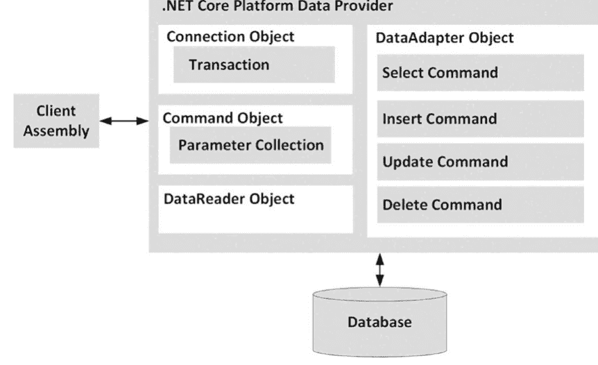
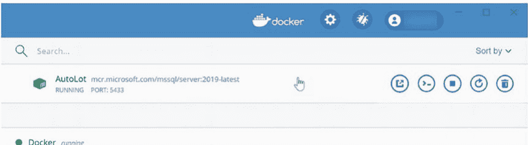
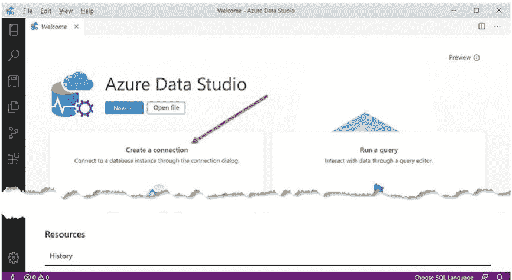
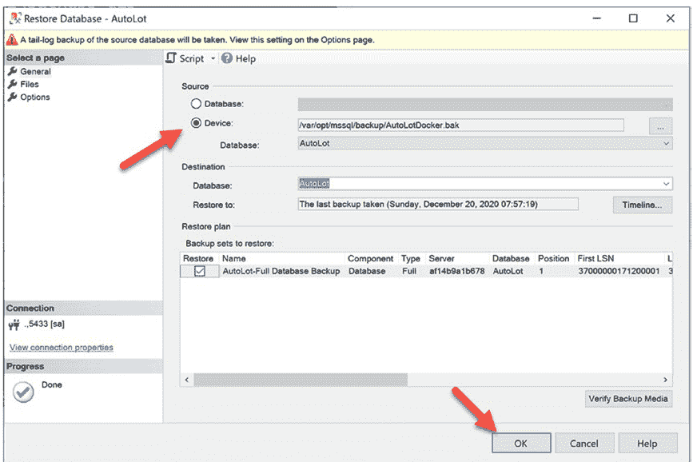
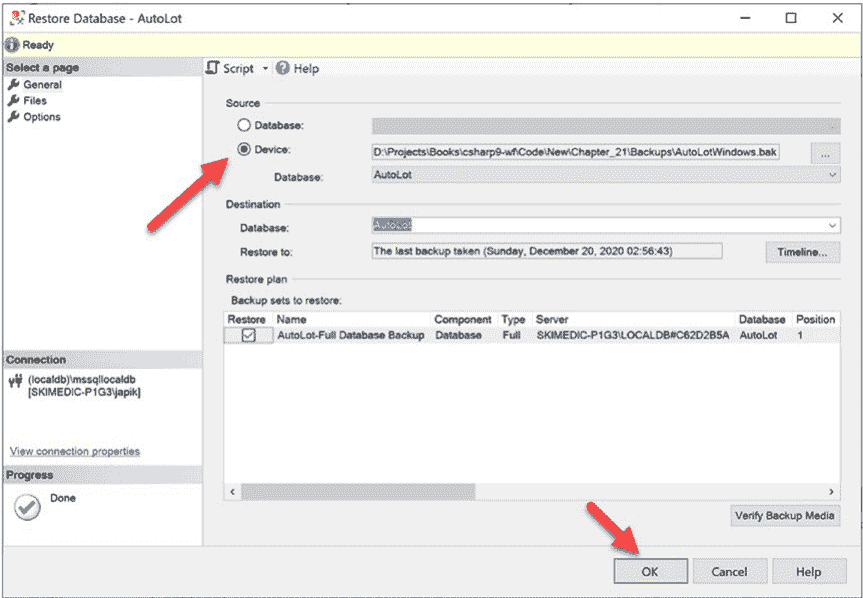
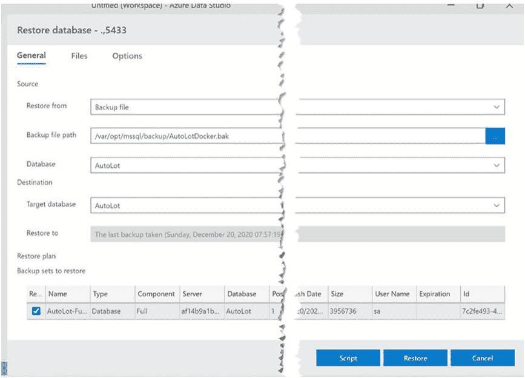

## 第 21 章

## 使用 ADO.NET 进行数据访问

.NET Core 平台定义了多个命名空间，允许你与关系数据库系统交互。统称为 ADO.NET。在本章中，你将了解 ADO.NET 的整体作用以及核心类型和命名空间，然后你将继续讨论 ADO.NET 数据提供程序的主题。.NET Core 平台支持众多数据提供程序 既作为 .NET Core Framework 的一部分提供，也可从第三方来源获得，每个数据提供程序都针对特定数据库管理系统进行了优化 例如 Microsoft SQL Server、Oracle 和 MySQL。

在你了解了各种数据提供程序提供的通用功能后，你将查看数据提供程序工厂模式。正如你将看到的，使用 System.Data 命名空间中的类型 包括 System.Data.Common 和提供程序特定的命名空间如 Microsoft.Data.SqlClient、System.Data.Odbc 以及仅限 Windows 的 System.Data.OleDb，你可以构建一个单一代码库，该代码库可以在无需重新编译或重新部署应用程序代码库的情况下动态选择底层数据提供程序。

接下来，你将学习如何直接使用 SQL Server 数据库提供程序，创建和打开连接以检索数据，然后继续插入、更新和删除数据，然后检查数据库事务主题。最后，你将使用 ADO.NET 执行 SQL Server 的批量复制功能，以将记录列表加载到数据库中。

> 注意 本章重点介绍原始 ADO.NET。从第 22 章开始，我将介绍 Entity Framework EF Core，微软的对象关系映射 ORM 框架。由于 Entity Framework Core 在幕后使用 ADO.NET 进行数据访问，因此在排查数据访问问题时，扎实理解 ADO.NET 的工作原理至关重要。还有一些场景是 EF Core 无法解决的 例如执行 SQL 批量复制，你需要了解 ADO.NET 来解决这些问题。

## ADO.NET 与 ADO

如果你有 Microsoft 之前的 COM 基于数据访问模型 Active Data Objects ADO 的背景，并且刚刚开始使用 .NET Core 平台，你需要了解 ADO.NET 除了字母 A、D 和 O 之外，与 ADO 几乎没有关系。虽然确实两个系统之间存在一些关系 例如每个都有连接和命令对象的概念，但一些熟悉的 ADO 类型 例如 Recordset 不再存在。此外，你会发现许多新类型在经典 ADO 下没有直接等价物 例如数据适配器。


## 理解 ADO.NET 数据提供程序

ADO.NET 并不提供一组与多个数据库管理系统（DBMS）通信的对象。相反，ADO.NET 支持多个数据提供程序，每个数据提供程序都针对与特定 DBMS 交互而优化。这种方式的首要好处是，你可以针对特定数据提供程序进行编程，以访问特定 DBMS 的任何独特功能。第二个好处是，特定的数据提供程序可以直接连接到所涉 DBMS 的底层引擎，而无需在各层之间设置中间映射层。

简单来说，数据提供程序是在给定命名空间中定义的一组类型，它们知道如何与特定类型的数据源通信。无论使用哪个数据提供程序，每个数据提供程序都定义了一组提供核心功能的类类型。表 21-1 记录了一些核心基类及其实现的关键接口。

**表 21-1. ADO.NET 数据提供程序的核心对象**

| 基类 | 相关接口 | 作用 |
|---|---|---|
| DbConnection | IDbConnection | 提供连接数据存储和断开连接的能力。连接对象还提供对相关事务对象的访问。 |
| DbCommand | IDbCommand | 表示 SQL 查询或存储过程。命令对象还提供对提供程序的 data reader 对象的访问。 |
| DbDataReader | IDataReader, IDataRecord | 使用服务器端游标提供对数据的只进、只读访问。 |
| DbDataAdapter | IDataAdapter, IDbDataAdapter | 在调用方和数据存储之间传输 DataSet。数据适配器包含一个连接和一组四个内部命令对象，用于从数据存储中选择、插入、更新和删除信息。 |
| DbParameter | IDataParameter, IDbDataParameter | 表示参数化查询中的命名参数。 |
| DbTransaction | IDbTransaction | 封装数据库事务。 |

尽管这些核心类的具体名称在不同的数据提供程序中会有所不同（例如，SqlConnection 与 OdbcConnection），但每个类都派生自相同的基类（对于连接对象，是 DbConnection），并实现相同的接口（例如，IDbConnection）。因此，你可以合理地推断，一旦学会了如何使用一个数据提供程序，其余的提供程序就会相当简单。

> **注意** 在 ADO.NET 中引用连接对象时，你实际上引用的是特定的 DbConnection 派生类型；并没有一个字面上名为 Connection 的类。命令对象、数据适配器对象等也是如此。按照命名约定，特定数据提供程序中的对象以相关 DBMS 的名称作为前缀（例如，SqlConnection、SqlCommand 和 SqlDataReader）。

图 21-1 展示了 ADO.NET 数据提供程序的整体情况。客户端程序集可以是任何类型的 .NET Core 应用程序：控制台程序、Windows Forms、Windows Presentation Foundation、ASP.NET Core、.NET Core 代码库等。



图 21-1. ADO.NET 数据提供程序提供对给定 DBMS 的访问

除了图 21-1 所示的对象之外，数据提供程序还会提供其他类型；然而，这些核心对象定义了所有数据提供程序的共同基线。

### ADO.NET 数据提供程序

与所有 .NET Core 一样，数据提供程序以 NuGet 包的形式分发。Microsoft 支持多个提供程序，同时也有大量第三方提供程序可用。表 21-2 记录了 Microsoft 支持的一些数据提供程序。

**表 21-2. Microsoft 支持的部分数据提供程序**

| 数据提供程序 | 命名空间/NuGet 包名称 |
|---|---|
| Microsoft SQL Server | Microsoft.Data.SqlClient |
| ODBC | System.Data.Odbc |
| OLE DB（仅限 Windows） | System.Data.OleDb |

Microsoft SQL Server 数据提供程序提供对 Microsoft SQL Server 数据存储的直接访问——并且仅针对 SQL Server 数据存储（包括 SQL Azure）。Microsoft.Data.SqlClient 命名空间包含 SQL Server 提供程序使用的类型。

> **注意** 虽然 System.Data.SqlClient 仍然受支持，但所有与 SQL Server（和 SQL Azure）交互的开发工作都集中在新的 Microsoft.Data.SqlClient 提供程序库上。

ODBC 提供程序（System.Data.Odbc）提供对 ODBC 连接的访问。System.Data.Odbc 命名空间中定义的 ODBC 类型通常仅在你需要与某个没有自定义 .NET Core 数据提供程序的 DBMS 通信时才有用。之所以如此，是因为 ODBC 是一种广泛使用的模型，可提供对多个数据存储的访问。

OLE DB 数据提供程序由 System.Data.OleDb 命名空间中定义的类型组成，允许你访问支持经典的基于 COM 的 OLE DB 协议的任何数据存储中的数据。由于对 COM 的依赖，该提供程序只能在 Windows 操作系统上运行，并且在跨平台的 .NET Core 世界中应被视为已弃用。

### System.Data 命名空间的类型

在所有 ADO.NET 命名空间中，System.Data 是最低公共分母。该命名空间包含所有 ADO.NET 数据提供程序共享的类型，无论底层数据存储是什么。除了许多以数据库为中心的异常（例如，NoNullAllowedException、RowNotInTableException 和 MissingPrimaryKeyException）之外，System.Data 还包含表示各种数据库原语（例如，表、行、列和约束）的类型，以及数据提供程序对象实现的公共接口。表 21-3 列出了一些你应该了解的核心类型。

**表 21-3. System.Data 命名空间的核心成员**

| 类型 | 作用 |
|---|---|
| Constraint | 表示给定 DataColumn 对象的约束 |
| DataColumn | 表示 DataTable 对象中的单个列 |
| DataRelation | 表示两个 DataTable 对象之间的父子关系 |
| DataRow | 表示 DataTable 对象中的单个行 |
| DataSet | 表示由任意数量的相关 DataTable 对象组成的内存中数据缓存 |
| DataTable | 表示内存中数据的表格块 |
| DataTableReader | 允许你将 DataTable 视为 fire-hose 游标（只进、只读数据访问） |
| DataView | 表示 DataTable 的自定义视图，用于排序、筛选、搜索、编辑和导航 |
| IDataAdapter | 定义数据适配器对象的核心行为 |
| IDataParameter | 定义参数对象的核心行为 |
| IDataReader | 定义数据读取器对象的核心行为 |
| IDbCommand | 定义命令对象的核心行为 |
| IDbDataAdapter | 扩展 IDataAdapter 以提供数据适配器对象的额外功能 |
| IDbTransaction | 定义事务对象的核心行为 |

你的下一个任务是从较高层次审视 System.Data 的核心接口；这可以帮助你理解任何数据提供程序提供的常见功能。你将在本章中学习具体细节；不过，现在最好先关注每个接口类型的整体行为。

### IDbConnection 接口的作用

IDbConnection 类型由数据提供程序的*连接对象*实现。该接口定义了一组成员，用于配置到特定数据存储的连接。它还允许你获取数据提供程序的事务对象。以下是 IDbConnection 的正式定义：

```csharp
public interface IDbConnection : IDisposable
{
    string ConnectionString { get; set; }
    int ConnectionTimeout { get; }
    string Database { get; }
    ConnectionState State { get; }

    IDbTransaction BeginTransaction();
    IDbTransaction BeginTransaction(IsolationLevel il);
    void ChangeDatabase(string databaseName);
    void Close();
    IDbCommand CreateCommand();
    void Open();
    void Dispose();
}
```

### IDbTransaction 接口的作用

IDbConnection 定义的重载 BeginTransaction() 方法提供了对提供程序的*事务对象*的访问。你可以使用 IDbTransaction 定义的成员以编程方式与事务会话及底层数据存储进行交互。

```csharp
public interface IDbTransaction : IDisposable
{
    IDbConnection Connection { get; }
    IsolationLevel IsolationLevel { get; }

    void Commit();
    void Rollback();
    void Dispose();
}
```

### IDbCommand 接口的作用

接下来是 IDbCommand 接口，它将由数据提供程序的*命令对象*实现。与其他数据访问对象模型一样，命令对象允许以编程方式操作 SQL 语句、存储过程和参数化查询。命令对象还通过重载的 ExecuteReader() 方法提供对数据提供程序的 data reader 类型的访问。


```public interface IDbCommand : IDisposable
{
    string CommandText { get; set; }
    int CommandTimeout { get; set; }
    CommandType CommandType { get; set; }
    IDbConnection Connection { get; set; }
    IDbTransaction Transaction { get; set; }
    IDataParameterCollection Parameters { get; }
    UpdateRowSource UpdatedRowSource { get; set; }

    void Prepare();
    void Cancel();
    IDbDataParameter CreateParameter();
    int ExecuteNonQuery();
    IDataReader ExecuteReader();
    IDataReader ExecuteReader(CommandBehavior behavior);
    object ExecuteScalar();
    void Dispose();
}
```

## IDbDataParameter 和 IDataParameter 接口的作用

请注意，IDbCommand 的 Parameters 属性返回一个强类型集合，该集合实现了 IDataParameterCollection。此接口提供了访问一组符合 IDbDataParameter 的类类型（例如参数对象）的功能。

```public interface IDbDataParameter : IDataParameter
{
    //Plus members in the IDataParameter interface
    byte Precision { get; set; }
    byte Scale { get; set; }
    int Size { get; set; }
}
```

IDbDataParameter 扩展了 IDataParameter 接口以获得以下额外行为：

```public interface IDataParameter
{
    DbType DbType { get; set; }
    ParameterDirection Direction { get; set; }
    bool IsNullable { get; }
    string ParameterName { get; set; }
    string SourceColumn { get; set; }
    DataRowVersion SourceVersion { get; set; }
    object Value { get; set; }
}
```

正如你将看到的，IDbDataParameter 和 IDataParameter 接口的功能允许你通过特定的 ADO.NET 参数对象，而不是通过硬编码的字符串文字，来在 SQL 命令（包括存储过程）中表示参数。

## IDbDataAdapter 和 IDataAdapter 接口的作用

你使用 *数据适配器* 在给定数据存储和 DataSet 之间推送和拉取数据。IDbDataAdapter 接口定义了以下一组属性，你可以使用它们来维护相关的 select、insert、update 和 delete 操作的 SQL 语句：

```public interface IDbDataAdapter : IDataAdapter
{
    //Plus members of IDataAdapter
    IDbCommand SelectCommand { get; set; }
    IDbCommand InsertCommand { get; set; }
    IDbCommand UpdateCommand { get; set; }
    IDbCommand DeleteCommand { get; set; }
}
```

除了这四个属性之外，ADO.NET 数据适配器还采用了基接口 IDataAdapter 中定义的行为。此接口定义了数据适配器类型的一个关键功能：使用 Fill() 和 Update() 方法在调用方和底层数据存储之间传输 DataSet 的能力。IDataAdapter 接口还允许你使用 TableMappings 属性将数据库列名映射到更用户友好的显示名称。

```public interface IDataAdapter
{
    MissingMappingAction MissingMappingAction { get; set; }
    MissingSchemaAction MissingSchemaAction { get; set; }
    ITableMappingCollection TableMappings { get; }

    DataTable[] FillSchema(DataSet dataSet, SchemaType schemaType);
    int Fill(DataSet dataSet);
    IDataParameter[] GetFillParameters();
    int Update(DataSet dataSet);
}
```

## IDataReader 和 IDataRecord 接口的作用

下一个需要了解的关键接口是 IDataReader，它表示给定数据读取器对象支持的通用行为。当你从 ADO.NET 数据提供程序获得一个与 IDataReader 兼容的类型时，你可以以只读、前进的方式迭代结果集。

```public interface IDataReader : IDisposable, IDataRecord
{
    //Plus members from IDataRecord
    int Depth { get; }
    bool IsClosed { get; }
    int RecordsAffected { get; }

    void Close();
    DataTable GetSchemaTable();
    bool NextResult();
    bool Read();
    void Dispose();
}
```

最后，IDataReader 扩展了 IDataRecord，后者定义了许多成员，允许你从流中提取强类型值，而不是将数据读取器的重载索引器方法检索到的通用 System.Object 进行强制转换。以下是 IDataRecord 接口的定义：

```public interface IDataRecord
{
    int FieldCount { get; }
    object this[ int i ] { get; }
    object this[ string name ] { get; }
    bool GetBoolean(int i);
    byte GetByte(int i);
    long GetBytes(int i, long fieldOffset, byte[] buffer,
        int bufferOffset, int length);
    char GetChar(int i);
    long GetChars(int i, long fieldOffset, char[] buffer,
        int bufferOffset, int length);
    IDataReader GetData(int i);
    string GetDataTypeName(int i);
    DateTime GetDateTime(int i);
    Decimal GetDecimal(int i);
    double GetDouble(int i);
    Type GetFieldType(int i);
    float GetFloat(int i);
    Guid GetGuid(int i);
    short GetInt16(int i);
    int GetInt32(int i);
    long GetInt64(int i);
    string GetName(int i);
    int GetOrdinal(string name);
    string GetString(int i);
    object GetValue(int i);
    int GetValues(object[] values);
    bool IsDBNull(int i);
}
```

注意 你可以使用 IDataReader.IsDBNull() 方法在尝试从数据读取器获取值之前以编程方式发现指定字段是否设置为 null（以避免触发运行时异常）。另请记住，C# 支持可空数据类型（参见第 4 章），它们非常适合与数据库表中可能为 null 的数据列进行交互。

## 使用接口抽象数据提供程序

到目前为止，你应该对所有 .NET Core 数据提供程序中常见的功能有了更好的了解。请记住，即使不同数据提供程序中实现类型的确切名称会有所不同，你也可以以类似的方式对这些类型进行编程——这就是基于接口的多态性的美妙之处。例如，如果你定义一个接受 IDbConnection 参数的方法，你可以传入任何 ADO.NET 连接对象，如下所示：

```public static void OpenConnection(IDbConnection cn)
{
    // Open the incoming connection for the caller.
    connection.Open();
}
```

注意 接口并非严格必需；你可以使用抽象基类（例如 DbConnection）作为参数或返回值来实现相同程度的抽象。然而，使用接口而不是基类是公认的最佳实践。

对于成员返回值也同样适用。创建一个名为 MyConnectionFactory 的新的 .NET Core 控制台应用程序。向项目添加以下 NuGet 包（OleDb 包仅在 Windows 上有效）：

- Microsoft.Data.SqlClient
- System.Data.Common
- System.Data.Odbc
- System.Data.OleDb

接下来，添加一个名为 DataProviderEnum.cs 的新文件并将代码更新为以下内容：

```namespace MyConnectionFactory
{
    //OleDb is Windows only and is not supported in .NET Core
    enum DataProviderEnum
    {
        SqlServer,
#if PC
        OleDb,
#endif
        Odbc,
        None
    }
}
```

如果你在开发机器上使用 Windows 操作系统，请更新项目文件以定义条件编译符号 PC。

```
<PropertyGroup>
    <DefineConstants>PC</DefineConstants>
</PropertyGroup>
```

如果你使用 Visual Studio，请右键单击项目，选择属性，然后转到生成选项卡以输入“条件编译符号”值。

以下代码示例允许你根据自定义枚举的值获取特定的连接对象。出于诊断目的，你只需使用反射服务打印底层连接对象。

```using System;
using System.Data;
using System.Data.Odbc;
#if PC
    using System.Data.OleDb;
#endif
using Microsoft.Data.SqlClient;
using MyConnectionFactory;

Console.WriteLine("**** Very Simple Connection Factory ****\n");
Setup(DataProviderEnum.SqlServer);
#if PC
    Setup(DataProviderEnum.OleDb); //Not supported on macOS
#endif
Setup(DataProviderEnum.Odbc);
Setup(DataProviderEnum.None);
Console.ReadLine();

void Setup(DataProviderEnum provider)
{
    // Get a specific connection.
    IDbConnection myConnection = GetConnection(provider);
    Console.WriteLine($"Your connection is a {myConnection?.GetType().Name ?? "unrecognized type"}");
    // Open, use and close connection...
}

// This method returns a specific connection object
// based on the value of a DataProvider enum.
IDbConnection GetConnection(DataProviderEnum dataProvider)
    => dataProvider switch
    {
        DataProviderEnum.SqlServer => new SqlConnection(),
#if PC
        //Not supported on macOS
        DataProviderEnum.OleDb => new OleDbConnection(),
#endif
        DataProviderEnum.Odbc => new OdbcConnection(),
        _ => null,
    };
```

使用 System.Data 的通用接口工作（或者，就此而言，System.Data.Common 的抽象基类）的好处是，你有更大的机会构建一个可以随着时间演进的灵活代码库。例如，今天你可能正在构建一个针对 Microsoft SQL Server 的应用程序；然而，你的公司可能会切换到不同的数据库。如果你构建了一个硬编码 System.Data.SqlClient Microsoft SQL Server 特定类型的解决方案，你将需要为新的数据库提供程序编辑、重新编译和重新部署代码。

到目前为止，你已经编写了一些（相当简单）的 ADO.NET 代码，允许你创建不同类型的提供程序特定的连接对象。然而，获取连接对象只是使用 ADO.NET 的一个方面。为了创建一个有价值的数据提供程序工厂库，你还必须考虑命令对象、数据读取器、事务对象和其他数据中心类型。构建这样的代码库不一定困难，但它需要相当多的代码和时间。


自从 .NET 2.0 发布以来，Redmond 的各位好心人已将此确切功能直接构建到 .NET 基础类库中。该功能已针对 .NET Core 进行了重大更新。

你将在稍后立即检查此正式 API；然而，首先你需要创建一个自定义数据库，在本章（以及之后的许多章节）中使用。

## 设置 SQL Server 和 Azure Data Studio

在本章中，你将针对名为 AutoLot 的简单 SQL Server 测试数据库执行查询。遵循本书通篇使用的汽车主题，该数据库将包含五个相互关联的表（Inventory、Makes、Orders、Customers 和 CreditRisks），其中包含代表虚构汽车销售公司信息的各种数据。在深入数据库细节之前，你必须设置 SQL Server 和 SQL Server IDE。

> **注意：** 如果你使用的是基于 Windows 的开发机器并安装了 Visual Studio 2019，你也安装了 SQL Server Express 的一个实例（称为 localdb），可用于本书中的所有示例。如果你愿意使用该版本，请跳至“安装 SQL Server IDE”部分。

### 安装 SQL Server

在本章和本书中许多剩余章节中，你需要访问 SQL Server 的一个实例。如果你使用的是非 Windows 的开发机器并且没有可用的外部 SQL Server 实例，或选择不使用外部 SQL Server 实例，你可以在 Mac 或 Linux 工作站上在 Docker 容器中运行 SQL Server。Docker 也可在 Windows 机器上运行，因此无论你选择何种操作系统，都可以使用 Docker 运行本书中的示例。

### 在 Docker 容器中安装 SQL Server

如果你使用的是非 Windows 的开发机器并且没有可用于示例的 SQL Server 实例，你可以在 Mac 或 Linux 工作站上在 Docker 容器中运行 SQL Server。Docker 也可在 Windows 机器上运行，因此无论你选择何种操作系统，都可以使用 Docker 运行本书中的示例。

> **注意：** 容器化是一个庞大的主题，本书中没有足够的空间深入介绍容器或 Docker 的细节。本书只会涵盖足够的内容，让你能够完成示例。

Docker Desktop 可从 www.docker.com/get-started 下载。下载并安装适用于你工作站的适当版本（Windows、Mac、Linux）（你需要一个免费的 DockerHub 用户账户）。确保在提示时选择 Linux 容器。

> **注意：** 容器选择（Windows 或 Linux）是容器内部运行的操作系统，而不是你工作站的操作系统。

### 拉取镜像并运行 SQL Server 2019

容器基于镜像，每个镜像都是构建最终产品的分层集合。要获取在容器中运行 SQL Server 2019 所需的镜像，请打开命令窗口并输入以下命令：

```
docker pull mcr.microsoft.com/mssql/server:2019-latest
```

一旦将镜像加载到你的机器上，你需要启动 SQL Server。为此，输入以下命令（全部在一行）：

```
docker run -e "ACCEPT_EULA=Y" -e "SA_PASSWORD=P@ssw0rd" -p 5433:1433 --name AutoLot -d mcr.microsoft.com/mssql/server:2019-latest
```

前面的命令接受最终用户许可协议，设置密码（在现实生活中，你需要使用强密码），设置端口映射（你机器上的端口 5433 映射到容器中 SQL Server 的默认端口 1433），然后命名容器（AutoLot），最后告知 Docker 使用之前下载的镜像。

> **注意：** 这些不是你用于实际开发想要使用的设置。有关更改 SA 密码的信息以及教程，请访问 https://docs.microsoft.com/en-us/sql/linux/quickstart-install-connect-docker?view=sql-server-ver15&pivots=cs1-bash。

要确认它正在运行，请在命令提示符中输入命令 docker ps -a。你将看到如下输出（为简洁省略了一些列）：

```
C:\Users\japik>docker ps -a
CONTAINER ID IMAGE                    STATUS          PORTS
NAMES
347475cfb823 mcr.microsoft.com/mssql/server:2019-latest Up 6 minutes 0.0.0.0:5433->1433/tcp  AutoLot
```

要停止容器，输入 docker stop 34747，其中数字 34747 是容器 ID 的前五个字符。要重新启动容器，输入 docker start 34747，再次根据容器 ID 的开头更新命令。

> **注意：** 你也可以使用容器的名称（本例中为 AutoLot）与 Docker CLI 命令一起使用，例如 docker start AutoLot。请注意，Docker 命令无论操作系统如何都是区分大小写的。

如果你想使用 Docker Dashboard，右键单击 Docker 鲸鱼（在你的系统托盘中）并选择 Dashboard，你应该会看到镜像在端口 5433 上运行。将鼠标悬停在镜像名称上，你将看到停止、启动和删除（其中其他）命令，如图 21-2 所示。



图 21-2. Docker Dashboard

### 安装 SQL Server 2019

Visual Studio 2019 安装了一个特殊的 SQL Server 实例（名为 (localdb)\mssqllocaldb）。如果你选择不使用 SQL Server Express LocalDB（或 Docker）并且使用的是 Windows 机器，你可以安装 SQL Server 2019 Developer Edition。SQL Server 2019 Developer Edition 是免费的，可以从这里下载：

```
https://www.microsoft.com/en-us/sql-server/sql-server-downloads
```

如果你有其他版本，你也可以使用该实例与本书一起使用；你只需相应地更改你的连接屏幕。

### 安装 SQL Server IDE

Azure Data Studio 是用于 SQL Server 的新 IDE。它是免费的并且跨平台，因此可在 Windows、Mac 或 Linux 上运行。它可以从这里下载：

```
https://docs.microsoft.com/en-us/sql/azure-data-studio/download-azure-data-studio
```

> **注意：** 如果你使用的是 Windows 机器并且更喜欢使用 SQL Server Management Studio（SSMS），你可以从这里下载最新版本：https://docs.microsoft.com/en-us/sql/ssms/download-sql-server-management-studio-ssms。

### 连接到 SQL Server

一旦安装了 Azure Data Studio 或 SSMS，就该连接到你的数据库实例了。以下部分涵盖连接到 Docker 或 LocalDb 中的 SQL Server。如果你使用的是 SQL Server 的另一个实例，请相应地更新以下部分中使用的连接字符串。

### 连接到 Docker 容器中的 SQL Server

要连接到在 Docker 容器中运行的 SQL Server 实例，首先确保它已启动并运行。接下来，如图 21-3 所示，在 Azure Data Studio 中单击“Create a connection”。



图 21-3. 在 Azure Data Studio 中创建连接

在 Connection Details 对话框中，为 Server 值输入 `.,5433`。点表示当前主机，`5433` 是你在 Docker 容器中创建 SQL Server 实例时指定的端口。输入 sa 作为用户名；密码与你在创建 SQL Server 实例时输入的相同。名称是可选的，但允许你在后续的 Azure Data Studio 会话中快速选择此连接。图 21-4 显示了这些连接选项。

```text
# Connection

Recent Connections   Saved Connections   Browse (Preview)

Clear List

# Connection Details

Connection type
Microsoft SQL Server

Server
.,5433

Authentication type
SQL Login

User name
sa

Password
********

Remember password

Database
<Default>

Server group
<Default>

Name (optional)
AutoLot

Advanced...

Connect   Cancel
```

图 21-4. 为 Docker SQL Server 设置连接选项

### 连接到 SQL Server LocalDb

要连接到 Visual Studio 安装的 SQL Server Express LocalDb 版本，请将连接信息更新为如图 21-5 所示的内容。

```text
# Connection

Recent Connections
Saved Connections
Browse (Preview)
Clear List

# Connection Details

Connection type
Microsoft SQL Server

Server
(localdb)\mssqllocaldb

Authentication type
Windows Authentication

User name

Password

Remember password

Database
<Default>

Server group
<Default>

Name (optional)
AutoLot-LocalDB

Advanced...

Connect
Cancel
```

图 21-5. 为 SQL Server LocalDb 设置连接选项

连接到 LocalDb 时，你可以使用 Windows 身份验证，因为实例在与 Azure Data Studio 相同的机器上运行，并且与当前登录用户的相同安全上下文。


## 连接到任意其他 SQL Server 实例

如果您要连接到其他 SQL Server 实例，请相应地更新连接属性。

## 恢复 AutoLot 数据库备份

与其从头构建数据库，您可以使用 SSMS 或 Azure Data Studio 恢复存储库中本章文件里提供的备份之一。提供了两个备份：名为 AutoLotWindows.ba_ 的备份专为 Windows 机器（LocalDb、Windows Server 等）使用而设计，而名为 AutoLotDocker.ba_ 的备份专为 Docker 容器中使用而设计。

> 注意 Git 默认忽略扩展名为 bak 的文件。在恢复数据库之前，您需要将扩展名从 ba_ 重命名为 bak。

## 将备份文件复制到您的容器

如果您在 Docker 容器中使用 SQL Server，则首先必须将备份文件复制到容器中。幸运的是，Docker CLI 提供了处理容器文件系统的机制。首先，在主机机器上的命令窗口中使用以下命令为备份创建一个新目录：

```
docker exec -it AutoLot mkdir var/opt/mssql/backup
```

路径结构必须与容器的操作系统（本例中为 Ubuntu）匹配，即使您的主机机器基于 Windows。接下来，使用以下命令将备份复制到新目录（将 AutoLotDocker.bak 的位置更新为本地机器的相对或绝对路径）：

```
[Windows]
docker cp .\AutoLotDocker.bak AutoLot:var/opt/mssql/backup
```

```
[Non-Windows]
docker cp ./AutoLotDocker.bak AutoLot:var/opt/mssql/backup
```

请注意，源目录结构与主机机器匹配（在我示例中为 Windows），而目标则是容器名称然后是目录路径（以目标操作系统格式表示）。

## 使用 SSMS 恢复数据库

要使用 SSMS 恢复数据库，请在对象资源管理器中右键单击数据库节点。选择还原数据库。选择设备并单击省略号。这将打开选择备份设备对话框。

## 恢复数据库到 SQL Server（Docker）

保持“备份媒体类型”设置为文件，然后单击添加，导航到容器中的 AutoLotDocker.bak 文件，然后单击确定。当您返回主还原屏幕时，单击确定，如图 21-6 所示。



图 21-6. 使用 SSMS 恢复数据库

## 恢复数据库到 SQL Server（Windows）

保持“备份媒体类型”设置为文件，然后单击添加，导航到 AutoLotWindows.bak，然后单击确定。当您返回主还原屏幕时，单击确定，如图 21-7 所示。



图 21-7. 使用 SSMS 恢复数据库

## 使用 Azure Data Studio 恢复数据库

要使用 Azure Data Studio 恢复数据库，请单击查看，选择命令调色板（或按 Ctrl+Shift+P），然后选择还原。选择“备份文件”作为“还原自”选项，然后选择您刚刚复制的文件。目标数据库和相关字段将为您填充，如图 21-8 所示。



图 21-8. 使用 Azure Data Studio 将数据库恢复到 Docker

> 注意 使用 Azure Data Studio 恢复 Windows 版本备份的过程相同。只需调整文件名和路径即可。

## 创建 AutoLot 数据库

本节的全部内容都是关于使用 Azure Data Studio 创建 AutoLot 数据库。如果您使用 SSMS，可以使用此处讨论的 SQL 脚本或使用 GUI 工具按照这些步骤进行操作。如果您已恢复备份，可以跳到“ADO.NET 数据提供程序工厂模型”部分。

> 注意 所有脚本文件都位于 Git 仓库中与本章代码一起的名为 Scripts 的文件夹中。

## 创建数据库

要创建 AutoLot 数据库，请使用 Azure Data Studio 连接到数据库服务器。通过选择文件 ► 新查询（或按 Ctrl+N）打开新查询并输入以下命令文本：

```
USE [master]
GO
/****** Object:  Database [AutoLot50]    Script Date: 12/20/2020 01:48:05 ******/
CREATE DATABASE [AutoLot]
GO
ALTER DATABASE [AutoLot] SET RECOVERY SIMPLE
GO
```

除了将恢复模式更改为简单外，这会使用 SQL Server 默认设置创建 AutoLot 数据库。单击运行（或按 F5）以创建数据库。

## 创建表

AutoLot 数据库包含五个表：Inventory、Makes、Customers、Orders 和 CreditRisks。

## 创建 Inventory 表

数据库创建后，是时候创建表了。首先是 Inventory 表。打开新查询并输入以下 SQL：

```
USE [AutoLot]
GO
CREATE TABLE [dbo].[Inventory](
    [Id] [int] IDENTITY(1,1) NOT NULL,
    [MakeId] [int] NOT NULL,
    [Color] [nvarchar](50) NOT NULL,
    [PetName] [nvarchar](50) NOT NULL,
    [TimeStamp] [timestamp] NULL,
    CONSTRAINT [PK_Inventory] PRIMARY KEY CLUSTERED
(
    [Id] ASC
) ON [PRIMARY]
)
ON [PRIMARY]
GO
```

单击运行（或按 F5）以创建表。

## 创建 Makes 表

Inventory 表存储对（尚未创建的）Makes 表的外键。创建新查询并输入以下 SQL 以创建 Makes 表：

```
USE [AutoLot]
GO
CREATE TABLE [dbo].[Makes](
[Id] [int] IDENTITY(1,1) NOT NULL,
[Name] [nvarchar](50) NOT NULL,
[TimeStamp] [timestamp] NULL,
CONSTRAINT [PK_Makes] PRIMARY KEY CLUSTERED
(
[Id] ASC
) ON [PRIMARY]
)
ON [PRIMARY]
GO
```

单击运行（或按 F5）以创建表。

## 创建 Customers 表

Customers 表（顾名思义）将包含客户列表。创建新查询并输入以下 SQL 命令：

```
USE [AutoLot]
GO
CREATE TABLE [dbo].[Customers](
[Id] [int] IDENTITY(1,1) NOT NULL,
[FirstName] [nvarchar](50) NOT NULL,
[LastName] [nvarchar](50) NOT NULL,
[TimeStamp] [timestamp] NULL,
CONSTRAINT [PK_Customers] PRIMARY KEY CLUSTERED
(
[Id] ASC
) ON [PRIMARY]
)
ON [PRIMARY]
GO
```

单击运行（或按 F5）以创建 Customers 表。

## 创建 Orders 表

您将使用下一个表 Orders 来表示给定客户订购的汽车。创建新查询，输入以下代码，然后单击运行（或按 F5）：

```
USE [AutoLot]
GO
CREATE TABLE [dbo].[Orders](
[Id] [int] IDENTITY(1,1) NOT NULL,
[CustomerId] [int] NOT NULL,
[CarId] [int] NOT NULL,
[TimeStamp] [timestamp] NULL,
CONSTRAINT [PK_Orders] PRIMARY KEY CLUSTERED
(
[Id] ASC
) ON [PRIMARY]
)
ON [PRIMARY]
GO
```

## 创建 CreditRisks 表

您将使用最后一个表 CreditRisks 来表示被认为有信用风险的客户。创建新查询，输入以下代码，然后单击运行（或按 F5）：

```
USE [AutoLot]
GO
CREATE TABLE [dbo].[CreditRisks](
    [Id] [int] IDENTITY(1,1) NOT NULL,
    [FirstName] [nvarchar](50) NOT NULL,
    [LastName] [nvarchar](50) NOT NULL,
    [CustomerId] [int] NOT NULL,
    [TimeStamp] [timestamp] NULL,
    CONSTRAINT [PK_CreditRisks] PRIMARY KEY CLUSTERED
(
    [Id] ASC
) ON [PRIMARY]
)
ON [PRIMARY]
GO
```

## 创建表关系

本节接下来将为相互关联的表添加外键关系。

## 创建 Inventory 到 Makes 的关系

打开新查询，输入以下 SQL，然后单击运行（或按 F5）：

```
USE [AutoLot]
GO
CREATE NONCLUSTERED INDEX [IX_Inventory_MakeId] ON [dbo].[Inventory]
(
    [MakeId] ASC
) ON [PRIMARY]
GO
ALTER TABLE [dbo].[Inventory] WITH CHECK ADD CONSTRAINT [FK_Make_Inventory] FOREIGN KEY([MakeId])
REFERENCES [dbo].[Makes] ([Id])
GO
ALTER TABLE [dbo].[Inventory] CHECK CONSTRAINT [FK_Make_Inventory]
GO
```

## 创建 Inventory 到 Orders 的关系

打开新查询，输入以下 SQL，然后单击运行（或按 F5）：

```
USE [AutoLot]
GO
CREATE NONCLUSTERED INDEX [IX_Orders_CarId] ON [dbo].[Orders]
(
    [CarId] ASC
) ON [PRIMARY]
GO
ALTER TABLE [dbo].[Orders]  WITH CHECK ADD  CONSTRAINT [FK_Orders_Inventory] FOREIGN KEY([CarId])
REFERENCES [dbo].[Inventory] ([Id])
GO
ALTER TABLE [dbo].[Orders] CHECK CONSTRAINT [FK_Orders_Inventory]
GO
```

## 创建 Orders 到 Customers 的关系

打开新查询，输入以下 SQL，然后单击运行（或按 F5）：

```
USE [AutoLot]
GO
CREATE UNIQUE NONCLUSTERED INDEX [IX_Orders_CustomerId_CarId] ON [dbo].[Orders]
(
    [CustomerId] ASC,
    [CarId] ASC
) ON [PRIMARY]
GO
ALTER TABLE [dbo].[Orders]  WITH CHECK ADD  CONSTRAINT [FK_Orders_Customers] FOREIGN KEY([CustomerId])
REFERENCES [dbo].[Customers] ([Id])
ON DELETE CASCADE
GO
ALTER TABLE [dbo].[Orders] CHECK CONSTRAINT [FK_Orders_Customers]
GO
```

## 创建 Customers 到 CreditRisks 的关系

打开新查询，输入以下 SQL，然后单击运行（或按 F5）：

```
USE [AutoLot]
GO
CREATE NONCLUSTERED INDEX [IX_CreditRisks_CustomerId] ON [dbo].[CreditRisks]
(
    [CustomerId] ASC
) ON [PRIMARY]
GO
ALTER TABLE [dbo].[CreditRisks]  WITH CHECK ADD  CONSTRAINT [FK_CreditRisks_Customers] FOREIGN KEY([CustomerId])
REFERENCES [dbo].[Customers] ([Id])
ON DELETE CASCADE
GO
ALTER TABLE [dbo].[CreditRisks] CHECK CONSTRAINT [FK_CreditRisks_Customers]
GO
```


> 注意 如果你好奇为什么有 FirstName 和 LastName 列以及与 customer 表的关系，那纯粹是为了演示目的。我可以想出一个创造性的理由，但归根结底，它为第 23 章做好了准备。

## 创建 GetPetName() 存储过程

本章后面，你将学习如何使用 ADO.NET 调用存储过程。正如你可能已经知道的，存储过程是存储在数据库中执行某些操作的例程代码。与 C# 方法类似，存储过程可以返回数据或仅对数据进行操作而不返回任何内容。你将添加一个存储过程，它将根据提供的 carId 返回汽车的昵称。为此，创建一个新的查询窗口并输入以下 SQL 命令：

```
USE [AutoLot]
GO
CREATE PROCEDURE [dbo].[GetPetName]
@carID int,
@petName nvarchar(50) output
AS
SELECT @petName = PetName from dbo.Inventory where Id = @carID
GO
```

点击运行（或按 F5）以创建存储过程。

## 添加测试记录

没有数据的数据库相当无聊，并且最好有脚本可以快速将测试记录加载到数据库中。

## Makes 表记录

创建一个新的查询并执行以下 SQL 语句以向 Makes 表中添加记录：

```
USE [AutoLot]
GO
SET IDENTITY_INSERT [dbo].[Makes] ON
INSERT INTO [dbo].[Makes] ([Id], [Name]) VALUES (1, N'VW')
INSERT INTO [dbo].[Makes] ([Id], [Name]) VALUES (2, N'Ford')
INSERT INTO [dbo].[Makes] ([Id], [Name]) VALUES (3, N'Saab')
INSERT INTO [dbo].[Makes] ([Id], [Name]) VALUES (4, N'Yugo')
INSERT INTO [dbo].[Makes] ([Id], [Name]) VALUES (5, N'BMW')
INSERT INTO [dbo].[Makes] ([Id], [Name]) VALUES (6, N'Pinto')
SET IDENTITY_INSERT [dbo].[Makes] OFF
```

## Inventory 表记录

要向第一个表中添加记录，请创建一个新的查询并执行以下 SQL 语句以向 Inventory 表中添加记录：

```
USE [AutoLot]
GO
SET IDENTITY_INSERT [dbo].[Inventory] ON
GO
INSERT INTO [dbo].[Inventory] ([Id], [MakeId], [Color], [PetName]) VALUES (1, 1, N'Black', N'Zippy')
INSERT INTO [dbo].[Inventory] ([Id], [MakeId], [Color], [PetName]) VALUES (2, 2, N'Rust', N'Rusty')
INSERT INTO [dbo].[Inventory] ([Id], [MakeId], [Color], [PetName]) VALUES (3, 3, N'Black', N'Mel')
INSERT INTO [dbo].[Inventory] ([Id], [MakeId], [Color], [PetName]) VALUES (4, 4, N'Yellow', N'Clunker')
INSERT INTO [dbo].[Inventory] ([Id], [MakeId], [Color], [PetName]) VALUES (5, 5, N'Black', N'Bimmer')
INSERT INTO [dbo].[Inventory] ([Id], [MakeId], [Color], [PetName]) VALUES (6, 5, N'Green', N'Hank')
INSERT INTO [dbo].[Inventory] ([Id], [MakeId], [Color], [PetName]) VALUES (7, 5, N'Pink', N'Pinky')
INSERT INTO [dbo].[Inventory] ([Id], [MakeId], [Color], [PetName]) VALUES (8, 6, N'Black', N'Pete')
INSERT INTO [dbo].[Inventory] ([Id], [MakeId], [Color], [PetName]) VALUES (9, 4, N'Brown', N'Brownie')
SET IDENTITY_INSERT [dbo].[Inventory] OFF
GO
```

## 向 Customers 表添加测试记录

要向 Customers 表添加记录，请创建一个新的查询并执行以下 SQL 语句：

```
USE [AutoLot]
GO
SET IDENTITY_INSERT [dbo].[Customers] ON
INSERT INTO [dbo].[Customers] ([Id], [FirstName], [LastName]) VALUES (1, N'Dave', N'Brenner')
INSERT INTO [dbo].[Customers] ([Id], [FirstName], [LastName]) VALUES (2, N'Matt', N'Walton')
INSERT INTO [dbo].[Customers] ([Id], [FirstName], [LastName]) VALUES (3, N'Steve', N'Hagen')
INSERT INTO [dbo].[Customers] ([Id], [FirstName], [LastName]) VALUES (4, N'Pat', N'Walton')
INSERT INTO [dbo].[Customers] ([Id], [FirstName], [LastName]) VALUES (5, N'Bad', N'Customer')
SET IDENTITY_INSERT [dbo].[Customers] OFF
```

## 向 Orders 表添加测试记录

现在向 Orders 表添加数据。创建一个新的查询，输入以下 SQL，然后点击运行（或按 F5）：

```
USE [AutoLot]
GO
SET IDENTITY_INSERT [dbo].[Orders] ON
```

```
INSERT INTO [dbo].[Orders] ([Id], [CustomerId], [CarId]) VALUES (1, 1, 5)
INSERT INTO [dbo].[Orders] ([Id], [CustomerId], [CarId]) VALUES (2, 2, 1)
INSERT INTO [dbo].[Orders] ([Id], [CustomerId], [CarId]) VALUES (3, 3, 4)
INSERT INTO [dbo].[Orders] ([Id], [CustomerId], [CarId]) VALUES (4, 4, 7)
SET IDENTITY_INSERT [dbo].[Orders] OFF
```

## 向 CreditRisks 表添加测试记录

最后一步是向 CreditRisks 表添加数据。创建一个新的查询，输入以下 SQL，然后点击运行（或按 F5）：

```
USE [AutoLot]
GO
SET IDENTITY_INSERT [dbo].[CreditRisks] ON
INSERT INTO [dbo].[CreditRisks] ([Id], [FirstName], [LastName], [CustomerId]) VALUES (1, N'Bad', N'Customer', 5)
SET IDENTITY_INSERT [dbo].[CreditRisks] OFF
```

至此，AutoLot 数据库已完成！当然，这与现实世界的应用程序数据库相差甚远，但它足以满足本章的需求，并且将在 Entity Framework Core 章节中得到补充。现在你有了可用于测试的数据库，可以深入了解 ADO.NET 数据提供程序工厂模型了。

## ADO.NET 数据提供程序工厂模型

.NET Core 数据提供程序工厂模式允许你使用通用数据访问类型构建单一代码库。为了理解数据提供程序工厂实现，请回想表 21-1 中，数据提供程序中的类都派生自 System.Data.Common 命名空间中定义的基础类。

- DbCommand：所有命令类的抽象基类
- DbConnection：所有连接类的抽象基类
- DbDataAdapter：所有数据适配器类的抽象基类
- DbDataReader：所有数据读取器类的抽象基类
- DbParameter：所有参数类的抽象基类
- DbTransaction：所有事务类的抽象基类

每个符合 .NET Core 的数据提供程序都包含一个派生自 System.Data.Common.DbProviderFactory 的类类型。此基类定义了多个检索提供程序特定数据对象的方法。以下是 DbProviderFactory 的成员：

```
public abstract class DbProviderFactory
{
..public virtual bool CanCreateDataAdapter { get;};
..public virtual bool CanCreateCommandBuilder { get;};
    public virtual DbCommand CreateCommand();
    public virtual DbCommandBuilder CreateCommandBuilder();
```

```
public virtual DbConnection CreateConnection();
public virtual DbConnectionStringBuilder
    CreateConnectionStringBuilder();
public virtual DbDataAdapter CreateDataAdapter();
public virtual DbParameter CreateParameter();
public virtual DbDataSourceEnumerator
    CreateDataSourceEnumerator();
}
```

要获取数据提供程序的 DbProviderFactory 派生类型，每个提供程序都提供一个静态属性用于返回正确的类型。要返回 SQL Server 版本的 DbProviderFactory，请使用以下代码：

```
// Get the factory for the SQL data provider.
DbProviderFactory sqlFactory =
    Microsoft.Data.SqlClient.SqlClientFactory.Instance;
```

为了使程序更具通用性，你可以创建一个 DbProviderFactory 工厂，根据应用程序 appsettings.json 文件中的设置返回特定类型的 DbProviderFactory。你将在稍后学习如何做到这一点；目前，一旦你获得了数据提供程序的工厂，你就可以获取关联的提供程序特定数据对象（例如连接、命令和数据读取器）。

## 一个完整的数据提供程序工厂示例

作为一个完整示例，创建一个新的 C# 控制台应用程序项目（命名为 DataProviderFactory），打印出 AutoLot 数据库的汽车库存。对于此初始示例，你将直接在控制台应用程序中硬编码数据访问逻辑（以保持简单）。随着你在本章的进展，你将看到更好的做法。

首先向项目文件添加一个新的 ItemGroup 以及 Microsoft.Extensions.Configuration.Json、System.Data.Common、System.Data.Odbc、System.Data.OleDb 和 Microsoft.Data.SqlClient 包。

```
dotnet add DataProviderFactory package Microsoft.Data.SqlClient
dotnet add DataProviderFactory package System.Data.Common
dotnet add DataProviderFactory package System.Data.Odbc
dotnet add DataProviderFactory package System.Data.OleDb
dotnet add DataProviderFactory package Microsoft.Extensions.Configuration.Json
```

定义 PC 编译器常量（如果你使用的是 Windows 操作系统）。

```
<PropertyGroup>
    <DefineConstants>PC</DefineConstants>
</PropertyGroup>
```

接下来，添加一个名为 DataProviderEnum.cs 的新文件并将代码更新为以下内容：

```
namespace DataProviderFactory
{
    //OleDb is Windows only and is not supported in .NET Core
    enum DataProviderEnum
    {
        SqlServer,

```csharp
#if PC
    OleDb,
#endif
    Odbc
}
}
```

向项目添加一个名为 `appsettings.json` 的新 JSON 文件并更新其内容如下（根据你的具体环境更新连接字符串）：

```json
{
  "ProviderName": "SqlServer",
  //"ProviderName": "OleDb",
  //"ProviderName": "Odbc",
  "SqlServer": {
    // for localdb use @"Data Source=(localdb)\mssqllocaldb;Integrated Security=true; Initial Catalog=AutoLot"
    "ConnectionString": "Data Source=.,5433;User Id=sa;Password=P@ssw0rd;Initial Catalog=AutoLot"
  },
  "Odbc": {
    // for localdb use @"Driver={ODBC Driver 17 for SQL Server};Server=(localdb)\mssqllocaldb;Database=AutoLot;Trusted_Connection=Yes";
    "ConnectionString": "Driver={ODBC Driver 17 for SQL Server};Server=localhost,5433; Database=AutoLot;UID=sa;Pwd=P@ssw0rd;"
  },
  "OleDb": {
    // if localdb use @"Provider=SQLNCLI11;Data Source=(localdb)\mssqllocaldb;Initial Catalog=AutoLot;Integrated Security=SSPI"),
    "ConnectionString": "Provider=SQLNCLI11;Data Source=.,5433;User Id=sa;Password=P@ssw0rd; Initial Catalog=AutoLot;"
  }
}
```

指示 MSBuild 在每次构建时将 JSON 文件复制到输出目录。更新项目文件，添加以下内容：

```xml
<ItemGroup>
  <None Update="appsettings.json">
    <CopyToOutputDirectory>Always</CopyToOutputDirectory>
  </None>
</ItemGroup>
```

> 注意 `CopyToOutputDirectory` 对空格敏感。确保它全部在一行上，且 `Always` 周围没有任何空格。

现在你有了正确的 `appsettings.json`，你可以使用 .NET Core 配置读取提供程序和 `connectionString` 值。首先更新 `Program.cs` 顶部的使用语句如下：

```csharp
using System;
using System.Data.Common;
using System.Data.Odbc;
#if PC
    using System.Data.OleDb;
#endif
using System.IO;
using Microsoft.Data.SqlClient;
using Microsoft.Extensions.Configuration;
```

清除 `Program.cs` 文件中的所有代码，并添加以下内容：

```csharp
using System;
using System.Data.Common;
using System.Data.Odbc;
#if PC
    using System.Data.OleDb;
#endif
using System.IO;
using Microsoft.Data.SqlClient;
using Microsoft.Extensions.Configuration;
using DataProviderFactory;

Console.WriteLine("***** Fun with Data Provider Factories ****\n");
var (provider, connectionString) = GetProviderFromConfiguration();
DbProviderFactory factory = GetDbProviderFactory(provider);
// Now get the connection object.
using (DbConnection connection = factory.CreateConnection())
{
    if (connection == null)
    {
        Console.WriteLine($"Unable to create the connection object");
        return;
    }

    Console.WriteLine($"Your connection object is a: {connection.GetType().Name}");
    connection.ConnectionString = connectionString;
    connection.Open();

    // Make command object.
    DbCommand command = factory.CreateCommand();
    if (command == null)
    {
        Console.WriteLine($"Unable to create the command object");
        return;
    }

    Console.WriteLine($"Your command object is a: {command.GetType().Name}");
    command.Connection = connection;
    command.CommandText =
        "Select i.Id, m.Name From Inventory i inner join Makes m on m.Id = i.MakeId ";

    // Print out data with data reader.
    using (DbDataReader dataReader = command.ExecuteReader())
    {
        Console.WriteLine($"Your data reader object is a: {dataReader.GetType().Name}");
        Console.WriteLine("\n***** Current Inventory *****");
        while (dataReader.Read())
        {
            Console.WriteLine($"-> Car #{dataReader["Id"]} is a {dataReader["Name"]}.");
        }
    }
}
Console.ReadLine();
```

接下来，将以下代码添加到 `Program.cs` 文件末尾。这些方法读取配置，将 `DataProviderEnum` 设置为正确的值，获取连接字符串，并返回 `DbProviderFactory` 的实例：

```csharp
static DbProviderFactory GetDbProviderFactory(DataProviderEnum provider)
    => provider switch
{
    DataProviderEnum.SqlServer => SqlClientFactory.Instance,
    DataProviderEnum.Odbc => OdbcFactory.Instance,
#if PC
    DataProviderEnum.OleDb => OleDbFactory.Instance,
#endif
    _ => null
};
```

```csharp
static (DataProviderEnum Provider, string ConnectionString)
GetProviderFromConfiguration()
{
    IConfiguration config = new ConfigurationBuilder()
        .SetBasePath(Directory.GetCurrentDirectory())
        .AddJsonFile("appsettings.json", true, true)
        .Build();
    var providerName = config["ProviderName"];
    if (Enum.TryParse<DataProviderEnum>
        (providerName, out DataProviderEnum provider))
    {
        return (provider, config[$"{providerName}:ConnectionString"]);
    }
    throw new Exception("Invalid data provider value supplied.");
}
```

注意，出于诊断目的，你使用反射服务打印底层连接、命令和数据读取器的名称。如果运行此应用程序，你会发现 `AutoLot` 数据库的 `Inventory` 表中的以下当前数据会打印到控制台：

```text
**** Fun with Data Provider Factories ****
Your connection object is a: SqlConnection
Your command object is a: SqlCommand
Your data reader object is a: SqlDataReader

**** Current Inventory ****
-> Car #1 is a VW.
-> Car #2 is a Ford.
-> Car #3 is a Saab.
-> Car #4 is a Yugo.
-> Car #9 is a Yugo.
-> Car #5 is a BMW.
-> Car #6 is a BMW.
-> Car #7 is a BMW.
-> Car #8 is a Pinto.
```

现在更改设置文件以指定不同的提供程序。代码将获取相关的连接字符串并产生与之前相同的输出，除了类型特定的信息。

当然，根据你对 ADO.NET 的经验，你可能会有点不确定连接、命令和数据读取器对象到底做什么。暂时不要纠结细节（毕竟本章后面还有很多页！）。此时，足够知道你可以使用 ADO.NET 数据提供程序工厂模型构建单个代码库，以声明方式使用各种数据提供程序。

## 数据提供程序工厂模型的潜在缺点

尽管这是一个强大的模型，但你必须确保代码库仅使用所有提供程序通用的类型和方法，通过抽象基类的成员。因此，在编写代码库时，你仅限于 `DbConnection`、`DbCommand` 和 `System.Data.Common` 命名空间中其他类型的公开成员。

鉴于此，你可能会发现这种通用方法阻止你直接访问特定 DBMS 的某些铃铛和哨子。如果你必须能够调用底层提供程序的特定成员（例如 `SqlConnection`），你可以使用显式转换来做到这一点，如此示例所示：

```csharp
if (connection is SqlConnection sqlConnection)
{
    // Print out which version of SQL Server is used.
    WriteLine(sqlConnection.ServerVersion);
}
```

这样做时，你的代码库变得有点难以维护（且灵活性较低），因为你必须添加许多运行时检查。尽管如此，如果你需要以尽可能灵活的方式构建 ADO.NET 数据访问库，数据提供程序工厂模型提供了很好的机制来实现这一点。

> 注意 Entity Framework Core 及其对依赖注入的支持大大简化了构建需要访问不同数据源的数据访问库。

有了这个第一个示例之后，你现在可以深入了解使用 ADO.NET 的细节。

## 更深入地了解连接、命令和 DataReader

如前例所示，ADO.NET 允许你使用数据提供程序的连接、命令和数据读取器对象与数据库交互。现在你将创建一个扩展示例，以更深入地了解 ADO.NET 中的这些对象。

在前面的示例中演示了，当你想要连接到数据库并使用数据读取器对象读取记录时，你需要执行以下步骤：

- 1. 分配、配置并打开你的连接对象。
- 2. 分配并配置命令对象，将连接对象指定为构造函数参数或使用 `Connection` 属性。
- 3. 在配置好的命令类上调用 `ExecuteReader()`。
- 4. 使用数据读取器的 `Read()` 方法处理每条记录。

为了开始，创建一个名为 `AutoLot.DataReader` 的新控制台应用程序项目并添加 `Microsoft.Data.SqlClient` 包。以下是 `Program.cs` 中的完整代码（分析随后进行）：

```csharp
using System;
using Microsoft.Data.SqlClient;

Console.WriteLine("**** Fun with Data Readers ****\n");

// Create and open a connection.
using (SqlConnection connection = new SqlConnection())
{
    connection.ConnectionString =
        @" Data Source=.,5433;User Id=sa;Password=P@ssw0rd;Initial Catalog=AutoLot";
    connection.Open();

    // Create a SQL command object.
    string sql =
        @"Select i.Id, m.Name as Make, i.Color, i.Petname
          FROM Inventory i
          INNER JOIN Makes m on m.Id = i.MakeId";
    SqlCommand myCommand = new SqlCommand(sql, connection);

    // Obtain a data reader a la ExecuteReader().
    using (SqlDataReader myDataReader = myCommand.ExecuteReader())
    {
        // Loop over the results.
        while (myDataReader.Read())
        {
            Console.WriteLine($"-> Make: {myDataReader["Make"]}, PetName: {myDataReader["PetName"]}, Color: {myDataReader["Color"]}.");
        }
    }
}
Console.ReadLine();
```


## 使用连接对象

使用数据提供程序时，第一步是利用连接对象（你应该还记得，它派生自 DbConnection）与数据源建立会话。.NET Core 连接对象带有一个格式化的连接字符串；该字符串包含若干以分号分隔的名称/值对。你可以利用这些信息来确定要连接的计算机名称、所需的安全设置、该计算机上的数据库名称，以及其他数据提供程序特有的信息。

从前面的代码可以看出，Initial Catalog 名称指的是你要与之建立会话的数据库。Data Source 名称用于标识维护数据库的计算机名称。我这里使用的是 ".,5433"，其中句点代表主机（与使用 "localhost" 相同），5433 是端口号，即 Docker 容器映射到 SQL Server 端口所使用的端口号。如果你使用的是其他实例，则应将此属性定义为 machinename,port\instance 的形式。例如，MYSERVER\SQLSERVER2019 表示 MYSERVER 是运行 SQL Server 的服务器名称，使用的是默认端口，SQLSERVER2019 是实例名称。如果该计算机是开发所用的本机，则可以使用句点 (.) 或令牌 (localhost) 作为服务器名称。如果 SQL Server 实例是默认实例，则应省略实例名称。例如，如果你在本地计算机上安装的 Microsoft SQL Server（设置为默认实例）中创建了 AutoLot，则应使用 "Data Source=localhost"。

除此之外，你还可以提供任意数量的表示安全凭据的令牌。如果 Integrated Security 设置为 true，则将使用当前 Windows 账户凭据进行身份验证和授权。

建立连接字符串之后，你可以通过调用 Open() 与 DBMS 建立连接。除了 ConnectionString、Open() 和 Close() 成员之外，连接对象还提供了许多成员，让你可以配置与连接相关的其他设置，例如超时设置和事务信息。表 21-4 列出了 DbConnection 基类的一部分（但并非全部）成员。

## 表 21-4 DbConnection 类型的成员

| 成员 | 含义 |
|---|---|
| `BeginTransaction()` | 使用此方法开始一个数据库事务。 |
| `ChangeDatabase()` | 使用此方法在打开的连接上更改数据库。 |
| `ConnectionTimeout` | 此只读属性返回建立连接时在终止并生成错误之前要等待的时间（默认值取决于提供程序）。如果要更改默认值，请在连接字符串中指定 Connect Timeout 段（例如 Connect Timeout=30）。 |
| `Database` | 此只读属性获取连接对象所维护的数据库的名称。 |
| `DataSource` | 此只读属性获取连接对象所维护的数据库的位置。 |
| `GetSchema()` | 此方法返回一个 DataTable 对象，其中包含来自数据源的架构信息。 |
| `State` | 此只读属性获取连接的当前状态，该状态由 ConnectionState 枚举表示。 |

DbConnection 类型的属性本质上通常是只读的，仅当你希望在运行时获取连接的特性时才有用。当你需要覆盖默认设置时，必须修改连接字符串本身。例如，以下连接字符串将连接超时设置从默认值（SQL Server 为 15 秒）更改为 30 秒：

```
using(SqlConnection connection = new SqlConnection())
{
    connection.ConnectionString =
        @" Data Source=.,5433;User Id=sa;Password=P@ssw0rd;Initial Catalog=AutoLot;Connect Timeout=30";
    connection.Open();
}
```

以下代码输出传入的 SqlConnection 的详细信息：

```
static void ShowConnectionStatus(SqlConnection connection)
{
    // Show various stats about current connection object.
    Console.WriteLine("**** Info about your connection ****");
    Console.WriteLine($"@Database location:
    {connection.DataSource}");
    Console.WriteLine($"Database name: {connection.Database}");
    Console.WriteLine($"@Timeout:
    {connection.ConnectionTimeout}");
    Console.WriteLine($"Connection state:
    {connection.State}\n");
}
```

虽然这些属性大多不言自明，但 State 属性值得一提。你可以为此属性赋予 ConnectionState 枚举中的任意值，如下所示：

```
public enum ConnectionState
{
    Broken,
    Closed,
    Connecting,
    Executing,
    Fetching,
    Open
}
```

然而，唯一有效的 ConnectionState 值是 ConnectionState.Open、ConnectionState.Connecting 和 ConnectionState.Closed（该枚举的其余成员保留供将来使用）。此外，关闭连接始终是安全的，即使连接状态当前为 ConnectionState.Closed。

## 使用 ConnectionStringBuilder 对象

以编程方式处理连接字符串可能很繁琐，因为它们通常以字符串字面量的形式表示，难以维护，而且即便往好处说也容易出错。符合 .NET Core 规范的数据提供程序支持连接字符串生成器对象，这些对象允许你使用强类型属性来设置名称/值对。考虑对当前代码进行以下更新：

```
var connectionStringBuilder = new SqlConnectionStringBuilder
{
    InitialCatalog = "AutoLot",
    DataSource = ".,5433",
    UserID = "sa",
    Password = "P@ssw0rd",
    ConnectTimeout = 30
};
connection.ConnectionString =
    connectionStringBuilder.ConnectionString;
```

在这次迭代中，你创建了一个 SqlConnectionStringBuilder 实例，相应地设置属性，并通过 ConnectionString 属性获取内部字符串。另请注意，你使用的是该类型的默认构造函数。如果你愿意，还可以通过传入现有的连接字符串作为起点来创建数据提供程序的连接字符串生成器对象的实例（当你从外部源动态读取这些值时，这会很有帮助）。一旦你使用初始字符串数据填充了该对象，就可以使用相关属性更改特定的名称/值对。

## 使用命令对象

既然你更好地理解了连接对象的作用，接下来要做的事情就是了解如何向相关数据库提交 SQL 查询。SqlCommand 类型（派生自 DbCommand）是 SQL 查询、表名或存储过程的面向对象（OO）表示。你可以使用 CommandType 属性指定命令的类型，该属性可以取 CommandType 枚举中的任意值，如下所示：

```
public enum CommandType
{
    StoredProcedure,
    TableDirect,
    Text // Default value.
}
```

创建命令对象时，你可以通过构造函数参数来设置 SQL 查询，也可以直接使用 CommandText 属性进行设置。此外，创建命令对象时，你需要指定要使用的连接。同样，你可以将其作为构造函数参数，或者使用 Connection 属性来完成。请看以下代码片段：

```
// Create command object via ctor args.
string sql =
    @"Select i.id, m.Name as Make, i.Color, i.Petname
      FROM Inventory i
      INNER JOIN Makes m on m.Id = i.MakeId";
SqlCommand myCommand = new SqlCommand(sql, connection);
```

```
// Create another command object via properties.
SqlCommand testCommand = new SqlCommand();
testCommand.Connection = connection;
testCommand.CommandText = sql;
```

请注意，此时你实际上还没有将 SQL 查询提交到 AutoLot 数据库，而是准备好了命令对象的状态以供将来使用。表 21-5 重点介绍了 DbCommand 类型的一些其他成员。

## 表 21-5 DbCommand 类型的成员

| 成员 | 含义 |
|---|---|
| `CommandTimeout` | 获取或设置执行命令时在终止尝试并生成错误之前要等待的时间。默认值为 30 秒。 |
| `Connection` | 获取或设置此 DbCommand 实例所使用的 DbConnection。 |
| `Parameters` | 获取用于参数化查询的 DbParameter 对象集合。 |
| `Cancel()` | 取消命令的执行。 |
| `ExecuteReader()` | 执行 SQL 查询并返回数据提供程序的 DbDataReader 对象，该对象提供对查询结果的只进、只读访问。 |
| `ExecuteNonQuery()` | 执行 SQL 非查询语句（例如插入、更新、删除或创建表）。 |
| `ExecuteScalar()` | ExecuteReader() 方法的一个轻量级版本，专为单值查询（例如获取记录计数）而设计。 |
| `Prepare()` | 在数据源上创建命令的预编译（或已编译）版本。你可能知道，预编译查询的执行速度稍快一些，并且当你需要多次执行同一查询（通常每次使用不同的参数）时非常有用。 |

## 使用数据读取器

建立活动连接和 SQL 命令之后，下一步就是将查询提交到数据源。你可能已经猜到，有多种方法可以做到这一点。DbDataReader 类型（实现 IDataReader 接口）是从数据存储中获取信息的最简单、最快的方法。回想一下，数据读取器表示一次返回一条记录的只读、只进数据流。因此，数据读取器仅适用于向底层数据存储提交 SQL 选择语句的情况。

当你需要快速遍历大量数据，并且不需要在内存中维护其表示形式时，数据读取器非常有用。例如，如果你从表中请求 20,000 条记录以存储到文本文件中，那么将这些信息保存在 DataSet 中会相当耗费内存（因为 DataSet 会同时将整个查询结果保存在内存中）。更好的方法是创建一个数据读取器，尽可能快地遍历每条记录。但是请注意，数据读取器对象（不同于稍后将要介绍的数据适配器对象）会保持与数据源的连接处于打开状态，直到你显式关闭连接。

你可以通过调用 ExecuteReader() 从命令对象获取数据读取器对象。数据读取器表示它从数据库读取的当前记录。数据读取器具有索引器方法（例如 C# 中的 [] 语法），允许你访问当前记录中的某一列。你可以按名称或从零开始的整数来访问该列。

下面使用数据读取器的方式利用 Read() 方法来确定何时到达记录的末尾（通过返回 false 值）。对于你从该处读取的每一条传入记录


database，你使用类型索引器打印出每辆汽车的 make、宠物名称和颜色。还要注意，你在处理完记录后立即调用 Close()，这会释放连接对象。

// 通过 ExecuteReader() 获取数据读取器。
using(SqlDataReader myDataReader = myCommand.ExecuteReader())
{
    // 遍历结果。
    while (myDataReader.Read())
    {
        WriteLine($"-> Make: { myDataReader["Make"]}, PetName: { myDataReader["PetName"]},
        Color: { myDataReader["Color"]}.");
    }
}
ReadLine();

在前面的代码片段中，你重载了数据读取器对象的索引器，使其可以接受字符串（表示列名）或 int（表示列的序数位置）。因此，你可以使用以下更新来清理当前的读取器逻辑（并避免硬编码的字符串名称），注意使用了 FieldCount 属性：

```
while (myDataReader.Read())
{
    for (int i = 0; i < myDataReader.FieldCount; i++)
    {
        Console.Write(i != myDataReader.FieldCount - 1
            ? $"{myDataReader.GetName(i)} = {myDataReader.GetValue(i)}, "
            : $"{myDataReader.GetName(i)} = {myDataReader.GetValue(i)} ");
    }
    Console.WriteLine();
}
```

如果此时编译并运行你的项目，你应该会看到 AutoLot 数据库中 Inventory 表中的所有汽车列表。

```
***** Fun with Data Readers *****

***** Info about your connection *****
Database location: .,5433
Database name: AutoLot
Timeout: 30
Connection state: Open

id = 1, Make = VW, Color = Black, Petname = Zippy
id = 2, Make = Ford, Color = Rust, Petname = Rusty
id = 3, Make = Saab, Color = Black, Petname = Mel
id = 4, Make = Yugo, Color = Yellow, Petname = Clunker
id = 5, Make = BMW, Color = Black, Petname = Bimmer
id = 6, Make = BMW, Color = Green, Petname = Hank
id = 7, Make = BMW, Color = Pink, Petname = Pinky
id = 8, Make = Pinto, Color = Black, Petname = Pete
id = 9, Make = Yugo, Color = Brown, Petname = Brownie
```

## 使用数据读取器获取多个结果集

数据读取器对象可以使用单个命令对象获取多个结果集。例如，如果你想获取 Inventory 表中的所有行，以及 Customers 表中的所有行，你可以使用分号分隔符指定两个 SQL Select 语句，如下所示：

```
sql += ";Select * from Customers;";
```

> 注意 开头的分号不是笔误。当使用多个语句时，它们必须用分号分隔。由于初始语句中没有分号，因此在第二个语句的开头添加了分号。

获取数据读取器后，你可以使用 NextResult() 方法遍历每个结果集。请注意，你总是会自动返回第一个结果集。因此，如果你想读取每个表的行，可以构建以下迭代结构：

```
do
{
    while (myDataReader.Read())
    {
        for (int i = 0; i < myDataReader.FieldCount; i++)
        {
            Console.Write(i != myDataReader.FieldCount - 1
                ? $"{myDataReader.GetName(i)} = {myDataReader.GetValue(i)}, "
                : $"{myDataReader.GetName(i)} = {myDataReader.GetValue(i)}");
        }
        Console.WriteLine();
    }
    Console.WriteLine();
} while (myDataReader.NextResult());
```

此时，你应该更清楚数据读取器对象带来的功能。始终记住，数据读取器只能处理 SQL Select 语句；你不能使用它们通过 Insert、Update 或 Delete 请求修改现有数据库表。修改现有数据库需要对命令对象进行额外研究。

## 使用 Create、Update 和 Delete 查询

ExecuteReader() 方法提取一个数据读取器对象，允许你以只进、只读的信息流方式检查 SQL Select 语句的结果。然而，当你想提交导致修改给定表的结果的 SQL 语句时（或任何其他非查询 SQL 语句，例如创建表或授予权限），你调用命令对象的 ExecuteNonQuery() 方法。此单一方法根据命令文本的格式执行插入、更新和删除。

> 注意 从技术上讲，非查询是指不返回结果集的 SQL 语句。因此，Select 语句是查询，而 Insert、Update 和 Delete 语句不是。鉴于此，ExecuteNonQuery() 返回一个 int，表示受影响的行数，而不是新的记录集。

本章迄今为止的所有数据库交互示例仅打开连接并使用它们检索数据。这只是使用数据库的一部分；除非数据访问框架也完全支持创建、读取、更新和删除（CRUD）功能，否则它不会很有用。接下来，你将学习如何使用对 ExecuteNonQuery() 的调用来实现这一点。

首先创建一个名为 AutoLot.Dal 的新 C# 类库项目（缩写为 AutoLot data access layer），删除默认的类文件，并将 Microsoft.Data.SqlClient 包添加到项目中。

在构建将进行数据操作的类之前，我们将首先创建一个 C# 类来表示来自 Inventory 表的记录及其相关的 Make 信息。

### 创建 Car 和 CarViewModel 类

现代数据访问库使用类（通常称为模型或实体）来表示和传输数据库中的数据。此外，类可用于表示对数据的视图，该视图结合了两个或多个表以使数据更有意义。实体类用于与数据库目录一起工作（用于更新语句），而视图模型类用于以有意义的方式显示数据。你将在下一章看到，这些概念是对象关系映射器（ORM）如 Entity Framework Core 的基础，但现在，你只创建一个模型（用于原始库存行）和一个视图模型（将库存行与 Makes 表中的相关数据结合）。向项目添加一个名为 Models 的新文件夹，并添加两个新文件，分别命名为 Car.cs 和 CarViewModel.cs。将代码更新为以下内容：

```
//Car.cs
namespace AutoLot.Dal.Models
{
    public class Car
    {
        public int Id { get; set; }
        public string Color { get; set; }
        public int MakeId { get; set; }
        public string PetName { get; set; }
        public byte[] TimeStamp {get;set;}
    }
}
```

```
//CarViewModel.cs
namespace AutoLot.Dal.Models
{
    public class CarViewModel : Car
    {
        public string Make { get; set; }
    }
}
```

> 注意 如果你不熟悉 SQL Server TimeStamp 数据类型（映射到 C# 中的 byte[]），不用担心。现在只需知道它用于行级并发检查，将在 Entity Framework Core 中介绍。

这些类将很快使用。

### 添加 InventoryDal 类

接下来，添加一个名为 DataOperations 的新文件夹。在此新文件夹中，添加一个名为 InventoryDal.cs 的新类并将其更改为 public。此类将定义各种成员以与 AutoLot 数据库的 Inventory 表交互。最后，导入以下命名空间：

```
using System;
using System.Collections.Generic;
using System.Data;
using AutoLot.Dal.Models;
using Microsoft.Data.SqlClient;
```

### 添加构造函数

创建一个接受字符串参数（connectionString）的构造函数并将值分配给类级变量。接下来，创建一个无参数构造函数，将默认连接字符串传递给另一个构造函数。这使调用代码能够从默认值更改连接字符串。相关代码如下：

```
namespace AutoLot.Dal.DataOperations
{
    public class InventoryDal
    {
        private readonly string _connectionString;
        public InventoryDal() : this(
            @"Data Source=.,5433;User Id=sa;Password=P@ssw0rd;Initial Catalog=AutoLot")
        {
        }
        public InventoryDal(string connectionString)
            => _connectionString = connectionString;
    }
}
```

### 打开和关闭连接

接下来，添加一个类级变量来保存数据访问代码将使用的连接。此外，添加两个方法，一个用于打开连接（OpenConnection()），另一个用于关闭连接（CloseConnection()）。在 CloseConnection() 方法中，检查连接的状态，如果未关闭，则在连接上调用 Close()。代码列表如下：

```
private SqlConnection _sqlConnection = null;
private void OpenConnection()
{
    _sqlConnection = new SqlConnection
    {
        ConnectionString = _connectionString
    };
    _sqlConnection.Open();
}
```

```csharp
private void CloseConnection()
{
    if (_sqlConnection?.State != ConnectionState.Closed)
    {
        _sqlConnection?.Close();
    }
}
```

为简洁起见，InventoryDal 类中的大多数方法都不会使用 try/catch 块来处理可能的异常，也不会抛出自定义异常来报告执行中出现的各种问题（例如格式错误的连接字符串）。如果你要构建一个工业级的数据访问库，你绝对希望使用结构化异常处理技术（第 7 章中介绍的内容）来应对任何运行时异常。

## 添加 IDisposable

将 IDisposable 接口添加到类定义中，如下所示：

```csharp
public class InventoryDal : IDisposable
{
    ...
}
```

接下来，实现可释放模式，在 SqlConnection 对象上调用 Dispose。

```csharp
bool _disposed = false;
protected virtual void Dispose(bool disposing)
{
    if (_disposed)
    {
        return;
    }
    if (disposing)
    {
        _sqlConnection.Dispose();
    }
    _disposed = true;
}
public void Dispose()
{
    Dispose(true);
    GC.SuppressFinalize(this);
}
```

## 添加选择方法

你开始将对 Command 对象、DataReader 和泛型集合的已有知识结合起来，从 Inventory 表中获取记录。正如本章前面所见，数据提供程序的数据读取器对象允许使用 Read() 方法以只读、前进的方式选择记录。在此示例中，DataReader 上的 CommandBehavior 属性被设置为在读取器关闭时自动关闭连接。GetAllInventory() 方法返回一个 List<CarViewModel> 来表示 Inventory 表中的所有数据。

```csharp
public List<CarViewModel> GetAllInventory()
{
    OpenConnection();
    // This will hold the records.
    List<CarViewModel> inventory = new List<CarViewModel>();

    // Prep command object.
    string sql =
        @"SELECT i.Id, i.Color, i.PetName,m.Name as Make
            FROM Inventory i
            INNER JOIN Makes m on m.Id = i.MakeId";
    using SqlCommand command =
        new SqlCommand(sql, _sqlConnection)
    {
        CommandType = CommandType.Text
    };
    command.CommandType = CommandType.Text;
    SqlDataReader dataReader =
        command.ExecuteReader(CommandBehavior.CloseConnection);
    while (dataReader.Read())
    {
        inventory.Add(new CarViewModel
        {
            Id = (int)dataReader["Id"],
            Color = (string)dataReader["Color"],
            Make = (string)dataReader["Make"],
            PetName = (string)dataReader["PetName"]
        });
    }
    dataReader.Close();
    return inventory;
}
```

下一个选择方法根据 CarId 获取单个 CarViewModel。

```csharp
public CarViewModel GetCar(int id)
{
    OpenConnection();
    CarViewModel car = null;
    //This should use parameters for security reasons
    string sql =
        $@"SELECT i.Id, i.Color, i.PetName,m.Name as Make
            FROM Inventory i
            INNER JOIN Makes m on m.Id = i.MakeId
            WHERE i.Id = {id}";
    using SqlCommand command =
        new SqlCommand(sql, _sqlConnection)
    {
        CommandType = CommandType.Text
    };
    SqlDataReader dataReader =
        command.ExecuteReader(CommandBehavior.CloseConnection);
    while (dataReader.Read())
    {
        car = new CarViewModel
        {
            Id = (int)dataReader["Id"],
            Color = (string)dataReader["Color"],
            Make = (string)dataReader["Make"],
            PetName = (string)dataReader["PetName"]
        };
    }
    dataReader.Close();
    return car;
}
```

> **注意：** 将用户输入直接接受到原始 SQL 语句中，如此处所示，通常是不良做法。本章后面，此代码将被更新为使用参数。

## 插入新车

向 Inventory 表插入新记录与格式化 SQL INSERT 语句（基于用户输入）、打开连接、使用命令对象调用 ExecuteNonQuery() 并关闭连接一样简单。你可以通过向 InventoryDal 类型添加一个名为 InsertAuto() 的公共方法来实现这一点，该方法接收三个参数，映射到 Inventory 表的非标识列（Color、Make 和 PetName）。你使用这些参数来格式化一个字符串类型以插入新记录。最后，使用 SqlConnection 对象执行 SQL 语句。

```csharp
public void InsertAuto(string color, int makeId, string petName)
{
    OpenConnection();
    // Format and execute SQL statement.
    string sql = $"Insert Into Inventory (MakeId, Color, PetName) Values ('{makeId}',
    '{color}', '{petName}')";
    // Execute using our connection.
    using (SqlCommand command = new SqlCommand(sql, _sqlConnection))
    {
        command.CommandType = CommandType.Text;
        command.ExecuteNonQuery();
    }
    CloseConnection();
}
```

此前的方法接收三辆车的取值，只要调用代码按正确顺序传递值即可工作。更好的方法使用 Car 使其成为强类型方法，确保所有属性都按正确顺序传递到方法中。

## 创建强类型的 InsertCar() 方法

向 InventoryDal 类添加另一个接收 Car 作为参数的 InsertAuto() 方法，如下所示：

```csharp
public void InsertAuto(Car car)
{
    OpenConnection();
    // Format and execute SQL statement.
    string sql = "Insert Into Inventory (MakeId, Color, PetName) Values " +
        $"('{car.MakeId}', '{car.Color}', '{car.PetName}')";

    // Execute using our connection.
    using (SqlCommand command = new SqlCommand(sql, _sqlConnection))
    {
        command.CommandType = CommandType.Text;
        command.ExecuteNonQuery();
    }
    CloseConnection();
}
```

## 添加删除逻辑

删除现有记录与插入新记录一样简单。与为 InsertAuto() 创建代码时不同，这次你将学习一个重要的 try/catch 范围，该范围处理尝试删除 Customers 表中某个个人当前订购的汽车的可能性。外键的默认 INSERT 和 UPDATE 选项默认为防止删除链接表中相关记录。当这种情况发生时，会抛出 SqlException。真正的程序会智能地处理该错误；然而，在此示例中，你只是抛出一个新的异常。将以下方法添加到 InventoryDal 类类型中：

```csharp
public void DeleteCar(int id)
{
    OpenConnection();
    // Get ID of car to delete, then do so.
    string sql = $"Delete from Inventory where Id = '{id}'";
    using (SqlCommand command = new SqlCommand(sql, _sqlConnection))
    {
        try
        {
            command.CommandType = CommandType.Text;
            command.ExecuteNonQuery();
        }
        catch (SqlException ex)
        {
            Exception error = new Exception("Sorry! That car is on order!", ex);
            throw error;
        }
    }
    CloseConnection();
}
```

## 添加更新逻辑

当涉及到在 Inventory 表中更新现有记录时，你必须首先决定希望允许调用者更改什么内容，无论是汽车的颜色、昵称、品牌还是全部。一种赋予调用者完全灵活性的方式是定义一个接收字符串类型的方法来表示任何类型的 SQL 语句，但这充其量是危险的。

理想情况下，你希望有一组方法允许调用者在各种方式下更新记录。然而，对于这个简单的数据访问库，你将定义一个单一方法，允许调用者更新给定汽车的昵称，如下所示：

```csharp
public void UpdateCarPetName(int id, string newPetName)
{
    OpenConnection();
    // Get ID of car to modify the pet name.
    string sql = $"Update Inventory Set PetName = '{newPetName}' Where Id = '{id}'";
    using (SqlCommand command = new SqlCommand(sql, _sqlConnection))
    {
        command.ExecuteNonQuery();
    }
    CloseConnection();
}
```

## 使用参数化命令对象

目前，InventoryDal 类型的插入、更新和删除逻辑为每个 SQL 查询使用硬编码的字符串文字。使用参数化查询时，SQL 参数是对象，而不是简单的文本块。以更面向对象的方式处理 SQL 查询有助于减少拼写错误（由于强类型属性）；此外，参数化查询通常比字面 SQL 字符串执行得快得多，因为它们只被解析一次（而不是每次将 SQL 字符串分配给 CommandText 属性时）。参数化查询还有助于防止 SQL 注入攻击（众所周知的数据访问安全问题）。

为了支持参数化查询，ADO.NET 命令对象维护一组单独的参数对象。默认情况下，此集合为空，但你可以插入任意数量的参数对象，这些对象映射到 SQL 查询中的占位符参数。当你想将 SQL 查询中的参数与命令对象的参数集合中的成员关联时，可以在 SQL 文本参数前加上 @ 符号（至少在使用 Microsoft SQL Server 时；并非所有 DBMS 都支持此表示法）。

## 使用 DbParameter 类型指定参数

在构建参数化查询之前，你需要熟悉 DbParameter 类型（它是提供程序特定参数对象的基类）。此类维护了多个属性，允许你配置参数的名称、大小和数据类型，以及其他特性，包括参数的传输方向。表 21-6 描述了 DbParameter 类型的一些关键属性。


## 表 21-6. DbParameter 类型的关键成员

| 属性 | 含义 |
|---|---|
| DbType | 获取或设置参数的原生数据类型，以 CLR 数据类型形式表示 |
| Direction | 获取或设置参数是仅输入、仅输出、双向还是返回值参数 |
| IsNullable | 获取或设置参数是否接受 null 值 |
| ParameterName | 获取或设置 DbParameter 的名称 |
| Size | 获取或设置数据的最大参数大小（以字节为单位）；此属性仅对文本数据有用 |
| Value | 获取或设置参数的值 |

现在，让我们通过改造 InventoryDal 方法以使用参数，来了解如何填充命令对象中兼容 DbParameter 的对象的集合。

## 更新 GetCar 方法

GetCar() 方法的原始实现在构建用于检索汽车数据的 SQL 字符串时使用了 C# 字符串插值。要更新此方法，请使用适当的值创建 SqlParameter 实例，如下所示：

```csharp
SqlParameter param = new SqlParameter
{
    ParameterName = "@carId",
    Value = id,
    SqlDbType = SqlDbType.Int,
    Direction = ParameterDirection.Input
};
```

ParameterName 值必须与 SQL 查询中使用的名称相匹配（你接下来将更新该名称），类型必须与数据库列类型相匹配，而方向则取决于参数是用于将数据发送到查询中（ParameterDirection.Input）还是用于从查询返回数据（ParameterDirection.Output）。参数也可以定义为输入/输出参数或返回值参数（例如，来自存储过程）。

接下来，更新 SQL 字符串，使用参数名称（"@carId"）而不是 C# 字符串插值结构（"{id}"）。

```csharp
string sql =
    @"SELECT i.Id, i.Color, i.PetName,m.Name as Make
      FROM Inventory i
      INNER JOIN Makes m on m.Id = i.MakeId
      WHERE i.Id = @CarId";
```

最后的更新是将新参数添加到命令对象的 Parameters 集合中。

```csharp
command.Parameters.Add(param);
```

## 更新 DeleteCar 方法

同样，DeleteCar() 方法的原始实现使用了 C# 字符串插值。要更新此方法，请使用适当的值创建 SqlParameter 实例，如下所示：

```csharp
SqlParameter param = new SqlParameter
{
    ParameterName = "@carId",
    Value = id,
    SqlDbType = SqlDbType.Int,
    Direction = ParameterDirection.Input
};
```

接下来，更新 SQL 字符串以使用参数名称（"@carId"）。

```csharp
string sql = "Delete from Inventory where Id = @carId";
```

最后的更新是将新参数添加到命令对象的 Parameters 集合中。

```csharp
command.Parameters.Add(param);
```

## 更新 UpdateCarPetName 方法

此方法需要两个参数，一个用于汽车 Id，另一个用于新的 PetName。第一个参数的创建方式与前两个示例完全相同（只是变量名不同），第二个参数则创建一个映射到数据库 NVarChar 类型（Inventory 表中的 PetName 字段类型）的参数。请注意，这里设置了 Size 值。该大小必须与数据库字段大小匹配，以避免在执行命令时产生问题。

```csharp
SqlParameter paramId = new SqlParameter
{
    ParameterName = "@carId",
    Value = id,
    SqlDbType = SqlDbType.Int,
    Direction = ParameterDirection.Input
};
SqlParameter paramName = new SqlParameter
{
    ParameterName = "@petName",
    Value = newPetName,
    SqlDbType = SqlDbType.NVarChar,
    Size = 50,
    Direction = ParameterDirection.Input
};
```

接下来，更新 SQL 字符串以使用这些参数。

```csharp
string sql = $"Update Inventory Set PetName = @petName Where Id = @carId";
```

最后的更新是将新参数添加到命令对象的 Parameters 集合中。

```csharp
command.Parameters.Add(paramId);
command.Parameters.Add(paramName);
```

## 更新 InsertAuto 方法

添加以下版本的 InsertAuto() 方法以利用参数对象：

```csharp
public void InsertAuto(Car car)
{
    OpenConnection();
    // Note the "placeholders" in the SQL query.
    string sql = "Insert Into Inventory" +
    "(MakeId, Color, PetName) Values" +
    "(@MakeId, @Color, @PetName)";

    // This command will have internal parameters.
    using (SqlCommand command = new SqlCommand(sql, _sqlConnection))
    {
        // Fill params collection.
        SqlParameter parameter = new SqlParameter
        {
            ParameterName = "@MakeId",
            Value = car.MakeId,
            SqlDbType = SqlDbType.Int,
            Direction = ParameterDirection.Input
        };
        command.Parameters.Add(parameter);

        parameter = new SqlParameter
        {
            ParameterName = "@Color",
            Value = car.Color,
            SqlDbType = SqlDbType.NVarChar,
            Size = 50,
            Direction = ParameterDirection.Input
        };
        command.Parameters.Add(parameter);

        parameter = new SqlParameter
        {
            ParameterName = "@PetName",
            Value = car.PetName,
            SqlDbType = SqlDbType.NVarChar,
            Size = 50,
            Direction = ParameterDirection.Input
        };
        command.Parameters.Add(parameter);
    }

    command.ExecuteNonQuery();
    CloseConnection();
}
}
```

虽然构建参数化查询通常需要更多代码，但最终结果是一种更方便地以编程方式调整 SQL 语句的方式，并且可以实现更好的整体性能。当你想要触发存储过程时，它们也非常有用。

## 执行存储过程

回顾一下，存储过程是存储在数据库中的一个命名的 SQL 代码块。你可以构造存储过程，使其返回一组行或标量数据类型，或执行任何其他有意义的操作（例如，插入、更新或删除记录）；还可以让它们接受任意数量的可选参数。最终结果是一个类似典型方法的工作单元，只不过它位于数据存储中，而不是二进制业务对象中。目前，你的 AutoLot 数据库定义了一个名为 GetPetName 的存储过程。

现在考虑 InventoryDal 类型的以下（目前是）最终方法，它将调用你的存储过程：

```csharp
public string LookUpPetName(int carId)
{
    OpenConnection();
    string carPetName;

    // Establish name of stored proc.
    using (SqlCommand command = new SqlCommand("GetPetName", _sqlConnection))
    {
        command.CommandType = CommandType.StoredProcedure;

        // Input param.
        SqlParameter param = new SqlParameter
        {
            ParameterName = "@carId",
            SqlDbType = SqlDbType.Int,
            Value = carId,
            Direction = ParameterDirection.Input
        };
        command.Parameters.Add(param);

        // Output param.
        param = new SqlParameter
        {
            ParameterName = "@petName",
            SqlDbType = SqlDbType.NVarChar,
            Size = 50,
            Direction = ParameterDirection.Output
        };
        command.Parameters.Add(param);

        // Execute the stored proc.
        command.ExecuteNonQuery();

        // Return output param.
        carPetName = (string)command.Parameters["@petName"].Value;
        CloseConnection();
    }
    return carPetName;
}
```

调用存储过程的一个重要方面是要记住，命令对象可以表示 SQL 语句（默认）或存储过程的名称。当你想要告知命令对象它将调用存储过程时，你传入过程名称（作为构造函数参数或通过使用 CommandText 属性），并且必须将 CommandType 属性设置为值 CommandType.StoredProcedure。（如果你不这样做，将会收到运行时异常，因为命令对象默认期望的是 SQL 语句。）

接下来，请注意 @petName 参数的 Direction 属性设置为 ParameterDirection.Output。与之前一样，你将每个参数对象添加到命令对象的参数集合中。

在存储过程通过调用 ExecuteNonQuery() 完成后，你可以通过检查命令对象的参数集合并进行相应的强制转换来获取输出参数的值。

```csharp
// Return output param.
carPetName = (string)command.Parameters["@petName"].Value;
```

此时，你拥有一个极其简单的数据访问库，可以用它来构建一个客户端来显示和编辑数据。你尚未了解如何构建图形用户界面，因此接下来你将从一个新的控制台应用程序中测试你的数据访问库。

## 创建基于控制台的客户端应用程序

向 AutoLot.Dal 解决方案中添加一个新的控制台应用程序（名为 AutoLot.Client），并添加对 AutoLot.Dal 项目的引用。完成此操作的 dotnet CLI 命令如下（假设你的解决方案名为 Chapter21_AllProjects.sln）：

```bash
dotnet new console -lang c# -n AutoLot.Client -o .\AutoLot.Client -f net5.0
dotnet sln .\Chapter21_AllProjects.sln add .\AutoLot.Client
dotnet add AutoLot.Client package Microsoft.Data.SqlClient
dotnet add AutoLot.Client reference AutoLot.Dal
```

如果使用 Visual Studio，请右键单击你的解决方案并选择“添加 ► 新项目”。将新项目设置为启动项目（右键单击解决方案资源管理器中的项目并选择“设为启动项目”）。这样在 Visual Studio 中进行调试时就会运行你的新项目。如果你使用的是 Visual Studio Code，则需要导航到 AutoLot.Test 目录，并在需要时使用 dotnet run 运行该项目。

清除 Program.cs 中生成的代码，并在 Program.cs 顶部添加以下 using 语句：

```csharp
using System;
using System.Linq;
using AutoLot.Dal;
using AutoLot.Dal.Models;
using AutoLot.Dal.DataOperations;
using System.Collections.Generic;
```


使用以下代码替换 Main() 方法以练习 AutoLot.DAL：

```
InventoryDal dal = new InventoryDal();
List<CarViewModel> list = dal.GetAllInventory();
Console.WriteLine(" *********** All Cars *********** ");
Console.WriteLine("Id\tMake\tColor\tPet Name");
foreach (var itm in list)
{
    Console.WriteLine($"{itm.Id}\t{itm.Make}\t{itm.Color}\t{itm.PetName}");
}
Console.WriteLine();
CarViewModel car = dal.GetCar(list.OrderBy(x=>x.Color).Select(x => x.Id).First());
Console.WriteLine(" *********** First Car By Color *********** ");
Console.WriteLine("CarId\tMake\tColor\tPet Name");
Console.WriteLine($"{car.Id}\t{car.Make}\t{car.Color}\t{car.PetName}");

try
{
    //This will fail because of related data in the Orders table
    dal.DeleteCar(5);
    Console.WriteLine("Car deleted.");
}
catch (Exception ex)
{
    Console.WriteLine($"An exception occurred: {ex.Message}");
}
dal.InsertAuto(new Car { Color = "Blue", MakeId = 5, PetName = "TowMonster" });
list = dal.GetAllInventory();
var newCar = list.First(x => x.PetName == "TowMonster");
Console.WriteLine(" *********** New Car *********** ");
Console.WriteLine("CarId\tMake\tColor\tPet Name");
Console.WriteLine($"{newCar.Id}\t{newCar.Make}\t{newCar.Color}\t{newCar.PetName}");
dal.DeleteCar(newCar.Id);
var petName = dal.LookUpPetName(car.Id);
Console.WriteLine(" *********** New Car *********** ");
Console.WriteLine($"Car pet name: {petName}");
Console.Write("Press enter to continue...");
Console.ReadLine();
```

## 理解数据库事务

让我们通过查看数据库事务的概念来总结对 ADO.NET 的考察。简单来说，事务是一组作为整体单元成功或失败的数据库操作。如果其中一个操作失败，所有其他操作都会回滚，就好像什么都没发生过一样。正如你可能想象的那样，事务对于确保表数据安全、有效且一致非常重要。

当数据库操作涉及与多个表或多个存储过程交互时，事务就很重要了，或者是数据库原子的组合。经典的事务示例涉及在两个银行账户之间转移货币资金的过程。例如，如果你要从储蓄账户向支票账户转账 500 美元，则应以事务方式发生以下步骤：

- 1. 银行应从你的储蓄账户中扣除 500 美元。
- 2. 银行应向你的支票账户中增加 500 美元。

如果由于银行方面的某些错误，钱从储蓄账户中取出但未转入支票账户，那将是非常糟糕的事情，因为你将损失 500 美元！然而，如果这些步骤被封装到数据库事务中，DBMS 会确保所有相关步骤作为单个单元发生。如果事务的任何部分失败，整个操作将回滚到原始状态。另一方面，如果所有步骤都成功，事务将被提交。

> 注意 你可能熟悉从事务文献中看到的 ACID 这个缩写。它代表了规范而适当的事务的四个关键属性：原子性（全有或全无）、一致性（数据在整个事务期间保持稳定）、隔离性（事务不会干扰其他操作）以及持久性（事务被保存并记录）。

事实证明，.NET Core 平台以多种方式支持事务。本章将介绍你的 ADO.NET 数据提供程序的事务对象，即在 Microsoft.Data.SqlClient 的情况下为 SqlTransaction。

除了 .NET 基类库中内置的事务支持之外，还可以使用数据库管理系统的 SQL 语言。例如，你可以编写一个使用 BEGIN TRANSACTION、ROLLBACK 和 COMMIT 语句的存储过程。

## ADO.NET 事务对象的关键成员

我们将使用的所有事务都实现了 IDbTransaction 接口。回顾本章开头，IDbTransaction 定义了以下几个成员：

```
public interface IDbTransaction : IDisposable
{
    IDbConnection Connection { get; }
    IsolationLevel IsolationLevel { get; }

    void Commit();
    void Rollback();
}
```

请注意 Connection 属性，它返回对启动当前事务的连接对象的引用，正如你将看到的那样，你从给定的连接对象获取事务对象。当你的每个数据库操作都成功时，你调用 Commit() 方法。这会导致每个挂起的更改在数据存储中持久化。相反，如果出现运行时异常，你可以调用 Rollback() 方法，这会通知 DBMS 忽略任何挂起的更改，保持原始数据不变。

> 注意 事务对象的 IsolationLevel 属性允许你指定事务应如何积极地防止其他并行事务的活动。默认情况下，事务在提交之前完全隔离。

除了 IDbTransaction 接口定义成员之外，SqlTransaction 类型还定义了一个额外的 Save() 成员，允许你定义保存点。此概念允许你将失败的事务回滚到命名点，而不是回滚整个事务。基本上，当你使用 SqlTransaction 对象调用 Save() 时，你可以指定一个友好的字符串名称。当你调用 Rollback() 时，你可以将此相同名称作为参数指定以执行有效的部分回滚。调用不带参数的 Rollback() 会导致所有挂起的更改回滚。

## 向 InventoryDal 添加事务方法

现在让我们看看如何以编程方式使用 ADO.NET 事务。开始打开你之前创建的 AutoLot.DAL 代码库项目，并在 InventoryDal 类中添加一个名为 ProcessCreditRisk() 的新公共方法来处理 perceived credit risks。该方法将查找客户，将其添加到 CreditRisks 表中，然后通过在末尾添加“(Credit Risk)”来更新其姓氏。

```
public void ProcessCreditRisk(bool throwEx, int customerId)
{
    OpenConnection();
    // First, look up current name based on customer ID.
    string fName;
    string lName;
    var cmdSelect = new SqlCommand(
        "Select * from Customers where Id = @customerId",
        _sqlConnection);
    SqlParameter paramId = new SqlParameter
    {
        ParameterName = "@customerId",
        SqlDbType = SqlDbType.Int,
        Value = customerId,
        Direction = ParameterDirection.Input
    };
    cmdSelect.Parameters.Add(paramId);
    using (var dataReader = cmdSelect.ExecuteReader())
    {
        if (dataReader.HasRows)
        {
            dataReader.Read();
            fName = (string) dataReader["FirstName"];
            lName = (string) dataReader["LastName"];
        }
        else
        {
            CloseConnection();
            return;
        }
    }
    cmdSelect.Parameters.Clear();
    // Create command objects that represent each step of the operation.
    var cmdUpdate = new SqlCommand(
        "Update Customers set LastName = LastName + ' (CreditRisk) ' where Id = @customerId",
        _sqlConnection);
    cmdUpdate.Parameters.Add(paramId);
    var cmdInsert = new SqlCommand(
        "Insert Into CreditRisks (CustomerId,FirstName, LastName) Values( @CustomerId, @FirstName, @LastName)",
        _sqlConnection);
    SqlParameter parameterId2 = new SqlParameter
    {
        ParameterName = "@CustomerId",
        SqlDbType = SqlDbType.Int,
        Value = customerId,
        Direction = ParameterDirection.Input
    };
    SqlParameter parameterFirstName = new SqlParameter
    {
        ParameterName = "@FirstName",
        Value = fName,
        SqlDbType = SqlDbType.NVarChar,
        Size = 50,
        Direction = ParameterDirection.Input
    };
    SqlParameter parameterLastName = new SqlParameter
    {
        ParameterName = "@LastName",
        Value = lName,
        SqlDbType = SqlDbType.NVarChar,
        Size = 50,
        Direction = ParameterDirection.Input
    };

    cmdInsert.Parameters.Add(parameterId2);
    cmdInsert.Parameters.Add(parameterFirstName);
    cmdInsert.Parameters.Add(parameterLastName);
    // We will get this from the connection object.
    SqlTransaction tx = null;
    try
    {
        tx = _sqlConnection.BeginTransaction();
        // Enlist the commands into this transaction.
        cmdInsert.Transaction = tx;
        cmdUpdate.Transaction = tx;
        // Execute the commands.
        cmdInsert.ExecuteNonQuery();
        cmdUpdate.ExecuteNonQuery();
        // Simulate error.
        if (throwEx)
        {
            throw new Exception("Sorry!  Database error! Tx failed...");
        }
        // Commit it!
        tx.Commit();
    }
}
```

```
catch (Exception ex)
{
    Console.WriteLine(ex.Message);
    // Any error will roll back transaction. Using the new conditional access operator to check for null.
    tx?.Rollback();
}
finally
{
    CloseConnection();
}
```

这里，你使用一个传入的 bool 参数来表示当你尝试处理有问题的客户时是否抛出任意异常。这允许你模拟一种不可预见的情况，该情况将导致数据库事务失败。显然，你在这里这样做只是为了说明目的；一个真正的数据库事务方法不会希望允许调用者一时兴起强制逻辑失败！

请注意，你使用两个 SqlCommand 对象来表示将要启动的事务中的每个步骤。在根据传入的 customerID 参数获取客户的名和姓之后，你可以使用 BeginTransaction() 从连接对象获取一个有效的 SqlTransaction 对象。接下来，最重要的是，你必须通过将 Transaction 属性分配给你刚刚获取的事务对象来登记每个命令对象。如果不这样做，Insert/Update 逻辑将不会处于事务上下文中。

在对每个命令调用 ExecuteNonQuery() 后，当且仅当 bool 参数的值为 true 时，你会抛出一个异常。在这种情况下，所有挂起的数据库操作都会被回滚。如果你没有抛出异常，那么一旦调用 Commit()，两个步骤都将提交到数据库表中。

## 测试你的数据库事务

从你添加到 Customers 表的客户中选择一个（例如，Dave Benner，Id = 1）。接下来，在 AutoLot.Client 项目的 Program.cs 中添加一个名为 FlagCustomer() 的新方法。

```
void FlagCustomer()
{
    Console.WriteLine("**** Simple Transaction Example ****\n");

    // A simple way to allow the tx to succeed or not.
    bool throwEx = true;
    Console.Write("Do you want to throw an exception (Y or N): ");
    var userAnswer = Console.ReadLine();
    if (string.IsNullOrEmpty(userAnswer) || userAnswer.Equals("N", StringComparison.OrdinalIgnoreCase))
    {
        throwEx = false;
    }
    var dal = new InventoryDal();
    // Process customer 1 - enter the id for the customer to move.
    dal.ProcessCreditRisk(throwEx, 1);
    Console.WriteLine("Check CreditRisk table for results");
    Console.ReadLine();
}
```

如果你运行程序并选择抛出异常，你会发现客户在 Customers 表中的姓氏不会被更改，因为整个事务已经被回滚。然而，如果你没有抛出异常，你会发现客户在 Customers 表中的姓氏会被更新，并且该客户已经被添加到 CreditRisks 表中。

## 使用 ADO.NET 执行批量复制

当你需要向数据库加载大量记录时，目前展示的方法会相当低效。SQL Server 有一个名为批量复制（bulk copy）的功能，专为这种情况设计，并且在 ADO.NET 中通过 SqlBulkCopy 类进行了封装。本章的这一部分展示了如何使用 ADO.NET 来完成此操作。

### 探索 SqlBulkCopy 类

SqlBulkCopy 类有一个方法 WriteToServer()（以及异步版本 WriteToServerAsync()），它处理记录列表并将数据写入数据库，比编写一系列 insert 语句并通过 Command 对象运行它们更高效。WriteToServer 的重载接受 DataTable、DataReader 或 DataRow 数组。为了符合本章的主题，你将使用 DataReader 版本。为此，你需要创建一个自定义数据读取器。

### 创建自定义数据读取器

你希望自定义数据读取器是泛型的，并保存你想要导入的模型列表。首先在 AutoLot.Dal 项目中创建一个名为 BulkImport 的新文件夹；在该文件夹中，创建一个名为 IMyDataReader.cs 的新接口类，它实现 IDataReader，并将代码更新为以下内容：

```
using System.Collections.Generic;
using System.Data;

namespace AutoLot.Dal.BulkImport
{
    public interface IMyDataReader<T> : IDataReader
    {
        List<T> Records { get; set; }
    }
}
```

接下来是实现自定义数据读取器的任务。正如你已经看到的，数据读取器有很多可移动部件。好消息是，对于 SqlBulkCopy，你只需要实现其中的一小部分。创建一个名为 MyDataReader.cs 的新类，并添加以下 using 语句：

```
using System;
using System.Collections.Generic;
using System.Data;
using System.Linq;
using System.Reflection;
```

接下来，将类更新为 public 和 sealed，并实现 IMyDataReader。添加一个构造函数来接收记录并设置属性。

```
public sealed class MyDataReader<T> : IMyDataReader<T>
{
    public List<T> Records { get; set; }
    public MyDataReader(List<T> records)
    {
        Records = records;
    }
}
```

让 Visual Studio 或 Visual Studio Code 为你实现所有方法（或者从下面复制它们），你将获得自定义数据读取器的起点。表 21-7 详细说明了在此场景中唯一需要实现的方法。

### 表 21-7. IDataReader 对 SqlBulkCopy 的关键方法

| 方法 | 用途 |
| --- | --- |
| Read | 获取下一条记录；如果还有另一条记录则返回 true，如果位于列表末尾则返回 false |
| FieldCount | 获取数据源中的字段总数 |
| GetValue | 根据序号位置获取字段的值 |
| GetSchemaTable | 获取目标表的架构信息 |

从 Read() 方法开始，如果读取器位于列表末尾，则返回 false；如果读取器不在列表末尾，则返回 true（并递增一个类级计数器）。添加一个类级变量来保存 `List<T>` 的当前索引，并按如下方式更新 Read() 方法：

```
public class MyDataReader<T> : IMyDataReader<T>
{
    ...
    private int _currentIndex = -1;
    public bool Read()
    {
        if (_currentIndex + 1 >= Records.Count)
        {
            return false;
        }
        _currentIndex++;
        return true;
    }
}
```

每个 get 方法和 FieldCount 方法都需要深入了解要加载的具体模型。GetValue() 方法的一个示例（使用 CarViewModel）如下：

```
public object GetValue(int i)
{
    Car currentRecord = Records[_currentIndex] as Car;
    return i switch
    {
        0 => currentRecord.Id,
        1 => currentRecord.MakeId,
        2 => currentRecord.Color,
        3 => currentRecord.PetName,
        4 => currentRecord.TimeStamp,
        _ => string.Empty,
    };
}
```

数据库只有四张表，但这意味着你仍然有四种数据读取器的变体。想象一下，如果你有一个真实的生产数据库，里面有更多的表！使用反射（在第 17 章中介绍）和 LINQ to Objects（在第 13 章中介绍），你可以做得更好。

添加 readonly 变量来保存模型的 PropertyInfo 值，以及一个字典，用于保存 SQL Server 中表的字段位置和名称。更新构造函数以获取泛型类型的属性并初始化字典。添加的代码如下：

```
private readonly PropertyInfo[] _propertyInfos;
private readonly Dictionary<int, string> _nameDictionary;
```

```
public MyDataReader(List<T> records)
{
    Records = records;
    _propertyInfos = typeof(T).GetProperties();
    _nameDictionary = new Dictionary<int,string>();
}
```

接下来，更新构造函数以接收 SqlConnection 以及用于存储记录将要插入到的表的架构名称和表名称的字符串，并为这些值添加类级变量。

```
private readonly SqlConnection _connection;
private readonly string _schema;
private readonly string _tableName;
```

```
public MyDataReader(List<T> records, SqlConnection connection, string schema, string tableName)
{
    Records = records;
    _propertyInfos = typeof(T).GetProperties();
    _nameDictionary = new Dictionary<int, string>();

    _connection = connection;
    _schema = schema;
    _tableName = tableName;
}
```


接下来实现 `GetSchemaTable()` 方法。此方法检索有关目标表的 SQL Server 信息。

```
public DataTable GetSchemaTable()
{
    using var schemaCommand = new SqlCommand($"SELECT * FROM {_schema}.{_tableName}",
        connection);
    using var reader = schemaCommand.ExecuteReader(CommandBehavior.SchemaOnly);
    return reader.GetSchemaTable();
}
```

更新构造函数以使用 SchemaTable 来构建包含数据库顺序中目标表字段的字典。

```
public MyDataReader(List<T> records, SqlConnection connection, string schema, string tableName)
{
    ...
    DataTable schemaTable = GetSchemaTable();
    for (int x = 0; x < schemaTable?.Rows.Count; x++)
    {
        DataRow col = schemaTable.Rows[x];
        var columnName = col.Field<string>("ColumnName");
        _nameDictionary.Add(x, columnName);
    }
}
```

现在，以下方法可以使用反射信息通用实现：

```
public int FieldCount => _propertyInfos.Length;
public object GetValue(int i)
    => _propertyInfos
        .First(x => x.Name.Equals(_nameDictionary[i], StringComparison.OrdinalIgnoreCase))
        .GetValue(Records[_currentIndex]);
```

其余必须存在但未实现的方法在此列出供参考：

```
public string GetName(int i) => throw new NotImplementedException();
public int GetOrdinal(string name) => throw new NotImplementedException();
public string GetDataTypeName(int i) => throw new NotImplementedException();
public Type GetFieldType(int i) => throw new NotImplementedException();
public int GetValues(object[] values) => throw new NotImplementedException();
public bool GetBoolean(int i) => throw new NotImplementedException();
public byte GetByte(int i) => throw new NotImplementedException();
public long GetBytes(int i, long fieldOffset, byte[] buffer, int bufferoffset, int length) => throw new NotImplementedException();
public char GetChar(int i) => throw new NotImplementedException();
public long GetChars(int i, long fieldoffset, char[] buffer, int bufferoffset, int length) => throw new NotImplementedException();
public Guid GetGuid(int i) => throw new NotImplementedException();
public short GetInt16(int i) => throw new NotImplementedException();
public int GetInt32(int i) => throw new NotImplementedException();
public long GetInt64(int i) => throw new NotImplementedException();
public float GetFloat(int i) => throw new NotImplementedException();
public double GetDouble(int i) => throw new NotImplementedException();
public string GetString(int i) => throw new NotImplementedException();
public decimal GetDecimal(int i) => throw new NotImplementedException();
public DateTime GetDateTime(int i) => throw new NotImplementedException();
public IDataReader GetData(int i) => throw new NotImplementedException();
public bool IsDBNull(int i) => throw new NotImplementedException();
object IDataRecord.this[int i] => throw new NotImplementedException();
object IDataRecord.this[string name] => throw new NotImplementedException();
public void Close() => throw new NotImplementedException();
public DataTable GetSchemaTable() => throw new NotImplementedException();
public bool NextResult() => throw new NotImplementedException();
public int Depth { get; }
public bool IsClosed { get; }
public int RecordsAffected { get; }
```

### 执行批量复制

在 BulkImport 文件夹中添加一个名为 ProcessBulkImport.cs 的新公共静态类。 在文件顶部添加以下 using 语句：

```
using System;
using System.Collections.Generic;
using System.Data;
using System.Linq;
using Microsoft.Data.SqlClient;
```

添加处理打开和关闭连接的代码，如 InventoryDal 类中的代码所示：

```
private const string ConnectionString =
    @"Data Source=.,5433;User Id=sa;Password=P@ssw0rd;Initial Catalog=AutoLot";
private static SqlConnection _sqlConnection = null;

private static void OpenConnection()
{
    _sqlConnection = new SqlConnection
    {
        ConnectionString = ConnectionString
    };
    _sqlConnection.Open();
}

private static void CloseConnection()
{
    if (_sqlConnection?.State != ConnectionState.Closed)
    {
        _sqlConnection?.Close();
    }
}
```

SqlBulkCopy 类需要名称 以及如果不同于 dbo 的架构 来处理记录。 在创建新的 SqlBulkCopy 实例 后 传递连接对象 ，设置 DestinationTableName 属性。 然后，创建自定义数据读取器的新实例以保存要批量复制的列表，并调用 WriteToServer()。 ExecuteBulkImport 方法如下所示：

```
public static void ExecuteBulkImport<T>(IEnumerable<T> records, string tableName)
{
    OpenConnection();
    using SqlConnection conn = _sqlConnection;
    SqlBulkCopy bc = new SqlBulkCopy(conn)
    {
        DestinationTableName = tableName
    };
    var dataReader = new MyDataReader<T>(records.ToList(), _sqlConnection,
        "dbo", tableName);
    try
    {
        bc.WriteToServer(dataReader);
    }
    catch (Exception ex)
    {
        //Should do something here
    }
    finally
    {
        CloseConnection();
    }
}
```

### 测试批量复制

回到 AutoLot.Client 项目，在 Program.cs 中添加以下 using 语句：

```
using AutoLot.Dal.BulkImport;
using System.Collections.Generic;
```

在 Program.cs 中添加一个名为 DoBulkCopy() 的新方法。 创建一个 Car 对象列表并将其 以及表名 传递给 ExecuteBulkImport() 方法。 其余代码显示批量复制的结果。

```
void DoBulkCopy()
{
    Console.WriteLine(" ............ Do Bulk Copy ............ ");
    var cars = new List<Car>
    {
        new Car() {Color = "Blue", MakeId = 1, PetName = "MyCar1"},
        new Car() {Color = "Red", MakeId = 2, PetName = "MyCar2"},
        new Car() {Color = "White", MakeId = 3, PetName = "MyCar3"},
        new Car() {Color = "Yellow", MakeId = 4, PetName = "MyCar4"}
    };
    ProcessBulkImport.ExecuteBulkImport(cars, "Inventory");
    InventoryDal dal = new InventoryDal();

    List<CarViewModel> list = dal.GetAllInventory();
    Console.WriteLine(" ********** All Cars **********");
    Console.WriteLine("CarId\tMake\tColor\tPet Name");
    foreach (var itm in list)
    {
        Console.WriteLine(
            $"{itm.Id}\t{itm.Make}\t{itm.Color}\t{itm.PetName}");
    }
    Console.WriteLine();
}
```

虽然添加四辆新车并不能显示使用 SqlBulkCopy 类所涉及工作的优点，但想象一下加载数千条记录。 我曾与客户一起这样做过，加载时间仅需几秒，而逐条循环记录则需要数小时！ 与 .NET Core 中的所有内容一样，这只是另一个工具，可在最合适时放入你的工具箱中使用。

### 摘要

ADO.NET 是 .NET Core 平台的原生数据访问技术。 在本章中，你首先学习了数据提供程序的作用，它们本质上是 System.Data.Common 命名空间中多个抽象基类的具体实现 以及 System.Data 命名空间中的接口类型。 你还看到，使用 ADO.NET 数据提供程序工厂模型，可以构建提供程序中立的代码库。

你还了解到，使用连接对象、事务对象、命令对象和数据读取器对象来选择、更新、插入和删除记录。 另外请记住，命令对象支持内部参数集合，你可以使用它为 SQL 查询添加一些类型安全性；这些在触发存储过程时也非常有帮助。

接下来，你学习了如何使用事务保护数据操作代码，并以使用 SqlBulkCopy 类通过 ADO.NET 将大量数据加载到 SQL Server 的介绍结束本章。
