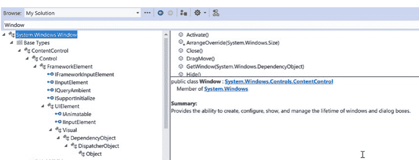
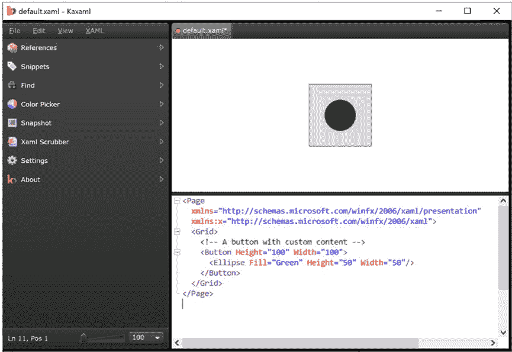
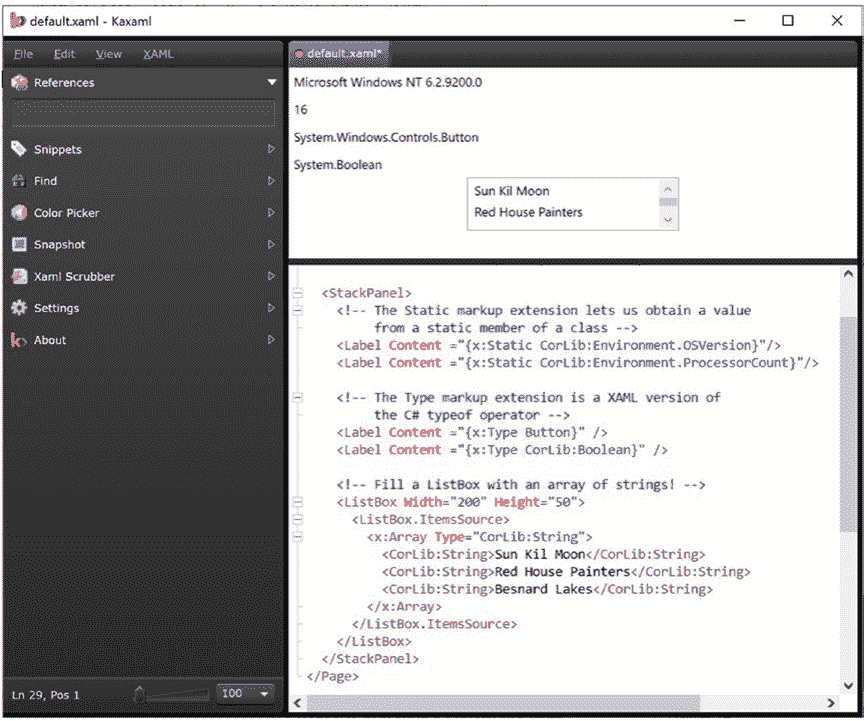
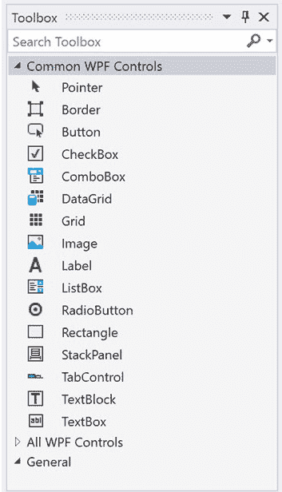
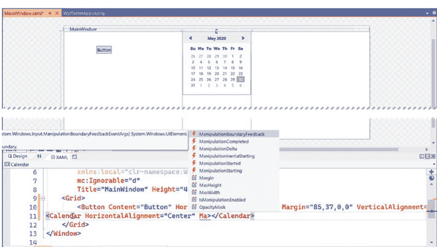
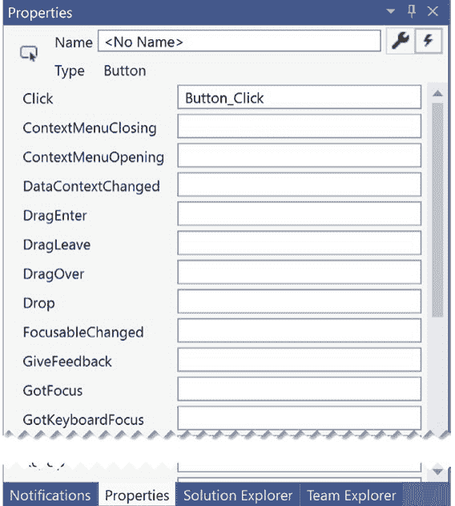
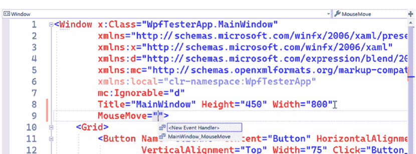
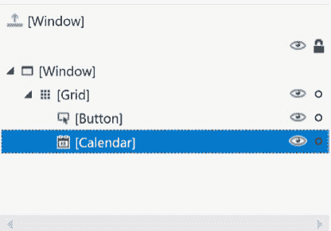
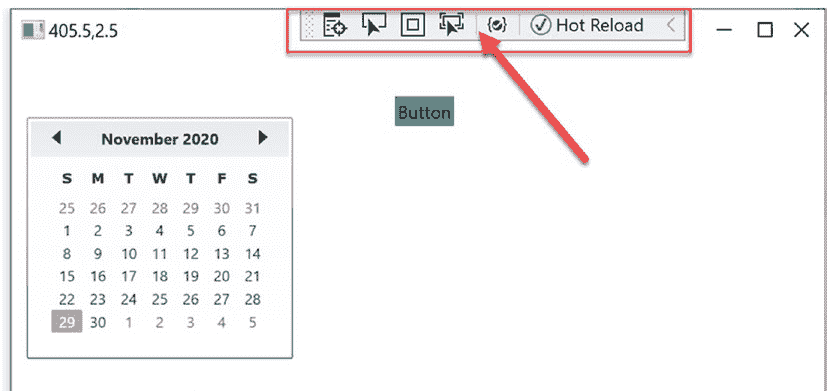
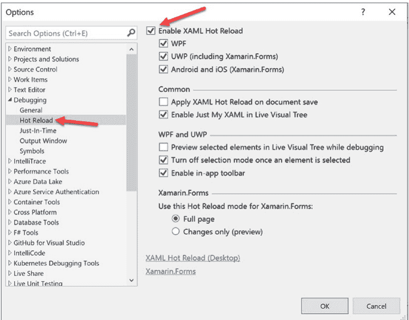

## 第 24 章

## 介绍 Windows Presentation Foundation 和 XAML

当 .NET 平台 1.0 版本发布时，需要构建图形桌面应用程序的程序员使用了两个名为 Windows Forms 和 GDI+ 的 API，它们主要打包在 `System.Windows.Forms.dll` 和 `System.Drawing.dll` 程序集中。虽然 Windows Forms 和 GDI+ 仍然是构建传统桌面 GUI 的可行 API，但微软从 .NET 3.0 开始，发布了一个名为 Windows Presentation Foundation (WPF) 的替代 GUI 桌面 API。WPF 和 Windows Forms 随 .NET Core 3.0 的发布加入了 .NET Core 家族。

这第一本 WPF 章节首先探讨了这个新 GUI 框架背后的动机，这将帮助你了解 Windows Forms/GDI+ 和 WPF 编程模型之间的差异。接下来，你将了解几个重要类的角色，包括 `Application`、`Window`、`ContentControl`、`Control`、`UIElement` 和 `FrameworkElement`。

然后，本章将向你介绍一种基于 XML 的语法，名为*可扩展应用程序标记语言*（XAML；发音为“zammel”）。在这里，你将学习 XAML 的语法和语义，包括附加属性语法以及类型转换器和标记扩展的作用。

本章最后通过构建你的第一个 WPF 应用程序，来探讨 Visual Studio 中集成的 WPF 设计器。在此期间，你将学习拦截键盘和鼠标活动、定义应用程序级数据以及执行其他常见的 WPF 任务。

## WPF 背后的动机

多年来，微软创建了众多图形用户界面工具包（原始的 C/C++/Windows API 开发、VB6、MFC 等）来构建桌面可执行文件。这些 API 中的每一个都提供了一个代码库来表示 GUI 应用程序的基本方面，包括主窗口、对话框、控件、菜单系统等。随着 .NET 平台的首次发布，Windows Forms API 凭借其简单而强大的对象模型，迅速成为 UI 开发的首选模型。

虽然使用 Windows Forms 已经成功创建了许多功能齐全的桌面应用程序，但事实是，这种编程模型相当*不对称*。简单来说，`System.Windows.Forms.dll` 和 `System.Drawing.dll` 并未为构建功能丰富的桌面应用程序所需的许多附加技术提供直接支持。为了说明这一点，请考虑 WPF 发布之前 GUI 桌面开发的临时性（参见表 24-1）。

## 表 24-1. WPF 之前所需功能的技术方案

| 所需功能 | 技术 |
|---|---|
| 使用控件构建窗口 | Windows Forms |
| 2D 图形支持 | GDI+ (`System.Drawing.dll`) |
| 3D 图形支持 | DirectX API |
| 流视频支持 | Windows Media Player API |
| 流式文档支持 | 以编程方式操作 PDF 文件 |

如你所见，Windows Forms 开发人员必须从几个不相关的 API 和对象模型中引入类型。虽然使用这些不同的 API 在语法上看起来可能相似（毕竟，它只是 C# 代码），但你也可能同意，每种技术都需要截然不同的思维方式。例如，使用 DirectX 创建 3D 渲染动画所需的技能与将数据绑定到网格所需的技能完全不同。可以肯定的是，Windows Forms 程序员很难掌握每个 API 的多样性。

## 统一不同的 API

WPF 被特意创建为将这些以前不相关的编程任务合并到一个统一的对象模型中。因此，如果你需要制作 3D 动画，则无需手动针对 DirectX API 进行编程（尽管你可以这样做），因为 3D 功能已直接内置到 WPF 中。为了了解改进的效果，请考虑表 24-2，它展示了自 .NET 3.0 起引入的桌面开发模型。

## 表 24-2. .NET 3.0+ 所需功能的技术方案

| 所需功能 | 技术 |
|---|---|
| 使用控件构建窗体 | WPF |
| 2D 图形支持 | WPF |
| 3D 图形支持 | WPF |
| 流视频支持 | WPF |
| 流式文档支持 | WPF |

这里明显的好处是，.NET 程序员现在拥有一个单一的、对称的 API 来满足所有常见的 GUI 桌面编程需求。一旦你熟悉了关键 WPF 程序集的功能和 XAML 的语法，你会惊讶于创建复杂 UI 的速度之快。

## 通过 XAML 实现关注点分离

也许最引人注目的好处之一是，WPF 提供了一种将 GUI 应用程序的外观与其驱动的编程逻辑清晰分离的方法。使用 XAML，可以通过 XML 标记来定义应用程序的 UI。然后，可以将此标记（理想情况下使用 Microsoft Visual Studio 或 Blend for Visual Studio 等工具生成）连接到相关的 C# 代码文件，以提供程序功能的核心。

> **注意：** XAML 不仅限于 WPF 应用程序。任何应用程序都可以使用 XAML 来描述 .NET 对象的树，即使它们与可见的用户界面无关。

当你深入研究 WPF 时，你可能会惊讶于这种“桌面标记”提供的灵活性。XAML 不仅允许你在标记中定义简单的 UI 元素（按钮、网格、列表框等），还可以定义交互式 2D 和 3D 图形、动画、数据绑定逻辑以及多媒体功能（例如视频播放）。

XAML 还使得自定义控件的视觉外观变得容易。例如，定义一个动画显示公司徽标的圆形按钮控件只需要几行标记。如第 27 章所示，WPF 控件可以通过样式和模板进行修改，这使你可以以最少的麻烦改变应用程序的整体外观。与 Windows Forms 开发不同，从头开始构建自定义 WPF 控件的唯一令人信服的理由是，如果你需要更改控件的行为（例如，添加自定义方法、属性或事件；继承现有控件以重写虚拟成员）。如果你只需要更改控件的外观（再次强调，例如圆形动画按钮），则完全可以仅通过标记来实现。

## 提供优化的渲染模型

诸如 Windows Forms、MFC 或 VB6 之类的 GUI 工具包使用基于 C 的低级 API（GDI）执行所有图形渲染请求（包括按钮和列表框等 UI 元素的渲染），该 API 多年来一直是 Windows 操作系统的一部分。GDI 为典型的业务应用程序或简单的图形程序提供了足够的性能；但是，如果 UI 应用程序需要利用高性能图形，则需要 DirectX。

WPF 编程模型则完全不同，它在渲染图形数据时不使用 GDI。所有渲染操作（例如，2D 图形、3D 图形、动画、控件渲染等）现在都使用 DirectX API。第一个明显的好处是，你的 WPF 应用程序将自动利用硬件和软件优化。此外，WPF 应用程序可以利用丰富的图形服务（模糊效果、抗锯齿、透明度等），而无需直接针对 DirectX API 进行编程的复杂性。

> **注意：** 尽管 WPF 确实将所有渲染请求推送到 DirectX 层，但我并不是说 WPF 应用程序的性能会与直接使用非托管 C++ 和 DirectX 构建应用程序一样快。尽管每个版本的 WPF 在性能上都有显著提升，但如果你打算构建需要最快执行速度的桌面应用程序（例如 3D 视频游戏），非托管 C++ 和 DirectX 仍然是最佳方法。

## 简化复杂的 UI 编程

回顾一下目前的内容，Windows Presentation Foundation (WPF) 是一个用于构建桌面应用程序的 API，它将各种桌面 API 集成到一个对象模型中，并通过 XAML 提供了清晰的关注点分离。除了这些主要优点之外，WPF 应用程序还受益于一种将服务集成到程序中的简单方法，而这些服务在历史上是相当复杂的。以下是核心 WPF 功能的快速概述：

-   多种布局管理器（远多于 Windows Forms），可对内容的放置和重新定位提供极其灵活的控制。
-   使用增强的数据绑定引擎，以多种方式将内容绑定到 UI 元素。


- 内置样式引擎，允许你为 WPF 应用程序定义“主题”。
- 使用矢量图形，允许内容自动调整大小，以适应承载应用程序的屏幕尺寸和分辨率。
- 支持 2D 和 3D 图形、动画以及视频和音频播放。
- 丰富的排版 API，例如支持 XML Paper Specification（XPS）文档、固定文档（所见即所得）、流式文档和文档批注（例如 Sticky Notes API）。
- 支持与旧版 GUI 模型进行互操作（例如 Windows Forms、ActiveX 和 Win32 HWND）。例如，你可以将自定义 Windows Forms 控件嵌入 WPF 应用程序，反之亦然。

现在你已经大致了解了 WPF 所提供的功能，接下来让我们看看可以使用此 API 创建的各种应用程序类型。其中许多功能将在后续章节中详细介绍。

## 探索 WPF 程序集

WPF 归根结底只是 .NET Core 程序集内打包的一组类型。表 24-3 描述了用于构建 WPF 应用程序的核心程序集；创建新项目时必须引用其中每一个程序集。正如你所期望的那样，Visual Studio 的 WPF 项目会自动引用这些必需的程序集。

**表 24-3。WPF 核心程序集**

| 程序集 | 作用 |
|---|---|
| PresentationCore | 此程序集定义了众多命名空间，构成 WPF GUI 层的基础。例如，此程序集包含对 WPF Ink API、动画基元以及众多图形呈现类型的支持。 |
| PresentationFramework | 此程序集包含大多数 WPF 控件、Application 和 Window 类、对交互式 2D 图形的支持，以及数据绑定所使用的众多类型。 |
| System.Xaml.dll | 此程序集提供了一些命名空间，允许你在运行时针对 XAML 文档进行编程。总的来说，只有在编写 WPF 支持工具，或需要在运行时完全控制 XAML 时，这个库才有用。 |
| WindowsBase.dll | 此程序集定义了构成 WPF API 基础设施的类型，包括表示 WPF 线程类型和安全类型的类型、各种类型转换器，以及对依赖属性和路由事件的支持（第 27 章将对此进行介绍）。 |

总的来说，这四个程序集定义了新的命名空间以及 .NET Core 类、接口、结构、枚举和委托。表 24-4 描述了一些重要命名空间的作用（当然并不包括全部命名空间）。

**表 24-4。WPF 核心命名空间**

| 命名空间 | 作用 |
|---|---|
| System.Windows | 这是 WPF 的根命名空间。在这里，你可以找到任何 WPF 桌面项目都需要的核心类（例如 Application 和 Window）。 |
| System.Windows.Controls | 此命名空间包含所有预期的 WPF 小部件，包括用于构建菜单系统、工具提示以及各种布局管理器的类型。 |
| System.Windows.Data | 此命名空间包含用于处理 WPF 数据绑定引擎的类型，以及对数据绑定模板的支持。 |
| System.Windows.Documents | 此命名空间包含用于处理文档 API 的类型。通过 XML Paper Specification（XPS）协议，该 API 允许你将类似 PDF 的功能集成到 WPF 应用程序中。 |
| System.Windows.Ink | 此命名空间为 Ink API 提供支持，允许你捕获来自手写笔或鼠标的输入、响应输入手势等。这对于 Tablet PC 编程很有用；不过，任何 WPF 应用程序都可以使用此 API。 |
| System.Windows.Markup | 此命名空间定义了多个类型，允许以编程方式分析和处理 XAML 标记（以及与之对应的二进制格式 BAML）。 |
| System.Windows.Media | 这是多个以媒体为中心的命名空间的根命名空间。在这些命名空间中，你可以找到用于处理动画、3D 呈现、文本呈现以及其他多媒体基元的类型。 |
| System.Windows.Navigation | 此命名空间提供了用于处理 XAML 浏览器应用程序（XBAP）所采用的导航逻辑，以及需要导航页面模型的标准桌面应用程序的类型。 |
| System.Windows.Shapes | 此命名空间定义了允许你呈现交互式 2D 图形的类，这些图形会自动响应鼠标输入。 |

为了开始学习 WPF 编程模型，你将研究 System.Windows 命名空间中的两个成员，它们在任何传统桌面开发工作中都很常见：Application 和 Window。

> 注意：如果你曾使用 Windows Forms API 创建桌面 UI，请注意，System.Windows.Forms.* 和 System.Drawing.* 程序集与 WPF 无关。这些库代表原始的 .NET GUI 工具包，即 Windows Forms/GDI+。

## Application 类的作用

System.Windows.Application 类表示正在运行的 WPF 应用程序的全局实例。此类提供了一个 Run() 方法（用于启动应用程序），以及一系列可供处理的事件，以便与应用程序的生命周期交互（例如 Startup 和 Exit）。表 24-5 详细介绍了一些关键属性。

**表 24-5。Application 类型的关键属性**

| 属性 | 作用 |
|---|---|
| Current | 此静态属性允许你从代码中的任何位置访问正在运行的 Application 对象。当窗口或对话框需要访问创建它的 Application 对象时，此属性非常有用，通常用于访问应用程序范围的变量和功能。 |
| MainWindow | 此属性允许你以编程方式获取或设置应用程序的主窗口。 |
| Properties | 此属性允许你建立和获取可在 WPF 应用程序各个部分（窗口、对话框等）中访问的数据。 |
| StartupUri | 此属性获取或设置一个 URI，用于指定应用程序启动时自动打开的窗口或页面。 |
| Windows | 此属性返回 WindowCollection 类型的对象，该对象提供对创建 Application 对象的线程所创建的每个窗口的访问。当你想要遍历应用程序中的每个打开窗口并更改其状态（例如最小化所有窗口）时，此属性会很有用。 |

## 构造 Application 类

任何 WPF 应用程序都需要定义一个继承自 Application 的类。在此类中，你将定义程序的入口点（Main() 方法），该方法会创建此子类的实例，并通常根据需要处理 Startup 和 Exit 事件。下面是一个示例：

```
// 定义全局应用程序对象
// 用于此 WPF 程序。
class MyApp : Application
{
    [STAThread]
    static void Main(string[] args)
    {
        // 创建应用程序对象。
        MyApp app = new MyApp();

        // 注册 Startup/Exit 事件。
        app.Startup += (s, e) => { /* 启动应用程序 */ };
        app.Exit += (s, e) => { /* 退出应用程序 */ };
    }
}
```

在 Startup 处理程序中，你通常会处理传入的命令行参数并启动程序的主窗口。正如你所期望的那样，Exit 处理程序用于编写程序所需的关闭逻辑（例如保存用户首选项、写入 Windows 注册表）。

> 注意：WPF 应用程序的 Main() 方法必须使用 [STAThread] 特性进行标记，以确保应用程序使用的任何旧版 COM 对象都是线程安全的。如果不以这种方式标注 Main()，运行时将引发异常。即使 C# 9.0 引入了顶级语句，你仍然会希望在 WPF 应用程序中使用更传统的 Main() 方法。事实上，Main() 方法会自动为你生成。

## 枚举 Windows 集合

Application 公开的另一个有趣属性是 Windows，它提供了一个集合，用于表示当前 WPF 应用程序中加载到内存的每个窗口。当你创建新的 Window 对象时，它们会自动添加到 Application.Windows 集合中。下面是一个示例方法，它会最小化应用程序中的每个窗口（例如响应最终用户触发的某个键盘手势或菜单选项）：

```
static void MinimizeAllWindows()
{
    foreach (Window wnd in Application.Current.Windows)
    {
        wnd.WindowState = WindowState.Minimized;
    }
}
```

你很快就会构建一些 WPF 应用程序，但在此之前，让我们先了解 Window 类型的核心功能，并在此过程中学习一些重要的 WPF 基类。

## Window 类的作用

System.Windows.Window 类（位于 PresentationFramework.dll 程序集中）表示一个由 Application 派生类拥有的单独窗口，其中包括主窗口显示的任何对话框。不出所料，Window 拥有一系列父类，每个父类都会带来更多功能。请看图 24-1，其中展示了 System.Windows.Window 的继承链（以及所实现的接口），该信息来自 Visual Studio 对象浏览器。



图 24-1。Window 类的层次结构

随着你继续学习本章及后续章节，你将逐渐了解许多基类所提供的功能。不过，为了激发你的兴趣，下面几节将分别介绍每个基类所提供的功能（完整细节请参阅 .NET 5 文档）。


# System.Windows.Controls.ContentControl 的作用

Window 的直接父类是 ContentControl，它很可能是所有 WPF 类中最具吸引力的一个。这个基类为派生类型提供了承载单个内容的能力。简单来说，内容指的是通过 Content 属性放置在控件表面区域内部的可视数据。WPF 内容模型使自定义内容控件的基本外观和行为变得非常简单。

例如，当你想到典型的“按钮”控件时，通常会认为其内容是一个简单的字符串字面量（确定、取消、中止等）。如果使用 XAML 描述 WPF 控件，并且想要分配给 Content 属性的值可以表示为简单字符串，那么可以在元素的开始定义中设置 Content 属性，如下所示（此时不必过分关注确切的标记）：

```
<!-- 在开始元素中设置 Content 值 -->
<Button Height="80" Width="100" Content="OK"/>
```

注意 Content 属性也可以在 C# 代码中设置，这样便可以在运行时更改控件的内部内容。

不过，内容几乎可以是任意形式。例如，假设你想要一个比简单字符串更有趣的“按钮”，也许还要包含自定义图形和一段文字。在 Windows Forms 等其他 UI 框架中，你需要构建一个自定义控件，这可能需要编写大量代码，并且还要维护一个全新的类。而使用 WPF 内容模型，则无需这样做。

当你想要将 Content 属性设置为无法表示为简单字符数组的值时，不能在控件的开始定义中通过属性进行赋值。相反，必须在元素的范围内隐式定义内容数据。例如，下面的 <Button> 包含一个作为内容的 <StackPanel>，而该 <StackPanel> 本身又包含一些独特的数据（确切地说，是一个 <Ellipse> 和一个 <Label>）：

```
<!-- 使用复杂数据隐式设置 Content 属性 -->
<Button Height="80" Width="100">
  <StackPanel>
    <Ellipse Fill="Red" Width="25" Height="25"/>
    <Label Content ="OK!"/>
  </StackPanel>
</Button>
```

你还可以使用 XAML 的属性元素语法来设置复杂内容。请看下面这个功能等价的 <Button> 定义，它使用属性元素语法显式设置了 Content 属性（本章稍后会详细介绍 XAML，因此现在不必过分纠结细节）：

```
<!-- 使用属性元素语法设置 Content 属性 -->
<Button Height="80" Width="100">
  <Button.Content>
    <StackPanel>
      <Ellipse Fill="Red" Width="25" Height="25"/>
      <Label Content ="OK!"/>
    </StackPanel>
  </Button.Content>
</Button>
```

请注意，并非每个 WPF 元素都派生自 ContentControl，因此并非所有控件都支持这种独特的内容模型（不过，大多数控件支持）。此外，一些 WPF 控件还会对刚才介绍的基本内容模型进行少许改进。第 25 章将更加详细地介绍 WPF 内容的作用。

# System.Windows.Controls.Control 的作用

与 ContentControl 不同，所有 WPF 控件都将 Control 基类作为共同的父类。这个基类提供了许多核心成员，用于实现基本的 UI 功能。例如，Control 定义了用于设置控件大小、不透明度、Tab 顺序逻辑、显示光标、背景颜色等的属性。此外，这个父类还提供了对模板服务的支持。如第 27 章所述，WPF 控件可以使用模板和样式彻底改变其外观的呈现方式。表 24-6 按相关功能分组，记录了 Control 类型的一些关键成员。

表 24-6。Control 类型的关键成员

| 成员 | 实际作用 |
|---|---|
| Background、Foreground、BorderBrush、BorderThickness、Padding、HorizontalContentAlignment、VerticalContentAlignment | 这些属性允许你设置与控件呈现和定位方式相关的基本设置。 |
| FontFamily、FontSize、FontStretch、FontWeight | 这些属性控制各种与字体相关的设置。 |
| IsTabStop、TabIndex | 这些属性用于建立窗口中各控件之间的 Tab 顺序。 |
| MouseDoubleClick、PreviewMouseDoubleClick | 这些事件处理双击控件的操作。 |
| Template | 此属性允许你获取和设置控件的模板，该模板可用于更改控件的呈现结果。 |

# System.Windows.FrameworkElement 的作用

这个基类提供了许多在整个 WPF 框架中使用的成员，例如对故事板（用于动画）的支持、对数据绑定的支持，以及通过 Name 属性为成员命名、获取派生类型定义的资源和设置派生类型总体尺寸的能力。表 24-7 概括了其中的重点。

# 表 24-7。FrameworkElement 类型的关键成员

| 成员 | 实际作用 |
|---|---|
| ActualHeight、ActualWidth、MaxHeight、MaxWidth、MinHeight、MinWidth、Height、Width | 这些属性控制派生类型的大小。 |
| ContextMenu | 获取或设置与派生类型关联的弹出菜单。 |
| Cursor | 获取或设置与派生类型关联的鼠标光标。 |
| HorizontalAlignment、VerticalAlignment | 获取或设置该类型在容器（例如面板或列表框）中的定位方式。 |
| Name | 允许你为该类型分配名称，以便在代码文件中访问其功能。 |
| Resources | 提供对该类型定义的所有资源的访问（有关 WPF 资源系统的介绍，请参阅第 29 章）。 |
| ToolTip | 获取或设置与派生类型关联的工具提示。 |

# System.Windows.UIElement 的作用

在 Window 继承链中的所有类型里，UIElement 基类提供了最丰富的功能。UIElement 的主要任务是为派生类型提供大量事件，使派生类型能够获得焦点并处理输入请求。例如，该类提供了许多用于处理拖放操作、鼠标移动、键盘输入、触笔输入和触摸操作的事件。

第 25 章将详细介绍 WPF 事件模型；不过，其中许多核心事件看起来应该非常熟悉（MouseMove、KeyUp、MouseDown、MouseEnter、MouseLeave 等）。除了定义数十个事件之外，这个父类还提供了多个属性，用于处理控件焦点、启用状态、可见性和命中测试逻辑，如表 24-8 所示。

# 表 24-8。UIElement 类型的关键成员

| 成员 | 实际作用 |
|---|---|
| Focusable、IsFocused | 这些属性允许你将焦点设置到指定的派生类型上。 |
| IsEnabled | 此属性允许你控制指定的派生类型处于启用还是禁用状态。 |
| IsMouseDirectlyOver、IsMouseOver | 这些属性提供了一种简单的方式来执行命中测试逻辑。 |
| IsVisible、Visibility | 这些属性允许你处理派生类型的可见性设置。 |
| RenderTransform | 此属性允许你建立一个用于呈现派生类型的变换。 |

# System.Windows.Media.Visual 的作用

Visual 类提供了 WPF 中的核心呈现支持，包括对图形数据执行命中测试、坐标变换以及边界框计算。事实上，Visual 类会与底层 DirectX 子系统交互，以便在屏幕上绘制数据。正如你将在第 26 章中看到的，WPF 提供了三种呈现图形数据的方式，每种方式在功能和性能方面都有所不同。使用 Visual 类型（及其子类，例如 DrawingVisual）可以用最轻量的方式呈现图形数据，但同时也需要编写最多的手动代码，以处理所有必需的服务。关于这一点的更多细节将在第 28 章介绍。

# System.Windows.DependencyObject 的作用

WPF 支持一种特殊形式的 .NET 属性，称为依赖属性。简单来说，这种属性形式提供了额外的代码，使属性能够响应样式、数据绑定、动画等多种 WPF 技术。若要让某个类型支持这种新的属性机制，就需要从 DependencyObject 基类派生。虽然依赖属性是 WPF 开发的重要组成部分，但在大多数时候，它们的具体细节都被隐藏起来了。第 25 章将进一步深入介绍依赖属性的详细信息。

# System.Windows.Threading.DispatcherObject 的作用

Window 类型的最后一个基类（除此之外还有 System.Object，我想在本书当前阶段无需再做解释）是 DispatcherObject。该类型提供了一个值得关注的属性 Dispatcher，它返回关联的 System.Windows.Threading.Dispatcher 对象。Dispatcher 类是 WPF 应用程序事件队列的入口，并提供了处理并发和线程的基本构造。第 15 章介绍过 Dispatcher 类。

# 理解 WPF XAML 的语法

生产级 WPF 应用程序通常会使用专用工具来生成必要的 XAML。尽管这些工具非常有帮助，但了解 XAML 标记的整体结构仍然是一个好主意。为了帮助你学习，下面介绍一个流行且免费的工具，它可以让你轻松地试验 XAML。

# 介绍 Kaxaml

刚开始学习 XAML 语法时，使用名为 Kaxaml 的免费工具会很有帮助。你可以从 https://github.com/punker76/kaxaml 获取这个流行的 XAML 编辑器/解析器。

注意 在本书的许多版本中，我曾将读者指向 www.kaxaml.com，但遗憾的是，该网站已经停止运营。Jan Karger（https://github.com/punker76）基于旧代码创建了一个分支，并对其进行了改进。你可以在 GitHub 上找到他维护的工具版本：https://github.com/punker76/kaxaml/releases。向 Kaxaml 的原始开发者以及让它得以延续的 Jan 致以崇高的敬意和感谢；这是一个非常出色的工具，帮助无数开发者学习了 XAML。


Kaxaml 很有帮助，因为它对 C# 源代码、事件处理程序或实现逻辑一无所知。与使用完整的 Visual Studio WPF 项目模板相比，它是测试 XAML 片段的更直接的方法。此外，Kaxaml 还有多个集成工具，例如颜色选择器、XAML 片段管理器，甚至还有一个“XAML 清理”选项，可根据你的设置格式化你的 XAML。首次打开 Kaxaml 时，你会找到一个 <Page> 控件的简单标记，如下所示：

```
<Page
    xmlns="http://schemas.microsoft.com/winfx/2006/xaml/presentation"
    xmlns:x="http://schemas.microsoft.com/winfx/2006/xaml">
    <Grid>

    </Grid>
</Page>
```

像 Window 一样，Page 包含各种布局管理器和控件。然而，与 Window 不同，Page 对象不能作为独立实体运行。相反，它们必须放置在合适的宿主中，例如 NavigationWindow 或 Frame。好消息是，你可以在 <Page> 或 <Window> 范围内输入完全相同的标记。

> 注意 如果你在 Kaxaml 标记窗口中将 <Page> 和 </Page> 元素更改为 <Window> 和 </Window>，你可以按 F5 键将新窗口加载到屏幕上。

作为初始测试，将以下标记输入到工具底部的 XAML 面板中：

```
<Page
    xmlns="http://schemas.microsoft.com/winfx/2006/xaml/presentation"
    xmlns:x="http://schemas.microsoft.com/winfx/2006/xaml">
    <Grid>
        <!-- A button with custom content -->
        <Button Height="100" Width="100">
            <Ellipse Fill="Green" Height="50" Width="50"/>
        </Button>
    </Grid>
</Page>
```

你现在应该能在 Kaxaml 编辑器的上部看到你的页面渲染效果（参见图 24-2）。



图 24-2. Kaxaml 是一个有用的（并且免费的）工具，用于学习 XAML 的语法

在使用 Kaxaml 时，请记住此工具不允许你编写任何涉及代码编译的标记（然而，使用 x:Name 是允许的）。这包括定义 x:Class 属性（用于指定代码文件）、在标记中输入事件处理程序名称，或使用任何也涉及代码编译的 XAML 关键字（例如 FieldModifier 或 ClassModifier）。任何尝试这样做都会导致标记错误。

# XAML XML 命名空间和 XAML“关键字”

WPF XAML 文档的根元素（例如 <Window>、<Page>、<UserControl> 或 <Application> 定义）几乎总是会引用以下两个预定义的 XML 命名空间：

```
<Page
xmlns="http://schemas.microsoft.com/winfx/2006/xaml/presentation"
xmlns:x="http://schemas.microsoft.com/winfx/2006/xaml"
<Grid>

</Grid>
</Page>
```

第一个 XML 命名空间 http://schemas.microsoft.com/winfx/2006/xaml/presentation 将大量 WPF .NET 命名空间映射供当前 *.xaml 文件使用（System.Windows、System.Windows.Controls、System.Windows.Data、System.Windows.Ink、System.Windows.Media、System.Windows.Navigation 等）。

这种一对多的映射是在 WPF 程序集（WindowsBase.dll、PresentationCore.dll 和 PresentationFramework.dll）中使用程序集级别的 [XmlnsDefinition] 属性硬编码的。例如，如果你打开 Visual Studio 对象浏览器并选择 PresentationCore.dll 程序集，你会看到如下列表，本质上导入了 System.Windows：

```
[assembly: XmlnsDefinition("http://schemas.microsoft.com/winfx/2006/xaml/presentation", "System.Windows")]
```

第二个 XML 命名空间 http://schemas.microsoft.com/winfx/2006/xaml 用于包含 XAML 特定的“关键字”（姑且这么称呼），以及 System.Windows.Markup 命名空间的包含，如下所示：

```
[assembly: XmlnsDefinition("http://schemas.microsoft.com/winfx/2006/xaml", "System.Windows.Markup")]
```

任何格式良好的 XML 文档（记住，XAML 是基于 XML 的语法）的一个规则是，打开的根元素指定一个 XML 命名空间作为主命名空间，即包含大多数项目的命名空间。如果根元素需要包含额外的次要命名空间（如这里所示），它们必须使用唯一的标签前缀定义（以解决可能的名称冲突）。作为惯例，前缀就是 x；然而，这可以是你需要的任何唯一标记，例如 XamlSpecificStuff。

```
<Page
    xmlns="http://schemas.microsoft.com/winfx/2006/xaml/presentation"
    xmlns:XamlSpecificStuff="http://schemas.microsoft.com/winfx/2006/xaml">
    <Grid>
        <!-- A button with custom content -->
        <Button XamlSpecificStuff:Name="button1" Height="100" Width="100">
            <Ellipse Fill="Green" Height="50" Width="50"/>
        </Button>
    </Grid>
</Page>
```

定义冗长的 XML 命名空间前缀的明显缺点是，你每次 XAML 文件需要引用此 XAML 为中心的 XML 命名空间中定义的一项时，都必须键入 XamlSpecificStuff。鉴于 XamlSpecificStuff 需要许多额外的击键，就坚持使用 x 吧。

无论如何，除了 x:Name、x:Class 和 x:Code 关键字之外，http://schemas.microsoft.com/winfx/2006/xaml XML 命名空间还提供对额外 XAML 关键字的访问，其中最常见的是在表 24-9 中显示。

# 表 24-9. XAML 关键字

| XAML 关键字 | 含义 |
|---|---|
| x:Array | 在 XAML 中表示 .NET 数组类型。 |
| x:ClassModifier | 允许你定义由 Class 关键字表示的 C# 类的可见性（internal 或 public）。 |
| x:FieldModifier | 允许你定义根的任何命名子元素（例如 <Window> 元素内的 <Button>）的类型成员的可见性（internal、public、private 或 protected）。命名元素是使用 Name XAML 关键字定义的。 |
| x:Key | 允许你为将要放入字典元素中的 XAML 项建立一个键值。 |
| x:Name | 允许你指定给定 XAML 元素的生成的 C# 名称。 |
| x:Null | 表示空引用。 |
| x:Static | 允许你引用类型的静态成员。 |
| x:Type | C# typeof 运算符的 XAML 等价物（它将根据提供的名称生成一个 System.Type）。 |
| x:TypeArguments | 允许你将一个元素建立为具有特定类型参数的泛型类型（例如 List<int> 与 List<bool>）。 |

除了这两个必要的 XML 命名空间声明之外，在 XAML 文档的打开元素中定义额外的标签前缀是可能的，有时也是必要的。你通常会在需要在 XAML 中描述外部程序集中定义的 .NET Core 类时这样做。

例如，假设你构建了一些自定义 WPF 控件并将它们打包在名为 MyControls.dll 的库中。现在，如果你想创建一个使用这些控件的新 Window，你可以使用 clr-namespace 和 assembly 标记建立一个映射到你的库的自定义 XML 命名空间。以下是一些示例标记，创建一个名为 myCtrls 的标签前缀，可用于访问库中的控件：

```
<Window x:Class="WpfApplication1.MainWindow"
    xmlns="http://schemas.microsoft.com/winfx/2006/xaml/presentation"
    xmlns:x="http://schemas.microsoft.com/winfx/2006/xaml"
    xmlns:myCtrls="clr-namespace:MyControls;assembly=MyControls"
    Title="MainWindow" Height="350" Width="525">
    <Grid>
        <myCtrls:MyCustomControl />
    </Grid>
</Window>
```

clr-namespace 标记被分配给程序集中的 .NET Core 命名空间的名称，而 assembly 标记被设置为外部 *.dll 程序集的友好名称。你可以使用此语法来操作你想要在标记中操作的任何外部 .NET Core 库。目前没有必要这样做，但未来的章节将要求你定义自定义 XML 命名空间声明来在标记中描述类型。

> 注意 如果你需要在标记中定义一个属于当前程序集但在不同 .NET Core 命名空间中的类，你的 xmlns 标签前缀是在不带 assembly= 属性的情况下定义的，如下所示：xmlns:myCtrls="clr-namespace:SomeNamespaceInMyApp"。

# 控制类和成员变量可见性

你将在接下来的章节中看到许多这些关键字在需要时发挥作用；然而，作为一个简单的例子，考虑以下使用 ClassModifier 和 FieldModifier 关键字以及 x:Name 和 x:Class 的 XAML <Window> 定义（请记住 kaxaml.exe 不允许你使用任何涉及代码编译的 XAML 关键字，例如 x:Code、x:FieldModifier 或 x:ClassModifier）：

```
<!-- This class will now be declared internal in the *.g.cs file -->
<Window x:Class="MyWPFApp.MainWindow" x:ClassModifier ="internal"
    xmlns="http://schemas.microsoft.com/winfx/2006/xaml/presentation"
    xmlns:x="http://schemas.microsoft.com/winfx/2006/xaml">

<!-- This button will be public in the *.g.cs file -->
    <Button x:Name ="myButton" x:FieldModifier ="public" Content = "OK"/>
</Window>
```

默认情况下，所有 C#/XAML 类型定义都是 public，而成员默认为 internal。然而，基于你的 XAML 定义，生成的自动生成文件包含一个 internal 类类型和一个 public Button 变量。

```
internal partial class MainWindow :
    System.Windows.Window,
    System.Windows.Markup.IComponentConnector
{
    public System.Windows.Controls.Button myButton;
    ...
}
```

# XAML 元素、XAML 属性和类型转换器

在你建立了根元素和任何必需的 XML 命名空间后，你的下一个任务是用子元素填充根。在真实的 WPF 应用程序中，子元素将是一个布局管理器（例如 Grid 或 StackPanel），它反过来包含任意数量的额外 UI 元素来描述用户界面。下一章将详细检查这些布局管理器，所以现在只需假设你的 <Window> 类型将包含一个单一的 Button 元素。

正如你在本章中已经看到的那样，XAML 元素映射到给定 .NET Core 命名空间中的类或结构类型，而打开元素标签中的属性映射到该类型的属性或事件。为了说明这一点，将以下 <Button> 定义输入到 Kaxaml 中：

```
<Page
    xmlns="http://schemas.microsoft.com/winfx/2006/xaml/presentation"
    xmlns:x="http://schemas.microsoft.com/winfx/2006/xaml">
    <Grid>
```


```xaml
<!-- Configure the look and feel of a Button -->
<Button Height="50" Width="100" Content="OK!"
    FontSize="20" Background="Green" Foreground="Yellow"/>
</Grid>
</Page>
```

请注意，为每个属性分配的值都被捕获为简单的文本值。这看起来像是数据类型完全不匹配，因为如果你要在 C# 代码中创建这个 Button，你不会将字符串对象分配给这些属性，而是会使用特定的数据类型。例如，这里是用代码编写的同一个按钮：

```csharp
public void MakeAButton()
{
    Button myBtn = new Button();
    myBtn.Height = 50;
    myBtn.Width = 100;
    myBtn.FontSize = 20;
    myBtn.Content = "OK!";
    myBtn.Background = new SolidColorBrush(Colors.Green);
    myBtn.Foreground = new SolidColorBrush(Colors.Yellow);
}
```

事实证明，WPF 提供了多个类型转换器类，它们将被用来将简单的文本值转换为正确的底层数据类型。此过程是透明的，并且是自动完成的。

虽然这已经很不错了，但在很多情况下你需要为 XAML 属性分配一个更复杂的值，而这个值无法作为简单的字符串捕获。例如，假设你想构建一个自定义画刷来设置 Button 的 Background 属性。如果你要在代码中构建画刷，那会非常简单，如下所示：

```csharp
public void MakeAButton()
{
    ...
    // A fancy brush for the background.
    LinearGradientBrush fancyBrush =
        new LinearGradientBrush(Colors.DarkGreen, Colors.LightGreen, 45);
    myBtn.Background = fancyBrush;
    myBtn.Foreground = new SolidColorBrush(Colors.Yellow);
}
```

你如何将复杂的画刷表示为字符串？好吧，你不能！值得庆幸的是，XAML 提供了一种特殊的语法，可在你需要将属性值分配给复杂对象时使用，称为属性元素语法。

## 理解 XAML 属性元素语法

属性元素语法允许你将复杂对象分配给属性。以下是使用 LinearGradientBrush 设置其 Background 属性的 Button 的 XAML 描述：

```xaml
<Button Height="50" Width="100" Content="OK!"
    FontSize="20" Foreground="Yellow">
    <Button.Background>
        <LinearGradientBrush>
            <GradientStop Color="DarkGreen" Offset="0"/>
            <GradientStop Color="LightGreen" Offset="1"/>
        </LinearGradientBrush>
    </Button.Background>
</Button>
```

请注意，在 `<Button>` 和 `</Button>` 标签的范围内，你定义了一个名为 `<Button.Background>` 的子范围。在此范围内，你定义了一个自定义的 `<LinearGradientBrush>`。 （不必担心画刷的确切代码；你将在第 28 章学习 WPF 绘图。）

任何属性都可以使用属性元素语法设置，其始终遵循以下模式：

```xaml
<DefiningClass>
    <DefiningClass.PropertyOnDefiningClass>
        <!-- Value for Property here! -->
    </DefiningClass.PropertyOnDefiningClass>
</DefiningClass>
```

虽然可以使用此语法设置任何属性，但如果可以将值作为简单字符串捕获，你将节省输入时间。例如，这里是设置 Button 的 Width 的一种更冗长的方式：

```xaml
<Button Height="50" Content="OK!" FontSize="20" Foreground="Yellow">
...
    <Button.Width>
        100
    </Button.Width>
</Button>
```

## 理解 XAML 附加属性

除了属性元素语法之外，XAML 还定义了一种特殊的语法，用于为附加属性设置值。基本上，附加属性允许子元素为在父元素中定义的属性设置值。需要遵循的通用模板如下所示：

```xaml
<ParentElement>
    <ChildElement ParentElement.PropertyOnParent="Value"/>
</ParentElement>
```

附加属性语法的最常见用途是在 WPF 布局管理器类之一（Grid、DockPanel 等）中定位 UI 元素。下一章将详细介绍这些面板；现在，在 Kaxaml 中输入以下内容：

```xaml
<Page
xmlns="http://schemas.microsoft.com/winfx/2006/xaml/presentation"
xmlns:x="http://schemas.microsoft.com/winfx/2006/xaml">
    <Canvas Height="200" Width="200" Background="LightBlue">
        <Ellipse Canvas.Top="40" Canvas.Left="40" Height="20" Width="20" Fill="DarkBlue"/>
    </Canvas>
</Page>
```

这里，你定义了一个包含 Ellipse 的 Canvas 布局管理器。请注意，Ellipse 可以使用附加属性语法告知其父级（Canvas）其顶部/左侧位置。

关于附加属性，有几件事需要注意。首先也是最重要的，这不是一种可以应用于任何父元素的任何属性的通用语法。例如，以下 XAML 无法在不报错的情况下解析：

```xaml
<!-- Error! Set Background property on Canvas via attached property? -->
<Canvas Height="200" Width="200">
    <Ellipse Canvas.Background="LightBlue"
            Canvas.Top="40" Canvas.Left="90"
            Height="20" Width="20" Fill="DarkBlue"/>
</Canvas>
```

附加属性是 WPF 特定概念依赖属性的一种特殊形式。除非属性以特定方式实现，否则你不能使用附加属性语法设置其值。你将在第 25 章详细探讨依赖属性。

> 注 Visual Studio 具有 IntelliSense，它会显示可由给定元素设置的有效的附加属性。

## 理解 XAML 标记扩展

如前所述，属性值最常使用简单字符串或通过属性元素语法表示。然而，还有另一种指定 XAML 属性值的方法，使用标记扩展。标记扩展允许 XAML 解析器从专用外部类获取属性的值。这可能是有益的，因为某些属性值需要执行几条代码语句才能确定值。

标记扩展提供了一种干净地扩展 XAML 语法以添加新功能的方法。标记扩展在内部表示为派生自 MarkupExtension 的类。请注意，你几乎永远不需要构建自定义标记扩展的可能性微乎其微。然而，一组 XAML 关键字（例如 x:Array、x:Null、x:Static 和 x:Type）实际上是伪装的标记扩展！

标记扩展被花括号包围，如下所示：

```xaml
<Element PropertyToSet = "{MarkUpExtension}"/>
```

要查看一些标记扩展的实际操作，请将以下内容写入 Kaxaml：

```xaml
<Page
    xmlns="http://schemas.microsoft.com/winfx/2006/xaml/presentation"
    xmlns:x="http://schemas.microsoft.com/winfx/2006/xaml"
    xmlns:CorLib="clr-namespace:System;assembly=mscorlib">

    <StackPanel>
        <!-- The Static markup extension lets us obtain a value
             from a static member of a class -->
        <Label Content ="{x:Static CorLib:Environment.OSVersion}"/>
        <Label Content ="{x:Static CorLib:Environment.ProcessorCount}"/>

        <!-- The Type markup extension is a XAML version of the C# typeof operator -->
        <Label Content ="{x:Type Button}" />
        <Label Content ="{x:Type CorLib:Boolean}" />

        <!-- Fill a ListBox with an array of strings! -->
        <ListBox Width="200" Height="50">
            <ListBox.ItemsSource>
                <x:Array Type="CorLib:String">
                    <CorLib:String>Sun Kil Moon</CorLib:String>
                    <CorLib:String>Red House Painters</CorLib:String>
                    <CorLib:String>Besnard Lakes</CorLib:String>
                </x:Array>
            </ListBox.ItemsSource>
        </ListBox>
    </StackPanel>
</Page>
```

首先，请注意 `<Page>` 定义有一个新的 XML 命名空间声明，它允许你访问 mscorlib.dll 的 System 命名空间。建立此 XML 命名空间后，你首先使用 x:Static 标记扩展并从 System.Environment 类的 OSVersion 和 ProcessorCount 中获取值。

x:Type 标记扩展允许你访问指定项的元数据描述。在这里，你只是将 WPF Button 和 System.Boolean 类型的完全限定名称分配给。

此标记中最有趣的部分是 ListBox。在这里，你将 ItemsSource 属性设置为完全在标记中声明的字符串数组！请注意，这里 x:Array 标记扩展如何允许你在其范围内指定一组子项：

```xaml
<x:Array Type="CorLib:String">
    <CorLib:String>Sun Kil Moon</CorLib:String>
    <CorLib:String>Red House Painters</CorLib:String>
    <CorLib:String>Besnard Lakes</CorLib:String>
</x:Array>
```

> 注 前面的 XAML 示例仅用于说明标记扩展的实际操作。如你在第 25 章中将看到的那样，填充 ListBox 控件有更简单的方法！

图 24-3 显示了 Kaxaml 中此 `<Page>` 的标记。




## Figure 24-3. Markup extensions allow you to set values via the functionality of a dedicated class

你现在已经看到了众多示例，展示了 XAML 语法各个核心方面的用法。正如你可能同意的那样，XAML 的有趣之处在于它允许你以声明方式描述一棵 .NET 对象树。虽然这在配置图形用户界面时非常有帮助，但请记住，只要是非抽象类型且包含默认构造函数的类型，XAML 就可以描述来自任何程序集的任何类型。

## Building WPF Applications Using Visual Studio

让我们来看看 Visual Studio 如何简化 WPF 程序的构建。虽然你可以使用 Visual Studio Code 构建 WPF 应用程序，但 Visual Studio Code 并没有用于构建 WPF 应用程序的设计器支持。Visual Studio 凭借其丰富的 XAML 支持，在构建 WPF 应用程序时是一个更高效的 IDE。

> Note 在这里，我将指出使用 Visual Studio 构建 WPF 应用程序的一些关键特性。后续章节将在必要时说明 IDE 的其他方面。

## The WPF Project Templates

Visual Studio 的新建项目对话框定义了一组 WPF 项目模板，包括 WPF App、WPF Custom Control Library 和 WPF User Control Library。创建一个名为 WpfTesterApp 的新 WPF App (.NET) 项目。

Note 在从 Visual Studio“添加新项目”屏幕选择 WPF 项目时，请务必选择标题中带有“(.NET)”的 WPF 项目模板，而不是“(.NET Framework)”。当前版本的 .NET Core 已更名为 .NET 5。如果你选择标题中带有“(.NET Framework)”的模板，你将使用 .NET Framework 4.x 构建你的应用程序。

除了将项目 SDK 设置为 Microsoft.NET.Sdk 外，你还将获得初始的 Window 和 Application 派生类，每个类都使用 XAML 和 C# 代码文件表示。

## The Toolbox and XAML Designer/Editor

Visual Studio 提供了一个工具箱（可通过视图菜单打开），其中包含众多 WPF 控件。面板的上部包含最常用的控件，下部包含所有控件（见图 24-4）。



Figure 24-4. The Toolbox contains the WPF controls that can be placed on the designer surface

使用标准的拖放操作，你可以将这些控件中的任何一个放置到窗口的设计器表面上，或将控件拖到设计器底部的 XAML 标记编辑器中。当你这样做时，初始 XAML 将由系统代为编写。使用鼠标拖动一个 Button 控件和一个 Calendar 控件到设计器表面。完成后，注意你如何重新定位和调整控件的大小（并务必查看根据你的编辑生成的 XAML）。

除了通过鼠标和工具箱构建 UI 外，你还可以使用集成的 XAML 编辑器手动输入标记。如图 24-5 所示，你可以获得 IntelliSense 支持，这有助于简化标记的编写。例如，尝试向开始的 <Window> 元素添加 Background 属性。



Figure 24-5. The WPF Window designer

花几分钟时间直接在 XAML 编辑器中添加一些属性值。务必花时间熟悉 WPF 设计器的这一方面。

## Setting Properties Using the Properties Window

在将一些控件放置到设计器上（或在编辑器中手动定义它们）之后，你可以使用属性窗口为所选控件设置属性值，以及为所选控件设置事件处理程序。作为一个简单的测试，在设计器上选择你的 Button 控件。现在，使用属性窗口通过集成的画刷编辑器更改按钮的 Background 颜色（见图 24-6；你将在第 26 章研究 WPF 绘图时了解更多关于画刷编辑器的信息）。

Figure 24-6. The Properties window can be used to configure the UI of a WPF control

Properties
Name <No Name>
Type Button
Arrange by: Category
Brush
Background
BorderBrush
Foreground
OpacityMask No brush
Editor
Color Resources
R 55
G 163
B 165
A 100%
#FF37A3A5
Layout
Text
Appearance
Common
Automation
Transform
Miscellaneous
Properties Solution Explorer Git Changes

> Note 属性窗口在顶部提供了一个搜索文本区域。输入你想要设置的属性名称以快速找到相关项。

在你完成使用画刷编辑器的尝试后，查看生成的标记。它可能看起来像这样：

```
<Button Content="Button" HorizontalAlignment="Left" Margin="10,10,0,0" VerticalAlignment="Top" Width="75">
    <Button.Background>
        <LinearGradientBrush EndPoint="0.5,1" StartPoint="0.5,0">
            <GradientStop Color="Black" Offset="0"/>
            <GradientStop Color="#FFE90E0E" Offset="1"/>
            <GradientStop Color="#FF1F4CE3"/>
        </LinearGradientBrush>
    </Button.Background>
</Button>
```

## Handling Events Using the Properties Window

如果你想处理某个控件的事件，你也可以使用属性窗口，但这时你需要点击属性窗口右上角的事件按钮（寻找闪电图标）。确保你的按钮在设计器上被选中并找到 Click 事件。一旦找到，直接双击 Click 事件条目。这将导致 Visual Studio 自动构建一个采用以下一般形式的事件处理程序：

*NameOfControl_NameOfEvent*

由于你没有重命名按钮，属性窗口显示它生成了一个名为 Button_Click 的事件处理程序（见图 24-7）。



Figure 24-7. Handling events using the Properties window

此外，Visual Studio 在你的窗口代码文件中生成了相应的 C# 事件处理程序。在这里，你可以添加在按钮被点击时必须执行的任何代码。为了快速测试，只需输入以下代码语句：

```
private void Button_Click(object sender, RoutedEventArgs e)
{
    MessageBox.Show("You clicked the button!");
}
```

## Handling Events in the XAML Editor

你也可以直接在 XAML 编辑器中处理事件。作为示例，将鼠标置于 <Window> 元素内并输入 MouseMove 事件，后跟等号。一旦这样做，你会看到 Visual Studio 显示代码文件中任何兼容的处理程序（如果存在），以及创建新事件处理程序的选项（见图 24-8）。



Figure 24-8. Handling events using the XAML editor

让 IDE 创建 MouseMove 事件处理程序，输入以下代码，然后运行应用程序查看结果：

```
private void MainWindow_MouseMove (object sender, MouseEventArgs e)
{
    this.Title = e.GetPosition(this).ToString();
}
```

Note 第 28 章涵盖了 MVVM 和命令模式，这是在企业应用程序中处理点击事件的更好方法。但如果你只需要一个简单的应用程序，使用直接的事件处理程序处理点击事件是完全可以接受的。

## The Document Outline Window

当你使用任何基于 XAML 的项目时，你肯定会大量使用标记来表示你的 UI。当你开始使用更复杂的 XAML 时，可视化标记以便快速在 Visual Studio 设计器上选择要编辑的项会很有用。

目前，你的标记相当简单，因为你只在初始的 <Grid> 中定义了几个控件。尽管如此，在你的 IDE 中找到文档大纲窗口，它默认安装在 Visual Studio 的左侧（如果你找不到它，只需使用视图 ► 其他窗口菜单选项激活它）。现在，确保你的 XAML 设计器是 IDE 中的活动窗口（而不是 C# 代码文件），你会注意到文档大纲窗口显示了嵌套元素（见图 24-9）。




图24-9. 通过“文档大纲”窗口可视化你的XAML

此工具还提供了一种在设计器上临时隐藏给定项（或一组项）以及锁定项以防止进一步编辑的方法。在下一章中，你将看到“文档大纲”窗口还提供了许多其他功能，例如将选定项分组到新的布局管理器中（以及其他功能）。

## 启用或禁用XAML调试器

运行应用程序时，你会看到屏幕上的MainWindow。你还会看到交互式调试器，如图24-10所示。



图24-10. XAML UI调试

如果想关闭此功能，可以在“工具”►“选项”►“调试”►“热重载”下找到XAML调试的条目。取消选中顶部复选框以防止调试器窗口覆盖你的窗口。图24-11显示了这些条目。



图24-11. XAML UI调试

## 检查App.xaml文件

项目是如何知道要启动哪个窗口的？更有趣的是，如果你检查应用程序中的代码文件，你会发现到处都找不到Main()方法。你在本书中已经学到，应用程序必须有一个入口点，那么.NET是如何知道如何启动你的应用的呢？幸运的是，这两个底层问题都由Visual Studio模板和WPF框架为你处理好了。

为了解决启动哪个窗口的谜团，App.xaml文件通过标记定义了一个应用程序类。除了命名空间定义之外，它还定义了应用程序属性，如StartupUri、应用程序级资源（在第27章中介绍），以及Startup和Exit等应用程序事件的特定处理程序。StartupUri指示启动时要加载哪个窗口。打开App.xaml文件并查看此处显示的标记：

```
<Application x:Class="WpfTesterApp.App"
    xmlns="http://schemas.microsoft.com/winfx/2006/xaml/presentation"
    xmlns:x="http://schemas.microsoft.com/winfx/2006/xaml"
    xmlns:local="clr-namespace:WpfTesterApp"
    StartupUri="MainWindow.xaml">
        <Application.Resources>
        </Application.Resources>
</Application>
```

使用XAML设计器和Visual Studio代码补全，为Startup和Exit事件添加处理程序。更新后的XAML应如下所示（注意加粗的更改）：

```
<Application x:Class="WpfTesterApp.App"
    xmlns="http://schemas.microsoft.com/winfx/2006/xaml/presentation"
    xmlns:x="http://schemas.microsoft.com/winfx/2006/xaml"
    xmlns:local="clr-namespace:WpfTesterApp"
    StartupUri="MainWindow.xaml" Startup="App_OnStartup" Exit="App_OnExit">
    <Application.Resources>
    </Application.Resources>
</Application>
```

如果查看App.xaml.cs文件，它应该如下所示：

```
public partial class App : Application
{
    private void App_OnStartup(object sender, StartupEventArgs e)
    {
    }
    private void App_OnExit(object sender, ExitEventArgs e)
    {
    }
}
```

注意，该类被标记为partial。实际上，所有XAML文件的代码后置窗口都被标记为partial。这是解决Main()方法所在位置之谜的关键。但首先，你需要检查msbuild.exe处理XAML文件时会发生什么。

## 将窗口XAML标记映射到C#代码

当msbuild.exe处理你的*.csproj文件时，它会为你项目中的每个XAML文件生成三个文件，格式分别为*.g.cs（其中g表示自动生成的）、*.g.i.cs（其中i表示IntelliSense）和*.baml（二进制应用程序标记语言）。这些文件保存在\obj\Debug目录中（可以通过单击解决方案资源管理器中的“显示所有文件”按钮查看）。你可能需要在解决方案资源管理器中单击“刷新”按钮才能看到它们，因为它们不是实际项目的一部分，而是构建工件。

为了更清楚地理解这个过程，为控件命名会很有帮助。继续为Button和Calendar控件命名，如下所示：

```
<Button Name="ClickMe" Content="Button" HorizontalAlignment="Left" Margin="10,10,0,0" VerticalAlignment="Top" Width="75" Click="Button_Click">
//omitted for brevity
</Button>
<Calendar Name="MyCalendar" HorizontalAlignment="Left" Margin="10,41,0,0" VerticalAlignment="Top"/>
```

现在重新生成解决方案（或项目），并在解决方案资源管理器中刷新文件。如果在文本编辑器中打开MainWindow.g.cs文件，你会找到一个名为MainWindow的类，它扩展了Window基类。这个类的名称直接来自<Window>开始标签中的x:Class属性。

这个类定义了一个bool类型的私有成员变量（名为_contentLoaded），这个变量在XAML标记中没有直接对应物。这个数据成员用于确定（并确保）窗口的内容只被赋值一次。这个类还包含一个类型为System.Windows.Controls.Button的成员变量，名为ClickMe。控件名称基于开头的<Button>声明中的x:Name（或其简写形式Name）属性值。你看不到Calendar控件的变量。这是因为msbuild.exe只为XAML中那些在代码后置中有相关代码的命名控件创建变量。如果没有任何代码，就不需要变量。更让人困惑的是，如果你没有命名Button控件，那么也不会有它的变量。这是WPF魔法的一部分，与IComponentConnector接口实现有关。

编译器生成的类还显式实现了System.Windows.Markup命名空间中定义的WPF IComponentConnector接口。该接口定义了一个名为Connect()的方法，实现该方法是为了准备标记中定义的每个控件，并按原始MainWindow.xaml文件中的指定布置事件逻辑。你可以看到为ClickMe的click事件设置处理程序。在方法完成之前，_contentLoaded成员变量被设置为true。以下是该方法的关键部分：

```
void System.Windows.Markup.IComponentConnector.Connect(int connectionId, object target)
{
    switch (connectionId)
    {
        case 1:
            this.ClickMe = ((System.Windows.Controls.Button)(target));
            #line 11 "..\..\MainWindow.xaml"
            this.ClickMe.Click += new System.Windows.RoutedEventHandler(this.Button_Click);
            #line default
            #line hidden
            return;
    }
    this._contentLoaded = true;
}
```

为了展示未命名控件与代码的效果，为日历上的SelectedDatesChanged事件添加一个事件处理程序。重新生成应用程序，刷新文件，并重新加载MainWindow.g.cs文件。在Connect()方法中，你现在会看到以下代码块：

```
#line 20 "..\..\MainWindow.xaml"
this.MyCalendar.SelectedDatesChanged += new
    System.EventHandler<System.Windows.Controls.SelectionChangedEventArgs>(
        this.MyCalendar_OnSelectedDatesChanged);
```

这告诉框架，XAML文件第20行上的控件已分配了SelectedDatesChanged事件处理程序，如前面的代码所示。

最后，MainWindow类定义并实现了一个名为InitializeComponent()的方法。你可能期望此方法包含通过设置各种属性（Height、Width、Content等）来设置每个控件外观的代码。然而，事实并非如此！那么控件是如何获得正确UI的呢？InitializeComponent()的逻辑解析了一个嵌入的程序集资源的位置，该资源的名称与原始*.xaml文件相同，如下所示：

```
public void InitializeComponent() {
    if (_contentLoaded) {
        return;
    }
    _contentLoaded = true;
```

```
System.Uri resourceLocater = new System.Uri("/WpfTesterApp;component/mainwindow.xaml", System.UriKind.Relative);
#line 1 "..\..\MainWindow.xaml"
System.Windows.Application.LoadComponent(this, resourceLocater);
#line default
#line hidden
}
```

此时，问题变成了“这个嵌入的资源到底是什么？”

## BAML的作用

正如你可能从名称中猜到的那样，二进制应用程序标记语言（BAML）是原始XAML数据的紧凑二进制表示形式。这个*.baml文件作为资源（通过生成的*.g.resources文件）嵌入到编译后的程序集中。该BAML资源包含建立UI控件外观所需的所有数据（同样，如Height和Width属性）。

这里的重要收获是理解WPF应用程序内部包含标记的二进制表示形式（BAML）。在运行时，BAML将从资源容器中被取出，用于确保所有窗口和控件都初始化为正确的外观。

另外，请记住，这些二进制资源的名称与你编写的独立*.xaml文件的名称相同。然而，这绝不意味着你必须随编译后的WPF程序分发松散的*.xaml文件。除非你构建的WPF应用程序会在运行时动态加载并解析*.xaml文件，否则你永远不需要随程序提供原始标记。

## 解开Main()之谜

既然你了解了MSBuild过程的工作原理，打开App.g.cs文件。在这里，你会找到自动生成的Main()方法，它初始化并运行你的应用程序对象。

```
public static void Main() {
    WpfTesterApp.App app = new WpfTesterApp.App();
    app.InitializeComponent();
    app.Run();
}
```

InitializeComponent()方法配置应用程序属性，包括StartupUri以及Startup和Exit事件的事件处理程序。

```
public void InitializeComponent() {
    #line 5 "..\..\App.xaml"
    this.Startup += new System.Windows.StartupEventHandler(this.App_OnStartup);
    #line default
    #line hidden
    #line 5 "..\..\App.xaml"
    this.Exit += new System.Windows.ExitEventHandler(this.App_OnExit);
    #line default
    #line hidden
    #line 5 "..\..\App.xaml"
```


```
this.StartupUri = new System.Uri("MainWindow.xaml", System.UriKind.Relative);
#line default
#line hidden
}
```

## 与应用程序级数据交互

回想一下，Application 类定义了一个名为 Properties 的属性，它允许你通过类型索引器定义一组名称-值对。因为该索引器被定义为在类型 System.Object 上操作，所以你能够在此集合中存储任何类型项（包括你的自定义类），以便稍后使用友好的名称检索。使用这种方法，在 WPF 应用程序的所有窗口之间共享数据变得非常简单。

为了说明这一点，你将更新当前的 Startup 事件处理程序，以检查传入的命令行参数中是否存在名为 /GODMODE 的值（许多 PC 视频游戏的常见作弊代码）。如果找到此标记，你将在同名的属性集合中建立一个设置为 true 的 bool 值（否则，你将把该值设置为 false）。

听起来很简单，但你将如何将传入的命令行参数（通常从 Main() 方法获取）传递给你的 Startup 事件处理程序？一种方法是调用静态 Environment.GetCommandLineArgs() 方法。然而，这些相同的参数会自动添加到传入的 StartupEventArgs 参数中，可以通过 Args 属性访问。以下是当前代码库的第一次更新：

```
private void App_OnStartup(object sender, StartupEventArgs e)
{
    Application.Current.Properties["GodMode"] = false;
    // Check the incoming command-line arguments and see if they
    // specified a flag for /GODMODE.
    foreach (string arg in e.Args)
    {
        if (arg.Equals("/godmode",StringComparison.OrdinalIgnoreCase))
        {
            Application.Current.Properties["GodMode"] = true;
            break;
        }
    }
}
```

应用程序范围的数据可以从 WPF 应用程序内的任何位置访问。你所需要做的就是获得对全局应用程序对象的访问点（通过 Application.Current）并检查该集合。例如，你可以按如下方式更新 Button 的 Click 事件处理程序：

```
private void Button_Click(object sender, RoutedEventArgs e)
{
    // Did user enable /godmode?
    if (((bool)Application.Current.Properties["GodMode"])
    {
        MessageBox.Show("Cheater!");
    }
}
```

这样，如果你在项目属性的 Debug 选项卡中输入 /godmode 命令行参数然后运行程序，你将被羞辱，程序将退出。你也可以从命令行运行程序，输入以下命令（打开命令提示符并导航到 bin/debug 目录）：

```
WpfAppAllCode.exe  /godmode
```

你将在终止应用程序时看到可耻的消息框。

注意 回想一下，你可以在 Visual Studio 中提供命令行参数。只需在解决方案资源管理器中双击 Properties 图标，从生成的编辑器中单击 Debug 选项卡，然后在“Command line arguments”编辑器中输入 /godmode。

## 处理窗口对象的关闭

最终用户可以通过多种内置系统级技术关闭窗口（例如，单击窗口框架上的 X 关闭按钮）或通过间接调用 Close() 方法响应某些用户交互元素（例如，File ► Exit）。在任何一种情况下，WPF 都提供了两个可以拦截的事件，以确定用户是否真的准备好关闭窗口并将其从内存中移除。第一个触发的事件是 Closing，它与 CancelEventHandler 委托配合使用。

该委托期望目标方法将 System.ComponentModel.CancelEventArgs 作为第二个参数。CancelEventArgs 提供了 Cancel 属性，当设置为 true 时将阻止窗口实际关闭（这在你询问用户是否真的想关闭窗口或是否希望先保存工作时非常有用）。

如果用户确实想关闭窗口，可以将 CancelEventArgs.Cancel 设置为 false（这是默认设置）。这将导致 Closed 事件触发（它使用 System.EventHandler 委托），使其成为窗口即将永久关闭的点。

通过将以下代码语句添加到当前构造函数中，像这样更新 MainWindow 类以处理这两个事件：

```
public MainWindow()
{
    InitializeComponent();
    this.Closed+=MainWindow_Closed;
    this.Closing += MainWindow_Closing;
}
```

现在，像这样实现相应的事件处理程序：

```
private void MainWindow_Closing(object sender, System.ComponentModel.CancelEventArgs e)
{
    // See if the user really wants to shut down this window.
    string msg = "Do you want to close without saving?";
    MessageBoxResult result = MessageBox.Show(msg,
        "My App", MessageBoxButton.YesNo, MessageBoxImage.Warning);
    if (result == MessageBoxResult.No)
    {
        // If user doesn't want to close, cancel closure.
        e.Cancel = true;
    }
}

private void MainWindow_Closed(object sender, EventArgs e)
{
    MessageBox.Show("See ya!");
}
```

现在，运行你的程序并尝试关闭窗口，可以通过单击窗口右上角的 X 图标或单击按钮控件。你应该会看到确认对话框询问你是否真的想离开。如果回答 Yes，你将看到告别消息。单击 No 按钮将使窗口保留在内存中。

## 拦截鼠标事件

WPF API 提供了几个可以捕获的事件来与鼠标交互。具体来说，UIElement 基类定义了诸如 MouseMove、MouseUp、MouseDown、MouseEnter、MouseLeave 等以鼠标为中心的事件。

例如，考虑处理 MouseMove 事件的行为。该事件与 System.Windows.Input.MouseEventHandler 委托配合使用，该委托期望其目标采用 System.Windows.Input.MouseEventArgs 类型作为第二个参数。使用 MouseEventArgs，你可以提取鼠标的 (x, y) 位置和其他相关详细信息。考虑以下部分定义：

```
public class MouseEventArgs : InputEventArgs
{
...
    public Point GetPosition(IInputElement relativeTo);
    public MouseButtonState LeftButton { get; }
    public MouseButtonState MiddleButton { get; }
    public MouseDevice MouseDevice { get; }
    public MouseButtonState RightButton { get; }
    public StylusDevice StylusDevice { get; }
    public MouseButtonState XButton1 { get; }
    public MouseButtonState XButton2 { get; }
}
```

> 注意 XButton1 和 XButton2 属性允许你与“扩展鼠标按钮”交互（例如，在某些鼠标控件上找到的“下一个”和“上一个”按钮）。这些通常用于与浏览器的历史列表交互以在访问的页面之间导航。

GetPosition() 方法允许你获取相对于窗口上 UI 元素的 (x, y) 值。如果您有兴趣捕获相对于激活窗口的位置，只需传入 this。像这样在 MainWindow 类的构造函数中处理 MouseMove 事件：

```
public MainWindow(string windowTitle, int height, int width)
{
...
    this.MouseMove += MainWindow_MouseMove;
}
```

以下是 MouseMove 的事件处理程序，它将显示鼠标在窗口标题区域中的位置（注意你正在通过 ToString() 将返回的 Point 类型转换为文本值）：

```
private void MainWindow_MouseMove(object sender,
    System.Windows.Input.MouseEventArgs e)
{
    // Set the title of the window to the current (x,y) of the mouse.
    this.Title = e.GetPosition(this).ToString();
}
```

## 拦截键盘事件

处理聚焦窗口的键盘输入也很简单。UIElement 定义了可以捕获的事件，以拦截活动元素上的键盘按键（例如，KeyUp、KeyDown）。KeyUp 和 KeyDown 事件都使用 System.Windows.Input.KeyEventHandler 委托，该委托期望目标的第二个事件处理程序为 KeyEventArgs 类型，该类型定义了几个感兴趣的公共属性，如下所示：

```
public class KeyEventArgs : KeyboardEventArgs
{
...
    public bool IsDown { get; }
    public bool IsRepeat { get; }
    public bool IsToggled { get; }
    public bool IsUp { get; }
    public Key Key { get; }
    public KeyStates KeyStates { get; }
    public Key SystemKey { get; }
}
```

为了说明在 MainWindow 的构造函数中处理 KeyDown 事件（就像你对之前的事件所做的那样），实现以下事件处理程序，该处理程序会将按钮的内容更改为当前按下的键：

```
private void MainWindowOs_KeyDown(object sender, System.Windows.Input.KeyEventArgs e)
{
    // Display key press on the button.
    ClickMe.Content = e.Key.ToString();
}
```


在本书的这一章节中，WPF 可能看起来不过是又一个 GUI 框架，它提供的服务（或多或少）与 Windows Forms、MFC 或 VB6 相同。如果事实确实如此，你可能会质疑又一个 UI 工具包的必要性。要真正了解 WPF 的独特性，你需要理解基于 XML 的语法 XAML。

## Summary

Windows Presentation Foundation（WPF）是在 .NET 3.0 发布时引入的用户界面工具包。WPF 的主要目标是将此前相互独立的桌面技术（2D 绘图、3D 绘图、窗口和控件开发等）整合并统一到单一的统一编程模型中。此后，WPF 程序通常会使用 XAML，它允许你通过标记来声明 WPF 元素的外观和感觉。

请回想一下，XAML 允许你使用声明式语法来描述 .NET 对象的树。在本章对 XAML 的探究过程中，你接触到了几种新的语法，包括属性元素语法和附加属性，以及类型转换器和 XAML 标记扩展的作用。

XAML 是任何生产级 WPF 应用的关键方面。本章的最后一个示例让你有机会构建一个 WPF 应用，展示了本章讨论的许多概念。下一章将更深入地探讨这些概念，并介绍更多内容。
