## CHAPTER 25

## WPF Controls, Layouts, Events, and Data Binding

第 24 章为 WPF 编程模型奠定了基础，包括对 Window 和 Application 类的检查、XAML 的语法以及代码文件的使用。第 24 章还向你介绍了使用 Visual Studio 设计器构建 WPF 应用的过程。在本章中，你将深入构建更复杂的图形用户界面，使用多个新的控件和布局管理器，在此过程中学习 Visual Studio 中 XAML 的 WPF Visual Designer 的附加功能。

本章还将探讨一些重要的相关 WPF 控件主题，例如数据绑定编程模型和控件命令的使用。你还将学习如何使用 Ink 和 Documents API，前者允许你捕获手写笔（或鼠标）输入，后者允许你使用 XML Paper Specification 构建富文本文档。

## A Survey of the Core WPF Controls

除非你对构建图形用户界面的概念是全新的（这也没问题），否则主要 WPF 控件的一般用途不应引起太多问题。无论你过去可能使用过哪个 GUI 工具包（例如 VB6、MFC、Java AWT/Swing、Windows Forms、macOS 或 GTK+/GTK# [其中之一]），表 25-1 中列出的核心 WPF 控件很可能看起来很熟悉。

## Table 25-1. The Core WPF Controls

| WPF Control Category | Example Members | Meaning in Life |
|---|---|---|
| Core user input controls | Button, RadioButton, ComboBox, CheckBox, Calendar, DatePicker, Expander, DataGrid, ListBox, ListView, ToggleButton, TreeView, ContextMenu, ScrollBar, Slider, TabControl, TextBlock, TextBox, RepeatButton, RichTextBox, Label | WPF 提供了一整套控件家族，你可以用它来构建用户界面的核心。 |
| Window and control adornments | Menu, ToolBar, StatusBar, ToolTip, ProgressBar | 你使用这些 UI 元素来装饰 Window 对象的框架，添加输入设备（如 Menu）和用户信息元素（例如 StatusBar 和 ToolTip）。 |
| Media controls | Image, MediaElement, SoundPlayerAction | 这些控件提供音频/视频播放和图像显示的支持。 |
| Layout controls | Border, Canvas, DockPanel, Grid, GridView, GridSplitter, GroupBox, Panel, TabControl, StackPanel, Viewbox, WrapPanel | WPF 提供了众多控件，允许你对其他控件进行分组和组织以进行布局管理。 |

Note 本章的意图并不是逐一讲解每个 WPF 控件的每个成员。相反，你将对各种控件有一个概述，重点关注底层编程模型和大多数 WPF 控件共有的关键服务。

## The WPF Ink Controls

除了表 25-1 中列出的常见 WPF 控件外，WPF 还定义了用于处理数字 Ink API 的附加控件。在 Tablet PC 开发期间，这一方面很有用，因为它让你能够捕获手写笔输入。然而，这并不意味着标准桌面应用程序不能利用 Ink API，因为相同的控件也可以使用鼠标捕获输入。

PresentationCore.dll 的 System.Windows.Ink 命名空间包含各种 Ink API 支持类型（例如 Stroke 和 StrokeCollection）；然而，大多数 Ink API 控件（例如 InkCanvas 和 InkPresenter）与常见的 WPF 控件一起打包在 PresentationFramework.dll 程序集的 System.Windows.Controls 命名空间下。你将在本章后面使用 Ink API。

## The WPF Document Controls

WPF 还提供了用于高级文档处理的控件，让你能够构建包含类似 Adobe PDF 功能的应用程序。使用 System.Windows.Documents 命名空间中的类型（也在 PresentationFramework.dll 程序集中），你可以创建支持缩放、搜索、用户注释（便签）和其他富文本服务的打印就绪文档。

不过，在底层，文档控件并不使用 Adobe PDF API；相反，它们使用 XML Paper Specification（XPS）API。对最终用户来说，几乎看不出区别，因为 PDF 文档和 XPS 文档的外观和感觉几乎相同。事实上，你可以找到许多免费实用程序，允许你在两种文件格式之间即时转换。由于篇幅限制，这些控件在本版中不会涉及。

## WPF Common Dialog Boxes

WPF 还为你提供了几个常见的对话框，例如 OpenFileDialog 和 SaveFileDialog。这些对话框在 PresentationFramework.dll 程序集的 Microsoft.Win32 命名空间中定义。使用其中任何一个对话框都只需创建对象并调用 ShowDialog() 方法，如下所示：

```
using Microsoft.Win32;
//omitted for brevity
private void btnShowDlg_Click(object sender, RoutedEventArgs e)
{
    // Show a file save dialog.
    SaveFileDialog saveDlg = new SaveFileDialog();
    saveDlg.ShowDialog();
}
```

正如你所期望的，这些类支持各种成员，允许你建立文件过滤器和目录路径，并访问用户选择的文件。你将在后面的示例中使用这些文件对话框；你还将学习如何构建自定义对话框来收集用户输入。

## A Brief Review of the Visual Studio WPF Designer

这些标准 WPF 控件的大多数已被打包到 PresentationFramework.dll 程序集的 System.Windows.Controls 命名空间中。当你使用 Visual Studio 构建 WPF 应用程序时，如果 WPF 设计器是活动窗口，你会发现大多数这些常用控件都包含在工具箱中。

与使用 Visual Studio 创建的其他 UI 框架类似，你可以将这些控件拖放到 WPF 窗口设计器上，并使用属性窗口进行配置（你在第 24 章中学习过）。虽然 Visual Studio 会代表你生成大量 XAML，但手动自行编辑标记并不罕见。让我们回顾一下基础知识。

## Working with WPF Controls Using Visual Studio

你可能还记得第 24 章的内容，当你将 WPF 控件放置到 Visual Studio 设计器上时，你希望通过属性窗口（或直接通过 XAML）设置 x:Name 属性，因为这允许你在相关的 C# 代码文件中访问该对象。你可能还记得，你可以使用属性窗口的 Events 选项卡为所选控件生成事件处理程序。因此，你可以使用 Visual Studio 为一个简单的 Button 控件生成以下标记：

```
<Button x:Name="btnMyButton" Content="Click Me!" Height="23" Width="140" Click="btnMyButton_Click" />
```


在这里，你将 Button 的 Content 属性设置为一个简单的字符串，值为“Click Me!”。然而，得益于 WPF 控件内容模型，你可以构造一个包含以下复杂内容的 Button：

```xml
<Button x:Name="btnMyButton" Height="121" Width="156" Click="btnMyButton_Click">
    <Button.Content>
        <StackPanel Height="95" Width="128" Orientation="Vertical">
            <Ellipse Fill="Red" Width="52" Height="45" Margin="5"/>
            <Label Width="59" FontSize="20" Content="Click!" Height="36" />
        </StackPanel>
    </Button.Content>
</Button>
```

你可能还记得，ContentControl 派生类的直接子元素就是隐含的内容；因此，在指定复杂内容时，你无需显式定义 Button.Content 作用域。你可以简单地编写如下代码：

```xml
<Button x:Name="btnMyButton" Height="121" Width="156" Click="btnMyButton_Click">
    <StackPanel Height="95" Width="128" Orientation="Vertical">
        <Ellipse Fill="Red" Width="52" Height="45" Margin="5"/>
        <Label Width="59" FontSize="20" Content="Click!" Height="36" />
    </StackPanel>
</Button>
```

无论哪种方式，你都将按钮的 Content 属性设置为一个包含相关项的 StackPanel。你也可以使用 Visual Studio 设计器来编写这种复杂内容。在为内容控件定义布局管理器后，你可以在设计器中选择它作为内部控件的放置目标。此时，你可以使用“属性”窗口编辑每个控件。如果你使用“属性”窗口处理 Button 控件的 Click 事件（如前面的 XAML 声明所示），IDE 将生成一个空的事件处理程序，你可以向其添加自己的自定义代码，如下所示：

```csharp
private void btnMyButton_Click(object sender, RoutedEventArgs e)
{
    MessageBox.Show("You clicked the button!");
}
```

## 使用文档大纲编辑器

你应该还记得上一章的内容，Visual Studio 的“文档大纲”窗口（可通过“视图”►“其他窗口”菜单打开）在设计具有复杂内容的 WPF 控件时非常有用。该窗口会显示正在构建的 Window 的 XAML 逻辑树，如果你单击其中任意节点，它会在可视化设计器和 XAML 编辑器中自动选中，以便进行编辑。

在当前版本的 Visual Studio 中，“文档大纲”窗口还有一些你可能觉得有用的附加功能。在任何节点的右侧，你会找到一个类似眼睛的图标。切换此按钮时，你可以选择在设计器上隐藏或显示某个项，这在你想专注于编辑特定部分时很有帮助（请注意，这不会在运行时隐藏该项；它只会在设计器表面上隐藏项）。

紧挨着“眼睛图标”的是第二个切换按钮，它允许你锁定设计器上的某个项。正如你可能猜到的，当你想确保你（或你的同事）不会意外更改某个项的 XAML 时，这会很有帮助。实际上，锁定某个项会使其在设计时变为只读（但是，你可以在运行时更改对象的状态）。

## 使用面板控制内容布局

WPF 应用程序通常包含大量 UI 元素（例如，用户输入控件、图形内容、菜单系统和状态栏），这些元素需要在各种窗口中良好地组织。放置好 UI 元素后，你需要确保它们在最终用户调整窗口大小或窗口的某一部分（例如，在拆分器窗口的情况下）时能按预期行为运行。为了确保 WPF 控件在宿主窗口中保持其位置，你可以利用多种面板类型（也称为布局管理器）。

默认情况下，使用 Visual Studio 创建的新 WPF Window 会使用 Grid 类型的布局管理器（稍后会详细介绍）。然而，现在假设一个没有声明布局管理器的 Window，如下所示：

```xml
<Window x:Class="MyWPFApp.MainWindow"
    xmlns="http://schemas.microsoft.com/winfx/2006/xaml/presentation"
    xmlns:x="http://schemas.microsoft.com/winfx/2006/xaml"
    Title="Fun with Panels!" Height="285" Width="325">

</Window>
```

当你直接在未使用面板的窗口中声明控件时，该控件会位于容器的正中心。考虑以下简单的窗口声明，其中包含一个 Button 控件。无论你如何调整窗口大小，该 UI 控件始终与客户区的四边等距。Button 的大小由其分配的 Height 和 Width 属性决定。

```xml
<!-- 此按钮始终位于窗口中心 -->
<Window x:Class="MyWPFApp.MainWindow"
    xmlns="http://schemas.microsoft.com/winfx/2006/xaml/presentation"
    xmlns:x="http://schemas.microsoft.com/winfx/2006/xaml"
    Title="Fun with Panels!" Height="285" Width="325">

    <Button x:Name="btnOK" Height="100" Width="80" Content="OK"/>
</Window>
```

你可能还记得，如果你尝试将多个元素直接放置在 Window 的作用域内，你会收到标记和编译时错误。这些错误的原因是窗口（或任何 ContentControl 的后代）只能将单个对象分配给其 Content 属性。因此，以下 XAML 会产生标记和编译时错误：

```xml
<!-- 错误！Content 属性被隐式设置了多次！ -->
<Window x:Class="MyWPFApp.MainWindow"
    xmlns="http://schemas.microsoft.com/winfx/2006/xaml/presentation"
    xmlns:x="http://schemas.microsoft.com/winfx/2006/xaml"
    Title="Fun with Panels!" Height="285" Width="325">
    <!-- 错误！<Window> 有两个直接子元素！ -->
    <Label x:Name="lblInstructions" Width="328" Height="27" FontSize="15" Content="Enter Information"/>
    <Button x:Name="btnOK" Height="100" Width="80" Content="OK"/>
</Window>
```

显然，一个只能包含单个控件的窗口用处不大。当窗口需要包含多个元素时，这些元素必须排列在任意数量的面板中。面板将包含代表窗口的所有 UI 元素，然后面板本身用作分配给 Content 属性的单个对象。

System.Windows.Controls 命名空间提供了许多面板，每个面板都控制子元素如何被维护。你可以使用面板来建立控件在最终用户调整窗口大小时的行为方式，例如控件是否保持在设计时放置的确切位置，控件是否从左到右水平重排或从上到下垂直重排，等等。

你还可以在其他面板中混合使用面板控件（例如，一个包含其他项 StackPanel 的 DockPanel），以提供极大的灵活性和控制力。表 25-2 记录了一些常用 WPF 面板控件的作用。

## 表 25-2. 核心 WPF 面板控件

| 面板控件 | 作用 |
|---|---|
| Canvas | 提供经典的内容放置模式。项目保持在你设计时放置的确切位置。 |
| DockPanel | 将内容锁定到面板的指定侧（顶部、底部、左侧或右侧）。 |
| Grid | 在表格网格中维护的一系列单元格中排列内容。 |
| StackPanel | 根据 Orientation 属性，以垂直或水平方式堆叠内容。 |
| WrapPanel | 从左到右定位内容，在包含框的边缘将内容换行到下一行。后续排序按顺序从上到下或从右到左进行，具体取决于 Orientation 属性的值。 |

在接下来的几节中，你将通过将一些预定义的 XAML 数据复制到你在第 24 章安装的 Kaxaml.exe 应用程序中，学习如何使用这些常用的面板类型。你可以在第 25 章代码下载文件夹的 PanelMarkup 子文件夹中找到所有这些独立的 XAML 文件。使用 Kaxaml 时，要模拟调整窗口大小，请更改标记中 Page 元素的高度或宽度。

## 在 Canvas 面板中定位内容

如果你有 WinForms 背景，你可能会对 Canvas 面板感到最熟悉，因为它允许 UI 内容的绝对定位。如果最终用户将窗口大小调整为小于 Canvas 面板维护的布局区域，则内部内容将不可见，直到容器被拉伸到等于或大于 Canvas 区域的大小。

要向 Canvas 添加内容，你首先在开始和结束 Canvas 标签的作用域内定义所需的控件。接下来，为每个控件指定左上角；这是使用 Canvas.Top 和 Canvas.Left 属性开始渲染的位置。你可以通过设置每个控件的 Height 和 Width 属性间接指定右下角，或者直接使用 Canvas.Right 和 Canvas.Bottom 属性。

要查看 Canvas 的实际效果，请使用 Kaxaml.exe 打开提供的 SimpleCanvas.xaml 文件。你应该看到以下 Canvas 定义（如果将这些示例加载到 WPF 应用程序中，你可能需要将 Page 标签更改为 Window 标签）：


```xml
<Page
xmlns="http://schemas.microsoft.com/winfx/2006/xaml/presentation"
xmlns:x="http://schemas.microsoft.com/winfx/2006/xaml"
Title="Fun with Panels!" Height="285" Width="325">
<Canvas Background="LightSteelBlue">
<Button x:Name="btnOK" Canvas.Left="212" Canvas.Top="203" Width="80" Content="OK"/>
<Label x:Name="lblInstructions" Canvas.Left="17" Canvas.Top="14" Width="328" Height="27" FontSize="15" Content="Enter Car Information"/>
<Label x:Name="lblMake" Canvas.Left="17" Canvas.Top="60" Content="Make"/>
<TextBox x:Name="txtMake" Canvas.Left="94" Canvas.Top="60" Width="193" Height="25"/>
<Label x:Name="lblColor" Canvas.Left="17" Canvas.Top="109" Content="Color"/>
<TextBox x:Name="txtColor" Canvas.Left="94" Canvas.Top="107" Width="193" Height="25"/>
<Label x:Name="lblPetName" Canvas.Left="17" Canvas.Top="155" Content="Pet Name"/>
<TextBox x:Name="txtPetName" Canvas.Left="94" Canvas.Top="153" Width="193" Height="25"/>
</Canvas>
</Page>
```

你应该会在屏幕上半部分看到如图 25-1 所示的窗口。

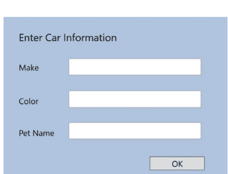

图 25-1　Canvas 布局管理器允许对内容进行绝对定位。

请注意，在 Canvas 内声明内容的顺序不会用于计算位置；相反，位置取决于控件的大小以及 Canvas.Top、Canvas.Bottom、Canvas.Left 和 Canvas.Right 属性。

> 注意 如果 Canvas 中的子元素未使用附加属性语法（如 Canvas.Left 和 Canvas.Top）指定具体位置，它们会自动附加到 Canvas 的左上角。

使用 Canvas 类型似乎是排列内容的首选方式（因为它感觉很熟悉），但这种方式确实存在一些局限性。首先，Canvas 中的项目在应用样式或模板时不会动态调整自身大小（例如，它们的字号不受影响）。其次，当最终用户将窗口调整得更小时，Canvas 不会尝试保持元素可见。

也许 Canvas 类型的最佳用途是定位图形内容。例如，如果要使用 XAML 构建自定义图像，你当然希望线条、形状和文本保持在相同位置，而不是在用户调整窗口大小时看到它们动态重定位！在第 26 章探讨 WPF 的图形渲染服务时，你将再次接触到 Canvas。

## 在 WrapPanel 面板中定位内容

WrapPanel 允许你定义在窗口调整大小时会在面板中流动的内容。在 WrapPanel 中定位元素时，无需像使用 Canvas 时那样指定上、下、左、右的停靠值。不过，每个子元素都可以自由定义 Height 和 Width 值（以及其他属性值），以控制其在容器中的整体大小。

由于 WrapPanel 中的内容不会停靠到面板的某一侧，因此声明元素的顺序非常重要（内容从第一个元素渲染到最后一个元素）。如果你加载 SimpleWrapPanel.xaml 文件中的 XAML 数据，你会发现它包含以下标记（包含在 Page 定义中）：

```xml
<WrapPanel Background="LightSteelBlue">
    <Label x:Name="lblInstruction" Width="328" Height="27" FontSize="15" Content="Enter Car Information"/>
    <Label x:Name="lblMake" Content="Make"/>
    <TextBox x:Name="txtMake" Width="193" Height="25"/>
    <Label x:Name="lblColor" Content="Color"/>
    <TextBox x:Name="txtColor" Width="193" Height="25"/>
    <Label x:Name="lblPetName" Content="Pet Name"/>
    <TextBox x:Name="txtPetName" Width="193" Height="25"/>
    <Button x:Name="btnOK" Width="80" Content="OK"/>
</WrapPanel>
```

当你加载这段标记时，内容看起来会有些杂乱，因为它会在窗口中从左到右流动（见图 25-2）。

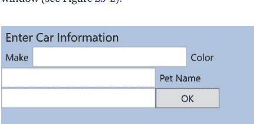

图 25-2　WrapPanel 中的内容行为非常类似于传统 HTML 页面

默认情况下，WrapPanel 中的内容从左到右流动。但是，如果将 Orientation 属性的值更改为 Vertical，则可以让内容从上到下换行。

```xml
<WrapPanel Background="LightSteelBlue" Orientation ="Vertical">
```

你可以通过指定 ItemWidth 和 ItemHeight 值来声明 WrapPanel（以及其他一些面板类型），这些值控制每个项的默认大小。如果子元素确实提供了自己的 Height 和/或 Width 值，它将相对于面板建立的大小进行定位。请看以下标记：

```xml
<Page
    xmlns="http://schemas.microsoft.com/winfx/2006/xaml/presentation"
    xmlns:x="http://schemas.microsoft.com/winfx/2006/xaml"
    Title="Fun with Panels!" Height="100" Width="650">
<WrapPanel Background="LightSteelBlue" Orientation ="Horizontal" ItemWidth ="200" ItemHeight ="30">
<Label x:Name="lblInstruction" FontSize="15" Content="Enter Car Information"/>
<Label x:Name="lblMake" Content="Make"/>
<TextBox x:Name="txtMake"/>
<Label x:Name="lblColor" Content="Color"/>
<TextBox x:Name="txtColor"/>
<Label x:Name="lblPetName" Content="Pet Name"/>
<TextBox x:Name="txtPetName"/>
<Button x:Name="btnOK" Width ="80" Content="OK"/>
</WrapPanel>
</Page>
```

渲染结果如图 25-3 所示（注意 Button 控件的大小和位置，它指定了唯一的 Width 值）。

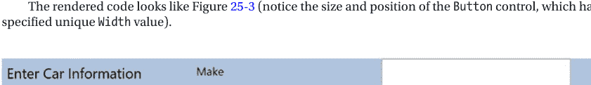

图 25-3　WrapPanel 可以设置给定项的宽度和高度

看完图 25-3 后，你可能会认同：WrapPanel 通常不是直接在窗口中排列内容的最佳选择，因为当用户调整窗口大小时，其元素可能会变得混乱。在大多数情况下，WrapPanel 将作为另一种面板类型的子元素，允许窗口的一小块区域在调整大小时换行其内容（例如 ToolBar 控件）。

## 在 StackPanel 面板中定位内容

与 WrapPanel 一样，StackPanel 控件会将内容排列成一行，该行可以基于 Orientation 属性赋值为水平或垂直（默认）。不同之处在于，StackPanel 不会在用户调整窗口大小时尝试换行内容。相反，StackPanel 中的项目只会（根据其方向）拉伸以适应 StackPanel 自身的大小。例如，SimpleStackPanel.xaml 文件包含以下标记，其输出结果如图 25-4 所示：

```xml
<Page
    xmlns="http://schemas.microsoft.com/winfx/2006/xaml/presentation"
    xmlns:x="http://schemas.microsoft.com/winfx/2006/xaml"
    Title="Fun with Panels!" Height="200" Width="400">
    <StackPanel Background="LightSteelBlue" Orientation ="Vertical">
        <Label Name="lblInstruction"
            FontSize="15" Content="Enter Car Information"/>
        <Label Name="lblMake" Content="Make"/>
        <TextBox Name="txtMake"/>
        <Label Name="lblColor" Content="Color"/>
        <TextBox Name="txtColor"/>
        <Label Name="lblPetName" Content="Pet Name"/>
        <TextBox Name="txtPetName"/>
        <Button Name="btnOK" Width ="80" Content="OK"/>
    </StackPanel>
</Page>
```

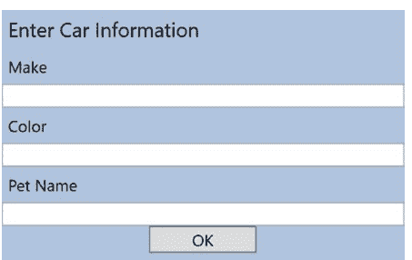

图 25-4　内容的垂直堆叠

如果将 Orientation 属性指定为如下所示的 Horizontal，渲染输出将与图 25-5 匹配：

```xml
<StackPanel Background="LightSteelBlue" Orientation="Horizontal">
```

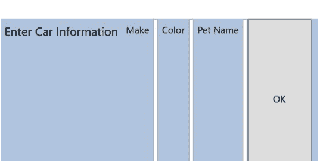

图 25-5　内容的水平堆叠

同样，与 WrapPanel 的情况一样，你很少会想使用 StackPanel 直接在窗口中排列内容。相反，你应该将 StackPanel 用作主面板的子面板。

## 在 Grid 面板中定位内容

在 WPF API 提供的所有面板中，Grid 毫无疑问是最灵活的。与 HTML 表格一样，Grid 可以被划分为一组单元格，每个单元格都可以提供内容。定义 Grid 时，需要执行以下三个步骤：

- 1. 定义并配置每一列。
- 2. 定义并配置每一行。
- 3. 使用附加属性语法将内容分配给网格的每个单元格。

> 注意 如果没有定义任何行或列，Grid 默认是一个填满整个窗口表面的单元格。此外，如果没有为 Grid 中的子元素分配单元格值（列和行），它会自动附着到第 0 列、第 0 行。

你可以通过使用 Grid.ColumnDefinitions 和 Grid.RowDefinitions 元素来完成前两个步骤（定义列和行），这两个元素分别包含 ColumnDefinition 和 RowDefinition 元素的集合。网格中的每个单元格都是真正的 .NET 对象，因此你可以根据需要配置每个单元格的外观、感觉和行为。

下面是一个 Grid 定义（可在 SimpleGrid.xaml 文件中找到），它将你的 UI 内容排列为图 25-6 所示的形式：

```xml
<Grid ShowGridLines ="True" Background ="LightSteelBlue">
    <!-- Define the rows/columns -->
    <Grid.ColumnDefinitions>
        <ColumnDefinition/>
        <ColumnDefinition/>
    </Grid.ColumnDefinitions>
    <Grid.RowDefinitions>
        <RowDefinition/>
        <RowDefinition/>
    </Grid.RowDefinitions>

    <!-- Now add the elements to the grid's cells -->
    <Label x:Name="lblInstruction" Grid.Column ="0" Grid.Row ="0"
        FontSize="15" Content="Enter Car Information"/>
    <Button x:Name="btnOK" Height ="30" Grid.Column ="0"
        Grid.Row ="0" Content="OK"/>
    <Label x:Name="lblMake" Grid.Column ="1"
        Grid.Row ="0" Content="Make"/>
    <TextBox x:Name="txtMake" Grid.Column ="1"
        Grid.Row ="0" Width="193" Height="25"/>
    <Label x:Name="lblColor" Grid.Column ="0"
        Grid.Row ="1" Content="Color"/>
    <TextBox x:Name="txtColor" Width="193" Height="25"
        Grid.Column ="0" Grid.Row ="1" />
```


```
<!-- 只是为了让界面更有趣，为宠物名称单元格添加一些颜色 -->
<Rectangle Fill ="LightGreen" Grid.Column ="1" Grid.Row ="1" />
<Label x:Name="lblPetName" Grid.Column ="1" Grid.Row ="1" Content="Pet Name"/>
<TextBox x:Name="txtPetName" Grid.Column ="1" Grid.Row ="1" Width="193" Height="25"/>
</Grid>
```

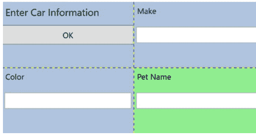

图 25-6。Grid 面板的实际效果

请注意，每个元素（包括为增强效果而添加的浅绿色 Rectangle 元素）都通过 Grid.Row 和 Grid.Column 附加属性，将自身连接到网格中的某个单元格。默认情况下，网格中单元格的排列从左上角开始，可以使用 Grid.Column="0" Grid.Row="0" 指定左上角单元格。由于网格总共定义了四个单元格，因此可以使用 Grid.Column="1" Grid.Row="1" 标识右下角单元格。

## 设置 Grid 列和行的大小

网格中的列和行可以通过以下三种方式之一设置大小。

- 绝对大小（例如 `100`）
- 自动调整大小
- 相对大小（例如 `3x`）

绝对大小正如其名称所示：列（或行）的大小被设置为特定数量的设备无关单位。自动调整大小会根据列或行中包含的控件来设置每一列或行的大小。相对大小与 CSS 中的百分比大小基本等价。相对大小的列或行会将所有数字的总和划分为可用空间总量。

在下面的示例中，第一行占用 25% 的空间，第二行占用 75% 的空间：

```
<Grid.ColumnDefinitions>
    <ColumnDefinition Width="1*" />
    <ColumnDefinition Width="3*" />
</Grid.ColumnDefinitions>
```

## 使用 GridSplitter 类型的网格

Grid 对象还支持分隔条。正如你可能了解的那样，分隔条允许最终用户调整网格类型中行或列的大小。调整过程中，每个可调整大小单元格中的内容会根据其中项目的布局方式重新调整形状。向 Grid 中添加分隔条非常简单；只需定义 GridSplitter 控件，并使用附加属性语法来确定它影响的行或列即可。

请注意，必须为分隔条分配 Width 或 Height 值（具体取决于执行垂直分割还是水平分割），它才能在屏幕上显示。下面是一个简单的 Grid 类型示例，其中第一列（Grid.Column = "0"）包含一个分隔条。GridWithSplitter.xaml 文件中的内容如下：

```
<Grid Background ="LightSteelBlue">
    <!-- 定义列 -->
    <Grid.ColumnDefinitions>
        <ColumnDefinition Width ="Auto"/>
        <ColumnDefinition/>
    </Grid.ColumnDefinitions>

    <!-- 将此标签添加到单元格 0 -->
    <Label x:Name="lblLeft" Background ="GreenYellow" Grid.Column="0" Content ="Left!"/>

    <!-- 定义分隔条 -->
    <GridSplitter Grid.Column ="0" Width ="5"/>

    <!-- 将此标签添加到单元格 1 -->
    <Label x:Name="lblRight" Grid.Column ="1" Content ="Right!"/>
</Grid>
```

首先请注意，支持分隔条的列，其 Width 属性为 Auto。接下来请注意，GridSplitter 使用附加属性语法来确定它操作的列。如果查看此输出，会发现一个五像素宽的分隔条，它允许你调整每个 Label 的大小。请注意，由于没有为任一 Label 指定 Height 或 Width 属性，因此内容会填满整个单元格（见图 25-7）。

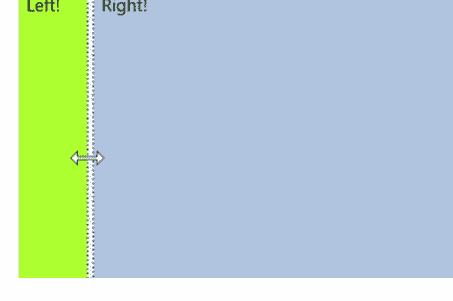

图 25-7。包含分隔条的 Grid 类型

## 在 DockPanel 面板中定位内容

DockPanel 通常用作容器，用于承载任意数量的其他面板，以便对相关内容进行分组。DockPanel 使用附加属性语法（与 Canvas 或 Grid 类型中的用法类似）来控制每个项目在 DockPanel 中的停靠位置。

SimpleDockPanel.xaml 文件定义了下面这个简单的 DockPanel，其结果如图 25-8 所示：

```
<DockPanel LastChildFill ="True" Background="AliceBlue">
    <!-- 将项目停靠到面板 -->
    <Label DockPanel.Dock ="Top" Name="lblInstruction" FontSize="15" Content="Enter Car Information"/>
    <Label DockPanel.Dock ="Left" Name="lblMake" Content="Make"/>
    <Label DockPanel.Dock ="Right" Name="lblColor" Content="Color"/>
    <Label DockPanel.Dock ="Bottom" Name="lblPetName" Content="Pet Name"/>
    <Button Name="btnOK" Content="OK"/>
</DockPanel>
```

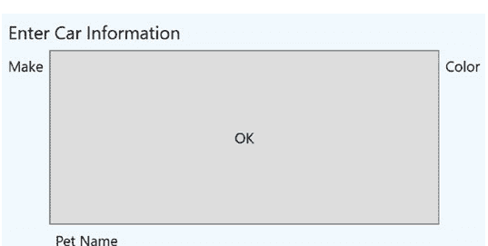

图 25-8。一个简单的 DockPanel

> 注意 如果向 DockPanel 的同一侧添加多个元素，它们会按照声明顺序沿指定边缘堆叠。

使用 DockPanel 类型的好处是，当用户调整窗口大小时，每个元素仍会通过 DockPanel.Dock 与面板的指定侧保持连接。此外还要注意，本示例中开头的 DockPanel 标签将 LastChildFill 属性设置为 true。由于 Button 控件确实是容器中的“最后一个子元素”，因此它会在剩余空间中拉伸显示。

## 为面板类型启用滚动

值得指出的是，WPF 提供了 ScrollViewer 类，它可以为面板对象中的数据提供自动滚动行为。SimpleScrollViewer.xaml 文件定义了以下内容：

```
<ScrollViewer>
    <StackPanel>
        <Button Content ="First" Background = "Green" Height ="50"/>
        <Button Content ="Second" Background = "Red" Height ="50"/>
```
```
<Button Content ="Third" Background = "Pink" Height ="50"/>
<Button Content ="Fourth" Background = "Yellow" Height ="50"/>
<Button Content ="Fifth" Background = "Blue" Height ="50"/>
</StackPanel>
</ScrollViewer>
```

你可以在图 25-9 中看到前面 XAML 定义的结果（注意右侧的滚动条，因为窗口大小不足以显示全部五个按钮）。

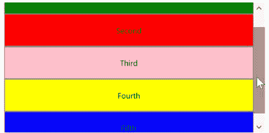

图 25-9。使用 ScrollViewer 类型

正如你所料，每个面板都提供了许多成员，可用于微调内容的放置方式。相关地，许多 WPF 控件支持两个值得关注的属性（Padding 和 Margin），允许控件自身向面板说明它希望以何种方式处理。具体来说，Padding 属性控制控件内部周围应保留多少额外空间，而 Margin 控制控件外部周围的额外空间。

至此，本章对 WPF 主要面板类型及其定位内容的各种方式的介绍就结束了。接下来，你将学习如何使用 Visual Studio 设计器来创建布局。

## 使用 Visual Studio 设计器配置面板

现在，你已经了解了用于定义一些常见布局管理器的 XAML，相信你会很高兴地知道，Visual Studio 为构建布局提供了非常完善的设计时支持。实现这一点的关键在于本章前面介绍过的“文档大纲”窗口。为了演示一些基本操作，请创建一个名为 VisualLayoutTester 的新 WPF 应用程序项目。

请注意，初始 Window 默认使用 Grid 布局，如下所示：

```
<Window x:Class="VisualLayoutTester.MainWindow"
xmlns="http://schemas.microsoft.com/winfx/2006/xaml/presentation"
xmlns:x="http://schemas.microsoft.com/winfx/2006/xaml"
xmlns:d="http://schemas.microsoft.com/expression/blend/2008"
xmlns:local="clr-namespace:VisualLayoutTesterApp"
mc:Ignorable="d"
Title="MainWindow" Height="450" Width="800">
<Grid>
</Grid>
</Window>
```

如果你习惯使用 Grid 布局系统，请注意，如图 25-10 所示，你可以使用可视化布局轻松划分和调整网格单元格的大小。具体来说，先在“文档大纲”窗口中选择 Grid 组件，然后单击网格边框即可创建新的行和列。

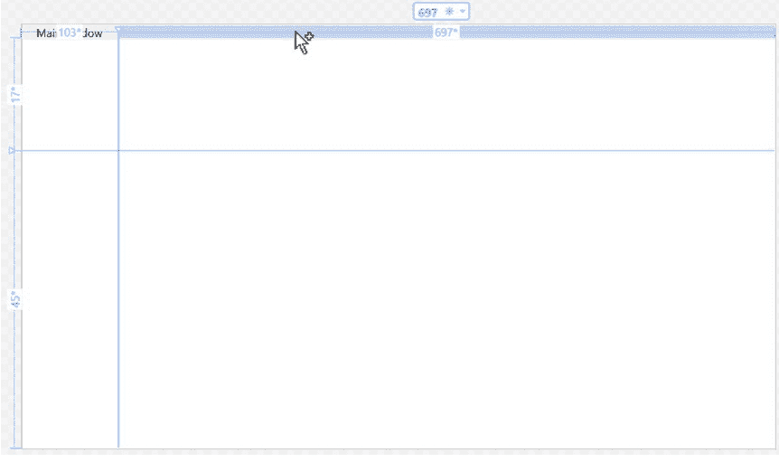

图 25-10。可以使用 IDE 的设计器将 Grid 控件可视化切分为多个单元格

现在，假设你已经定义了一个包含若干单元格的网格。接下来，可以将控件拖放到布局系统的指定单元格中，IDE 会自动设置相关控件的 Grid.Row 和 Grid.Column 属性。下面是将 Button 拖入预定义单元格后，IDE 可能生成的一段标记：

```
<Button x:Name="button" Content="Button" Grid.Column="1" HorizontalAlignment="Left" Margin="21,21,4,0,0" Grid.Row="1" VerticalAlignment="Top" Width="75"/>
```

现在，假设你不想使用 Grid。如果在“文档大纲”窗口中右键单击任意布局节点，就会发现一个允许你将当前容器更改为其他容器的菜单选项（见图 25-11）。请注意，这样做时，控件的位置很可能会发生彻底改变，因为控件将遵循新面板类型的布局规则。


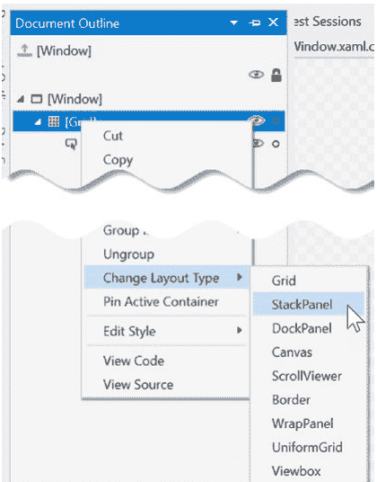

# 图25-11. 文档大纲窗口允许你转换为新的面板类型

另一个实用的技巧是，可以在可视化设计器上选择一组控件，并将它们分组到新的嵌套布局管理器中。假设你有一个包含一组随机对象的Grid。现在，在按住Ctrl键的同时用鼠标左键逐个点击设计器上的项，即可选择一组项。如果随后右键单击所选内容，则可以将所选项目分组到新的子面板中（参见图25-12）。

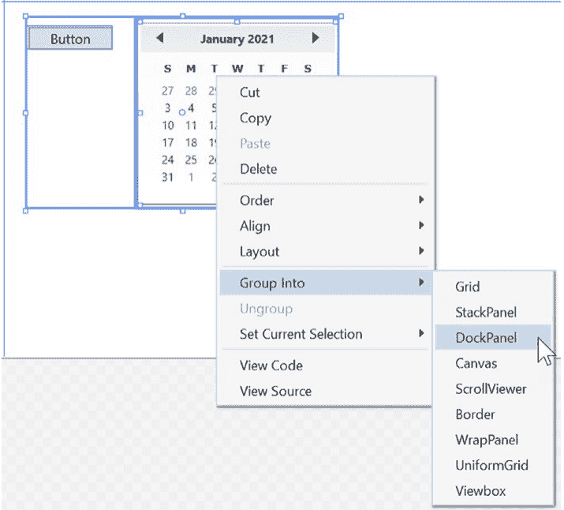

图25-12. 将项目分组到新的子面板中

完成此操作后，再次检查文档大纲窗口以验证嵌套布局系统。在构建功能完备的WPF窗口时，你很可能始终需要使用嵌套布局系统，而不是简单地为所有UI显示选择一个面板（实际上，本文后续的WPF示例通常都会这样做）。最后一点，文档大纲窗口中的所有节点都是可拖放的。例如，如果要将当前位于DockPanel中的控件移动到父面板中，可以按照图25-13所示进行操作。

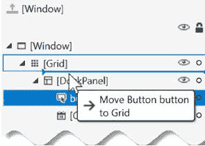

图25-13. 通过文档大纲窗口重新定位项目

在你阅读后续WPF章节时，我会尽可能指出更多的布局快捷方式。然而，花时间亲自实验和测试各种功能绝对是值得的。为了让你在正确的方向上继续前进，本章的下一个示例将说明如何为自定义文本处理应用程序（支持拼写检查！）构建嵌套布局管理器。

## 使用嵌套面板构建窗口框架

如前所述，典型的WPF窗口不会使用单个面板控件，而是会嵌套其他面板中的面板，以获得所需的布局系统。首先创建一个名为MyWordPad的新WPF应用程序。

你的目标是构建一个布局，使主窗口具有最顶层的菜单系统、菜单系统下方的工具栏以及位于窗口底部的状态栏。状态栏将包含一个窗格，用于保存用户选择菜单项（或工具栏按钮）时显示的文本提示，而菜单系统和工具栏将提供UI触发器，以关闭应用程序并在Expander小部件中显示拼写建议。图25-14显示了你想要实现的初始布局；它还展示了WPF中的拼写检查功能。

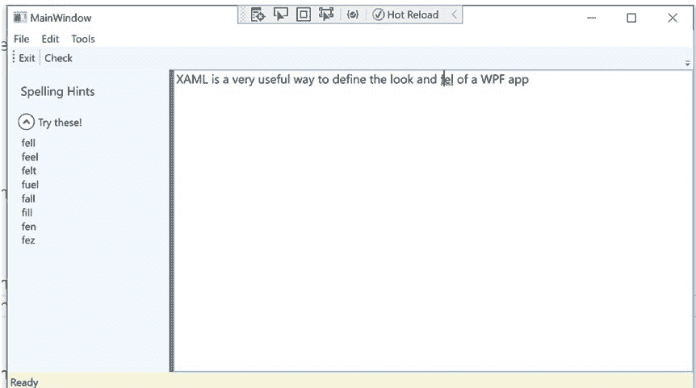

图25-14. 使用嵌套面板建立窗口的UI

要开始构建此UI，请更新Window类型的初始XAML定义，使其使用DockPanel子元素而不是默认的Grid，如下所示：

```
<Window x:Class="MyWordPad.MainWindow"
    xmlns="http://schemas.microsoft.com/winfx/2006/xaml/presentation"
    xmlns:x="http://schemas.microsoft.com/winfx/2006/xaml"
    xmlns:d="http://schemas.microsoft.com/expression/blend/2008"
```

## 构建菜单系统

WPF中的菜单系统由Menu类表示，该类维护一组MenuItem对象。在XAML中构建菜单系统时，可以让每个MenuItem处理各种事件。这些事件中最值得注意的是Click，当最终用户选择子项时会发生。在此示例中，你首先构建两个顶层菜单项（File和Tools；稍后将在本示例中构建Edit菜单），它们分别公开Exit和Spelling Hints子项。

除了处理每个子项的Click事件外，还需要处理MouseEnter和MouseExit事件，稍后你将使用这些事件来设置状态栏文本。在DockPanel作用域内添加以下标记：

```
<!-- Dock menu system on the top -->
<Menu DockPanel.Dock ="Top"
    HorizontalAlignment="Left" Background="White" BorderBrush ="Black">
    <MenuItem Header="_File">
        <Separator/>
        <MenuItem Header ="_Exit" MouseEnter ="MouseEnterExitArea"
            MouseLeave ="MouseLeaveArea" Click ="FileExit_Click"/>
    </MenuItem>
    <MenuItem Header="_Tools">
        <MenuItem Header ="_Spelling Hints"
            MouseEnter ="MouseEnterToolsHintsArea"
            MouseLeave ="MouseLeaveArea" Click ="ToolsSpellingHints_Click"/>
    </MenuItem>
</Menu>
```

请注意，你将菜单系统停靠在DockPanel的顶部。此外，你使用Separator元素在菜单系统中直接位于Exit选项之前插入一条细水平线。另请注意，每个MenuItem的Header值包含一个嵌入的下划线标记（例如_Exit）。你可以使用此标记来确定最终用户按下Alt键时要为哪个字母添加下划线（用于键盘快捷方式）。这与Windows Forms中使用的&字符不同，因为XAML基于XML，&字符在XML中有特殊含义。

到目前为止，你已经实现了完整的菜单系统定义；接下来，你需要实现各种事件处理程序。首先，你有File Exit处理程序FileExit_Click()，它仅关闭窗口，而由于这是你的顶层窗口，关闭窗口将终止应用程序。每个子项的MouseEnter和MouseExit事件处理程序最终将更新状态栏；不过，目前只需提供空壳。最后，Tools Spelling Hints菜单项的ToolsSpellingHints_Click()处理程序暂时也将保持为空壳。以下是你对代码隐藏文件的最新更新（包括更新后的using语句）：

```
using System.IO;
using System.Windows;
using System.Windows.Controls;
```

```
using System.Windows.Input;
using Microsoft.Win32;
public partial class MainWindow : Window
{
    public MainWindow()
    {
        InitializeComponent();
    }

    protected void FileExit_Click(object sender, RoutedEventArgs args)
    {
        // Close this window.
        this.Close();
    }

    protected void ToolsSpellingHints_Click(object sender, RoutedEventArgs args)
    {
    }
    protected void MouseEnterExitArea(object sender, RoutedEventArgs args)
    {
    }
    protected void MouseEnterToolsHintsArea(object sender, RoutedEventArgs args)
    {
    }
    protected void MouseLeaveArea(object sender, RoutedEventArgs args)
    {
    }
}
```

## 可视化构建菜单

虽然了解如何在XAML中手动定义项目总是好的，但这样做可能有点繁琐。Visual Studio支持菜单系统、工具栏、状态栏和许多其他UI控件的可视化设计。如果你右键单击Menu控件，会注意到一个Add MenuItem选项。顾名思义，这会将新的菜单项添加到Menu控件中。添加一组顶层项后，可以通过再次右键单击来添加子菜单项和分隔符、展开或折叠菜单本身，以及执行其他与菜单相关的操作。

在当前的MyWordPad示例的其余部分中，我通常会向你展示最终生成的XAML；但是，请花时间尝试使用可视化设计器来简化手头的任务。

## 构建工具栏

工具栏（由WPF中的ToolBar类表示）通常提供一种替代方式来激活菜单选项。直接在Menu定义的结束作用域之后添加以下标记：

```
<!-- Put Toolbar under the Menu -->
<ToolBar DockPanel.Dock ="Top" >
    <Button Content ="Exit" MouseEnter ="MouseEnterExitArea"
            MouseLeave ="MouseLeaveArea" Click ="FileExit_Click"/>

```

```
<Separator/>
<Button Content ="Check" MouseEnter ="MouseEnterToolsHintsArea"
    MouseLeave ="MouseLeaveArea" Click ="ToolsSpellingHints_Click"
    Cursor="Help" />
</ToolBar>
```

你的ToolBar控件由两个Button控件组成，它们恰好处理相同的事件，并由代码文件中的相同方法处理。使用此技术，可以将处理程序加倍，同时服务于菜单项和工具栏按钮。尽管此工具栏使用典型的按钮，但你应该明白，ToolBar类型“是一个”（is-a）ContentControl；因此，你可以自由地在其中嵌入任何类型（例如下拉列表、图像和图形）。这里唯一需要注意的另一点是，Check按钮通过Cursor属性支持自定义鼠标光标。

> 注意：你可以选择将ToolBar元素包装在ToolBarTray元素中，该元素控制一组ToolBar对象的布局、停靠和拖放操作。

## 构建状态栏

StatusBar控件将停靠在DockPanel的下部，并包含一个TextBlock控件，到目前为止你在本章中还未使用过该控件。你可以使用TextBlock来保存支持多种文本批注的文本，例如粗体文本、下划线文本、换行等。直接在前面的ToolBar定义之后添加以下标记：

```
<!-- Put a StatusBar at the bottom -->
<StatusBar DockPanel.Dock ="Bottom" Background="Beige" >
    <StatusBarItem>
        <TextBlock Name="statBarText" Text="Ready"/>
    </StatusBarItem>
</StatusBar>
```

## 完成UI设计

UI设计的最后一方面是定义一个可拆分的Grid，该Grid定义两列。在左侧，放置一个Expander控件，该控件将显示拼写建议列表，并包装在StackPanel中。在右侧，放置一个支持多行和滚动条并启用拼写检查的TextBox控件。将整个Grid挂载到父DockPanel的左侧。直接在StatusBar标记下方添加以下XAML标记，以完成窗口UI的定义：

```
<Grid DockPanel.Dock ="Left" Background ="AliceBlue">
    <!-- Define the rows and columns -->
    <Grid.ColumnDefinitions>
        <ColumnDefinition />
        <ColumnDefinition />
    </Grid.ColumnDefinitions>
```


<GridSplitter Grid.Column="0" Width="5" Background="Gray" />
<StackPanel Grid.Column="0" VerticalAlignment="Stretch">
    <Label Name="lblSpellingInstructions" FontSize="14" Margin="10,10,0,0">
        拼写提示
    </Label>

    <Expander Name="expanderSpelling" Header="试试这些！"
        Margin="10,10,10,10">
        <!-- This will be filled programmatically -->
        <Label Name="lblSpellingHints" FontSize="12" />
    </Expander>
</StackPanel>

<!-- This will be the area to type within -->
<TextBox Grid.Column="1"
    SpellCheck.IsEnabled="True"
    AcceptsReturn="True"
    Name="txtData" FontSize="14"
    BorderBrush="Blue"
    VerticalScrollBarVisibility="Auto"
    HorizontalScrollBarVisibility="Auto">
</TextBox>
</Grid>
```

## 实现 MouseEnter/MouseLeave 事件处理程序

此时，窗口的 UI 已经完成。剩下的唯一任务是为其余的事件处理程序提供实现。首先更新 C# 代码文件，使 MouseEnter、MouseLeave 和 MouseExit 处理程序都能在状态栏的文本区域显示恰当的消息，以帮助最终用户，如下所示：

```
public partial class MainWindow : System.Windows.Window
{
    ...
    protected void MouseEnterExitArea(object sender, RoutedEventArgs args)
    {
        statBarText.Text = "Exit the Application";
    }
    protected void MouseEnterToolsHintsArea(object sender, RoutedEventArgs args)
    {
        statBarText.Text = "Show Spelling Suggestions";
    }
    protected void MouseLeaveArea(object sender, RoutedEventArgs args)
    {
        statBarText.Text = "Ready";
    }
}
```

此时，你可以运行应用程序。当鼠标悬停在菜单项或工具栏按钮上时，你应该能看到状态栏文字随之变化。

## 实现拼写检查逻辑

WPF API 内置了拼写检查器支持，且不依赖于 Microsoft Office 产品。这意味着你无需通过 COM 互操作层使用 Microsoft Word 的拼写检查器；只需几行代码，就能轻松添加同类支持。

你可能还记得，在定义 TextBox 控件时，你将 SpellCheck.IsEnabled 属性设为了 true。启用此属性后，拼写错误的单词会像在 Microsoft Office 中一样显示红色波浪线。更棒的是，底层编程模型允许你访问拼写检查引擎，从而获取拼写错误单词的建议列表。将以下代码添加到 ToolsSpellingHints_Click() 方法中：

```
protected void ToolsSpellingHints_Click(object sender, RoutedEventArgs args)
{
    string spellingHints = string.Empty;

    // Try to get a spelling error at the current caret location.
    SpellingError error = txtData.GetSpellingError(txtData.CaretIndex);
    if (error != null)
    {
        // Build a string of spelling suggestions.
        foreach (string s in error.Suggestions)
        {
            spellingHints += $"{s}\n";
        }

        // Show suggestions and expand the expander.
        lblSpellingHints.Content = spellingHints;
        expanderSpelling.IsExpanded = true;
    }
}
```

前面的代码很简单。你只需使用 CaretIndex 属性获取文本框中插入符的当前位置，并据此提取 SpellingError 对象。如果该位置存在错误（也就是说，该值不为 null），就可以使用名称恰如其分的 Suggestions 属性遍历建议列表。获取拼写错误单词的所有建议后，将这些数据赋给 Expander 中的 Label。

至此，你已经初步实现了一个可运行的文字处理程序，只用了几行过程式代码（以及大量 XAML）。了解控件命令还能让你的应用程序更上一层楼。

## 理解 WPF 命令

WPF 通过命令体系结构支持一种可被视为与控件无关的事件。典型的 .NET Core 事件定义在特定基类中，且只能由该类或其派生类使用。因此，普通的 .NET Core 事件与其定义所在的类紧密耦合。

相比之下，WPF 命令是类似事件的实体，不依赖于特定控件，而且在很多情况下，可以成功应用于多种（看似毫不相关的）控件类型。例如，WPF 支持复制、粘贴和剪切命令，这些命令可以应用于各种 UI 元素（如菜单项、工具栏按钮和自定义按钮），也可以用于键盘快捷键（如 Ctrl+C 和 Ctrl+V）。

其他 UI 工具包（如 Windows Forms）虽然提供了用于此类用途的标准事件，但使用这些事件通常会产生冗余且难以维护的代码。在 WPF 模型中，你可以改用命令，最终通常可以得到规模更小、灵活性更高的代码库。

## 内置命令对象

WPF 内置了许多控件命令，所有这些命令都可以配置相应的键盘快捷键（或其他输入手势）。从编程角度来看，WPF 命令是任何支持某个属性（通常名为 Command）的对象；该属性返回一个实现了 ICommand 接口的对象，如下所示：

```
public interface ICommand
{
    // Occurs when changes occur that affect whether
    // or not the command should execute.
    event EventHandler CanExecuteChanged;

    // Defines the method that determines whether the command
    // can execute in its current state.
    bool CanExecute(object parameter);

    // Defines the method to be called when the command is invoked.
    void Execute(object parameter);
}
```

WPF 提供了多种命令类，开箱即用地公开了近 100 个命令对象。这些类定义了许多属性，用于公开各个命令对象，而每个对象都实现了 ICommand。表 25-3 列出了一些可用的标准命令对象。

### 表 25-3. 内置的 WPF 控件命令对象

| WPF 类 | 命令对象 | 用途 |
|---|---|---|
| ApplicationCommands | Close、Copy、Cut、Delete、Find、Open、Paste、Save、SaveAs、Redo、Undo | 各种应用程序级命令 |
| ComponentCommands | MoveDown、MoveFocusBack、MoveLeft、MoveRight、ScrollToEnd、ScrollToHome | UI 组件常用的各种命令 |
| MediaCommands | BoostBase、ChannelUp、ChannelDown、FastForward、NextTrack、Play、Rewind、Select、Stop | 各种媒体相关命令 |
| NavigationCommands | BrowseBack、BrowseForward、Favorites、LastPage、NextPage、Zoom | 各种与 WPF 导航模型相关的命令 |
| EditingCommands | AlignCenter、CorrectSpellingError、DecreaseFontSize、EnterLineBreak、EnterParagraphBreak、MoveDownByLine、MoveRightByWord | 各种与 WPF Documents API 相关的命令 |

## 将命令连接到 Command 属性

如果要将任何 WPF 命令属性连接到支持 Command 属性的 UI 元素（如 Button 或 MenuItem），需要做的工作很少。下面通过更新当前菜单系统来演示如何实现：添加一个名为 Edit 的顶级菜单项，以及三个用于复制、粘贴和剪切文本数据的子项，如下所示：

```
<Menu DockPanel.Dock="Top" HorizontalAlignment="Left" Background="White" BorderBrush="Black">
    <MenuItem Header="_File" Click="FileExit_Click">
        <MenuItem Header="_Exit" MouseEnter="MouseEnterExitArea" MouseLeave="MouseLeaveArea" Click="FileExit_Click"/>
    </MenuItem>
    <!-- New menu item with commands! -->
    <MenuItem Header="_Edit">
        <MenuItem Command="ApplicationCommands.Copy"/>
        <MenuItem Command="ApplicationCommands.Cut"/>
        <MenuItem Command="ApplicationCommands.Paste"/>
    </MenuItem>
    <MenuItem Header="_Tools">
        <MenuItem Header="_Spelling Hints" MouseEnter="MouseEnterToolsHintsArea" MouseLeave="MouseLeaveArea" Click="ToolsSpellingHints_Click"/>
    </MenuItem>
</Menu>
```

注意，Edit 菜单中的每个子项都为 Command 属性指定了一个值。这样做后，菜单项会自动获得正确的名称和快捷键（例如，剪切操作对应 Ctrl+C）；同时，应用程序无需任何过程式代码就能支持复制、剪切和粘贴！

运行应用程序并选中一些文本后，就可以直接使用新添加的菜单项了。此外，应用程序还能够响应标准的右键单击操作，并向用户显示相同的选项。

## 将命令连接到任意操作

如果要将命令对象连接到任意（特定于应用程序的）事件，就需要使用过程式代码。实现起来并不复杂，但所需逻辑比 XAML 中的示例稍多一些。例如，假设你希望整个窗口都能响应 F1 键，让最终用户按下该键时启动关联的帮助系统。另外，假设主窗口的代码文件定义了一个名为 SetF1CommandBinding() 的新方法，并在调用 InitializeComponent() 后于构造函数中调用该方法。

```
public MainWindow()
{
    InitializeComponent();
    SetF1CommandBinding();
}
```


这个新方法将以编程方式创建一个新的 CommandBinding 对象，你可以在应用程序中需要将命令对象绑定到给定事件处理程序时使用它。在这里，你将 CommandBinding 对象配置为与 ApplicationCommands.Help 命令一起操作，该命令会自动感知 F1：

```csharp
private void SetF1CommandBinding()
{
    CommandBinding helpBinding = new CommandBinding(ApplicationCommands.Help);
    helpBinding.CanExecute += CanHelpExecute;
    helpBinding.Executed += HelpExecuted;
    CommandBindings.Add(helpBinding);
}
```

大多数 CommandBinding 对象都希望处理 CanExecute 事件（它允许你根据程序的运行情况指定命令是否发生）和 Executed 事件（你可以在其中编写命令发生时应执行的内容）。将以下事件处理程序添加到你的 Window 派生类型中（请注意每个方法的格式，因为这是相关委托所要求的）：

```csharp
private void CanHelpExecute(object sender, CanExecuteRoutedEventArgs e)
{
    // 在这里，如果你想阻止命令执行，可以将 CanExecute 设置为 false。
    e.CanExecute = true;
}
```

```csharp
private void HelpExecuted(object sender, ExecutedRoutedEventArgs e)
{
    MessageBox.Show("Look, it is not that difficult. Just type something!", "Help!");
}
```

在前面的代码片段中，你实现了 CanHelpExecute() 使其始终允许 F1 帮助启动；你只需简单地返回 true 即可实现这一点。然而，如果你有某些情况不希望帮助系统显示，你可以对此进行处理，并在必要时返回 false。HelpExecuted() 中显示的“帮助系统”不过是一个消息框而已。此时，你可以运行你的应用程序。当你在键盘上按下 F1 键时，你会看到消息框出现。

## 使用 Open 和 Save 命令

为了完成当前示例，你将添加功能以将文本数据保存到外部文件并打开 *.txt 文件进行编辑。如果你想走长路，你可以手动添加编程逻辑，根据 TextBox 中是否有数据来启用或禁用新的菜单项。同样，你也可以使用命令来减轻负担。

首先通过添加以下两个使用 Save 和 Open ApplicationCommands 对象的新的子菜单来更新代表顶层 File 菜单的 MenuItem 元素：

```xml
<MenuItem Header="_File">
    <MenuItem Command="ApplicationCommands.Open"/>
    <MenuItem Command="ApplicationCommands.Save"/>
    <Separator/>
    <MenuItem Header="_Exit"
              MouseEnter="MouseEnterExitArea"
              MouseLeave="MouseLeaveArea"
              Click="FileExit_Click"/>
</MenuItem>
```

再次记住，所有命令对象都实现了 ICommand 接口，该接口定义了两个事件（CanExecute 和 Executed）。现在你需要使整个窗口能够检查当前是否可以触发这些命令；如果是，你可以定义事件处理程序来执行自定义代码。

你通过填充窗口维护的 CommandBindings 集合来实现这一点。在 XAML 中执行此操作需要你使用属性元素语法来定义 Window.CommandBindings 范围，在其中放置两个 CommandBinding 定义。像这样更新你的 Window：

```xml
<Window x:Class="MyWordPad.MainWindow"
        xmlns="http://schemas.microsoft.com/winfx/2006/xaml/presentation"
        xmlns:x="http://schemas.microsoft.com/winfx/2006/xaml"
        Title="MySpellChecker"
        Height="331"
        Width="508"
        WindowStartupLocation="CenterScreen">

    <!-- This will inform the Window which handlers to call,
         when testing for the Open and Save commands. -->
    <Window.CommandBindings>
        <CommandBinding Command="ApplicationCommands.Open"
                        Executed="OpenCmdExecuted"
                        CanExecute="OpenCmdCanExecute"/>
        <CommandBinding Command="ApplicationCommands.Save"
                        Executed="SaveCmdExecuted"
                        CanExecute="SaveCmdCanExecute"/>
    </Window.CommandBindings>

    <!-- This panel establishes the content for the window -->
    <DockPanel>
        ...
    </DockPanel>
</Window>
```

现在右键单击 XAML 编辑器中 Executed 和 CanExecute 属性中的每一个，然后选择 Navigate to Event Handler 菜单选项。正如你在第 24 章中回忆的那样，这将自动为事件本身生成存根代码。此时，你应该在窗口的 C# 代码文件中拥有四个空的处理程序。

CanExecute 事件处理程序的实现将告诉窗口在任何时候都可以触发相应的 Executed 事件，只要将传入的 CanExecuteRoutedEventArgs 对象的 CanExecute 属性设置为 true 即可。

```csharp
private void OpenCmdCanExecute(object sender, CanExecuteRoutedEventArgs e)
{
    e.CanExecute = true;
}
```

```csharp
private void SaveCmdCanExecute(object sender, CanExecuteRoutedEventArgs e)
{
    e.CanExecute = true;
}
```

相应的 Executed 处理程序执行实际工作，显示打开和保存对话框；它们还将 TextBox 中的数据发送到文件。首先确保你在代码文件中导入 System.IO 和 Microsoft.Win32 命名空间。以下完成的代码很简单：

```csharp
private void OpenCmdExecuted(object sender, ExecutedRoutedEventArgs e)
{
    // Create an open file dialog box and only show XAML files.
    var openDlg = new OpenFileDialog { Filter = "Text Files |*.txt" };

    // Did they click on the OK button?
    if (true == openDlg.ShowDialog())
    {
        // Load all text of selected file.
        string dataFromFile = File.ReadAllText(openDlg.FileName);

        // Show string in TextBox.
        txtData.Text = dataFromFile;
    }
}

private void SaveCmdExecuted(object sender, ExecutedRoutedEventArgs e)
{
    var saveDlg = new SaveFileDialog { Filter = "Text Files |*.txt" };

    // Did they click on the OK button?
    if (true == saveDlg.ShowDialog())
    {
        // Save data in the TextBox to the named file.
        File.WriteAllText(saveDlg.FileName, txtData.Text);
    }
}
```

> **注意：** 第 28 章将更深入地探讨 WPF 命令系统。在其中，你将创建基于 ICommand 的自定义命令以及 RelayCommands。

这就结束了本示例以及你对使用 WPF 控件的初步了解。在这里，你学习了如何使用基本命令、菜单系统、状态栏、工具栏、嵌套面板以及一些基本的 UI 控件，如 TextBox 和 Expander。下一个示例将使用一些更奇特的控件，同时检查几个重要的 WPF 服务。

## 理解路由事件

你可能已经注意到前面的代码示例中使用了 RoutedEventArgs 参数而不是 EventArgs。路由事件模型是对标准 CLR 事件模型的一种改进，旨在确保事件能够以适合 XAML 描述的对象树的方式进行处理。假设你有一个名为 WpfRoutedEvents 的新 WPF 应用程序项目。现在，通过添加以下定义了复杂内容的 Button 控件来更新初始窗口的 XAML 描述：

```xml
<Window ...
    <Grid>
        <Button Name="btnClickMe"
                Height="75"
                Width="250"
                Click="btnClickMe_Clicked">
            <StackPanel Orientation="Horizontal">
                <Label Height="50" FontSize="20">
                    Fancy Button!</Label>
                <Canvas Height="50" Width="100">
                    <Ellipse Name="outerEllipse"
                             Fill="Green"
                             Height="25"
                             Width="50"
                             Cursor="Hand"
                             Canvas.Left="25"
                             Canvas.Top="12"/>
                    <Ellipse Name="innerEllipse"
                             Fill="Yellow"
                             Height="15"
                             Width="36"
                             Canvas.Top="17"
                             Canvas.Left="32"/>
                </Canvas>
            </StackPanel>
        </Button>
    </Grid>
</Window>
```

请注意在 Button 的开始定义中，你已通过指定在事件引发时调用的方法的名称来处理 Click 事件。Click 事件使用 RoutedEventHandler 委托，该委托期望一个事件处理程序，其第一个参数为 object，第二个参数为 System.Windows.RoutedEventArgs。按如下方式实现此处理程序：

```csharp
public void btnClickMe_Clicked(object sender, RoutedEventArgs e)
{
    // Do something when button is clicked.
    MessageBox.Show("Clicked the button");
}
```

如果你运行应用程序，你将看到此消息框显示，无论你点击按钮内容的哪一部分（绿色 Ellipse、黄色 Ellipse、Label 或 Button 的表面）。这是一件好事。想象一下，如果你被迫为 Button 的每一个子元素处理 Click 事件，WPF 事件处理会是多么繁琐。不仅为 Button 的每个方面创建单独的事件处理程序会很费力，你最终还会得到一些将来难以维护的代码。

幸运的是，WPF 路由事件确保你的单个 Click 事件处理程序无论点击按钮的哪一部分都会被自动调用。简单来说，路由事件模型会自动将事件沿对象树向上（或向下）传播，寻找合适的处理程序。

具体来说，路由事件可以使用三种路由策略。如果事件从起源点向上移动到对象树中的其他定义范围，则该事件被称为冒泡事件。相反，如果事件从最外层元素（例如 Window）向下移动到起源点，则该事件被称为隧道事件。最后，如果事件仅由起源元素引发并处理（这可以描述为正常的 CLR 事件），则它被称为直接事件。


## 路由冒泡事件的作用

在当前示例中，如果用户单击内部的黄色椭圆，Click 事件会冒泡到下一个作用域（Canvas），然后冒泡到 StackPanel，最后到达处理 Click 事件处理程序的 Button。类似地，如果用户单击 Label，事件会冒泡到 StackPanel，最后到达 Button 元素。

有了这种路由冒泡事件模式，你无需为复合控件的所有成员注册特定的 Click 事件处理程序。不过，如果你希望对同一对象树中的多个元素执行自定义单击逻辑，也可以做到这一点。

举例来说，假设你需要以独特的方式处理 outerEllipse 控件的单击操作。首先，为这个子元素处理 MouseDown 事件（Ellipse 等图形呈现类型不支持 Click 事件；不过，它们可以通过 MouseDown、MouseUp 等事件监控鼠标按钮活动）。

```xml
<Button Name="btnClickMe" Height="75" Width="250"
    Click="btnClickMe_Clicked">
    <StackPanel Orientation="Horizontal">
        <Label Height="50" FontSize="20">Fancy Button!</Label>
        <Canvas Height="50" Width="100">
            <Ellipse Name="outerEllipse" Fill="Green"
                Height="25" MouseDown="outerEllipse_MouseDown"
                Width="50" Cursor="Hand" Canvas.Left="25" Canvas.Top="12"/>
            <Ellipse Name="innerEllipse" Fill="Yellow" Height="15" Width="36"
                Canvas.Top="17" Canvas.Left="32"/>
        </Canvas>
    </StackPanel>
</Button>
```

然后实现适当的事件处理程序。在本示例中，该处理程序只会更改主窗口的 Title 属性，如下所示：

```csharp
public void outerEllipse_MouseDown(object sender, MouseButtonEventArgs e)
{
    // Change title of window.
    this.Title = "You clicked the outer ellipse!";
}
```

这样，你就可以根据最终用户单击的位置采取不同的操作（归根结底，就是区分外部椭圆与按钮作用域内的其他位置）。

> **注意：**路由冒泡事件始终会从起始点移动到下一个定义作用域。因此，在本示例中，如果你单击 innerEllipse 对象，事件会冒泡到 Canvas，而不是 outerEllipse，因为它们都是 Canvas 作用域内的 Ellipse 类型。

## 继续或停止冒泡

目前，如果用户单击 outerEllipse 对象，它会触发为此 Ellipse 对象注册的 MouseDown 事件处理程序，此时事件会继续冒泡到 Button 的 Click 事件。如果你希望通知 WPF 停止沿对象树向上冒泡，可以将 EventArgs 参数的 Handled 属性设置为 true，如下所示：

```csharp
public void outerEllipse_MouseDown(object sender, MouseButtonEventArgs e)
{
    // Change title of window.
    this.Title = "You clicked the outer ellipse!";
    // Stop bubbling!
    e.Handled = true;
}
```

在这种情况下，你会发现窗口标题发生了更改，但不会看到 Button 的 Click 事件处理程序显示的 MessageBox。简而言之，路由冒泡事件使一组复杂的内容既可以作为单个逻辑元素（例如 Button）运行，也可以作为离散项（例如 Button 内的 Ellipse）运行。

## 路由隧道事件的作用

严格来说，路由事件可以是冒泡事件（如前所述），也可以是隧道事件。隧道事件（名称都以 `Preview` 后缀开头，例如 `PreviewMouseDown`）会从最顶层元素向对象树的内部作用域逐层深入。总的来说，WPF 基类库中的每个冒泡事件都对应一个相关的隧道事件，并且隧道事件会在对应的冒泡事件之前触发。例如，在冒泡 MouseDown 事件触发之前，会先触发隧道 PreviewMouseDown 事件。

处理隧道事件的方式与处理其他事件完全相同：只需在 XAML 中指定事件处理程序名称（或者在需要时，在代码文件中使用相应的 C# 事件处理语法），然后在代码文件中实现该处理程序。为了说明隧道事件和冒泡事件之间的交互，首先为 outerEllipse 对象处理 PreviewMouseDown 事件，如下所示：

```xml
<Ellipse Name="outerEllipse" Fill="Green" Height="25"
    MouseDown="outerEllipse_MouseDown"
    PreviewMouseDown="outerEllipse_PreviewMouseDown"
    Width="50" Cursor="Hand" Canvas.Left="25" Canvas.Top="12"/>
```

接下来，修改当前的 C# 类定义，更新每个事件处理程序（适用于所有对象），使用传入的事件参数对象，将当前事件的信息追加到名为 `_mouseActivity` 的字符串成员变量中。这样，你就可以观察后台触发事件的流程。

```csharp
public partial class MainWindow : Window
{
    string _mouseActivity = string.Empty;

    public MainWindow()
    {
        InitializeComponent();
    }
}
```

```csharp
public void btnClickMe_Clicked(object sender, RoutedEventArgs e)
{
    AddEventInfo(sender, e);
    MessageBox.Show(_mouseActivity, "Your Event Info");
    // Clear string for next round.
    _mouseActivity = "";
}

private void AddEventInfo(object sender, RoutedEventArgs e)
{
    _mouseActivity += string.Format(
        "{0} sent a {1} event named {2}.\n", sender,
        e.RoutedEvent.RoutingStrategy,
        e.RoutedEvent.Name);
}

private void outerEllipse_MouseDown(object sender, MouseButtonEventArgs e)
{
    AddEventInfo(sender, e);
}

private void outerEllipse_PreviewMouseDown(object sender, MouseButtonEventArgs e)
{
    AddEventInfo(sender, e);
}
```

请注意，你没有在任何事件处理程序中停止事件的冒泡。如果运行此应用程序，你会看到一个根据单击按钮位置而显示不同内容的消息框。图 25-15 展示了单击外部 Ellipse 对象后的结果。

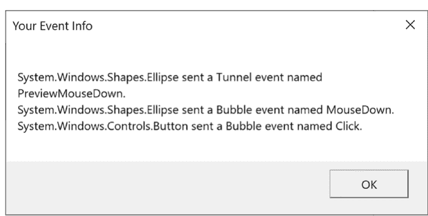

图 25-15。先隧道，后冒泡

那么，为什么 WPF 事件通常会成对出现（一个隧道事件和一个冒泡事件）呢？答案是，通过预览事件，你可以在对应的冒泡事件触发之前执行任何特殊逻辑（数据验证、禁用冒泡操作等）。例如，假设你有一个只能包含数字数据的 TextBox。你可以处理 PreviewKeyDown 事件；如果发现用户输入了非数字数据，就可以将 Handled 属性设置为 true，从而取消冒泡事件。

正如你所料，在构建包含自定义事件的自定义控件时，可以设计事件，使其能够沿 XAML 树进行冒泡（或隧道）。在本章中，我不会介绍如何构建自定义路由事件（不过，这一过程与构建自定义依赖属性并没有太大区别）。如果你对此感兴趣，可以查看 .NET Framework 4.7 SDK 文档中的“Routed Events Overview”主题。其中包含许多教程，可以帮助你入门。

## 深入了解 WPF API 和控件

本章的剩余部分将让你有机会使用 Visual Studio 构建一个新的 WPF 应用程序。目标是创建一个包含 TabControl 控件的用户界面，其中包含一组标签页。每个标签页都将演示一些新的 WPF 控件和有趣的 API，你可能希望在自己的软件项目中使用它们。在此过程中，你还将学习 Visual Studio WPF 设计器的其他功能。

## 使用 TabControl

首先，创建一个名为 WpfControlsAndAPIs 的新 WPF 应用程序。如前所述，初始窗口将包含一个 TabControl，其中有三个不同的标签页，每个标签页展示一组相关控件和/或 WPF API。将窗口的 Width 更新为 800，将 Height 更新为 350。

在 Visual Studio 工具箱中找到 TabControl 控件，将其拖放到设计器中，然后将标记更新为以下内容：

```xml
<TabControl Name="MyTabControl" HorizontalAlignment="Stretch" VerticalAlignment="Stretch">
    <TabItem Header="TabItem">
        <Grid Background="#FFFE5E5E"/>
    </TabItem>
    <TabItem Header="TabItem">
        <Grid Background="#FFFE5E5E"/>
    </TabItem>
</TabControl>
```

你会注意到，系统会自动为你提供两个标签项。若要添加其他标签，只需在“文档大纲”窗口中右键单击 TabControl 节点，然后选择“Add TabItem”菜单选项（也可以在设计器中右键单击 TabControl，以激活相同的菜单选项），或者直接开始在 XAML 编辑器中输入。使用任一方法再添加一个标签。

现在，通过 XAML 编辑器更新每个 TabItem 控件，并更改每个标签的 Header 属性，将它们命名为 Ink API、Data Binding 和 DataGrid。此时，你的窗口设计器应类似于图 25-16 所示的效果。


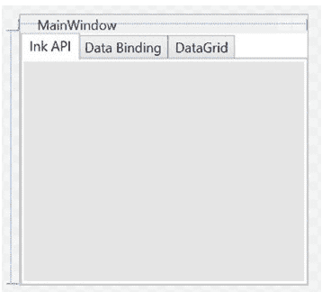

Figure 25-16. The initial layout of the tab system

请注意，当你选择一个选项卡进行编辑时，该选项卡会成为活动选项卡，你可以通过从 Toolbox 窗口拖动控件来设计该选项卡。现在你已经定义了核心的 TabControl，可以逐个处理选项卡的细节，并在过程中学习更多 WPF API 的功能。

## Building the Ink API Tab

第一个选项卡将用于展示 WPF 数字 Ink API 的整体作用，该 API 可让你轻松地将绘画功能集成到程序中。当然，应用程序不一定必须是绘画应用程序；你可以用此 API 实现各种用途，包括捕获手写输入。

> Note 本章（以及接下来的 WPF 章节）的其余大部分内容中，我将直接编辑 XAML 而不是使用各种设计器窗口。虽然拖放控件是可行的，但更常见的是布局不是你想要的（Visual Studio 会根据你放置控件的位置添加边距和填充），而且你无论如何都要花费大量时间清理 XAML。

首先将 Ink API TabItem 下的 Grid 标签更改为 StackPanel 并添加一个闭合标签（确保从开始标签中删除“/”）。你的标记应如下所示：

```
<TabItem Header="Ink API">
    <StackPanel Background="#FFE5E5E5">
    </StackPanel>
</TabItem>
```

## Designing the Toolbar

在 StackPanel 中添加一个新的 ToolBar 控件（使用 XAML 编辑器），命名为 InkToolBar，高度为 60

```
.<ToolBar Name="InkToolBar" Height="60">
</ToolBar>
```

按如下方式在 ToolBar 中添加一个 Border 控件内的 WrapPanel，再添加三个 RadioButton 控件：

```
<Border Margin="0,2,0,2.4" Width="280" VerticalAlignment="Center">
    <WrapPanel>
        <RadioButton x:Name="inkRadio" Margin="5,10" Content="Ink Mode!" IsChecked="True" />
        <RadioButton x:Name="eraseRadio" Margin="5,10" Content="Erase Mode!" />
        <RadioButton x:Name="selectRadio" Margin="5,10" Content="Select Mode!" />
    </WrapPanel>
</Border>
```

当 RadioButton 控件未放置在父面板控件内时，它的外观将与 Button 控件完全相同！这就是为什么我将 RadioButton 控件包装在 WrapPanel 中的原因。

接下来，添加一个 Separator，然后添加一个宽度为 175、Margin 为 10,0,0,0 的 ComboBox。添加三个 ComboBoxItem 标签，其内容分别为 Red、Green 和 Blue，并在整个 ComboBox 后跟另一个 Separator 控件，如下所示：

```
<Separator/>
<ComboBox x:Name="comboColors" Width="175" Margin="10,0,0,0">
    <ComboBoxItem Content="Red"/>
    <ComboBoxItem Content="Green"/>
    <ComboBoxItem Content="Blue"/>
</ComboBox>
<Separator/>
```

## The RadioButton Control

在此示例中，你希望这三个 RadioButton 控件互斥。在其他 GUI 框架中，确保一组相关控件（如单选按钮）互斥需要将它们放置在同一个组框中。在 WPF 中你不需要这样做。相反，你只需将它们全部分配给相同的组名即可。这很有帮助，因为相关项不需要物理上集中在同一区域，而可以位于窗口的任何位置。

RadioButton 类包含一个 IsChecked 属性，当最终用户单击 UI 元素时，该属性在 true 和 false 之间切换。此外，RadioButton 还提供两个事件（Checked 和 Unchecked），你可以使用它们来拦截此状态更改。

## Add the Save, Load, and Delete Buttons

ToolBar 控件中的最后一个控件将是一个包含三个 Button 控件的 Grid。在最后一个 Separator 控件之后添加以下标记：

```
<Grid>
    <Grid.ColumnDefinitions>
        <ColumnDefinition Width="Auto"/>
        <ColumnDefinition Width="Auto"/>
        <ColumnDefinition Width="Auto"/>
    </Grid.ColumnDefinitions>
    <Button Grid.Column="0" x:Name="btnSave" Margin="10,10" Width="70" Content="Save Data"/>
    <Button Grid.Column="1" x:Name="btnLoad" Margin="10,10" Width="70" Content="Load Data"/>
    <Button Grid.Column="2" x:Name="btnClear" Margin="10,10" Width="70" Content="Clear"/>
</Grid>
```

## Add the InkCanvas Control

TabControl 的最后一个控件是 InkCanvas 控件。在闭合 ToolBar 标签之后、闭合 StackPanel 标签之前添加以下标记，如下所示：

```
<InkCanvas x:Name="MyInkCanvas" Background="#FFB6F4F1" />
```

## Preview the Window

此时，你已准备好测试程序，你可以通过按 F5 键来执行。你现在应该会看到三个互斥的单选按钮、一个具有三个选项的组合框和三个按钮（见图 25-17）。

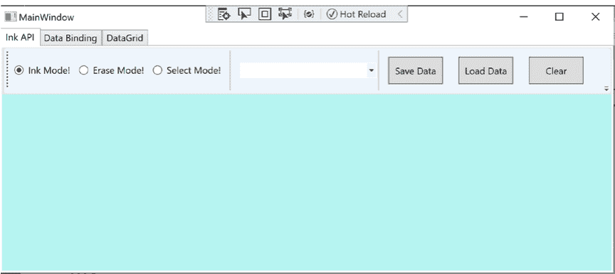

Figure 25-17. The completed layout for the Ink API tab

## Handling Events for the Ink API Tab

Ink API 选项卡的下一步是处理每个 RadioButton 控件的 Click 事件。如同本书中其他 WPF 项目中所做的那样，只需单击 Visual Studio 属性编辑器的闪电图标即可输入事件处理程序的名称。使用这种方法，将每个按钮的 Click 事件路由到同一个处理程序，命名为 RadioButtonClicked。处理完所有三个 Click 事件后，使用名为 ColorChanged() 的处理程序处理 ComboBox 的 SelectionChanged 事件。完成后，你应该有以下 C# 代码：

```
public partial class MainWindow : Window
{
    public MainWindow()
    {
        this.InitializeComponent();

        // Insert code required on object creation below this point.
    }
}
```

```
private void RadioButtonClicked(object sender,RoutedEventArgs e)
{
    // TODO: Add event handler implementation here.
}

private void ColorChanged(object sender,SelectionChangedEventArgs e)
{
    // TODO: Add event handler implementation here.
}
```

你将在后面的步骤中实现这些处理程序，因此暂时保持为空。

## Add Controls to the Toolbox

你通过直接编辑 XAML 添加了 InkCanvas 控件。如果你想使用 UI 添加它，Visual Studio 工具箱默认不会显示每个可能的 WPF 组件。但你可以更新工具箱中显示的项目。

为此，在 Toolbox 区域的任何位置右键单击并选择 Choose Items 菜单选项。片刻之后，你将看到可以添加到 Toolbox 的可能组件列表。就你的目的而言，你有兴趣添加 InkCanvas 控件（见图 25-18）。

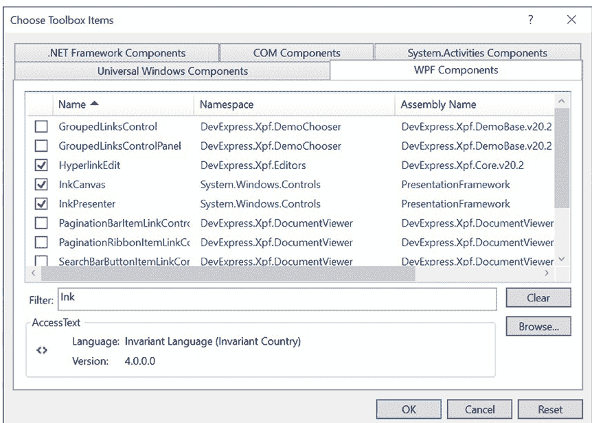

Figure 25-18. Adding new components to the Visual Studio Toolbox

> Note Ink 控件与 Visual Studio XAML 设计器在版本 16.8.3（本文撰写时的当前版本）或 Visual Studio 16.9 Preview 2 中不兼容。控件仍可使用，只是不能通过设计器使用。

## The InkCanvas Control

仅添加 InkCanvas 就能在你的窗口中进行绘图。你可以使用鼠标，或如果有触控设备，则可以使用手指或数位笔。运行应用程序并在框中绘图（见图 25-19）。

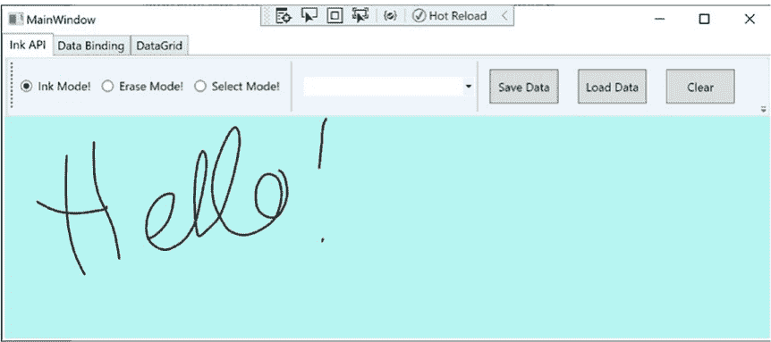

Figure 25-19. The InkCanvas in action

InkCanvas 不仅可以绘制鼠标（或手写笔）笔迹；它还支持多种独特的编辑模式，由 EditingMode 属性控制。你可以为此属性分配来自相关 InkCanvasEditingMode 枚举的任何值。对于此示例，你感兴趣的是 Ink 模式，即你刚刚见证的默认选项；Select 模式，允许用户使用鼠标选择区域以移动或调整大小；以及 EraseByStoke，将删除之前的鼠标笔迹。

> Note 一个笔迹是在单次鼠标按下/鼠标释放操作期间进行的渲染。InkCanvas 将所有笔迹存储在 StrokeCollection 对象中，你可以使用 Strokes 属性访问它。

使用以下逻辑更新你的 RadioButtonClicked() 处理程序，该逻辑根据所选的 RadioButton 将 InkCanvas 置于正确的模式：

```
private void RadioButtonClicked(object sender,RoutedEventArgs e)
{
    // Based on which button sent the event, place the InkCanvas in a unique
    // mode of operation.
```


this.MyInkCanvas.EditingMode = (sender as RadioButton)?.Content.ToString() switch
{
    // These strings must be the same as the Content values for each
    // RadioButton.
    "Ink Mode!" => InkCanvasEditingMode.Ink,
    "Erase Mode!" => InkCanvasEditingMode.EraseByStroke,
    "Select Mode!" => InkCanvasEditingMode.Select,
    _ => this.MyInkCanvas.EditingMode
};
}

同时，在窗口的构造函数中将模式默认为 Ink。顺便说一下，按如下方式为 ComboBox 设置默认选择（有关此控件的更多详细信息，请参阅下一节）：

```
public MainWindow()
{
    this.InitializeComponent();

    // Be in Ink mode by default.
    this.MyInkCanvas.EditingMode = InkCanvasEditingMode.Ink;
    this.inkRadio.IsChecked = true;
    this.comboColors.SelectedIndex = 0;
}
```

现在通过按 F5 再次运行程序。进入 Ink 模式并绘制一些数据。接下来，进入 Erase 模式并删除之前输入的鼠标笔划（你会注意到鼠标图标会自动看起来像橡皮擦）。最后，进入 Select 模式并使用鼠标作为套索选择一些笔划。

在你圈出项目后，你可以将其在画布上移动并调整其尺寸。图 25-20 显示了你的编辑模式的工作情况。

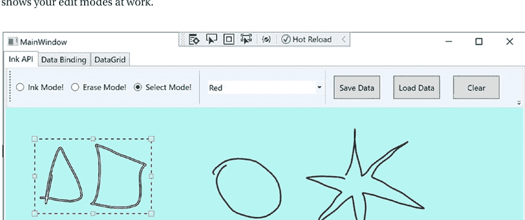

图 25-20. InkCanvas 在运行中，带有编辑模式！

## ComboBox 控件

在你填充 ComboBox 控件（或 ListBox）后，你有三种方法来确定所选项目。首先，如果你想找到所选项目的数值索引，可以使用 SelectedIndex 属性（从零开始；值为 -1 表示无选择）。其次，如果你想获取列表中已被选中的对象，SelectedItem 属性就很合适。第三，SelectedValue 允许你获取所选对象的数值（通常通过调用 ToString() 获得）。

你需要为此选项卡添加最后一部分代码，以更改在 InkCanvas 上输入的笔划颜色。InkCanvas 的 DefaultDrawingAttributes 属性返回一个 DrawingAttributes 对象，允许你配置笔尖的众多方面，包括其大小和颜色（以及其他设置）。使用以下 ColorChanged() 方法的实现更新你的 C# 代码：

```
private void ColorChanged(object sender, SelectionChangedEventArgs e)
{
    // Get the selected value in the combo box.
    string colorToUse =
        (this.comboColors.SelectedItem as ComboBoxItem)?.Content.ToString();

    // Change the color used to render the strokes.
    this.MyInkCanvas.DefaultDrawingAttributes.Color =
        (Color)ColorConverter.ConvertFromString(colorToUse);
}
```

现在请记住，ComboBox 有一个 ComboBoxItems 的集合。如果你查看生成的 XAML，你会看到以下定义：

```
<ComboBox x:Name="comboColors" Width="100" SelectionChanged="ColorChanged">
    <ComboBoxItem Content="Red"/>
    <ComboBoxItem Content="Green"/>
    <ComboBoxItem Content="Blue"/>
</ComboBox>
```

当你调用 SelectedItem 时，你会获取所选的 ComboBoxItem，它被存储为一个通用的 Object。在将 Object 强制转换为 ComboBoxItem 后，你会取出 Content 的值，它将是字符串 Red、Green 或 Blue。然后此字符串使用方便的 ColorConverter 实用程序类转换为 Color 对象。现在再次运行程序。你应该能够在渲染图像时在颜色之间切换。

请注意，ComboBox 和 ListBox 控件也可以包含复杂的内容，而不仅仅是文本数据。你可以通过打开窗口的 XAML 编辑器并更改 ComboBox 的定义，使其包含一组 StackPanel 元素，每个元素都包含一个 Ellipse 和一个 Label 来了解其中一些可能性（请注意 ComboBox 的 Width 为 175）。

```
<ComboBox x:Name="comboColors" Width="175" Margin="10,0,0,0" SelectionChanged="ColorChanged">
    <StackPanel Orientation ="Horizontal" Tag="Red">
        <Ellipse Fill ="Red" Height ="50" Width ="50"/>
        <Label FontSize ="20" HorizontalAlignment="Center"
            VerticalAlignment="Center" Content="Red"/>
    </StackPanel>

<StackPanel Orientation ="Horizontal" Tag="Green">
    <Ellipse Fill ="Green" Height ="50" Width ="50"/>
    <Label FontSize ="20" HorizontalAlignment="Center"
        VerticalAlignment="Center" Content="Green"/>
</StackPanel>

<StackPanel Orientation ="Horizontal" Tag="Blue">
    <Ellipse Fill ="Blue" Height ="50" Width ="50"/>
    <Label FontSize ="20" HorizontalAlignment="Center"
        VerticalAlignment="Center" Content="Blue"/>
</StackPanel>
</ComboBox>
```

请注意，每个 StackPanel 都为其 Tag 属性分配了一个值，这是一种简单、快速且方便的方式来发现用户选择了哪一堆项目（有更好的方法可以做到这一点，但目前这样就够了）。有了此调整，你需要像这样更改 ColorChanged() 方法的实现：

```
private void ColorChanged(object sender, SelectionChangedEventArgs e)
{
    // Get the Tag of the selected StackPanel.
    string colorToUse = (this.comboColors.SelectedItem
        as StackPanel).Tag.ToString();
    ...
}
```

现在再次运行程序并注意你的独特 ComboBox（参见图 25-21）。

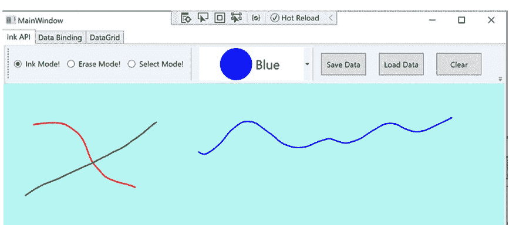

图 25-21. 借助 WPF 内容模型定制的 ComboBox

## 保存、加载和清除 InkCanvas 数据

此选项卡的最后一部分将使你能够保存和加载画布数据，以及通过为工具栏中的按钮添加事件处理程序来清除所有内容。通过添加点击事件的标记，按如下方式更新按钮的 XAML：

```
<Button Grid.Column="0" x:Name="btnSave" Margin="10,10" Width="70" Content="Save Data" Click="SaveData"/>
<Button Grid.Column="1" x:Name="btnLoad" Margin="10,10" Width="70" Content="Load Data" Click="LoadData"/>
<Button Grid.Column="2" x:Name="btnClear" Margin="10,10" Width="70" Content="Clear" Click="Clear"/>
```

接下来，将 System.IO 和 System.Windows.Ink 命名空间导入到你的代码文件中。按如下方式实现处理程序：

```
private void SaveData(object sender, RoutedEventArgs e)
{
    // Save all data on the InkCanvas to a local file.
    using (FileStream fs = new FileStream("StrokeData.bin", FileMode.Create))
    this.MyInkCanvas.Strokes.Save(fs);
    fs.Close();
    MessageBox.Show("Image Saved","Saved");
}

private void LoadData(object sender, RoutedEventArgs e)
{
    // Fill StrokeCollection from file.
    using(FileStream fs = new FileStream("StrokeData.bin", FileMode.Open, FileAccess.Read))
    StrokeCollection strokes = new StrokeCollection(fs);
    this.MyInkCanvas.Strokes = strokes;
}

private void Clear(object sender, RoutedEventArgs e)
{
    // Clear all strokes.
    this.MyInkCanvas.Strokes.Clear();
}
```

你现在应该能够将数据保存到文件，从文件加载它，并清除 InkCanvas 的所有数据。这就完成了 TabControl 的第一个选项卡，以及你对 WPF 数字 Ink API 的检查。当然，关于此技术还有更多内容；不过，如果你感兴趣，你应该处于一个很好的位置来进一步深入该主题。接下来，你将学习如何使用 WPF 数据绑定。

## 介绍 WPF 数据绑定模型

控件通常是各种数据绑定操作的<|message|>。简单来说，数据绑定是将控件属性连接到在应用程序生命周期中可能会发生变化的数据值的行为。这样做可以让用户界面元素显示代码中变量的状态。例如，你可能会使用数据绑定来实现以下目的：

- 根据给定对象的布尔属性选中 CheckBox 控件。
- 从关系数据库表中在 DataGrid 对象中显示数据。
- 将 Label 连接到表示文件夹中文件数量的整数。

当你使用内置的 WPF 数据绑定引擎时，你必须意识到绑定操作源和目标之间的区别。正如你所期望的，数据绑定操作的源是数据本身（例如布尔属性或关系数据），而目标（目标）是使用数据内容的 UI 控件属性（例如 CheckBox 或 TextBox 控件上的属性）。

除了绑定到传统数据之外，WPF 还支持元素绑定，如前面的示例所述。这意味着你可以根据复选框的选中属性来绑定属性的可见性（例如）。你当然可以在 WinForms 中通过代码做到这一点。WPF 框架提供了一个丰富的数据绑定生态系统，可以几乎完全在标记中处理。这也使你能够确保如果任一值发生变化，源和目标保持同步。

## 构建数据绑定选项卡

使用 Document Outline 编辑器，将第二个选项卡的 Grid 更改为 StackPanel。现在，使用 Visual Studio 的 Toolbox 和 Properties 编辑器构建以下初始布局：

```
<TabItem x:Name="tabDataBinding" Header="Data Binding">
    <StackPanel Width="250">
        <Label Content="Move the scroll bar to see the current value"/>

        <!-- The scrollbar's value is the source of this data bind. -->
        <ScrollBar x:Name="mySB" Orientation="Horizontal" Height="30"
            Minimum = "1" Maximum = "100" LargeChange="1" SmallChange="1"/>

        <!-- The label's content will be bound to the scroll bar! -->
        <Label x:Name="labelSBThumb" Height="30" BorderBrush="Blue"
            BorderThickness="2" Content = "0"/>
    </StackPanel>
</TabItem>
```

请注意，ScrollBar 对象（此处命名为 mySB）已配置为 1 到 100 的范围。目标是确保当你重新定位滚动条的拇指（或点击左侧或右侧箭头）时，Label 会自动更新为当前值。目前，Label 控件的 Content 属性设置为值 "0"；不过，你将通过数据绑定操作更改它。


## 建立数据绑定

在 XAML 中定义绑定之所以可行，得益于 `{Binding}` 标记扩展。虽然你可以通过 Visual Studio 定义绑定，但直接在标记中操作也同样简单。将名为 `labelSBThumb` 的 Label 的 Content 属性编辑为以下内容：

```xml
<Label x:Name="labelSBThumb" Height="30" BorderBrush="Blue" BorderThickness="2"
    Content = "{Binding Path=Value, ElementName=mySB}"/>
```

请注意分配给 Label 的 Content 属性的值。`{Binding}` 语句表示一次数据绑定操作。ElementName 的值表示数据绑定操作的数据源（ScrollBar 对象），而 Path 指示要绑定的属性；在本例中，它是滚动条的 Value 属性。

再次运行程序，你会发现，拖动滑块时，标签的内容会随滚动条的值更新！

## DataContext 属性

你也可以使用另一种格式在 XAML 中定义数据绑定操作：显式将 DataContext 属性设置为绑定操作的数据源，从而将 `{Binding}` 标记扩展中指定的值分离出来，如下所示：

```xml
<!-- 通过 DataContext 分离对象和值 -->
<Label x:Name="labelSBThumb" Height="30" BorderBrush="Blue" BorderThickness="2"
    DataContext = "{Binding ElementName=mySB}" Content = "{Binding Path=Value}" />
```

在当前示例中，如果这样修改标记，输出结果将完全相同。鉴于此，你可能会想，什么时候需要显式设置 DataContext 属性？这样做很有帮助，因为在标记树中，子元素可以继承它的值。

通过这种方式，你可以轻松地将同一个数据源设置给一组控件，而不必在多个控件中重复编写一堆冗余的 `"{Binding ElementName=X, Path=Y}"` XAML 值。例如，假设你已将以下新 Button 添加到此选项卡的 StackPanel 中（稍后你就会知道它为什么这么大）：

```xml
<Button Content="Click" Height="200"/>
```

你可以使用 Visual Studio 为多个控件生成数据绑定，但不妨试着使用 XAML 编辑器手动输入修改后的标记，如下所示：

```xml
<!-- 注意，StackPanel 设置了 DataContext 属性。 -->
<StackPanel Background="#FFE5E5E5" DataContext = "{Binding ElementName=mySB}">
...
    <!-- 现在，两个 UI 元素都以各自的方式使用滚动条的值。 -->
    <Label x:Name="labelSBThumb" Height="30" BorderBrush="Blue" BorderThickness="2"
        Content = "{Binding Path=Value}"/>

    <Button Content="Click" Height="200" FontSize = "{Binding Path=Value}"/>
</StackPanel>
```

在这里，你直接在 StackPanel 上设置了 DataContext 属性。因此，拖动滑块时，你不仅可以在 Label 上看到当前值，还会看到 Button 的字体大小根据同一个值相应地增大或缩小（图 25-22 展示了一种可能的输出结果）。

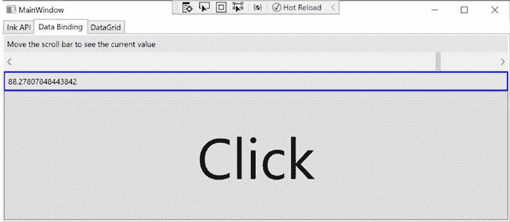

图 25-22. 将 ScrollBar 的值绑定到 Label 和 Button

## 格式化绑定的数据

ScrollBar 类型使用 double 表示滑块的值，而不是使用预期的整数（例如 int）。因此，拖动滑块时，你会发现 Label 中显示了各种浮点数（例如 61.0576923076923）。对最终用户来说，这种显示方式并不直观，因为他们更可能希望看到整数（例如 61、62 和 63）。

若要格式化数据，可以添加 ContentStringFormat 属性，并传入自定义字符串和 .NET Core 格式说明符，如下所示：

```xml
<Label x:Name="labelSBThumb" Height="30" BorderBrush="Blue"
    BorderThickness="2" Content = "{Binding Path=Value}" ContentStringFormat="The value is: {0:F0}"/>
```

如果格式说明字符串中没有文本，就需要以一对空花括号开头；这对花括号是 XAML 的转义序列。例如，这样可以告知处理器后续字符是文本，而不是绑定语句。更新后的 XAML 如下：

```xml
<Label x:Name="labelSBThumb" Height="30" BorderBrush="Blue"
    BorderThickness="2" Content = "{Binding Path=Value}" ContentStringFormat="{}{0:F0}"/>
```

> 注意：如果绑定的是控件的 Text 属性，可以直接在绑定语句中添加 StringFormat 名值对。只有绑定 Content 属性时，才需要单独设置。

## 使用 IValueConverter 转换数据

如果除了格式化数据之外还需要进行其他处理，可以创建一个实现 System.Windows.Data 命名空间中 IValueConverter 接口的自定义类。该接口定义了两个成员，可用于执行数据向目标的转换，以及从目标返回源的转换（适用于双向数据绑定）。定义该类后，就可以用它进一步控制数据绑定操作的处理过程。

你可以使用值转换器，而不是格式属性，来让 Label 控件显示整数。为此，请在项目中添加一个名为 MyDoubleConverter 的新类，然后添加以下代码：

```csharp
using System;
using System.Windows.Data;

namespace WpfControlsAndAPIs
{
    public class MyDoubleConverter : IValueConverter
    {
        public object Convert(object value, Type targetType, object parameter,
            System.Globalization.CultureInfo culture)
        {
            // 将 double 转换为 int。
            double v = (double)value;
            return (int)v;
        }

        public object ConvertBack(object value, Type targetType, object parameter,
            System.Globalization.CultureInfo culture)
        {
            // 这里不处理“双向”绑定，因此直接返回该值。
            return value;
        }
    }
}
```

当值从源（ScrollBar）传递到目标（TextBox 的 Text 属性）时，会调用 `Convert()` 方法。传入的参数有很多，但对于这次转换，你只需要处理传入的对象，也就是当前的 double 值。你可以将该值转换为整数类型，并返回新的数值。

当值从目标传回源时（如果启用了双向绑定模式），会调用 `ConvertBack()` 方法。在这里，你只需直接返回该值。这样一来，你就可以在 TextBox 中输入浮点数（例如 99.9），并在用户切换到其他控件时，自动将其转换为整数（例如 99）。这种“免费”的转换之所以能够实现，是因为调用 `ConvertBack()` 后会再次调用 `Convert()`。如果 `ConvertBack()` 只是返回 null，绑定就会显得不同步，因为文本框仍会显示浮点数。

要在标记中使用此转换器，首先需要创建一个本地资源，用来表示刚创建的自定义类。不必担心添加资源的具体操作；接下来的几章会深入讲解这一主题。在 Window 开始标记之后添加以下内容：

```xml
<Window.Resources>
    <local:MyDoubleConverter x:Key="DoubleConverter"/>
</Window.Resources>
```

接下来，将 Label 控件的绑定语句更新为以下内容：

```xml
<Label x:Name="labelSBThumb" Height="30" BorderBrush="Blue"
    BorderThickness="2" Content = "{Binding Path=Value,Converter={StaticResource
DoubleConverter}}" />
```

现在运行应用时，你只会看到整数。

## 在代码中建立数据绑定

你也可以在代码中注册数据转换类。首先，清理数据绑定选项卡中当前的 Label 控件定义，使其不再使用 `{Binding}` 标记扩展。

```xml
<Label x:Name="labelSBThumb" Height="30" BorderBrush="Blue" BorderThickness="2" />
```

确保引入 `System.Windows.Data`；然后在窗口的构造函数中调用一个名为 `SetBindings()` 的新私有辅助函数。在此方法中添加以下代码（并确保从构造函数中调用它）：

```csharp
using System.Windows.Data;
...
namespace WpfControlsAndAPIs
{
    public partial class MainWindow : Window
    {
        public MainWindow()
        {
            InitializeComponent();
            ...
            SetBindings();
        }
        ...
        private void SetBindings()
        {
            // 创建 Binding 对象。
            Binding b = new Binding
            {
                // 注册转换器、源和路径。
                Converter = new MyDoubleConverter(),
                Source = this.mySB,
                Path = new PropertyPath("Value")
            };
            // 调用 Label 上的 SetBinding 方法。
            this.labelSBThumb.SetBinding(Label.ContentProperty, b);
        }
    }
}
```

这个函数中可能看起来有些特别的部分，只有调用 `SetBinding()` 的地方。请注意，第一个参数调用了 Label 类中一个名为 ContentProperty 的静态只读字段。正如你将在本章稍后了解到的，这是在指定一种称为依赖属性的属性。暂且先记住这一点，


只需知道，当你在代码中设置绑定时，第一个参数几乎总是要求你指定需要绑定的类名（此处是 Label），随后调用带 Property 后缀的基础属性。无论如何，运行应用程序可以看到 Label 只打印出整数。

## 构建 DataGrid 选项卡

前面的数据绑定示例演示了如何配置两个（或更多）控件参与数据绑定操作。虽然这很有用，但也可以绑定来自 XML 文件、数据库数据以及内存对象的数据。为了完成本示例，你将设计选项卡控件的最后一个选项卡，使其显示从 AutoLot 数据库的 Inventory 表获取的数据。

与其他选项卡一样，你首先将当前的 Grid 改为 StackPanel。为此，请使用 Visual Studio 直接更新 XAML。然后在新 StackPanel 中定义一个名为 gridInventory 的 DataGrid 控件，如下所示：

```
<TabItem x:Name="tabDataGrid" Header="DataGrid">
    <StackPanel>
        <DataGrid x:Name="gridInventory" Height="288"/>
    </StackPanel>
</TabItem>
```

使用 NuGet 包管理器将以下包添加到项目中：

- Microsoft.EntityFrameworkCore
- Microsoft.EntityFrameworkCore.SqlServer
- Microsoft.Extensions.Configuration
- Microsoft.Extensions.Configuration.Json

如果你更愿意使用 .NET Core 命令行接口(CLI)来添加这些包，请在解决方案目录下输入以下命令：

```
dotnet add WpfControlsAndAPIs package Microsoft.EntityFrameworkCore
dotnet add WpfControlsAndAPIs package Microsoft.EntityFrameworkCore.SqlServer
dotnet add WpfControlsAndAPIs package Microsoft.Extensions.Configuration
dotnet add WpfControlsAndAPIs package Microsoft.Extensions.Configuration.Json
```

接下来，右键单击解决方案，选择“添加”▶“现有项目”，从第 23 章添加 AutoLot.Dal 和 AutoLot.Dal.Models 项目，并添加对这些项目的项目引用。你也可以使用 CLI 通过以下命令添加引用（你需要根据项目的位置和计算机的操作系统调整路径）：

```
dotnet sln .\Chapter25_AllProjects.sln add ..\Chapter_23\AutoLot.Models
dotnet sln .\Chapter25_AllProjects.sln add ..\Chapter_23\AutoLot.Dal
dotnet add WpfControlsAndAPIs reference ..\Chapter_23\AutoLot.Models
dotnet add WpfControlsAndAPIs reference ..\Chapter_23\AutoLot.Dal
```

确认 AutoLot.Dal 到 AutoLot.Dal.Models 的项目引用仍然存在。将以下命名空间添加到 MainWindow.xaml.cs 中：

```
using System.Linq;
using AutoLot.Dal.EfStructures;
using AutoLot.Dal.Repos;
using Microsoft.EntityFrameworkCore;
using Microsoft.Extensions.Configuration;
```

在 MainWindow.cs 中添加两个模块级属性，用于保存 IConfiguration 和 ApplicationDbContext 的实例。

```
private IConfiguration _configuration;
private ApplicationDbContext _context;
```

添加一个名为 GetConfigurationAndContext() 的新方法来创建这些实例，并在构造函数中调用它。完整方法如下：

```
private void GetConfigurationAndDbContext()
{
_configuration = new ConfigurationBuilder()
    .SetBasePath(Directory.GetCurrentDirectory())
    .AddJsonFile("appsettings.json", true, true)
    .Build();
var optionsBuilder =
    new DbContextOptionsBuilder<ApplicationDbContext>();
var connectionString =
    _configuration.GetConnectionString("AutoLot");
optionsBuilder.UseSqlServer(connectionString,
    sqlOptions => sqlOptions.EnableRetryOnFailure());
_context = new ApplicationDbContext(optionsBuilder.Options);
}
```

向项目添加一个名为 appsettings.json 的新 JSON 文件，并将其生成状态设置为“始终复制”。这可以通过在解决方案资源管理器中右键单击该文件，选择“属性”，然后在“复制到输出目录”设置中输入“始终复制”来完成。你也可以将此添加到项目文件中以实现相同的效果：

```
<ItemGroup>
    <None Update="appsettings.json">
        <CopyToOutputDirectory>Always</CopyToOutputDirectory>
    </None>
</ItemGroup>
```

将 JSON 文件更新为以下内容（更新你的连接字符串以匹配你的环境）：

```
{
    "ConnectionStrings": {
        "AutoLotFinal": "server=.,5433;Database=AutoLot;User Id=sa;Password=P@ssw0rd;"
    }
}
```

打开 MainWindow.xaml.cs，添加一个名为 ConfigureGrid() 的最终辅助函数，并在配置完 ApplicationDbContext 后从构造函数中调用它。你只需添加几行代码，如下所示：

```
private void ConfigureGrid()
{
    using var repo = new CarRepo(_context);
    gridInventory.ItemsSource = repo
        .GetAllIgnoreQueryFilters()
        .ToList()
        .Select(x=> new {
            x.Id,
            Make=x.MakeName,
            x.Color,
            x.PetName
        });
}
```

现在，当你运行项目时，会看到数据填充到网格中。如果你想让网格更漂亮一些，可以使用 Visual Studio 的“属性”窗口编辑网格，使其更具吸引力。

这结束了当前的示例。在后面的章节中，你会看到其他一些控件的实际使用；不过，此时你应该已经熟悉了在 Visual Studio 中构建 UI 以及手动使用 XAML 和 C# 代码的过程。

## 理解依赖属性的作用

与任何 .NET Core API 一样，WPF 在其实现中使用了 .NET Core 类型系统的每个成员（类、结构、接口、委托、枚举）以及每个类型成员（属性、方法、事件、常量数据、只读字段等）。不过，WPF 还支持一种称为依赖属性的独特编程概念。

与“普通”.NET Core 属性（在 WPF 文献中通常称为 CLR 属性）一样，依赖属性可以使用 XAML 声明式设置，也可以在代码文件中以编程方式设置。此外，依赖属性（如 CLR 属性）最终用于封装类的数据字段，并且可以配置为只读、只写或读写。

更有趣的是，在几乎每种情况下，你都不会意识到自己实际上设置（或访问）的是依赖属性而不是 CLR 属性！例如，WPF 控件从 FrameworkElement 继承的 Height 和 Width 属性，以及从 ControlContent 继承的 Content 成员，实际上都是依赖属性。

```
<!-- Set three dependency properties! -->
<Button x:Name = "btnMyButton" Height = "50" Width = "100" Content = "OK"/>
```

鉴于所有这些相似之处，为什么 WPF 要为这样一个熟悉的概念定义一个新术语？答案在于依赖属性在类中的实现方式。稍后你会看到一个编码示例；但从高层来看，所有依赖属性都是按以下方式创建的：

- 首先，定义依赖属性的类必须在其继承链中包含 DependencyObject。
- 单个依赖属性表示为类中类型为 DependencyProperty 的公共静态只读字段。按照约定，该字段的命名方式是在 CLR 包装器名称后添加 Property 后缀（参见最后一点）。
- DependencyProperty 变量通过对 DependencyProperty.Register() 的静态调用进行注册，这通常发生在静态构造函数中或在声明变量时内联进行。
- 最后，该类将定义一个对 XAML 友好的 CLR 属性，该属性调用 DependencyObject 提供的方法来获取和设置值。

一旦实现，依赖属性就提供许多强大的功能，各种 WPF 技术（包括数据绑定、动画服务、样式、模板等）都会使用这些功能。简而言之，依赖属性的动机是提供一种基于其他输入的值来计算属性值的方法。以下是其中一些关键优势的列表，这些优势远远超出了 CLR 属性的简单数据封装：

- 依赖属性可以从父元素的 XAML 定义中继承其值。例如，如果在 Window 的开始标记中为 FontSize 属性定义了一个值，则该 Window 中的所有控件默认都会具有相同的字体大小。
- 依赖属性支持由 XAML 作用域内的元素设置值的能力，例如 Button 设置 DockPanel 父元素的 Dock 属性。（请记住，附加属性就是这样做的，因为附加属性是依赖属性的一种形式。）
- 依赖属性允许 WPF 基于多个外部值计算值，这对于动画和数据绑定服务可能很重要。
- 依赖属性为 WPF 触发器提供基础结构支持（在处理动画和数据绑定时也经常使用）。

现在请记住，在许多情况下，你将以与普通 CLR 属性相同的方式与现有依赖属性交互（这要归功于 XAML 包装器）。在上一节关于数据绑定的内容中，你了解到如果需要在代码中建立数据绑定，必须在作为操作目标的对象上调用 SetBinding() 方法，并指定它将操作的依赖属性，如下所示：

```
private void SetBindings()
{
    Binding b = new Binding
    {
        // Register the converter, source, and path.
        Converter = new MyDoubleConverter(),
        Source = this.mySB,
        Path = new PropertyPath("Value")
    };
    // Specify the dependency property!
    this.labelSBThumb.SetBinding(Label.ContentProperty, b);
}
```

在第 27 章中，你将看到类似的代码，了解如何在代码中启动动画。

```
// Specify the dependency property!
rt.BeginAnimation(RotateTransform.AngleProperty, dblAnim);
```


你只有在编写自定义 WPF 控件时才需要构建自己的自定义依赖属性。例如，如果你正在构建一个 UserControl 并定义了四个自定义属性，并且希望这些属性能够很好地集成到 WPF API 中，你应该使用依赖属性逻辑来编写它们。

具体来说，如果你的属性需要成为数据绑定或动画操作的目标，如果属性必须在更改时广播，如果它必须能够作为 WPF 样式中的 Setter 工作，或者如果它必须能够从父元素接收其值，那么普通的 CLR 属性是不够的。如果你使用普通的 CLR 属性，其他程序员确实能够获取和设置值；然而，如果他们尝试在 WPF 服务的上下文中使用你的属性，事情将不会按预期工作。因为你永远无法知道其他人可能如何与你的自定义 UserControl 类的属性交互，所以在构建自定义控件时，你应该养成始终定义依赖属性的习惯。

## 检查现有的依赖属性

在学习如何构建自定义依赖属性之前，让我们先看看 FrameworkElement 类的 Height 属性在内部是如何实现的。相关代码如下所示（附带我的注释）：

// FrameworkElement is-a DependencyObject.
public class FrameworkElement : UIElement, IFrameworkInputElement,
    IInputElement, ISupportInitialize, IHaveResources, IQueryAmbient
{
...
// A static read-only field of type DependencyProperty.
public static readonly DependencyProperty HeightProperty;

// The DependencyProperty field is often registered
// in the static constructor of the class.
static FrameworkElement()
{
...
HeightProperty = DependencyProperty.Register(
    "Height",
    typeof(double),
    typeof(FrameworkElement),
    new FrameworkPropertyMetadata((double) 1.0 / (double) 0.0,
        FrameworkPropertyMetadataOptions.AffectsMeasure,
        new PropertyChangedCallback(FrameworkElement.OnTransformDirty)),
    new ValidateValueCallback(FrameworkElement.IsWidthHeightValid));
}

// The CLR wrapper, which is implemented using
// the inherited GetValue()/SetValue() methods.
public double Height
{
    get { return (double) base.GetValue(HeightProperty); }
    set { base.SetValue(HeightProperty, value); }
}
}

正如你所见，依赖属性比普通的 CLR 属性需要多得多的额外代码！而且实际上，依赖属性可能比这里看到的更复杂（值得庆幸的是，许多实现比 Height 更简单）。

首先，请记住，如果一个类想要定义一个依赖属性，它必须在继承链中具有 DependencyObject，因为这是定义 CLR 包装器中使用的 GetValue() 和 SetValue() 方法的类。因为 FrameworkElement 是 DependencyObject，所以这一要求得到满足。

接下来，请回想一下，将保存属性实际值（Height 的情况下为 double）的实体表示为类型为 DependencyProperty 的公共、静态、只读字段。按惯例，此字段的名称应始终通过在相关 CLR 包装器的名称后加上 Property 字样来命名，如下所示：

```
public static readonly DependencyProperty HeightProperty;
```

由于依赖属性被声明为静态字段，它们通常在类的静态构造函数中创建（并注册）。DependencyProperty 对象是通过调用静态 DependencyProperty.Register() 方法创建的。该方法已被重载多次；然而，在 Height 的情况下，DependencyProperty.Register() 的调用方式如下：

```
HeightProperty = DependencyProperty.Register(
"Height",
typeof(double),
typeof(FrameworkElement),
new FrameworkPropertyMetadata((double)0.0,
FrameworkPropertyMetadataOptions.AffectsMeasure,
new PropertyChangedCallback(FrameworkElement.OnTransformDirty)),
new ValidateValueCallback(FrameworkElement.IsWidthHeightValid));
```

传递给 DependencyProperty.Register() 的第一个参数是类上普通 CLR 属性的名称（本例中为 Height），而第二个参数是它封装的底层数据类型的信息类型（double）。第三个参数指定此属性所属的类的类型信息（本例中为 FrameworkElement）。虽然这看起来有些冗余（毕竟 HeightProperty 字段已在 FrameworkElement 类中定义），但这是 WPF 的一个巧妙之处，因为它允许一个类在另一个类上注册属性（即使类定义已被密封！）。

在此示例中传递给 DependencyProperty.Register() 的第四个参数真正赋予了依赖属性其独特的特性。在这里，传递了一个 FrameworkPropertyMetadata 对象，它描述了 WPF 应如何处理此属性的相关细节，包括回调通知（如果属性需要在值更改时通知其他方）以及各种选项（由 FrameworkPropertyMetadataOptions 枚举表示），这些选项控制受问题属性影响的内容。（它是否支持数据绑定？是否可以继承？）在本例中，FrameworkPropertyMetadata 的构造函数参数分解如下：

```
new FrameworkPropertyMetadata(
// Default value of property.
(double)0.0,

// Metadata options.
FrameworkPropertyMetadataOptions.AffectsMeasure,

// Delegate pointing to method called when property changes.
new PropertyChangedCallback(FrameworkElement.OnTransformDirty)
)
```

由于 FrameworkPropertyMetadata 构造函数的最后一个参数是一个委托，请注意其构造函数参数指向 FrameworkElement 类上的一个静态方法 OnTransformDirty()。我不会费心展示此方法背后的代码，但请注意，只要你正在构建自定义依赖属性，你就可以指定一个 PropertyChangedCallback 委托来指向在属性值更改时将被调用的方法。

这就引出了传递给 DependencyProperty.Register() 方法的最后一个参数，一个类型为 ValidateValueCallback 的第二个委托，它指向 FrameworkElement 类上的一个方法，该方法用于确保分配给属性的值是有效的。

```
new ValidateValueCallback(FrameworkElement.IsWidthHeightValid)
```

此方法包含你通常期望在属性的 set 块中找到的逻辑（下一节将详细介绍这一点）。

```
private static bool IsWidthHeightValid(object value)
{
    double num = (double) value;
    return (!DoubleUtil.IsNaN(num) && (num >= 0.0))
        && !double.IsPositiveInfinity(num);
}
```

在 DependencyProperty 对象注册后，最后一个任务是将该字段包装在普通的 CLR 属性中（本例中为 Height）。请注意，get 和 set 访问器的作用域不仅仅返回或设置类级别的 double 成员变量，而是间接使用 System.Windows.DependencyObject 基类中的 GetValue() 和 SetValue() 方法，如下所示：

```
public double Height
{
    get { return (double) base.GetValue(HeightProperty); }
    set { base.SetValue(HeightProperty, value); }
}
```

## 有关 CLR 属性包装器的注意事项

因此，简单回顾一下到目前为止的故事，依赖属性在 XAML 或代码中获取或设置其值时看起来像普通的日常属性，但在幕后它们使用更复杂的编码技术实现。请记住，整个过程的理由是构建一个具有自定义属性的自定义控件，这些属性需要与需要与依赖属性通信的 WPF 服务集成（例如动画、数据绑定和样式）。

即使依赖属性的实现的一部分包括定义 CLR 包装器，你也永远不应在 set 块中放置验证逻辑。事实上，依赖属性的 CLR 包装器不应做任何超出调用 GetValue() 或 SetValue() 的事情。

原因在于 WPF 运行时是这样构建的：当你编写似乎设置属性的 XAML 时，例如

```
<Button x:Name="myButton" Height="100" .../>
```

运行时将完全绕过 Height 属性的 set 块并直接调用 SetValue()！这种奇怪行为的原因与一种简单的优化技术有关。如果 WPF 运行时调用 Height 属性的 set 块，它将不得不执行运行时反射来找出


DependencyProperty 字段（由传递给 SetValue() 的第一个参数指定）被定位，在内存中引用它，等等。如果你在 XAML 中编写检索 Height 属性值的代码也是同样的情况——GetValue() 将被直接调用。

既然如此，为什么你还需要构建这个 CLR 包装器呢？好吧，WPF XAML 不允许你在标记中调用函数，因此以下标记会是一个错误：

```
<!-- Nope! Can't call methods in WPF XAML! -->
<Button x:Name="myButton" this.SetValue("100") .../>
```

实际上，当你使用 CLR 包装器在标记中设置或获取值时，可以把它看作是告诉 WPF 运行时“嘿！帮我调用 GetValue()/SetValue()，因为我不能在标记中直接这么做！” 现在，如果你像这样在代码中调用 CLR 包装器：

```
Button b = new Button();
b.Height = 10;
```

在这种情况下，如果 Height 属性的 set 块中包含除对 SetValue() 的调用之外的代码，它就会执行，因为 WPF XAML 解析器优化并未参与其中。

需要记住的基本规则是，在注册依赖属性时，使用 ValidateValueCallback 委托指向一个执行数据验证的方法。这可以确保无论你使用 XAML 还是代码来获取/设置依赖属性，都会发生正确的行为。

## Building a Custom Dependency Property

如果你在阅读本章到此为止时有点头疼，这是完全正常的反应。构建依赖属性需要一些时间来适应。然而，无论好坏，它是构建许多自定义 WPF 控件过程的一部分，所以让我们看看如何构建一个依赖属性。

首先创建一个名为 CustomDependencyProperty 的新 WPF 应用程序。现在，使用 Project 菜单，激活 Add User Control (WPF) 菜单选项，并创建一个名为 ShowNumberControl.xaml 的控件。

> Note 你将在第 27 章学到有关 WPF UserControl 的更多细节，所以现在只需按所示跟随操作。

就像窗口一样，WPF UserControl 类型有一个 XAML 文件和一个相关的代码文件。更新你的用户控件的 XAML 以在 Grid 中定义一个单一的 Label 控件，如下所示：

```
<UserControl x:Class="CustomDepProp.ShowNumberControl"
    xmlns="http://schemas.microsoft.com/winfx/2006/xaml/presentation"
    xmlns:x="http://schemas.microsoft.com/winfx/2006/xaml"
    xmlns:d="http://schemas.microsoft.com/expression/blend/2008"
    xmlns:local="clr-namespace:CustomDependencyProperty"
    mc:Ignorable="d"
    d:DesignHeight="300" d:DesignWidth="300">
    <Grid>
        <Label x:Name="numberDisplay" Height="50" Width="200" Background="LightBlue"/>
    </Grid>
</UserControl>
```

在该自定义控件的代码文件中，创建一个普通的、日常的 .NET Core 属性，它包装一个 int 并使用新值设置 Label 的 Content 属性，如下所示：

```
public partial class ShowNumberControl : UserControl
{
    public ShowNumberControl()
    {
        InitializeComponent();
    }

    // A normal, everyday .NET property.
    private int _currNumber = 0;
    public int CurrentNumber
    {
        get => _currNumber;
        set
        {
            _currNumber = value;
            numberDisplay.Content = CurrentNumber.ToString();
        }
    }
}
```

现在，更新 MainWindow.xaml 中的 XAML 定义，在 StackPanel 布局管理器内声明你的自定义控件的一个实例。因为你的自定义控件不是核心 WPF 程序集堆栈的一部分，所以你需要定义一个映射到你的控件的自定义 XML 命名空间。以下是所需的标记：

```
<Window x:Class="CustomDepPropApp.MainWindow"
    xmlns="http://schemas.microsoft.com/winfx/2006/xaml/presentation"
    xmlns:x="http://schemas.microsoft.com/winfx/2006/xaml"
    xmlns:d="http://schemas.microsoft.com/expression/blend/2008"
    xmlns:myCtrls="clr-namespace: CustomDependencyProperty"
    xmlns:local="clr-namespace: CustomDependencyProperty"
    mc:Ignorable="d"
    Title="Simple Dependency Property App" Height="450" Width="450"
    WindowStartupLocation="CenterScreen">
    <StackPanel>
        <myCtrls:ShowNumberControl HorizontalAlignment="Left" x:Name="myShowNumberCtrl" CurrentNumber="100"/>
    </StackPanel>
</Window>
```

正如你所见，Visual Studio 设计器似乎正确地显示了你在 CurrentNumber 属性中设置的值（参见图 25-23）。

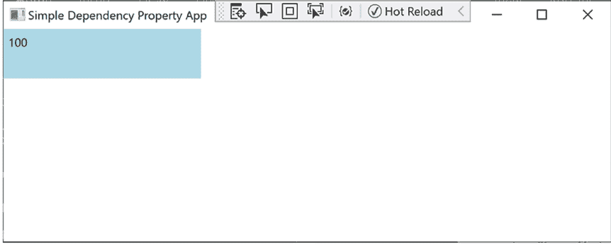

## Figure 25-23. It appears your property works as expected

然而，如果你想将一个动画对象应用于 CurrentNumber 属性，以便值在 10 秒的时间段内从 100 变化到 200 呢？如果你想在标记中这样做，你可能会像这样更新你的 myCtrls:ShowNumberControl 范围：

```
<myCtrls:ShowNumberControl x:Name="myShowNumberCtrl" CurrentNumber="100">
    <myCtrls:ShowNumberControl.Triggers>
        <EventTrigger RoutedEvent = "myCtrls:ShowNumberControl.Loaded">
            <EventTrigger.Actions>
                <BeginStoryboard>
                    <Storyboard TargetProperty = "CurrentNumber">
                        <Int32Animation From = "100" To = "200" Duration = "0:0:10"/>
                    </Storyboard>
                </BeginStoryboard>
            </EventTrigger.Actions>
        </EventTrigger>
    </myCtrls:ShowNumberControl.Triggers>
</myCtrls:ShowNumberControl>
```

如果你运行你的应用程序，动画对象找不到合适的目标，并抛出异常。原因是 CurrentNumber 属性尚未注册为依赖属性！要修复这个问题，返回到你的自定义控件的代码文件，并完全注释掉当前的属性逻辑（包括私有备份字段）。

现在，添加以下代码以将 CurrentNumber 创建为依赖属性：

```
public int CurrentNumber
{
    get => (int)GetValue(CurrentNumberProperty);
    set => SetValue(CurrentNumberProperty, value);
}
public static readonly DependencyProperty CurrentNumberProperty =
    DependencyProperty.Register("CurrentNumber",
    typeof(int),
    typeof(ShowNumberControl),
    new UIPropertyMetadata(0));
```

这与你在 Height 属性的实现中看到的类似；然而，代码片段是在线注册属性，而不是在静态构造函数中（这是可以的）。还请注意，使用 UIPropertyMetadata 对象来定义整数的默认值（0），而不是更复杂的 FrameworkPropertyMetadata 对象。这是 CurrentNumber 作为依赖属性的最简单版本。

## Adding a Data Validation Routine

虽然你现在有一个名为 CurrentNumber 的依赖属性（并且异常不再抛出），但你仍然看不到动画生效。你可能想要做的下一个调整是指定一个函数来调用以执行一些数据验证逻辑。对于本示例，假设你需要确保 CurrentNumber 的值在 0 到 500 之间。

为此，将一个最终参数添加到 DependencyProperty.Register() 方法，类型为 ValidateValueCallback，它指向一个名为 ValidateCurrentNumber 的方法。

ValidateValueCallback 是一个委托，只能指向返回 bool 且仅接受 object 作为参数的方法。此对象代表正在被赋值的新的值。实现 ValidateCurrentNumber 以在传入值在预期范围内时返回 true 或 false。

```
public static readonly DependencyProperty CurrentNumberProperty =
    DependencyProperty.Register("CurrentNumber",
        typeof(int),
        typeof(ShowNumberControl),
        new UIPropertyMetadata(100),
        new ValidateValueCallback(ValidateCurrentNumber));

// Just a simple rule. Value must be between 0 and 500.
public static bool ValidateCurrentNumber(object value) =>
    Convert.ToInt32(value) >= 0 && Convert.ToInt32(value) <= 500;
```

## Responding to the Property Change

所以，现在你有一个有效数字但仍然没有动画。你需要做的最后一次更改是为 UIPropertyMetadata 构造函数的第二个参数指定一个 PropertyChangedCallback 对象。此委托可以指向任何接受 DependencyObject 作为第一个参数和 DependencyPropertyChangedEventArgs 作为第二个参数的方法。首先，按如下方式更新你的代码：

```
// Note the second param of UIPropertyMetadata constructor.
public static readonly DependencyProperty CurrentNumberProperty =
    DependencyProperty.Register("CurrentNumber", typeof(int), typeof(ShowNumberControl),
        new UIPropertyMetadata(100, new PropertyChangedCallback(CurrentNumberChanged)),
        new ValidateValueCallback(ValidateCurrentNumber));
```

在 CurrentNumberChanged() 方法中，你的最终目标是将 Label 的 Content 更改为 CurrentNumber 属性分配的新值。然而，你有一个大问题：CurrentNumberChanged() 方法必须是静态的，因为它必须与静态 DependencyProperty 对象一起工作。那么，你如何 supposed 获得对 ShowNumberControl 当前实例的 Label 的访问权限呢？


该引用包含在第一个 DependencyObject 参数中。你可以使用传入的事件参数找到新值。以下是将更改 Label 的 Content 属性所需的代码：

```
private static void CurrentNumberChanged(DependencyObject depObj,
DependencyPropertyChangedEventArgs args)
{
    // Cast the DependencyObject into ShowNumberControl.
    ShowNumberControl c = (ShowNumberControl)depObj;
    // Get the Label control in the ShowNumberControl.
    Label theLabel = c.numberDisplay;
    // Set the Label with the new value.
    theLabel.Content = args.NewValue.ToString();
}
```

呼！仅为了更改标签的输出，这条路可真够长的。好处是，你的 CurrentNumber 依赖属性现在可以成为 WPF 样式、动画对象、数据绑定操作等的目标。如果你再次运行应用程序，应该会在执行过程中看到值的变化。

这就是对 WPF 依赖属性的全部介绍。虽然我希望你现在对这些构造能做什么有了更好的了解，也对如何创建自己的依赖属性有了更好的认识，但请注意，这里还有很多细节我没有涉及。

如果你正在构建许多支持自定义属性的自定义控件，请查阅 .NET Framework 4.7 SDK 文档中“WPF Fundamentals”节点下的“Properties”主题。在其中，你将找到更多关于构建依赖属性、附加属性、配置属性元数据的各种方式以及其他大量细节的示例。

## 小结

本章探讨了 WPF 控件的几个方面，首先概述了控件工具包和布局管理器（面板）的作用。第一个示例让你有机会构建一个简单的文字处理应用程序，该程序演示了 WPF 集成的拼写检查功能，以及如何构建带有菜单系统、状态栏和工具栏的主窗口。

更重要的是，你了解了如何使用 WPF 命令。回想一下，你可以将这些与控件无关的事件附加到 UI 元素或输入手势上，以自动继承开箱即用的服务（例如剪贴板操作）。

你还学习了如何在 XAML 中构建复杂的 UI，同时了解了 WPF 墨迹 API。你还了解了 WPF 数据绑定操作，包括如何使用 WPF DataGrid 类显示来自自定义 AutoLot 数据库的数据。

最后，你探讨了 WPF 如何对传统 .NET Core 编程基元（特别是属性和事件）进行独特诠释。正如你所见，依赖属性允许你构建能够集成到 WPF 服务集（动画、数据绑定、样式等）中的属性。与此相关，路由事件提供了一种让事件在标记树中向上或向下流动的方式。

## WPF 图形渲染服务

在本章中，你将了解 WPF 的图形渲染能力。你会看到，WPF 提供了三种不同的方式来渲染图形数据：形状、绘图和视觉。在理解了每种方法的优缺点之后，你将开始学习如何使用 System.Windows.Shapes 中的类来探索交互式 2D 图形世界。之后，你将看到绘图和几何如何以更轻量的方式渲染 2D 数据。最后，你将学习视觉层如何为你提供最高级别的能力和性能。

在此过程中，你将探索几个相关主题，例如如何创建自定义画刷和画笔，如何将图形变换应用于渲染，以及如何执行命中测试操作。你将看到 Visual Studio 的集成工具以及一个名为 Inkscape 的附加工具如何简化你的图形编码工作。

> 注意：图形是 WPF 开发的一个关键方面。即使你不是在构建图形密集型应用（如视频游戏或多媒体应用），本章中的主题在处理控件模板、动画和数据绑定自定义等服务时也至关重要。

## 理解 WPF 的图形渲染服务

WPF 使用一种称为保留模式图形的特定图形渲染风格。简而言之，这意味着由于你使用 XAML 或过程式代码来生成图形渲染，因此 WPF 有责任持久化这些视觉项，并确保它们以最佳方式被正确重绘和刷新。因此，当你渲染图形数据时，它始终存在，即使最终用户通过调整大小或最小化窗口、用另一个窗口覆盖窗口等方式隐藏图像，也是如此。

与之形成鲜明对比的是，以前的 Microsoft 图形渲染 API（包括 Windows Forms 的 GDI+）是即时模式图形系统。在这种模型中，程序员需要确保渲染的视觉对象在应用程序生命周期内被正确“记住”和更新。例如，在 Windows Forms 应用程序中，渲染一个矩形这样的形状涉及处理 Paint 事件（或重写虚拟的 OnPaint() 方法）、获取 Graphics 对象来绘制矩形，更重要的是，添加基础设施以确保在用户调整窗口大小时图像得以持久化（例如，创建成员变量来表示矩形的位置，并在整个程序中调用 Invalidate()）。

从即时模式到保留模式图形的转变确实是一件好事，因为程序员需要编写和维护的繁琐图形代码少得多。然而，我并不是说 WPF 图形 API 与早期的渲染工具包完全不同。例如，与 GDI+ 一样，WPF 支持各种画刷类型和画笔对象、命中测试技术、裁剪区域、图形变换等。因此，如果你目前有 GDI+（或基于 C/C++ 的 GDI）背景，你已经对如何在 WPF 下执行基本渲染有了相当多的了解。

## WPF 图形渲染选项

与 WPF 开发的其他方面一样，除了决定通过 XAML 或过程式 C# 代码（或两者的组合）来执行图形渲染之外，你还可以有多种选择。具体来说，WPF 提供了以下三种不同的方式来渲染图形数据：

- *形状*：WPF 提供了 System.Windows.Shapes 命名空间，其中定义了一些用于渲染 2D 几何对象（矩形、椭圆、多边形等）的类。虽然这些类型简单易用且功能强大，但如果随意使用，它们会带来相当大的内存开销。

- *绘图和几何*：WPF API 提供了第二种渲染图形数据的方式，使用 System.Windows.Media.Drawing 抽象类的派生类。通过使用 GeometryDrawing 或 ImageDrawing 等类（以及各种几何对象），你可以以更轻量（但功能较少）的方式渲染图形数据。

- *视觉对象*：在 WPF 下渲染图形数据最快、最轻量的方式是使用视觉层，该层只能通过 C# 代码访问。使用 System.Windows.Media.Visual 的派生类，你可以直接与 WPF 图形子系统通信。

提供不同方式来做同一件事（即渲染图形数据）的原因与内存使用以及最终的应用程序性能有关。由于 WPF 是一个图形密集型系统，应用程序在窗口表面上渲染数百甚至数千个不同图像并非不合理，而实现方式（形状、绘图或视觉对象）的选择可能会产生巨大影响。

请务必理解，在构建 WPF 应用程序时，你很可能会使用全部三种选项。根据经验法则，如果你需要适量且可由用户操作的交互式图形数据（接收鼠标输入、显示工具提示等），你应使用 System.Windows.Shapes 命名空间中的成员。

相比之下，当你需要使用 XAML 或 C# 建模复杂的、通常非交互的、基于矢量的图形数据时，绘图和几何更合适。虽然绘图和几何仍能响应鼠标事件、命中测试和拖放操作，但你通常需要编写更多代码才能实现。

最后但同样重要的是，如果你需要以最快的方式渲染大量图形数据，视觉层是首选。例如，假设你正在使用 WPF 构建一个可以绘制数千个数据点的科学应用程序。使用视觉层，你可以以尽可能最优的方式渲染绘图点。正如你稍后将在本章中看到的，视觉层只能通过 C# 代码访问，并且对 XAML 不友好。

无论你采用哪种方法（形状、绘图和几何，或视觉对象），你都会使用常见的图形基元，例如画刷（填充内部）、画笔（绘制外部）和变换对象（用于变换数据）。要开始这段旅程，你将首先使用 System.Windows.Shapes 中的类。

> 注意：WPF 还提供了一个完整的 API，用于渲染和操作 3D 图形，但本书不涉及这一部分。


## 使用形状渲染图形数据

System.Windows.Shapes 命名空间的成员提供了渲染二维图像最直接、交互性最强，但内存占用也最高的方式。该命名空间（定义于 PresentationFramework.dll 程序集中）非常小，只包含六个继承自抽象 Shape 基类的密封类：Ellipse、Rectangle、Line、Polygon、Polyline 和 Path。

抽象 Shape 类继承自 FrameworkElement，而 FrameworkElement 继承自 UIElement。这些类定义了用于处理尺寸、工具提示、鼠标光标等内容的成员。考虑到这一继承链，当你使用 Shape 派生类渲染图形数据时，这些对象在用户交互方面几乎与 WPF 控件一样功能强大！

例如，判断用户是否点击了渲染出的图像，其复杂度不高于处理 MouseDown 事件。举个例子，如果你在初始 Window 的 Grid 中编写了如下 Rectangle 对象的 XAML：

```
<Rectangle x:Name="myRect" Height="30" Width="30" Fill="Green" MouseDown="myRect_MouseDown"/>
```

你可以为 MouseDown 事件实现一个 C# 事件处理器，当点击时改变矩形的背景颜色，如下所示：

```
private void myRect_MouseDown(object sender, MouseButtonEventArgs e)
{
    // Change color of Rectangle when clicked.
    myRect.Fill = Brushes.Pink;
}
```

与你可能使用过的其他图形工具包不同，你无需编写大量基础结构代码来手动将鼠标坐标映射到几何图形、手动计算命中测试、渲染到屏幕外缓冲区等。System.Windows.Shapes 的成员只是响应你注册的事件，就像典型的 WPF 控件（例如 Button 等）一样。

所有这些开箱即用功能的缺点是，形状确实会占用相当多的内存。如果你正在构建一个在屏幕上绘制数千个点的科学应用程序，使用形状将是一个糟糕的选择（本质上，其内存占用与渲染数千个 Button 对象相当！）。然而，当你需要生成交互式 2D 矢量图像时，形状是一个绝佳的选择。

除了从 UIElement 和 FrameworkElement 父类继承的功能外，Shape 还为每个子类定义了许多成员；表 26-1 展示了一些更有用的成员。

**表 26-1. Shape 基类的关键属性**

| 属性 | 含义 |
|---|---|
| DefiningGeometry | 返回一个 Geometry 对象，表示当前形状的整体尺寸。该对象仅包含用于渲染数据的绘图点，不含 UIElement 或 FrameworkElement 的任何功能痕迹。 |
| Fill | 允许你指定一个画刷对象来填充形状的内部区域。 |
| GeometryTransform | 允许你在形状渲染到屏幕之前对其应用变换。继承的 RenderTransform 属性（来自 UIElement）在形状渲染到屏幕后应用变换。 |
| Stretch | 描述如何在分配给形状的空间内填充形状，例如在布局管理器中的位置。这是通过相应的 System.Windows.Media.Stretch 枚举控制的。 |
| Stroke | 定义一个画刷对象，在某些情况下也可定义画笔对象（实际上是画刷的变体），用于绘制形状的边框。 |
| StrokeDashArray、StrokeEndLineCap、StrokeStartLineCap、StrokeThickness | 这些（以及其他）与笔画相关的属性控制绘制形状边框时线条的配置方式。在大多数情况下，这些属性将配置用于绘制边框或线条的画刷。 |

> 注意 如果你忘记设置 Fill 和 Stroke 属性，WPF 会提供“不可见”的画刷，因此形状在屏幕上将不可见！

### 向 Canvas 中添加矩形、椭圆和线条

你将构建一个能够使用 XAML 和 C# 渲染形状的 WPF 应用程序，并在此过程中了解一些命中测试的知识。创建一个名为 RenderingWithShapes 的新 WPF 应用程序，并将 MainWindow.xaml 的标题改为“有趣的形状！”。然后更新 `<Window>` 的初始 XAML，将 Grid 替换为包含一个（目前为空的）`<ToolBar>` 和一个 `<Canvas>` 的 `<DockPanel>`。请注意，每个包含的项目都通过 Name 属性具有合适的名称。

```
<DockPanel LastChildFill="True">
    <ToolBar DockPanel.Dock="Top" Name="mainToolBar" Height="50">
    </ToolBar>
    <Canvas Background="LightBlue" Name="canvasDrawingArea"/>
</DockPanel>
```

现在，用一组 `<RadioButton>` 对象填充 `<ToolBar>`，每个对象都包含一个特定的 Shape 派生类作为内容。请注意，每个 `<RadioButton>` 都被分配到相同的 GroupName（以确保互斥性），并且也被赋予了合适的名称。

```
<ToolBar DockPanel.Dock="Top" Name="mainToolBar" Height="50">
    <RadioButton Name="circleOption" GroupName="shapeSelection" Click="CircleOption_Click">
        <Ellipse Fill="Green" Height="35" Width="35" />
    </RadioButton>
    <RadioButton Name="rectOption" GroupName="shapeSelection" Click="RectOption_Click">
        <Rectangle Fill="Red" Height="35" Width="35" RadiusY="10" RadiusX="10" />
    </RadioButton>
    <RadioButton Name="lineOption" GroupName="shapeSelection" Click="LineOption_Click">
        <Line Height="35" Width="35" StrokeThickness="10" Stroke="Blue"
            X1="10" Y1="10" Y2="25" X2="25"
            StrokeStartLineCap="Triangle" StrokeEndLineCap="Round" />
    </RadioButton>
</ToolBar>
```

如你所见，在 XAML 中声明 Rectangle、Ellipse 和 Line 对象非常直接，无需太多解释。回想一下，Fill 属性用于指定画刷来绘制形状的内部。当你需要纯色画刷时，只需指定一个已知值的硬编码字符串，底层的类型转换器就会生成正确的对象。Rectangle 类型的一个有趣特性是它定义了 RadiusX 和 RadiusY 属性，允许你渲染圆角。

Line 使用 X1、X2、Y1 和 Y2 属性表示其起点和终点（因为高度和宽度在描述线条时意义不大）。此处你设置了一些附加属性，控制 Line 起点和终点的渲染方式，以及如何配置笔画设置。图 26-1 显示了通过 Visual Studio WPF 设计器看到的渲染后的工具栏。

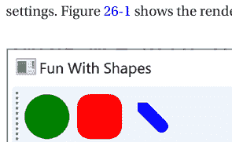

图 26-1. 使用 Shape 作为一组 RadioButton 的内容

现在，使用 Visual Studio 的“属性”窗口，为 Canvas 处理 MouseLeftButtonDown 事件，并为每个 RadioButton 处理 Click 事件。在 C# 文件中，你的目标是在用户点击 Canvas 内部时渲染选中的形状（圆形、正方形或线条）。首先，在 Window 派生类中定义以下嵌套枚举（以及相应的成员变量）：

```
public partial class MainWindow : Window
{
    private enum SelectedShape
    { Circle, Rectangle, Line }
    private SelectedShape _currentShape;
}
```

在每个 Click 事件处理程序中，将 `_currentShape` 成员变量设置为正确的 SelectedShape 值，如下所示：

```
private void CircleOption_Click(object sender, RoutedEventArgs e)
{
    _currentShape = SelectedShape.Circle;
}

private void RectOption_Click(object sender, RoutedEventArgs e)
{
    _currentShape = SelectedShape.Rectangle;
}

private void LineOption_Click(object sender, RoutedEventArgs e)
{
    _currentShape = SelectedShape.Line;
}
```

在 Canvas 的 MouseLeftButtonDown 事件处理程序中，你将使用鼠标光标的 X、Y 位置作为起点，渲染出正确的形状（预定义大小）。以下是完整实现，随后进行分析：

```
private void CanvasDrawingArea_MouseLeftButtonDown(object sender, MouseButtonEventArgs e)
{
    Shape shapeToRender = null;
    // Configure the correct shape to draw.
    switch (_currentShape)
    {
        case SelectedShape.Circle:
            shapeToRender = new Ellipse() { Fill = Brushes.Green, Height = 35, Width = 35 };
            break;
        case SelectedShape.Rectangle:
            shapeToRender = new Rectangle()
            { Fill = Brushes.Red, Height = 35, Width = 35, RadiusX = 10, RadiusY = 10 };
            break;
        case SelectedShape.Line:
            shapeToRender = new Line()
            {
                Stroke = Brushes.Blue,
                StrokeThickness = 10,
                X1 = 0, X2 = 50, Y1 = 0, Y2 = 50,
                StrokeStartLineCap= PenLineCap.Triangle,
                StrokeEndLineCap = PenLineCap.Round
            };
            break;
        default:
            return;
    }
    // Set top/left position to draw in the canvas.
    Canvas.SetLeft(shapeToRender, e.GetPosition(canvasDrawingArea).X);
    Canvas.SetTop(shapeToRender, e.GetPosition(canvasDrawingArea).Y);
    // Draw shape!
    canvasDrawingArea.Children.Add(shapeToRender);
}
```


> 注意 你可能会注意到，在此方法中创建的 Ellipse、Rectangle 和 Line 对象具有与对应的 XAML 定义相同的属性设置！正如你所希望的那样，你可以简化这段代码，但这需要理解 WPF 对象资源，而你将在第 27 章中研究这个问题。

如你所见，你正在测试 currentShape 成员变量以创建正确的 Shape 派生对象。此后，你使用传入的 MouseButtonEventArgs 在 Canvas 中设置左上角的值。最后但同样重要的是，你将新的 Shape 派生类型添加到 Canvas 维护的 UIElement 对象集合中。如果现在运行你的程序，你应该能够在画布的任何位置单击并看到所选形状在左鼠标单击位置渲染。

## 从 Canvas 中移除矩形、椭圆和线条

由于 Canvas 维护着一个对象集合，你可能会想知道如何动态移除一个项目，例如响应用户右键单击一个形状。你当然可以使用 System.Windows.Media 命名空间中的 VisualTreeHelper 类来实现这一点。第 27 章将详细解释“视觉树”和“逻辑树”的作用。在此之前，你可以在 Canvas 对象上处理 MouseRightButtonDown 事件并像这样实现相应的事件处理程序：

```
private void CanvasDrawingArea_MouseRightButtonDown(object sender, MouseButtonEventArgs e)
{
    // First, get the X,Y location of where the user clicked.
    Point pt = e.GetPosition((Canvas)sender);
    // Use the HitTest() method of VisualTreeHelper to see if the user clicked
    // on an item in the canvas.
    HitTestResult result = VisualTreeHelper.HitTest(canvasDrawingArea, pt);
    // If the result is not null, they DID click on a shape!
    if (result != null)
    {
        // Get the underlying shape clicked on, and remove it from
        // the canvas.
        canvasDrawingArea.Children.Remove(result.VisualHit as Shape);
    }
}
```

此方法首先获取用户在 Canvas 中单击的确切 X,Y 位置，并通过静态 VisualTreeHelper.HitTest() 方法执行一次命中测试操作。返回值 HitTestResult 对象，如果用户未单击 Canvas 内的 UIElement，则将设置为 null。如果 HitTestResult 不为 null，你可以通过 VisualHit 属性获取被单击的底层 UIElement，该属性被强制转换为 Shape 派生对象（记住，Canvas 可以容纳任何 UIElement，而不仅仅是形状！）。再次说明，“视觉树”究竟是什么，你将在下一章获得更多详细信息。

> 注意 默认情况下，VisualTreeHelper.HitTest() 返回被单击的最上层 UIElement，并且不提供有关该项目下方其他对象的信息（例如，按 Z 顺序重叠的对象）。

有了此修改，你应该能够通过左键单击向画布添加形状，并通过右键单击从画布中删除项目！

到目前为止，一切顺利。此时，你已使用 XAML 在 RadioButtons 上使用 Shape 派生对象渲染内容，并使用 C# 填充 Canvas。当你研究画刷和图形变换的作用时，你将为此示例添加更多功能。相关说明，本章中的另一个示例将说明在 UIElement 对象上拖放技术的用法。在此之前，让我们研究 System.Windows.Shapes 的剩余成员。

## 使用折线和多边形

当前示例仅使用了三个 Shape 派生类。剩余的子类（Polyline、Polygon 和 Path）如果没有工具支持（例如 Microsoft Blend，专为 WPF 开发人员设计的 Visual Studio 伴随工具，或其他可以创建矢量图形的工具）则极其繁琐地正确渲染，仅仅因为它们需要大量绘图点来表示其输出。以下是剩余 Shapes 类型的概述。

Polyline 类型允许你定义一组 (x, y) 坐标（通过 Points 属性）来绘制一系列不需要连接端点的线段。Polygon 类型类似；然而，它被编程为始终闭合起始点和结束点，并用指定的画刷填充内部。假设你已在 Kaxaml 编辑器中编写了以下 <StackPanel>：

```
<!-- Polylines do not automatically connect the ends. -->
<Polyline Stroke ="Red" StrokeThickness ="20" StrokeLineJoin ="Round" Points ="10,10 40,40 10,90 300,50"/>
<!-- A Polygon always closes the end points. -->
<Polygon Fill ="AliceBlue" StrokeThickness ="5" Stroke ="Green" Points ="40,10 70,80 10,50" />
```

图 26-2 显示了 Kaxaml 中的渲染输出。


图 26-2. 多边形和折线

## 使用路径

仅使用 Rectangle、Ellipse、Polygon、Polyline 和 Line 类型来绘制详细的 2D 矢量图像将极其复杂，因为这些原语不允许你轻松捕获曲线、重叠数据的并集等图形数据。最后一个 Shape 派生类 Path 提供了定义作为独立几何图形集合表示的复杂 2D 图形数据的能力。在定义了此类几何图形的集合后，你可以将它们分配给 Path 类的 Data 属性，其中此信息将用于渲染你的复杂 2D 图像。

Data 属性接受一个 System.Windows.Media.Geometry 派生类，其中包含表 26-2 中描述的关键成员。

## 表 26-2. System.Windows.Media.Geometry 类型的选定成员

| 成员 | 意义 |
|---|---|
| Bounds | 建立包含几何图形的当前边界矩形。 |
| FillContains() | 确定给定的 Point（或其他 Geometry 对象）是否在特定 Geometry 派生类的边界内。这对于命中测试计算很有用。 |
| GetArea() | 返回 Geometry 派生类型占用的整个面积。 |
| GetRenderBounds() | 返回包含可用于渲染 Geometry 派生类的最小可能矩形的 Rect。 |
| Transform | 将 Transform 对象分配给几何图形以改变渲染。 |

扩展 Geometry 的类（见表 26-3）看起来与它们的 Shape 派生对应物非常相似。例如，EllipseGeometry 具有与 Ellipse 相似的成员。最大的区别在于 Geometry 派生类不知道如何直接渲染自己，因为它们不是 UIElements。相反，Geometry 派生类代表的不过是一组绘图点数据，它说“如果 Path 使用我的数据，这就是我将如何渲染自己。”

## 表 26-3. Geometry 派生类

| 几何类 | 意义 |
|---|---|
| LineGeometry | 表示一条直线 |
| RectangleGeometry | 表示一个矩形 |
| EllipseGeometry | 表示一个椭圆 |
| GeometryGroup | 允许你对多个 Geometry 对象进行分组 |
| CombinedGeometry | 允许你将两个不同的 Geometry 对象合并为一个形状 |
| PathGeometry | 表示由线条和曲线组成的图形 |

> 注意 Path 并不是 WPF 中唯一可以使用几何图形集合的类。例如，DoubleAnimationUsingPath、DrawingGroup、GeometryDrawing，甚至 UIElement 都可以使用几何图形进行渲染，分别使用 PathGeometry、ClipGeometry、Geometry 和 Clip 属性。

以下是使用一些 Geometry 派生类型的 Path。注意你将 Path 的 Data 属性设置为包含其他 Geometry 派生对象（如 EllipseGeometry、RectangleGeometry 和 LineGeometry）的 GeometryGroup 对象。图 26-3 显示了输出。

```
<!-- A Path contains a set of geometry objects, set with the Data property. -->
<Path Fill = "Orange" Stroke = "Blue" StrokeThickness = "3">
    <Path.Data>
        <GeometryGroup>
            <EllipseGeometry Center = "75,70" RadiusX = "30" RadiusY = "30" />
            <RectangleGeometry Rect = "25,55 100 30" />
            <LineGeometry StartPoint="0,0" EndPoint="70,30" />
            <LineGeometry StartPoint="70,30" EndPoint="0,30" />
```


</GeometryGroup>
</Path.Data>
</Path>


图 26-3。包含各种 Geometry 对象的 Path

图 26-3 中的图像也可以使用前面介绍的 Line、Ellipse 和 Rectangle 类绘制。不过，这样会在内存中创建多个 UIElement 对象。使用几何图形对要绘制的图形点进行建模，然后将几何图形集合放入能够呈现数据的容器中（此处为 Path），可以减少内存开销。

现在回想一下，Path 的继承链与 System.Windows.Shapes 中的其他成员相同，因此它也能像其他 UIElement 对象一样发送事件通知。因此，如果你在 Visual Studio 项目中定义相同的 `<Path>` 元素，只需处理鼠标事件，就可以判断用户是否单击了曲线上的任意位置（请记住，Kaxaml 不允许你为自己编写的标记处理事件）。

## Path 建模“迷你语言”

表 26-3 中列出的所有类里，PathGeometry 在通过 XAML 或代码进行配置时最为复杂。这是因为 PathGeometry 的每个段都由包含各种段和图形的对象组成（例如 ArcSegment、BezierSegment、LineSegment、PolyBezierSegment、PolylineSegment、PolyQuadraticBezierSegment 等）。下面是一个 Path 对象示例，其 Data 属性被设置为一个由多个图形和线段组成的 `<PathGeometry>`：

```
<Path Stroke="Black" StrokeThickness="1" >
    <Path.Data>
        <PathGeometry>
            <PathGeometry.Figures>
                <PathFigure StartPoint="10,50">
                    <PathFigure.Segments>
                        <BezierSegment
                            Point1="100,0"
                            Point2="200,200"
                            Point3="300,100"/>
                        <LineSegment Point="400,100" />
                        <ArcSegment
                            Size="50,50" RotationAngle="45"
                            IsLargeArc="True" SweepDirection="Clockwise"
                            Point="200,100"/>
                    </PathFigure.Segments>
</PathFigure>
</PathGeometry>
</PathGeometry.Figures>
</Path.Data>
</Path>
```

坦率地说，很少有程序员需要通过直接描述派生自 Geometry 或 PathSegment 的类，来手动构建复杂的二维图像。本章后面会介绍如何将矢量图形转换为可在 XAML 中使用的路径语句。

即使借助这些工具，定义复杂 Path 对象所需的 XAML 也会多得令人难以忍受，因为数据包含了对各种派生自 Geometry 或 PathSegment 的类的完整描述。为了生成更简洁紧凑的标记，Path 类被设计为能够理解一种专用的“迷你语言”。

例如，你无需将 Path 的 Data 属性设置为由 Geometry 和 PathSegment 派生类型组成的集合，而是可以将其设置为一个字符串字面量，其中包含若干已知符号和用于定义待绘制形状的各种值。下面是一个简单示例，其输出结果如图 26-4 所示：

```
<Path Stroke="Black" StrokeThickness="3" Data="M 10,75 C 70,15 250,270 300,175 H 240" />
```


图 26-4。Path 迷你语言可以简洁地描述 Geometry/PathSegment 对象模型

M 命令（move 的缩写）接受一个 X、Y 坐标，表示绘图的起点。C 命令接受一系列绘图点来绘制曲线（具体来说，是三次贝塞尔曲线），而 H 命令用于绘制水平线。

坦率地说，你需要手动构建或解析包含 Path 迷你语言指令的字符串字面量的可能性微乎其微。不过，至少当你查看由 XAML 生成的专用工具时，就不会再感到意外了。

## WPF 画刷与画笔

WPF 的每种图形呈现方式（形状、Drawing 和几何图形，以及 Visual）都大量使用画刷，以便控制如何填充二维表面的内部。WPF 提供了六种不同的画刷类型，它们都继承自 System.Windows.Media.Brush。Brush 是抽象类，但表 26-4 中介绍的派生类几乎可以用任何你能想到的方式填充区域。

### 表 26-4。WPF Brush 派生类型

| 画刷类型 | 用途 |
|---|---|
| DrawingBrush | 使用派生自 Drawing 的对象（GeometryDrawing、ImageDrawing 或 VideoDrawing）绘制区域 |
| ImageBrush | 使用图像（由 ImageSource 对象表示）绘制区域 |
| LinearGradientBrush | 使用线性渐变绘制区域 |
| RadialGradientBrush | 使用径向渐变绘制区域 |
| SolidColorBrush | 使用通过 Color 属性设置的单一颜色绘制区域 |
| VisualBrush | 使用派生自 Visual 的对象（DrawingVisual、Viewport3DVisual 和 ContainerVisual）绘制区域 |

DrawingBrush 和 VisualBrush 类允许你基于现有的 Drawing 或 Visual 派生类构建画刷。在使用 WPF 的另外两种图形选项（Drawing 或 Visual）时会用到这些画刷类，本章稍后将对此进行介绍。

顾名思义，ImageBrush 允许你通过设置 ImageSource 属性，构建一个显示外部文件或嵌入式应用程序资源中的图像数据的画刷。其余的画刷类型（LinearGradientBrush 和 RadialGradientBrush）用起来相当简单，不过输入所需的 XAML 可能会有些冗长。值得庆幸的是，Visual Studio 支持集成式画刷编辑器，可以轻松生成风格化的画刷。

## 使用 Visual Studio 配置画刷

让我们更新 WPF 绘图程序 RenderingWithShapes，使用一些更有趣的画刷。到目前为止，你在工具栏上用于呈现数据的三个形状都使用了简单的纯色，因此可以用简单的字符串字面量表示它们的值。现在，为了让效果更丰富一些，我们将使用集成式画刷编辑器。请确保 IDE 中打开的是初始窗口的 XAML 编辑器，然后选择 Ellipse 元素。接着，在“属性”窗口中找到“画刷”类别，再单击顶部列出的 Fill 属性（参见图 26-5）。

### 图 26-5。任何需要画刷的属性都可以通过集成式画刷编辑器进行配置

在“画刷”编辑器顶部，你会看到一组适用于所选项的“画刷兼容”属性（即 Fill、Stroke 和 OpacityMask）。下方是一系列选项卡，可用于配置不同类型的画刷，其中包括当前的纯色画刷。你可以使用颜色选择工具以及 ARGB（Alpha、红、绿、蓝，其中“Alpha”控制透明度）编辑器来控制当前画刷的颜色。利用这些滑块和相关的颜色选择区域，可以创建任意类型的纯色。使用这些工具更改 Ellipse 的 Fill 颜色，并查看生成的 XAML。你会发现，颜色以十六进制值存储，如下所示：

```
<Ellipse Fill="#FF47CE47" Height="35" Width="35" />
```

更有意思的是，同一个编辑器还允许你配置渐变画刷，用于定义一系列颜色及其过渡点。回想一下，“画刷”编辑器提供了一组用于配置画刷的选项卡，第一个选项卡允许你设置空画刷，使其不产生任何呈现输出。其余四个选项卡分别用于设置纯色画刷（刚才介绍的类型）、渐变画刷、平铺画刷或图像画刷。
单击渐变画刷按钮后，编辑器会显示一些新选项（参见图 26-6）。左下方的三个按钮分别用于选择线性渐变、选择径向渐变或反转渐变色标。最下方的色带会显示各个渐变色标的当前颜色，每个色标都由色带上的一个“滑块”标记。拖动这些滑块在渐变色带上移动，即可控制渐变偏移量。此外，单击某个滑块后，可以通过颜色选择器更改对应渐变色标的颜色。最后，直接单击渐变色带即可添加渐变色标。

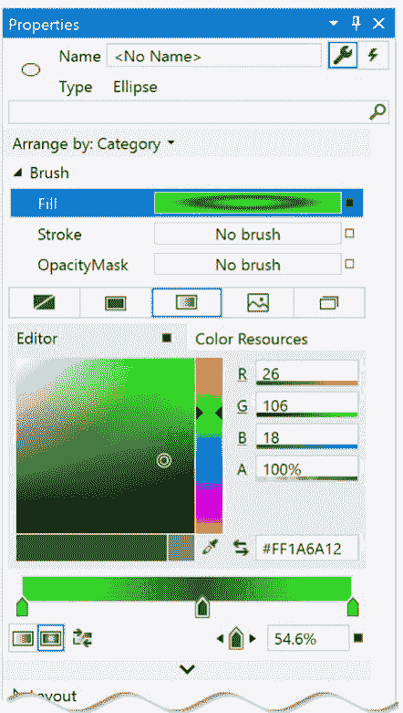

图 26-6。Visual Studio 画刷编辑器允许你创建基本的渐变画刷


花几分钟时间试用此编辑器，制作一个包含三个渐变停止点的径向渐变画刷，并设置为你选择的颜色。图 26-6 显示了你刚刚构建的画刷，使用了三种不同的绿色。

完成后，IDE 将使用属性元素语法，用自定义画刷更新你的 XAML，并将其设置为与画刷兼容的属性（在本例中为 Ellipse 的 Fill 属性），如下所示：

```xml
<Ellipse Height="35" Width="35">
    <Ellipse.Fill>
        <RadialGradientBrush>
            <GradientStop Color="#FF17F800"/>
            <GradientStop Color="#FF24F610" Offset="1"/>
            <GradientStop Color="#FF1A6A12" Offset="0.546"/>
        </RadialGradientBrush>
    </Ellipse.Fill>
</Ellipse>
```

## 在代码中配置画刷

现在你已经为 Ellipse 的 XAML 定义构建了一个自定义画刷，对应的 C# 代码已过时，因为它仍会渲染一个纯绿色圆圈。为了同步回来，更新正确的 case 语句以使用你刚刚创建的相同画刷。以下是最必要的更新，看起来比你预期的更复杂，只是因为你需要通过 System.Windows.Media.ColorConverter 类将十六进制值转换为适当的 Color 对象（参见图 26-7 中的修改后输出）：

```csharp
case SelectedShape.Circle:
    shapeToRender = new Ellipse() { Height = 35, Width = 35 };
    // Make a RadialGradientBrush in code!
    RadialGradientBrush brush = new RadialGradientBrush();
    brush.GradientStops.Add(new GradientStop(
        (Color)ColorConverter.ConvertFromString("#FF77F177"), 0));
    brush.GradientStops.Add(new GradientStop(
        (Color)ColorConverter.ConvertFromString("#FF11E611"), 1));
    brush.GradientStops.Add(new GradientStop(
        (Color)ColorConverter.ConvertFromString("#FF5A8E5A"), 0.545));
    shapeToRender.Fill = brush;
    break;
```

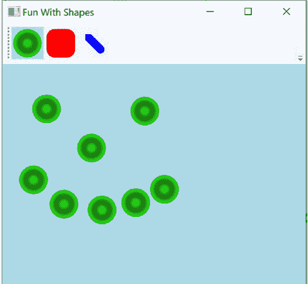

## 图 26-7. 绘制更有活力的圆圈

顺便说一下，你可以通过使用 Colors 枚举作为第一个构造函数参数指定一个简单颜色来构建 GradientStop 对象，该枚举返回一个已配置的 Color 对象。

```csharp
GradientStop g = new GradientStop(Colors.Aquamarine, 1);
```

或者，如果你需要更精细的控制，也可以传入一个已配置的 Color 对象，如下所示：

```csharp
Color myColor = new Color() { R = 200, G = 100, B = 20, A = 40 };
GradientStop g = new GradientStop(myColor, 34);
```

当然，Colors 枚举和 Color 类并不局限于渐变画刷。只要你在代码中需要表示颜色值，就可以使用它们。

## 配置画笔

与画刷相比，画笔是用于绘制几何图形边框的对象，或者在 Line 或 PolyLine 类的情况下，是线几何图形本身。具体来说，Pen 类允许你绘制指定的厚度，由 double 值表示。此外，Pen 可以配置与 Shape 类中看到的同类属性，例如起始和结束画笔端帽、点划线模式等。例如，你可以向形状添加以下标记来定义画笔属性：

```xml
<Pen Thickness="10" LineJoin="Round" EndLineCap="Triangle" StartLineCap="Round" />
```

在许多情况下，你无需直接创建 Pen 对象，因为在将值分配给属性（如 Shape 派生类型的 StrokeThickness 以及其他 UIElement）时，这会间接完成。然而，在处理 Drawing 派生类型（本章后面描述）时，构建自定义 Pen 对象非常方便。Visual Studio 本身没有画笔编辑器，但它允许你使用属性窗口配置所选项目的全部笔触相关属性。

## 应用图形变换

为了结束对使用形状的讨论，让我们来谈谈变换的话题。WPF 提供了大量扩展 System.Windows.Media.Transform 抽象基类的类。表 26-5 记录了许多关键的 Transform 派生类。

### 表 26-5. System.Windows.Media.Transform 类型的关键后代

| Type | Meaning in Life |
|---|---|
| MatrixTransform | 创建一个任意矩阵变换，用于在 2D 平面中操作对象或坐标系统 |
| RotateTransform | 围绕 2D (x, y) 坐标系中指定的点顺时针旋转对象 |
| ScaleTransform | 在 2D (x, y) 坐标系中缩放对象 |
| SkewTransform | 在 2D (x, y) 坐标系中倾斜对象 |
| TranslateTransform | 在 2D (x, y) 坐标系中平移（移动）对象 |
| TransformGroup | 表示由其他 Transform 对象组成的复合 Transform |

变换可以应用于任何 UIElement（例如 Shape 的后代以及 Button、TextBox 等控件）。使用这些变换类，你可以以给定角度渲染图形数据，将图像在表面上倾斜，并以多种方式扩展、缩小或翻转目标项。

> **注意：** 虽然变换对象可以在任何地方使用，但在处理 WPF 动画和自定义控件模板时你会发现它们最有用。正如本章后面将看到的，你可以使用 WPF 动画为自定义控件向最终用户添加视觉提示。

变换（或一组变换）可以通过两个常用属性 LayoutTransform 和 RenderTransform 分配给目标对象（例如 Button、Path 等）。

LayoutTransform 属性很有帮助，因为变换发生在元素渲染到布局管理器之前，因此变换不会影响 Z 顺序操作（换句话说，被变换的图像数据不会重叠）。

另一方面，RenderTransform 属性发生在项目进入其容器之后，因此元素完全可能被变换到彼此重叠，基于它们在容器中的排列方式。

## 第一次了解变换

你将在片刻之后向 RenderingWithShapes 项目添加一些变换逻辑。然而，为了亲眼看到变换对象的作用，打开 XAML 并在根 Page 或 Window 中定义一个简单的 StackPanel，并将 Orientation 属性设置为 Horizontal。现在，添加以下 Rectangle，它将使用 RotateTransform 对象以 45 度角绘制：

```xml
<!-- A Rectangle with a rotate transformation. -->
<Rectangle Height="100" Width="40" Fill="Red">
    <Rectangle.LayoutTransform>
        <RotateTransform Angle="45"/>
    </Rectangle.LayoutTransform>
</Rectangle>
```

这里有一个 `<Button>`，它使用 `<SkewTransform>` 在表面上倾斜 20 度：

```xml
<!-- A Button with a skew transformation. -->
<Button Content="Click Me!" Width="95" Height="40">
    <Button.LayoutTransform>
        <SkewTransform AngleX="20" AngleY="20"/>
    </Button.LayoutTransform>
</Button>
```

为了更充分，这里有一个使用 ScaleTransform 缩放 20% 的 Ellipse（注意设置的初始 Height 和 Width），以及一个应用了变换对象组的 TextBox：

```xml
<!-- An Ellipse that has been scaled by 20%. -->
<Ellipse Fill="Blue" Width="5" Height="5">
    <Ellipse.LayoutTransform>
        <ScaleTransform ScaleX="20" ScaleY="20"/>
    </Ellipse.LayoutTransform>
</Ellipse>
```

```xml
<!-- A TextBox that has been rotated and skewed. -->
<TextBox Text="Me Too!" Width="50" Height="40">
    <TextBox.LayoutTransform>
        <TransformGroup>
            <RotateTransform Angle="45"/>
            <SkewTransform AngleX="5" AngleY="20"/>
        </TransformGroup>
    </TextBox.LayoutTransform>
</TextBox>
```

请注意，应用变换时，你无需执行任何手动计算来正确响应命中测试、输入焦点等。WPF 图形引擎会代表你处理这些任务。例如，在图 26-8 中，你可以看到 TextBox 仍然响应键盘输入。


图 26-8. 图形变换对象的效果

## 变换画布数据

现在，让我们在 RenderingWithShapes 示例中加入一些变换逻辑。除了将变换对象应用于单个元素（例如 Rectangle、TextBox 等）之外，你还可以将变换对象应用于布局管理器，以变换其内部的所有数据。例如，你可以将主窗口的整个 DockPanel 以一定角度渲染。

```
<DockPanel LastChildFill="True">
    <DockPanel.LayoutTransform>
        <RotateTransform Angle="45"/>
    </DockPanel.LayoutTransform>
    ...
</DockPanel>
```

对于这个示例来说，这样做有些极端，所以让我们添加最后一个（不那么激进的）功能，允许用户翻转整个画布及其包含的所有图形。首先在 ToolBar 中添加一个最终的 ToggleButton，定义如下：

```
<ToggleButton Name="flipCanvas" Click="FlipCanvas_Click" Content="Flip Canvas!"/>
```

在 Click 事件处理程序中，如果这个新的 ToggleButton 被点击，则创建一个 RotateTransform 对象，并通过 LayoutTransform 属性将其连接到 Canvas 对象。如果 ToggleButton 未被点击，则将该属性设置为 null 以移除变换。

```
private void FlipCanvas_Click(object sender, RoutedEventArgs e)
{
    if (flipCanvas.IsChecked == true)
    {
        RotateTransform rotate = new RotateTransform(-180);
        canvasDrawingArea.LayoutTransform = rotate;
    }
    else
    {
        canvasDrawingArea.LayoutTransform = null;
    }
}
```

运行你的应用程序，并在画布区域中添加一些图形，确保它们延伸到画布的边缘。如果你点击新按钮，你会发现图形数据会流出画布的边界！这是因为你还没有定义裁剪区域（参见图 26-9）。

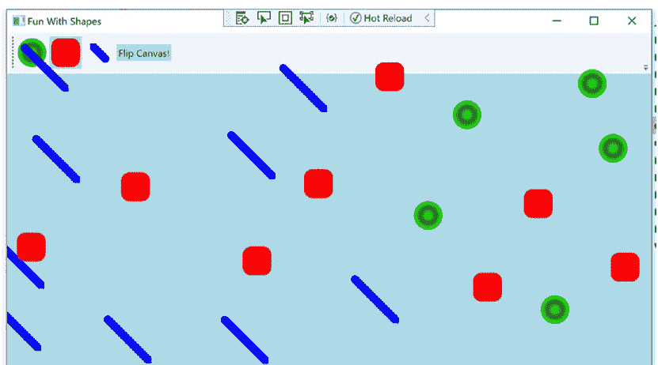

## 图 26-9. 糟糕！变换后你的数据流出了画布边界！

修复这个问题很简单。无需手动编写复杂的裁剪逻辑代码，只需将 Canvas 的 ClipToBounds 属性设置为 true，即可防止子元素在父元素的边界之外渲染。如果你再次运行程序，你会发现数据不会溢出画布边界。

```
<Canvas ClipToBounds = "True" ... >
```

最后一个小修改与以下事实有关：当你按下切换按钮翻转画布，然后点击画布绘制新图形时，你点击的点并不是图形数据应用的位置。相反，数据会渲染在鼠标光标的上方。

要解决此问题，请在渲染发生之前（通过 RenderTransform）将相同的变换对象应用于正在绘制的图形。以下是代码的关键部分：

```
private void CanvasDrawingArea_MouseLeftButtonDown(object sender, MouseButtonEventArgs e)
{
    //为简洁起见省略
    if (flipCanvas.IsChecked == true)
    {
        RotateTransform rotate = new RotateTransform(-180);
        shapeToRender.RenderTransform = rotate;
    }
    // 设置左上角以在画布中绘制。
    Canvas.SetLeft(shapeToRender,
        e.GetPosition(canvasDrawingArea).X);
    Canvas.SetTop(shapeToRender,
        e.GetPosition(canvasDrawingArea).Y);
}
```

```
// 绘制图形！
canvasDrawingArea.Children.Add(shapeToRender);
}
```

至此，我们对 System.Windows.Shapes、画刷和变换的探讨就结束了。在了解如何使用绘图和几何图形进行渲染之前，让我们看看如何利用 Visual Studio 来简化处理基本图形的工作。

## 使用 Visual Studio 变换编辑器

在前面的示例中，你通过手动输入标记和编写一些 C# 代码来应用各种变换。虽然这确实很有用，但你会很高兴地知道，最新版本的 Visual Studio 内置了一个集成的变换编辑器。回想一下，任何 UI 元素都可以接收变换服务，包括包含各种 UI 元素的布局系统。为了演示 Visual Studio 变换编辑器的用法，创建一个名为 FunWithTransforms 的新 WPF 应用程序。

## 构建初始布局

首先，使用集成的网格编辑器将初始的 Grid 拆分为两列（具体大小无关紧要）。然后，在工具箱中找到 StackPanel 控件，将其添加到 Grid 的第一列并占据整个空间；然后向 StackPanel 添加三个 Button 控件，如下所示：

```
<Grid>
    <Grid.ColumnDefinitions>
        <ColumnDefinition Width="*"/>
        <ColumnDefinition Width="*"/>
    </Grid.ColumnDefinitions>
    <StackPanel Grid.Row="0" Grid.Column="0">
        <Button Name="btnSkew" Content="Skew" Click="Skew"/>
        <Button Name="btnRotate" Content="Rotate" Click="Rotate"/>
        <Button Name="btnFlip" Content="Flip" Click="Flip"/>
    </StackPanel>
</Grid>
```

在代码页面中添加按钮的处理程序，如下所示：

```
private void Skew(object sender, RoutedEventArgs e)
{
}
private void Rotate(object sender, RoutedEventArgs e)
{
}
private void Flip(object sender, RoutedEventArgs e)
{
}
```

为了完成 UI，请在 Grid 的第二列中创建一个你选择的图形（使用本章讨论的任何技术）。示例中使用的标记如下：

```
<Canvas x:Name="myCanvas" Grid.Column="1" Grid.Row="0">
    <Ellipse HorizontalAlignment="Left" VerticalAlignment="Top" Height="186" Width="92" Stroke="Black" Canvas.Left="20" Canvas.Top="31">
        <Ellipse.Fill>
            <RadialGradientBrush>
                <GradientStop Color="#FF951ED8" Offset="0.215"/>
                <GradientStop Color="#FF2FECB0" Offset="1"/>
            </RadialGradientBrush>
        </Ellipse.Fill>
    </Ellipse>
    <Ellipse HorizontalAlignment="Left" VerticalAlignment="Top" Height="101" Width="110" Stroke="Black" Canvas.Left="122" Canvas.Top="126">
        <Ellipse.Fill>
            <LinearGradientBrush EndPoint="0.5,1" StartPoint="0.5,0">
                <GradientStop Color="#FFB91DDC" Offset="0.355"/>
                <GradientStop Color="#FFB0381D" Offset="1"/>
            </LinearGradientBrush>
        </Ellipse.Fill>
    </Ellipse>
</Canvas>
```

图 26-10 显示了该示例的最终布局。

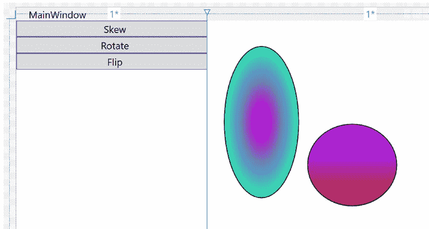

图 26-10. 变换示例的布局

## 在设计时应用变换

如前所述，Visual Studio 提供了一个集成的变换编辑器，可以在“属性”面板中找到它。找到该区域，并确保展开“变换”部分以查看编辑器的 RenderTransform 和 LayoutTransform 部分（参见图 26-11）。

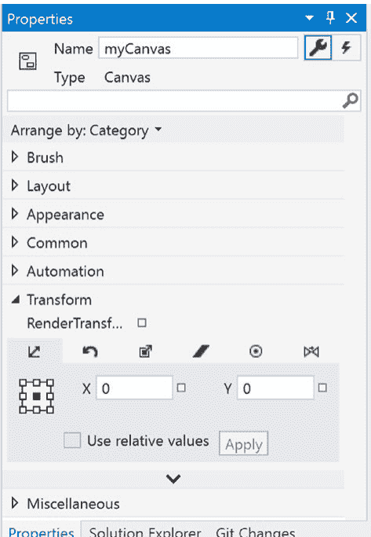

图 26-11. 变换编辑器

与“画刷”部分类似，“变换”部分提供了多个选项卡，用于为当前选定的项目配置各种类型的图形变换。表 26-6 描述了每个变换选项，按从左到右评估每个选项卡的顺序列出。

## 表 26-6 Blend 变换选项

| 变换选项 | 用途 |
|---|---|
| 平移 | 允许你按 X、Y 位置偏移项目的位置。 |
| 旋转 | 允许你以 360 度角旋转项目。 |
| 缩放 | 允许你按 X 和 Y 方向的因子放大或缩小项目。 |
| 倾斜 | 允许你按 X 和 Y 方向的因子倾斜包含所选项目的边界框。 |
| 中心点 | 当你旋转或翻转对象时，项目会相对于一个固定点移动，该点称为对象的中心点。默认情况下，对象的中心点位于对象的中心；但是，此变换允许你更改对象的中心点，以围绕不同的点旋转或翻转对象。 |
| 翻转 | 基于 X 或 Y 中心点翻转选定的项目。 |

我建议你以自定义图形为目标测试每种变换（只需按 Ctrl+Z 即可撤销上一步操作）。与“变换属性”面板的许多其他方面一样，每个变换部分都有一组独特的配置选项，随着你的操作，这些选项应该会变得相当容易理解。例如，倾斜变换编辑器允许你设置 X 和 Y 的倾斜值，翻转变换编辑器允许你在 x 轴或 y 轴上翻转，等等。

## 在代码中变换画布

每个 Click 事件处理程序的实现大致相同。你将配置一个变换对象并将其分配给 myCanvas 对象。然后，当你运行应用程序时，可以点击按钮查看所应用变换的结果。以下是每个事件处理程序的完整代码（请注意，你设置的是 LayoutTransform 属性，因此图形数据仍相对于父容器定位）：

```
private void Flip(object sender, System.Windows.RoutedEventArgs e)
{
    myCanvas.LayoutTransform = new ScaleTransform(-1, 1);
}
```

```
private void Rotate(object sender, System.Windows.RoutedEventArgs e)
{
    myCanvas.LayoutTransform = new RotateTransform(180);
}
```

```
private void Skew(object sender, System.Windows.RoutedEventArgs e)
{
    myCanvas.LayoutTransform = new SkewTransform(40, -20);
}
```


## 使用绘图和几何图形渲染图形数据

虽然 Shape 类型允许你生成任何种类的交互式二维表面，但由于其丰富的继承链，它们会带来相当大的内存开销。尽管 Path 类可以通过使用包含的几何图形（而不是大量其他形状的集合）来消除其中的一些开销，但 WPF 提供了复杂的绘图和几何编程接口，可渲染更轻量的 2D 矢量图像。

进入此 API 的入口点是抽象的 System.Windows.Media.Drawing 类（位于 PresentationCore.dll 中），它本身除了定义一个用于容纳渲染的边界矩形外几乎什么都不做。与 Shape 相比，Drawing 类要轻量得多，因为其继承链中既没有 UIElement 也没有 FrameworkElement。

WPF 提供了扩展 Drawing 的各种类，每个类代表一种特定的绘图内容方式，如表 26-7 所述。

### 表 26-7 WPF Drawing 派生类型

| Type | Meaning in Life |
|---|---|
| DrawingGroup | 用于将一组单独的 Drawing 派生对象组合成单个复合渲染。 |
| GeometryDrawing | 用于以非常轻量的方式渲染 2D 形状。 |
| GlyphRunDrawing | 用于使用 WPF 图形渲染服务渲染文本数据。 |
| ImageDrawing | 用于将图像文件或几何集合渲染到边界矩形中。 |
| VideoDrawing | 用于播放音频文件或视频文件。此类型只能通过过程式代码充分利用。如果你想通过 XAML 播放视频，MediaPlayer 类型是更好的选择。 |

由于更轻量，Drawing 派生类型没有处理输入事件的固有支持，因为它们不是 UIElements 或 FrameworkElements（尽管可以以编程方式执行命中测试逻辑）。

Drawing 派生类型与 Shape 派生类型之间的另一个关键区别是，Drawing 派生类型没有自我渲染的能力，因为它们不派生自 UIElement！相反，派生类型必须放置在托管对象中（具体为 DrawingImage、DrawingBrush 或 DrawingVisual）才能显示其内容。

DrawingImage 允许你将绘图和几何图形放置在 WPF Image 控件内部，该控件通常用于显示来自外部文件的数据。DrawingBrush 允许你基于绘图及其几何图形构建画刷，以设置需要画刷的属性。最后，DrawingVisual 仅用于图形渲染的“视觉”层，该层完全由 C# 代码驱动。

尽管使用绘图比使用简单形状稍微复杂一些，但这种将图形组合与图形渲染解耦的做法使得 Drawing 派生类型比 Shape 派生类型轻量得多，同时仍保留关键服务。

## 使用几何图形构建 DrawingBrush

本章前面，你已用一组几何图形填充了一个 Path，如下所示：

```
<Path Fill = "Orange" Stroke = "Blue" StrokeThickness = "3">
    <Path.Data>
        <GeometryGroup>
            <EllipseGeometry Center = "75,70" RadiusX = "30" RadiusY = "30" />
<RectangleGeometry Rect = "25,55 100 30" />
<LineGeometry StartPoint="0,0" EndPoint="70,30" />
<LineGeometry StartPoint="70,30" EndPoint="0,30" />
</GeometryGroup>
</Path.Data>
</Path>
```

通过这样做，你获得了 Path 的交互性，但由于使用了几何图形，仍然相当轻量。然而，如果你想渲染相同的输出并且不需要任何（开箱即用）交互性，你可以将相同的 <GeometryGroup> 放在 DrawingBrush 中，如下所示：

```
<DrawingBrush>
<DrawingBrush.Drawing>
<GeometryDrawing>
<GeometryDrawing.Geometry>
<GeometryGroup>
<EllipseGeometry Center = "75,70" RadiusX = "30" RadiusY = "30" />
<RectangleGeometry Rect = "25,55 100 30" />
<LineGeometry StartPoint="0,0" EndPoint="70,30" />
<LineGeometry StartPoint="70,30" EndPoint="0,30" />
</GeometryGroup>
</GeometryDrawing.Geometry>
<!-- A custom pen to draw the borders. -->
<GeometryDrawing.Pen>
<Pen Brush="Blue" Thickness="3"/>
</GeometryDrawing.Pen>
<!-- A custom brush to fill the interior. -->
<GeometryDrawing.Brush>
<SolidColorBrush Color="Orange"/>
</GeometryDrawing.Brush>
</GeometryDrawing>
</DrawingBrush.Drawing>
</DrawingBrush>
```

当你将一组几何图形放入 DrawingBrush 时，你还需要建立用于绘制边界的 Pen 对象，因为你不再从 Shape 基类继承 Stroke 属性。在这里，你创建了一个 <Pen>，其设置与之前 Path 示例中的 Stroke 和 StrokeThickness 值相同。

此外，由于你不再从 Shape 继承 Fill 属性，因此你还需要使用属性元素语法定义一个用于 <DrawingGeometry> 的画刷对象，这里是一个纯橙色画刷，与之前的 Path 设置相同。

## 使用 DrawingBrush 绘制

现在你有了 DrawingBrush，你就可以用它来设置任何需要画刷对象的值的属性。例如，如果你正在 Xaml 中编写此标记，你可以使用属性元素语法将绘图绘制在 Page 的整个表面上，如下所示：

```
<Page
  xmlns="http://schemas.microsoft.com/winfx/2006/xaml/presentation"
  xmlns:x="http://schemas.microsoft.com/winfx/2006/xaml">
  <Page.Background>
    <DrawingBrush>
      <!-- Same DrawingBrush as seen above. -->
    </DrawingBrush>
  </Page.Background>
</Page>
```

或者你可以使用此 <DrawingBrush> 来设置不同的与画刷兼容的属性，例如 Button 的 Background 属性。

```
<Page
  xmlns="http://schemas.microsoft.com/winfx/2006/xaml/presentation"
  xmlns:x="http://schemas.microsoft.com/winfx/2006/xaml">
  <Button Height="100" Width="100">
    <Button.Background>
      <DrawingBrush>
        <!-- Same DrawingBrush as seen above. -->
      </DrawingBrush>
    </Button.Background>
  </Button>
</Page>
```

无论你用自定义 <DrawingBrush> 设置哪个与画刷兼容的属性，归根结底，你都是以比用形状渲染相同的 2D 图像更少的开销来渲染 2D 矢量图像。

## 在 DrawingImage 中包含 Drawing 类型

DrawingImage 类型允许你将绘图几何图形插入到 WPF <Image> 控件中。考虑以下示例：

```
<Image>
  <Image.Source>
    <DrawingImage>
      <DrawingImage.Drawing>
        <!--Same GeometryDrawing from above -->
      </DrawingImage.Drawing>
    </DrawingImage>
  </Image.Source>
</Image>
```

在这种情况下，你的 <GeometryDrawing> 被放置在 <DrawingImage> 中，而不是 <DrawingBrush> 中。使用此 <DrawingImage>，你可以设置 Image 控件的 Source 属性。

## 处理矢量图像

正如你可能同意的那样，对于图形艺术家来说，使用 Visual Studio 提供的工具和技术创建复杂的基于矢量的图像将是相当具有挑战性的。图形艺术家拥有自己的工具集，可以生成惊人的矢量图形。Visual Studio 及其配套的 Visual Studio 版 Expression Blend 并没有那种设计能力。在将矢量图像导入 WPF 应用程序之前，它们必须被转换为 Path 表达式。届时，你就可以使用 Visual Studio 对生成的对象模型进行编程。

> Note 你可以在下载文件的第 26 章文件夹中找到正在使用的图像（LaserSign.svg）以及导出的路径（LaserSign.xaml）数据。该图像最初来自 Wikipedia，位于 https://en.wikipedia.org/wiki/Hazard_symbol。

## 将示例矢量图形文件转换为 XAML

在将复杂图形数据（例如矢量图形）导入 WPF 应用程序之前，你需要将图形转换为路径数据。作为如何执行此操作的示例，从前面注释中引用的激光标志开始，例如一个示例 .svg 图像文件。然后下载并安装一个名为 Inkscape 的开源工具（位于 www.inkscape.org）。使用 Inkscape 打开章节下载中的 LaserSign.svg 文件。你可能会被提示升级格式。按图 26-12 所示填写选择项。

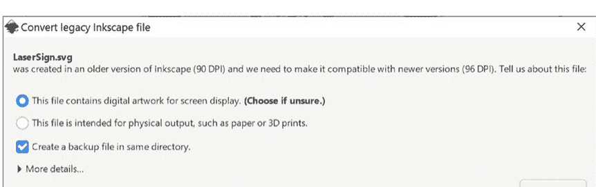

图 26-12. 在 Inkscape 中将 SVG 文件升级到最新格式

接下来的步骤乍一看会显得有点奇怪，但一旦你克服了这种怪异感，这就是将矢量图像转换为正确 XAML 的简单方法。当你将图像调整到想要的样子时，选择 File ► Print 菜单选项。接下来，选择 Microsoft XPS Document Writer 作为打印机目标，然后单击 Print。在下一个屏幕中，输入文件名并选择文件保存位置；然后单击 Save。现在你就拥有了一个完整的 *.xps（或 *.oxps）文件。


> 注意：根据系统配置的多个变量，生成的文件将具有 `.xps` 或 `.oxps` 扩展名。无论哪种情况，过程都相同。

`.xps` 和 `.oxps` 格式实际上是 `.zip` 文件。将文件的扩展名重命名为 `.zip`，你就可以在文件资源管理器中打开该文件（或 7-Zip，或你喜欢的任何归档工具）。你会看到它包含图 26-13 所示的层次结构。

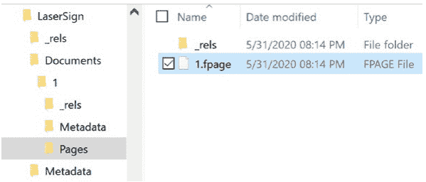

图 26-13. 打印的 XPS 文件的文件夹层次结构

你需要的文件位于 Pages 目录（`Documents/1/Pages`）中，名为 `1.fpage`。使用文本编辑器打开该文件并复制除 `<FixedPage>` 开启和关闭标签之外的所有内容。然后可以将路径数据复制到 XAML 中并放置在主窗口中的 Canvas 内。你的图像将在 XAML 窗口中显示。

> 注意：最新版本的 Inkscape 有一个选项可以将文件另存为 Microsoft XAML。不幸的是，在撰写本文时，它与 WPF 不兼容。

## 将图形数据导入 WPF 项目

此时，创建一个名为 `InteractiveLaserSign` 的新 WPF 应用程序。将窗口大小调整为高度 600，宽度 650，并用 Canvas 替换 Grid。

```xml
<Window x:Class="InteractiveLaserSign.MainWindow"
    xmlns="http://schemas.microsoft.com/winfx/2006/xaml/presentation"
    xmlns:x="http://schemas.microsoft.com/winfx/2006/xaml"
    xmlns:d="http://schemas.microsoft.com/expression/blend/2008"
    
    xmlns:local="clr-namespace:InteractiveLaserSign"
    mc:Ignorable="d"
    Title="MainWindow" Height="600" Width="650">
    <Canvas>
    </Canvas>
</Window>
```

复制 `1.fpage` 文件中的整个 XAML（不包括外部的 `FixedPage` 标签）并将其粘贴到 Canvas 控件中。以设计模式查看窗口，你将在应用程序中看到标志的复现。

如果查看文档大纲，你会看到图像的每个部分都表示为 XAML Path 元素。如果你调整窗口大小，图像质量保持不变，无论你将窗口调得多大。这是因为由 Path 元素表示的图像使用绘图引擎和数学而不是翻转像素来渲染。

## 与标志交互

回想一下，路由事件会隧道路由和冒泡，因此 Canvas 内部单击的任何 Path 都可以由 Canvas 上的单击事件处理程序处理。将 Canvas 标记更新为以下内容：

```xml
<Canvas MouseLeftButtonDown="Canvas_MouseLeftButtonDown">
```

添加以下代码的事件处理程序：

```csharp
private void Canvas_MouseLeftButtonDown(object sender, MouseButtonEventArgs e)
{
    if (e.OriginalSource is Path p)
    {
        p.Fill = new SolidColorBrush(Colors.Red);
    }
}
```

现在，运行你的应用程序。单击线条以查看效果。

你现在了解了为复杂图形生成 Path 数据的过程以及如何在代码中与图形数据交互。正如你可能同意的那样，专业图形艺术家能够生成复杂的图形数据并将数据导出为 XAML 这一能力是极其强大的。一旦图形数据生成，开发人员就可以导入标记并针对对象模型进行编程。

## 使用视觉层渲染图形数据

使用 WPF 渲染图形数据的最后一种选择称为视觉层。如前所述，你只能通过代码访问此层（它不友好于 XAML）。虽然绝大多数 WPF 应用程序使用形状、绘图和几何图形工作就足够了，但视觉层确实提供了渲染大量图形数据的最快可能方式。这种低级图形层在你需要在一大区域上渲染单张图像时也很有用。例如，如果你需要用纯静态图像填充窗口的背景，视觉层是最快的方法。如果需要根据用户输入或其他情况快速在窗口背景之间切换，也很有用。

我不会花费太多时间深入探讨 WPF 编程的这一方面的细节，但让我们构建一个小型示例程序来说明基本原理。

## Visual 基类和派生的子类

抽象的 `System.Windows.Media.Visual` 类类型为渲染图形提供了最少的一组服务（渲染、命中测试、变换），但它不提供额外的非视觉服务支持，这可能导致代码膨胀（输入事件、布局服务、样式和数据绑定）。`Visual` 类是一个抽象基类。你需要使用其中一个派生类型来执行实际的渲染操作。WPF 提供了一些子类，包括 `DrawingVisual`、`Viewport3DVisual` 和 `ContainerVisual`。

在本示例中，你将只关注 `DrawingVisual`，这是一个轻量级绘图类，用于渲染形状、图像或文本。

## 初次使用 DrawingVisual 类

要使用 `DrawingVisual` 将数据渲染到表面上，你需要执行以下基本步骤：

- 从 `DrawingVisual` 类获取 `DrawingContext` 对象。
- 使用 `DrawingContext` 渲染图形数据。

这两个步骤代表了将一些数据渲染到表面的最低限度要求。然而，如果你希望你渲染的图形数据对命中测试计算做出响应（这对于添加用户交互性很重要），你还需要执行以下附加步骤：

- 更新容器维护的逻辑和视觉树，在其上进行渲染。
- 重写 `FrameworkElement` 类的两个虚方法，允许容器获取你创建的视觉数据。

你将在稍后检查最后这两个步骤。首先，为了说明如何使用 `DrawingVisual` 类渲染 2D 数据，创建一个名为 `RenderingWithVisuals` 的新 WPF 应用程序。你的第一个目标是使用 `DrawingVisual` 动态地将数据分配给 WPF Image 控件。首先按如下方式更新窗口的 XAML 以处理 Loaded 事件：

```xml
<Window x:Class="RenderingWithVisuals.MainWindow"
    <!--omitted for brevity -->
    Title="Fun With Visual Layer" Height="450" Width="800"
    Loaded="MainWindow_Loaded">
```

接下来，用 StackPanel 替换 Grid 并在 StackPanel 中添加一个 Image，如下所示：

```xml
<StackPanel Background="AliceBlue" Name="myStackPanel">
    <Image Name="myImage" Height="80"/>
</StackPanel>
```

你的 `<Image>` 控件尚无 Source 值，因为这将在运行时发生。Loaded 事件将负责构建内存中的图形数据，使用 `DrawingBrush` 对象。确保 `MainWindow.cs` 顶部有以下命名空间：

```csharp
using System;
using System.Windows;
using System.Windows.Media;
using System.Windows.Media.Imaging;
```

以下是 Loaded 事件处理程序的实现：

```csharp
private void MainWindow_Loaded(
    object sender, RoutedEventArgs e)
{
    const int TextFontSize = 30;
    // Make a System.Windows.Media.FormattedText object.
```

```csharp
FormattedText text = new FormattedText(
    "Hello Visual Layer!",
    new System.Globalization.CultureInfo("en-us"),
    FlowDirection.LeftToRight,
    new Typeface(this.FontFamily, FontStyles.Italic,
    FontWeights.DemiBold, FontStretches.UltraExpanded),
    TextFontSize,
    Brushes.Green,
    null,
    VisualTreeHelper.GetDpi(this).PixelsPerDip);
// Create a DrawingVisual, and obtain the DrawingContext.
DrawingVisual drawingVisual = new DrawingVisual();
using(DrawingContext drawingContext =
    drawingVisual.RenderOpen())
{
    // Now, call any of the methods of DrawingContext to render data.
    drawingContext.DrawRoundedRectangle(
        Brushes.Yellow, new Pen(Brushes.Black, 5),
        new Rect(5, 5, 450, 100), 20, 20);
    drawingContext.DrawText(text, new Point(20, 20));
}
// Dynamically make a bitmap, using the data in the DrawingVisual.
RenderTargetBitmap bmp = new RenderTargetBitmap(
    500, 100, 100, 90, PixelFormats.Pbgra32);
bmp.Render(drawingVisual);
// Set the source of the Image control!
myImage.Source = bmp;
}
```

此代码引入了许多新的 WPF 类，我将在此处简要评论一下。该方法首先创建一个新的 `FormattedText` 对象，表示你正在构建的内存中图像的文本部分。如你所见，构造函数允许你指定许多属性，例如字体大小、字体系列、前景色和文本本身。

接下来，你通过在 `DrawingVisual` 实例上调用 `RenderOpen()` 来获取必要的 `DrawingContext` 对象。在这里，你将一个彩色圆角矩形渲染到 `DrawingVisual` 中，然后是你的格式文本。在这两种情况下，你都使用硬编码值将图形数据放置到 `DrawingVisual` 中，这对于生产来说不一定是好主意，但对于这个简单测试来说是可以的。

最后几条语句将 `DrawingVisual` 映射到 `RenderTargetBitmap` 对象，这是 `System.Windows.Media.Imaging` 命名空间的成员。此类将视觉对象转换为内存中的位图图像。此后，你设置 Image 控件的 Source 属性，果然，你将在图 26-14 中看到输出。


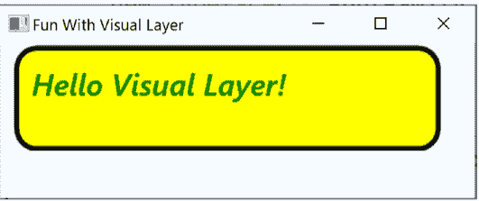

Figure 26-14. Using the visual layer to render an in-memory bitmap

> Note System.Windows.Media.Imaging 命名空间包含多个额外的编码类，可让你将内存中的 RenderTargetBitmap 对象保存为物理文件，格式多样。查看 JpegBitmapEncoder 类（及其同类）可了解更多信息。

## Rendering Visual Data to a Custom Layout Manager

使用 DrawingVisual 在 WPF 控件的背景上绘制很有趣，但更常见的做法是构建一个自定义布局管理器（Grid、StackPanel、Canvas 等），它在内部使用视觉层来渲染其内容。在创建了这样的自定义布局管理器之后，你可以将其插入到普通的 Window（或 Page 或 UserControl）中，从而使 UI 的一部分使用高度优化的渲染代理，而承载 Window 的非关键部分则使用形状和绘图来处理其余的图形数据。

如果你不需要专用布局管理器提供的额外功能，也可以选择直接扩展 FrameworkElement，因为它也具有容纳视觉项所需的基础结构。为了说明如何实现这一点，在项目中插入一个名为 CustomVisualFrameworkElement 的新类。从 FrameworkElement 扩展此类并导入 System、System.Windows、System.Windows.Input、System.Windows.Media 和 System.Windows.Media.Imaging 命名空间。

此类将维护一个类型为 VisualCollection 的成员变量，其中包含两个固定的 DrawingVisual 对象（当然，你也可以通过鼠标操作向此集合添加新成员，但本示例将保持简单）。使用以下新功能更新你的类：

```
public class CustomVisualFrameworkElement : FrameworkElement
{
    // A collection of all the visuals we are building.
    VisualCollection theVisuals;
    public CustomVisualFrameworkElement()
    {
        // Fill the VisualCollection with a few DrawingVisual objects.
        // The ctor arg represents the owner of the visuals.
        theVisuals = new VisualCollection(this)
            {AddRect(),AddCircle()};
    }
}
```

```
private Visual AddCircle()
{
    DrawingVisual drawingVisual = new DrawingVisual();
    // Retrieve the DrawingContext in order to create new drawing content.
    using DrawingContext drawingContext =
        drawingVisual.RenderOpen()
    // Create a circle and draw it in the DrawingContext.
    drawingContext.DrawEllipse(Brushes.DarkBlue, null,
        new Point(70, 90), 40, 50);
    return drawingVisual;
}
private Visual AddRect()
{
    DrawingVisual drawingVisual = new DrawingVisual();
    using DrawingContext drawingContext =
        drawingVisual.RenderOpen()
    Rect rect =
        new Rect(new Point(160, 100), new Size(320, 80));
    drawingContext.DrawRectangle(Brushes.Tomato, null, rect);
    return drawingVisual;
}
```

现在，在你可以在 Window 中使用此自定义 FrameworkElement 之前，必须重写前面提到的两个关键虚方法，这两个方法在渲染过程中由 WPF 内部调用。GetVisualChild() 方法从子元素集合中返回指定索引处的子元素。可读的 VisualChildrenCount 属性返回此视觉集合中视觉子元素的数量。由于你可以将实际工作委托给 VisualCollection 成员变量，因此这两个方法都很容易实现。

```
protected override int VisualChildrenCount
=> theVisuals.Count;

protected override Visual GetVisualChild(int index)
{
    // Value must be greater than zero, so do a sanity check.
    if (index < 0 || index >= theVisuals.Count)
    {
        throw new ArgumentOutOfRangeException();
    }
    return theVisuals[index];
}
```

现在你已经拥有了足够的功能来测试你的自定义类。更新 Window 的 XAML 描述，将其中一个 CustomVisualFrameworkElement 对象添加到现有的 StackPanel 中。这样做需要你添加一个自定义 XML 命名空间，将其映射到你的 .NET Core 命名空间。

```
<Window x:Class="RenderingWithVisuals.MainWindow"
xmlns="http://schemas.microsoft.com/winfx/2006/xaml/presentation"
xmlns:x="http://schemas.microsoft.com/winfx/2006/xaml"
xmlns:local="clr-namespace:RenderingWithVisuals"
```

```
Title="Fun with the Visual Layer" Height="350" Width="525"
Loaded="Window_Loaded" WindowStartupLocation="CenterScreen">
    <StackPanel Background="AliceBlue" Name="myStackPanel">
        <Image Name="myImage" Height="80"/>
        <local:CustomVisualFrameworkElement/>
    </StackPanel>
</Window>
```

运行程序时，你将看到图 26-15 所示的结果。

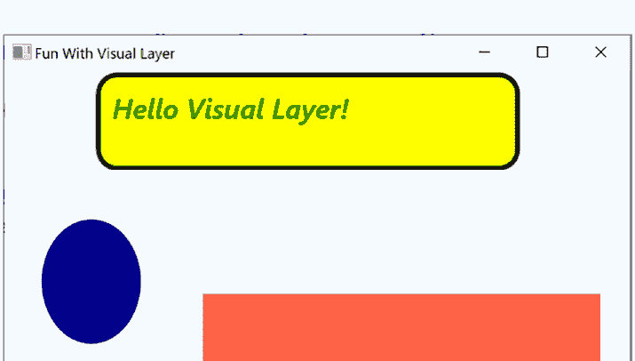

Figure 26-15. Using the visual layer to render data to a custom FrameworkElement

## Responding to Hit-Test Operations

由于 DrawingVisual 不具备 UIElement 或 FrameworkElement 的任何基础结构，因此你需要以编程方式添加计算命中测试操作的能力。幸运的是，由于逻辑树和视觉树的概念，这在视觉层中相当容易实现。事实证明，当你编写 XAML 片段时，本质上是在构建元素的逻辑树。然而，在每个逻辑树背后都有一个更丰富的描述，称为视觉树，其中包含更低级的渲染指令。

第 27 章将更详细地介绍这些树，但现在只需理解，在你将自定义视觉对象注册到这些数据结构之前，将无法执行命中测试操作。幸运的是，VisualCollection 容器已代表你完成了此操作（这也解释了为什么你需要在构造函数参数中传入对自定义 FrameworkElement 的引用）。

首先，使用标准的 C# 语法更新 CustomVisualFrameworkElement 类以在类构造函数中处理 MouseDown 事件，如下所示：

```
this.MouseDown += CustomVisualFrameworkElement_MouseDown;
```

此处理程序的实现将调用 VisualTreeHelper.HitTest() 方法，以查看鼠标是否在其中一个渲染视觉对象的边界内。为此，你将 HitTestResultCallback 委托作为参数传递给 HitTest()，该委托将执行计算。如果单击一个视觉对象，你将在视觉对象的倾斜渲染和原始渲染之间切换。将以下方法添加到你的 CustomVisualFrameworkElement 类：

```
void CustomVisualFrameworkElement_MouseDown(object sender, MouseButtonEventArgs e)
{
    // Figure out where the user clicked.
    Point pt = e.GetPosition((UIElement)sender);
    // Call helper function via delegate to see if we clicked on a visual.
    VisualTreeHelper.HitTest(this, null,
        new HitTestResultCallback(myCallback), new PointHitTestParameters(pt));
}
```

```
public HitTestResultBehavior myCallback(HitTestResult result)
{
    // Toggle between a skewed rendering and normal rendering,
    // if a visual was clicked.
    if (result.VisualHit.GetType() == typeof(DrawingVisual))
    {
        if (((DrawingVisual)result.VisualHit).Transform == null)
        {
            ((DrawingVisual)result.VisualHit).Transform = new SkewTransform(7, 7);
        }
        else
        {
            ((DrawingVisual)result.VisualHit).Transform = null;
        }
    }
    // Tell HitTest() to stop drilling into the visual tree.
    return HitTestResultBehavior.Stop;
}
```

现在，再次运行你的程序。你现在应该能够单击任一渲染的视觉对象并看到变换效果！虽然这只是使用 WPF 视觉层的简单示例，但请记住，你使用的画刷、变换、画笔和布局管理器与使用 XAML 时相同。因此，你已经相当了解如何使用这些派生自 Visual 的类。

这就结束了你对 Windows Presentation Foundation 图形渲染服务的调查。虽然你学习了许多有趣的主题，但现实是，你只触及了 WPF 图形功能的一小部分。我将把更深入挖掘形状、绘图、画刷、变换和视觉对象等主题的工作留给你（当然，你将在剩余的 WPF 章节中看到这些主题的一些额外细节）。


## Summary

由于 Windows Presentation Foundation 是一个图形密集型的 GUI API，因此我们拥有多种渲染图形输出的方式也就不足为奇了。本章首先[content]

## Summary

由于 Windows Presentation Foundation 是一个图形密集型的 GUI API，因此我们拥有多种渲染图形输出的方式也就不足为奇了。本章首先考察了 WPF 应用程序可以采用的三种方式（形状、绘图和视觉对象）来实现此目的，并讨论了诸如画刷、画笔和变换等各种渲染原语。

请记住，当你需要构建交互式 2D 渲染时，形状会使过程变得非常简单。然而，静态的非交互式渲染可以通过使用绘图和几何图形以更优化的方式进行渲染，而视觉层（仅在代码中可访问）则为你提供最大程度的控制和性能。

## WPF Resources, Animations, Styles, and Templates

本章将介绍三个重要且相互关联的话题，从而加深你对 Windows Presentation Foundation（WPF）API 的理解。首先要学习的是逻辑资源的作用。正如你将看到的，逻辑资源（也称为对象资源）系统是一种在 WPF 应用程序中命名和引用常用对象的方式。虽然逻辑资源通常在 XAML 中编写，但也可以在过程式代码中定义。

接下来，你将学习如何定义、执行和控制动画序列。尽管你可能认为如此，WPF 动画并不局限于视频游戏或多媒体应用程序。在 WPF API 下，动画可以像让按钮在获得焦点时看起来发光，或扩展 DataGrid 中选中行的大小一样微妙。理解动画是构建自定义控件模板的关键方面（正如本章后面将看到的那样）。

你随后将探索 WPF 样式和模板的作用。 much like a web page that uses CSS or the ASP.NET theme engine, a WPF application can define a common look and feel for a set of controls. 你可以在标记中定义这些样式并将其存储为对象资源以供以后使用，也可以动态地在运行时应用它们。最后一个示例将教你如何构建自定义控件模板。

## Understanding the WPF Resource System

你的第一个任务是检查嵌入和访问应用程序资源的话题。WPF 支持两种类型的资源。第一种是二进制资源，此类别通常包括大多数程序员在传统意义上认为的资源（嵌入式图像文件或声音剪辑、应用程序使用的图标等）。

第二种类型称为对象资源或逻辑资源，它代表一个命名的 .NET 对象，可以在整个应用程序中打包和重用。虽然任何 .NET 对象都可以打包为对象资源，但逻辑资源在处理任何类型的图形数据时特别有帮助，因为你可以定义常用的图形原语（画刷、画笔、动画等）并在需要时引用它们。

## Working with Binary Resources

在进入对象资源的话题之前，让我们快速了解一下如何将诸如图标或图像文件（例如公司标志或动画图像）等二进制资源打包到你的应用程序中。如果你想跟随操作，创建一个名为 BinaryResourcesApp 的新 WPF 应用程序。更新初始窗口的标记以处理 Window Loaded 事件并使用 DockPanel 作为布局根，如下所示：

```
<Window x:Class="BinaryResourcesApp.MainWindow"
    <!-- Omitted for brevity -->
    Title="Fun with Binary Resources" Height="500" Width="649" Loaded="MainWindow_OnLoaded">
    <DockPanel LastChildFill="True">
    </DockPanel>
</Window>
```

现在，假设你的应用程序需要根据用户输入在窗口的一部分中显示三个图像文件之一。WPF Image 控件不仅可以显示典型的图像文件（*.bmp、*.gif、*.ico、*.jpg、*.png、*.wdp 或 *.tiff），还可以显示 DrawingImage 中的数据（如你在第 26 章中看到的那样）。你可能会为窗口构建一个 UI，其中包含一个 DockPanel，其中包含一个简单的工具栏，带有 Next 和 Previous 按钮。在此工具栏下方，你可以放置一个 Image 控件，其 Source 属性目前没有设置值，如下所示：

```
<DockPanel LastChildFill="True">
    <ToolBar Height="60" Name="picturePickerToolbar" DockPanel.Dock="Top">
        <Button x:Name="btnPreviousImage" Height="40" Width="100" BorderBrush="Black" Margin="5" Content="Previous" Click="btnPreviousImage_Click"/>
        <Button x:Name="btnNextImage" Height="40" Width="100" BorderBrush="Black" Margin="5" Content="Next" Click="btnNextImage_Click"/>
    </ToolBar>
    <!-- We will fill this Image in code. -->
    <Border BorderThickness="2" BorderBrush="Green">
        <Image x:Name="imageHolder" Stretch="Fill" />
    </Border>
</DockPanel>
```

接下来，添加以下空事件处理程序：

```
private void MainWindow_OnLoaded(
    object sender, RoutedEventArgs e)
{
}
private void btnPreviousImage_Click(
    object sender, RoutedEventArgs e)
{
}
private void btnNextImage_Click(
    object sender, RoutedEventArgs e)
{
}
```

窗口加载时，图像将被添加到集合中，Next 和 Previous 按钮将循环浏览这些图像。现在应用程序框架已经就位，让我们来检查实现此功能的各种选项。

## Including Loose Resource Files in a Project

一个选项是以应用程序安装路径子目录中的一组松散文件形式分发你的图像文件。首先在你的项目中添加一个新文件夹（命名为 Images）。通过右键单击并选择 Add ► Existing Item 将一些图像添加到此文件夹中。确保在 Add Existing Item 对话框中更改文件筛选器为 *. *，以便显示图像文件。你可以添加自己的图像文件或使用可下载代码中的三个名为 Deer.jpg、Dogs.jpg 和 Welcome.jpg 的图像文件。

## Configuring the Loose Resources

为了在项目构建时将 \Images 文件夹的内容复制到 \bin\Debug 文件夹，首先在 Solution Explorer 中选择所有图像。现在，在仍选择这些图像的情况下，右键单击并选择 Properties 以打开 Properties 窗口。将 Build Action 属性设置为 Content，并将 Copy to Output Directory 属性设置为 Copy always（参见图 27-1）。

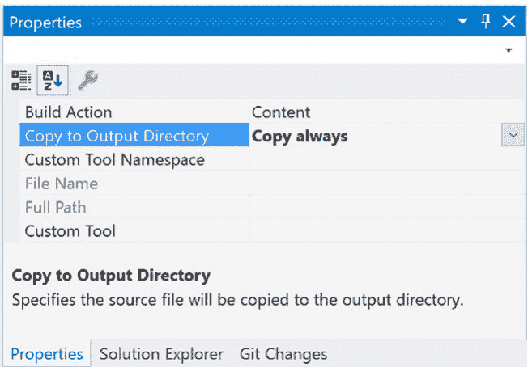

图 27-1. 配置图像数据以复制到你的输出目录

> Note 你也可以选择 Copy if Newer，如果你在构建包含大量内容的较大项目，这将为你节省时间。对于本示例，Copy always 即可。

如果构建你的项目，你现在可以单击 Solution Explorer 的 Show All Files 按钮，并在 \bin\Debug 目录下查看复制的 Image 文件夹（你可能需要单击 Refresh 按钮）。

## Programmatically Loading an Image

WPF 提供了一个名为 BitmapImage 的类，它是 System.Windows.Media.Imaging 命名空间的一部分。此类允许你从由 System.Uri 对象表示位置的图像文件加载数据。添加一个 List<BitmapImage> 来保存图像，以及一个 int 来存储当前显示图像的索引。

```
// A List of BitmapImage files.
List<BitmapImage> _images=new List<BitmapImage>();
// Current position in the list.
private int _currImage=0;
```

在窗口的 Loaded 事件中，填充图像列表，然后将 Image 控件源设置为列表中的第一张图像。

```
private void MainWindow_OnLoaded(
    object sender, RoutedEventArgs e)
{
    try
    {
        string path=Environment.CurrentDirectory;
        // Load these images from disk when the window loads.
        _images.Add(new BitmapImage(new Uri($@"{path}\Images\Deer.jpg")));
        _images.Add(new BitmapImage(new Uri($@"{path}\Images\Dogs.jpg")));
        _images.Add(new BitmapImage(new Uri($@"{path}\Images\Welcome.jpg")));
        // Show first image in the list.
        imageHolder.Source=_images[_currImage];
    }
    catch (Exception ex)
    {
        MessageBox.Show(ex.Message);
    }
}
```

接下来，实现上一个和下一个处理程序以循环浏览图像。如果用户到达列表末尾，则让他们回到开头，反之亦然。

```
private void btnPreviousImage_Click(
    object sender, RoutedEventArgs e)
{
    if (--_currImage < 0)
    {
        _currImage=_images.Count - 1;
    }
    imageHolder.Source=_images[_currImage];
}
private void btnNextImage_Click(
    object sender, RoutedEventArgs e)
{
    if (++_currImage >= _currImage >= _images.Count)
```


```
{
    _currImage=0;
}
imageHolder.Source=_images[_currImage];
}
```

此时，你可以运行程序并翻阅每张图片。

## 嵌入应用程序资源

如果你更愿意将图像文件配置为直接编译到你的 .NET Core 程序集作为二进制资源，请在解决方案资源管理器中选择图像文件（在 \Images 文件夹中，而不是在 \bin\Debug\Images 文件夹中）。将 Build Action 属性更改为 Resource，并将 Copy to Output Directory 属性设置为 Do not copy（参见图 27-2）。

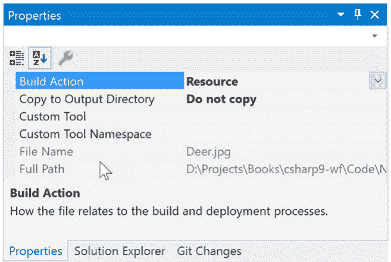

图 27-2. 配置图像以嵌入资源

现在，使用 Visual Studio 的 Build 菜单，选择 Clean Solution 选项以清除 \bin\Debug\Images 的当前内容，然后重新构建你的项目。刷新解决方案资源管理器并观察你的 \bin\Debug\Images 目录中数据的缺失。使用当前的构建选项，你的图形数据不再复制到输出文件夹，而是现在嵌入在程序集本身中。这确保了资源存在，但也增加了编译后程序集的大小。

你需要修改代码以通过从编译后的程序集中提取来将这些图像加载到你的列表中。

```
// Extract from the assembly and then load images
_images.Add(new BitmapImage(new Uri("@/Images/Deer.jpg", UriKind.Relative)));
_images.Add(new BitmapImage(new Uri("@/Images/Dogs.jpg", UriKind.Relative)));
_images.Add(new BitmapImage(new Uri("@/Images/Welcome.jpg", UriKind.Relative)));
```

在这种情况下，你不再需要确定安装路径，可以简单地按名称列出资源，其中考虑了原始子目录的名称。另请注意，当你创建 Uri 对象时，你指定了 UriKind 值为 Relative。此时，你的可执行文件是一个独立的实体，可以从机器上的任何位置运行，因为所有编译后的数据都在二进制文件中。

## 使用对象（逻辑）资源

当你构建 WPF 应用程序时，通常会定义一段 XAML 片段以在窗口内的多个位置或跨多个窗口或项目中使用。例如，假设你创建了完美的线性渐变画刷，由十行标记组成。现在，你想将该画刷用作项目中每个 Button 控件的背景颜色（该项目包含八个窗口），总共 16 个 Button 控件。

最糟糕的做法是将 XAML 复制粘贴到每个控件。显然，这将是维护的噩梦，因为你每次想要调整画刷的外观时都需要进行大量更改。

幸运的是，对象资源允许你定义一段 XAML，给它一个名称，并将其存储在合适的字典中以供以后使用。像二进制资源一样，对象资源通常编译到需要它们的程序集中。然而，你不需要调整 Build Action 属性来做到这一点。如果你将 XAML 放在正确的位置，编译器会处理其余部分。

使用对象资源是 WPF 开发的重要组成部分。正如你将看到的，对象资源可能比自定义画刷复杂得多。你可以定义基于 XAML 的动画、3D 渲染、自定义控件样式、数据模板、控件模板等，并将每个打包为可重用的资源。

### Resources 属性的作用

如前所述，对象资源必须放置在合适的字典对象中才能在整个应用程序中使用。目前，每个 FrameworkElement 的后代都支持 Resources 属性。此属性封装了一个 ResourceDictionary 对象，其中包含已定义的对象资源。ResourceDictionary 可以保存任何类型项目，因为它在 System.Object 类型上操作，并且可以通过 XAML 或过程代码进行操作。

在 WPF 中，所有控件、Windows、Pages（用于构建导航应用程序时使用）和 UserControls 都扩展了 FrameworkElement，因此几乎所有小部件都提供对 ResourceDictionary 的访问。此外，Application 类虽然没有扩展 FrameworkElement，但为了相同目的支持同名 Resources 属性。

### 定义窗口级资源

为了开始探索对象资源的作用，创建一个名为 ObjectResourcesApp 的新 WPF 应用程序，并将初始 Grid 更改为水平对齐的 StackPanel 布局管理器。在此 StackPanel 中，像这样定义两个 Button 控件（你真的不需要太多来说明对象资源的作用，所以这样就足够了）：

```
<StackPanel Orientation="Horizontal">
    <Button Margin="25" Height="200" Width="200" Content="OK" FontSize="20"/>
    <Button Margin="25" Height="200" Width="200" Content="Cancel" FontSize="20"/>
</StackPanel>
```

现在，选择 OK 按钮并使用集成的 Brushes 编辑器（在第 26 章中讨论）将 Background 颜色属性设置为自定义画刷类型。完成后，注意画刷如何嵌入在 <Button> 和 </Button> 标签的范围内，如下所示：

```
<Button Margin="25" Height="200" Width="200" Content="OK" FontSize="20">
    <Button.Background>
        <RadialGradientBrush>
            <GradientStop Color="#FFC44EC4" Offset="0" />
            <GradientStop Color="#FF829CEB" Offset="1" />
            <GradientStop Color="#FF793879" Offset="0.669" />
        </RadialGradientBrush>
    </Button.Background>
</Button>
```

为了让 Cancel 按钮也能使用此画刷，你应该将 <RadialGradientBrush> 的作用域提升到父元素的资源字典。例如，如果你将其移动到 <StackPanel>，两个按钮都可以使用相同的画刷，因为它们是布局管理器的子元素。更好的是，你可以将画刷打包到 Window 本身的资源字典中，以便窗口的内容可以使用它。

当你需要定义资源时，你使用属性元素语法来设置所有者的 Resources 属性。你还为资源项提供一个 x:Key 值，这将由窗口的其他部分在想要引用对象资源时使用。请注意 x:Key 和 x:Name 不是同一个！x:Name 属性允许你在代码文件中将对象作为成员变量访问，而 x:Key 属性允许你引用资源字典中的项目。

Visual Studio 允许你使用其各自的属性窗口将资源提升到更高作用域。为此，首先识别具有你想要打包为资源的复杂对象的属性（在本例中为 Background 属性）。属性右侧有一个小方块，单击它会打开一个弹出菜单。从中选择 Convert to New Resource 选项（参见图 27-3）。

### 图 27-3. 将复杂对象移入资源容器

系统会要求你为资源命名（myBrush）并指定放置位置。对于本示例，请保留当前文档的默认选择（参见图 27-4）。

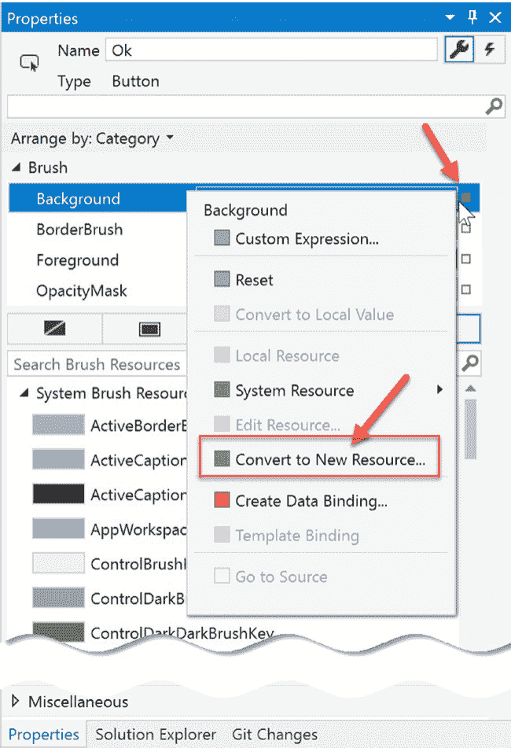

### 图 27-4. 为对象资源命名

完成后，你会看到画刷已移入 Window.Resources 标签内。

```
<Window.Resources>
<RadialGradientBrush x:Key="myBrush">
<GradientStop Color="#FFC44EC4" Offset="0" />
<GradientStop Color="#FF829CEB" Offset="1" />
<GradientStop Color="#FF793879" Offset="0.669" />
</RadialGradientBrush>
</Window.Resources>
```

并且 Button 控件的 Background 已更新为使用新资源。

```
<Button Margin="25" Height="200" Width="200" Content="OK"
FontSize="20" Background="{DynamicResource myBrush}"/>
```

Create Resource Wizard 将新资源创建为 DynamicResource。你将在后面的文本中了解 DynamicResources，但现在，将其更改为 StaticResource，如下所示：

```
<Button Margin="25" Height="200" Width="200" Content="OK"
FontSize="20" Background="{StaticResource myBrush}"/>
```

为了看到好处，将 Cancel Button 的 Background 属性更新为相同的 StaticResource，你就可以看到重用的效果。

```
<Button Margin="25" Height="200" Width="200" Content="Cancel"
FontSize="20" Background="{StaticResource myBrush}"/>
```

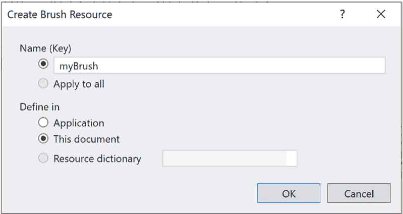


## {StaticResource} 标记扩展

{StaticResource} 标记扩展只在初始化时应用一次资源，并在应用程序的整个生命周期内与原对象保持“连接”。某些属性（如渐变停止点）会更新，但例如如果您创建了一个新的 Brush，控件不会更新。为了实际体验这一点，请向每个 Button 控件添加 Name 和 Click 事件处理程序，如下所示：

```
<Button Name="Ok" Margin="25" Height="200" Width="200" Content="OK"
    FontSize="20" Background="{StaticResource myBrush}" Click="Ok_OnClick"/>
<Button Name="Cancel" Margin="25" Height="200" Width="200" Content="Cancel"
    FontSize="20" Background="{StaticResource myBrush}" Click="Cancel_OnClick"/>
```

接下来，将以下代码添加到 Ok_OnClick() 事件处理程序中：

```
private void Ok_OnClick(object sender, RoutedEventArgs e)
{
    // Get the brush and make a change.
    var b=(RadialGradientBrush)Resources["myBrush"];
    b.GradientStops[1]=new GradientStop(Colors.Black, 0.0);
}
```

> 注意 此处您使用 Resources 索引器按名称查找资源。但请注意，如果找不到资源，这将引发运行时异常。您也可以使用 TryFindResource() 方法，该方法不会引发运行时错误；如果找不到指定资源，它只会返回 null。

当您运行程序并单击 OK 按钮时，会看到渐变相应地发生变化。现在将以下代码添加到 Cancel_OnClick() 事件处理程序中：

```
private void Cancel_OnClick(object sender, RoutedEventArgs e)
{
    // Put a totally new brush into the myBrush slot.
    Resources["myBrush"]=new SolidColorBrush(Colors.Red);
}
```

再次运行程序，单击 Cancel 按钮，什么也不会发生！

## {DynamicResource} 标记扩展

属性也可以使用 DynamicResource 标记扩展。为了查看区别，请将 Cancel 按钮的标记改为以下内容：

```
<Button Name="Cancel" Margin="25" Height="200" Width="200" Content="Cancel"
    FontSize="20" Background="{DynamicResource myBrush}" Click="Cancel_OnClick"/>
```

这一次，当您单击 Cancel 按钮时，Cancel 按钮的背景会发生变化，但 OK 按钮的背景保持不变。这是因为 {DynamicResource} 标记扩展能够检测到底层的键控对象是否已被新对象替换。正如您可能猜到的那样，这需要一些额外的运行时基础结构，因此通常应坚持使用 {StaticResource}，除非您知道某个对象资源在运行时会被替换为另一个对象，并且希望所有使用该资源的元素都得到通知。

## 应用程序级资源

当您在窗口的资源字典中拥有对象资源时，该窗口中的所有元素都可以随意使用它，但应用程序中的其他窗口则不能。跨应用程序共享资源的解决方案是在应用程序级别（而不是窗口级别）定义对象资源。在 Visual Studio 中无法自动完成此操作，因此只需将当前的画笔对象从 <Window.Resources> 范围中剪切出来，然后放到 App.xaml 文件的 <Application.Resources> 范围中。

现在，应用程序中的任何其他窗口或控件都可以随意使用这个画笔。如果您想为控件设置 Background 属性，应用程序级资源可供选择，如图 27-5 所示。

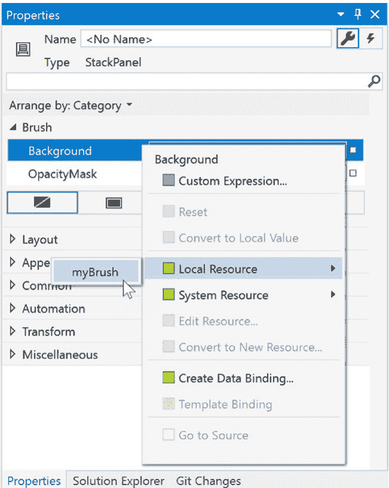

图 27-5. 应用应用程序级资源

> 注意 将资源放在应用程序级别并分配给控件的属性会冻结该资源，从而防止在运行时更改值。可以克隆资源，然后更新克隆。

## 定义合并资源字典

应用程序级资源通常已经足够好了，但它们无助于跨项目复用。在这种情况下，您需要定义所谓的合并资源字典。可以将其视为 WPF 资源的类库；它只是一个包含资源集合的 XAML 文件。单个项目可以根据需要拥有任意数量的此类文件（一个用于画笔，一个用于动画等），每个文件都可以通过“项目”菜单激活的“添加新项”对话框插入（参见图 27-6）。

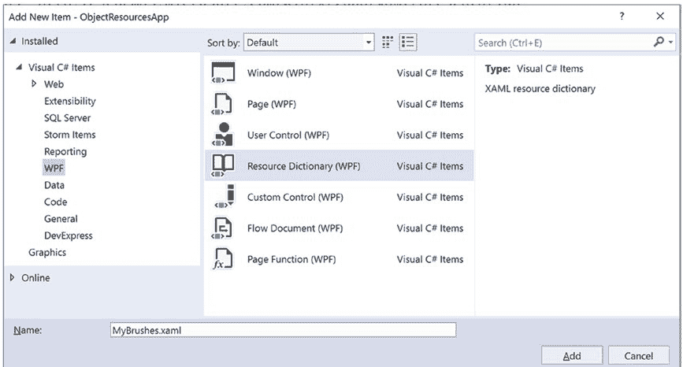

图 27-6. 插入新的合并资源字典

在新的 MyBrushes.xaml 文件中，剪切 Application.Resources 范围中的当前资源，并将它们移到您的字典中，如下所示：

```
<ResourceDictionary xmlns="http://schemas.microsoft.com/winfx/2006/xaml/presentation"
    xmlns:local="clr-namespace:ObjectResourcesApp"
    xmlns:x="http://schemas.microsoft.com/winfx/2006/xaml">
    <RadialGradientBrush x:Key="myBrush">
        <GradientStop Color="#FFC44EC4" Offset="0" />
        <GradientStop Color="#FF829CEB" Offset="1" />
        <GradientStop Color="#FF793879" Offset="0.669" />
    </RadialGradientBrush>
</ResourceDictionary>
```

尽管此资源字典是项目的一部分，但所有资源字典都必须合并（通常在应用程序级别）到现有的资源字典中才能使用。为此，请在 App.xaml 文件中使用以下格式（请注意，可以通过在 <ResourceDictionary.MergedDictionaries> 范围内添加多个 <ResourceDictionary> 元素来合并多个资源字典）：

```
<Application.Resources>
    <ResourceDictionary>
        <ResourceDictionary.MergedDictionaries>
            <ResourceDictionary Source="MyBrushes.xaml"/>
        </ResourceDictionary.MergedDictionaries>
    </ResourceDictionary>
</Application.Resources>
```

这种方法的问题在于，每个资源文件都必须添加到需要这些资源的每个项目中。更好的共享资源方法是定义一个 .NET Core 类库在项目之间共享，您接下来将这样做。

## 定义仅包含资源的程序集

构建仅包含资源的程序集最简单的方法是从 WPF 用户控件库（.NET Core）项目开始。通过 Visual Studio 的“添加”►“新建项目”菜单选项，将这样一个项目（名为 MyBrushesLibrary）添加到当前解决方案中，并从 ObjectResourcesApp 项目中添加对它的项目引用。

现在，从项目中删除 UserControl1.xaml 文件。接下来，将 MyBrushes.xaml 文件拖放到 MyBrushesLibrary 项目中，并从 ObjectResourcesApp 项目中删除它。最后，在 MyBrushesLibrary 项目中打开 MyBrushes.xaml，并将文件中的 xmlns:local 命名空间改为 clr-namespace:MyBrushesLibrary。您的 MyBrushes.xaml 文件应如下所示：

```
<ResourceDictionary xmlns="http://schemas.microsoft.com/winfx/2006/xaml/presentation"
    xmlns:x="http://schemas.microsoft.com/winfx/2006/xaml"
    xmlns:local="clr-namespace:MyBrushesLibrary">
    <RadialGradientBrush x:Key="myBrush">
        <GradientStop Color="#FFC44EC4" Offset="0" />
        <GradientStop Color="#FF829CEB" Offset="1" />
        <GradientStop Color="#FF793879" Offset="0.669" />
    </RadialGradientBrush>
</ResourceDictionary>
```

编译您的用户控件库项目。现在，将这些二进制资源合并到 ObjectResourcesApp 项目的应用程序级资源字典中。但是，这样做需要一些相当特殊的语法，如下所示：

```
<Application.Resources>
    <ResourceDictionary>
        <ResourceDictionary.MergedDictionaries>
            <!-- The syntax is /NameOfAssembly;Component/NameOfXamlFileInAssembly.xaml -->
            <ResourceDictionary Source="/MyBrushesLibrary;Component/MyBrushes.xaml"/>
        </ResourceDictionary.MergedDictionaries>
    </ResourceDictionary>
</Application.Resources>
```

首先，请注意此字符串对空格敏感。如果在分号或正斜杠周围有多余的空格，您将产生错误。字符串的第一部分是外部库的友好名称（没有文件扩展名）。在分号之后，输入单词 Component，后跟编译后的二进制资源的名称，该名称与原始 XAML 资源字典相同。

这就结束了对 WPF 资源管理系统的探讨。在您的大多数（如果不是全部）应用程序中，您都会很好地利用这些技术。接下来，让我们研究 Windows Presentation Foundation 的集成动画 API。

## 理解 WPF 的动画服务

除了您在第二十六章中研究的图形渲染服务之外，WPF 还提供了支持动画服务的编程接口。动画一词可能会让人想到旋转的公司标志、一系列旋转的图像资源（以提供运动的假象）、在屏幕上弹跳的文本，或特定类型的程序，如视频游戏或多媒体应用程序。

虽然 WPF 的动画 API 当然可以用于此类目的，但动画可以用于任何您想为应用程序增添额外魅力的场景。例如，您可以为屏幕上的按钮构建一个动画，当鼠标光标悬停在其边界内时，按钮会稍微放大（一旦鼠标光标移出边界，按钮就会缩小回去）。或者，您可以让窗口以特定的视觉效果关闭，例如缓慢淡入透明。更面向业务应用的用途是让错误消息在应用程序屏幕上淡入，以改善用户体验。事实上，WPF 的动画支持可以用于任何类型的应用程序（业务应用程序、多媒体程序、视频游戏等），只要您想提供更具吸引力的用户体验。

与 WPF 的许多其他方面一样，构建动画的概念并不新鲜。新的地方在于，与您过去可能使用过的其他 API（包括 Windows Forms）不同，开发人员无需手动编写必要的基础结构。在 WPF 下，无需创建用于推进动画序列的后台线程或计时器，无需定义自定义类型来表示动画，无需擦除和重绘图像，也无需进行繁琐的数学计算。与 WPF 的其他方面一样，您可以完全使用 XAML、完全使用 C# 代码或两者结合来构建动画。

> 注意 Visual Studio 不支持使用 GUI 动画工具来创作动画。如果您使用 Visual Studio 创作动画，则需要直接输入 XAML。但是，Blend for Visual Studio（随 Visual Studio 2019 一起提供的配套产品）确实内置了动画编辑器，可以大大简化您的工作。

### 动画类类型的作用

要理解 WPF 的动画支持，您必须首先检查 PresentationCore.dll 的 System.Windows.Media.Animation 命名空间中的动画类。在这里，您会找到 100 多个使用 Animation 标记命名的不同类类型。

这些类可以分为三大类。首先，任何遵循 DataTypeAnimation 命名约定的类（ByteAnimation、ColorAnimation、DoubleAnimation、Int32Animation 等）都允许您使用线性插值动画。这使您可以在给定的时间内，将值从起始值平滑地更改到最终值。


接下来，遵循命名约定 DataTypeAnimationUsingKeyFrames 的类（StringAnimationUsingKeyFrames、DoubleAnimationUsingKeyFrames、PointAnimationUsingKeyFrames 等）表示“关键帧动画”，它允许你在一段时间内循环一组定义的值。例如，你可以使用关键帧通过循环一系列单个字符来更改按钮的标题。

最后，遵循 DataTypeAnimationUsingPath 命名约定的类（DoubleAnimationUsingPath、PointAnimationUsingPath 等）是基于路径的动画，允许你将对象动画化以沿着你定义的路径移动。举例来说，如果你正在构建一个 GPS 应用程序，你可以使用基于路径的动画将项目沿着通往用户目的地的最快行驶路线移动。

现在，显然，这些类并不是用来以某种方式直接向特定数据类型的变量提供动画序列（毕竟，你究竟如何使用 Int32Animation 来为值“9”设置动画呢？）。

例如，考虑 Label 类型的 Height 和 Width 属性，两者都是包装 double 的依赖属性。如果你想定义一个在时间跨度内增加标签高度的动画，你可以将 DoubleAnimation 对象连接到 Height 属性，并让 WPF 处理执行实际动画的细节。另一个例子是，如果你想在五秒内将画刷类型的颜色从绿色过渡到黄色，你可以使用 ColorAnimation 类型来做到这一点。

要明确的是，这些 Animation 类可以连接到给定对象的任何依赖属性，只要其匹配底层类型即可。如第 25 章所述，依赖属性是 WPF 许多服务（包括动画、数据绑定和样式）所需的一种专用属性形式。

按照惯例，依赖属性被定义为类的静态只读字段，并通过在普通属性名称后加上单词 Property 来命名。例如，Button 的 Height 属性的依赖属性在代码中将使用 Button.HeightProperty 访问。

## To、From 和 By 属性

所有 Animation 类都定义了以下几个关键属性，用于控制执行动画时使用的起始值和结束值：

- To：此属性表示动画的结束值。
- From：此属性表示动画的起始值。
- By：此属性表示动画对其起始值变化的总量。

尽管所有 Animation 类都支持 To、From 和 By 属性，但它们并未通过基类的虚成员接收这些属性。原因在于这些属性所包装的底层类型差异很大（整数、颜色、Thickness 对象等），并且使用单个基类表示所有可能性会导致复杂的编码结构。

相关地，你可能还会想知道为什么没有使用 .NET 泛型来定义一个具有单个类型参数的单一通用动画类（例如 Animate<T>）。同样，鉴于用于动画化依赖属性的底层数据类型如此之多（颜色、向量、整数、字符串等），这并不是你可能期望的那样干净的解决方案（更不用说 XAML 对泛型类型的支持有限）。

## Timeline 基类的作用

尽管没有使用单个基类来定义虚 To、From 和 By 属性，但 Animation 类确实共享一个共同的基类：System.Windows.Media.Animation.Timeline。此类型提供了几个额外的属性，用于控制动画的节奏，如表 27-1 所述。

## 表 27-1. Timeline 基类的关键成员

| Properties | Meaning in Life |
|---|---|
| AccelerationRatio, DecelerationRatio, SpeedRatio | 这些属性可用于控制动画序列的整体节奏。 |
| AutoReverse | 此属性获取或设置一个值，该值指示时间线在完成一次正向迭代后是否以反向播放（默认值是 false）。 |
| BeginTime | 此属性获取或设置此时间线应开始的时间。默认值是 0，表示动画立即开始。 |
| Duration | 此属性允许你设置播放时间线的持续时间。 |
| FillBehavior, RepeatBehavior | 这些属性用于控制时间线完成后的行为（重复动画、无操作等）。 |

## 在 C# 代码中编写动画

具体来说，你将构建一个包含 Button 的 Window，当鼠标进入其表面区域时，该按钮会表现出一种奇怪的行为，即围绕左上角旋转。开始时，创建一个名为 SpinningButtonAnimationApp 的新 WPF 应用程序。将初始标记更新为以下内容（注意你正在处理按钮的 MouseEnter 事件）：

```
<Button x:Name="btnSpinner" Height="50" Width="100" Content="I Spin!" MouseEnter="btnSpinner_MouseEnter" Click="btnSpinner_OnClick"/>
```

在代码隐藏文件中，导入 System.Windows.Media.Animation 命名空间，并在窗口的 C# 代码文件中添加以下代码：

```
private bool _isSpinning=false;

private void btnSpinner_MouseEnter(
object sender, MouseEventArgs e)
{
    if (!_isSpinning)
    {
        _isSpinning=true;
        // Make a double animation object, and register
        // with the Completed event.
        var dblAnim=new DoubleAnimation();
        dblAnim.Completed +=(o, s)=> { _isSpinning=false; };
        // Set the start value and end value.
        dblAnim.From=0;
        dblAnim.To=360;
        // Now, create a RotateTransform object, and set
        // it to the RenderTransform property of our
        // button.
        var rt=new RotateTransform();
        btnSpinner.RenderTransform=rt;
```

```
// Now, animation the RotateTransform object.
rt.BeginAnimation(RotateTransform.AngleProperty, dblAnim);
}
}
private void btnSpinner_OnClick(
    object sender, RoutedEventArgs e)
{
```

此方法的第一个主要任务是配置一个 DoubleAnimation 对象，该对象将从值 0 开始并以值 360 结束。注意你也在处理此对象的 Completed 事件，以切换一个类级 bool 变量，该变量用于确保如果当前正在执行动画，则不会“重置”它重新开始。

接下来，你创建一个 RotateTransform 对象，该对象连接到你的 Button 控件（btnSpinner）的 RenderTransform 属性。最后，你通知 RenderTransform 对象使用你的 DoubleAnimation 对象开始为其 Angle 属性设置动画。当你在代码中编写动画时，通常通过调用 BeginAnimation() 来完成，然后传入你想要设置动画的底层依赖属性（记住，按照惯例，这是类上的一个静态字段），后跟相关的动画对象。

让我们再向程序添加一个动画，当按钮被点击时，该动画将使按钮淡出到不可见。首先，在 Click 事件处理程序中添加以下代码：

```
private void btnSpinner_OnClick(
    object sender, RoutedEventArgs e)
{
    var dblAnim=new DoubleAnimation
    {
        From=1.0,
        To=0.0
    };
    btnSpinner.BeginAnimation(Button.OpacityProperty, dblAnim);
}
```

在这里，你正在更改 Opacity 属性值以使按钮淡出视野。然而，目前这很难做到，因为按钮旋转得非常快！那么，你如何控制动画的节奏呢？很高兴你问了。

## 控制动画的节奏

默认情况下，动画大约需要一秒钟才能在 From 和 To 属性分配的值之间过渡。因此，你的按钮有一秒钟的时间旋转完整的 360 度角度，而按钮在被点击时将在一秒钟内淡出到不可见。

如果你想为动画的过渡定义自定义时间量，可以通过动画对象的 Duration 属性来完成，该属性可以设置为 Duration 对象的实例。通常，时间跨度是通过将 TimeSpan 对象传递给 Duration 的构造函数来建立的。考虑以下更新，它将给按钮四秒钟的时间旋转：

```
private void btnSpinner_MouseEnter(
    object sender, MouseEventArgs e)
{
    if (!isSpinning)
```


```
{
    _isSpinning=true;

    // Make a DoubleAnimation object, and register
    // with the Completed event.
    var dblAnim=new DoubleAnimation();
    dblAnim.Completed +=(o, s)=> { _isSpinning=false; };

    // Button has four seconds to finish the spin!
    dblAnim.Duration=new Duration(TimeSpan.FromSeconds(4));

    ...
}
}
```

With this adjustment, you should have a fighting chance of clicking the button while it is spinning, at which point it will fade away.

> Note The BeginTime property of an Animation class also takes a TimeSpan object. Recall that this property can be set to establish a wait time before starting an animation sequence.

## Reversing and Looping an Animation

You can also tell Animation objects to play an animation in reverse at the completion of the animation sequence by setting the AutoReverse property to true. For example, if you want to have the button come back into view after it has faded away, you could author the following:

```
private void btnSpinner_OnClick(object sender, RoutedEventArgs e)
{
    DoubleAnimation dblAnim=new DoubleAnimation
    {
        From=1.0,
        To=0.0
    };
    // Reverse when done.
    dblAnim.AutoReverse=true;
    btnSpinner.BeginAnimation(Button.OpacityProperty, dblAnim);
}
```

If you would like to have an animation repeat some number of times (or to never stop once activated), you can do so using the RepeatBehavior property, which is common to all Animation classes. If you pass in a simple numerical value to the constructor, you can specify a hard-coded number of times to repeat. On the other hand, if you pass in a TimeSpan object to the constructor, you can establish an amount of time the animation should repeat. Finally, if you want an animation to loop ad infinitum, you can simply specify RepeatBehavior.Forever. Consider the following ways you could change the repeat behaviors of either of the DoubleAnimation objects used in this example:

```
// Loop forever.
dblAnim.RepeatBehavior=RepeatBehavior.Forever;
```

```
// Loop three times.
dblAnim.RepeatBehavior=new RepeatBehavior(3);
```

```
// Loop for 30 seconds.
dblAnim.RepeatBehavior=new RepeatBehavior(TimeSpan.FromSeconds(30));
```

That wraps up your investigation about how to animate aspects of an object using C# code and the WPF animation API. Next, you will learn how to do the same using XAML.

## Authoring Animations in XAML

Authoring animations in markup is like authoring them in code, at least for simple, straightforward animation sequences. When you need to capture more complex animations, which may involve changing the values of numerous properties at once, the amount of markup can grow considerably. Even if you use a tool to generate XAML-based animations, it is important to know the basics of how an animation is represented in XAML because this will make it easier for you to modify and tweak tool-generated content.

> Note You will find a number of XAML files in the XamlAnimations folder of the downloadable source code. As you go through the next several pages, copy these markup files into your custom XAML editor or into the Kaxaml editor to see the results.

For the most part, creating an animation is like what you saw already. You still configure an Animation object and associate it to an object's property. One big difference, however, is that WPF is not function call friendly. As a result, instead of calling `BeginAnimation()`, you use a storyboard as a layer of indirection.

Let's walk through a complete example of an animation defined in terms of XAML, followed by a detailed breakdown. The following XAML definition will display a window that contains a single label. As soon as the Label object loads into memory, it begins an animation sequence in which the font size increases from 12 points to 100 over a period of four seconds. The animation will repeat for as long as the Window object is loaded in memory. You can find this markup in the GrowLabelFont.xaml file, so copy it into Kaxaml (make sure to press F5 to show the window) and observe the behavior.

```
<Window
    xmlns="http://schemas.microsoft.com/winfx/2006/xaml/presentation"
    xmlns:x="http://schemas.microsoft.com/winfx/2006/xaml"
    Height="200" Width="600" WindowStartupLocation="CenterScreen" Title="Growing Label Font!">
    <StackPanel>
        <Label Content="Interesting...">
            <Label.Triggers>
                <EventTrigger RoutedEvent="Label.Loaded">
                    <EventTrigger.Actions>
                        <BeginStoryboard>
                            <Storyboard TargetProperty="FontSize">
                                <DoubleAnimation From="12" To="100" Duration="0:0:4"
                                    RepeatBehavior="Forever"/>
                            </Storyboard>
                        </BeginStoryboard>
                    </EventTrigger.Actions>
                </EventTrigger>
            </Label.Triggers>
        </Label>
    </StackPanel>
</Window>
```

Now, let’s break this example down, bit by bit.

### The Role of Storyboards

Working from the innermost element outward, you first encounter the `<DoubleAnimation>` element, which makes use of the same properties you set in procedural code (From, To, Duration, and RepeatBehavior).

```
<DoubleAnimation From="12" To="100" Duration="0:0:4"
    RepeatBehavior="Forever"/>
```

As mentioned, Animation elements are placed within a `<Storyboard>` element, which is used to map the animation object to a given property on the parent type via the TargetProperty property, which in this case is FontSize. A `<Storyboard>` is always wrapped in a parent element named `<BeginStoryboard>`.

```
<BeginStoryboard>
    <Storyboard TargetProperty="FontSize">
        <DoubleAnimation From="12" To="100" Duration="0:0:4"
            RepeatBehavior="Forever"/>
    </Storyboard>
</BeginStoryboard>
```

### The Role of Event Triggers

After the `<BeginStoryboard>` element has been defined, you need to specify some sort of action that will cause the animation to begin executing. WPF has a few different ways to respond to runtime conditions in markup, one of which is termed a trigger. From a high level, you can consider a trigger a way of responding to an event condition in XAML, without the need for procedural code.

Typically, when you respond to an event in C#, you author custom code that will execute when the event occurs. A trigger, however, is just a way to be notified that some event condition has happened ("I’m loaded into memory!" or "The mouse is over me!" or "I have focus!").

Once you have been notified that an event condition has occurred, you can start the storyboard. In this example, you are responding to the Label being loaded into memory. Because it is the Label’s Loaded event you are interested in, the `<EventTrigger>` is placed in the Label’s trigger collection.

```
<Label Content="Interesting...">
    <Label.Triggers>
        <EventTrigger RoutedEvent="Label.Loaded">
            <EventTrigger.Actions>
                <BeginStoryboard>
                    <Storyboard TargetProperty="FontSize">
                        <DoubleAnimation From="12" To="100" Duration="0:0:4" RepeatBehavior="Forever"/>
                    </Storyboard>
                </BeginStoryboard>
            </EventTrigger.Actions>
        </EventTrigger>
    </Label.Triggers>
</Label>
```

Let’s see another example of defining an animation in XAML, this time using a key frame animation.

### Animation Using Discrete Key Frames

Unlike the linear interpolation animation objects, which can only move between a starting point and an ending point, the key frame counterparts allow you to create a collection of specific values for an animation that should take place at specific times.

To illustrate the use of a discrete key frame type, assume you want to build a Button control that animates its content so that over the course of three seconds the value “OK!” appears, one character at a time. You will find the following markup in the AnimateString.xaml file. Copy this markup into your MyXamlPad.exe program (or Kaxaml) and view the results:

```
<Window xmlns="http://schemas.microsoft.com/winfx/2006/xaml/presentation" xmlns:x="http://schemas.microsoft.com/winfx/2006/xaml" Height="100" Width="300" WindowStartupLocation="CenterScreen" Title="Animate String Data!">
  <StackPanel>
    <Button Name="myButton" Height="40" FontSize="16pt" FontFamily="Verdana" Width="100">
      <Button.Triggers>
        <EventTrigger RoutedEvent="Button.Loaded">
          <BeginStoryboard>
            <Storyboard>
              <StringAnimationUsingKeyFrames RepeatBehavior="Forever" Storyboard.TargetProperty="Content" Duration="0:0:3">
                <DiscreteStringKeyFrame Value="" KeyTime="0:0:0" />
                <DiscreteStringKeyFrame Value="O" KeyTime="0:0:1" />
                <DiscreteStringKeyFrame Value="OK" KeyTime="0:0:1.5" />
                <DiscreteStringKeyFrame Value="OK!" KeyTime="0:0:2" />
              </StringAnimationUsingKeyFrames>
            </Storyboard>
          </BeginStoryboard>
        </EventTrigger>
      </Button.Triggers>
    </Button>
  </StackPanel>
</Window>
```


首先，请注意你已经为按钮定义了一个事件触发器，以确保当按钮加载到内存中时，你的情节提要能够执行。`StringAnimationUsingKeyFrames` 类负责通过 `Storyboard.TargetProperty` 值来更改按钮的内容。

在 `<StringAnimationUsingKeyFrames>` 元素的作用域内，你定义了四个 `DiscreteStringKeyFrame` 元素，它们会在两秒内更改按钮的 Content 属性（请注意，`StringAnimationUsingKeyFrames` 建立的持续时间总共为三秒，因此你会看到最后一个 `!` 与循环显示的 `0` 之间有一小段暂停）。

现在你已经对如何在 C# 代码和 XAML 中构建动画有了更好的感觉，接下来让我们看看 WPF 样式的作用，它们大量使用了图形、对象资源和动画。

## 理解 WPF 样式的作用

在构建 WPF 应用程序的 UI 时，一组控件通常需要共享相同的外观和感觉。例如，你可能希望所有按钮类型都具有相同的高度、宽度、背景色以及字符串内容的字体大小。虽然你可以通过将每个按钮的各个属性设置为相同的值来处理，但这种方法使得后续更改变得困难，因为每次更改都需要在多个对象上重置相同的属性集。

幸运的是，WPF 提供了一种使用样式来约束相关控件外观和感觉的简单方法。简而言之，WPF 样式是一个维护属性-值对集合的对象。从编程角度来说，单个样式使用 `System.Windows.Style` 类来表示。该类有一个名为 `Setters` 的属性，它公开了一个强类型的 `Setter` 对象集合。正是 `Setter` 对象允许你定义属性-值对。

除了 `Setters` 集合之外，`Style` 类还定义了一些其他重要成员，这些成员允许你合并触发器、限制样式的应用范围，甚至基于现有样式创建新样式（可以将其视为“样式继承”）。请注意 `Style` 类的以下成员：

- `Triggers`：公开一个触发器对象集合，允许你在样式内捕获各种事件条件
- `BasedOn`：允许你基于现有样式构建新样式
- `TargetType`：允许你约束样式的应用范围

### 定义并应用样式

在几乎所有情况下，`Style` 对象都会作为对象资源打包。与任何对象资源一样，你可以在窗口或应用程序级别打包它，也可以放在专用的资源字典中（这很棒，因为这使得 `Style` 对象在整个应用程序中易于访问）。现在回想一下，目标就是定义一个 `Style` 对象，该对象用一组属性-值对填充（至少）`Setters` 集合。

让我们构建一个样式，捕获应用程序中控件的基本字体特征。首先创建一个名为 `WpfStyles` 的新 WPF 应用程序。打开 `App.xaml` 文件并定义以下命名样式：

```
<Application.Resources>
    <Style x:Key="BasicControlStyle">
        <Setter Property="Control.FontSize" Value="14"/>
        <Setter Property="Control.Height" Value="40"/>
        <Setter Property="Control.Cursor" Value="Hand"/>
    </Style>
</Application.Resources>
```

请注意，你的 `BasicControlStyle` 向内部集合添加了三个 `Setter` 对象。现在，让我们将此样式应用到主窗口中的一些控件。因为此样式是一个对象资源，所以要使用它的控件仍然需要使用 `{StaticResource}` 或 `{DynamicResource}` 标记扩展来定位样式。当它们找到样式时，会将资源项设置为同名的 `Style` 属性。用以下标记替换默认的 `Grid` 控件：

```
<StackPanel>
    <Label x:Name="lblInfo" Content="This style is boring..."
        Style="{StaticResource BasicControlStyle}" Width="150"/>
    <Button x:Name="btnTestButton" Content="Yes, but we are reusing settings!"
        Style="{StaticResource BasicControlStyle}" Width="250"/>
</StackPanel>
```

如果你在 Visual Studio 设计器中查看窗口（或运行应用程序），你会看到两个控件支持相同的鼠标指针、高度和字体大小。

### 覆盖样式设置

虽然你的两个控件都选择了样式，但如果某个控件想要应用样式然后再更改某些定义设置，那也是可以的。例如，按钮现在将使用 `Help` 鼠标指针（而不是样式中定义的 `Hand` 鼠标指针）。

```
<Button x:Name="btnTestButton" Content="Yes, but we are reusing settings!"
    Cursor="Help" Style="{StaticResource BasicControlStyle}" Width="250" />
```

样式在控件的各个属性设置之前处理，因此控件可以逐例“覆盖”设置。

### TargetType 对样式的影响

当前，你的样式的定义方式使得任何控件都可以采用它（并且必须通过设置控件的 `Style` 属性来显式采用），因为每个属性都由 `Control` 类限定。对于定义数十个设置的程序，这会产生大量的重复代码。稍微简化此样式的一种方法是使用 `TargetType` 属性。当你将此属性添加到 `Style` 的开始元素时，你可以恰好一次标记它的应用位置（在本例中是在 `App.xaml` 中）。

```
<Style x:Key="BasicControlStyle" TargetType="Control">
    <Setter Property="FontSize" Value="14"/>
    <Setter Property="Height" Value="40"/>
    <Setter Property="Cursor" Value="Hand"/>
</Style>
```

> 注意：当你构建使用基类类型的样式时，如果为派生类型不支持的依赖属性分配了值，则无需担心。如果派生类型不支持给定的依赖属性，该属性将被忽略。

这有点帮助，但你仍然拥有一个可以应用于任何控件的样式。当你想要定义一个只能应用于特定类型控件的样式时，`TargetType` 属性更有用。将以下新样式添加到应用程序的资源字典中：

```
<Style x:Key="BigGreenButton" TargetType="Button">
    <Setter Property="FontSize" Value="20"/>
    <Setter Property="Height" Value="100"/>
    <Setter Property="Width" Value="100"/>
    <Setter Property="Background" Value="DarkGreen"/>
    <Setter Property="Foreground" Value="Yellow"/>
</Style>
```

此样式仅适用于 `Button` 控件（或 `Button` 的子类）。如果你将其应用于不兼容的元素，将会收到标记和编译器错误。添加一个使用此新样式的新 `Button`，如下所示：

```
<Button x:Name="btnAnotherButton" Content="OK!" Margin="0,10,0,0"
    Style="{StaticResource BigGreenButton}" Width="250" Cursor="Help"/>
```

你将看到类似于图 27-7 所示的输出。

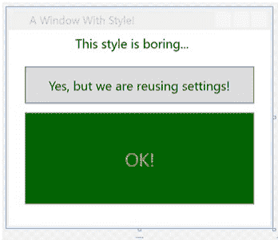

图 27-7. 具有不同样式的控件

`TargetType` 的另一个作用是，如果不存在 `x:Key` 属性，该样式将应用于样式定义作用域内该类型的所有元素。

下面是另一个应用程序级别的样式，它将自动应用于当前应用程序中的所有 `TextBox` 控件：

```
<!-- The default style for all text boxes. -->
<Style TargetType="TextBox">
    <Setter Property="FontSize" Value="14"/>
    <Setter Property="Width" Value="100"/>
    <Setter Property="Height" Value="30"/>
    <Setter Property="BorderThickness" Value="5"/>
    <Setter Property="BorderBrush" Value="Red"/>
    <Setter Property="FontStyle" Value="Italic"/>
</Style>
```

现在你可以定义任意数量的 `TextBox` 控件，它们将自动获得定义的外观。如果某个 `TextBox` 不想要这种默认外观和感觉，它可以通过将 `Style` 属性设置为 `{x:Null}` 来退出。例如，`txtTest` 将获取默认的未命名样式，而 `txtTest2` 则按自己的方式处理。

```
<TextBox x:Name="txtTest"/>
<TextBox x:Name="txtTest2" Style="{x:Null}" BorderBrush="Black" BorderThickness="5" Height="60" Width="100" Text="Ha!"/>
```

### 对现有样式进行子类化

你还可以通过 `BasedOn` 属性使用现有样式构建新样式。要扩展的样式必须在字典中有一个合适的 `x:Key`，因为派生样式将通过 `{StaticResource}` 或 `{DynamicResource}` 标记扩展按名称引用它。下面是一个基于 `BigGreenButton` 的新样式，它将按钮元素旋转 20 度：

```
<!-- This style is based on BigGreenButton. -->
<Style x:Key="TiltButton" TargetType="Button" BasedOn="{StaticResource BigGreenButton}">
    <Setter Property="Foreground" Value="White"/>
    <Setter Property="RenderTransform">
        <Setter.Value>
            <RotateTransform Angle="20"/>
        </Setter.Value>
    </Setter>
</Style>
```

要使用此新样式，请将按钮的标记更新为以下内容：

```
<Button x:Name="btnAnotherButton" Content="OK!" Margin="0,10,0,0" Style="{StaticResource TiltButton}" Width="250" Cursor="Help"/>
```

这将外观更改为图 27-8 所示的图像。

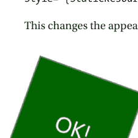

图 27-8. 使用派生样式


## 使用触发器定义样式

WPF样式还可以包含触发器，方法是将Trigger对象封装在Style对象的Triggers集合中。在样式中使用触发器，可以定义某些`<Setter>`元素，使其仅在给定触发器条件为真时才被应用。例如，你可能希望当鼠标悬停在按钮上时增大字体大小。或者你可能希望确保当前具有焦点的文本框以指定的颜色突出显示。触发器对于这类情况非常有用，因为它们允许你在属性更改时采取特定操作，而无需在代码隐藏文件中编写显式的C#代码。

以下是TextBox样式的更新版本，它确保当TextBox获得输入焦点时，其背景变为黄色：

```
<!-- The default style for all text boxes. -->
<Style TargetType="TextBox">
    <Setter Property="FontSize" Value="14"/>
    <Setter Property="Width" Value="100"/>
    <Setter Property="Height" Value="30"/>
    <Setter Property="BorderThickness" Value="5"/>
    <Setter Property="BorderBrush" Value="Red"/>
    <Setter Property="FontStyle" Value="Italic"/>
    <!-- The following setter will be applied only when the text box is in focus. -->
    <Style.Triggers>
        <Trigger Property="IsFocused" Value="True">
            <Setter Property="Background" Value="Yellow"/>
        </Trigger>
    </Style.Triggers>
</Style>
```

如果你测试这个样式，你会发现当你在各个TextBox对象之间切换Tab时，当前选中的TextBox会显示亮黄色的背景（前提是它没有通过将`{x:Null}`赋给Style属性来退出该样式）。

属性触发器也非常智能，当触发器条件不为真时，属性会自动接收默认的赋值。因此，一旦TextBox失去焦点，它也会自动变为默认颜色，无需你进行任何操作。相比之下，事件触发器（在你查看WPF动画时了解过）不会自动恢复到先前条件。

## 使用多个触发器定义样式

触发器还可以设计为在多个条件为真时应用定义的`<Setter>`元素。假设你希望仅当TextBox具有活动焦点并且鼠标悬停在其边界内时，才将其背景设置为黄色。为此，你可以使用`<MultiTrigger>`元素来定义每个条件，如下所示：

```
<!-- The default style for all text boxes. -->
<Style TargetType="TextBox">
    <Setter Property="FontSize" Value="14"/>
    <Setter Property="Width" Value="100"/>
    <Setter Property="Height" Value="30"/>
    <Setter Property="BorderThickness" Value="5"/>
    <Setter Property="BorderBrush" Value="Red"/>
    <Setter Property="FontStyle" Value="Italic"/>
    <!-- The following setter will be applied only when the text box is in focus AND the mouse is over the text box. -->
    <Style.Triggers>
        <MultiTrigger>
            <MultiTrigger.Conditions>
                <Condition Property="IsFocused" Value="True"/>
                <Condition Property="IsMouseOver" Value="True"/>
            </MultiTrigger.Conditions>
            <Setter Property="Background" Value="Yellow"/>
        </MultiTrigger>
    </Style.Triggers>
</Style>
```

## 动画样式

样式还可以包含触发动画序列的触发器。下面是一个最终样式，当应用到Button控件时，当鼠标位于按钮表面区域内，控件将增大和缩小其尺寸：

```
<!-- The growing button style! -->
<Style x:Key="GrowingButtonStyle" TargetType="Button">
    <Setter Property="Height" Value="40"/>
    <Setter Property="Width" Value="100"/>
    <Style.Triggers>
        <Trigger Property="IsMouseOver" Value="True">
            <Trigger.EnterActions>
                <BeginStoryboard>
                    <Storyboard TargetProperty="Height">
                        <DoubleAnimation From="40" To="200" Duration="0:0:2" AutoReverse="True"/>
                    </Storyboard>
                </BeginStoryboard>
            </Trigger.EnterActions>
        </Trigger>
    </Style.Triggers>
</Style>
```

在这里，Triggers集合在监视IsMouseOver属性是否返回true。当发生这种情况时，你定义一个`<Trigger.EnterActions>`元素来执行一个简单的故事板，该故事板强制按钮在两秒内增长到200的高度（然后返回到高度40）。如果你想执行其他属性更改，你还可以定义`<Trigger.ExitActions>`作用域，以定义当IsMouseOver变为false时要采取的自定义操作。

## 以编程方式分配样式

回想一下，样式也可以在运行时应用。如果你希望让最终用户选择其UI的外观和感觉，或者如果你需要根据安全设置（例如DisableAllButton样式）或其他原因来强制执行外观和感觉，这可能很有帮助。

在此项目期间，你定义了多个样式，其中许多样式可以应用于Button控件。因此，让我们重新调整主窗口的UI，允许用户通过在ListBox中选择名称来从中选择一些样式。根据用户的选择，你将应用适当的样式。以下是`<Window>`元素的新（最终）标记：

```
<DockPanel >
    <StackPanel Orientation="Horizontal" DockPanel.Dock="Top" Margin="0,0,0,50">
        <Label Content="Please Pick a Style for this Button" Height="50"/>
        <ListBox x:Name="lstStyles" Height="80" Width="150" Background="LightBlue" SelectionChanged="comboStyles_Changed" />
    </StackPanel>
    <Button x:Name="btnStyle" Height="40" Width="100" Content="OK!"/>
</DockPanel>
```

ListBox控件（名为lstStyles）将在窗口构造函数中动态填充，如下所示：

```
public MainWindow()
{
    InitializeComponent();
    // Fill the list box with all the Button styles.
    lstStyles.Items.Add("GrowingButtonStyle");
    lstStyles.Items.Add("TiltButton");
    lstStyles.Items.Add("BigGreenButton");
    lstStyles.Items.Add("BasicControlStyle");
}
```

最后一个任务是在相关的代码文件中处理SelectionChanged事件。请注意以下代码如何使用继承的TryFindResource()方法按名称提取当前资源：

```
private void comboStyles_Changed(object sender, SelectionChangedEventArgs e)
{
    // Get the selected style name from the list box.
    var currStyle=(Style)TryFindResource(lstStyles.SelectedValue);
    if (currStyle==null) return;
    // Set the style of the button type.
    this.btnStyle.Style=currStyle;
}
```

当你运行此应用程序时，你可以即时选择四种按钮样式之一。图27-9显示了完成的应用程序。


图27-9. 具有不同样式的控件

## 逻辑树、可视树和默认模板

既然你已经理解了样式和资源，那么在开始学习如何构建自定义控件之前，还有几个预备性主题需要研究。具体来说，你需要了解逻辑树、可视树和默认模板之间的区别。当你在Visual Studio或诸如kaxaml.exe之类的工具中输入XAML时，你的标记是XAML文档的逻辑视图。同样，如果你编写C#代码向布局控件添加新项，你就是在将新项插入到逻辑树中。本质上，逻辑视图表示你的内容将如何在主窗口（或其他根元素，如Page或NavigationWindow）的各个布局管理器中进行定位。

然而，在每个逻辑树背后，是一个更为详细的表示，称为可视树，WPF在内部使用它来正确地将元素渲染到屏幕上。在任何可视树中，都将包含用于渲染每个对象的模板和样式的完整详细信息，包括任何必要的绘图、形状、可视对象和动画。

理解逻辑树和可视树之间的区别是有用的，因为当你构建自定义控件模板时，你本质上是在替换控件的默认可视树的全部或部分，并插入你自己的内容。因此，如果你希望Button控件被渲染为星形，你可以定义一个新的星形模板并将其插入按钮的可视树中。从逻辑上讲，该Button仍然是Button类型，并且它按预期支持属性、方法和事件。但在视觉上，它呈现了一个全新的外观。仅此一点就使WPF成为一个极其有用的API，因为其他工具包需要你构建一个新类才能制作星形按钮。而使用WPF，你只需定义新的标记。

> 注意 WPF控件通常被描述为无外观的（lookless）。这指的是WPF控件的外观和感觉完全独立于其行为（并且可以自定义）。


## 以编程方式检查逻辑树

在运行时分析窗口的逻辑树并不是一个非常常见的 WPF 编程活动，但值得一提的是，System.Windows 命名空间定义了一个名为 LogicalTreeHelper 的类，它允许你在运行时检查逻辑树的结构。为了说明逻辑树、视觉树和控件模板之间的联系，创建一个名为 TreesAndTemplatesApp 的新 WPF 应用程序。

用以下包含两个 Button 控件和一个启用了滚动条的大型只读 TextBox 的标记替换 Grid。确保使用 IDE 处理每个按钮的 Click 事件。以下 XAML 就很不错：

```
<DockPanel LastChildFill="True">
    <Border Height="50" DockPanel.Dock="Top" BorderBrush="Blue">
        <StackPanel Orientation="Horizontal">
            <Button x:Name="btnShowLogicalTree" Content="Logical Tree of Window" Margin="4" BorderBrush="Blue" Height="40" Click="btnShowLogicalTree_Click"/>
            <Button x:Name="btnShowVisualTree" Content="Visual Tree of Window" BorderBrush="Blue" Height="40" Click="btnShowVisualTree_Click"/>
        </StackPanel>
    </Border>
    <TextBox x:Name="txtDisplayArea" Margin="10" Background="AliceBlue" IsReadOnly="True" BorderBrush="Red" VerticalScrollBarVisibility="Auto" HorizontalScrollBarVisibility="Auto" />
</DockPanel>
```

在你的 C# 代码文件中，定义一个名为 _dataToShow 的字符串成员变量。现在，在 btnShowLogicalTree 对象的 Click 处理程序中，调用一个递归调用自身的辅助函数，以使用 Window 的逻辑树填充字符串变量。为此，你将调用 LogicalTreeHelper 的静态 GetChildren() 方法。以下是代码：

```
private string _dataToShow = string.Empty;

private void btnShowLogicalTree_Click(object sender, RoutedEventArgs e)
{
    _dataToShow = "";
    BuildLogicalTree(0, this);
    txtDisplayArea.Text = _dataToShow;
}

void BuildLogicalTree(int depth, object obj)
{
    // Add the type name to the dataToShow member variable.
    _dataToShow += new string(' ', depth) + obj.GetType().Name + "\n";
    // If an item is not a DependencyObject, skip it.
    if (!(obj is DependencyObject))
        return;
    // Make a recursive call for each logical child.
    foreach (var child in LogicalTreeHelper.GetChildren((DependencyObject)obj))
    {
        BuildLogicalTree(depth + 5, child);
    }
}
```

```
private void btnShowVisualTree_Click(
    object sender, RoutedEventArgs e)
{
}
```

如果运行应用程序并单击第一个按钮，你将在文本区域看到一棵树打印出来，这几乎是原始 XAML 的精确复制品（参见图 27-10）。

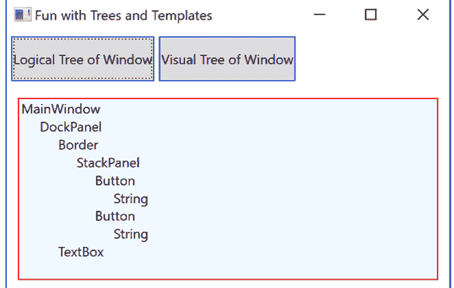

图 27-10. 在运行时查看逻辑树

## 以编程方式检查视觉树

Window 的视觉树也可以使用 System.Windows.Media 的 VisualTreeHelper 类在运行时进行检查。以下是第二个按钮控件 btnShowVisualTree 的 Click 实现，它执行类似的递归逻辑来构建视觉树的文本表示：

```
using System.Windows.Media;

private void btnShowVisualTree_Click(object sender, RoutedEventArgs e)
{
    _dataToShow = "";
    BuildVisualTree(0, this);
    txtDisplayArea.Text = _dataToShow;
}
void BuildVisualTree(int depth, DependencyObject obj)
{
    // Add the type name to the dataToShow member variable.
    _dataToShow += new string(' ', depth) + obj.GetType().Name + "\n";
    // Make a recursive call for each visual child.
    for (int i = 0; i < VisualTreeHelper.GetChildrenCount(obj); i++)
```

```
{
    BuildVisualTree(depth + 1, VisualTreeHelper.GetChild(obj, i));
}
}
```

正如你在图 27-11 中看到的，视觉树公开了几个较低级别的渲染代理，例如 ContentPresenter、AdornerDecorator、TextBoxLineDrawingVisual 等。

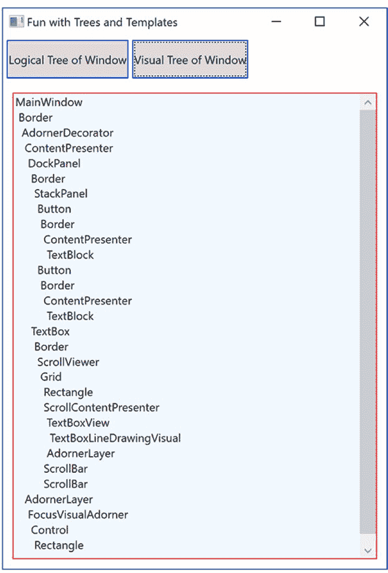

图 27-11. 在运行时查看视觉树

## 以编程方式检查控件的默认模板

回想一下，WPF 使用视觉树来理解如何渲染 Window 和所有包含的元素。每个 WPF 控件在其默认模板中存储自己的渲染命令集。从编程角度来说，任何模板都可以表示为 ControlTemplate 类的实例。此外，你还可以通过恰当地命名的 Template 属性获得控件的默认模板，如下所示：

```
// Get the default template of the Button.
Button myBtn = new Button();
ControlTemplate template = myBtn.Template;
```

同样，你也可以在代码中创建一个新的 ControlTemplate 对象并将其插入到控件的 Template 属性中，如下所示：

```
// Plug in a new template for the button to use.
Button myBtn = new Button();
ControlTemplate customTemplate = new ControlTemplate();

// Assume this method adds all the code for a star template.
MakeStarTemplate(customTemplate);
myBtn.Template = customTemplate;
```

虽然你可以在代码中构建新模板，但更常见的做法是在 XAML 中完成它。然而，在开始构建自己的模板之前，让我们完成当前示例并添加在运行时查看 WPF 控件默认模板的能力。这是一种查看模板整体构成的有用方法。用停靠在主 DockPanel 左侧的新 StackPanel 控件更新窗口的标记，定义如下（放置在 `<TextBox>` 元素之前）：

```
<Border DockPanel.Dock="Left" Margin="10" BorderBrush="DarkGreen" BorderThickness="4" Width="358">
    <StackPanel>
        <Label Content="Enter Full Name of WPF Control" Width="340" FontWeight="DemiBold" />
        <TextBox x:Name="txtFullName" Width="340" BorderBrush="Green" Background="BlanchedAlmond" Height="22" Text="System.Windows.Controls.Button" />
        <Button x:Name="btnTemplate" Content="See Template" BorderBrush="Green" Height="40" Width="100" Margin="5" Click="btnTemplate_Click" HorizontalAlignment="Left" />
        <Border BorderBrush="DarkGreen" BorderThickness="2" Height="260" Width="301" Margin="10" Background="LightGreen">
            <StackPanel x:Name="stackTemplatePanel" />
        </Border>
    </StackPanel>
</Border>
```

添加一个空的 btnTemplate_Click() 事件处理程序函数，如下所示：

```
private void btnTemplate_Click(
    object sender, RoutedEventArgs e)
{
}
```

左上方的文本区域允许你输入位于 PresentationFramework.dll 程序集中的 WPF 控件的完全限定名称。一旦库加载，你将动态创建对象的实例并将其显示在左下角的大方块中。最后，控件的默认模板将显示在右侧的文本区域。首先，将一个类型为 Control 的新成员变量添加到你的 C# 类中，如下所示：

```
private Control _ctrlToExamine = null;
```

以下是剩余的代码，这将要求你导入 System.Reflection、System.Xml 和 System.Windows.Markup 命名空间：

```
private void btnTemplate_Click(
    object sender, RoutedEventArgs e)
{
    _dataToShow = "";
    ShowTemplate();
    txtDisplayArea.Text = _dataToShow;
}

private void ShowTemplate()
{
    // Remove the control that is currently in the preview area.
    if (_ctrlToExamine != null)
        stackTemplatePanel.Children.Remove(_ctrlToExamine);
    try
    {
        // Load PresentationFramework, and create an instance of the
        // specified control. Give it a size for display purposes, then add to the
        // empty StackPanel.
        Assembly asm = Assembly.Load("PresentationFramework, Version=4.0.0.0," +
            "Culture=neutral, PublicKeyToken=31bf3856ad364e35");
        _ctrlToExamine = (Control)asm.CreateInstance(txtFullName.Text);
        _ctrlToExamine.Height = 200;
        _ctrlToExamine.Width = 200;
        _ctrlToExamine.Margin = new Thickness(5);
        stackTemplatePanel.Children.Add(_ctrlToExamine);
        // Define some XML settings to preserve indentation.
        var xmlSettings = new XmlWriterSettings { Indent = true };
        // Create a StringBuilder to hold the XAML.
        var strBuilder = new StringBuilder();
        // Create an XmlWriter based on our settings.
        var xWriter = XmlWriter.Create(strBuilder, xmlSettings);
        // Now save the XAML into the XmlWriter object based on the ControlTemplate.
        XamlWriter.Save(_ctrlToExamine.Template, xWriter);
        // Display XAML in the text box.
        _dataToShow = strBuilder.ToString();
    }
    catch (Exception ex)
    {
        _dataToShow = ex.Message;
    }
}
```


大部分工作只是调整已编译的 BAML 资源，将其映射到 XAML 字符串中。图 27-12 显示了你的最终应用程序的运行效果，其中展示了 System.Windows.Controls.DatePicker 控件的默认模板。该图显示了日历，可以通过单击控件右侧的按钮来访问。

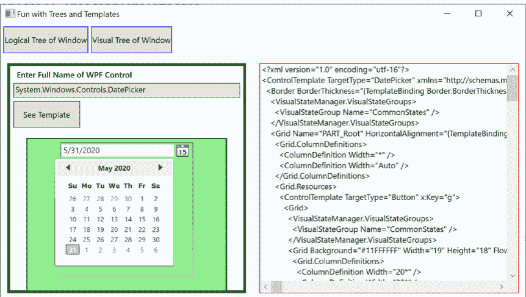

图 27-12. 在运行时检查 ControlTemplate

很好！你应该已经更好地理解了逻辑树、视觉树和控件默认模板是如何协同工作的。现在，你可以花本章剩余的时间来学习如何构建自定义模板和用户控件。

## 使用触发器框架构建控件模板

当你为控件构建自定义模板时，你可以仅用 C# 代码来实现。使用这种方法，你需要将数据添加到 ControlTemplate 对象，然后将其分配给控件的 Template 属性。然而，大多数时候，你会使用 XAML 定义 ControlTemplate 的外观，并添加一些代码（或可能相当多的代码）来驱动运行时行为。

在本章剩余部分，你将学习如何使用 Visual Studio 构建自定义模板。在此过程中，你将了解 WPF 的触发器框架和可视化状态管理器（VSM），并学习如何使用动画来为用户加入视觉提示。单靠 Visual Studio 构建复杂模板可能需要大量输入和一些繁重的工作。诚然，生产级模板会得益于 Blend for Visual Studio（现在随 Visual Studio 一起安装的免费配套应用）。然而，鉴于本书这一版没有涵盖 Blend 的内容，是时候卷起袖子，手动编写一些标记了。

首先，创建一个名为 ButtonTemplate 的新 WPF 应用程序。对于这个项目，你更感兴趣的是创建和使用模板的机制，因此用以下标记替换 Grid：

```
<StackPanel Orientation="Horizontal">
    <Button x:Name="myButton" Width="100" Height="100" Click="myButton_Click"/>
</StackPanel>
```

在 Click 事件处理程序中，只需显示一个消息框（通过 MessageBox.Show()）来确认控件的点击。请记住，当你构建自定义模板时，控件的行为是不变的，但外观可能会变化。

目前，这个 Button 使用默认模板渲染，正如前面的示例所示，默认模板是给定 WPF 程序集中的 XAML 资源。当你想要定义自己的模板时，实际上就是用你自己的创建来替换这个默认的可视化树。首先，更新 `<Button>` 元素的定义，使用属性元素语法指定一个新模板。这个模板将使控件呈现圆形外观。

```
<Button x:Name="myButton" Width="100" Height="100" Click="myButton_Click">
    <Button.Template>
        <ControlTemplate>
            <Grid x:Name="controlLayout">
                <Ellipse x:Name="buttonSurface" Fill="LightBlue"/>
                <Label x:Name="buttonCaption"
                    VerticalAlignment="Center"
                    HorizontalAlignment="Center"
                    FontWeight="Bold" FontSize="20" Content="OK!"/>
            </Grid>
        </ControlTemplate>
    </Button.Template>
</Button>
```

在这里，你定义了一个模板，包含一个命名 Grid 控件，其中包含一个命名 Ellipse 和一个 Label。由于你的 Grid 没有定义行或列，每个子元素都堆叠在前一个控件之上，从而使内容居中。如果现在运行应用程序，你会注意到，只有当鼠标光标位于 Ellipse 的边界内时，Click 事件才会触发！这是 WPF 模板架构的一大优点：你无需重新计算命中测试、边界检查或任何其他底层细节。因此，如果你的模板使用 Polygon 对象来渲染某种不规则几何图形，你可以放心，鼠标命中测试的细节是相对于控件的形状，而不是更大的外接矩形。

### 模板作为资源

目前，你的模板嵌入到了特定的 Button 控件中，这限制了复用。理想情况下，你应该将模板放入资源字典中，这样就可以在项目之间复用圆形按钮模板，或者至少将其移动到应用程序资源容器中，以便在此项目内复用。现在，让我们将本地 Button 资源移动到应用程序级别：从 Button 中剪切模板定义，将其粘贴到 App.xaml 文件的 Application.Resources 标记中。添加一个 Key 和 TargetType，如下所示：

```
<Application.Resources>
    <ControlTemplate x:Key="RoundButtonTemplate" TargetType="{x:Type Button}">
        <Grid x:Name="controlLayout">
            <Ellipse x:Name="buttonSurface" Fill="LightBlue"/>
            <Label x:Name="buttonCaption" VerticalAlignment="Center" HorizontalAlignment="Center" FontWeight="Bold" FontSize="20" Content="OK!"/>
        </Grid>
    </ControlTemplate>
</Application.Resources>
```

将 Button 标记更新为以下内容：

```
<Button x:Name="myButton" Width="100" Height="100" Click="myButton_Click" Template="{StaticResource RoundButtonTemplate}">
</Button>
```

现在，由于此资源可用于整个应用程序，你可以通过简单应用该模板来定义任意数量的圆形按钮。再创建两个使用此模板的 Button 控件以进行测试（无需为这些新项处理 Click 事件）。

```
<StackPanel>
    <Button x:Name="myButton" Width="100" Height="100" Click="myButton_Click" Template="{StaticResource RoundButtonTemplate}"/>
    <Button x:Name="myButton2" Width="100" Height="100" Template="{StaticResource RoundButtonTemplate}"/>
    <Button x:Name="myButton3" Width="100" Height="100" Template="{StaticResource RoundButtonTemplate}"/>
</StackPanel>
```

### 使用触发器加入视觉提示

当你定义自定义模板时，默认模板的视觉提示也会被移除。例如，默认的按钮模板包含标记，这些标记告知控件在某些 UI 事件发生时如何呈现，比如当它获得焦点、被鼠标点击、被启用（或禁用）等等。用户非常习惯这类视觉提示，因为它给控件带来了一种类似触觉的响应。然而，你的 RoundButtonTemplate 没有定义任何此类标记，因此无论鼠标如何操作，控件的外观都是相同的。理想情况下，当控件被点击时，它应该看起来稍有不同（例如通过颜色变化或投影），让用户知道视觉状态已经改变。

正如你已经学到的，这可以使用触发器来完成。对于简单操作，触发器非常适用。还有其他方法超出了本书的范围，但你可以在 https://docs.microsoft.com/en-us/dotnet/desktop-wpf/themes/how-to-create-apply-template 找到更多信息。

举个例子，用以下标记更新你的 RoundButtonTemplate，其中添加了两个触发器。第一个触发器会在鼠标悬停在表面上时将控件颜色改为蓝色，并将前景色改为黄色。第二个触发器会在控件被鼠标按下时缩小 Grid（以及所有子元素）的尺寸。

```
<ControlTemplate x:Key="RoundButtonTemplate" TargetType="Button" >
    <Grid x:Name="controlLayout">
        <Ellipse x:Name="buttonSurface" Fill="LightBlue" />
        <Label x:Name="buttonCaption" Content="OK!" FontSize="20" FontWeight="Bold"
               HorizontalAlignment="Center"
               VerticalAlignment="Center" />
    </Grid>
    <ControlTemplate.Triggers>
        <Trigger Property="IsMouseOver" Value="True">
            <Setter TargetName="buttonSurface" Property="Fill" Value="Blue"/>
            <Setter TargetName="buttonCaption" Property="Foreground" Value="Yellow"/>
        </Trigger>
        <Trigger Property="IsPressed" Value="True">
            <Setter TargetName="controlLayout" Property="RenderTransformOrigin" Value="0.5,0.5"/>
            <Setter TargetName="controlLayout" Property="RenderTransform">
                <Setter.Value>
                    <ScaleTransform ScaleX="0.8" ScaleY="0.8"/>
                </Setter.Value>
            </Setter>
        </Trigger>
    </ControlTemplate.Triggers>
</ControlTemplate>
```

### {TemplateBinding} 标记扩展的作用

控件模板的问题在于，每个按钮看起来都一样，显示的内容也相同。将标记更新为以下内容不会产生任何效果：

```
<Button x:Name="myButton" Width="100" Height="100" Background="Red" Content="Howdy!" Click="myButton_Click" Template="{StaticResource RoundButtonTemplate}" />
<Button x:Name="myButton2" Width="100" Height="100" Background="LightGreen" Content="Cancel!" Template="{StaticResource RoundButtonTemplate}" />
<Button x:Name="myButton3" Width="100" Height="100" Background="Yellow" Content="Format" Template="{StaticResource RoundButtonTemplate}" />
```

这是因为控件的默认属性（如 Background 和 Content）在模板中被覆盖了。若要启用这些属性，必须将它们映射到模板中的相关属性。你可以在构建模板时使用 {TemplateBinding} 标记扩展来解决这些问题。这允许你捕获使用该模板的控件所定义的属性设置，并使用它们在模板本身中设置值。

以下是 RoundButtonTemplate 的重写版本，现在它使用此标记扩展将 Button 的 Background 属性映射到 Ellipse 的 Fill 属性；同时还确保 Button 的 Content 确实传递给 Label 的 Content 属性：

```
<Ellipse x:Name="buttonSurface" Fill="{TemplateBinding Background}"/>
<Label x:Name="buttonCaption" Content="{TemplateBinding Content}" FontSize="20" FontWeight="Bold" HorizontalAlignment="Center" VerticalAlignment="Center" />
```


With this update, you can now create buttons of various colors and textual values. Figure 27-13 shows the result of the updated XAML.

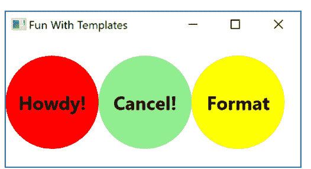

Figure 27-13. Template bindings allow values to pass through to the internal controls.

## The Role of ContentPresenter

When you designed your template, you used a Label to display the textual value of the control. Like the Button, the Label supports a Content property. Therefore, given your use of `{TemplateBinding}`, you could define a Button that contains complex content beyond that of a simple string.

However, what if you need to pass in complex content to a template member that does not have a Content property? When you want to define a generalized content display area in a template, you can use the ContentPresenter class as opposed to a specific type of control (Label or TextBlock). There is no need to do so for this example; however, here is some simple markup that illustrates how you could build a custom template that uses ContentPresenter to show the value of the Content property of the control using the template:

```xml
<!-- This button template will display whatever is set to the Content of the hosting button. -->
<ControlTemplate x:Key="NewRoundButtonTemplate" TargetType="Button">
    <Grid>
        <Ellipse Fill="{TemplateBinding Background}"/>
        <ContentPresenter HorizontalAlignment="Center" VerticalAlignment="Center"/>
    </Grid>
</ControlTemplate>
```

## Incorporating Templates into Styles

Currently, your template simply defines a basic look and feel of the Button control. However, the process of establishing the basic properties of the control (content, font size, font weight, etc.) is the responsibility of the Button itself.

```xml
<!-- Currently the Button must set basic property values, not the template. -->
<Button x:Name="myButton" Foreground="Black" FontSize="20"
    FontWeight="Bold"
    Template="{StaticResource RoundButtonTemplate}"
    Click="myButton_Click"/>
```

If you want, you could establish these values in the template. By doing so, you can effectively create a default look and feel. As you might have already realized, this is a job for WPF styles. When you build a style (to account for basic property settings), you can define a template within the style! Here is your updated application resource in the application resources in App.xaml, which has been rekeyed as RoundButtonStyle:

```xml
<!-- A style containing a template. -->
<Style x:Key="RoundButtonStyle" TargetType="Button">
    <Setter Property="Foreground" Value="Black"/>
    <Setter Property="FontSize" Value="14"/>
    <Setter Property="FontWeight" Value="Bold"/>
    <Setter Property="Width" Value="100"/>
    <Setter Property="Height" Value="100"/>
    <!-- Here is the template! -->
    <Setter Property="Template">
        <Setter.Value>
            <ControlTemplate TargetType="Button">
                <!-- Control template from above example -->
            </ControlTemplate>
        </Setter.Value>
    </Setter>
</Style>
```

With this update, you can now create button controls by setting the Style property as so:

```xml
<Button x:Name="myButton" Background="Red" Content="Howdy!" Click="myButton_Click" Style="{StaticResource RoundButtonStyle}"/>
```

While the rendering and behavior of the button are identical, the benefit of nesting templates within styles is that you can provide a canned set of values for common properties. That wraps up your look at how to use Visual Studio and the trigger framework to build custom templates for a control. While there is still much more about the Windows Presentation Foundation API than has been examined here, you should be in a solid position for further study.

## Summary

The first part of this chapter examined the resource management system of WPF. You began by looking at how to work with binary resources, and then you examined the role of object resources. As you learned, object resources are named blobs of XAML that can be stored at various locations to reuse content.

Next, you learned about WPF’s animation framework. Here you had a chance to create some animations using C# code, as well as with XAML. You learned that if you define an animation in markup, you use `<Storyboard>` elements and triggers to control execution. You then looked at the WPF-style mechanism, which makes heavy use of graphics, object resources, and animations.

You examined the relationship between a logical tree and a visual tree. The logical tree is basically a one-to-one correspondence of the markup you author to describe a WPF root element. Behind this logical tree is a much deeper visual tree that contains detailed rendering instructions.

The role of a default template was then examined. Remember, when you are building custom templates, you are essentially ripping out all (or part) of a control’s visual tree and replacing it with your own custom implementation.

## WPF Notifications, Validations, Commands, and MVVM

This chapter will conclude your investigation of the WPF programming model by covering the capabilities that support the Model-View-ViewModel (MVVM) pattern. The first section covers the Model-View-ViewModel pattern. Next, you learn about the WPF notification system and its implementation of the Observable pattern through observable models and observable collections. Having the data in the UI accurately portray the current state of the data automatically improves the user experience significantly and reduces the manual coding required in older technologies (such as WinForms) to achieve the same result.

Building on the Observable pattern, you will examine the mechanisms to add validation into your application. Validation is a vital part of any application—not only letting the user know that something is wrong but also letting them know what is wrong. To inform the user what the error is, you will also learn how to incorporate validation into the view markup.

Next, you will take a deeper dive into the WPF command system and create custom commands to encapsulate program logic, much as you did in Chapter 25 with the built-in commands. There are several advantages to creating custom commands, including (but not limited to) enabling code reuse, logic encapsulation, and separation of concerns.

Finally, you will bring all of this together in a sample MVVM application.

### Introducing Model-View-ViewModel

Before you dive into notifications, validations, and commands in WPF, it would be good to understand the end goal of this chapter, which is the Model-View-ViewModel pattern (MVVM). Derived from Martin Fowler’s Presentation Model pattern, MVVM leverages XAML-specific capabilities, discussed in this chapter, to make your WPF development faster and cleaner. The name itself describes the main components of the pattern: model, view, view model.

### The Model

The model is the object representation of your data. In MVVM, models are conceptually the same as the models from your data access layer (DAL). Sometimes they are the same physical class, but there is no requirement for this. As you read this chapter, you will learn how to decide whether you can use your DAL models or whether you need to create new ones.

Models typically take advantage of the built-in (or custom) validations through data annotations and the INotifyDataErrorInfo interface and are configured as observable to tie into the WPF notification system. You will see all of this later in this chapter.

### The View

The view is the UI of the application, and it is designed to be very lightweight. Think of the menu board at a drive-thru restaurant. The board displays menu items and prices, and it has a mechanism so the user can communicate with the back-end systems. However, there isn’t any intelligence built into the board, unless it is specifically user interface logic, such as turning on the lights if it gets dark.

MVVM Views should be developed with the same goals in mind. Any intelligence should be built into the application elsewhere. The only code in the code-behind file (e.g., MainWindow.xaml.cs) should be directly related to manipulating the UI. It should not be based on business rules or anything that needs to be persisted for future use. While not a main goal of MVVM, well-developed MVVM applications typically have very little code in the code-behind.

### The View Model

In WPF and other XAML technologies, the view model serves two purposes.

- The view model provides a single stop for all the data needed by the view. This doesn’t mean the view model is responsible for getting the actual data; instead, it is merely a transport mechanism to move the data from the data store to the view. Usually, there is a one-to-one correlation between views and view models, but architectural differences exist, and your mileage may vary.
- The second job is to act as the controller for the view. Just like the menu board, the view model takes direction from the user and relays that call to the relevant code to make sure the proper actions are taken. Quite often this code is in the form of custom commands.

### Anemic Models or Anemic View Models

In the early days of WPF, when developers were still working out how best to implement the MVVM pattern, there were significant (and sometimes heated) discussions about where to implement items like validation and the Observable pattern. One camp (the anemic model camp) argued that it all should be in the view model since adding those capabilities to the model broke separation of concerns. The other camp (the anemic view model camp) argued it should all be in the models since that reduced duplication of code.

The real answer is, of course, it depends. When INotifyPropertyChanged, IDataErrorInfo, and INotifyDataErrorInfo are implemented on the model classes, this ensures that the relevant code is close to the target of the code (as you will see in this chapter) and is implemented only once for each model. That being said, there are times when your view model classes will need to be developed as observables themselves. At the end of the day, you need to determine what makes the most sense for your application, without over-complicating your code or sacrificing the benefits of MVVM.

> **Note:** There are multiple MVVM frameworks available for WPF, such as MVVMLite, Caliburn.Micro, and Prism (although Prism is much more than just an MVVM framework). This chapter discusses the MVVM pattern and the features in WPF that support implementing the pattern. I leave it to you, the reader, to examine the different frameworks and select the one that best matches your app’s needs.


## WPF 绑定通知系统

WinForms 绑定系统的一个显著缺陷是缺乏通知。如果视图中表示的数据以编程方式更新，UI 也必须以编程方式刷新才能保持同步。这会导致对控件调用大量 Refresh()，通常比为安全所必需的要多。虽然通常包含过多的 Refresh() 调用并不是重大的性能问题，但如果包含的调用不足，用户的体验可能会受到负面影响。

XAML 基于应用程序中内置的绑定系统通过让您将数据对象和集合挂钩到通知系统中来纠正此问题，通过将它们开发为可观察对象。每当可观察模型上的属性值发生变化或可观察集合上的集合发生变化（例如，添加、删除或重新排序项目）时，就会引发事件（NotifyPropertyChanged 或 NotifyCollectionChanged）。绑定框架会自动监听这些事件的发生，并在事件触发时更新绑定的控件。甚至更好的是，作为开发人员，您可以控制哪些属性会引发通知。听起来很完美，对吧？嗯，还不完全完美。如果您完全手工操作，为可观察模型设置此功能可能涉及相当多的代码。幸运的是，有一个开源框架可以让它变得简单得多，正如您很快就会看到的那样。

## 可观察模型和集合

在本节中，您将创建一个使用可观察模型和集合的应用程序。首先，创建一个名为 WpfNotifications 的新 WPF 应用程序。该应用程序将是一个主从表单，允许用户使用 ComboBox 选择特定的汽车，然后汽车的详细信息将显示在下面的 TextBox 控件中。通过以下标记替换默认的 Grid 来更新 MainWindow.xaml：

```
<Grid IsSharedSizeScope="True" Margin="5,0,5,5">
    <Grid.RowDefinitions>
        <RowDefinition Height="Auto"/>
        <RowDefinition Height="Auto"/>
    </Grid.RowDefinitions>
    <Grid Grid.Row="0">
        <Grid.ColumnDefinitions>
            <ColumnDefinition Width="Auto" SharedSizeGroup="CarLabels"/>
            <ColumnDefinition Width="*"/>
        </Grid.ColumnDefinitions>
        <Label Grid.Column="0" Content="Vehicle"/>
        <ComboBox Name="cboCars" Grid.Column="1" DisplayMemberPath="PetName" />
    </Grid>
    <Grid Grid.Row="1" Name="DetailsGrid">
        <Grid.ColumnDefinitions>
            <ColumnDefinition Width="Auto" SharedSizeGroup="CarLabels"/>
            <ColumnDefinition Width="*"/>
        </Grid.ColumnDefinitions>
        <Grid.RowDefinitions>
            <RowDefinition Height="Auto"/>
            <RowDefinition Height="Auto"/>
            <RowDefinition Height="Auto"/>
            <RowDefinition Height="Auto"/>
            <RowDefinition Height="Auto"/>
        </Grid.RowDefinitions>
```

```
<Label Grid.Column="0" Grid.Row="0" Content="Id"/>
<TextBox Grid.Column="1" Grid.Row="0" />
<Label Grid.Column="0" Grid.Row="1" Content="Make"/>
<TextBox Grid.Column="1" Grid.Row="1" />
<Label Grid.Column="0" Grid.Row="2" Content="Color"/>
<TextBox Grid.Column="1" Grid.Row="2" />
<Label Grid.Column="0" Grid.Row="3" Content="Pet Name"/>
<TextBox Grid.Column="1" Grid.Row="3" />
<StackPanel Grid.Column="0" Grid.ColumnSpan="2" Grid.Row="4" HorizontalAlignment="Right" Orientation="Horizontal" Margin="0,5,0,5">
    <Button x:Name="btnAddCar" Content="Add Car" Margin="5,0,5,0" Padding="4, 2" />
    <Button x:Name="btnChangeColor" Content="Change Color" Margin="5,0,5,0" Padding="4, 2"/>
</StackPanel>
</Grid>
</Grid>
```

您的窗口将类似于图 28-1。

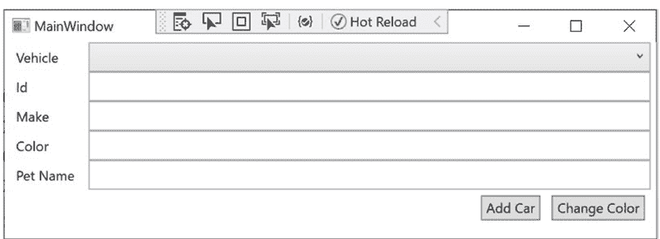

图 28-1. 显示汽车详细信息的从属窗口

Grid 控件上的 IsSharedSizeScope 标签设置了子网格共享尺寸。标记为 SharedSizeGroup 的 ColumnDefinitions 将自动调整为相同的宽度，而无需任何编程。在此示例中，如果将 Pet Name 标签更改为更长的内容，Vehicle 列（位于不同的 Grid 控件中）将被调整大小以匹配它，保持窗口的外观整洁有序。

接下来，在解决方案资源管理器中右键单击项目名称，选择 添加 ► 新文件夹，并将文件夹命名为 Models。在此新文件夹中，创建一个名为 Car 的类。初始类如下所示：

```
public class Car
{
    public int Id { get; set; }
    public string Make { get; set; }
    public string Color { get; set; }
    public string PetName { get; set; }
}
```

## 添加绑定和数据

下一步是为控件添加绑定语句。请记住，数据绑定语句围绕数据上下文展开，该上下文可以设置在控件本身或父控件上。在这里，您将上下文设置在 DetailsGrid 上，因此包含的每个控件都会继承该数据上下文。将 DataContext 设置为 ComboBox 的 SelectedItem 属性。将保存详细信息控件的 Grid 更新为以下内容：

```
<Grid Grid.Row="1" Name="DetailsGrid"
    DataContext="{Binding ElementName=cboCars, Path=SelectedItem}">
```

DetailsGrid 中的文本框将显示所选汽车的各个属性。像这样向 TextBox 控件添加适当的文本属性和相关绑定：

```
<TextBox Grid.Column="1" Grid.Row="0" Text="{Binding Path=Id}" />
<TextBox Grid.Column="1" Grid.Row="1" Text="{Binding Path=Make}" />
<TextBox Grid.Column="1" Grid.Row="2" Text="{Binding Path=Color}" />
<TextBox Grid.Column="1" Grid.Row="3" Text="{Binding Path=PetName}" />
```

最后，向 ComboBox 添加数据。在 MainWindow.xaml.cs 中，创建一个新的 Car 记录列表，并将 ComboBox 的 ItemsSource 设置为该列表。同时，添加 Notifications.Models 命名空间的 using 语句。

```
using WpfNotifications.Models;
//omitted for brevity
public partial class MainWindow : Window
{
    readonly IList<Car> _cars = new List<Car>();
    public MainWindow()
    {
        InitializeComponent();
        _cars.Add(new Car {Id = 1, Color = "Blue", Make = "Chevy", PetName = "Kit"});
        _cars.Add(new Car {Id = 2, Color = "Red", Make = "Ford", PetName = "Red Rider"});
        cboCars.ItemsSource = _cars;
    }
}
```

运行应用程序。您会看到车辆选择器中有两辆车可供选择。选择其中一辆，文本框将自动填充车辆详细信息。更改其中一辆车辆的颜色，选择另一辆车辆，然后返回您编辑的车辆。您会看到新颜色确实仍然附加在车辆上。这没有什么特别之处；您在之前的示例中已经见过 XAML 数据绑定的强大功能。

## 以编程方式更改车辆数据

虽然前面的示例按预期工作，但如果数据以编程方式更改，UI 不会反映更改，除非您编程应用程序刷新数据。为了演示这一点，像这样为 btnChangeColor 按钮添加事件处理程序：

```
<Button x:Name="btnChangeColor" Content="Change Color" Margin="5,0,5,0" Padding="4, 2" Click="BtnChangeColor_OnClick"/>
```

在 BtnChangeColor_Click() 事件处理程序中，使用 ComboBox 的 SelectedItem 属性从 cars 列表中定位所选记录，并将颜色更改为粉红色。代码如下所示：

```
private void BtnChangeColor_OnClick(object sender, RoutedEventArgs e)
{
    _cars.First(x => x.Id == ((Car)cboCars.SelectedItem)?.Id).Color = "Pink";
}
```

运行应用程序，选择一辆车辆，然后单击更改颜色按钮。什么也没有明显变化。选择另一辆车辆，然后返回您最初选择的车辆。现在您会看到更新后的值。这对用户来说不是一个好的体验！

现在像这样为 btnAddCar 按钮添加事件处理程序：

```
<Button x:Name="btnAddCar" Content="Add Car" Margin="5,0,5,0" Padding="4, 2" Click="BtnAddCar_OnClick" />
```

在 BtnAddCar_Click 事件处理程序中，向 Car 列表添加一条新记录。

```
private void BtnAddCar_Click(object sender, RoutedEventArgs e)
{
    var maxCount = _cars?.Max(x => x.Id) ?? 0;
    _cars?.Add(new Car { Id=++maxCount,Color="Yellow",Make="VW",PetName="Birdie"});
}
```

运行应用程序，单击添加汽车按钮，并检查 ComboBox 的内容。即使您知道列表中有三辆车，也只有两辆被显示！为了解决这两个问题，您将把 Car 类转换为可观察模型，并使用可观察集合来保存所有 Car 实例。

## 可观察模型

模型属性上的数据更改且未在 UI 中显示的问题通过在 Car 模型类上实现 INotifyPropertyChanged 接口来解决。INotifyPropertyChanged 接口包含一个事件：PropertyChangedEvent。XAML 绑定引擎会为实现 INotifyPropertyChanged 接口的类上的每个绑定属性监听此事件。接口如下所示：

```
public interface INotifyPropertyChanged
{
    event PropertyChangedEventHandler PropertyChanged;
}
```

向 Car.cs 类添加以下 using 语句：

```
using System.ComponentModel;
using System.Runtime.CompilerServices;
```


Next, implement the INotifyPropertyChanged interface on the class, as follows:

```
public class Car : INotifyPropertyChanged
{
    //Omitted for brevity
    public event PropertyChangedEventHandler PropertyChanged;
}
```

The PropertyChanged event takes an object reference and a new instance of the PropertyChangedEventArgs class, like in this example:

```
PropertyChanged?.Invoke(this,
    new PropertyChangedEventArgs("Model"));
```

The first parameter is the object instance that is raising the event. The PropertyChangedEventArgs constructor takes a string that indicates the property that was changed and needs to be updated. When the event is raised, the binding engine looks for any controls bound to the named property on that instance. If you pass String.Empty into the PropertyChangedEventArgs, all of the bound properties of the instance are updated.

You control which properties are enlisted in the automatic updates. Only those properties that raise the PropertyChanged event in the setter will be automatically updated. This is usually all of the properties on your model classes, but you have the option of omitting certain properties based on your application’s requirements. Instead of raising the event directly in the setter for each of the enlisted properties, a common pattern is to create a helper method (typically named OnPropertyChanged()) that raises the event on behalf of the properties, usually in a base class for your models. Add the following method and code into the Car.cs class:

```
protected void OnPropertyChanged([CallerMemberName] string propertyName = "")
{
    PropertyChanged?.Invoke(this,
        new PropertyChangedEventArgs(propertyName));
}
```

Next, update each of the automatic properties in the Car class to have a full getter and setter with a backing field. When the value is changed, call the OnPropertyChanged() helper method. Here is the Id property updated:

```
private int _id;
public int Id
{
    get => _id;
    set
    {
        if (value == _id) return;
        _id = value;
        OnPropertyChanged();
    }
}
```

Make sure you do the same for all the properties in the class and then run the app again. Select a vehicle and click the Change Color button. You will immediately see the change show up in the UI. First problem solved!

## Using nameof

A feature added in C# 6 is the nameof operator, which provides the string name of the item passed into the nameof method. You can use this in the calls to OnPropertyChanged() in your setters, like this:

```
public string Color
{
    get { return _color; }
    set
    {
        if (value == _color) return;
        _color = value;
        OnPropertyChanged(nameof(Color));
    }
}
```

Note that you don’t have to remove the CallerMemberName attribute from OnPropertyChanged() when you use the nameof method (although it becomes unnecessary). In the end, whether you use the nameof method or the CallerMemberName attribute comes down to a matter of personal choice.

## Observable Collections

The next problem to resolve is updating the UI when the contents of a collection changes. This is done by implementing the INotifyCollectionChanged interface. Like the INotifyPropertyChanged interface, this interface exposes one event, the CollectionChanged event. Unlike the INotifyPropertyChanged event, implementing this interface by hand is more than just calling a method in the setter. You need to create a full List implementation and raise the CollectionChanged event any time your list changes.

## Using the ObservableCollections Class

Fortunately, there is a much easier way than creating your own collection class. The ObservableCollection<T> class implements INotifyCollectionChanged, INotifyPropertyChanged, and Collection<T>, and it is part of the .NET Core Framework. No extra work! To see this, add a using statement for System.Collections.ObjectModel and then update the private field for _cars to the following:

```
private readonly IList<Car> _cars =
    new ObservableCollection<Car>();
```

Run the app again and click the Add Car button. You will see the new records appear appropriately.

## Implementing a Dirty Flag

Another advantage of observable models is the ability to track state changes. Dirty tracking (tracking when one or more of an object’s values have changed) with WPF is fairly trivial. Add a bool property named IsChanged to the Car class. Make sure to call OnPropertyChanged() just like the other properties in the Car class.

```
private bool _isChanged;
public bool IsChanged {
    get => _isChanged;
    set
    {
        if (value == _isChanged) return;
        _isChanged = value;
        OnPropertyChanged();
    }
}
```

You need to set the IsChanged property to true in the OnPropertyChanged() method. You also need to make sure you aren’t setting IsChanged to true when IsChanged is updated, or you will hit a stack overflow exception! Update the OnPropertyChanged() method to the following (which uses the nameof method discussed earlier):

```
protected virtual void OnPropertyChanged(
    [CallerMemberName] string propertyName = "")
{
    if (propertyName != nameof(IsChanged))
    {
        IsChanged = true;
    }
    PropertyChanged?.Invoke(this,
        new PropertyChangedEventArgs(propertyName));
}
```

Open MainWindow.xaml and add an additional RowDefinition to the DetailsGrid. Add the following to the end of the Grid, which contains a Label and a CheckBox, bound to the IsChanged property, as follows:

```
<Label Grid.Column="0" Grid.Row="5" Content="Is Changed"/>
<CheckBox Grid.Column="1" Grid.Row="5" VerticalAlignment="Center" Margin="10,0,0,0" IsEnabled="False" IsChecked="{Binding Path=IsChanged}" />
```

If you were to run the app now, you would see that every single record shows up as changed, even though you haven’t changed anything! This is because object creation sets property values, and setting any values calls OnPropertyChanged(). This sets the object’s IsChanged property. To correct this, set the IsChanged property to false as the last property in the object initialization code. Open MainWindow.xaml.cs and change the code that creates the list to the following:

```
_cars.Add(
    new Car {Id = 1, Color = "Blue", Make = "Chevy", PetName = "Kit", IsChanged = false});
_cars.Add(
    new Car {Id = 2, Color = "Red", Make = "Ford", PetName = "Red Rider", IsChanged = false});
```

Run the app again, select a vehicle, and click the Change Color button. You will see the check box get selected along with the updated color.

## Updating the Source Through UI Interaction

You might notice that if you type text into the UI, the Is Changed check box doesn’t actually get selected until you tab out of the control being edited. This is because of the UpdateSourceTrigger property on the TextBox bindings. The UpdateSourceTrigger determines what event (such as changing the value, tabbing out, etc.) causes the UI to update the underlying data. There are four options, as shown in Table 28-1.

### Table 28-1. UpdateSourceTrigger Values

| Member | Meaning in Life |
|---|---|
| Default | Sets to the default for the control (e.g., LostFocus for TextBox controls). |
| Explicit | Updates the source object only when the UpdateSource method is called. |
| LostFocus | Updates when the control loses focus. This is the default for TextBox controls. |
| PropertyChanged | Updates as soon as the property changes. This is the default for CheckBox controls. |

The default source trigger for a TextBox is the LostFocus event. Change this to PropertyChanged by updating the binding for the Color TextBox to the following XAML:

```
<TextBox Grid.Column="1" Grid.Row="2" Text="{Binding Path=Color,
UpdateSourceTrigger=PropertyChanged}" />
```

Now, when you run the app and start typing into the Color text box, the check box is immediately selected. You might ask why the default is set to LostFocus for TextBox controls. Any validation (covered in a moment) for a model fires in conjunction with the UpdateSourceTrigger. For a TextBox, this would then potentially cause errors continually flashing until the user entered the correct values. For example, if the validation rules don’t allow less than five characters in a TextBox, the error would show on each keystroke until the user got five or more entered. In those cases, it’s best to wait for the user to tab out of the TextBox (after completing the change to the text) to update the source.

## Wrapping Up Notifications and Observables

Using INotifyPropertyChanged on your models and ObservableCollections classes for your lists improves the user experience by keeping the data and the UI in sync. While neither interface is complicated, they do require updates to your code. Fortunately, Microsoft has included the ObservableCollection class to handle all of the plumbing to create observable collections. Just as fortunate is the update to the Fody project to add INotifyPropertyChanged functionality automatically. With these two tools in hand, there isn’t any reason to not implement observables in your WPF applications.

## WPF Validations

Now that you’ve implemented INotifyPropertyChanged and are using an ObservableCollection, it’s time to add validations to your application. Applications need to validate user input and provide feedback to the user when the data entered is incorrect. This section covers the most common validation mechanisms for modern WPF applications, but these are still just a portion of the capabilities built into WPF.
Validation occurs when a data binding attempts to update the data source. In addition to built-in validations, such as exceptions in a property’s setter, you can create custom validation rules. If any validation rule (built-in or custom) fails, the Validation class, discussed shortly, comes into play.


> **注意：** 本章各节中，你可以在上一节的同一项目中继续工作，也可以为每个新节创建项目的副本。在本章的仓库中，每个节都是一个不同的项目。

## 为验证示例更新示例

在本章的仓库中，从前一个示例复制的新项目称为 WpfValidations。如果你使用的是上一节的同一项目，那么从本节列出的示例中将代码复制到你的项目时，只需注意命名空间的更改即可。

## Validation 类

在向项目添加验证之前，了解 Validation 类非常重要。该类是验证框架的一部分，并提供了可用于显示验证结果的方法和附加属性。Validation 类在处理验证错误时常用的三个主要属性如表 28-2 所示。你将在本节的其余部分使用这些属性。

**表 28-2. Validation 类的关键成员**

| 成员 | 含义 |
|---|---|
| HasError | 指示验证规则在流程中某处失败的附加属性 |
| Errors | 所有活动 ValidationError 对象的集合 |
| ErrorTemplate | 当 HasError 设置为 true 时变得可见并装饰绑定元素的控件模板 |

## 验证选项

如前所述，XAML 技术有几种将验证逻辑合并到应用程序中的机制。你将在下一节中检查三种最常用的验证选择。

### Notify on Exceptions

虽然不应该使用异常来强制执行业务逻辑，但异常确实会发生，并且应该得到适当处理。如果在代码中未处理，用户应收到问题的视觉反馈。与 WinForms 的一个重要变化是，WPF 绑定异常默认情况下不会作为异常传播给用户。它们会以装饰器（位于控件顶部视觉层）的形式进行视觉指示。

要测试这一点，运行应用程序，从 ComboBox 中选择一条记录，并清除 Id 值。由于 Id 属性定义为 int（而不是可空 int），因此需要数值。当你从 Id 字段切换焦点时，绑定框架会将空字符串发送到 Id 属性，而空字符串无法转换为 int，因此在 setter 中抛出异常。通常，未处理的异常会向用户生成消息框，但在这种情况下，没有发生类似情况。如果你在 Output 窗口的 Debug 部分查看，你会看到以下内容：

```
System.Windows.Data Error: 7 : ConvertBack cannot convert value '' (type 'String').
BindingExpression:Path=Id; DataItem='Car' (HashCode=52579650); target element is 'TextBox' (Name=''); target property is 'Text' (type 'String') FormatException:'System.FormatException: Input string was not in a correct format.
```

异常的视觉显示是控件周围的细红框，如图 28-2 所示。

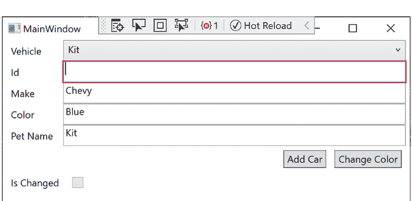

**图 28-2. 默认错误模板**

红框是 Validation 对象的 ErrorTemplate 属性，并充当绑定控件的装饰器。虽然默认错误装饰器显示确实存在错误，但没有任何说明问题是什么。好消息是 ErrorTemplate 完全可自定义，如本章后面所述。

### IDataErrorInfo

IDataErrorInfo 接口为你提供了向模型类添加自定义验证的机制。此接口直接添加到你的模型（或视图模型）类中，并且验证代码放在模型类内部（最好放在 partial 类中）。这将验证代码集中在项目中，与 WinForms 项目形成鲜明对比，在 WinForms 项目中，验证通常在 UI 本身中完成。

此处显示的 IDataErrorInfo 接口包含两个属性：一个索引器和一个名为 Error 的字符串属性。请注意，WPF 绑定引擎不使用 Error 属性。

```
public interface IDataErrorInfo
{
    string this[string columnName] { get; }
    string Error { get; }
}
```

你将很快添加 Car partial 类，但首先需要更新 Car.cs 类并将其标记为 partial。接下来，在 Models 目录中添加另一个名为 CarPartial.cs 的文件。将此类的名称重命名为 Car，确保类被标记为 partial，并添加 IDataErrorInfo 接口。最后，实现接口的 API。初始代码如下所示：

```
public partial class Car : IDataErrorInfo
{
    public string this[string columnName] => string.Empty;
    public string Error { get; }
}
```

要使绑定控件选择加入 IDataErrorInfo 接口，它必须在绑定表达式中添加 ValidatesOnDataErrors。更新 Make 文本框的绑定表达式如下（并以相同方式更新其余绑定语句）：

```
<TextBox Grid.Column="1" Grid.Row="1" Text="{Binding Path=Make, ValidatesOnDataErrors=True}" />
```

一旦对绑定语句进行此更新，模型上的索引器将在每次引发 PropertyChanged 事件时被调用。事件中的属性名称用作索引器中 columnName 参数。如果索引器返回 string.Empty，框架假定所有验证都通过，并且不存在错误条件。如果索引器返回除 string.Empty 之外的任何内容，则假定该对象实例的该属性存在错误，并且绑定到此特定类实例上正在验证的属性的每个控件都被视为存在错误，Validation 对象的 HasError 属性设置为 true，并且 ErrorTemplate 装饰器被激活以影响控件。

接下来，你将在 CarPartial.cs 中的索引器中添加一些简单的验证逻辑。验证规则很简单。

- 如果 Make 等于 ModelT，则将错误设置为 "Too Old"。
- 如果 Make 等于 Chevy 且 Color 等于 Pink，则将错误设置为 `$"{Make}'s don't come in {Color}"`。

首先为每个属性添加 switch 语句。为了避免在 case 语句中使用魔术字符串，你将再次使用 nameof 方法。如果代码通过 switch 语句落空，则返回 string.Empty。接下来，添加验证规则。在适当的 case 语句中，根据前面列出的规则添加属性值的检查。在 Make 属性的 case 语句中，首先检查值是否不是 ModelT。如果是，则返回错误。如果通过，下一行将调用辅助方法，如果违反第二个规则则返回错误，如果没有违反则返回 string.Empty。在 Color 属性的 case 语句中，也调用辅助方法。代码如下：

```
public string this[string columnName]
{
    get
    {
        switch (columnName)
        {
            case nameof(Id):
                break;
            case nameof(Make):
                return Make == "ModelT"
                    ? "Too Old"
                    : CheckMakeAndColor();
            case nameof(Color):
                return CheckMakeAndColor();
            case nameof(PetName):
                break;
        }
        return string.Empty;
    }
}

internal string CheckMakeAndColor()
{
    if (Make == "Chevy" && Color == "Pink")
    {
        return $"{Make}'s don't come in {Color}";
    }
    return string.Empty;
}
```

运行应用程序，选择 Red Rider 车辆（Ford），并将 Make 更改为 ModelT。一旦你从字段中切换焦点，红色的错误装饰器就会出现。现在从下拉列表中选择 Kit（它是 Chevy）并单击 Change Color 按钮将颜色更改为 Pink。立即，Color 字段上出现红色的错误装饰器，但 Make 文本框上没有出现。现在，将 Make 更改为 Ford，从文本框中切换焦点，并注意红色装饰器并未消失！

这是因为索引器仅在为属性触发 PropertyChanged 事件时运行。如“WPF 绑定通知系统”部分所述，PropertyChanged 事件在源对象的属性更改时触发，这要么通过代码（例如单击 Change Color 按钮）发生，要么通过用户交互发生（其时间由 UpdateSourceTrigger 控制）。当你更改颜色时，Make 属性没有更改，因此 Make 属性的事件未触发。由于事件未触发，索引器未被调用，因此 Make 属性的验证未运行。

有两种方法可以修复此问题。第一种方法是将 PropertyChangedEventArgs 更改为通过传递 string.Empty 而不是字段名称来更新每个绑定属性。如讨论所述，这会导致绑定引擎更新该实例上的每个属性。像这样更新 Car.cs 类中的 OnPropertyChanged() 方法：

```
protected virtual void OnPropertyChanged([CallerMemberName] string propertyName = "")
{
    if (propertyName != nameof(IsChanged))
    {
        IsChanged = true;
    }
    //PropertyChanged?.Invoke(this, new PropertyChangedEventArgs(propertyName));
    PropertyChanged?.Invoke(this,
        new PropertyChangedEventArgs(string.Empty));
}
```

现在，当你运行相同的测试时，你会看到当其中一个被更新时，Make 和 Color 文本框都用错误模板装饰。那么，为什么不总是以这种方式引发事件呢？这在很大程度上是性能问题。刷新对象上的每个属性可能会影响性能。当然，没有测试就无法知道，你的里程可能会（并且很可能会）有所不同。

另一个解决方案是在一个属性更改时为其他相关字段引发 PropertyChanged 事件。使用此机制的缺点是，你（或其他支持你的应用程序的开发人员）必须知道 Make 和 Color 属性通过验证代码相关联。


## INotifyDataErrorInfo

.NET 4.5 中引入的 INotifyDataErrorInfo 接口在 IDataErrorInfo 接口的基础上构建，并增加了用于验证的额外功能。当然，功能增强的同时也带来了额外的工作！与之前需要明确选择加入的验证技术相比发生了巨大转变，ValidatesOnNotifyDataErrors 绑定属性默认值为 true，因此在绑定语句中添加该属性是可选的。

INotifyDataErrorInfo 接口非常小，但要使其有效，需要相当多的管道代码，如你很快就会看到。接口如下所示：

```public interface INotifyDataErrorInfo
{
    bool HasErrors { get; }
    event EventHandler<DataErrorsChangedEventArgs>
        ErrorsChanged;
    IEnumerable GetErrors(string propertyName);
}
```

HasErrors 属性由绑定引擎用来确定实例的任何属性是否存在错误。如果使用 null 或空字符串作为 propertyName 参数调用 GetErrors() 方法，它将返回实例中存在的所有错误。如果向方法传入 propertyName，则只返回该特定属性的错误。ErrorsChanged 事件（与 PropertyChanged 和 CollectionChanged 事件类似）通知绑定引擎更新当前错误列表的 UI。

## 实现支持代码

实现 INotifyDataErrorInfo 时，大部分代码通常会推入到基模型类中，因此只需编写一次即可。开始时，在 CarPartial.cs 类中将 IDataErrorInfo 替换为 INotifyDataErrorInfo 并添加接口成员（你可以保留类中 IDataErrorInfo 的代码；稍后会更新它）。

```public partial class Car: INotifyDataErrorInfo, IDataErrorInfo
{
    ...
    public IEnumerable GetErrors(string propertyName)
    {
        throw new NotImplementedException();
    }

    public bool HasErrors { get; }
    public event
        EventHandler<DataErrorsChangedEventArgs> ErrorsChanged;
}
```

接下来，添加一个 Dictionary<string,List<string>> 来按属性名称保存任何错误。你还需要添加 System.Collections.Generic 的 using 语句。两者如下所示：

```using System.Collections.Generic;
private readonly Dictionary<string,List<string>> _errors
    = new Dictionary<string, List<string>>();
```

HasErrors 属性应在字典中存在任何错误时返回 true。这可以通过以下方式轻松实现：

```public bool HasErrors => _errors.Any();
```

接下来，创建一个用于引发 ErrorsChanged 事件的辅助方法（就像引发 PropertyChanged 事件一样），如下所示：

```private void OnErrorsChanged(string propertyName)
{
    ErrorsChanged?.Invoke(this,
        new DataErrorsChangedEventArgs(propertyName));
}
```

如前所述，GetErrors() 方法应在参数为空或 null 时返回字典中的所有错误。如果传入 propertyName 值，它将返回为该属性找到的任何错误。如果参数不匹配（或属性没有错误），则该方法将返回 null。

```public IEnumerable GetErrors(string propertyName)
{
    if (string.IsNullOrEmpty(propertyName))
    {
        return _errors.Values;
    }
    return _errors.ContainsKey(propertyName)
        ? _errors[propertyName]
        : null;
}
```

最后一组辅助方法将为属性添加一个或多个错误，或清除属性（或所有属性）的所有错误。只要字典发生变化，记得调用 OnErrorsChanged() 辅助方法。

```private void AddError(string propertyName, string error)
{
    AddErrors(propertyName, new List<string> { error });
}
```

```private void AddErrors(
    string propertyName, IList<string> errors)
{
    if (errors == null || !errors.Any())
    {
        return;
    }
    var changed = false;
    if (!_errors.ContainsKey(propertyName))
    {
        _errors.Add(propertyName, new List<string>());
        changed = true;
    }

    foreach (var err in errors)
    {
        if (_errors[propertyName].Contains(err)) continue;
        _errors[propertyName].Add(err);
        changed = true;
    }
    if (changed)
    {
        OnErrorsChanged(propertyName);
    }
}

protected void ClearErrors(string propertyName = "")
{
    if (string.IsNullOrEmpty(propertyName))
    {
        _errors.Clear();
    }
    else
    {
        _errors.Remove(propertyName);
    }
    OnErrorsChanged(propertyName);
}
```

现在问题是“如何激活此代码？”绑定引擎会监听 ErrorsChanged 事件，如果绑定语句的错误集合发生变化，它将更新 UI。但验证代码仍需要触发器来执行。有两种机制可用于此，下文将讨论。

## 使用 INotifyDataErrorInfo 进行验证

检查错误的一个地方是在属性 setter 中，如以下示例所示，简化为仅检查 ModelT 验证：

```public string Make
{
    get { return _make; }
    set
    {
        if (value == _make) return;
        _make = value;
        if (Make == "ModelT")
        {
            AddError(nameof(Make), "Too Old");
        }
        else
        {
            ClearErrors(nameof(Make));
        }
        OnPropertyChanged(nameof(Make));
        OnPropertyChanged(nameof(Color));
    }
}
```

这种方法的主要问题是你必须将验证逻辑与属性 setter 结合起来，使代码更难阅读和维护。

## 将 IDataErrorInfo 与 INotifyDataErrorInfo 结合用于验证

你在上一节中看到 IDataErrorInfo 可以添加到 partial 类中，这意味着你不必更新 setter。你还看到索引器在属性上引发 PropertyChanged 时会自动被调用。将 IDataErrorInfo 和 INotifyDataErrorInfo 结合使用可为你提供 INotifyDataErrorInfo 的验证附加功能，以及 IDataErrorInfo 提供的与 setter 的分离。

使用 IDataErrorInfo 的目的是不是运行验证，而是确保利用 INotifyDataErrorInfo 的验证代码在对象上每次引发 PropertyChanged 时都会被调用。由于你不使用 IDataErrorInfo 进行验证，始终从索引器返回 string.Empty。将索引器和 CheckMakeAndColor() 辅助方法更新为以下代码：

```public string this[string columnName]
{
    get
    {
        ClearErrors(columnName);
        switch (columnName)
        {
            case nameof(Id):
                break;
            case nameof(Make):
                CheckMakeAndColor();
                if (Make == "ModelT")
                {
                    AddError(nameof(Make), "Too Old");
                    hasError = true;
                }
                break;
            case nameof(Color):
                CheckMakeAndColor();
                break;
            case nameof(PetName):
                break;
        }
        return string.Empty;
    }
}

internal bool CheckMakeAndColor()
{
    if (Make == "Chevy" && Color == "Pink")
    {
        AddError(nameof(Make), $"{Make}'s don't come in {Color}");
        AddError(nameof(Color),
            $"{Make}'s don't come in {Color}");
        return true;
    }
    return false;
}
```

运行应用，选择 Chevy，然后将颜色更改为 Pink。除了 Make 和 Model 文本框周围的红色装饰器外，你还会看到包含 Car 详细信息字段的整个网格周围出现红色框装饰器（见图 28-3）。

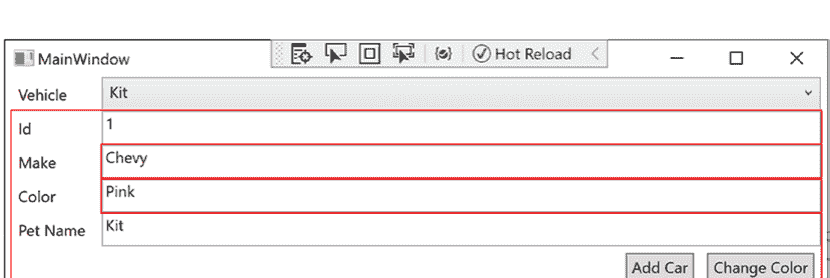

图 28-3. 更新后的错误装饰器

这是使用 INotifyDataErrorInfo 的另一个优势。除了出错的控件外，定义数据上下文的控件也会被错误模板装饰。

## 显示所有错误

Validation 类上的 Errors 属性以 ValidationError 对象的形式返回特定对象上的所有验证错误。每个 ValidationError 对象都有一个 ErrorContent 属性，其中包含该属性的错误消息列表。这意味着你想要显示的错误消息位于列表中的列表内。要正确显示它们，你需要创建一个包含 ListBox 的 ListBox 来显示数据。听起来有点递归，但一旦你看到它就会明白。

首先向 DetailsGrid 添加另一行，并确保 Window 的 Height 至少为 300。在最后一行添加一个 ListBox，并将 ItemsSource 绑定到 DetailsGrid，使用 Validation.Errors 作为路径，如下所示：

```<ListBox Grid.Row="6" Grid.Column="0" Grid.ColumnSpan="2"
    ItemsSource="{Binding ElementName=DetailsGrid, Path=(Validation.Errors)}">
</ListBox>
```


向 ListBox 添加一个 DataTemplate，并在 DataTemplate 中添加一个绑定到 ErrorContent 属性的 ListBox。在这种情况下，每个 ListBoxItem 的数据上下文都是一个 ValidationError 对象，因此你不需要设置数据上下文，只需设置路径。将绑定路径设置为 ErrorContent，如下所示：

```
<ListBox.ItemTemplate>
    <DataTemplate>
        <ListBox ItemsSource="{Binding Path=ErrorContent}"/>
    </DataTemplate>
</ListBox.ItemTemplate>
```

运行应用程序，选择 Chevy，并将颜色设置为 Pink。你将看到如图 28-4 所示的错误。

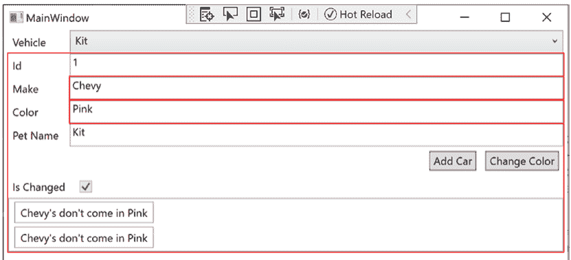

图 28-4. 显示 errors 集合

这只是使用验证以及显示生成的错误所能做到的事情的冰山一角，但它应该能让你很好地开始开发能够改善用户体验的信息性 UI。

## 将支持代码移至基类

正如你可能注意到的那样，CarPartial.cs 类中现在有很多代码。由于此示例只有一个模型类，这并不太糟糕。但随着你在真实应用程序中添加模型，你不希望在每个模型的 partial 类中都添加所有这些管道代码。最好的做法是将所有这些支持代码下推到一个基类中。你现在就这样做。

在 Models 文件夹中添加一个新的类文件，命名为 BaseEntity.cs。添加 System.Collections 和 System.ComponentModel 的 using 语句。使类为 public，并添加 INotifyDataErrorInfo 接口，如下所示：

```
using System;
using System.Collections;
using System.Collections.Generic;
using System.ComponentModel;
using System.Linq;
```

```
namespace Validations.Models
{
    public class BaseEntity : INotifyDataErrorInfo
}
```

将 CarPartial.cs 中与 INotifyDataErrorInfo 相关的所有代码移至新的基类。任何私有方法和变量都需要改为 protected。接下来，从 CarPartial.cs 类中移除 INotifyDataErrorInfo 接口，并添加 BaseEntity 作为基类，如下所示：

```
public partial class Car : BaseEntity, IDataErrorInfo
{
    //removed for brevity
}
```

现在，你创建的任何额外模型类都将继承所有 INotifyDataErrorInfo 管道代码。

## 使用 WPF 利用数据注解

WPF 也可以利用数据注解进行 UI 验证。让我们向 Car 模型添加一些数据注解。

### 向模型添加数据注解

打开 Car.cs 并添加 System.ComponentModel.DataAnnotations 的 using 语句。向 Make、Color 和 PetName 添加 [Required] 和 [StringLength(50)] 属性。Required 属性添加一条验证规则，即属性不能为空（对于 Id 属性来说这有点冗余，因为它不是可空的 int）。StringLength(50) 属性添加一条验证规则，即属性值的长度不能超过 50 个字符。

### 检查基于数据注解的验证错误

在 WPF 中，你必须以编程方式检查基于数据注解的验证错误。用于注解验证的两个关键类是 ValidationContext 和 Validator 类。ValidationContext 类为检查类是否存在验证错误提供了一个上下文。Validator 类允许你在 ValidationContext 中检查对象是否存在基于属性的错误。

打开 BaseEntity.cs，并添加以下 using 语句：

```
using System.ComponentModel;
using System.ComponentModel.DataAnnotations;
```

接下来，创建一个名为 GetErrorsFromAnnotations() 的新方法。该方法为泛型，接受一个字符串类型的属性名和一个类型为 T 的值作为参数，并返回一个字符串数组。确保该方法标记为 protected。其签名如下所示：

```
protected string[] GetErrorsFromAnnotations<T>(
    string propertyName, T value)
{
```

在方法中，创建一个 List<ValidationResult> 变量来保存验证检查的结果，并创建一个作用域限定为传入方法中的属性名的 ValidationContext。当这两个项目就绪后，调用 Validate.TryValidateProperty，它返回一个 bool。如果一切通过（关于数据注解验证），它返回 true。如果不通过，它返回 false 并用错误填充 List<ValidationResult>。完整的代码如下所示：

```
protected string[] GetErrorsFromAnnotations<T>(
    string propertyName, T value)
{
    var results = new List<ValidationResult>();
    var vc = new ValidationContext(this, null, null)
    { MemberName = propertyName };
    var isValid = Validator.TryValidateProperty(
        value, vc, results);
    return (isValid)
        ? null
        : Array.ConvertAll(
            results.ToArray(), o => o.ErrorMessage);
}
```

现在你可以更新 CarPartial.cs 中的索引器方法，以检查是否存在基于数据注解的任何错误。如果发现任何错误，将它们添加到支持 INotifyDataErrorInfo 的 errors 集合中。这使我们能够清理错误处理。在索引器方法的开始处，清除该列的错误。然后处理验证，最后处理实体的自定义逻辑。更新后的索引器代码如下所示：

```
public string this[string columnName]
{
    get
    {
        ClearErrors(columnName);
        var errorsFromAnnotations =
            GetErrorsFromAnnotations(columnName,
                typeof(Car)
                    .GetProperty(columnName)?.GetValue(this,null));
        if (errorsFromAnnotations != null)
        {
            AddErrors(columnName, errorsFromAnnotations);
        }
        switch (columnName)
        {
            case nameof(Id):
                break;
            case nameof(Make):
                CheckMakeAndColor();
                if (Make == "ModelT")
                {
                    AddError(nameof(Make), "Too Old");
                }
                break;
```

```
case nameof(Color):
    CheckMakeAndColor();
    break;
case nameof(PetName):
    break;
}
return string.Empty;
}
```

运行应用程序，选择其中一辆车，并为颜色添加超过 50 个字符的文本。当你超过 50 个字符的阈值时，StringLength 数据注解会创建验证错误，并向用户报告，如图 28-5 所示。

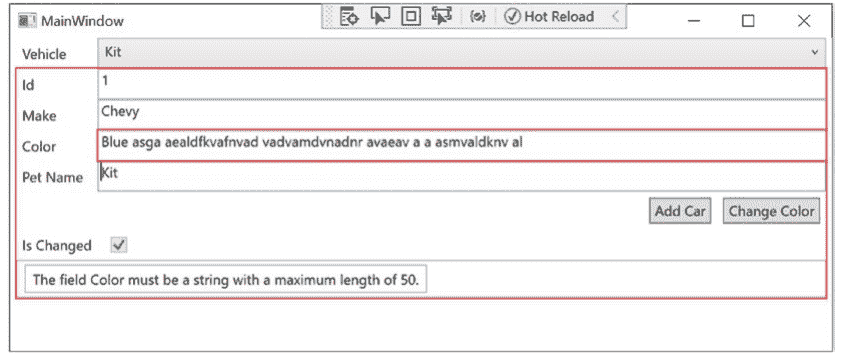

图 28-5. 验证 required 数据注解

## 自定义 ErrorTemplate

最后一个主题是创建一个在控件处于错误状态时应用的样式，并更新 ErrorTemplate 以显示更有意义的错误信息。正如你在第 27 章中学到的那样，控件可以通过样式和控件模板进行自定义。

首先在 MainWindow.xaml 的 Windows.Resources 部分添加一个新的样式，其目标类型为 TextBox。接下来，添加一个触发器到样式上，当 Validation.HasError 属性设置为 true 时设置属性。属性及其要设置的值为 Background（Pink）、Foreground（Black）以及 ToolTip 为 ErrorContent。Background 和 Foreground 设置器没什么新意，但设置 ToolTip 的语法需要一些解释。绑定指向此样式所应用的控件指向自身，在本例中为 TextBox。路径是 Validation.Errors 集合的第一个 ErrorContent 值。标记如下：

```
<Window.Resources>
    <Style TargetType="{x:Type TextBox}">
        <Style.Triggers>
            <Trigger Property="Validation.HasError" Value="true">
                <Setter Property="Background" Value="Pink" />
```

```
<Setter Property="Foreground" Value="Black" />
<Setter Property="ToolTip"
    Value="{Binding RelativeSource={RelativeSource Self},
    Path=(Validation.Errors)[0].ErrorContent}"/>
</Trigger>
</Style.Triggers>
</Style>
</Window.Resources>
```

运行应用程序并创建一个错误条件。结果将类似于图 28-6，完整显示了显示错误消息的工具提示。


图 28-6. 显示自定义 ErrorTemplate

之前的样式更改了任何处于错误条件的 TextBox 的外观。接下来，你将创建一个自定义控件模板来更新 Validation 类的 ErrorTemplate，以显示红色感叹号并为感叹号设置工具提示。ErrorTemplate 是一个装饰器，位于控件顶部。虽然刚刚创建的样式更新了控件本身，但 ErrorTemplate 将位于控件顶部。

在你刚刚创建的样式中，在 Style.Triggers 关闭标签之后立即放置一个 setter。你将创建一个控件模板，它由一个 TextBlock（用于显示感叹号）和一个 BorderBrush 组成，用于环绕包含错误(s)的 TextBox。XAML 中有一个特殊的标签用于被 ErrorTemplate 装饰的控件，名为 AdornedElementPlaceholder。通过为此控件添加名称，你可以访问与控件关联的错误。在此示例中，你希望访问 Validation.Errors 属性以获取 ErrorContent（就像你在 Style.Trigger 中所做的那样）。以下是 setter 的完整标记：

```
<Setter Property="Validation.ErrorTemplate">
    <Setter.Value>
        <ControlTemplate>
            <DockPanel LastChildFill="True">
                <TextBlock Foreground="Red" FontSize="20" Text="!"
                    ToolTip="{Binding ElementName=controlWithError,
                    Path=AdornedElement.(Validation.Errors)[0].ErrorContent}"/>
```


```xml
<Border BorderBrush="Red" BorderThickness="1">
    <AdornedElementPlaceholder Name="controlWithError" />
</Border>
</DockPanel>
</ControlTemplate>
</Setter.Value>
</Setter>
```

运行应用程序并创建一个错误条件。结果将类似于图 28-7。


图 28-7. 显示自定义 ErrorTemplate

## Wrapping Up Validations

这完成了你在 WPF 中对验证方法的介绍。当然，你还可以做更多的事情。如需更多信息，请参阅 WPF 文档。

## Creating Custom Commands

与验证部分一样，你可以继续在同一个项目中工作，也可以创建一个新项目并将所有代码复制到其中。我将创建一个名为 WpfCommands 的新项目。如果你使用的是同一个项目，请务必注意本节代码示例中的命名空间并根据需要进行调整。

正如你在第 25 章中所学，命令是 WPF 的一个组成部分。命令可以连接到 WPF 控件（如 Button 和 MenuItem 控件）来处理用户事件，例如 Click() 事件。与直接创建事件处理程序并将代码直接添加到代码隐藏文件不同，单击事件触发时将执行命令的 Execute() 方法。CanExecute() 方法用于根据自定义代码启用或禁用控件。除了你在第 25 章中使用的内置命令之外，你还可以通过实现 ICommand 接口创建自己的自定义命令。通过使用命令而不是事件处理程序，你可以获得封装应用程序代码的好处，以及根据业务逻辑自动启用和禁用控件。

### Implementing the ICommand Interface

作为对第 25 章的快速回顾，ICommand 接口如下所示：

```csharp
public interface ICommand
{
    event EventHandler CanExecuteChanged;
    bool CanExecute(object parameter);
    void Execute(object parameter);
}
```

### Adding the ChangeColorCommand

你的 Button 控件的事件处理程序将被命令取代，首先是 Change Color 按钮。首先在项目中添加一个新文件夹（命名为 Cmds）。添加一个名为 ChangeColorCommand.cs 的新类。使该类为 public，并实现 ICommand 接口。添加以下 using 语句（第一个可能因你是否为此示例创建了新项目而有所不同）：

```csharp
using WpfCommands.Models;
using System.Windows.Input;
```

你的类应如下所示：

```csharp
public class ChangeColorCommand : ICommand
{
    public bool CanExecute(object parameter)
    {
        throw new NotImplementedException();
    }
    public void Execute(object parameter)
    {
        throw new NotImplementedException();
    }
    public event EventHandler CanExecuteChanged;
}
```

如果 CanExecute() 方法返回 true，则任何绑定的控件将被启用，如果返回 false，则将被禁用。如果控件已启用（因为 CanExecute() 返回 true）并且被单击，则 Execute() 方法将被触发。传递给这两个方法的参数来自 UI，基于绑定语句上设置的 CommandParameter 属性。CanExecuteChanged 事件连接到绑定和通知系统，以通知 UI CanExecute() 方法的结果已更改（类似于 PropertyChanged 事件）。

在此示例中，Change Color 按钮只有在参数不为 null 且为 Car 类型时才应工作。将 CanExecute() 方法更新为如下所示：

```csharp
public bool CanExecute(object parameter)
=> (parameter as Car) != null;
```

Execute() 方法参数的值与 CanExecute() 方法相同。由于 Execute() 方法只能在对象为 Car 类型时执行，因此参数必须强制转换为 Car 类型并更新颜色，如下所示：

```csharp
public void Execute(object parameter)
{
    ((Car)parameter).Color = "Pink";
}
```

### Attaching the Command to the CommandManager

命令类的最后一次更新是将命令类型化到命令管理器中。CanExecute() 方法在 Window 首次加载时触发，然后在命令管理器指示其重新执行时触发。每个命令类都必须选择加入命令管理器。这是通过更新有关 CanExecuteChanged 事件的代码完成的，如下所示：

```csharp
public event EventHandler CanExecuteChanged
{
    add => CommandManager.RequerySuggested += value;
    remove => CommandManager.RequerySuggested -= value;
}
```

### Updating MainWindow.xaml.cs

下一步是创建 Button 可以访问的此类实例。现在，你将把它放在 MainWindow 的代码隐藏文件中（本章后面你会将其移至视图模型）。打开 MainWindow.xaml.cs 并删除 Change Color 按钮的 Click 事件处理程序。向文件顶部添加以下 using 语句（再次，命名空间可能因你仍在使用同一项目还是新建了一个项目而有所不同）：

```csharp
using WpfCommands.Cmds;
using System.Windows.Input;
```

接下来，添加一个名为 ChangeColorCmd 的 public 属性，其类型为 ICommand，并带有支持字段。在属性的表达式体中，返回支持属性（确保如果支持字段为 null，则实例化 ChangeColorCommand 的新实例）。

```csharp
private ICommand _changeColorCommand = null;
public ICommand ChangeColorCmd
    => _changeColorCommand ??= new ChangeColorCommand();
```

### Updating MainWindow.xaml

正如你在第 25 章中看到的，WPF 中可点击的控件（如 Button 控件）具有 Command 属性，允许你将命令对象分配给控件。首先将你在代码隐藏中实例化的命令连接到 btnChangeColor 按钮。由于命令的属性位于 MainWindow 类上，因此你使用 RelativeSource 绑定语法来获取包含 Button 的 Window，如下所示：

```xml
Command="{Binding Path=ChangeColorCmd,
    RelativeSource={RelativeSource Mode=FindAncestor, AncestorType={x:Type Window}}}"
```

Button 仍需要将 Car 对象作为 CanExecute() 和 Execute() 方法的参数发送。这是通过 CommandParameter 属性分配的。你将其设置为 cboCars ComboBox 的 SelectedItem，如下所示：

```xml
CommandParameter="{Binding ElementName=cboCars, Path=SelectedItem}"
```

按钮的完整标记如下所示：

```xml
<Button x:Name="btnChangeColor" Content="Change Color" Margin="5,0,5,0"
    Padding="4, 2" Command="{Binding Path=ChangeColorCmd,
        RelativeSource={RelativeSource Mode=FindAncestor, AncestorType={x:Type Window}}}"
    CommandParameter="{Binding ElementName=cboCars, Path=SelectedItem}"/>
```

### Testing the Application

运行应用程序。你会看到 Change Color 命令未启用，如图 28-8 所示，因为没有选择车辆。


图 28-8. 一个未选择任何内容的窗口

现在，选择一辆车；按钮将被启用，点击它将更改颜色，正如预期的那样！

### Creating the CommandBase Class

如果你继续使用此模式用于 AddCarCommand.cs，则类之间会重复代码。这是一个很好的迹象，表明基类可以帮助。创建一个名为 CommandBase.cs 的新类到 Cmds 文件夹中，并添加对 System.Windows.Input 命名空间的 using。将类设置为 public 并实现 ICommand 接口。将类和 Execute() 与 CanExecute() 方法更改为抽象。最后，添加来自 ChangeColorCommand 类的更新后的 CanExecuteChanged 事件。完整实现如下所示：

```csharp
using System;
using System.Windows.Input;

namespace WpfCommands.Cmds
{
    public abstract class CommandBase : ICommand
    {
        public abstract bool CanExecute(object parameter);
        public abstract void Execute(object parameter);
        public event EventHandler CanExecuteChanged
        {
            add => CommandManager.RequerySuggested += value;
            remove => CommandManager.RequerySuggested -= value;
        }
    }
}
```

### Adding the AddCarCommand Class

向 Cmds 文件夹添加一个名为 AddCarCommand.cs 的新类。使该类为 public 并将 CommandBase 作为基类。向文件顶部添加以下 using 语句：

```csharp
using System.Collections.ObjectModel;
using System.Linq;
using WpfCommands.Models;
```

参数预计为 ObservableCollection<Car>，因此在 CanExecute() 方法中检查这一点。如果是，则 Execute() 方法应添加一辆额外的汽车，就像 Click 事件处理程序一样。

```csharp
public class AddCarCommand : CommandBase
{
    public override bool CanExecute(object parameter)
        => parameter is ObservableCollection<Car>;
    public override void Execute(object parameter)
    {
        if (parameter is not ObservableCollection<Car> cars)
        {
            return;
        }
        var maxCount = cars.Max(x => x.Id);
        cars.Add(new Car
        {
            Id = ++maxCount,
            Color = "Yellow",
            Make = "VW",
            PetName = "Birdie"
        });
    }
}
```


## 更新 MainWindow.xaml.cs

添加一个名为 AddCarCmd 的公共属性，其类型为 ICommand，并使用支持字段。在属性的表达式体中，返回支持属性（确保如果支持字段为 null，则实例化一个新的 AddCarCommand 实例）。

```
private ICommand _addCarCommand = null;
public ICommand AddCarCmd
=> _addCarCommand ??= new AddCarCommand();
```

## 更新 MainWindow.xaml

更新 XAML 以移除 Click 属性并添加 Command 和 CommandParameter 属性。AddCarCommand 将从 cboCars 组合框接收汽车列表。整个按钮的 XAML 如下所示：

```
<Button x:Name="btnAddCar" Content="Add Car" Margin="5,0,5,0" Padding="4, 2"
    Command="{Binding Path=AddCarCmd,
        RelativeSource={RelativeSource Mode=FindAncestor, AncestorType={x:Type Window}}}"
    CommandParameter="{Binding ElementName=cboCars, Path=ItemsSource}"/>
```

完成此设置后，您现在可以使用独立类中包含的可重用代码添加汽车并更新汽车的颜色。

## 更新 ChangeColorCommand

最后一步是将 ChangeColorCommand 更新为继承自 CommandBase。将 ICommand 改为 CommandBase，对两个方法添加 override 关键字，并删除 CanExecuteChanged 代码。就这么简单！新的代码如下所示：

```
public class ChangeColorCommand : CommandBase
{
    public override bool CanExecute(object parameter)
        => parameter is Car;
    public override void Execute(object parameter)
    {
        ((Car)parameter).Color = "Pink";
    }
}
```

## RelayCommands

WPF 中命令模式的另一种实现是 RelayCommand。与为每个命令创建新类不同，此模式使用委托来实现 ICommand 接口。这是一种轻量级实现，因为每个命令都没有自己的类。RelayCommands 通常在命令实现不需要重用时使用。

## 创建基础 RelayCommand

RelayCommands 通常在两个类中实现。基础 RelayCommand 类在 CanExecute() 和 Execute() 方法不需要参数时使用，而 RelayCommand<T> 在需要参数时使用。你将从基础 RelayCommand 类开始，它利用了 CommandBase 类。将一个名为 RelayCommand.cs 的新类添加到 Cmds 文件夹。使类为 public 并将 CommandBase 添加为基类。添加两个类级变量来保存 Execute() 和 CanExecute() 委托。

```
private readonly Action _execute;
private readonly Func<bool> _canExecute;
```

创建三个构造函数。第一个是默认构造函数（由 RelayCommand<T> 派生类需要），第二个是接受 Action 参数的构造函数，第三个是接受 Action 参数和 Func 参数的构造函数，如下所示：

```
public RelayCommand(){}
public RelayCommand(Action execute) : this(execute, null) { }
public RelayCommand(Action execute, Func<bool> canExecute)
{
    _execute = execute
    ?? throw new ArgumentNullException(nameof(execute));
    _canExecute = canExecute;
}
```

最后，实现 CanExecute() 和 Execute() 的重写。CanExecute() 如果 Func 为 null 则返回 true；如果不为 null，则执行并返回 true。Execute() 执行 Action 参数。

```
public override bool CanExecute(object parameter)
    => _canExecute == null || _canExecute();
public override void Execute(object parameter) { _execute(); }
```

## 创建 RelayCommand<T>

在 Cmds 文件夹中添加一个名为 RelayCommandT.cs 的新类。此类几乎是基础类的复制品，只是委托都接受参数。使类为 public 且泛型，并将 RelayCommand 添加为基类，如下所示：

```
public class RelayCommand<T> : RelayCommand
```

添加两个类级变量来保存 Execute() 和 CanExecute() 委托：

```
private readonly Action<T> _execute;
private readonly Func<T, bool> _canExecute;
```

创建两个构造函数。第一个接受 Action<T> 参数，第二个接受 Action<T> 参数和 Func<T,bool> 参数，如下所示：

```
public RelayCommand(Action<T> execute):this(execute, null) {}
public RelayCommand(
    Action<T> execute, Func<T, bool> canExecute)
{
    _execute = execute
    ?? throw new ArgumentNullException(nameof(execute));
    _canExecute = canExecute;
}
```

最后，实现 CanExecute() 和 Execute() 的重写。CanExecute() 如果 Func 为 null 则返回 true；如果不为 null，则执行并返回 true。Execute() 执行 Action 参数。

```
public override bool CanExecute(object parameter)
    => _canExecute == null || _canExecute((T)parameter);
public override void Execute(object parameter)
{ _execute((T)parameter); }
```

## 更新 MainWindow.xaml.cs

当使用 RelayCommands 时，所有委托的方法都需要在构造新命令时指定。这并不意味着代码需要在代码后置中存在（如此处所示）；它只需要可从代码后置访问即可。它可以存在于另一个类中（甚至是另一个程序集），提供创建自定义命令类的代码封装优势。

添加一个类型为 RelayCommand<Car> 的新私有变量和一个名为 DeleteCarCmd 的公共属性，如下所示：

```
private RelayCommand<Car> _deleteCarCommand = null;
public RelayCommand<Car> DeleteCarCmd
    => _deleteCarCommand ??=
        new RelayCommand<Car>(DeleteCar,CanDeleteCar);
```

DeleteCar() 和 CanDeleteCar() 方法也必须创建，如下所示：

```
private bool CanDeleteCar(Car car) => car != null;
private void DeleteCar(Car car)
{
    _cars.Remove(car);
}
```

注意方法中的强类型——这是使用 RelayCommand<T> 的好处之一。

## 添加并实现删除汽车按钮

将所有内容联系起来的最后一步是添加按钮并分配 Command 和 CommandParameter 绑定。添加以下标记：

```
<Button x:Name="btnDeleteCar" Content="Delete Car" Margin="5,0,5,0" Padding="4, 2"
    Command="{Binding Path=DeleteCarCmd,
        RelativeSource={RelativeSource Mode=FindAncestor, AncestorType={x:Type Window}}}"
    CommandParameter="{Binding ElementName=cboCars, Path=SelectedItem}"/>
```

现在运行应用程序时，您可以测试删除汽车按钮仅在下拉列表中选择了汽车时才启用，并且单击按钮确实会从汽车列表中删除该汽车。

## 总结命令

这结束了你对 WPF 命令的简短探索。通过将事件处理从代码后置文件移出并放入单独的命令类中，你获得了代码封装、可重用性和可维护性提高的好处。如果不需要那么多的关注点分离，你可以使用更轻量级的 RelayCommand 实现。目标是提高可维护性和代码质量，因此选择最适合你的方法。

## 将代码和数据迁移到视图模型

与“WPF 验证”部分一样，你可以继续在同一项目中工作，也可以创建一个新项目并复制所有代码。我将创建一个名为 WpfViewModel 的新项目。如果你使用的是同一项目，请确保注意本节代码示例中的命名空间并根据需要进行调整。

在项目中创建一个名为 ViewModels 的新文件夹，并在该文件夹中添加一个名为 MainWindowViewModel.cs 的新类。添加以下命名空间并使类为 public：

```
using System.Collections.Generic;
using System.Collections.ObjectModel;
using System.Windows.Input;
using WpfViewModel.Cmds;
using WpfViewModel.Models;
```

> 注意 一个流行的约定是根据其支持的窗口命名视图模型。我通常遵循该约定，并在本章中也将遵循该约定。然而，像任何模式或约定一样，这不是规则，你会发现对此有各种各样的意见。

## 移动 MainWindow.xaml.cs 代码

代码后置文件中的几乎所有代码都将被移动到视图模型。最后只剩下几行，包括对 InitializeComponent() 的调用和将窗口的数据上下文设置为视图模型的代码。

创建一个类型为 IList<Car> 的公共属性 Cars，如下所示：

```
public IList<Car> Cars { get; } =
    new ObservableCollection<Car>();
```

创建默认构造函数并将 MainWindow.xaml.cs 文件中的所有汽车创建代码移动过来，更新列表变量名。你也可以从 MainWindow.xaml.cs 中删除 _cars 变量。以下是视图模型构造函数：

```
public MainWindowViewModel()
{
    Cars.Add(
        new Car { Id = 1, Color = "Blue", Make = "Chevy", PetName = "Kit", IsChanged = false });
    Cars.Add(
        new Car { Id = 2, Color = "Red", Make = "Ford", PetName = "Red Rider", IsChanged = false });
}
```


接下来，将所有与命令相关的代码从窗口代码隐藏文件移到视图模型，并将`_cars`变量引用更新为`Cars`。以下是更改后的代码：

```
//rest omitted for brevity
private void DeleteCar(Car car)
{
    Cars.Remove(car);
}
```

### 更新MainWindow代码和标记

大部分代码已从MainWindow.xaml.cs文件中删除。删除为组合框分配ItemsSource的那一行，只保留对InitializeComponent的调用。现在它应如下所示：

```
public MainWindow()
{
    InitializeComponent();
}
```

在文件顶部添加以下using语句：

```
using WpfViewModel.ViewModels;
```

接下来，创建一个强类型属性来保存视图模型的实例。

```
public MainWindowViewModel ViewModel { get; set; }
    = new MainWindowViewModel();
```

最后，在XAML中的窗口声明中添加一个DataContext属性。

```
DataContext="{Binding ViewModel, RelativeSource={RelativeSource Self}}"
```

### 更新控件标记

现在窗口的DataContext已设置为视图模型，需要更新控件的XAML绑定。从组合框开始，通过添加ItemsSource来更新标记。

```
<ComboBox Name="cboCars" Grid.Column="1" DisplayMemberPath="PetName"
ItemsSource="{Binding Cars}" />
```

这是可行的，因为窗口的数据上下文是MainWindowViewModel，而Cars是视图模型上的公共属性。回想一下，绑定调用会沿着元素树向上查找，直到找到数据上下文为止。接下来，您需要更新Button控件的绑定。这很简单；由于绑定已经设置在窗口级别，您只需要更新绑定语句以DataContext属性开头，如下所示：

```
<Button x:Name="btnAddCar" Content="Add Car" Margin="5,0,5,0" Padding="4, 2"
    Command="{Binding Path=DataContext.AddCarCmd,
        RelativeSource={RelativeSource Mode=FindAncestor, AncestorType={x:Type Window}}}"
    CommandParameter="{Binding ElementName=cboCars, Path=ItemsSource}"/>
<Button x:Name="btnDeleteCar" Content="Delete Car" Margin="5,0,5,0" Padding="4, 2"
    Command="{Binding Path=DataContext.DeleteCarCmd,
        RelativeSource={RelativeSource Mode=FindAncestor, AncestorType={x:Type Window}}}"
    CommandParameter="{Binding ElementName=cboCars, Path=SelectedItem}" />
<Button x:Name="btnChangeColor" Content="Change Color" Margin="5,0,5,0" Padding="4, 2"
    Command="{Binding Path=DataContext.ChangeColorCmd,
        RelativeSource={RelativeSource Mode=FindAncestor, AncestorType={x:Type Window}}}"
    CommandParameter="{Binding ElementName=cboCars, Path=SelectedItem}"/>
```

### 视图模型小结

信不信由你，你刚刚完成了你的第一个MVVM WPF应用程序。你可能会想：“这不是一个真正的应用程序。数据呢？这个例子中的数据是硬编码的。”你是对的。它不是一个真正的应用程序；它是演示软件。然而，这正是MVVM模式的美妙之处。视图不知道数据来自哪里；它只是绑定到视图模型上的一个属性。你可以替换视图模型的实现，也许使用一个带有硬编码数据的版本进行测试，以及一个在生产环境中访问数据库的版本。

还有很多额外的要点可以讨论，包括各种开源框架、视图模型定位器模式，以及关于如何最好实现该模式的各种不同意见。这就是软件设计模式的美妙之处——通常有许多正确的实现方式，然后你只需要根据你的业务和技术需求找到最佳方式。

### 为MVVM更新AutoLot.Dal

如果你想为MVVM更新AutoLot.Dal，你必须将我们对Car类所做的更改应用到AutoLot.Dal.Models项目中的所有实体，包括BaseEntity。

### 总结

本章探讨了支持Model-View-ViewModel模式的WPF主题。你首先学习了如何将模型类和集合绑定到绑定管理器中的通知系统。你实现了INotifyPropertyChanged，并使用ObservableCollection类来保持UI与绑定数据的同步。

接下来，你使用IDataErrorInfo和INotifyDataErrorInfo向模型添加了验证代码，并检查了数据注释错误。然后，你在UI中显示任何验证错误，以便用户知道问题是什么以及如何修复它，并且你创建了一个样式和自定义控件模板，以有意义的方式呈现错误。

最后，你通过添加视图模型将所有内容整合在一起，并清理了UI标记和代码隐藏文件，以增加关注点分离。

## 第九部分

## ASP.NET Core

## 第29章

## ASP.NET Core简介

本书的最后一节介绍ASP.NET Core，这是使用C#和.NET Core的Web开发框架的最新版本。本章介绍ASP.NET Core以及相对于先前版本的Web开发框架ASP.NET的一些变化。

在介绍ASP.NET Core中实现的MVC模式基础知识之后，你将开始构建两个协同工作的应用程序。第一个应用程序是一个ASP.NET Core RESTful服务，将在第30章完成。第二个是使用Model-View-Controller模式的ASP.NET Core Web应用程序，将在第31章完成。你在第23章完成的AutoLot.Dal和AutoLot.Models项目将作为这两个应用程序的数据访问层。

### 快速回顾

微软于2007年发布了ASP.NET MVC，并取得了巨大的成功。该框架基于Model-View-Controller模式，为那些对WebForms感到失望的开发者提供了一个答案，WebForms本质上是对HTTP的一种有漏洞的抽象。WebForms是为了帮助客户端-服务器开发者迁移到Web而创建的，在这方面它相当成功。然而，随着开发者对Web开发越来越熟悉，许多人希望更多地控制渲染输出、消除视图状态，并遵循经过验证的Web应用程序设计模式。基于这些目标，ASP.NET MVC应运而生。

### MVC模式简介

Model-View-Controller（MVC）模式自20世纪70年代以来一直存在，最初是作为Smalltalk中使用的模式而创建的。该模式最近重新流行起来，在许多不同的语言中都有实现，包括Java（Spring Framework）、Ruby（Ruby on Rails）和.NET（ASP.NET MVC）。

### 模型

*模型*是应用程序的数据。数据通常由普通的CLR对象（POCO）表示。视图模型由一个或多个模型组成，并针对数据的使用者进行专门设计。思考模型和视图模型的一种方式是将它们与数据库表和数据库视图联系起来。

从学术上讲，模型应该非常干净，不包含验证或任何其他业务规则。从务实上讲，模型是否包含验证逻辑或其他业务规则完全取决于所使用的语言和框架，以及具体的应用程序需求。例如，EF Core包含许多数据注释，这些注释既可以作为塑造数据库表的机制，也可以作为ASP.NET Core Web应用程序中的验证手段。在本书中（以及在我的专业工作中），示例侧重于减少代码重复，将数据注释和验证放在最有意义的地方。

### 视图

视图是应用程序的用户界面。视图接受命令并将这些命令的结果呈现给用户。视图应该尽可能轻量，实际上不处理任何工作，而是将所有工作交给控制器。

### 控制器

控制器是应用程序的大脑。控制器通过操作方法接收来自用户（通过视图）或客户端（通过API调用）的命令/请求，并适当地处理它们。操作的结果随后返回给用户或客户端。控制器应该保持轻量，并利用其他组件或服务来处理请求的细节。这促进了关注点分离，并提高了可测试性和可维护性。

### ASP.NET Core与MVC模式

ASP.NET Core能够创建多种类型的Web应用程序和服务。其中两个选项是使用MVC模式的Web应用程序和RESTful服务。如果你使用过“经典”ASP.NET，这些分别类似于ASP.NET MVC和ASP.NET Web API。MVC Web应用程序和API应用程序类型共享模式中的“模型”和“控制器”部分，而MVC Web应用程序还实现了“视图”以完成MVC模式。

### ASP.NET Core与.NET Core

正如Entity Framework Core是Entity Framework 6的完全重写一样，ASP.NET Core是对流行的ASP.NET Framework的重写。重写ASP.NET并非易事，但为了消除对System.Web的依赖，这是必要的。消除这种依赖使得ASP.NET应用程序能够在Windows以外的操作系统以及Internet Information Services（IIS）以外的其他Web服务器（包括自托管）上运行。这为ASP.NET Core应用程序使用名为Kestrel的跨平台、轻量级、快速且开源的Web服务器打开了大门。Kestrel在所有平台上提供了统一的开发体验。

> 注意：Kestrel最初基于LibUV，但自ASP.NET Core 2.1起，它现在基于托管套接字。

与EF Core一样，ASP.NET Core正在GitHub上作为一个完全开源的项目进行开发（https://github.com/aspnet）。它也被设计为一个模块化的NuGet包系统。开发者只需安装特定应用程序所需的功能，从而最小化应用程序的占用空间，减少开销，并降低安全风险。其他改进包括简化启动、内置依赖注入、更简洁的配置系统以及可插拔的中间件。

### 一个框架，多种用途

ASP.NET Core中有很多变化和改进，正如你将在本部分其余章节中看到的那样。除了跨平台能力之外，另一个重大变化是Web应用程序框架的统一。ASP.NET Core将ASP.NET MVC、ASP.NET Web API和Razor Pages整合到一个开发框架中。使用完整的框架开发Web应用程序和服务。


.NET Framework 提供了多种选择，包括 WebForms、MVC、Web API、Windows Communication Foundation (WCF) 和 WebMatrix。它们各有利弊；有些关系密切，有些则截然不同。所有可用的选择都意味着开发人员必须了解它们中的每一个，以便为手头的任务选择合适的选项，或者只是选择一个然后希望一切顺利。

使用 ASP.NET Core，你可以构建使用 Razor Pages、Model-View-Controller 模式、RESTful 服务以及使用 Angular 和 React 等 JavaScript 框架的 SPA 应用的应用程序。虽然 UI 渲染会因 MVC、Razor Pages 和 JavaScript 框架之间的选择而有所不同，但底层开发框架在所有选择中都是相同的。两个未被带入 ASP.NET Core 的先前选择是 WebForms 和 WCF。

> 注意 将所有独立的框架统一在同一屋檐下后，原 ASP.NET MVC 和 ASP.NET Web API 的名称已被正式退役。在本书中，我仍然将使用 Model-View-Controller 模式的 ASP.NET Core Web 应用程序称为 MVC，并将 ASP.NET RESTful 服务称为 Web API，以求简便。

## 来自 MVC/Web API 的 ASP.NET Core 功能

许多促使开发人员使用 ASP.NET MVC 和 ASP.NET Web API 的设计目标和功能在 ASP.NET Core 中仍然得到支持（并且有所改进）。其中一些（但不是全部）列于此处：

- 约定优于配置
- 控制器和动作
- 模型绑定
- 模型验证
- 路由
- 过滤器
- 布局和 Razor 视图

这些将在下一节中介绍，除了布局和 Razor 视图将在第 31 章中介绍。

## 约定优于配置

ASP.NET MVC 和 ASP.NET Web API 通过引入某些约定减少了必要的配置量。遵循这些约定可减少手动（或模板化）配置量，但也要求开发人员了解这些约定才能利用它们。其中两个主要约定包括命名约定和目录结构。

## 命名约定

ASP.NET Core 中存在多个命名约定，既适用于 MVC 也适用于 API 应用。例如，控制器通常以 Controller 后缀命名（例如 HomeController），并且派生自 Controller（或 ControllerBase）。通过路由访问时，会去掉 Controller 后缀。在查找控制器的视图时，去掉后缀的控制器名称是开始搜索的位置。

去掉后缀的约定在 ASP.NET Core 中反复出现。以下章节中将有许多示例。

另一个命名约定用于视图位置和选择。默认情况下，动作方法（在 MVC 应用中）将渲染与方法同名的视图。编辑器和显示模板以它们在视图中渲染的类命名。这些默认值如果应用程序需要可以更改。所有这些将在构建 AutoLot.Mvc 应用程序时进一步探讨。

## 目录结构

你必须理解几个文件夹约定才能成功构建 ASP.NET Core Web 应用程序和服务。

## Controllers 文件夹

按照约定，Controllers 文件夹是 ASP.NET Core MVC 和 API 实现（以及路由引擎）期望放置应用程序控制器的位置。

## Views 文件夹

Views 文件夹是应用程序视图的存储位置。每个控制器在主 Views 文件夹下都有自己的文件夹，以控制器名称（去掉 Controller 后缀）命名。动作方法默认在其控制器的文件夹中渲染视图。例如，Views/Home 文件夹保存 HomeController 控制器类的所有视图。

## Shared 文件夹

Views 下的一个特殊文件夹名为 Shared。该文件夹可供所有控制器及其动作方法访问。在按控制器命名的文件夹中搜索后，如果找不到视图，则会在 Shared 文件夹中搜索视图。

## wwwroot 文件夹（ASP.NET Core 中的新功能）

ASP.NET MVC 的改进之一是为 ASP.NET Core Web 应用程序创建了一个名为 wwwroot 的特殊文件夹。在 ASP.NET MVC 中，JavaScript 文件、图像、CSS 和其他客户端内容与所有其他文件夹混杂在一起。在 ASP.NET Core 中，客户端内容全部包含在 wwwroot 文件夹下。这种将编译文件与客户端文件分离的做法显著清理了使用 ASP.NET Core 时的项目结构。

## 控制器和动作

就像 ASP.NET MVC 和 ASP.NET Web API 一样，控制器和动作方法是 ASP.NET Core MVC 或 API 应用程序的支柱。

## Controller 类

如前所述，ASP.NET Core 统一了 ASP.NET MVC5 和 ASP.NET Web API。这种统一还将 MVC5 和 Web API 2.2 中的 Controller、ApiController 和 AsyncController 基类合并为一个新类 Controller，其自身基类名为 ControllerBase。ASP.NET Core Web 应用程序控制器继承自 Controller 类，而 ASP.NET Core 服务控制器继承自 ControllerBase 类（稍后介绍）。

Controller 类为 Web 应用程序提供了一系列帮助方法。表 29-1 列出了最常用的方法。

## 表 29-1 Controller 类提供的一些帮助方法

| Helper Method | Meaning in Life |
|---|---|
| ViewData TempData ViewBag | 通过 ViewDataDictionary、TempDataDictionary 和动态 ViewBag 传输向视图提供数据。 |
| View | 返回 ViewResult（派生自 ActionResult）作为 HTTP 响应。默认为与动作方法同名的视图，可选择指定特定视图。所有选项都允许指定一个强类型并发送到 View 的视图模型。视图在第 31 章中介绍。 |
| PartialView | 向响应管道返回 PartialViewResult。局部视图在第 31 章中介绍。 |
| ViewComponent | 向响应管道返回 ViewComponentResult。ViewComponents 在第 31 章中介绍。 |
| Json | 返回包含作为响应序列化为 JSON 的对象的 JsonResult。 |
| OnActionExecuting | 在动作方法执行前执行。 |
| OnActionExecutionAsync | OnActionExecuting 的异步版本。 |
| OnActionExecuted | 在动作方法执行后执行。 |

## ControllerBase 类

ControllerBase 类为 ASP.NET Core Web 应用程序和服务提供核心功能，以及返回 HTTP 状态码的帮助方法。表 29-2 列出了 ControllerBase 中的一些核心功能，表 29-3 涵盖了返回 HTTP 状态码的一些帮助方法。

## 表 29-2 ControllerBase 类提供的一些帮助方法

| Helper Method | Meaning in Life |
|---|---|
| HttpContext | 返回当前执行动作的 HttpContext。 |
| Request | 返回当前执行动作的 HttpRequest。 |
| Response | 返回当前执行动作的 HttpResponse。 |
| RouteData | 返回当前执行动作的 RouteData（路由将在本章后面介绍）。 |
| ModelState | 返回模型关于模型绑定和验证的状态（两者都将在本章后面介绍）。 |
| Url | 返回 IUrlHelper 的实例，提供构建 ASP.NET Core MVC 应用程序和服务的 URL 的访问权限。 |

## 表 29-2.（续）

| Helper Method | Meaning in Life |
|---|---|
| User | 返回 ClaimsPrincipal 用户。 |
| Content | 向响应返回 ContentResult。重载允许添加内容类型和编码定义。 |
| File | 向响应返回 FileContentResult。 |
| Redirect | 一系列方法通过返回 RedirectResult 将用户重定向到另一个 URL。 |
| LocalRedirect | 一系列方法仅在 URL 为本地时将用户重定向到另一个 URL。比通用 Redirect 方法更安全。 |
| RedirectToAction
RedirectToPage
RedirectToRoute | 一系列方法重定向到另一个动作方法、Razor 页面或命名路由。路由将在本章后面介绍。 |
| TryUpdateModel | 显式模型绑定（将在本章后面介绍）。 |
| TryValidateModel | 显式模型验证（将在本章后面介绍）。 |

## 表 29-3 ControllerBase 类提供的一些 HTTP 状态码帮助方法

| Helper Method | HTTP Status Code Action Result | Status Code |
|---|---|---|
| NoContent | NoContentResult | 204 |
| Ok | OkResult | 200 |
| NotFound | NotFoundResult | 404 |
| BadRequest | BadRequestResult | 400 |
| Created
CreatedAtAction
CreatedAtRoute | CreatedResult
CreatedAtActionResult
CreateAtRouteResult | 201 |
| Accepted
AcceptedAtAction
AcceptedAtRoute | AcceptedResult
AcceptedAtActionResult
AcceptedAtRouteResult | 202 |

## 动作

动作是控制器上的方法，返回 IActionResult（或异步操作的 Task<IActionResult>）或实现 IActionResult 的类，例如 ActionResult 或 ViewResult。动作将在以下章节中更详细地介绍。

## 模型绑定

模型绑定是 ASP.NET Core 使用 HTTP Post 调用中提交的名称-值对为模型分配值的过程。要绑定到引用类型，名称-值对来自表单值或请求体，引用类型必须具有公共默认构造函数，并且要绑定的属性必须是公共且可写的。在分配值时，隐式类型转换（例如设置字符串


在适用的情况下，会使用（使用int类型的属性值）。如果类型转换不成功，该属性会被标记为错误。在更详细地讨论绑定之前，理解ModelState字典及其在绑定（和验证）过程中的作用非常重要。

## ModelState字典

ModelState字典为每个被绑定的属性以及模型本身都包含一个条目。如果在模型绑定期间发生错误，绑定引擎会将错误添加到该属性的字典条目中，并将ModelState.IsValid设置为false。如果所有匹配的属性都成功赋值，绑定引擎会将ModelState.IsValid设置为true。

> **注意：** 模型验证（也会设置ModelState字典条目）发生在模型绑定之后。隐式和显式模型绑定都会自动调用模型的验证。验证将在下一节介绍。

## 向ModelState字典添加自定义错误

除了绑定引擎添加的属性和错误之外，还可以向ModelState字典添加自定义错误。错误可以在属性级别或整个模型级别添加。要为特定属性（例如Car实体的PetName属性）添加特定错误，请使用以下代码：

```csharp
ModelState.AddModelError("PetName", "Name is required");
```

要为整个模型添加错误，请对属性名称使用`string.Empty`，如下所示：

```csharp
ModelState.AddModelError(string.Empty, $"Unable to create record: {ex.Message}");
```

## 隐式模型绑定

当要绑定的模型是操作方法的参数时，就会发生隐式模型绑定。它使用反射和递归来处理复杂类型，将模型的可写属性名称与发布到操作方法的名称-值对中的名称进行匹配。如果名称匹配，绑定器将使用名称-值对中的值来尝试设置属性值。如果名称-值对中有多个名称匹配，则使用第一个匹配名称的值。如果找不到名称，则该属性将设置为其默认值。名称-值对的搜索顺序如下：

- 来自HTTP POST方法的表单值（包括JavaScript AJAX发布）
- 请求体（对于API控制器）
- 通过ASP.NET Core路由提供的路由值（对于简单类型）
- 查询字符串值（对于简单类型）
- 上传的文件（对于IFormFile类型）

例如，以下方法将尝试设置Car类型的所有属性。如果绑定过程完成且没有错误，则ModelState.IsValid属性返回true。

```csharp
[HttpPost]
public ActionResult Create(Car entity)
{
    if (ModelState.IsValid)
    {
        //Save the data;
    }
}
```

## 显式模型绑定

显式模型绑定通过调用`TryUpdateModelAsync()`来执行，传入要绑定的类型的实例以及要绑定的属性列表。如果模型绑定失败，该方法返回false，并以与隐式模型绑定相同的方式设置ModelState错误。使用显式模型绑定时，要绑定的类型不是操作方法参数。例如，您可以这样编写前面的`Create()`方法并使用显式模型绑定：

```csharp
[HttpPost]
public async Task<IActionResult> Create()
{
    var vm = new Car();
    if (await TryUpdateModelAsync(vm, "",
        c => c.Color, c => c.PetName, c => c.MakeId, c => c.TimeStamp))
    {
        //do something important
    }
}
```

## Bind特性

HTTP POST方法中的Bind特性允许您限制参与模型绑定的属性，或为名称-值对中的名称设置前缀。限制可绑定的属性有助于降低过度发布攻击的威胁。如果Bind特性放置在引用参数上，则Include列表中列出的字段是唯一将通过模型绑定赋值的字段。如果不使用Bind特性，则所有字段都可绑定。

在下面的`Create()`操作方法示例中，由于未使用Bind特性，Car实例上的所有字段都可用于模型绑定：

```csharp
[HttpPost]
[ValidateAntiForgeryToken]
public IActionResult Create(Car car)
{
    if (ModelState.IsValid)
    {
        //Add the record
    }
    //Allow the user to retry
}
```

假设您的业务需求指定只允许在`Create()`方法中更新PetName和Color字段。添加Bind特性（如下例所示）会限制参与绑定的属性，并指示模型绑定器忽略其余属性。

```csharp
[HttpPost]
[ValidateAntiForgeryToken]
public ActionResult Create(
    [Bind(nameof(Car.PetName), nameof(Car.Color))] Car car)
{
    if (ModelState.IsValid)
    {
        //Save the data;
    }
    //Allow the user to retry
}
```

Bind特性还可用于为属性名称指定前缀。如果名称-值对的名称在发送到操作方法时添加了前缀，则使用Bind特性告知ModelBinder如何将这些名称映射到类型的属性。以下示例为名称设置前缀并允许绑定所有属性：

```csharp
[HttpPost]
[ValidateAntiForgeryToken]
public ActionResult Create(
    [Bind(Prefix = "MakeList")] Car car)
{
    if (ModelState.IsValid)
    {
        //Save the data;
    }
}
```

## 在ASP.NET Core中控制模型绑定源

绑定源可以通过操作方法参数上的一组特性来控制。也可以创建自定义模型绑定器；但这超出了本书的范围。表29-4列出了可用于控制模型绑定的特性。

## 表29-4 控制模型绑定源

| 特性 | 作用 |
|---|---|
| BindingRequired | 如果无法进行绑定，将添加模型状态错误，而不是仅将属性设置为其默认值。 |
| BindNever | 告知模型绑定器永远不要绑定此参数。 |
| FromHeader, FromQuery, FromRoute, FromForm | 用于指定要应用的精确绑定源（标头、查询字符串、路由参数或表单值）。 |
| FromServices | 使用依赖注入绑定类型（将在本章后面介绍）。 |
| FromBody | 从请求体绑定数据。格式化程序根据请求的内容（例如JSON、XML等）选择。最多只能有一个参数使用FromBody特性装饰。 |
| ModelBinder | 用于覆盖默认模型绑定器（用于自定义模型绑定）。 |

## 模型验证

模型验证在模型绑定（包括显式和隐式）之后立即进行。模型绑定因转换问题向ModelState数据字典添加错误，而验证则根据业务规则向ModelState数据字典添加错误。业务规则的示例包括必填字段、具有最大允许长度的字符串，或日期处于特定允许范围内。

验证规则通过验证特性（内置或自定义）设置。表29-5列出了一些内置验证特性。请注意，其中几个还兼作塑造EF Core实体的数据注解。

## 表29-5 一些内置的验证特性

| 特性 | 作用 |
|---|---|
| CreditCard | 对信用卡号执行Luhn-10校验 |
| Compare | 验证模型中的两个属性是否匹配 |
| EmailAddress | 验证属性是否具有有效的电子邮件格式 |
| Phone | 验证属性是否具有有效的电话号码格式 |
| Range | 验证属性是否在指定范围内 |
| RegularExpression | 验证属性是否匹配指定的正则表达式 |
| Required | 验证属性具有值 |
| StringLength | 验证属性是否不超过最大长度 |
| Url | 验证属性是否具有有效的URL格式 |
| Remote | 通过调用服务器上的操作方法在客户端验证输入 |

也可以开发自定义验证特性，但本书不涉及。


## 路由

路由是指 ASP.NET Core 如何将 HTTP 请求匹配到应用程序中的控制器和操作（可执行的 *端点*），而不是旧的 Web Forms 过程，即将 URL 匹配到项目文件结构。它还提供了一种基于这些端点在应用程序内部创建 URL 的机制。MVC 或 Web API 风格应用程序中的端点由控制器、操作（仅限 MVC）、HTTP 动词和可选值（称为 *路由值*）组成。

> 注意 路由也适用于 Razor 页面、SignalR、gRPC 服务等。本书涵盖 MVC 和 Web API 风格的控制器。

ASP.NET Core 使用路由中间件来匹配传入请求的 URL 并生成响应中发送出去的 URL。中间件在 `Startup` 类中注册，端点在 `Startup` 类中添加或通过路由属性添加，两者都在本章后面介绍。

## URL 模式和路由令牌

路由端点由包含变量占位符（称为 *令牌*）的 URL 模式和放置在称为 *路由表* 的有序集合中的文字组成。每个条目定义一个不同的 URL 模式以进行匹配。占位符可以是自定义变量或来自预定义列表。表 29-6 列出了保留的路由名称。

*表 29-6 MVC 和 API 应用程序的保留路由令牌*

| Token | Meaning in Life |
|---|---|
| Area | Defines the MVC area for the route |
| Controller | Defines the controller (minus the controller suffix) |
| Action | Defines the action name in MVC applications |

除了保留的令牌外，路由还可以包含映射（模型绑定）到操作方法的参数的自定义令牌。

## 路由和 ASP.NET Core RESTful 服务

在为 ASP.NET 服务定义路由时，不指定操作方法。相反，一旦找到控制器，要执行的操作方法就基于请求的 HTTP 动词以及对操作方法的 HTTP 动词分配。稍后会详细介绍。

## 惯例路由

惯例路由在 `Startup` 类的 `UseEndpoints()` 方法中构建路由表。`MapControllerRoute()` 方法将端点添加到路由表。该方法指定名称、URL 模式以及 URL 模式中变量的任何默认值。在以下代码示例中，预定义的 `{controller}` 和 `{action}` 占位符引用控制器中包含的控制器和操作方法。占位符 {id} 是自定义的，并被翻译为操作方法的参数（名为 id）。在路由令牌后添加问号表示它是可选的。

```
app.UseEndpoints(endpoints =>
{
    endpoints.MapControllerRoute(
        name: "default",
        template: "{controller=Home}/{action=Index}/{id?}");
});
```

当请求 URL 时，它会与路由表进行检查。如果匹配，则执行该应用程序端点位置的代码。由此路由提供服务的示例 URL 是 Car/Delete/5。这会调用 CarController 上的 Delete() 操作方法，并将 5 传递给 id 参数。

默认值指定如何为不包含所有定义组件的 URL 填补空白。在前面的代码中，如果 URL 中未指定任何内容（例如 http://localhost:5001），则路由引擎将调用 HomeController 类的 Index() 操作方法，而不带 id 参数。默认值是递进的，这意味着它们可以从右到左排除。但是，不能跳过路由部分。输入像 http://localhost:60466/Delete/5 这样的 URL 将无法匹配 {controller}/{action}/{id} 模式。

路由引擎将尝试根据控制器、操作、自定义令牌和 HTTP 动词找到第一个路由。如果路由引擎无法确定最佳路由，它将抛出 AmbiguousMatchException。

请注意，路由模板不包含协议或主机名。路由引擎在创建路由时会自动加上正确的信息，并使用 HTTP 动词、路径和参数来确定正确的应用程序端点。例如，如果你的站点运行在 https://www.skimedic.com 上，协议（HTTPS）和主机名（www.skimedic.com）会在路由创建时自动加上（例如 https://www.skimedic.com/Car/Delete/5）。对于传入请求，路由引擎使用 URL 的 Car/Delete/5 部分。

## 命名路由

路由名称可以用作从应用程序内部生成 URL 的简写。在前面的惯例路由中，端点被分配名称 default。

## 属性路由

在属性路由中，路由是使用控制器及其操作方法上的 C# 属性定义的。这可以实现更精确的路由，但也可能增加配置量，因为每个控制器和操作都需要指定路由信息。

例如，查看以下代码片段。Index() 操作方法上的四个 Route 属性等同于前面定义的相同路由。Index() 操作方法是 mysite.com、mysite.com/Home、mysite.com/Home/Index 或 mysite.com/Home/Index/5 的应用程序端点。

```
public class HomeController : Controller
{
    [Route("/")]
    [Route("/Home")]
    [Route("/Home/Index")]
    [Route("/Home/Index/{id?}")]
    
    public IActionResult Index(int? id)
    {
        ...
    }
}
```

惯例路由与属性路由之间的主要区别在于，惯例路由覆盖整个应用程序，而属性路由覆盖带有 Route 属性的控制器。如果不使用惯例路由，每个控制器都需要定义其路由，否则将无法访问。例如，如果路由表中未定义默认路由，则以下代码无法发现，因为控制器没有配置任何路由：

```
public class CarController : Controller
{
    public IActionResult Delete(int id)
    {
        ...
    }
}
```

注意 惯例路由和属性路由可以一起使用。如果在 UseEndpoints() 上设置了默认控制器路由（如惯例路由示例中所示），则前面的控制器将由路由表定位。

当在控制器级别添加路由时，操作方法从该基本路由派生。例如，以下控制器路由涵盖 Delete()（以及任何其他）操作方法：

```
[Route("[controller]/[action]/{id?}")]
public class CarController : Controller
{
    public IActionResult Delete(int id)
    {
        ...
    }
}
```

注意 在属性路由中，内置令牌使用方括号（[]）区分，而不是惯例路由中使用的花括号（{}）。自定义令牌仍使用花括号。

如果操作方法需要重新启动路由模式，请在路由前加上正斜杠（/）。例如，如果 delete 方法应遵循 URL 模式 mysite.com/Delete/Car/5，请按如下方式配置操作：

```
[Route("[controller]/[action]/{id?}")]
public class CarController : Controller
{
    [Route("/[action]/[controller]/{id}")]
    
    public IActionResult Delete(int id)
    {
        ...
    }
}
```

路由也可以硬编码路由值而不是使用令牌替换。以下代码将产生与前一个代码示例相同的结果：

```
[Route("[controller]/[action]/{id?}")]
public class CarController : Controller
{
    [Route("/Delete/Car/{id}")]
    public IActionResult Delete(int id)
    {
        ...
    }
}
```

## 命名路由

路由也可以分配名称。这创建了一个简写方法，只需使用名称即可重定向到特定路由。例如，以下路由属性的名称为 GetOrderDetails：

```
[HttpGet("{orderId}", Name = "GetOrderDetails")]
```

## 路由和 HTTP 动词

你可能已经注意到，两种路由模板定义方法都没有定义 HTTP 动词。这是因为路由引擎（在 MVC 和 API 风格应用程序中）使用路由模板和 HTTP 动词的组合来选择适当的应用程序端点。

## Web 应用程序（MVC）路由中的 HTTP 动词

在构建使用 MVC 模式的 Web 应用程序时，通常会有两个应用程序端点匹配特定的路由模板。这些实例中的区分符是 HTTP 动词。例如，如果 CarController 包含两个名为 Delete() 的操作方法，并且它们都匹配路由模板，则要执行的方法的选择基于请求中使用的动词。第一个 Delete() 方法用 HttpGet 属性装饰，并在传入请求为 get 请求时执行。第二个 Delete() 方法用 HttpPost 属性装饰，并在传入请求为 post 时执行。

```
[Route("[controller]/[action]/{id?}")]
public class CarController : Controller
{
    [HttpGet]
    public IActionResult Delete(int id)
    {
        ...
    }
}
```


```csharp
[HttpPost]
public IActionResult Delete(int id, Car recordToDelete)
{
    ...
}
```

路由也可以使用 HTTP 动词特性来代替 Route 特性进行修改。例如，下面演示了如何在两个 `Delete()` 方法的路由模板中添加可选的 `id` 路由标记：

```csharp
[Route("[controller]/[action]")]
public class CarController : Controller
{
    [HttpGet("{id?}")]
    public IActionResult Delete(int? id)
    {
        ...
    }

    [HttpPost("{id}")]
    public IActionResult Delete(int id, Car recordToDelete)
    {
        ...
    }
}
```

路由也可以使用 HTTP 动词来重新声明；只需在路由模板前加上正斜杠（`/`），如下例所示：

```csharp
[HttpGet("/[controller]/[action]/{makeId}/{makeName}")]
public IActionResult ByMake(int makeId, string makeName)
{
    ViewBag.MakeName = makeName;
    return View(_repo.GetAllBy(makeId));
}
```

> **注意：** 如果操作方法没有使用 HTTP 动词特性进行修饰，则默认为 `GET` 方法。但是，在 MVC Web 应用程序中，未标记的操作方法也可以响应 `POST` 请求。因此，最佳实践是显式地为所有操作方法标记正确的动词特性。

## API 服务路由

用于 MVC 风格应用程序的路由定义与用于 RESTful 服务的路由定义之间的一个显著区别是，服务路由定义不指定操作方法。操作方法根据请求的 HTTP 动词（以及可选的内容类型）而非名称来选择。下面的代码显示了一个 API 控制器，其中四个方法都匹配相同的路由模板。请注意 HTTP 动词特性：

```csharp
[Route("api/[controller]")]
[ApiController]
public class CarController : ControllerBase
{
    [HttpGet("{id}")]
    public IActionResult GetCarsById(int id)
    {
        ...
    }

    [HttpPost]
    public IActionResult CreateANewCar(Car entity)
    {
        ...
    }

    [HttpPut("{id}")]
    public IActionResult UpdateAnExistingCar(int id, Car entity)
    {
        ...
    }

    [HttpDelete("{id}")]
    public IActionResult DeleteACar(int id, Car entity)
    {
        ...
    }
}
```

如果操作方法没有 HTTP 动词特性，则它将被视为 `GET` 请求的应用程序端点。如果路由请求匹配，但没有具有正确动词特性的操作方法，服务器将返回 404（未找到）。

> **注意：** ASP.NET Web API 允许你省略方法的 HTTP 动词，只要方法名以 `Get`、`Put`、`Delete` 或 `Post` 开头。这种约定通常被认为是一种不好的做法，并且已在 ASP.NET Core 中移除。如果操作方法没有指定 HTTP 动词，则将使用 HTTP `GET` 调用它。

API 控制器的最终端点选择器是可选的 `Consumes` 特性，它指定端点接受的内容类型。请求必须使用匹配的 content-type 标头，否则将返回 415 不支持的媒体类型错误。以下两个示例端点都位于同一个控制器中，用于区分 JSON 和 XML：

```csharp
[HttpPost]
[Consumes("application/json")]
public IActionResult PostJson(IEnumerable<int> values) =>
    Ok(new { Consumes = "application/json", Values = values });

[HttpPost]
[Consumes("application/x-www-form-urlencoded")]
public IActionResult PostForm([FromForm] IEnumerable<int> values) =>
    Ok(new { Consumes = "application/x-www-form-urlencoded", Values = values });
```

## 使用路由进行重定向

路由的另一个优点是，你不必再为站点中的其他页面硬编码 URL。路由条目既用于匹配传入请求，也用于生成 URL。生成 URL 时，会基于当前请求的值添加方案、主机和端口。

## 筛选器

ASP.NET Core 中的筛选器会在请求处理管道的特定阶段之前或之后运行代码。有用于授权和缓存的内置筛选器，也有用于分配自定义筛选器的选项。表 29-7 列出了可以添加到管道中的筛选器类型，并按其执行顺序列出。

## 表 29-7 ASP.NET Core 中可用的筛选器

| 筛选器 | 作用 |
|---|---|
| 授权筛选器 | 首先运行，并确定用户是否有权处理当前请求。 |
| 资源筛选器 | 在授权筛选器之后立即运行，并可在管道其余部分完成后运行。在模型绑定之前运行。 |
| 操作筛选器 | 在操作执行之前和/或操作执行之后立即运行。可以更改传递给操作的值以及操作返回的结果。 |
| 异常筛选器 | 用于对写入响应正文之前发生的未处理异常应用全局策略。 |
| 结果筛选器 | 在操作结果成功执行后立即运行代码。对于围绕视图或格式化程序执行的逻辑很有用。 |

## 授权筛选器

授权筛选器与 ASP.NET Core Identity 系统配合使用，以防止用户访问其无权使用的控制器或操作。不建议构建自定义授权筛选器，因为使用 ASP.NET Core Identity 时，内置的 `AuthorizeAttribute` 和 `AllowAnonymousAttribute` 通常已经足够覆盖。

## 资源筛选器

前置代码在授权筛选器之后、任何其他筛选器之前执行，后置代码在所有其他筛选器之后执行。这使资源筛选器能够短路整个响应管道。资源筛选器的一个常见用途是缓存。如果响应在缓存中，筛选器可以跳过管道的其余部分。

## 操作筛选器

前置代码在操作方法执行之前立即执行，后置代码在操作方法执行之后立即执行。操作筛选器可以短路操作方法以及由操作筛选器包装的任何筛选器（执行顺序和包装顺序将在稍后介绍）。

## 异常筛选器

异常筛选器在应用程序中实现横切错误处理。它们没有 before 或 after 事件，但会处理控制器创建、模型绑定、操作筛选器或操作方法中出现的任何未处理异常。

## 结果筛选器

结果筛选器包装操作方法中 `IActionResult` 的执行。一个常见场景是使用结果筛选器将标头信息添加到 HTTP 响应消息中。

## ASP.NET Core 的新增功能

除了支持 ASP.NET MVC 和 ASP.NET Web API 的基本功能外，开发团队还在之前的框架基础上添加了大量新功能和改进。除了框架和控制器的统一之外，以下是一些额外的改进和创新：

- 内置依赖注入。
- 面向云、基于环境的配置系统。
- 轻量、高性能、模块化的 HTTP 请求管道。
- 整个框架基于细粒度的 NuGet 包。
- 与现代客户端框架和开发工作流的集成。
- 引入标记帮助程序。
- 引入视图组件。
- 性能的显著提升。

## 内置依赖注入

依赖注入（DI）是一种支持对象之间松散耦合的机制。不再直接创建依赖对象或将特定实现传递给类和/或方法，而是将参数定义为接口。这样，接口的任何实现都可以传递给类或方法，极大地提高了应用程序的灵活性。

DI 支持是 ASP.NET Core 重写中的主要原则之一。`Startup` 类（本章稍后介绍）不仅通过依赖注入接受所有配置和中间件服务，你的自定义类也可以（并且应该）添加到服务容器中，以注入到应用程序的其他部分。当某项配置到 ASP.NET Core DI 容器中时，有三种生存期选项，如表 29-8 所示。

## 表 29-8 服务的生存期选项

| 生存期选项 | 提供的功能 |
|---|---|
| 瞬态 | 每次需要时创建。 |
| 作用域 | 每个请求创建一次。建议用于 Entity Framework `DbContext` 对象。 |
| 单例 | 在首次请求时创建一次，然后在对象的生存期内重用。与将你的类实现为单例相比，这是推荐的方法。 |


DI 容器中的条目可以注入到类构造函数和方法中，也可以注入到 Razor 视图中。

> **注意** 如果你想使用不同的依赖注入容器，ASP.NET Core 在设计时就考虑到了这种灵活性。查阅文档以了解如何插入不同的容器：https://docs.microsoft.com/en-us/aspnet/core/fundamentals/dependency-injection。

## 环境感知

ASP.NET Core 应用对其执行环境的感知包括主机环境变量和文件位置，通过 `IWebHostEnvironment` 的实例实现。表 29-9 显示了通过此接口可用的属性。

**表 29-9 IWebHostEnvironment 属性**

| 属性 | 提供的功能 |
| --- | --- |
| ApplicationName | 获取或设置应用程序的名称。默认为入口程序集的名称。 |
| ContentRootPath | 获取或设置包含应用程序内容文件的目录的绝对路径。 |
| ContentRootFileProvider | 获取或设置指向 ContentRootPath 的 IFileProvider。 |
| EnvironmentName | 获取或设置环境的名称。设置为 ASPNETCORE_ENVIRONMENT 环境变量的值。 |
| WebRootFileProvider | 获取或设置指向 WebRootPath 的 IFileProvider。 |
| WebRootPath | 获取或设置包含可通过 Web 提供服务的应用程序内容文件的目录的绝对路径。 |

除了访问相关文件路径外，`IWebHostEnvironment` 还用于确定运行时环境。

### 确定运行时环境

ASP.NET Core 会自动读取名为 ASPNETCORE_ENVIRONMENT 的环境变量的值来设置运行时环境。如果未设置 ASPNETCORE_ENVIRONMENT 变量，ASP.NET Core 会将值设置为 Production。设置的值可通过 `IWebHostEnvironment` 上的 EnvironmentName 属性访问。

在开发 ASP.NET Core 应用时，此变量通常使用设置文件或命令行进行设置。下游环境（暂存、生产等）通常使用标准的操作系统环境变量。

你可以自由使用任何名称作为环境名称，或使用 `Environments` 静态类提供的三个名称。

```csharp
public static class Environments
{
    public static readonly string Development = "Development";
    public static readonly string Staging = "Staging";
    public static readonly string Production = "Production";
}
```

`HostEnvironmentEnvExtensions` 类为 `IHostEnvironment` 提供了用于操作环境名称属性的扩展方法。表 29-10 列出了可用的便捷方法。

**表 29-10 HostEnvironmentEnvExtensions 方法**

| 方法 | 提供的功能 |
| --- | --- |
| IsProduction | 如果环境变量设置为 Production 则返回 true（不区分大小写） |
| IsStaging | 如果环境变量设置为 Staging 则返回 true（不区分大小写） |
| IsDevelopment | 如果环境变量设置为 Development 则返回 true（不区分大小写） |
| IsEnvironment | 如果环境变量与传入方法中的字符串匹配则返回 true（不区分大小写） |

以下是使用环境设置的一些示例：

- 确定要加载哪些配置文件
- 设置调试、错误和日志选项
- 加载特定于环境的 JavaScript 和 CSS 文件

在接下来的两章中构建 AutoLot.Api 和 AutoLot.Mvc 应用时，你将看到这些功能的实际应用。

## 应用配置

ASP.NET 的早期版本使用 web.config 文件来配置服务和应用程序，开发人员通过 System.Configuration 类访问配置设置。当然，所有站点配置设置，而不仅仅是应用程序特定设置，都被放入 web.config 文件中，使其成为一个（可能）复杂的混乱。

ASP.NET Core 引入了一个大大简化的配置系统。默认情况下，它基于简单的 JSON 文件，其中配置设置以名称-值对形式保存。配置的默认文件是 appsettings.json 文件。appsettings.json 文件的初始版本（由 ASP.NET Core Web 应用和 API 服务模板创建）仅包含日志记录的配置信息以及限制主机的设置，如下所示：

```json
{
  "Logging": {
    "LogLevel": {
      "Default": "Information",
      "Microsoft": "Warning",
      "Microsoft.Hosting.Lifetime": "Information"
    }
  },
  "AllowedHosts": "*"
}
```

模板还创建了一个 appsettings.Development.json 文件。配置系统与运行时环境感知协同工作，根据运行时环境加载额外的配置文件。这是通过指示配置系统在 appsettings.json 文件之后加载一个名为 appsettings.{environmentname}.json 的文件来实现的。在 Development 下运行 时，appsettings.Development.json 文件会在初始设置文件之后加载。如果环境是 Staging，则会加载 appsettings.Staging.json 文件。需要注意的是，当加载多个文件时，出现在多个文件中的任何设置都会被最后加载的文件覆盖；它们不是累加的。

所有配置值都可通过 `IConfiguration` 的实例访问，可通过 ASP.NET Core 依赖注入系统获得。

### 检索设置

配置构建完成后，可以使用传统的 Get 系列方法访问设置，例如 GetSection()、GetValue() 等。

```csharp
Configuration.GetSection("Logging")
```

还有一个获取应用程序连接字符串的快捷方式。

```csharp
Configuration.GetConnectionString("AutoLot")
```

本书其余部分将继续使用额外的配置功能。

## 部署 ASP.NET Core 应用

ASP.NET 的早期版本只能部署到使用 IIS 的 Windows 服务器。ASP.NET Core 可以以多种方式部署到多个操作系统，包括在 Web 服务器之外。高级选项如下：

- 在 Windows 服务器（包括 Azure）上使用 IIS
- 在 Windows 服务器（包括 Azure 应用服务）上在 IIS 之外运行
- 在 Linux 服务器上使用 Apache 或 NGINX
- 在 Windows 或 Linux 的 Docker 容器中

这种灵活性使组织能够决定对组织最有意义的部署平台，包括流行的基于容器的部署模型（如使用 Docker），而不是被锁定在 Windows 服务器上。

## 轻量级且模块化的 HTTP 请求管道

遵循 .NET Core 的原则，你必须在 ASP.NET Core 中选择加入所有功能。默认情况下，应用程序中没有任何内容被加载。这使得应用程序尽可能轻量，提高性能并最小化攻击面和潜在风险。

## 创建和配置解决方案

现在你已经了解了 ASP.NET Core 中的一些主要概念，是时候开始构建 ASP.NET Core 应用程序了。ASP.NET Core 项目可以使用 Visual Studio 或命令行创建。两种选项将在接下来的两个部分中介绍。

### 使用 Visual Studio

Visual Studio 具有 GUI 的优势，可逐步引导你完成创建解决方案和项目、添加 NuGet 包以及在项目之间创建引用的过程。

#### 创建解决方案和项目

首先在 Visual Studio 中创建一个新项目。从“创建新项目”对话框中选择 C# ASP.NET Core Web Application 模板。在“配置你的新项目”对话框中，将项目名称输入为 AutoLot.Api，将解决方案名称输入为 AutoLot，如图 29-1 所示。


图 29-1 创建 AutoLot.Api 项目和 AutoLot 解决方案

在下一个屏幕中，选择 ASP.NET Core Web API 模板、.NET Core 和 ASP.NET Core 5.0。保持高级复选框设置为默认值，如图 29-2 所示。


## Figure 29-2 Selecting the ASP.NET Core Web API template

接下来，再向解决方案中添加另一个 ASP.NET Core Web 应用。选择 ASP.NET Core Web App (Model-View-Controller) 模板。确保在顶部的选择框中选择了 .NET Core 和 ASP.NET Core 5.0；保持高级复选框为默认值。

最后，向项目添加一个 C# Class Library (.NET Core) 并将其命名为 AutoLot.Services。编辑项目文件，将 TargetFramework 设置为 net5.0，如下所示：

```
<PropertyGroup>
    <TargetFramework>net5.0</TargetFramework>
</PropertyGroup>
```

## Add in AutoLot.Models and AutoLot.Dal

解决方案需要来自第 23 章的已完成数据访问层。你可以将文件复制到当前解决方案目录中，也可以保留原位。无论哪种方式，你都需要右键单击解决方案资源管理器中的解决方案名称，选择 Add ► Existing Project，然后导航到 AutoLot.Models.csproj 文件并选择它。对 AutoLot.Dal 项目重复此操作。

> Note 虽然项目添加到解决方案的顺序在技术上并不重要，但如果先添加 models 项目，Visual Studio 将保留 AutoLot.Models 与 AutoLot.Dal 之间的引用。

## Add the Project References

通过右键单击解决方案资源管理器中的项目名称并为每个项目选择 Add ▶ Project Reference 来添加以下项目引用。

AutoLot.Api 和 AutoLot.Mvc 引用以下内容：
- AutoLot.Models
- AutoLot.Dal
- AutoLot.Services

AutoLot.Services 引用以下内容：
- AutoLot.Models
- AutoLot.Dal

## Add the NuGet Packages

需要额外的 NuGet 包来完成应用程序。

向 AutoLot.Api 项目添加以下包：
- AutoMapper
- System.Text.Json
- Swashbuckle.AspNetCore.Annotations
- Swashbuckle.AspNetCore.Swagger
- Swashbuckle.AspNetCore.SwaggerGen
- Swashbuckle.AspNetCore.SwaggerUI
- Microsoft.VisualStudio.Web.CodeGeneration.Design
- Microsoft.EntityFrameworkCore.SqlServer

> Note 使用 ASP.NET Core 5.0 API 模板时，Swashbuckle.AspNetCore 已被引用。列出的 Swashbuckle 包在基本实现之外增加了功能。

向 AutoLot.Mvc 项目添加以下包：
- AutoMapper
- System.Text.Json
- LigerShark.WebOptimizer.Core
- Microsoft.Web.LibraryManager.Build
- Microsoft.VisualStudio.Web.CodeGeneration.Design
- Microsoft.EntityFrameworkCore.SqlServer

## Using the Command Line

如本书前面所示，.NET Core 项目和解决方案可以使用命令行创建。打开一个提示符并导航到你希望解决方案所在的目录。

> Note 列出的命令使用 Windows 目录分隔符。如果使用非 Windows 操作系统，请根据需要调整分隔符字符。

以下命令创建 AutoLot 解决方案并将现有的 AutoLot.Models 和 AutoLot.Dal 项目添加到解决方案中：

```
rem create the solution
dotnet new sln -n AutoLot
rem add autolot dal to solution
dotnet sln AutoLot.sln add ..\Chapter_23\AutoLot.Models
dotnet sln AutoLot.sln add ..\Chapter_23\AutoLot.Dal
```

创建 AutoLot.Service 项目，将其添加到解决方案中，添加 NuGet 包并添加项目引用。

```
rem create the class library for the application services and add it to the solution
dotnet new classlib -lang c# -n AutoLot.Services -o .\AutoLot.Services -f net5.0
dotnet sln AutoLot.sln add AutoLot.Services
```

```
dotnet add AutoLot.Services package Microsoft.Extensions.Hosting.Abstractions
dotnet add AutoLot.Services package Microsoft.Extensions.Options
dotnet add AutoLot.Services package Serilog.AspNetCore
dotnet add AutoLot.Services package Serilog.Enrichers.Environment
dotnet add AutoLot.Services package Serilog.Settings.Configuration
dotnet add AutoLot.Services package Serilog.Sinks.Console
dotnet add AutoLot.Services package Serilog.Sinks.File
dotnet add AutoLot.Services package Serilog.Sinks.MSSqlServer
dotnet add AutoLot.Services package System.Text.Json
```

```
dotnet add AutoLot.Services reference ..\Chapter_23\AutoLot.Models
dotnet add AutoLot.Services reference ..\Chapter_23\AutoLot.Dal
```

创建 AutoLot.Api 项目，将其添加到解决方案中，添加 NuGet 包并添加项目引用。

```
dotnet new webapi -lang c# -n AutoLot.Api -au none -o .\AutoLot.Api -f net5.0
dotnet sln AutoLot.sln add AutoLot.Api
```

```
dotnet add AutoLot.Api package AutoMapper
dotnet add AutoLot.Api package Swashbuckle.AspNetCore
dotnet add AutoLot.Api package Swashbuckle.AspNetCore.Annotations
dotnet add AutoLot.Api package Swashbuckle.AspNetCore.Swagger
dotnet add AutoLot.Api package Swashbuckle.AspNetCore.SwaggerGen
dotnet add AutoLot.Api package Swashbuckle.AspNetCore.SwaggerUI
dotnet add AutoLot.Api package Microsoft.VisualStudio.Web.CodeGeneration.Design
dotnet add AutoLot.Api package Microsoft.EntityFrameworkCore.SqlServer
dotnet add AutoLot.Api package System.Text.Json
```

```
dotnet add AutoLot.Api reference ..\Chapter_23\AutoLot.Dal
dotnet add AutoLot.Api reference ..\Chapter_23\AutoLot.Models
dotnet add AutoLot.Api reference AutoLot.Services
```

创建 AutoLot.Mvc 项目，将其添加到解决方案中，添加 NuGet 包并添加项目引用。

```
dotnet new mvc -lang c# -n AutoLot.Mvc -au none -o .\AutoLot.Mvc -f net5.0
dotnet sln AutoLot.sln add AutoLot.Mvc
```

```
rem add project references
dotnet add AutoLot.Mvc reference ..\Chapter_23\AutoLot.Models
dotnet add AutoLot.Mvc reference ..\Chapter_23\AutoLot.Dal
dotnet add AutoLot.Mvc reference AutoLot.Services
```

```
rem add packages
dotnet add AutoLot.Mvc package AutoMapper
dotnet add AutoLot.Mvc package System.Text.Json
dotnet add AutoLot.Mvc package LigerShark.WebOptimizer.Core
dotnet add AutoLot.Mvc package Microsoft.Web.LibraryManager.Build
dotnet add AutoLot.Mvc package Microsoft.EntityFrameworkCore.SqlServer
dotnet add AutoLot.Mvc package Microsoft.VisualStudio.Web.CodeGeneration.Design
```

使用命令行完成设置。这在你不需要 Visual Studio GUI 帮助时效率更高。

## Running ASP.NET Core Applications

以前版本的 ASP.NET Web 应用程序始终使用 IIS（或 IIS Express）运行。使用 ASP.NET Core，应用程序通常使用 Kestrel Web 服务器运行，并可选择通过 Kestrel 与其他 Web 服务器之间的反向代理使用 IIS、Apache、Nginx 等。不仅这种转变改变了部署模型，而且还改变了开发可能性。在开发期间，你现在可以按以下方式运行应用程序：
- 从 Visual Studio 使用 IIS Express
- 从 Visual Studio 使用 Kestrel
- 从命令提示符使用 .NET CLI，使用 Kestrel
- 从 Visual Studio Code 使用 Kestrel，从 Run 菜单运行
- 从 Visual Studio Code 的终端窗口使用 .NET CLI 和 Kestrel

## Configuring the Launch Settings

launchsettings.json 文件（位于解决方案资源管理器中 Properties 节点下）配置应用程序在开发中如何运行，无论是 Kestrel 还是 IIS Express。launchsettings.json 文件在此列出以供参考（你的 IIS Express 端口会不同）：

```
{
  "$schema": "http://json.schemastore.org/launchsettings.json",
  "iisSettings": {
    "windowsAuthentication": false,
    "anonymousAuthentication": true,
    "iisExpress": {
      "applicationUrl": "http://localhost:42788",
      "sslPort": 44375
    }
  },
  "profiles": {
    "IIS Express": {
      "commandName": "IISExpress",
      "launchBrowser": true,
      "launchUrl": "swagger",
      "environmentVariables": {
        "ASPNETCORE_ENVIRONMENT": "Development"
      }
    },
    "AutoLot.Api": {
      "commandName": "Project",
      "dotnetRunMessages": true,
      "launchBrowser": true,
      "launchUrl": "swagger",
      "applicationUrl": "https://localhost:5001;http://localhost:5000",
      "environmentVariables": {
        "ASPNETCORE_ENVIRONMENT": "Development"
      }
    }
  }
}
```


## 使用 Visual Studio

iisSettings 部分定义了使用 IIS Express 作为 Web 服务器运行应用程序的设置。需要特别注意的最重要的设置是 `applicationUrl`，它定义了端口，以及 `environmentVariables` 块，它定义了运行时环境。此设置在调试模式下运行时会覆盖任何机器环境设置。第二个配置文件（AutoLot.Mvc 或 AutoLot.Api，具体取决于您使用的项目）定义了使用 Kestrel 作为 Web 服务器运行应用程序时的设置。该配置文件定义了 `applicationUrl` 和端口，以及环境。

Visual Studio 中的 Run 命令允许选择 IIS Express 或 Kestrel，如图 29-3 所示。选择配置文件后，您可以通过按 F5（调试模式）、按 Ctrl+F5（与 Debug 菜单中的“Start Without Debugging”相同）或单击绿色运行箭头（与 Debug 菜单中的“Start Debugging”相同）来运行项目。


图 29-3 Visual Studio 可用的调试配置文件

> 注意：从 Visual Studio 运行应用程序时，不再支持编辑并继续。

## 使用命令行或 Visual Studio Code 终端窗口

要从命令行或 VS Code 终端运行，请导航到包含应用程序 .csproj 文件的目录。输入以下命令以使用 Kestrel 作为 Web 服务器启动应用程序：

```text
dotnet run
```

要结束进程，请按 Ctrl+C。

## 调试时更改代码

从命令行运行时，可以更改代码，但更改不会反映在正在运行的应用程序中。要使更改反映在正在运行的应用程序中，请输入以下命令：

```text
dotnet watch run
```

此命令更新会同时运行文件监视器并启动您的应用程序。当检测到任何项目（或引用项目）文件中的更改时，应用程序将自动停止然后重新启动。ASP.NET Core 5 中的新功能是，任何已连接的浏览器窗口也会重新加载。这不完全是编辑并继续，但它是开发的良好解决方案。

## 使用 Visual Studio Code（VS Code）

要从 Visual Studio Code 运行项目，请打开解决方案所在的目录。当您按 F5（或单击 Run）时，VS Code 将提示您选择要运行的项目（AutoLot.Api 或 AutoLot.Mvc），然后创建运行配置并将其放在名为 `launch.json` 的文件中。VS Code 还使用 `launchSettings.json` 文件进行端口配置。

## 调试时更改代码

从 VS Code 运行代码时，可以更改代码，但更改不会反映在正在运行的应用程序中。要使更改反映在正在运行的应用程序中，请从终端运行 `dotnet watch run` 命令。

## 调试 ASP.NET Core 应用程序

从 Visual Studio 或 Visual Studio Code 运行应用程序时，调试按预期工作。从命令行运行时，您必须在调试应用程序之前附加到正在运行的进程。在 Visual Studio 和 Visual Studio Code 中执行此操作很容易。

## 使用 Visual Studio 附加

在启动应用程序（使用 `dotnet run` 或 `dotnet watch run`）后，选择 Visual Studio 中的 Debug ▶ Attach to Process。当出现 Attach to Process 对话框时，按应用程序名称过滤进程，如图 29-4 所示。


图 29-4 在 Visual Studio 中附加到正在运行的应用程序进行调试

附加到正在运行的进程后，您可以在 Visual Studio 中设置断点，调试按预期工作。不能编辑并继续；要使更改反映在正在运行的应用程序中，您必须从进程中分离。

## 使用 Visual Studio Code 附加

在启动应用程序（使用 `dotnet run` 或 `dotnet watch run`）后，通过单击 VS Code 中的绿色运行箭头，选择 .NET Core Attach 而不是 .NET Core Launch（web），如图 29-5 所示。


图 29-5 在 Visual Studio Code 中附加到正在运行的应用程序进行调试

单击 Run 按钮后，您将被提示选择要附加的进程。选择您的应用程序。现在您可以按预期设置断点。

使用 Visual Studio Code 的优点是，一旦附加（并且使用 `dotnet watch run`），您可以在运行时更新代码（无需分离），并且更改将反映在您的应用程序中。

## 更新 AutoLot.Api 端口

您可能已经注意到，AutoLot.Api 和 AutoLot.Mvc 为其 IIS Express 配置文件指定了不同的端口，但它们的 Kestrel 端口都配置为 5000（HTTP）和 5001（HTTPS）。这将在您尝试同时运行这两个应用程序时导致问题。将 AutoLot.Api 端口更新为 5020（HTTP）和 5021（HTTPS），如下所示：

```json
"AutoLot.Api": {
  "commandName": "Project",
  "launchBrowser": true,
  "launchUrl": "api/values",
  "applicationUrl": "https://localhost:5021;http://localhost:5020",
  "environmentVariables": {
    "ASPNETCORE_ENVIRONMENT": "Development"
  }
}
```

## 创建和配置 WebHost

与经典的 ASP.NET MVC 或 ASP.NET Web API 应用程序不同，ASP.NET Core 应用程序是简单的 .NET Core 控制台应用程序，它们创建并配置 WebHost。WebHost 的创建和随后的配置将应用程序设置为侦听和响应 HTTP 请求。WebHost 在 Program.cs 文件的 `Main()` 方法中创建。然后在 Startup.cs 文件中为您的应用程序配置 WebHost。

## Program.cs 文件

打开 AutoLot.Api 应用程序中的 Program.cs 类，并检查其内容，如下所示供参考：

```csharp
namespace AutoLot.Api
{
    public class Program
    {
        public static void Main(string[] args)
        {
            CreateHostBuilder(args).Build().Run();
        }

        public static IHostBuilder CreateHostBuilder(string[] args) =>
            Host.CreateDefaultBuilder(args)
                .ConfigureWebHostDefaults(webBuilder =>
                {
                    webBuilder.UseStartup<Startup>();
                });
    }
}
```

`CreateDefaultBuilder()` 方法将最典型的应用程序设置压缩到一个方法调用中。它配置应用程序（使用环境变量和 appsettings JSON 文件），配置默认日志提供程序，并设置依赖注入容器。此设置由 ASP.NET Core 模板为 API 和 MVC 风格的应用程序提供。

下一个方法 `ConfigureWebHostDefaults()` 也是一个元方法，它为 Kestrel、IIS 和额外配置添加支持。最后一步是设置应用程序特定的配置类，在此示例中（并且按惯例）命名为 Startup。最后一步是使用 `Run()` 方法激活 Web 主机。

除了 WebHost 之外，以上代码还创建了 IConfiguration 实例并将其添加到依赖注入容器中。

## Startup.cs 文件

Startup 类配置应用程序将如何处理 HTTP 请求和响应，配置所需的任何服务，并将服务添加到依赖注入容器。类名可以是任何名称，只要它与 `CreateHostBuilder()` 方法配置中 `UseStartup<T>()` 行匹配即可，但惯例是将其命名为 Startup。

## Startup 可用的服务

启动过程需要访问框架和环境服务和值，并且这些服务由框架注入到类中。Startup 类有五个可用于配置应用程序的服务，列在表 29-11 中。

### 表 29-11 Startup 中的可用服务

| Service | Functionality Provided |
|---|---|
| IApplicationBuilder | Defines a class that provides the mechanisms to configure an application’s request pipeline. |
| IWebHostEnvironment | Provides information about the web hosting environment an application is running in. |
| ILoggerFactory | Used to configure the logging system and create instances of loggers from the registered logging providers. |
| IServiceCollection | Specifies the contract for a collection of service descriptors. This is part of the dependency injection framework. |
| IConfiguration | An instance of the application configuration, created in the Main method of the Program class. |

构造函数接受 IConfiguration 的一个实例和 IWebHostEnvironment/IHostEnvironment 的一个可选实例。`ConfigureServices()` 方法在 `Configure()` 方法之前运行，并接受 IServiceCollection 的一个实例。`Configure()` 方法必须接受 IApplicationBuilder 的一个实例，但也可以接受 IWebHostEnvironment/IHostEnvironment、ILoggerFactory 的实例以及在 `ConfigureServices()` 中添加到依赖注入容器的任何接口。每个组件将在下一节中讨论。

## 构造函数

构造函数接受由 Program.cs 文件中 `Host.CreateDefaultBuilder` 方法创建的 IConfiguration 接口的实例，并将其分配给 Configuration 属性以供类中的其他地方使用。构造函数还可以接受 IWebHostEnvironment 和/或 ILoggerFactory 的实例，尽管这些在默认模板中未添加。

向构造函数添加 IWebHostEnvironment 的参数并将其分配给本地类级变量。这将在 `ConfigureServices()` 方法中需要。对 AutoLot.Api 和 AutoLot.Mvc 两个应用程序都执行此操作。

```csharp
private readonly IWebHostEnvironment _env;
public Startup(
    IConfiguration configuration, IWebHostEnvironment env)
{
    _env = env;
    Configuration = configuration;
}
```

## ConfigureServices 方法

`ConfigureServices()` 方法用于配置应用程序所需的任何服务并将其插入依赖注入容器。这包括支持 MVC 应用程序和 API 服务所需的服务。


## AutoLot.Api

AutoLot API 的 ConfigureServices() 方法默认只配置了一个服务，即添加对控制器的支持。在此元方法背后，还添加了许多其他服务，包括路由、授权、模型绑定以及本章已讨论的所有非 UI 项。

```
public void ConfigureServices(IServiceCollection services)
{
    services.AddControllers();
}
```

AddControllers() 方法可以扩展。一个例子是配置 JSON 处理。ASP.NET Core 默认使用驼峰命名法（camel case）处理 JSON（首字母小写，后续每个单词首字母大写，如“carRepo”）。这与大多数用于 Web 开发的非 Microsoft 框架一致。然而，早期版本的 ASP.NET 使用帕斯卡命名法（Pascal case）处理所有内容（如“CarRepo”）。对于许多期望帕斯卡命名法的应用程序来说，改为驼峰命名法是一项破坏性变更。要将应用程序的 JSON 处理改回帕斯卡命名法（并更好的格式化 JSON），请将 AddControllers() 方法更新为以下内容：

```
public void ConfigureServices(IServiceCollection services)
{
    services.AddControllers()
        .AddJsonOptions(options =>
        {
            options.JsonSerializerOptions.PropertyNamingPolicy = null;
            options.JsonSerializerOptions.WriteIndented = true;
        });
}
```

接下来的更新需要在 Startup.cs 类中添加以下 using 语句：

```
using AutoLot.Dal.EfStructures;
using AutoLot.Dal.Initialization;
using AutoLot.Dal.Repos;
using AutoLot.Dal.Repos.Interfaces;
using Microsoft.EntityFrameworkCore;
```

API 服务需要访问 ApplicationDbContext 以及数据访问层中的仓储。在 ASP.NET Core 应用程序中添加 EF Core 有内置支持。请将以下代码添加到 Startup 类的 ConfigureServices() 方法中：

```
var connectionString = Configuration.GetConnectionString("AutoLot");
services.AddDbContextPool<ApplicationDbContext>(
    options => options.UseSqlServer(connectionString,
    sqlOptions => sqlOptions.EnableRetryOnFailure()));
```

第一行从设置文件中获取连接字符串（稍后将详细介绍）。下一行将 ApplicationDbContext 实例池添加到 DI 容器中。与连接池非常相似，ApplicationDbContext 池通过预先初始化等待使用的实例来提高性能。当需要上下文时，会从池中加载。使用完毕后，会清除使用过程中的任何残留，然后返回池中。

下一个更新是将仓储添加到 DI 容器中。在配置 ApplicationDbContext 的代码之后，将以下代码添加到 ConfigureServices() 方法中：

```
services.AddScoped<ICarRepo, CarRepo>();
services.AddScoped<ICreditRiskRepo, CreditRiskRepo>();
services.AddScoped<ICustomerRepo, CustomerRepo>();
services.AddScoped<IMakeRepo, MakeRepo>();
services.AddScoped<IOrderRepo, OrderRepo>();
```

## 将连接字符串添加到应用设置

将 appsettings.development.json 文件更新为以下内容，其中添加了数据库的连接字符串。请务必包含用于分隔各节的逗号，并根据你的环境更新连接字符串。

```
{
  "Logging": {
    "LogLevel": {
      "Default": "Information",
      "Microsoft": "Warning",
      "Microsoft.Hosting.Lifetime": "Information"
    }
  },
  "ConnectionStrings": {
    "AutoLot": "Server=.,5433;Database=AutoLotFinal;User ID=sa;Password=P@ssw0rd;"
  }
}
```

如前所述，每个配置文件都以环境命名。这允许将特定于环境的值分离到不同的文件中。向项目添加一个名为 appsettings.production.json 的新文件，并将其更新为以下内容：

```
{
  "ConnectionStrings": {
    "AutoLot": "ITSASECRET"
  }
}
```

这样可以将真实的连接字符串排除在源代码管理之外，并在部署过程中替换令牌（ITSASECRET）。

## AutoLot.Mvc

MVC 风格 Web 应用程序的 ConfigureServices() 方法添加了 API 应用程序的基础服务，同时支持视图渲染。MVC 风格应用程序不调用 AddControllers()，而是调用 AddControllersWithViews()，如下所示：

```
public void ConfigureServices(IServiceCollection services)
{
    services.AddControllersWithViews();
}
```

将以下 using 语句添加到 Startup.cs 类中：

```
using AutoLot.Dal.EfStructures;
using AutoLot.Dal.Initialization;
using AutoLot.Dal.Repos;
using AutoLot.Dal.Repos.Interfaces;
using Microsoft.EntityFrameworkCore;
```

Web 应用程序也需要使用数据访问层。将以下代码添加到 Startup 类的 ConfigureServices() 方法中：

```
var connectionString = Configuration.GetConnectionString("AutoLot");
services.AddDbContextPool<ApplicationDbContext>(
    options => options.UseSqlServer(connectionString,
    sqlOptions => sqlOptions.EnableRetryOnFailure()));
services.AddScoped<ICarRepo, CarRepo>();
services.AddScoped<ICreditRiskRepo, CreditRiskRepo>();
services.AddScoped<ICustomerRepo, CustomerRepo>();
services.AddScoped<IMakeRepo, MakeRepo>();
services.AddScoped<IOrderRepo, OrderRepo>();
```

> 注意：MVC Web 应用程序将同时使用数据访问层和 API 与数据进行交互，以演示这两种机制。

## 将连接字符串添加到应用设置

将 appsettings.development.json 文件更新为以下内容：

```
{
  "Logging": {
    "LogLevel": {
      "Default": "Information",
      "Microsoft": "Warning",
      "Microsoft.Hosting.Lifetime": "Information"
    }
  },
  "ConnectionStrings": {
    "AutoLot": "Server=.,5433;Database=AutoLotFinal;User ID=sa;Password=P@ssw0rd;"
  }
}
```

## Configure 方法

Configure() 方法用于设置应用程序以响应 HTTP 请求。此方法在 ConfigureServices() 方法之后执行，这意味着添加到 DI 容器的任何内容都可以注入到 Configure() 方法中。

API 风格和 MVC 风格的应用程序在配置 HTTP 管道请求和响应处理方面存在差异。

## AutoLot.Api

默认模板会检查环境，如果设置为开发环境，则会将 UseDeveloperExceptionPage() 中间件添加到处理管道中。这提供了调试信息，这些信息你可能不希望在生产环境中暴露。

然后调用 UseHttpsRedirection() 将所有流量重定向到 HTTPS（而不是 HTTP）。接着添加对 app.UseRouting()、app.UseAuthorization() 和 app.UseEndpoints() 的调用。完整的方法如下所示：

```
public void Configure(IApplicationBuilder app, IWebHostEnvironment env)
{
    if (env.IsDevelopment())
    {
        //If in development environment, display debug info
        app.UseDeveloperExceptionPage();
        //Original code
        app.UseSwagger();
        app.UseSwaggerUI(c => c.SwaggerEndpoint("/swagger/v1/swagger.json", "AutoLot.Api v1"));
    }

    //redirect http traffic to https
    app.UseHttpsRedirection();
    //opt-in to routing
    app.UseRouting();
    //enable authorization checks
    app.UseAuthorization();
    //opt-in to using endpoint routing
    //use attribute routing on controllers
    app.UseEndpoints(endpoints =>
    {
        endpoints.MapControllers();
    });
}
```

我们要对此进行的更改是在系统以开发模式运行时初始化数据库。将 ApplicationDbContext 作为参数添加到方法中，并调用 AutoLot.Dal 中的 InitializeData()。更新后的代码如下所示：

```
public void Configure(
    IApplicationBuilder app,
    IWebHostEnvironment env,
    ApplicationDbContext context)
{
    if (env.IsDevelopment())
    {
        //If in development environment, display debug info
        app.UseDeveloperExceptionPage();
        //Initialize the database
        if (Configuration.GetValue<bool>("RebuildDataBase"))
        {
            SampleDataInitializer.InitializeData(context);
        }
    }
```


现在，使用 RebuildDataBase 属性（暂时将节点设为 false）更新 appsettings.development.json。

```
{
  "Logging": {
    "LogLevel": {
      "Default": "Information",
      "Microsoft": "Warning",
      "Microsoft.Hosting.Lifetime": "Information"
    }
  },
  "RebuildDataBase": false,
  "ConnectionStrings": {
    "AutoLot": "Server=db;Database=AutoLotPresentation;User ID=sa;Password=P@ssw0rd;"
  }
}
```

## AutoLot.Mvc

Web 应用程序的 Configure() 方法比 API 对应方法更复杂。完整的方法如下列出，并在之后进行讨论：

```
public void Configure(IApplicationBuilder app, IWebHostEnvironment env)
{
    if (env.IsDevelopment())
    {
        app.UseDeveloperExceptionPage();
    }
    else
    {
        app.UseExceptionHandler("/Home/Error");
        app.UseHsts();
    }
    app.UseHttpsRedirection();
    app.UseStaticFiles();
    app.UseRouting();
    app.UseAuthorization();
    app.UseEndpoints(endpoints =>
    {
        endpoints.MapControllerRoute(
            name: "default",
            pattern: "{controller=Home}/{action=Index}/{id?}");
    });
}
```

该方法还会检查环境，如果设置为开发环境，则添加 DeveloperExceptionPage 中间件。如果环境不是开发环境，则将通用 ExceptionHandler 中间件以及 HTTP 严格传输安全协议（HSTS）添加到管道中。

回到主执行路径，与其 API 对应部分一样，会添加 app.UseHttpsRedirection() 的调用。下一步是使用 app.UseStaticFiles() 添加对静态文件的支持。对静态文件的支持是可选的，作为安全措施。如果你的应用程序不需要它们（如 API），则不要添加支持，它们就不会成为安全风险。路由、授权和端点中间件已添加。

将 ApplicationDbContext 作为参数添加到该方法，并从 AutoLot.Dal 调用 InitializeData()。更新后的代码如下所示：

```
public void Configure(
    IApplicationBuilder app,
    IWebHostEnvironment env,
    ApplicationDbContext context)
{
    if (env.IsDevelopment())
    {
        //If in development environment, display debug info
        app.UseDeveloperExceptionPage();
        //Initialize the database
        if (Configuration.GetValue<bool>("RebuildDataBase"))
        {
            SampleDataInitializer.InitializeData(context);
        }
    }
    ...
}
```

现在，使用 RebuildDataBase 属性（暂时将节点设为 false）更新 appsettings.development.json。

```
{
  "Logging": {
    "LogLevel": {
      "Default": "Information",
      "Microsoft": "Warning",
      "Microsoft.Hosting.Lifetime": "Information"
    }
  },
  "RebuildDataBase": false,
  "ConnectionStrings": {
    "AutoLot": "Server=db;Database=AutoLotPresentation;User ID=sa;Password=P@ssw0rd;"
  }
}
```

在 UseEndpoints() 方法中，默认模板设置了约定路由。我们将关闭它，并在整个应用程序中使用属性路由。注释掉（或删除）对 MapControllerRoute() 的调用，并用 MapControllers() 替换它，如下所示：

```
app.UseEndpoints(endpoints =>
{
    endpoints.MapControllers();
});
```

下一步的更改是在 AutoLot.Mvc 应用程序的 HomeController 中添加路由属性。首先，将控制器/操作模式添加到控制器本身：

```
[Route("[controller]/[action]")]
public class HomeController : Controller
{
    ...
}
```

接下来，将三个路由添加到 Index() 方法，以便在未指定操作或未指定控制器或操作时将其作为默认操作。也将 HttpGet 属性放在方法上，以明确声明它是一个“get”操作：

```
[Route("/")]
[Route("/[controller]")]
[Route("/[controller]/[action]")]
[HttpGet]
public IActionResult Index()
{
    return View();
}
```

## Logging

作为启动和配置过程的一部分，基础日志记录被添加到依赖注入容器中。ILogger<T> 是日志基础设施使用的日志接口，非常简单。日志记录的幕后功臣是 LoggerExtensions 类，其方法定义如下所示：

```
public static class LoggerExtensions
{
    public static void LogDebug(this ILogger logger, EventId eventId, Exception exception, string message, params object[] args)
    public static void LogDebug(this ILogger logger, EventId eventId, string message, params object[] args)
    public static void LogDebug(this ILogger logger, Exception exception, string message, params object[] args)
    public static void LogDebug(this ILogger logger, string message, params object[] args)

    public static void LogTrace(this ILogger logger, EventId eventId, Exception exception, string message, params object[] args)
    public static void LogTrace(this ILogger logger, EventId eventId, string message, params object[] args)
    public static void LogTrace(this ILogger logger, Exception exception, string message, params object[] args)
    public static void LogTrace(this ILogger logger, string message, params object[] args)
```

```
public static void LogInformation(this ILogger logger, EventId eventId,
    Exception exception, string message, params object[] args)
public static void LogInformation(this ILogger logger, EventId eventId, string message,
params object[] args)
public static void LogInformation(this ILogger logger, Exception exception, string
message, params object[] args)
public static void LogInformation(this ILogger logger, string message, params object[] args)

public static void LogWarning(this ILogger logger, EventId eventId,
    Exception exception, string message, params object[] args)
public static void LogWarning(this ILogger logger, EventId eventId, string message, params
object[] args)
public static void LogWarning(this ILogger logger, Exception exception, string message,
params object[] args)
public static void LogWarning(this ILogger logger, string message, params object[] args)

public static void LogError(this ILogger logger, EventId eventId,
    Exception exception, string message, params object[] args)
public static void LogError(this ILogger logger, EventId eventId, string message, params
object[] args)
public static void LogError(this ILogger logger, Exception exception, string message,
params object[] args)
public static void LogError(this ILogger logger, string message, params object[] args)

public static void LogCritical(this ILogger logger, EventId eventId,
    Exception exception, string message, params object[] args)
public static void LogCritical(this ILogger logger, EventId eventId, string message,
params object[] args)
public static void LogCritical(this ILogger logger, Exception exception, string message,
params object[] args)
public static void LogCritical(this ILogger logger, string message, params object[] args)

public static void Log(this ILogger logger, LogLevel logLevel, string message, params
object[] args)
public static void Log(this ILogger logger, LogLevel logLevel, EventId eventId, string
message, params object[] args)
public static void Log(this ILogger logger, LogLevel logLevel,
    Exception exception, string message, params object[] args)
public static void Log(this ILogger logger, LogLevel logLevel, EventId eventId,
    Exception exception, string message, params object[] args)
}
```

ASP.NET Core 的强大功能之一是整个管道的可扩展性，特别是日志记录。默认记录器可以用另一个日志框架替换，只要新框架能够与日志模式集成即可。Serilog 就是一个与 ASP.NET Core 集成的框架。下一节将介绍基于 Serilog 创建日志基础设施并配置 ASP.NET Core 应用程序以使用新的日志代码。

## The IAppLogging Interface

首先，在 AutoLot.Service 项目中添加一个名为 Logging 的新目录。在此目录中，添加一个名为 IAppLogging<T> 的新接口。将此接口中的代码更新为以下内容：

```
using System;
using System.Runtime.CompilerServices;

namespace AutoLot.Services.Logging
{
    public interface IAppLogging<T>
    {
        void LogAppError(Exception exception, string message,
            [CallerMemberName] string memberName = "",
            [CallerFilePath] string sourceFilePath = "",
            [CallerLineNumber] int sourceLineNumber = 0);

        void LogAppError(string message,
            [CallerMemberName] string memberName = "",
            [CallerFilePath] string sourceFilePath = "",
            [CallerLineNumber] int sourceLineNumber = 0);

        void LogAppCritical(Exception exception, string message,
            [CallerMemberName] string memberName = "",
            [CallerFilePath] string sourceFilePath = "",
            [CallerLineNumber] int sourceLineNumber = 0);

        void LogAppCritical(string message,
            [CallerMemberName] string memberName = "",
            [CallerFilePath] string sourceFilePath = "",
            [CallerLineNumber] int sourceLineNumber = 0);

        void LogAppDebug(string message,
            [CallerMemberName] string memberName = "",
            [CallerFilePath] string sourceFilePath = "",
            [CallerLineNumber] int sourceLineNumber = 0);

        void LogAppTrace(string message,
            [CallerMemberName] string memberName = "",
            [CallerFilePath] string sourceFilePath = "",
            [CallerLineNumber] int sourceLineNumber = 0);

        void LogAppInformation(string message,
            [CallerMemberName] string memberName = "",
            [CallerFilePath] string sourceFilePath = "",
            [CallerLineNumber] int sourceLineNumber = 0);

        void LogAppWarning(string message,
            [CallerMemberName] string memberName = "",
            [CallerFilePath] string sourceFilePath = "",
            [CallerLineNumber] int sourceLineNumber = 0);
    }
}
```


属性 CallerMemberName、CallerFilePath 和 CallerLineNumber 会检查调用堆栈，以从调用代码中获取它们所命名的值。例如，如果调用 LogAppWarning() 的行位于 DoWork() 函数中，文件名为 MyClassFile.cs，并且位于第 36 行，则调用：

```
_appLogger.LogAppWarning("A warning");
```

会被转换为等价于以下内容：

```
_appLogger.LogAppWarning("A warning", "DoWork", "c:/myfilepath/MyClassFile.cs", 36);
```

如果向方法调用传入了值，则会使用传入的值，而不是属性中的值。

## The AppLogging Class

AppLogging 类实现了 IAppLogging 接口。添加一个名为 AppLogging 的新类并将 using 语句更新为以下内容：

```
using System;
using System.Collections.Generic;
using System.Runtime.CompilerServices;
using Microsoft.Extensions.Configuration;
using Microsoft.Extensions.Logging;
using Serilog.Context;
```

使类为 public 并实现 IAppLogging<T>。添加一个构造函数，该构造函数接收 ILogger<T> 的实例（ASP.NET Core 直接支持的接口）和 IConfiguration 的实例。在构造函数中，访问配置以从设置文件中检索应用程序名称。所有三项（ILogger<T>、IConfiguration 和应用程序名称）都需要保存在类级变量中。

```
namespace AutoLot.Services.Logging
{
    public class AppLogging<T> : IAppLogging<T>
    {
        private readonly ILogger<T> _logger;
        private readonly IConfiguration _config;
        private readonly string _applicationName;

        public AppLogging(ILogger<T> logger, IConfiguration config)
        {
            _logger = logger;
            _config = config;
            _applicationName = config.GetValue<string>("ApplicationName");
        }
    }
}
```

Serilog 通过将它们推送到 LogContext 来向标准日志记录过程添加属性。添加一个内部方法来推送 MemberName、FilePath、LineNumber 和 ApplicationName 属性。

```
internal List<IDisposable> PushProperties(
    string memberName,
    string sourceFilePath,
    int sourceLineNumber)
{
    List<IDisposable> list = new List<IDisposable>
    {
        LogContext.PushProperty("MemberName", memberName),
        LogContext.PushProperty("FilePath", sourceFilePath),
        LogContext.PushProperty("LineNumber", sourceLineNumber),
        LogContext.PushProperty("ApplicationName", _applicationName)
    };
    return list;
}
```

每个方法实现都遵循相同的流程。第一步是调用 PushProperties() 方法以添加附加属性，然后调用 ILogger<T> 上 LoggerExtensions 提供的适当日志记录方法。所有已实现接口方法如下所示：

```
public void LogAppError(Exception exception, string message,
    [CallerMemberName] string memberName = "",
    [CallerFilePath] string sourceFilePath = "",
    [CallerLineNumber] int sourceLineNumber = 0)
{
    var list = PushProperties(memberName, sourceFilePath, sourceLineNumber);
    _logger.LogError(exception, message);
    foreach (var item in list)
    {
        item.Dispose();
    }
}
```

```
public void LogAppError(string message,
    [CallerMemberName] string memberName = "",
    [CallerFilePath] string sourceFilePath = "",
    [CallerLineNumber] int sourceLineNumber = 0)
{
    var list = PushProperties(memberName, sourceFilePath, sourceLineNumber);
    _logger.LogError(message);
    foreach (var item in list)
    {
        item.Dispose();
    }
}
```

```
public void LogAppCritical(Exception exception, string message,
    [CallerMemberName] string memberName = "",
    [CallerFilePath] string sourceFilePath = "",
    [CallerLineNumber] int sourceLineNumber = 0)
{
    var list = PushProperties(memberName, sourceFilePath, sourceLineNumber);
    _logger.LogCritical(exception, message);
    foreach (var item in list)
    {
        item.Dispose();
    }
}

public void LogAppCritical(string message,
    [CallerMemberName] string memberName = "",
    [CallerFilePath] string sourceFilePath = "",
    [CallerLineNumber] int sourceLineNumber = 0)
{
    var list = PushProperties(memberName, sourceFilePath, sourceLineNumber);
    _logger.LogCritical(message);
    foreach (var item in list)
    {
        item.Dispose();
    }
}

public void LogAppDebug(string message,
    [CallerMemberName] string memberName = "",
    [CallerFilePath] string sourceFilePath = "",
    [CallerLineNumber] int sourceLineNumber = 0)
{
    var list = PushProperties(memberName, sourceFilePath, sourceLineNumber);
    _logger.LogDebug(message);
    foreach (var item in list)
    {
        item.Dispose();
    }
}

public void LogAppTrace(string message,
    [CallerMemberName] string memberName = "",
    [CallerFilePath] string sourceFilePath = "",
    [CallerLineNumber] int sourceLineNumber = 0)
{
    var list = PushProperties(memberName, sourceFilePath, sourceLineNumber);
    _logger.LogTrace(message);
    foreach (var item in list)
    {
        item.Dispose();
    }
}
```

```
public void LogAppInformation(string message,
    [CallerMemberName] string memberName = "",
    [CallerFilePath] string sourceFilePath = "",
    [CallerLineNumber] int sourceLineNumber = 0)
{
    var list = PushProperties(memberName, sourceFilePath, sourceLineNumber);
    _logger.LogInformation(message);
    foreach (var item in list)
    {
        item.Dispose();
    }
}
```

```
public void LogAppWarning(string message,
    [CallerMemberName] string memberName = "",
    [CallerFilePath] string sourceFilePath = "",
    [CallerLineNumber] int sourceLineNumber = 0)
{
    var list = PushProperties(memberName, sourceFilePath, sourceLineNumber);
    _logger.LogWarning(message);
    foreach (var item in list)
    {
        item.Dispose();
    }
}
```

## Logging Configuration

通过在 AutoLot.Services 项目的 Logging 目录中添加一个名为 LoggingConfiguration 的新类，开始用 Serilog 替换默认记录器。将 using 语句更新为以下内容，并使类为 public 且 static，如下所示：

```
using System;
using System.Collections.Generic;
using System.Data;
using Microsoft.Extensions.Configuration;
using Microsoft.Extensions.Hosting;
using Microsoft.Extensions.Logging;
using Serilog;
using Serilog.Events;
using Serilog.Sinks.MSSqlServer;
```

```
namespace AutoLot.Services.Logging
{
    public static class LoggingConfiguration
    {
    }
}
```

Serilog 使用 sink 将日志写入不同的日志目标。我们将在 ASP.NET Core 应用中用于日志记录的目标是文本文件、数据库和控制台。文本文件和数据库 sink 需要配置、文本文件 sink 的输出模板以及数据库 sink 的字段列表。

要设置文件模板，请创建以下 static readonly string：

```
private static readonly string OutputTemplate =
@"[{Timestamp:yy-MM-dd HH:mm:ss} {Level}]({ApplicationName}:{SourceContext}{NewLine}
Message:{Message}{NewLine}in method {MemberName} at {FilePath}:{LineNumber}{NewLine}
{Exception}{NewLine}";
```

SQL Server sink 需要使用 SqlColumn 类型标识的列列表。将以下代码添加到配置数据库列：

```
private static readonly ColumnOptions ColumnOptions = new ColumnOptions
{
    AdditionalColumns = new List<SqlColumn>
    {
        new SqlColumn {DataType = SqlDbType.VarChar, ColumnName = "ApplicationName"},
        new SqlColumn {DataType = SqlDbType.VarChar, ColumnName = "MachineName"},
        new SqlColumn {DataType = SqlDbType.VarChar, ColumnName = "MemberName"},
        new SqlColumn {DataType = SqlDbType.VarChar, ColumnName = "FilePath"},
        new SqlColumn {DataType = SqlDbType.Int, ColumnName = "LineNumber"},
        new SqlColumn {DataType = SqlDbType.VarChar, ColumnName = "SourceContext"},
        new SqlColumn {DataType = SqlDbType.VarChar, ColumnName = "RequestPath"},
        new SqlColumn {DataType = SqlDbType.VarChar, ColumnName = "ActionName"},
    }
};
```

用 Serilog 替换默认记录器是一个三步过程。第一步是清除现有提供程序，第二步是将 Serilog 添加到 HostBuilder，第三步是完成 Serilog 的配置。添加一个名为 ConfigureSerilog() 的新方法，该方法是对 IHostBuilder 的扩展方法。

```
public static IHostBuilder ConfigureSerilog(this IHostBuilder builder)
{
    builder
        .ConfigureLogging((context, logging) => { logging.ClearProviders(); })
        .UseSerilog((hostingContext, loggerConfiguration) =>
        {
            var config = hostingContext.Configuration;
            var connectionString = config.GetConnectionString("AutoLot").ToString();
            var tableName = config["Logging:MSSqlServer:tableName"].ToString();
            var schema = config["Logging:MSSqlServer:schema"].ToString();
            string restrictedToMinimumLevel = config["Logging:MSSqlServer:restrictedToMinimumLevel"].ToString();
            if (!Enum.TryParse<LogEventLevel>(restrictedToMinimumLevel, out var logLevel))
            {
                logLevel = LogEventLevel.Debug;
            }
            LogEventLevel level = (LogEventLevel)Enum.Parse(typeof(LogEventLevel), restrictedToMinimumLevel);
            var sqlOptions = new MSSqlServerSinkOptions
```


{
    AutoCreateSqlTable = false,
    SchemaName = schema,
    TableName = tableName,
};
if (hostingContext.HostingEnvironment.IsDevelopment())
{
    sqlOptions.BatchPeriod = new TimeSpan(0, 0, 0, 1);
    sqlOptions.BatchPostingLimit = 1;
}
loggerConfiguration
    .Enrich.FromLogContext()
    .Enrich.WithMachineName()
    .WriteTo.File(
        path: "ErrorLog.txt",
        rollingInterval: RollingInterval.Day,
        restrictedToMinimumLevel: logLevel,
        outputTemplate: OutputTemplate)
    .WriteTo.Console(restrictedToMinimumLevel: logLevel)
    .WriteTo.MSSqlServer(
        connectionString: connectionString,
        sqlOptions,
        restrictedToMinimumLevel: level,
        columnOptions: ColumnOptions);
});
return builder;
}

一切就绪后，是时候用 Serilog 替换默认的记录器了。

## App Settings 更新

AutoLot.Api 和 AutoLot.Dal 项目的所有应用设置文件（appsettings.json、appsettings.development.json 和 appsettings.production）的 Logging 部分必须更新为新的日志信息，并添加应用程序名称。

打开 appsettings.json 文件并将 JSON 更新为以下内容，确保为 ApplicationName 节点使用正确的项目名称并更新连接字符串以匹配你的配置：

//appsettings.json
{
  "Logging": {
    "MSSqlServer": {
      "schema": "Logging",
      "tableName": "SeriLogs",
      "restrictedToMinimumLevel": "Warning"
    }
  },
  "ApplicationName": "AutoLot.Api",
  "AllowedHosts": "*"
}
```

```
//appsettings.development.json
{
  "Logging": {
    "MSSqlServer": {
      "schema": "Logging",
      "tableName": "SeriLogs",
      "restrictedToMinimumLevel": "Warning"
    }
  },
  "RebuildDataBase": false,
  "ApplicationName": "AutoLot.Api - Dev",
  "ConnectionStrings": {
    "AutoLot": "Server=.,5433;Database=AutoLot;User ID=sa;Password=P@ssw0rd;"
  }
}
```

```
//appsettings.production.json
{
  "Logging": {
    "MSSqlServer": {
      "schema": "Logging",
      "tableName": "SeriLogs",
      "restrictedToMinimumLevel": "Warning"
    }
  },
  "RebuildDataBase": false,
  "ApplicationName": "AutoLot.Api - Prod",
  "ConnectionStrings": {
    "AutoLot": "It's a secret"
  }
}
```

## Program.cs 更新

在 AutoLot.Api 和 AutoLot.Mvc 项目的 Program.cs 文件中添加以下 using 语句：

```
using AutoLot.Services.Logging;
```

接下来，将两个项目中的 CreateHostBuilder() 方法更新为以下内容：

```
public static IHostBuilder CreateHostBuilder(string[] args) =>
    Host.CreateDefaultBuilder(args)
        .ConfigureWebHostDefaults(webBuilder =>
        {
            webBuilder.UseStartup<Startup>();
        }).ConfigureSerilog();
```

## Startup.cs 更新

在 AutoLot.Api 和 AutoLot.Mvc 项目的 Startup.cs 文件中添加以下 using 语句：

```
using AutoLot.Services.Logging;
```

接下来，需要将新的日志接口添加到依赖注入容器中。在两个项目的 ConfigureServices() 方法中添加以下内容：

```
services.AddScoped(typeof(IAppLogging<>), typeof(AppLogging<>));
```

## Controller 更新

下一步是更新对 ILogger 的引用为 IAppLogging。首先从 AutoLot.Api 项目中的 WeatherForecastController 开始。向该类添加以下 using 语句：

```
using AutoLot.Services.Logging;
```

接下来，将 ILogger<T> 更新为 IAppLogging<T>。

```
[ApiController]
[Route("[controller]")]
public class WeatherForecastController : ControllerBase
{
...
    private readonly IAppLogging<WeatherForecastController> _logger;
    public WeatherForecastController(IAppLogging<WeatherForecastController> logger)
    {
        _logger = logger;
    }
...
}
```

现在更新 AutoLot.Mvc 项目中的 HomeController。向该类添加以下 using 语句：

```
using AutoLot.Services.Logging;
```

接下来，将 ILogger<T> 更新为 IAppLogging<T>。

```
[Route("[controller]/[action]")]
public class HomeController : Controller
{
    private readonly IAppLogging<HomeController> _logger;
    public HomeController(IAppLogging<HomeController> logger)
    {
        _logger = logger;
    }
...
}
```

然后你可以在每个控制器中通过简单的调用来记录日志，如下所示：

//WeatherForecastController.cs (AutoLot.Api)
[HttpGet]
public IEnumerable<WeatherForecast> Get()
{
    _logger.LogAppWarning("This is a test");
    ...
}
```

```
//HomeController.cs (AutoLot.Mvc)
[Route("/")]
[Route("/[controller]")]
[Route("/[controller]/[action]")]
[HttpGet]
public IActionResult Index()
{
    _logger.LogAppWarning("This is a test");
    return View();
}
```

## 测试驱动日志框架

Serilog 就位后，是时候测试应用程序的日志了。如果你使用的是 Visual Studio，将 AutoLot.Mvc 应用程序设为启动应用程序（在解决方案资源管理器中右键单击，选择设为启动项目，然后单击绿色运行箭头，或按 F5）。如果你使用的是 Visual Studio Code，打开终端窗口（Ctrl+`），导航到 AutoLot.Mvc 目录，并输入 dotnet run。

在 Visual Studio 中，浏览器会自动启动到 Home/Index 视图（你会看到“Welcome/ Learn about building apps with ASP.NET Core”）。如果你使用 Visual Studio Code，你需要打开浏览器并导航到 https://localhost:5001。浏览器加载后，你可以关闭它，因为在加载主页时已发出日志调用。使用 VS 关闭浏览器将停止调试。要在 VS Code 中停止调试，请在终端窗口中按 Ctrl+C。

在项目目录中，你会看到一个名为 ErrorLogYYYYMMDD.txt 的文件。在此文件中，你会看到类似以下内容的条目：

```
[YY-MM-DD hh:mm:ss Warning]AutoLot.Mvc - Dev:AutoLot.Mvc.Controllers.HomeController
Message:This is a test
in method Index at D:\Projects\Books\csharp9-wf\Code\New\Chapter_29\AutoLot.Mvc\Controllers\
HomeController.cs:30
```

要测试 AutoLot.Api 项目中的日志代码，将该项目设为启动应用程序（VS）或在终端窗口中导航到 AutoLot.Api 目录（VCS）。按 F5 或输入 dotnet run 并导航到 https://localhost:44375/swagger/index.html。这将加载 API 应用程序的 Swagger 页面，如图 29-6 所示。

图 29-6 AutoLot.Api 的初始 Swagger 页面

单击 WeatherForecast 条目的 GET 按钮。这将打开一个显示此操作方法的详细信息的屏幕，包括“Try it out”选项，如图 29-7 所示。

## WeatherForecast

GET /WeatherForecast

## Parameters

No parameters

## Responses

| Code | Description | Links |
|---|---|---|
| 200 | Success | No links |

Media type

text/plain

Controls Accept header.

Example Value | Schema

```
[
  {
    "Date": "2021-01-10T20:29:20.862Z",
    "TemperatureC": 0,
    "TemperatureF": 0,
    "Summary": "string"
  }
]
```

图 29-7 WeatherForecast 控制器的 Get 方法的详细信息

单击“Try it out”按钮后，单击 Execute 按钮（图 29-8），顾名思义，它会执行对端点的调用。


图 29-8 执行 WeatherForecast 控制器的 Get 方法的详细信息

在 AutoLot.Api 项目目录中，你将再次看到一个名为 ErrorLogYYYYMMDD.txt 的文件。在此文件中，你会找到类似以下内容的条目：

```
[YY-MM-DD hh:mm:ss Warning]AutoLot.Api - Dev:AutoLot.Api.Controllers.WeatherForecastController
Message:This is a test
in method Get at D:\Projects\Books\csharp9-wf\Code\New\Chapter_29\AutoLot.Api\Controllers\WeatherForecastController.cs:30
```

> 注 ASP.NET Core 5 中新增，Swagger 在 API 模板中默认启用。Swagger 将在下一章中详细讨论。

## Summary

本章介绍了 ASP.NET Core，是涵盖 ASP.NET Core 的一系列章节中的第一章。本章首先简要回顾了 ASP.NET 的历史，然后介绍了经典 ASP.NET MVC 和 ASP.NET Web API 中也存在于 ASP.NET Core 中的功能。

接下来的部分探讨了 ASP.NET Core 的新功能及其工作原理。然后在了解了运行和调试 ASP.NET Core 应用程序的不同方式后，你使用两个 ASP.NET Core 项目、一个用于应用程序服务的通用库以及来自第 23 章的 AutoLot 数据访问层设置了解决方案。最后，你在两个项目中用 Serilog 替换了默认的 ASP.NET Core 记录器。

在下一章中，你将完成 AutoLot.Api 应用程序。


