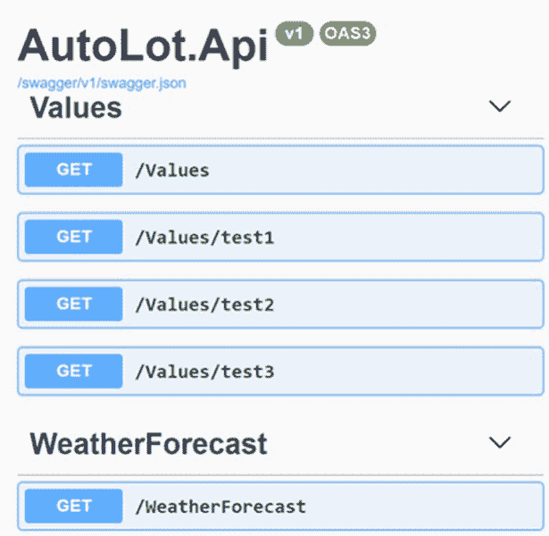
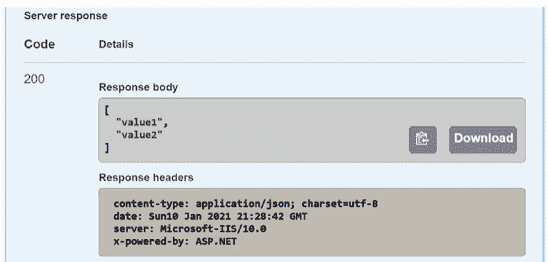
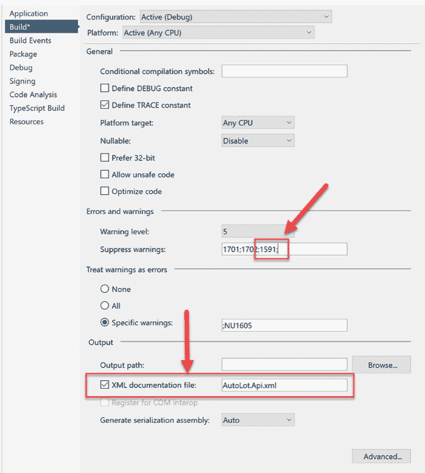
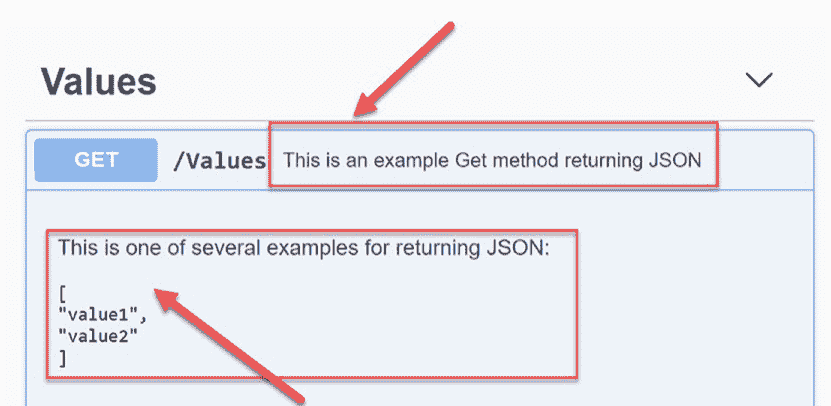
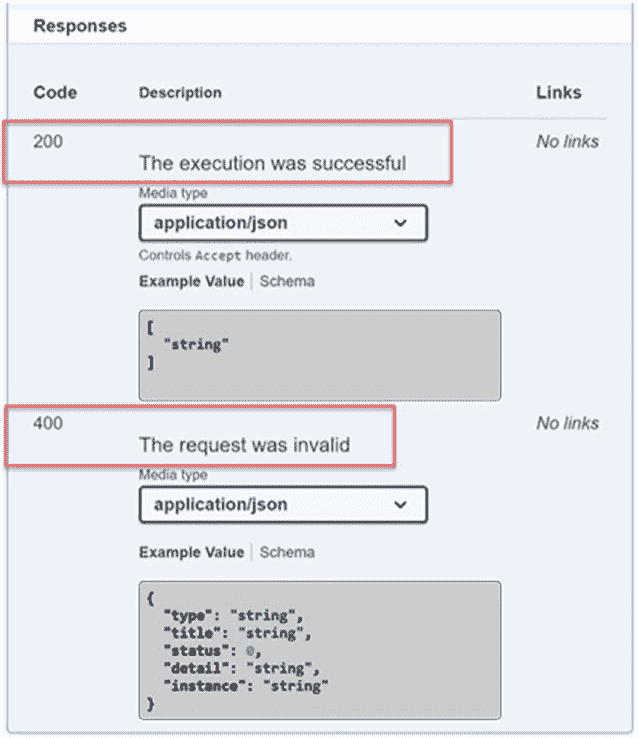

## 第30章：使用ASP.NET Core构建RESTful服务

前一章介绍了ASP.NET Core，讨论了一些新特性，创建了项目，并更新了AutoLot.Mvc和AutoLot.Api中的代码，以加入AutoLot.Dal和Serilog日志记录。本章重点在于完成AutoLot.Api RESTful服务。

> 注意 本章示例代码位于本书仓库的Chapter 30目录中。你可以继续使用在第二十九章中开始构建的解决方案。

### 介绍ASP.NET Core RESTful服务

ASP.NET MVC框架一经发布便迅速获得关注，微软在ASP.NET MVC 4和Visual Studio 2012中发布了ASP.NET Web API。ASP.NET Web API 2随Visual Studio 2013发布，随后在Visual Studio 2013 Update 1中更新至2.2版本。

ASP.NET Web API从一开始就被设计为基于服务的框架，用于构建表述性状态转移（RESTful）服务。它基于MVC框架减去V（视图），并针对创建无头服务进行了优化。这些服务可以被任何技术调用，而不仅仅是微软旗下的技术。对Web API服务的调用基于核心HTTP动词（Get、Put、Post、Delete），通过统一资源标识符（URI）进行，例如：

```
http://www.skimedic.com:5001/api/cars
```

如果这看起来像统一资源定位符（URL），那是因为它确实是！URL只是一种指向网络中物理资源的URI。

对Web API的调用使用特定主机（本例中为www.skimedic.com）上的超文本传输协议（HTTP）方案，位于特定端口（上例中为5001），后跟路径（api/cars）以及可选的查询和片段（本例中未显示）。Web API调用也可以在消息正文中包含文本，本章将展示这一点。如前一章所述，ASP.NET Core将Web API和MVC统一为一个框架。

### 使用RESTful服务的控制器操作

回想一下，操作返回IActionResult（对于异步操作返回`Task<IActionResult>`）。除了ControllerBase中返回特定HTTP状态码的辅助方法外，操作方法还可以将内容作为格式化后的JavaScript对象表示法（JSON）响应返回。

> 注意 严格来说，操作方法可以返回多种格式。本书介绍JSON是因为它最为常见。

### 格式化JSON响应结果

大多数RESTful API使用JSON（读作“jay-sawn”）从客户端接收数据并向客户端发送数据。下面是一个包含两个值的简单JSON示例：

```
[ "value1", "value2" ]
```

> 注意 第二十章深入介绍了使用System.Text.Json进行JSON序列化。

API还使用HTTP状态码来传达成功或失败。ControllerBase类中可用的部分HTTP状态辅助方法已在上一章的表29-3中列出。成功的请求会返回200范围内的状态码，其中200（OK）是最常见的成功代码。事实上，它非常常见，你无需显式返回OK。如果没有抛出异常且代码未指定状态码，则会向客户端返回200以及任何数据。

为了准备以下示例，请在AutoLot.Api项目中添加一个新的控制器。在Controllers目录中添加一个名为ValuesController.cs的新文件，并更新代码以匹配以下内容：

```
using System.Collections.Generic;
using Microsoft.AspNetCore.Mvc;

[Route("api/[controller]")]
[ApiController]
public class ValuesController : ControllerBase
{
}
```

> 注意 如果使用Visual Studio，其中提供了控制器的脚手架工具。要访问此工具，请右键单击AutoLot.Api项目中的Controllers文件夹，然后选择“添加 ► 控制器”。选择“MVC控制器 – 空”。

这段代码使用一个值（api）和一个标记（[controller]）为控制器设置路由。此路由模板将匹配类似于www.skimedic.com/api/values的URL。下一个特性（ApiController）启用了多个API专用功能（将在下一节介绍）。最后，控制器继承自ControllerBase。如第二十九章所述，ASP.NET Core将经典ASP.NET中所有不同的控制器类型合并为一个名为Controller的类型，其基类为ControllerBase。Controller类提供视图特定功能（MVC中的V），而ControllerBase提供MVC风格应用其余的所有核心功能。

有多种方法可以从操作方法中以JSON形式返回内容。以下示例都返回相同的JSON以及200状态码。差异主要在于风格。请将以下代码添加到你的ValuesController类中：

```
[HttpGet]
public IActionResult Get()
{
    return Ok(new string[] { "value1", "value2" });
}
[HttpGet("one")]
public IEnumerable<string> Get1()
{
    return new string[] { "value1", "value2" };
}
[HttpGet("two")]
public ActionResult<IEnumerable<string>> Get2()
{
    return new string[] { "value1", "value2" };
}
[HttpGet("three")]
public string[] Get3()
{
    return new string[] { "value1", "value2" };
}
[HttpGet("four")]
public IActionResult Get4()
{
    return new JsonResult(new string[] { "value1", "value2" });
}
```

要测试这一点，请运行AutoLot.Api应用程序，你将在Swagger UI中看到ValuesController中的所有方法，如图30-1所示。回想一下，在确定路由时，名称中的Controller后缀会被去掉，因此ValuesController上的端点映射为Values，而不是ValuesController。



图30-1. Swagger文档页面

要执行其中一个方法，请单击Get按钮、“Try it out”按钮，然后执行Execute按钮。方法执行后，UI会更新以显示结果，图30-2仅显示Swagger UI的相关部分。



图30-2. Swagger服务器响应信息

你将看到执行每个方法都会产生相同的JSON结果。

### ApiController特性

ApiController特性是在ASP.NET Core 2.1中添加的，与ControllerBase类结合使用时，提供REST特定的规则、约定和行为。这些约定和行为将在以下各节中概述。

### 特性路由要求

使用ApiController特性时，控制器必须使用特性路由。这只是在强制执行许多人认为的最佳实践。

### 自动400响应

如果模型绑定出现问题，操作将自动返回HTTP 400（错误请求）响应代码。这将替代以下代码：

```
if (!ModelState.IsValid)
{
    return BadRequest(ModelState);
}
```

ASP.NET Core使用ModelStateInvalidFilter操作过滤器来执行上述检查。当存在绑定或验证错误时，HTTP 400响应的正文中会包含错误详细信息。以下是一个示例：

```
{
  "type": "https://tools.ietf.org/html/rfc7231#section-6.5.1",
  "title": "One or more validation errors occurred.",
  "status": 400,
  "traceId": "|7fb5e16a-4c8f23bbfc974667.",
  "errors": {
    "": [
      "A non-empty request body is required."
    ]
  }
}
```

可以通过Startup.cs类的ConfigureServices()方法中的配置来禁用此行为。

```
services.AddControllers()
    .ConfigureApiBehaviorOptions(options =>
    {
        options.SuppressModelStateInvalidFilter = true;
    });
```

### 绑定源参数推断

模型绑定引擎将根据表30-1中列出的约定推断值的获取位置。

**表30-1. 绑定源推断约定**

| 源 | 绑定的参数 |
| --- | --- |
| FromBody | 对于复杂类型参数进行推断，但具有特殊意义的内置类型（如IFormCollection或CancellationToken）除外。只能存在一个FromBody参数，否则将抛出异常。如果需要对简单类型（例如string或int）进行绑定，则仍然需要FromBody特性。 |
| FromForm | 对于类型为IFormFile和IFormFileCollection的操作参数进行推断。当参数标记为FromForm时，会推断出multipart/form-data内容类型。 |
| FromRoute | 对于与路由标记名称匹配的任何参数名称进行推断。 |
| FromQuery | 对于任何其他操作参数进行推断。 |

可以通过Startup.cs类的ConfigureServices()方法中的配置来禁用此行为。

```
services.AddControllers().ConfigureApiBehaviorOptions(options =>
{
    //suppress all binding inference
    options.SuppressInferBindingSourcesForParameters = true;
    //suppress multipart/form-data content type inference
    options.SuppressConsumesConstraintForFormFileParameters = true;
});
```

### 错误状态码的问题详情

ASP.NET Core将错误结果（状态码为400或更高）转换为带有ProblemDetails的结果。

ProblemDetails类型如下所示：

```
public class ProblemDetails
{
    public string Type { get; set; }
    public string Title { get; set; }
    public int? Status { get; set; }
    public string Detail { get; set; }
    public string Instance { get; set; }
    public IDictionary<string, object> Extensions { get; }
        = new Dictionary<string, object>(StringComparer.Ordinal);
}
```


若要测试此行为，请向 ValuesController 中添加另一个方法，如下所示：

```
[HttpGet("error")]
public IActionResult Error()
{
    return NotFound();
}
```

运行应用程序，并使用 Swagger UI 执行新的 Error 终结点。结果仍然是 404（NotFound）状态码，但响应正文中会返回额外信息。以下显示了一个示例响应（你的 traceId 会不同）：

```
{
  "type": "https://tools.ietf.org/html/rfc7231#section-6.5.4",
  "title": "Not Found",
  "status": 404,
  "traceId": "00-9a609e7e05f46d4d82d5f897b90da624-a6484fb34a7d3a44-00"
}
```

可以通过 Startup.cs 类的 ConfigureServices() 方法中的配置来禁用此行为。

```
services.AddControllers()
    .ConfigureApiBehaviorOptions(options =>
    {
        options.SuppressMapClientErrors = true;
    });
```

当此行为被禁用时，对 Error 终结点的调用会返回 404，且不包含任何额外信息。

## 更新 Swagger/OpenAPI 设置

Swagger（也称为 OpenAPI）是一种用于记录 RESTful API 的开放标准。在 ASP.NET Core API 中添加 Swagger 的两个主要选择是 Swashbuckle 和 NSwag。ASP.NET Core 5 现在将 Swashbuckle 作为新项目模板的一部分包含在内。为 AutoLot.Api 生成的 swagger.json 文档包含站点、每个终结点以及终结点中涉及的任何对象的信息。

Swagger UI 是一个基于 Web 的 UI，它提供了一个交互式界面，用于检查应用程序的终结点以及测试这些终结点（正如你在本章前面所做的那样）。通过将文档添加到生成的 swagger.json 文件中，可以增强这种体验。

### 更新 Startup 类中的 Swagger 调用

默认 API 模板已添加代码，用于在 Startup.cs 的 ConfigureServices() 方法中生成 swagger.json 文件。

```
services.AddSwaggerGen(c =>
{
    c.SwaggerDoc("v1", new OpenApiInfo { Title = "AutoLot.Api", Version = "v1" });
});
```

与默认代码相比，第一个更改是向 OpenApiInfo 添加元数据。将 AddSwaggerGen() 调用更新为以下内容，这会更新标题并添加描述和许可证信息：

```
services.AddSwaggerGen(c =>
{
    c.SwaggerDoc("v1",
        new OpenApiInfo
        {
            Title = "AutoLot Service",
            Version = "v1",
            Description = "Service to support the AutoLot dealer site",
            License = new OpenApiLicense
            {
                Name = "Skimedic Inc",
                Url = new Uri("http://www.skimedic.com")
            }
        });
});
```

下一步是将 UseSwagger() 和 UseSwaggerUI() 从仅开发环境块中移到 Configure() 的主执行路径中。此外，将标题从“AutoLot.Api v1”更新为“AutoLot Service v1”。

```
public void Configure(IApplicationBuilder app, IWebHostEnvironment env, ApplicationDbContext context)
{
    if (env.IsDevelopment())
    {
        //If in development environment, display debug info
        app.UseDeveloperExceptionPage();
        //Original code
        //app.UseSwagger();
        //app.UseSwaggerUI(c => c.SwaggerEndpoint("/swagger/v1/swagger.json", "AutoLot.Api v1"));
        //Initialize the database
        if (Configuration.GetValue<bool>("RebuildDataBase"))
        {
            SampleDataInitializer.ClearAndReseedDatabase(context);
        }
    }

    // Enable middleware to serve generated Swagger as a JSON endpoint.
    app.UseSwagger();
    // Enable middleware to serve swagger-ui (HTML, JS, CSS, etc.),
    // specifying the Swagger JSON endpoint.
    app.UseSwaggerUI(c => { c.SwaggerEndpoint("/swagger/v1/swagger.json", "AutoLot Service v1"); });
    ...
}
```

上述代码选择使用 Swagger（app.UseSwagger()）和 Swagger UI（app.UseSwaggerUI()）。它还配置了 swagger.json 文件的终结点。

### 添加 XML 文档文件

.NET Core 可以通过检查方法上的三斜杠（///）注释，从你的项目生成 XML 文档文件。若要使用 Visual Studio 启用此功能，请右键单击 AutoLot.Api 项目并打开“属性”窗口。选择“生成”页面，选中“XML 文档文件”复选框，并在文件名中输入 AutoLot.Api.xml。另外，在“抑制警告”文本框中输入 1591，如图 30-3 所示。



图 30-3. 添加 XML 文档文件并抑制 1591

也可以直接将相同的设置输入到项目文件中。下面显示了要添加的 PropertyGroup：

```
<PropertyGroup Condition="'$(Configuration)|$(Platform)'=='Debug|AnyCPU'">
  <DocumentationFile>AutoLot.Api.xml</DocumentationFile>
  <NoWarn>1701;1702;1591;</NoWarn>
</PropertyGroup>
```

NoWarn 1591 设置会关闭对没有 XML 注释的方法的编译器警告。

> 注意 1701 和 1702 警告是经典 .NET 早期遗留内容，由 .NET Core 编译器暴露出来。

要查看此过程的实际效果，请将 ValuesController 的 Get 方法更新为以下内容：

```
/// <summary>
/// This is an example Get method returning JSON
/// </summary>
/// <remarks>This is one of several examples for returning JSON:
/// <pre>
/// [
///   "value1",
///   "value2"
/// ]
/// </pre>
/// </remarks>
/// <returns>List of strings</returns>
[HttpGet]
public IActionResult Get()
{
    return Ok(new string[] { "value1", "value2" });
}
```

当你生成项目时，会在项目的根目录中创建一个名为 AutoLot.Api.xml 的新文件。打开该文件即可看到你刚刚添加的注释。

```
<?xml version="1.0"?>
<doc>
  <assembly>
    <name>AutoLot.Api</name>
  </assembly>
  <members>
    <member name="M:AutoLot.Api.Controllers.ValuesController.Get">
      <summary>
        This is an example Get method returning JSON
      </summary>
<remarks>This is one of several examples for returning JSON:
<pre>
[
"value1",
"value2"
]
</pre>
</remarks>
<returns>List of strings</returns>  </member>
</members>
</doc>
```

> 注意 使用 Visual Studio 时，如果在类或方法定义之前输入三个斜杠，Visual Studio 会为你生成初始的 XML 注释。

下一步是将 XML 注释合并到生成的 swagger.json 文件中。

### 向 SwaggerGen 添加 XML 注释

必须将生成的 XML 注释添加到 swagger.json 的生成过程中。首先向 Startup 类添加以下 using 语句：

```
using System.IO;
using System.Reflection;
```

通过在 AddSwaggerGen() 方法中调用 IncludeXmlComments() 方法，可以将 XML 文档文件添加到 Swagger。导航到 Startup 类的 ConfigureServices() 方法，并将 AddSwaggerGen() 方法更新为以下内容以添加 XML 文档文件：

```
services.AddSwaggerGen(c =>
{
    c.SwaggerDoc("v1",
        new OpenApiInfo
        {
            Title = "AutoLot Service",
            Version = "v1",
            Description = "Service to support the AutoLot dealer site",
            License = new OpenApiLicense
            {
                Name = "Skimedic Inc",
                Url = new Uri("http://www.skimedic.com")
            }
        });
    var xmlFile = $"{Assembly.GetExecutingAssembly().GetName().Name}.xml";
    var xmlPath = Path.Combine(AppContext.BaseDirectory, xmlFile);
    c.IncludeXmlComments(xmlPath);
});
```

运行应用程序并检查 Swagger UI。注意已集成到 Swagger UI 中的 XML 注释，如图 30-4 所示。



图 30-4. 集成到 Swagger UI 中的 XML 文档

除了 XML 文档之外，对应用程序终结点进行附加配置也可以改进文档。

### API 终结点的其他文档选项

还有一些附加属性可以增强 Swagger 文档。若要使用它们，请首先将以下 using 语句添加到 ValuesController.cs 文件中：

```
using Microsoft.AspNetCore.Http;
using Swashbuckle.AspNetCore.Annotations;
```

Produces 特性指示终结点的内容类型。ProducesResponseType 特性使用 StatusCodes 枚举来指示终结点可能的返回代码。更新 ValuesController 的 Get() 方法，以指定 application/json 作为返回类型，并指定操作结果将返回 200 OK 或 400 Bad Request。

```
[HttpGet]
[Produces("application/json")]
[ProducesResponseType(StatusCodes.Status200OK)]
[ProducesResponseType(StatusCodes.Status400BadRequest)]
public ActionResult<IEnumerable<string>> Get()
{
    return new string[] { "value1", "value2" };
}
```


尽管 ProducesResponseType 特性将响应代码添加到了文档中，但这些信息无法自定义。幸运的是，Swashbuckle 正是为此目的添加了 SwaggerResponse 特性。将 Get() 方法更新为以下代码：

```
[HttpGet]
[Produces("application/json")]
[ProducesResponseType(StatusCodes.Status200OK)]
[ProducesResponseType(StatusCodes.Status400BadRequest)]
[SwaggerResponse(200, "The execution was successful")]
[SwaggerResponse(400, "The request was invalid")]
public ActionResult<IEnumerable<string>> Get()
{
    return new string[] {"value1", "value2"};
}
```

在 Swagger 注解被识别并添加到生成的文档中之前，必须先启用它们。打开 Startup.cs 并导航到 Configure() 方法。将 AddSwaggerGen() 的调用更新为以下代码：

```
services.AddSwaggerGen(c =>
{
    c.EnableAnnotations();
    ...
});
```

现在，当你在 Swagger UI 中查看 responses 部分时，你将看到自定义的消息，如图 30-5 所示。



图 30-5. Swagger UI 中更新后的响应

> 注意：Swashbuckle 还支持许多其他自定义功能。请参阅 https://github.com/domaindrivendev/Swashbuckle.AspNetCore 上的文档以获取更多信息。

## 构建 API 操作方法

AutoLot.Api 应用程序的大部分功能可以归类为以下方法之一：

- GetOne()
- GetAll()
- UpdateOne()
- AddOne()
- DeleteOne()

主要的 API 方法将在通用的基础 API 控制器中实现。首先在 AutoLot.Api 项目的 Controllers 目录中创建一个名为 Base 的新文件夹。在此文件夹中，添加一个名为 BaseCrudController.cs 的新类。将 using 语句和类定义更新为以下代码：

```
using System;
using System.Collections.Generic;
using AutoLot.Dal.Exceptions;
using AutoLot.Models.Entities.Base;
using AutoLot.Dal.Repos.Base;
using AutoLot.Services.Logging;
using Microsoft.AspNetCore.Http;
using Microsoft.AspNetCore.Mvc;
using Swashbuckle.AspNetCore.Annotations;
```

```
namespace AutoLot.Api.Controllers.Base
{
    [ApiController]
    public abstract class BaseCrudController<T, TController> : ControllerBase
        where T : BaseEntity, new()
        where TController : BaseCrudController<T, TController>
    {
    }
}
```

该类是公共抽象类，继承自 ControllerBase。该类接受两个泛型参数。第一个类型被约束为派生自 BaseEntity 并且具有默认构造函数，第二个类型派生自 BaseCrudController（用于表示派生控制器）。当将 ApiController 特性添加到基类时，派生控制器将获得该特性提供的功能。

> 注意：此类上未定义路由。它将通过派生类进行设置。

### 构造函数

下一步是添加两个受保护的类级变量：一个用于保存 IRepo<T> 的实例，另一个用于保存 IAppLogging<T> 的实例。这两个变量都应通过构造函数进行设置。

```
protected readonly IRepo<T> MainRepo;
protected readonly IAppLogging<TController> Logger;
protected BaseCrudController(IRepo<T> repo, IAppLogging<TController> logger)
{
    MainRepo = repo;
    Logger = logger;
}
```

### Get 方法

有两个 HTTP Get 方法，即 GetOne() 和 GetAll()。两者都使用传入控制器的 repo。首先，添加 GetAll() 方法。此方法作为派生控制器路由模板的端点。

```
/// <summary>
/// Gets all records
/// </summary>
/// <returns>All records</returns>
/// <response code="200">Returns all items</response>
[Produces("application/json")]
[ProducesResponseType(StatusCodes.Status200OK)]
[SwaggerResponse(200, "The execution was successful")]
[SwaggerResponse(400, "The request was invalid")]
[HttpGet]
public ActionResult<IEnumerable<T>> GetAll()
{
    return Ok(MainRepo.GetAllIgnoreQueryFilters());
}
```

下一个方法根据 id 获取单个记录，id 作为必需的路由参数传入，并添加到派生控制器的路由中。

```
/// <summary>
/// Gets a single record
/// </summary>
/// <param name="id">Primary key of the record</param>
/// <returns>Single record</returns>
/// <response code="200">Found the record</response>
/// <response code="204">No content</response>
[Produces("application/json")]
[ProducesResponseType(StatusCodes.Status200OK)]
[ProducesResponseType(StatusCodes.Status204NoContent)]
[SwaggerResponse(200, "The execution was successful")]
[SwaggerResponse(204, "No content")]
[HttpGet("{id}")]
public ActionResult<T> GetOne(int id)
{
    var entity = MainRepo.Find(id);
    if (entity == null)
    {
        return NotFound();
    }
    return Ok(entity);
}
```

路由值会自动分配给 id 参数（隐式 [FromRoute]）。

### UpdateOne 方法

HTTP Put 谓词表示对记录的更新。此处列出该方法，随后进行解释：

```
/// <summary>
/// Updates a single record
/// </summary>
/// <remarks>
/// Sample body:
/// <pre>
/// {
///   "Id": 1,
///   "TimeStamp": "AAAAAAAAAB+E="
///   "MakeId": 1,
///   "Color": "Black",
///   "PetName": "Zippy",
///   "MakeColor": "VW (Black)",
/// }
/// </pre>
/// </remarks>
/// <param name="id">Primary key of the record to update</param>
/// <returns>Single record</returns>
/// <response code="200">Found and updated the record</response>
/// <response code="400">Bad request</response>
[Produces("application/json")]
[ProducesResponseType(StatusCodes.Status200OK)]
[ProducesResponseType(StatusCodes.Status400BadRequest)]
[SwaggerResponse(200, "The execution was successful")]
[SwaggerResponse(400, "The request was invalid")]
[HttpPut("{id}")]
public IActionResult UpdateOne(int id,T entity)
{
    if (id != entity.Id)
    {
        return BadRequest();
    }

    try
    {
        MainRepo.Update(entity);
    }
    catch (CustomException ex)
    {
        //This shows an example with the custom exception
        //Should handle more gracefully
        return BadRequest(ex);
    }
```

```
catch (Exception ex)
{
    //Should handle more gracefully
    return BadRequest(ex);
}

return Ok(entity);
}
```

该方法首先根据派生控制器的路由将路由设置为 HttpPut 请求，并带有必需的 Id 路由参数。路由值分配给 id 参数（隐式 [FromRoute]），实体从请求体中分配（隐式 [FromBody]）。另请注意，没有对 ModelState 有效性进行检查。这也是由 ApiController 特性自动完成的。如果 ModelState 无效，将向客户端返回 400（BadRequest）。

该方法检查以确保路由值（id）与请求体中的 id 匹配。如果不匹配，则返回 BadRequest。如果匹配，则使用 repo 更新记录。如果更新因异常失败，将向客户端返回 400。如果全部成功，将向客户端返回 200（OK），并将更新后的记录作为响应体传递。

> 注意：此示例（以及其余示例）中的异常处理非常不充分。生产应用程序应利用您迄今为止在本书中学到的所有知识，根据需求妥善处理问题。

### AddOne 方法

HTTP Post 谓词表示对记录的插入。此处列出该方法，随后进行解释：

```
/// <summary>
/// Adds a single record
/// </summary>
/// <remarks>
/// Sample body:
/// <pre>
/// {
/// "Id": 1,
/// "TimeStamp": "AAAAAAAAAB+E="
/// "MakeId": 1,
/// "Color": "Black",
/// "PetName": "Zippy",
/// "MakeColor": "VW (Black)",
/// }
/// </pre>
/// </remarks>
/// <returns>Added record</returns>
/// <response code="201">Found and updated the record</response>
/// <response code="400">Bad request</response>
[Produces("application/json")]
```


```csharp
[ProducesResponseType(StatusCodes.Status201Created)]
[ProducesResponseType(StatusCodes.Status400BadRequest)]
[SwaggerResponse(201, "The execution was successful")]
[SwaggerResponse(400, "The request was invalid")]
[HttpPost]
public ActionResult<T> AddOne(T entity)
{
    try
    {
        MainRepo.Add(entity);
    }
    catch (Exception ex)
    {
        return BadRequest(ex);
    }
    return CreatedAtAction(nameof(GetOne), new {id = entity.Id}, entity);
}
```

该方法首先将路由定义为 HTTP Post。由于是新记录，因此没有路由参数。如果仓库成功添加记录，则响应为 CreatedAtAction()。这会向客户端返回 HTTP 201，并将新创建实体的 URL 作为 Location 头值。响应的主体是作为 JSON 的新添加实体。

## The DeleteOne Method

HTTP Delete 动词表示删除一条记录。创建实例后，使用仓库处理删除操作。整个方法如下所示：

```csharp
/// <summary>
/// Deletes a single record
/// </summary>
/// <remarks>
/// Sample body:
/// <pre>
/// {
///   "Id": 1,
///   "TimeStamp": "AAAAAAAAAB+E="
/// }
/// </pre>
/// </remarks>
/// <returns>Nothing</returns>
/// <response code="200">Found and deleted the record</response>
/// <response code="400">Bad request</response>
[Produces("application/json")]
[ProducesResponseType(StatusCodes.Status200OK)]
[ProducesResponseType(StatusCodes.Status400BadRequest)]
[SwaggerResponse(200, "The execution was successful")]
[SwaggerResponse(400, "The request was invalid")]
[HttpDelete("{id}")]
public ActionResult<T> DeleteOne(int id, T entity)
{
    if (id != entity.Id)
    {
        return BadRequest();
    }
    try
    {
        MainRepo.Delete(entity);
    }
    catch (Exception ex)
    {
        //Should handle more gracefully
        return new BadRequestObjectResult(ex.GetBaseException()?.Message);
    }
    return Ok();
}
```

该方法首先将路由定义为带必需路由参数 id 的 HTTP Delete。路由中的 id 会与随实体主体一起发送的 id 进行比较，如果不匹配，则返回 BadRequest。如果仓库成功删除记录，则响应为 OK；如果发生错误，则响应为 BadRequest。

至此，基础控制器已完成。

## The CarsController

AutoLot.Api 应用需要一个额外的 HTTP Get 方法来根据 Make 值获取 Car 记录。这将放入一个名为 CarsController 的新类中。在 Controllers 文件夹中创建一个名为 CarsController 的空 API 控制器。将 using 语句更新为以下内容：

```csharp
using System.Collections.Generic;
using AutoLot.Api.Controllers.Base;
using Microsoft.AspNetCore.Mvc;
using AutoLot.Models.Entities;
using AutoLot.Dal.Repos.Interfaces;
using AutoLot.Services.Logging;
using Microsoft.AspNetCore.Http;
using Swashbuckle.AspNetCore.Annotations;
```

CarsController 派生自 BaseCrudController 并定义了控制器路由。构造函数接收实体特定的仓库和记录器的实例。以下是初始控制器布局：

```csharp
namespace AutoLot.Api.Controllers
{
    [Route("api/[controller]")]
    public class CarsController : BaseCrudController<Car, CarsController>
    {
        public CarsController(ICarRepo carRepo, IAppLogging<CarsController> logger) :
            base(carRepo, logger)
        {
        }
    }
}
```

CarsController 通过另一个操作方法扩展基类，该方法获取特定 make 的所有汽车。添加以下代码，解释随后给出：

```csharp
/// <summary>
/// Gets all cars by make
/// </summary>
/// <returns>All cars for a make</returns>
/// <param name="id">Primary key of the make</param>
/// <response code="200">Returns all cars by make</response>
[Produces("application/json")]
[ProducesResponseType(StatusCodes.Status200OK)]
[ProducesResponseType(StatusCodes.Status204NoContent)]
[SwaggerResponse(200, "The execution was successful")]
[SwaggerResponse(204, "No content")]

[HttpGet("bymake/{id?}")]
public ActionResult<IEnumerable<Car>> GetCarsByMake(int? id)
{
    if (id.HasValue && id.Value > 0)
    {
        return Ok(((ICarRepo)MainRepo).GetAllBy(id.Value));
    }
    return Ok(MainRepo.GetAllIgnoreQueryFilters());
}
```

HTTP Get 属性使用 bymake 常量扩展路由，然后是可选的 make 的 id 用于过滤，例如：

```
https://localhost:5021/api/cars/bymake/5
```

接下来，它检查是否传入了 id 值。如果没有，则获取所有车辆。如果传入了值，则使用 `CarRepo` 的 `GetAllBy()` 方法按 make 获取汽车。由于基类的 `MainRepo` 受保护属性定义为 `IRepo<T>`，因此必须将其转换回 `ICarRepo` 接口。

## The Remaining Controllers

其余实体特定的控制器都派生自 BaseCrudController，但不添加任何额外功能。在 Controllers 文件夹中添加四个更多空 API 控制器，命名为 CreditRisksController、CustomersController、MakesController 和 OrdersController。其余控制器全部如下所示：

```csharp
//CreditRisksController.cs
using AutoLot.Api.Controllers.Base;
using AutoLot.Models.Entities;
using AutoLot.Dal.Repos.Interfaces;
using AutoLot.Services.Logging;
using Microsoft.AspNetCore.Mvc;

namespace AutoLot.Api.Controllers
{
    [Route("api/[controller]")]
    public class CreditRisksController : BaseCrudController<CreditRisk, CreditRisksController>
    {
        public CreditRisksController(
            ICreditRiskRepo creditRiskRepo, IAppLogging<CreditRisksController> logger)
            : base(creditRiskRepo, logger)
        {
        }
    }
}

//CustomersController.cs
using AutoLot.Api.Controllers.Base;
using AutoLot.Models.Entities;
using AutoLot.Dal.Repos.Interfaces;
using AutoLot.Services.Logging;
using Microsoft.AspNetCore.Mvc;

namespace AutoLot.Api.Controllers
{
    [Route("api/[controller]")]
    public class CustomersController : BaseCrudController<Customer, CustomersController>
    {
        public CustomersController(
            ICustomerRepo customerRepo, IAppLogging<CustomersController> logger)
            : base(customerRepo, logger)
        {
        }
    }
}

//MakesController.cs
using AutoLot.Api.Controllers.Base;
using AutoLot.Models.Entities;
using Microsoft.AspNetCore.Mvc;
using AutoLot.Dal.Repos.Interfaces;
using AutoLot.Services.Logging;

namespace AutoLot.Api.Controllers
{
    [Route("api/[controller]")]
    public class MakesController : BaseCrudController<Make, MakesController>
    {
        public MakesController(IMakeRepo makeRepo, IAppLogging<MakesController> logger)
            : base(makeRepo, logger)
        {
        }
    }
}

//OrdersController.cs
using AutoLot.Api.Controllers.Base;
using AutoLot.Dal.Repos.Interfaces;
using AutoLot.Models.Entities;
using AutoLot.Services.Logging;
using Microsoft.AspNetCore.Mvc;

namespace AutoLot.Api.Controllers
{
    [Route("api/[controller]")]
    public class OrdersController : BaseCrudController<Order, OrdersController>
    {
        public OrdersController(IOrderRepo orderRepo, IAppLogging<OrdersController> logger) :
            base(orderRepo, logger)
        {
        }
    }
}
```

至此，所有控制器均已完成，您可以使用 Swagger UI 测试所有功能。如果要添加/更新/删除记录，请在 appsettings.Development.json 文件中将 RebuildDataBase 值更新为 true。

```json
{
...
"RebuildDataBase": true,
...
}
```

## Exception Filters

当 Web API 应用中发生异常时，不会显示错误页面，因为用户通常是另一个应用程序而不是人类。任何信息都必须连同 HTTP 状态码一起作为 JSON 发送。如第 29 章所述，ASP.NET Core 允许创建在未处理异常事件中运行的过滤器。过滤器可以全局应用、在控制器级别应用或在操作级别应用。对于此应用程序，您将构建一个异常过滤器以返回格式化的 JSON（连同 HTTP 500），如果站点以调试模式运行，则包含堆栈跟踪。

> 注意：过滤器是 ASP.NET Core 的一项功能强大的特性。在本章中，我们仅检查异常过滤器，但可以创建许多其他过滤器，可以在构建 ASP.NET Core 应用时节省大量时间。有关过滤器的完整信息，请参阅 https://docs.microsoft.com/en-us/aspnet/core/mvc/controllers/filters 上的文档。


## 创建 CustomExceptionFilter

新建一个名为 Filters 的目录，并在该目录中添加一个名为 CustomExceptionFilterAttribute.cs 的类。将 using 语句更新为以下内容：

```
using Microsoft.AspNetCore.Hosting;
using Microsoft.AspNetCore.Mvc;
using Microsoft.AspNetCore.Mvc.Filters;
using Microsoft.EntityFrameworkCore;
using Microsoft.Extensions.Hosting;
```

将类改为 public，并继承自 ExceptionFilterAttribute。重写 OnException() 方法，如下所示：

```
namespace AutoLot.Api.Filters
{
    public class CustomExceptionFilterAttribute : ExceptionFilterAttribute
    {
        public override void OnException(ExceptionContext context)
        {
        }
    }
}
```

与 ASP.NET Core 中大多数具有前后事件处理器的过滤器不同，异常过滤器只有一个处理器：OnException()（或 OnExceptionAsync()）。该处理器只有一个参数 ExceptionContext。此参数提供对 ActionContext 以及所抛出异常的访问。

过滤器也参与依赖注入，允许代码访问容器中的任何项。在本示例中，我们需要将 IWebHostEnvironment 的实例注入到过滤器中。这将用于确定运行时环境。如果环境是 Development，则响应还应包含堆栈跟踪。添加一个类级变量来保存 IWebHostEnvironment 实例，并添加构造函数，如下所示：

```
private readonly IWebHostEnvironment _hostEnvironment;
public CustomExceptionFilterAttribute(IWebHostEnvironment hostEnvironment)
{
    _hostEnvironment = hostEnvironment;
}
```

OnException() 事件处理器中的代码会检查所抛出异常的类型，并构建相应的响应。如果环境是 Development，则堆栈跟踪会包含在响应消息中。构建一个包含要发送给调用请求的值的动态对象，并在 IActionResult 中返回。更新后的方法如下所示：

```
public override void OnException(ExceptionContext context)
{
    var ex = context.Exception;
    string stackTrace = _hostEnvironment.IsDevelopment() ? context.Exception.StackTrace : string.Empty;
    string message = ex.Message;
    string error;
```

```
IActionResult actionResult;
switch (ex)
{
    case DbUpdateConcurrencyException ce:
        //Returns a 400
        error = "Concurrency Issue.";
        actionResult = new BadRequestObjectResult(
            new {Error = error, Message = message, StackTrace = stackTrace});
        break;
    default:
        error = "General Error.";
        actionResult = new ObjectResult(
            new {error = error, Message = message, StackTrace = stackTrace})
        {
            StatusCode = 500
        };
        break;
}
//context.ExceptionHandled = true; //If this is uncommented, the exception is swallowed
context.Result = actionResult;
}
```

如果你希望异常过滤器吞掉异常并将响应设置为 200（例如，记录错误但不将其返回给客户端），请在设置 Result 之前添加以下代码行（在上面的示例中已注释掉）：

```
context.ExceptionHandled = true;
```

## 将过滤器添加到处理管道

过滤器可以应用于操作方法、控制器，或全局应用于应用程序。过滤器的前置代码从外向内执行（全局、控制器、操作方法），而后置代码从内向外执行（操作方法、控制器、全局）。

在应用程序级别添加过滤器是在 Startup 类的 ConfigureServices() 方法中完成的。打开 Startup.cs 类，并在文件顶部添加以下 using 语句：

```
using AutoLot.Api.Filters;
```

更新 AddControllers() 方法以添加自定义过滤器。

```
services
    .AddControllers(config => config.Filters.Add(new CustomExceptionFilterAttribute(_env)))
    .AddJsonOptions(options =>
    {
        options.JsonSerializerOptions.PropertyNamingPolicy = null;
        options.JsonSerializerOptions.WriteIndented = true;
    })
    .ConfigureApiBehaviorOptions(options =>
    {
    ...
    });
```

## 测试异常过滤器

为了测试异常过滤器，打开 WeatherForecastController.cs 文件，并将 Get() 操作更新为如下代码：

```
[HttpGet]
public IEnumerable<WeatherForecast> Get()
{
    _logger.LogAppWarning("This is a test");
    throw new Exception("Test Exception");
    ...
}
```

运行应用程序并使用 Swagger 调用该方法。Swagger UI 中显示的结果应与以下输出匹配（为了简洁，堆栈跟踪已缩短）：

```
{
  "Error": "General Error.",
  "Message": "Test Exception",
  "StackTrace": "   at AutoLot.Api.Controllers.WeatherForecastController.Get() in D:\\Projects\\Books\\csharp9-wf\\Code\\New\\Chapter_30\\AutoLot.Api\\Controllers\\WeatherForecastController.cs:line 31\r\n   "
}
```

## 添加跨域请求支持

API 应具备相应的策略，以允许或阻止来自其他服务器的客户端与 API 通信。这类请求称为跨域请求（CORS）。虽然在你本机运行且完全处于 ASP.NET Core 环境中时并不需要此功能，但希望与你的 API 通信的 JavaScript 框架需要它，即使所有内容都在本地运行也是如此。

注意 有关 CORS 支持的更多信息，请参阅 https://docs.microsoft.com/en-us/aspnet/core/security/cors 上的文档文章。

## 创建 CORS 策略

ASP.NET Core 对配置 CORS 提供了丰富的支持，包括允许/禁止标头、方法、来源、凭据等方法。在本示例中，我们将尽可能保持完全开放。配置从创建 CORS 策略并将该策略添加到服务集合开始。策略被命名（此名称将在 Configure() 方法中使用），后跟规则。以下示例创建了一个名为 AllowAll 的策略，然后执行该策略。将以下代码添加到 Startup.cs 类的 ConfigureServices() 方法中：

```
services.AddCors(options =>
{
    options.AddPolicy("AllowAll", builder =>
    {

```
```
builder
    .AllowAnyHeader()
    .AllowAnyMethod()
    .AllowAnyOrigin();
});
});
```

## 将 CORS 策略添加到 HTTP 管道处理中

最后一步是将 CORS 策略添加到 HTTP 管道处理中。在 Startup.cs 的 Configure() 方法中添加以下代码行，确保它位于 app.UseRouting() 和 app.UseEndpoints() 方法调用之间：

```
public void Configure(
    IApplicationBuilder app,
    IWebHostEnvironment env,
    ApplicationDbContext context)
{
    ...
    //opt-in to routing
    app.UseRouting();
    //Add CORS Policy
    app.UseCors("AllowAll");
    //enable authorization checks
    app.UseAuthorization();
    ...
}
```

## 总结

本章继续我们对 ASP.NET Core 的学习。我们首先了解了从操作方法返回 JSON，然后研究了 ApiController 属性及其对 API 控制器的影响。接下来，更新了通用的 Swashbuckle 实现，以包含应用程序的 XML 文档和操作方法属性中的信息。

然后，构建了基础控制器，它承载了应用程序的大部分功能。之后，将派生的、特定于实体的控制器添加到项目中。最后两步添加了应用程序级的异常过滤器和对跨域请求的支持。

在下一章中，你将完成构建 ASP.NET Core Web 应用程序 AutoLot.Mvc。
