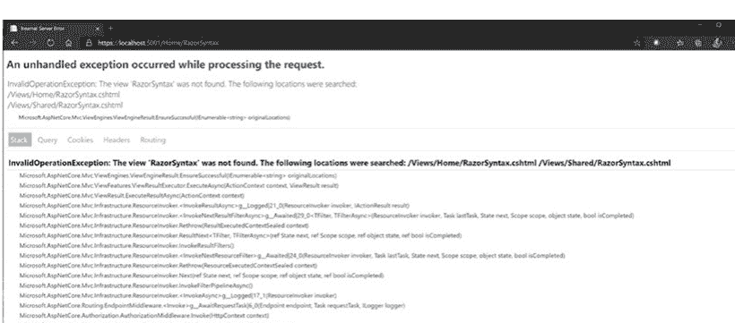
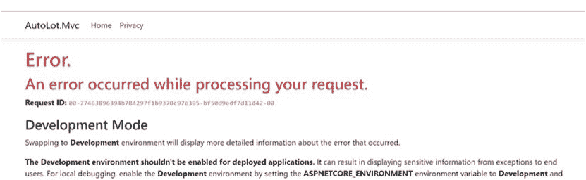
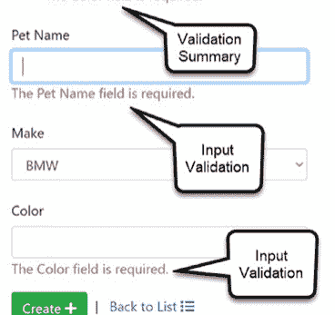
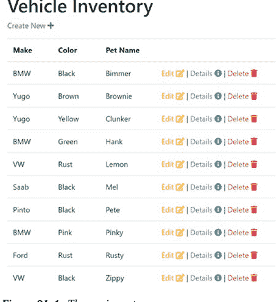
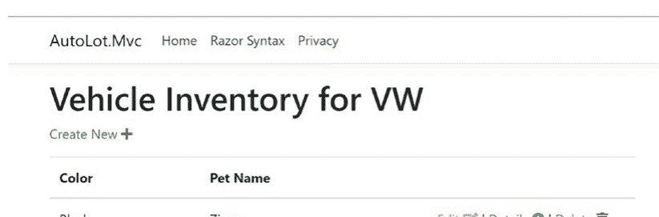
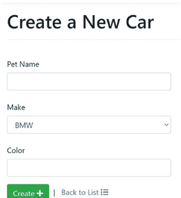
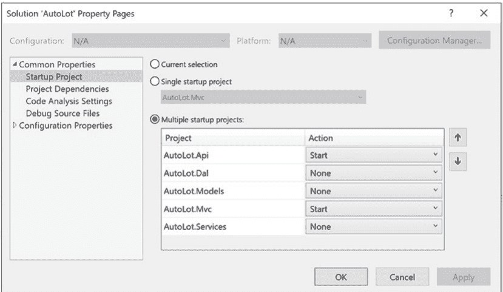

## 第 31 章

## 使用 ASP.NET Core 构建 MVC 应用程序

第 29 章为 ASP.NET Core 奠定了基础，在第 30 章中，我们构建了 RESTful 服务。在本章中，我们将使用 MVC 模式构建 Web 应用程序。我们首先将 V 放回 MVC 中。

> 注意 本章的示例代码位于本书仓库的 Chapter 31 目录中。你可以继续使用在第 29 章中创建并在第 30 章中更新的解决方案。

## 介绍 ASP.NET Core 中的“V”

在构建 ASP.NET Core 服务时，只使用了 MVC 模式中的 M（模型）和 C（控制器）。用户界面使用 V，即 MVC 模式中的视图来创建。视图使用 HTML、JavaScript、CSS 和 Razor 代码构建。它们可以选择性地具有基础布局页面，并由控制器操作方法或视图组件渲染。如果你使用过经典 ASP.NET MVC，应该对此很熟悉。

## ViewResult 与操作方法

正如第 29 章中简要提到的，ViewResult 和 PartialViewResult 是使用 Controller 辅助方法从操作方法返回的 ActionResult。PartialViewResult 设计用于在另一个视图中渲染，不使用布局页面，而 ViewResult 通常与布局页面一起渲染。

ASP.NET Core 中的约定（与 ASP.NET MVC 中一样）是 View 或 PartialView 渲染与方法同名的 *.cshtml 文件。视图必须位于以控制器命名的文件夹中（去掉 Controller 后缀）或 Shared 文件夹中（两者都位于父级 Views 文件夹下）。例如，以下代码将渲染位于 Views\Sample 或 Views\Shared 文件夹中的 SampleAction.cshtml 视图：

```
[Route("[controller]/[action]")]
public class SampleController: Controller
{
    public ActionResult SampleAction()
```


```
{
    return View();
}
}
```

> 注意 以控制器命名的视图文件夹会先被搜索。如果找不到视图，则会搜索 Shared 文件夹。如果仍然找不到，则会抛出异常。

要渲染一个与操作方法名称不同的视图，请传入文件名（不带 cshtml 扩展名）。以下代码将渲染 CustomViewName.cshtml 视图：

```
public ActionResult SampleAction()
{
    return View("CustomViewName");
}
```

最后两个重载用于传入一个成为视图模型的数据对象。第一个示例使用默认视图名称，第二个示例指定了不同的视图名称。

```
public ActionResult SampleAction()
{
    var sampleModel = new SampleActionViewModel();
    return View(sampleModel);
}
public ActionResult SampleAction()
{
    var sampleModel = new SampleActionViewModel();
    return View("CustomViewName",sampleModel);
}
```

下一节将使用从 HomeController 上的 RazorSyntax() 操作方法渲染的视图，详细探讨 Razor 视图引擎。操作方法将从注入到该方法中的 CarRepo 类实例获取一条 Car 记录，并将 Car 实例作为模型传递给视图。

打开 AutoLot.Mvc 应用的 Controllers 目录中的 HomeController 并添加以下 using 语句：

```
using AutoLot.Dal.Repos.Interfaces;
```

接下来，将 RazorSyntax() 方法添加到控制器。

```
[HttpGet]
public IActionResult RazorSyntax([FromServices] ICarRepo carRepo)
{
    var car = carRepo.Find(1);
    return View(car);
}
```

操作方法使用 HTTPGet 属性装饰，将此方法设置为 /Home/RazorSyntax 的应用程序端点，只要请求是 HTTP Get。ICarRepo 参数上的 FromServices 属性告知 ASP.NET Core 参数不应使用任何传入数据进行数据绑定，而是方法从依赖注入容器接收 ICarRepo 的实例。该方法获取一个 Car 实例并使用 View 方法返回一个 ViewResult。由于没有命名视图，ASP.NET Core 将在 Views\Home 目录或 Views\Shared 目录中查找名为 RazorSyntax.cshtml 的视图。如果在任一位置都找不到视图，则会向客户端（浏览器）返回异常。

运行应用程序并在浏览器中导航到 https://localhost:5001/Home/RazorSyntax（如果您使用 Visual Studio 和 IIS，则需要更新端口）。由于项目中没有视图可以满足请求，因此会向浏览器返回异常。回想一下第 29 章，Startup 类的 Configure() 方法如果环境为 Development，则会在 HTTP 管道中添加 UseDeveloperExceptionPage() 方法。图 31-1 显示了此方法的效果。



图 31-1. 来自开发人员异常页面的错误消息

开发人员异常页面提供了充足的信息来调试您的应用程序，包括完整的堆栈跟踪的原始异常详细信息。现在，在 Configure() 方法中注释掉该行，用“标准”错误处理程序替换它，如下所示：

```
if (env.IsDevelopment())
{
    //app.UseDeveloperExceptionPage();
    app.UseExceptionHandler("/Home/Error");
    ...
}
```

再次运行应用程序并导航到 http://localhost:5001/Home/RazorSyntax，您将看到标准错误页面，如图 31-2 所示。



图 31-2. 来自标准错误页面的错误消息

注意 本章中的示例 URL 全部使用 Kestrel 和端口 5001。如果您使用 Visual Studio 配合 IIS Express，请使用 launchsettings.json 配置文件中的 URL。

标准错误处理程序将错误重定向到 HomeController 的 Error 操作方法。请记住将 Configure() 方法改回使用开发人员异常页面：

```
if (env.IsDevelopment())
{
    app.UseDeveloperExceptionPage();
    ...
}
```

有关自定义错误处理和更多可用选项的更多信息，请参阅文档：https://docs.microsoft.com/en-us/aspnet/core/fundamentals/error-handling?view=aspnetcore-5.0。

## Razor 视图引擎和 Razor 语法

Razor 视图引擎是作为对 Web Forms 视图引擎的改进而设计的，并使用 Razor 作为核心语言。Razor 是嵌入到视图中的服务器端代码，基于 C#，并纠正了 Web Forms 视图引擎的许多烦恼。将 Razor 整合到 HTML 和 CSS 中会产生比使用 Web Forms 视图引擎语法更干净、更易读的代码。

开始使用时，在 AutoLot.Mvc 项目中右键单击 Views\Home 文件夹并选择 Add ► New Item。从 Add New Item - AutoLot.Mvc 对话框中选择 Razor View - Empty，并将视图命名为 RazorSyntax.cshtml。

注意 当您右键单击 Views\Home 文件夹时，还有一个菜单选项：Add ► View。但是，该对话框会直接带您返回 Add New Item 对话框。

Razor 视图通常通过使用 @model 指令进行强类型（注意 m 为小写）。通过在视图顶部添加以下内容，将新视图的类型更新为 Car 实体：

```
@model AutoLot.Models.Entities.Car
```

在页面顶部添加一个 <h1> 标签。这与 Razor 无关；它只是为页面添加一个标题。

```
<h1>Razor Syntax</h1>
```

Razor 语句块以 @ 符号开头，要么是自包含的语句（如 foreach），要么像以下示例那样用大括号括起来：

```
@for (var i = 0; i < 15; i++)
{
    //do something
}
```

```
@{
    //Code Block
    var foo = "Foo";
    var bar = "Bar";
    var htmlString = "<ul><li>one</li><li>two</li></ul>";
}
```

要将变量的值输出到视图，只需使用 @ 符号加上变量名。这相当于 Response.Write()。请注意，直接输出到浏览器时语句后没有分号。

```
@foo
<br />
@htmlString
<br />
@foo.@bar
<br />
```

前面的示例（@foo.@bar）使用句点（.）在两个变量之间进行组合。这不是通常的 C#“点”符号，即导航属性链。它只是将两个变量的输出与物理句点一起写入响应流。如果您需要“点”方式向下遍历变量，请在变量上使用 @，然后像平常一样编写代码。

```
@foo.ToUpper()
```

如果您想输出原始 HTML，则使用所谓的 HTML 助手。这些是内置于 Razor 视图引擎的助手。以下是输出原始 HTML 的行：

```
@Html.Raw(htmlString)
<hr />
```

代码块可以混合标记和代码。以标记开头的行被解释为 HTML，而所有其他行被解释为代码。如果一行以非代码的文本开头，您必须使用内容指示符（@:）或 <text></text> 内容块指示符。请注意，行可以在两者之间来回转换。以下是示例：

```
@{
    @:Straight Text
    <div>Value:@Model.Id</div>
    <text>
        Lines without HTML tag
    </text>
    <br />
}
```

如果您想转义 @ 符号，请使用双 @。Razor 也足够智能，可以处理电子邮件地址，因此无需转义。如果您需要 Razor 将 @ 符号视为 Razor 标记，请添加括号。

```
foo@foo.com
<br />
@@foo
<br />
test@foo
<br/>
test@(foo)
<br />
```

前面的代码分别输出 foo@foo.com、@foo、test@foo 和 testFoo。
Razor 注释以 @* 开头，以 *@ 关闭。

```
@*
    Multiline Comments
    Hi.
*@
```

Razor 也支持内联函数。以下示例函数对字符串列表进行排序：

```
@functions {
    public static IList<string> SortList(IList<string> strings) {
        var list = from s in strings orderby s select s;
        return list.ToList();
    }
}
```

以下代码创建一个字符串列表，使用 SortList() 函数对其进行排序，然后将排序后的列表输出到浏览器：

```
@{
    var myList = new List<string> {"C", "A", "Z", "F"};
    var sortedList = SortList(myList);
}
```

```
@foreach (string s in sortedList)
{
    @s@:&nbsp;
}
<hr/>
```

下面是另一个示例，它创建一个可用于将字符串设置为粗体的委托：

```
@{
    Func<dynamic, object> b = @<strong>@item</strong>;
}
This will be bold: @b("Foo")
```

Razor 还包含 HTML 帮助器，这些是由 ASP.NET Core 提供的方法。两个示例是 DisplayForModel() 和 EditorForModel()。前者对视图的模型使用反射，以在网页中显示。后者也使用反射来创建编辑表单的 HTML（注意，它不提供 Form 标签，只提供模型的标记）。HTML 帮助器将在本章后面详细讨论。最后，ASP.NET Core 中新增的是标记帮助器（tag helpers）。标记帮助器将标记和代码结合起来，将在本章后面介绍。

## 视图

视图是带有 cshtml 扩展名的特殊代码文件，使用 HTML 标记、CSS、JavaScript 和 Razor 语法的组合编写。

### Views 目录

Views 文件夹是使用 MVC 模式的 ASP.NET Core 项目中存储视图的位置。在 Views 文件夹的根目录下，有两个文件：_ViewStart.cshtml 和 _ViewImports.cshtml。

_ViewStart.cshtml 会在任何其他视图渲染之前执行其代码（不包括分部视图和布局）。该文件通常用于为未指定布局的视图设置默认布局。布局将在“布局”（Layouts）一节中更详细地讨论。_ViewStart.cshtml 文件如下所示：

```
@{
    Layout = "_Layout";
}
```

_ViewImports.cshtml 文件用于导入共享指令，例如 using 语句。其内容适用于与 _ViewImports 文件相同目录或子目录中的所有视图。为 AutoLot.Models.Entities 添加一条 using 语句。

```
@using AutoLot.Mvc
@using AutoLot.Mvc.Models
@using AutoLot.Models.Entities
@addTagHelper *, Microsoft.AspNetCore.Mvc.TagHelpers
```

@addTagHelper 行将随同标记帮助器一起介绍。

注意：为什么 _ViewStart.cshtml、_ViewImports.cshtml 和 _Layout.cshtml 以下划线开头？Razor 视图引擎最初是为 WebMatrix 创建的，WebMatrix 不允许任何以下划线开头的文件直接渲染。所有核心文件（如布局和配置）的名称都以下划线开头。这不是 MVC 在意的约定，因为 MVC 没有 WebMatrix 那样的限制，但下划线的传统仍然保留了下来。

如前所述，每个控制器在 Views 文件夹下都有自己的目录，用于存储其特定的视图。这些目录的名称与控制器名称匹配（减去 Controller 这个词）。例如，Views\Cars 目录保存 CarsController 的所有视图。视图通常以渲染它们的操作方法命名，但名称可以更改，如前所示。

### Shared 目录

Views 下有一个名为 Shared 的特殊目录。该目录保存可供所有控制器和操作使用的视图。如前所述，如果在控制器特定的目录中找不到所请求的视图文件，则会搜索 Shared 文件夹。

### DisplayTemplates 文件夹

DisplayTemplates 文件夹包含自定义模板，这些模板控制类型的渲染方式，并有助于代码复用和显示一致性。当调用 DisplayFor()/DisplayForModel() 方法时，Razor 视图引擎会查找与所渲染类型同名的模板，例如，为 Car 类查找 Car.cshtml。如果找不到自定义模板，则使用反射渲染标记。搜索路径从 Views\{CurrentControllerName}\DisplayTemplates 文件夹开始，如果找不到，则在 Views\Shared\DisplayTemplates 文件夹中查找。这两个方法都接受一个可选参数来指定模板名称。

#### DateTime 显示模板

在 Views\Shared 文件夹下创建一个名为 DisplayTemplates 的新文件夹。向该文件夹中添加一个名为 DateTime.cshtml 的新视图。清除所有生成的代码和注释，并用以下内容替换：

```
@model DateTime?
@if (Model == null)
{
    @:Unknown
}
else
{
    if (ViewData.ModelMetadata.IsNullableValueType)
    {
        @:@(Model.Value.ToString("d"))
    }
    else
    {
        @:@(((DateTime)Model).ToString("d"))
    }
}
```

请注意，对视图进行强类型化的 @model 指令使用小写 m。在 Razor 中引用模型的赋值时，使用大写 M。在此示例中，模型定义可为 null。如果传递给视图的模型值为 null，则模板显示单词 Unknown。否则，它使用可空类型的 Value 属性或模型本身，以短日期格式显示日期。

#### Car 显示模板

在 Views 目录下创建一个名为 Cars 的新目录，并在 Cars 目录下添加一个名为 DisplayTemplates 的目录。向该文件夹中添加一个名为 Car.cshtml 的新视图。清除所有生成的代码和注释，并用以下代码替换，这些代码显示一个 Car 实体：

```
@model AutoLot.Models.Entities.Car
<dl class="row">
    <dt class="col-sm-2">
        @Html.DisplayNameFor(model => model.MakeId)
    </dt>
    <dd class="col-sm-10">
        @Html.DisplayFor(model => model.MakeNavigation.Name)
    </dd>
    <dt class="col-sm-2">
        @Html.DisplayNameFor(model => model.Color)
    </dt>
    <dd class="col-sm-10">
        @Html.DisplayFor(model => model.Color)
    </dd>
    <dt class="col-sm-2">
        @Html.DisplayNameFor(model => model.PetName)
    </dt>
    <dd class="col-sm-10">
        @Html.DisplayFor(model => model.PetName)
    </dd>
</dl>
```

DisplayNameFor() HTML 帮助器显示属性的名称，除非该属性使用 Display(Name="") 或 DisplayName("") 特性进行装饰，在这种情况下，会使用显示值。DisplayFor() 方法显示表达式中指定的模型属性的值。请注意，正在使用 MakeNavigation 的导航属性来获取制造商名称。

如果你运行应用并导航到 RazorSyntax 页面，你可能会惊讶于 Car 显示模板没有被使用。这是因为该模板位于 Cars 视图文件夹中，而 RazorSyntax 操作方法和视图是从 HomeController 调用的。HomeController 中的操作方法只会搜索 Home 和 Shared 目录来查找视图，因此不会找到 Car 显示模板。

如果将 Car.cshtml 模板移动到 Shared\DisplayTemplates 目录，RazorSyntax 视图将使用该显示模板。

#### 带颜色的 Car 显示模板

以下模板与 Car 模板类似。区别在于，此模板会根据模型的 Color 属性值更改 Color 文本的颜色。将名为 CarWithColors.cshtml 的新模板添加到 Cars\DisplayTemplates 目录中，并将标记更新为以下内容：

```
@model Car
<hr />
<div>
    <dl class="row">
        <dt class="col-sm-2">
            @Html.DisplayNameFor(model => model.PetName)
        </dt>
        <dd class="col-sm-10">
            @Html.DisplayFor(model => model.PetName)
        </dd>
        <dt class="col-sm-2">
            @Html.DisplayNameFor(model => model.MakeNavigation)
        </dt>
        <dd class="col-sm-10">
            @Html.DisplayFor(model => model.MakeNavigation.Name)
        </dd>
        <dt class="col-sm-2">
            @Html.DisplayNameFor(model => model.Color)
        </dt>
        <dd class="col-sm-10" style="color:@Model.Color">
            @Html.DisplayFor(model => model.Color)
        </dd>
    </dl>
</div>
```

要使用此模板而不是 Car.cshtml 模板，请调用 DisplayForModel() 并传入模板名称（注意，位置规则仍然适用）。

```
@Html.DisplayForModel("CarWithColors")
```

### EditorTemplates 文件夹

EditorTemplates 文件夹的工作方式与 DisplayTemplates 文件夹相同，只是这些模板用于编辑。

#### Car 编辑模板

在 Views\Cars 目录下创建一个名为 EditorTemplates 的新目录。向该文件夹中添加一个名为 Car.cshtml 的新视图。清除所有生成的代码和注释，并用以下代码替换，这些代码表示编辑 Car 实体的标记：

```
@model Car
<div asp-validation-summary="All" class="text-danger"></div>
<div class="form-group">
    <label asp-for="PetName" class="col-form-label"></label>
```


```
<input asp-for="PetName" class="form-control" />
<span asp-validation-for="PetName" class="text-danger"></span>
</div>
<div class="form-group">
<label asp-for="MakeId" class="col-form-label"></label>
<select asp-for="MakeId" class="form-control" asp-items="ViewBag.MakeId"></select>
</div>
<div class="form-group">
<label asp-for="Color" class="col-form-label"></label>
<input asp-for="Color" class="form-control"/>
<span asp-validation-for="Color" class="text-danger"></span>
</div>
```

编辑器模板使用了几个标签助手（asp-for、asp-items、asp-validation-for 和 asp-validation-summary）。这些将在本章后面介绍。

该模板由 EditorFor()/EditorForModel() HTML 助手调用。与显示模板一样，这些方法会查找名为 Car.cshtml 的视图，或查找方法中指定的视图。

## 布局

与 Web Forms 母版页类似，MVC 支持在视图之间共享的布局，使站点页面具有一致的外观和感觉。导航到 Views\Shared 文件夹，打开 _Layout.cshtml 文件。这是一个完整的 HTML 文件，包含 <head> 和 <body> 标签。

该文件是其他视图渲染到其中的基础。此外，由于页面的大部分内容（例如导航以及任何页眉和/或页脚标记）由布局页面处理，因此视图页面保持小而简单。在文件中向下滚动，直到看到以下 Razor 代码行：

```
@RenderBody()
```

该行指示布局页面在何处渲染视图。现在向下滚动到结束 </body> 标签之前的一行。以下行为布局创建了一个新的节点，并使其成为可选：

```
@await RenderSectionAsync("scripts", required: false)
```

节点也可以通过传入 true 作为第二个参数来标记为必需。它们也可以同步渲染，如下所示：

```
@RenderSection("Header",true)
```

视图文件中 @section 块中的任何代码和/或标记都不会通过 @RenderBody() 调用渲染，而是在布局的节点定义位置渲染。例如，假设您有一个视图，其节点实现如下：

```
@section Scripts {
<script src="~/lib/jquery-validation/dist/jquery.validate.js"></script>
}
```

视图中的代码会渲染到布局中，以代替节点定义。如果布局具有以下定义：

```
<script src="~/lib/jquery/dist/jquery.min.js"></script>
<script src="~/lib/bootstrap/dist/js/bootstrap.bundle.min.js"></script>
<script src="~/js/site.js" asp-append-version="true"></script>
@await RenderSectionAsync("Scripts", required: false)
```

那么视图的节点会被添加，从而得到发送到浏览器的以下标记：

```
<script src="~/lib/jquery/dist/jquery.min.js"></script>
<script src="~/lib/bootstrap/dist/js/bootstrap.bundle.min.js"></script>
<script src="~/js/site.js" asp-append-version="true"></script>
<script src="~/lib/jquery-validation/dist/jquery.validate.js"></script>
```

ASP.NET Core 中的两个新选项是 IgnoreBody 和 IgnoreSection。这些方法放置在布局中，将分别不渲染视图的主体或特定节点。这样可以根据条件逻辑（如安全级别）从布局中打开或关闭视图的功能。

### 为视图指定默认布局

如前所述，默认布局页面定义在 _ViewStart.cshtml 文件中。任何未指定布局的视图都将使用位于视图目录或上级目录中的第一个 _ViewStart.cshtml 文件中定义的布局。

### 分部视图

分部视图在概念上类似于 Web Forms 中的用户控件。分部视图有助于封装 UI，从而减少重复的代码和/或标记。分部视图不使用布局，而是注入到另一个视图中，或使用视图组件渲染（本章后面会介绍）。

### 更新布局和分部视图

有时布局文件会变得庞大而笨拙。一种管理方法是把布局拆分成一组有重点的分部视图。

### 创建分部视图

在 Shared 文件夹下创建一个名为 Partials 的新文件夹。创建三个空视图，分别命名为 _Head.cshtml、_JavaScriptFiles.cshtml 和 _Menu.cshtml。

### Head 分部视图

剪切布局中位于 <head></head> 标签之间的内容，并将其粘贴到 _Head.cshtml 文件中。

```
<meta charset="utf-8" />
<meta name="viewport" content="width=device-width, initial-scale=1.0" />
<title>@ViewData["Title"] - AutoLot.Mvc</title>
<link rel="stylesheet" href="~/lib/bootstrap/dist/css/bootstrap.min.css" />
<link rel="stylesheet" href="~/css/site.css" />
```

在 _Layout.cshtml 中，用渲染新分部视图的调用替换删除的标记：

```
<head>
    <partial name="Partials/_Head"/>
</head>
```

<partial> 标签是标签助手的另一个示例。name 属性是分部视图的名称，路径从视图的当前目录开始，在本例中为 Views\Shared。

### 菜单分部视图

对于菜单分部视图，剪切 <header></header> 标签之间的所有标记（不是 <head></head> 标签），然后粘贴到 _Menu.cshtml 文件中。更新 _Layout 以渲染 Menu 分部视图。

```
<header>
    <partial name="Partials/_Menu"/>
</header>
```

### JavaScript 文件分部视图

目前最后一步是剪切用于 JavaScript 文件的 <script> 标签，并将它们粘贴到 JavaScriptFiles 分部视图中。确保将 RenderSection 标签留在原处。以下是 JavaScriptFiles 分部视图：

```
<script src="~/lib/jquery/dist/jquery.min.js"></script>
<script src="~/lib/bootstrap/dist/js/bootstrap.bundle.min.js"></script>
<script src="~/js/site.js" asp-append-version="true"></script>
```

以下是 _Layout.cshtml 文件当前的标记：

```
<!DOCTYPE html>
<html lang="en">
<head>
    <partial name="Partials/_Head" />
</head>
<body>
    <header>
        <partial name="Partials/_Menu" />
    </header>
    <div class="container">
        <main role="main" class="pb-3">
            @RenderBody()
        </main>
    </div>

    <footer class="border-top footer text-muted">
        <div class="container">
            &copy; 2021 - Autolot.Mvc - <a asp-area="" asp-controller="Home" asp-action="Privacy">Privacy</a>
        </div>
    </footer>
```

```
<partial name="Partials/_JavaScriptFiles" />
@await RenderSectionAsync("Scripts", required: false)
</body>
</html>
```

## 向视图发送数据

有多种方式可以向视图发送数据。当视图是强类型时，可以在渲染视图时发送数据（无论是通过操作方法还是通过 <partial> 标签助手）。

### 强类型视图和视图模型

当模型或 ViewModel 被传入视图方法时，该值会被赋值给强类型视图的 @model 属性，如下所示（注意小写的 m）：

```
@model IEnumerable<Order>
```

@model 设置视图的类型，然后可以使用 @Model Razor 命令访问它，如下所示（注意大写的 M）：

```
@foreach (var item in Model)
{
    //Do something interesting here
}
```

RazorViewSyntax() 操作方法展示了视图从操作方法获取数据。

```
[HttpGet]
public IActionResult RazorSyntax([FromServices] ICarRepo carRepo)
{
    var car = carRepo.Find(1);
    return View(car);
}
```

可以通过 <partial> 传入模型值，如下所示：

```
<partial name="Partials/_CarListPartial" model="@Model"/>
```

### ViewBag、ViewData 和 TempData

ViewBag、ViewData 和 TempData 对象是向视图发送少量数据的机制。表 31-1 列出了从控制器向视图（除了 Model 属性）或从控制器向控制器传递数据的三种机制。

### 表 31-1. 向视图发送数据的其他方式

| 数据传输对象 | 使用说明 |
|---|---|
| TempData | 这是一个短生命周期对象，仅在当前请求和后续一次请求中有效。通常用于重定向到另一个操作方法时。 |
| ViewData | 一个字典，允许以名称-值对的形式存储值（例如，ViewData["Title"] = "My Page"）。 |
| ViewBag | ViewData 字典的动态包装器（例如，ViewBag.Title = "My Page"）。 |

ViewBag 和 ViewData 都指向同一个对象；它们只是提供了不同的数据访问方式。让我们再看一下之前创建的 _HeadPartial.cshtml 文件（重要行以粗体显示）：

```
<meta charset="utf-8" />
<meta name="viewport" content="width=device-width, initial-scale=1.0" />
<title>@ViewData["Title"] - AutoLot.Mvc</title>
<link rel="stylesheet" href="~/lib/bootstrap/dist/css/bootstrap.min.css" />
<link rel="stylesheet" href="~/css/site.css" />
```

您会注意到 <title> 属性使用 ViewData 来设置值。由于 ViewData 是 Razor 构造，它前面带有 @ 符号。要查看实际效果，请使用以下内容更新 RazorSyntax.cshtml 视图：

```
@model AutoLot.Models.Entities.Car
@{
    ViewData["Title"] = "RazorSyntax";
}
<h1>Razor Syntax</h1>
...
```

现在，当您运行应用程序并导航到 https://localhost:5001/Home/RazorSyntax 时，您将在浏览器选项卡中看到标题“Razor Syntax - AutoLot.Mvc”。

## 标签助手

标签助手是 ASP.NET Core 中引入的新功能。标签助手是一种标记（自定义标签或标准标签上的属性），表示服务器端代码。然后服务器端代码帮助塑造所生成的 HTML。它们极大地改善了 MVC 视图的开发体验和可读性。

与作为 Razor 方法调用的 HTML 助手不同，标签助手是添加到标准 HTML 元素或独立自定义标签中的属性。如果您使用 Visual Studio 进行开发，那么还有一个额外的好处：内置标签助手支持 IntelliSense。

例如，以下 HTML 助手为客户的 FullName 属性创建标签：

```
@Html.Label("FullName","Full Name:",new {@class="customer"})
```


这将生成以下 HTML：

```
<label class="customer" for="FullName">Full Name:</label>
```

对于一直使用 ASP.NET MVC 和 Razor 的 C# 开发人员来说，HTML 帮助程序语法可能很容易理解。但它并不直观，尤其是对那些从事 HTML/CSS/JavaScript 开发而非 C# 开发的人来说。

标记帮助程序版本如下所示：

```
<label class="customer" asp-for="FullName">Full Name:</label>
```

它们产生相同的输出，但标记帮助程序通过与 HTML 标签的集成，让你始终停留在“标记”之中。

有许多内置的标记帮助程序，它们被设计用来替代各自对应的 HTML 帮助程序。然而，并非所有 HTML 帮助程序都有对应的标记帮助程序。表 31-2 列出了更常用的标记帮助程序、它们对应的 HTML 帮助程序以及可用的属性。本章其余部分将详细介绍它们。

## 表 31-2. 常用的内置标记帮助程序

| 标记帮助程序 | HTML 帮助程序 | 可用属性 |
|---|---|---|
| Form | Html.BeginForm Html.BeginRouteForm Html.AntiForgeryToken | asp-route——用于命名路由（不能与 controller 或 action 属性一起使用）。<br>asp-antiforgery——是否应添加防伪造令牌（默认为 true）。<br>asp-area——区域的名称。<br>asp-controller——控制器的名称。<br>asp-action——操作的名称。<br>asp-route-<ParameterName>——向路由添加参数，例如 asp-route-id="1"。<br>asp-page——Razor 页面的名称。<br>asp-page-handler——Razor 页面处理程序的名称。<br>asp-all-route-data——用于附加路由值的字典。 |
| Form Action（button 或 input type=image） | 不适用 | asp-route——用于命名路由（不能与 controller 或 action 属性一起使用）。<br>asp-antiforgery——是否应添加防伪造令牌（默认为 true）。<br>asp-area——区域的名称。<br>asp-controller——控制器的名称。<br>asp-action——操作的名称。<br>asp-route-<ParameterName>——向路由添加参数，例如 asp-route-id="1"。<br>asp-page——Razor 页面的名称。<br>asp-page-handler——Razor 页面处理程序的名称。<br>asp-all-route-data——用于附加路由值的字典。 |

## 表 31-2.（续）

| 标记帮助程序 | HTML 帮助程序 | 可用属性 |
|---|---|---|
| Anchor | Html.ActionLink | asp-route——用于命名路由（不能与 controller 或 action 属性一起使用）。<br>asp-area——区域的名称。<br>asp-controller——定义控制器。<br>asp-action——定义操作。<br>asp-protocol——HTTP 或 HTTPS。<br>asp-fragment——URL 片段。<br>asp-host——主机名。<br>asp-route-<ParameterName>——向路由添加参数，例如 asp-route-id="1"。<br>asp-page——Razor 页面的名称。<br>asp-page-handler——Razor 页面处理程序的名称。<br>asp-all-route-data——用于附加路由值的字典。 |
| Input | Html.TextBox/ TextBoxFor Html.Editor/EditorFor | asp-for——一个模型属性。可以导航模型（Customer.Address.AddressLine1）并使用表达式（asp-for="@localVariable"）。id 和 name 属性是自动生成的。任何 HTML5 data-val 属性和 type 属性都是自动生成的。 |
| TextArea | Html.TextAreaFor | asp-for——一个模型属性。可以导航模型（Customer.Address.Description）并使用表达式（asp-for="@localVariable"）。id 和 name 属性是自动生成的。任何 HTML5 data-val 属性和 type 属性都是自动生成的。 |
| Label | Html.LabelFor | asp-for——一个模型属性。可以导航模型（Customer.Address.AddressLine1）并使用表达式（asp-for="@localVariable"）。如果存在 Display 特性，则显示其值；否则使用属性名称。 |
| Partial | Html.Partial(Async) Html.RenderPartial(Async) | name——分部视图的路径和名称。<br>for——当前表单上要用作分部视图模型的模型表达式。<br>model——要用作分部视图模型的对象。<br>view-data——分部视图的 ViewData。 |
| Select | Html.DropDownListFor Html.ListBoxFor | asp-for——一个模型属性。可以导航模型（Customer.Address.AddressLine1）并使用表达式（asp-for="@localVariable"）。<br>asp-items——指定选项元素。自动生成 selected="selected" 属性。id 和 name 属性是自动生成的。任何 HTML5 data-val 属性都是自动生成的。 |
| Validation Message（Span） | Html.ValidationMessageFor | asp-validation-for——一个模型属性。可以导航模型（Customer.Address.AddressLine1）并使用表达式（asp-for="@localVariable"）。向 span 添加 data-valmsg-for 属性。 |

## 表 31-2.（续）

| 标记帮助程序 | HTML 帮助程序 | 可用属性 |
|---|---|---|
| Validation Summary（Div） | Html.ValidationSummaryFor | asp-validation-summary——选择 All、ModelOnly 或 None 之一。向 div 添加 data-valmsg-summary 属性。 |
| Link | 不适用 | asp-append-version——将文件的哈希作为版本指示符追加到文件名（作为查询字符串），用于缓存破坏。<br>href——源的内容分发网络（CDN）版本的地址。<br>asp-fallback-href——当主文件不可用时使用的回退文件；通常与 CDN 源一起使用。<br>asp-fallback-href-include——回退时要包含的文件的 glob 文件列表。<br>asp-fallback-href-exclude——回退时要排除的文件的 glob 文件列表。<br>asp-fallback-test-*——回退测试中要使用的属性。包括 class、property 和 value。<br>asp-href-include——要包含的文件的 glob 文件模式。<br>asp-href-exclude——要排除的文件的 glob 文件模式。 |
| Script | 不适用 | asp-append-version——将文件的哈希作为版本指示符追加到文件名（作为查询字符串），用于缓存破坏。<br>src——源的内容分发网络（CDN）版本的地址<br>asp-fallback-src——当主文件不可用时使用的回退文件；通常与 CDN 源一起使用。<br>asp-fallback-src-include——回退时要包含的文件的 glob 文件列表。<br>asp-fallback-src-exclude——回退时要排除的文件的 glob 文件列表。<br>asp-fallback-test——回退测试中要使用的脚本方法。<br>asp-src-include——要包含的文件的 glob 文件模式。<br>asp-src-exclude——要排除的文件的 glob 文件模式。 |
| Image | 不适用 | asp-append-version——将文件的哈希作为版本指示符追加到文件名（作为查询字符串），用于缓存破坏。 |
| Environment | 不适用 | names——单个主机环境名称或逗号分隔的名称列表，用于触发内容的渲染（忽略大小写）。<br>include——单个主机环境名称或逗号分隔的名称列表，用于触发内容的渲染（忽略大小写）。<br>exclude——单个主机环境名称或逗号分隔的名称列表，用于排除内容的渲染（忽略大小写）。 |

## 启用标记帮助程序

必须让所有想要使用标记帮助程序的代码都能看到它们。标准模板中的 _ViewImports.cshtml 文件已经包含以下行：

```
@addTagHelper *, Microsoft.AspNetCore.Mvc.TagHelpers
```

这使得 Microsoft.AspNetCore.Mvc.TagHelpers 程序集（其中包含所有内置标记帮助程序）中的所有标记帮助程序，对 _ViewImports.cshtml 文件所在目录级别及其以下的所有视图都可用。

## Form 标记帮助程序

Form 标记帮助程序取代了 Html.BeginForm 和 Html.BeginRouteForm HTML 帮助程序。例如，要创建一个表单，将数据提交到 CarsController 上 Edit 操作的 HTTP Post 版本（带一个参数 Id），请使用以下代码和标记：

```
<form method="post" asp-controller="Cars" asp-action="Edit"
    asp-route-id="@Model.Id" >
<!-- Omitted for brevity -->
</form>
```

从严格的 HTML 角度来看，Form 标签在没有表单标记帮助程序属性的情况下也能正常工作。如果这些属性都不存在，那么它就是一个普通的 HTML 表单，必须手动添加防伪造令牌。但是，一旦添加了某个 asp- 标签，防伪造令牌就会被添加到表单中。可以通过在 form 标签中添加 asp-antiforgery="false" 来禁用防伪造令牌。防伪造令牌将在后面介绍。

## Cars 创建表单

Car 实体的创建表单将数据提交到 CarsController 的 Create 操作方法。在 Views\Cars 目录中添加一个名为 Create.cshtml 的新空白 Razor 视图。将视图更新为以下内容：

```
@model Car

@{
    ViewData["Title"] = "Create";
}

<h1>Create a New Car</h1>
<hr/>
<div class="row">
    <div class="col-md-4">
        <form asp-controller="Cars" asp-action="Create">
        </form>
    </div>
</div>
```

这并不是完整的视图，但足以展示我们目前介绍的内容以及 Form 标记帮助程序。回顾一下，第一行将视图强类型化为 Car 实体类。Razor 代码块设置了该视图特有的页面标题。HTML `<form>` 标签具有 asp-controller 和 asp-action 属性，这些属性在服务器端执行，以生成标签并添加防伪造令牌。


要渲染此视图，请在 Controllers 文件夹中添加一个名为 CarsController 的新控制器。将代码更新为以下内容（本章后面会更新此代码）：

```
using Microsoft.AspNetCore.Mvc;

namespace AutoLot.Mvc.Controllers
{
    [Route("[controller]/[action]")]
    public class CarsController : Controller
    {
        public IActionResult Create()
        {
            return View();
        }
    }
}
```

现在运行应用程序并导航到 http://localhost:5001/Cars/Create。检查源代码会发现，表单的 action 属性基于 asp-controller 和 asp-action，method 被设置为 post，并且 `__RequestVerificationToken` 被添加为隐藏的表单输入。

```
<form action="/Cars/Create" method="post">
    <input name="__RequestVerificationToken" type="hidden" value="CfDJ8Hqg5HsrvCt0kkLRHY4ukxwvix0vkQ3vOvezvtJWdIOP5IwbI5-FFWXh8KCFZo7eKxveCuK8NRJywj8Jz23pP2nV37fIGqqcITRyISGgq7tRYZD uPv8NMIY z2nCWRiDbx0vlkg61DTDW9BrJxr8H63Y">
</form>
```

Create 视图将在本章中持续更新。

## 表单操作标签助手

表单操作标签助手用于按钮和图像，用于更改包含它们的表单的操作。例如，添加到编辑表单中的以下按钮将导致 POST 请求发送到 Create 端点：

```
<button type="submit" asp-action="Create">Index</button>
```

## 锚点标签助手

锚点标签助手取代了 Html.ActionLink HTML 助手。例如，要为 RazorSyntax 视图创建链接，请使用以下代码：

```
<a class="nav-link text-dark" asp-area="" asp-controller="Home" asp-action="RazorSyntax">
    Razor Syntax
</a>
```

要将 Razor 语法页面添加到菜单中，请将 _Menu.cshtml 更新为以下内容，在 Home 和 Privacy 菜单项之间添加新的菜单项（锚点标签周围的 `<li>` 标签是为 Bootstrap 菜单准备的）：

```
...
<li class="nav-item">
    <a class="nav-link text-dark" asp-area="" asp-controller="Home" asp-action="Index">Home</a>
</li>
```

```
<li class="nav-item">
    <a class="nav-link text-dark" asp-area="" asp-controller="Home" asp-action="RazorSyntax">Razor Syntax</a>
</li>
<li class="nav-item">
    <a class="nav-link text-dark" asp-area="" asp-controller="Home" asp-action="Privacy">Privacy</a>
</li>
```

## 输入标签助手

`<input>` 标签助手是最通用的标签助手之一。除了自动生成 HTML id 和 name 属性，以及任何 HTML5 data-val 验证属性之外，该标签助手还会根据目标属性的数据类型构建适当的 HTML 标记。表 31-3 列出了根据属性的 .NET Core 类型所创建的 HTML 类型。

表 31-3. 使用输入标签助手从 .NET 类型生成的 HTML 类型

| .NET 类型 | 生成的 HTML 类型 |
|---|---|
| Bool | type="checkbox" |
| String | type="text" |
| DateTime | type="datetime" |
| Byte, Int, Single, Double | type="number" |

此外，输入标签助手会根据数据注解添加 HTML5 类型属性。表 31-4 列出了一些最常见的注解以及生成的 HTML5 类型属性。

表 31-4. 从 .NET 数据注解生成的 HTML5 类型属性

| .NET 数据注解 | 生成的 HTML5 类型属性 |
|---|---|
| EmailAddress | type="email" |
| Url | type="url" |
| HiddenInput | type="hidden" |
| Phone | type="tel" |
| DataType(DataType.Password) | type="password" |
| DataType(DataType.Date) | type="date" |
| DataType(DataType.Time) | type="time" |

Car.cshtml 编辑器模板包含用于 PetName 和 Color 属性的 `<input>` 标签。提醒一下，这里只列出了这些标签：

```
<input asp-for="PetName" class="form-control" />
<input asp-for="Color" class="form-control"/>
```

输入标签助手会向渲染后的标签添加 name 和 id 属性、该属性的现有值（如果有的话）以及 HTML5 验证属性。这两个字段都是必填项，并且字符串长度限制为 50。以下是这两个属性的渲染标记：

```
<input class="form-control" type="text" data-val="true" data-val-length="The field Pet Name must be a string with a maximum length of 50." data-val-length-max="50" data-val-required="The Pet Name field is required." id="PetName" maxlength="50" name="PetName" value="Zippy">
```

```
<input class="form-control valid" type="text" data-val="true" data-val-length="The field Color must be a string with a maximum length of 50." data-val-length-max="50" data-val-required="The Color field is required." id="Color" maxlength="50" name="Color" value="Black" aria-describedby="Color-error" aria-invalid="false">
```

## 文本区域标签助手

`<textarea>` 标签助手会自动添加 id 和 name 属性，以及为该属性定义的任何 HTML5 验证标签。例如，以下代码行为 Description 属性创建了一个 textarea 标签：

```
<textarea asp-for="Description"></textarea>
```

## 选择标签助手

`<select>` 标签助手从模型属性和集合构建输入选择标签。与其他输入标签助手一样，id 和 name 会添加到标记中，以及任何 HTML5 data-val 属性。如果模型属性值与某个选择列表项的值匹配，则该选项会获得 selected 属性并添加到标记中。

例如，假设一个模型有一个名为 Country 的属性和一个名为 Countries 的 SelectList，列表定义如下：

```
public List<SelectListItem> Countries { get; } = new List<SelectListItem>
{
    new SelectListItem { Value = "MX", Text = "Mexico" },
    new SelectListItem { Value = "CA", Text = "Canada" },
    new SelectListItem { Value = "US", Text = "USA" },
};
```

以下标记将渲染带有相应选项的 select 标签：

```
<select asp-for="Country" asp-items="Model.Countries"></select>
```

如果 Country 属性的值设置为 CA，则会将以下完整标记输出到视图中：

```
<select id="Country" name="Country">
    <option value="MX">Mexico</option>
    <option selected="selected" value="CA">Canada</option>
    <option value="US">USA</option>
</select>
```

## 验证标签助手

验证消息和验证摘要标签助手与 Html.ValidationMessageFor 和 Html.ValidationSummaryFor HTML 助手非常相似。前者应用于模型中特定属性的 HTML span，后者应用于 div 标签并代表整个模型。验证摘要可以选择 All 错误、ModelOnly（不包括模型属性上的错误）或 None。
回顾一下 Car.cshtml 文件的 EditorTemplate 中的验证标签助手（此处以粗体显示）：

```
<div asp-validation-summary="All" class="text-danger"></div>
<div class="form-group">
<label asp-for="PetName" class="col-form-label"></label>
<input asp-for="PetName" class="form-control" />
<span asp-validation-for="PetName" class="text-danger"></span>
</div>
<div class="form-group">
<label asp-for="MakeId" class="col-form-label"></label>
<select asp-for="MakeId" class="form-control" asp-items="ViewBag.MakeId"></select>
</div>
<div class="form-group">
<label asp-for="Color" class="col-form-label"></label>
<input asp-for="Color" class="form-control"/>
<span asp-validation-for="Color" class="text-danger"></span>
</div>
```

这些助手将显示来自绑定和验证的 ModelState 错误，如图 31-3 所示。

## 创建新汽车

- 宠物名字段是必填项。
- 颜色字段是必填项。



图 31-3. 验证标签助手的实际效果

## 环境标签助手

`<environment>` 标签助手通常用于根据站点运行的环境，有条件地加载 JavaScript 和 CSS 文件（或任何标记）。打开 _Head.cshtml 分部视图，并将标记更新为以下内容：

```
<meta charset="utf-8" />
<meta name="viewport" content="width=device-width, initial-scale=1.0" />
<title>@ViewData["Title"] - AutoLot.Mvc</title>
<environment include="Development">
<link rel="stylesheet" href="~/lib/bootstrap/dist/css/bootstrap.css" />
</environment>
<environment exclude="Development">
<link rel="stylesheet" href="~/lib/bootstrap/dist/css/bootstrap.min.css" />
</environment>
<link rel="stylesheet" href="~/css/site.css" />
```

第一个 `<environment>` 标签助手使用 include="Development" 属性，在环境设置为 Development 时包含所包含的文件。在前面的代码中，加载的是 Bootstrap 的非压缩版本。第二个标签助手使用 exclude="Development" 在环境为 Development 之外的任何环境时使用所包含的文件，并加载 bootstrap.css 的压缩版本。site.css 文件在开发环境和非开发环境之间不会变化，因此它被列在 `<environment>` 标签助手之外。

另外，将 _JavaScriptFiles.cshtml 分部视图更新为以下内容（注意 Development 部分中的文件不再具有 .min 扩展名）：

```
<environment include="Development">
<script src="~/lib/jquery/dist/jquery.js"></script>
<script src="~/lib/bootstrap/dist/js/bootstrap.bundle.js"></script>
</environment>
<environment exclude="Development">
<script src="~/lib/jquery/dist/jquery.min.js"></script>
<script src="~/lib/bootstrap/dist/js/bootstrap.bundle.min.js"></script>
</environment>
<script src="~/js/site.js" asp-append-version="true"></script>
```

## 链接标签助手

`<link>` 标签助手拥有用于本地和远程文件的属性。asp-append-version 属性与本地文件一起使用时，会将文件的哈希值作为查询字符串参数添加到发送到浏览器的 URL 中。当文件发生变化时，哈希值也会变化，从而更新发送到浏览器的 URL。由于链接发生了变化，浏览器会清除该文件的缓存并重新加载它。将 _Head.cshtml 文件中的 bootstrap.css 和 site.css 链接标签更新为以下内容：

```
<environment include="Development">
<link rel="stylesheet" href="~/lib/bootstrap/dist/css/bootstrap.css" asp-append-version="true"/>
</environment>
<environment exclude="Development">
<link rel="stylesheet" href="~/lib/bootstrap/dist/css/bootstrap.min.css" />
</environment>
<link rel="stylesheet" href="~/css/site.css" asp-append-version="true"/>
```


发送到浏览器的 `site.css` 文件的链接现在类似于以下内容（你的哈希值会有所不同）：

``` 
<link href="/css/site.css?v=v9cmzjNgxPHiyLlrNom5fw3tZj3TNT2QD7a0hBrSa4U" rel="stylesheet">
```

当从内容分发网络加载 CSS 文件时，标签助手提供了一种测试机制来确保文件已正确加载。测试会查找特定 CSS 类上的特定属性值，如果属性不匹配，标签助手将加载回退文件。将 `_Head.cshtml` 文件中的 `exclude="Development"` 更新为以下内容：

``` 
<environment exclude="Development">
<link rel="stylesheet" href="https://stackpath.bootstrapcdn.com/bootstrap/4.3.1/css/bootstrap.min.css" asp-fallback-href="~/lib/bootstrap/dist/css/bootstrap.css" asp-fallback-test-class="sr-only" asp-fallback-test-property="position" asp-fallback-test-value="absolute" crossorigin="anonymous" integrity="sha384-ggOyRoiXCbMQv3Xipma34MD+dH/1fQ784/j6cY/iJTQUOhcWr7x9j9voRxT2MzW1T" />
</environment>
```

## 脚本标签助手

`<script>` 标签助手与 `<link>` 标签助手类似，具有缓存破坏和 CDN 回退设置。`asp-append-version` 属性对脚本的工作方式与对链接样式表相同。`asp-fallback-*` 属性也与 CDN 文件源一起使用。`asp-fallback-test` 仅检查 JavaScript 真值，如果检查失败，则从回退源加载文件。

将 `_JavaScriptFiles.cshtml` 部分更新为使用缓存破坏和 CDN 回退功能（请注意，MVC 模板已在 `site.js` 脚本标签上包含 `asp-append-version`）。

``` 
<environment include="Development">
<script src="~/lib/jquery/dist/jquery.js" asp-append-version="true"></script>
<script src="~/lib/bootstrap/dist/js/bootstrap.bundle.js" asp-append-version="true">
</script>
</environment>
<environment exclude="Development">
<script src="https://cdnjs.cloudflare.com/ajax/libs/jquery/3.5.1/jquery.min.js" asp-fallback-src="~/lib/jquery/dist/jquery.min.js" asp-fallback-test="window.jQuery" crossorigin="anonymous" integrity="sha256-FgpCb/KJQ1LNf0u91ta32o/NMZXltwRo8QtmKMRdAu8=">
</script>
<script src="https://stackpath.bootstrapcdn.com/bootstrap/4.5.0/js/bootstrap.bundle.min.js" asp-fallback-src="~/lib/bootstrap/dist/js/bootstrap.bundle.min.js" asp-fallback-test="window.jQuery && window.jQuery.fn && window.jQuery.fn.modal" crossorigin="anonymous" integrity="sha384-xrRywqdh3PH8keKZN+8zzc5TXOGRTLCCmivcbnNJWm2rs5C8PRhcEn3czEjhA0Q0">
</script>
</environment>
<script src="~/js/site.js" asp-append-version="true"></script>
```

`_ValidationScriptsPartial.cshtml` 需要使用 `<environment>` 和 `<script>` 标签助手进行更新。

``` 
<environment include="Development">
    <script src="~/lib/jquery-validation/dist/jquery.validate.js" asp-append-version="true"></script>
    <script src="~/lib/jquery-validation-unobtrusive/jquery.validate.unobtrusive.js" asp-append-version="true"></script>
</environment>
<environment exclude="Development">
    <script src="https://cdnjs.cloudflare.com/ajax/libs/jquery-validate/1.19.1/jquery.validate.min.js" asp-fallback-src="~/lib/jquery-validation/dist/jquery.validate.min.js" asp-fallback-test="window.jQuery && window.jQuery.validator" crossorigin="anonymous" integrity="sha256-F6h55Qw6sweK+t5i0JX+2bpSAa3b/fnlrVCJmEj1A="></script>
    <script src="https://cdnjs.cloudflare.com/ajax/libs/jquery-validation-unobtrusive/3.2.11/jquery.validate.unobtrusive.min.js" asp-fallback-src="~/lib/jquery-validation-unobtrusive/jquery.validate.unobtrusive.min.js" asp-fallback-test="window.jQuery && window.jQuery.validator && window.jQuery.validator.unobtrusive" crossorigin="anonymous" integrity="sha256-9GycpJnliUjJDVqPoUEu/bsm9U+3dnQUH8+3W10vkY="></script>
</environment>
```

## 图像标签助手

图像标签助手提供 `asp-append-version` 属性，其工作方式与链接和脚本标签助手所述相同。

## 自定义标签助手

自定义标签助手可以帮助消除重复代码。对于 AutoLot.Mvc，自定义标签助手将替换用于在 Car CRUD 屏幕之间导航的 HTML。

### 设置基础

自定义标签助手使用 `UrlHelperFactory` 和 `IActionContextAccessor` 根据路由创建链接。我们还将添加一个字符串扩展方法来删除控制器名称中的 `Controller` 后缀。

### 更新 Startup.cs

要从非 Controller 派生的类创建 `UrlFactory` 的实例，必须将 `IActionContextAccessor` 添加到服务集合。首先向 `Startup.cs` 添加以下命名空间：

``` 
using Microsoft.AspNetCore.Mvc.Infrastructure;
using Microsoft.Extensions.DependencyInjection.Extensions;
```

接下来，将以下行添加到 `ConfigureServices()` 方法中：

``` 
services.TryAddSingleton<IActionContextAccessor, ActionContextAccessor>();
```

### 创建字符串扩展方法

在代码中引用控制器名称时，ASP.NET Core 通常需要原始字符串值，且不带 `Controller` 后缀。这会阻止在不调用 `string.Replace()` 的情况下使用 `nameof()` 方法。随着时间的推移，这变得很繁琐，因此我们将创建一个字符串扩展方法来处理此问题。

在 AutoLot.Services 项目中添加一个名为 `Utilities` 的新文件夹，并在该文件夹中添加一个名为 `StringExtensions` 的新静态类。将代码更新为以下内容以添加 `RemoveController()` 扩展方法：

``` 
using System;

namespace AutoLot.Mvc.Extensions
{
    public static class StringExtensions
    {
        public static string RemoveController(this string original)
            => original.Replace("Controller", "", StringComparison.OrdinalIgnoreCase);
    }
}
```

### 创建基类

在 AutoLot.Mvc 项目根目录下创建一个名为 `TagHelpers` 的新文件夹。在此文件夹中，创建一个名为 `Base` 的新文件夹，并在该文件夹中创建一个名为 `ItemLinkTagHelperBase` 的类，使其为 public 且 abstract，并继承自 `TagHelper`。向新文件添加以下 using 语句：

``` 
using AutoLot.Mvc.Controllers;
using AutoLot.Services.Utilities;
using Microsoft.AspNetCore.Mvc;
using Microsoft.AspNetCore.Mvc.Infrastructure;
using Microsoft.AspNetCore.Mvc.Routing;
using Microsoft.AspNetCore.Razor.TagHelpers;

namespace AutoLot.Mvc.TagHelpers.Base
{
    public abstract class ItemLinkTagHelperBase : TagHelper
    {
    }
}
```

添加一个构造函数，接受 `IActionContextAccessor` 和 `IUrlHelperFactory` 的实例。使用 `UrlHelperFactory` 与 `ActionContextAccessor` 创建 `IUrlHelper` 的实例，并将其存储在类级变量中。代码如下所示：

``` 
protected readonly IUrlHelper UrlHelper;
protected ItemLinkTagHelperBase(IActionContextAccessor contextAccessor, IUrlHelperFactory urlHelperFactory)
{
    UrlHelper = urlHelperFactory.GetUrlHelper(contextAccessor.ActionContext);
}
```

添加一个公共属性来保存项目的 Id，如下所示：

``` 
public int? ItemId { get; set; }
```

当标签助手被调用时，将调用 `Process()` 方法。`Process()` 方法接受两个参数，`TagHelperContext` 和 `TagHelperOutput`。`TagHelperContext` 用于获取标签上的其他属性以及用于与其他针对子元素的标签助手通信的对象字典。`TagHelperOutput` 用于创建渲染输出。

由于这是一个基类，我们将添加一个名为 `BuildContent()` 的方法，供派生类从 `Process()` 方法中调用。添加以下方法和代码：

``` 
protected void BuildContent(TagHelperOutput output,
    string actionName, string className, string displayText, string fontAwesomeName)
{
    output.TagName = "a"; // Replaces <item-list> with <a> tag
    var target = (ItemId.HasValue)
        ? UrlHelper.Action(actionName, nameof(CarsController).RemoveController(), new {id = ItemId})
        : UrlHelper.Action(actionName, nameof(CarsController).RemoveController());
    output.Attributes.SetAttribute("href", target);
    output.Attributes.Add("class",className);
    output.Content.AppendHtml($@"{displayText} <i class=""fas fa-{fontAwesomeName}""></i>");
}
```

之前的代码列表引用了 Font Awesome，该内容将在本章后面添加到项目中。

### 项目详情标签助手

在 `TagHelpers` 文件夹中创建一个名为 `ItemDetailsTagHelper` 的新类。使该类为 public 并继承自 `ItemLinkTagHelperBase`。向新文件添加以下 using 语句：

``` 
using AutoLot.Mvc.Controllers;
using AutoLot.Mvc.TagHelpers.Base;
using Microsoft.AspNetCore.Mvc.Infrastructure;
using Microsoft.AspNetCore.Mvc.Routing;
using Microsoft.AspNetCore.Razor.TagHelpers;

namespace AutoLot.Mvc.TagHelpers
{
    public class ItemDetailsTagHelper : ItemLinkTagHelperBase
    {
    }
}
```

添加一个公共构造函数以接收所需的对象实例并将其传递给基类。

``` 
public ItemDetailsTagHelper(
    IActionContextAccessor contextAccessor,
    IUrlHelperFactory urlHelperFactory)
        : base(contextAccessor, urlHelperFactory) { }
```


重写 `Process()` 方法，在基类中调用 `BuildContent()` 方法。

```
public override void Process(TagHelperContext context, TagHelperOutput output)
{
    BuildContent(output,nameof(CarsController.Details),"text-info","Details","info-circle");
}
```

这会创建带有 Font Awesome 信息图像的 Details 链接。为防止编译错误，向 `CarsController` 添加一个基本的 `Details()` 方法。

```
public IActionResult Details()
{
    return View();
}
```

## The Item Delete Tag Helper

在 `TagHelpers` 文件夹中创建一个名为 `ItemDeleteTagHelper.cs` 的新类。使该类为 public 并继承自 `ItemLinkTagHelperBase`。向新文件添加以下 using 语句：

```
using AutoLot.Mvc.Controllers;
using AutoLot.Mvc.TagHelpers.Base;
using Microsoft.AspNetCore.Mvc.Infrastructure;
using Microsoft.AspNetCore.Mvc.Routing;
using Microsoft.AspNetCore.Razor.TagHelpers;

namespace AutoLot.Mvc.TagHelpers
{
    public class ItemDeleteTagHelper : ItemLinkTagHelperBase
    {
    }
}
```

添加一个公共构造函数以接收所需的对象实例并将其传递给基类。

```
public ItemDeleteTagHelper(
    IActionContextAccessor contextAccessor,
    IUrlHelperFactory urlHelperFactory)
    : base(contextAccessor, urlHelperFactory) { }
```

重写 `Process()` 方法，在基类中调用 `BuildContent()` 方法。

```
public override void Process(TagHelperContext context, TagHelperOutput output)
{
    BuildContent(output,nameof(CarsController.Delete),"text-danger","Delete","trash");
}
```

这会创建带有 Font Awesome 垃圾桶图像的 Delete 链接。为防止编译错误，向 `CarsController` 添加一个基本的 `Delete()` 方法。

```
public IActionResult Delete()
{
    return View();
}
```

## The Item Edit Tag Helper

在 `TagHelpers` 文件夹中创建一个名为 `ItemEditTagHelper.cs` 的新类。使该类为 public 并继承自 `ItemLinkTagHelperBase`。向新文件添加以下 using 语句：

```
using AutoLot.Mvc.Controllers;
using AutoLot.Mvc.TagHelpers.Base;
using Microsoft.AspNetCore.Mvc.Infrastructure;
using Microsoft.AspNetCore.Mvc.Routing;
using Microsoft.AspNetCore.Razor.TagHelpers;

namespace AutoLot.Mvc.TagHelpers
{
    public class ItemEditTagHelper : ItemLinkTagHelperBase
    {
    }
}
```

添加一个公共构造函数以接收所需的对象实例并将其传递给基类。

```
public ItemEditTagHelper(
    IActionContextAccessor contextAccessor,
    IUrlHelperFactory urlHelperFactory)
    : base(contextAccessor, urlHelperFactory) { }
```

重写 `Process()` 方法，在基类中调用 `BuildContent()` 方法。

```
public override void Process(TagHelperContext context, TagHelperOutput output)
{
    BuildContent(output, nameof(CarsController.Edit), "text-warning", "Edit", "edit");
}
```

这会创建带有 Font Awesome 铅笔图像的 Edit 链接。为防止编译错误，向 `CarsController` 添加一个基本的 `Edit()` 方法。

```
public IActionResult Edit()
{
    return View();
}
```

## The Item Create Tag Helper

在 `TagHelpers` 文件夹中创建一个名为 `ItemCreateTagHelper.cs` 的新类。使该类为 public 并继承自 `ItemLinkTagHelperBase`。向新文件添加以下 using 语句：

```
using AutoLot.Mvc.Controllers;
using AutoLot.Mvc.TagHelpers.Base;
using Microsoft.AspNetCore.Mvc.Infrastructure;
using Microsoft.AspNetCore.Mvc.Routing;
using Microsoft.AspNetCore.Razor.TagHelpers;
```

```
namespace AutoLot.Mvc.TagHelpers
{
    public class ItemCreateTagHelper : ItemLinkTagHelperBase
    {
    }
}
```

添加一个公共构造函数以接收所需的对象实例并将其传递给基类：

```
public ItemCreateTagHelper(
    IActionContextAccessor contextAccessor,
    IUrlHelperFactory urlHelperFactory)
    : base(contextAccessor, urlHelperFactory) { }
```

重写 `Process()` 方法，在基类中调用 `BuildContent()` 方法。

```
public override void Process(TagHelperContext context, TagHelperOutput output)
{
    BuildContent(output,nameof(CarsController.Create),"text-success","Create new","plus");
}
```

这会创建带有 Font Awesome 加号图像的 Create 链接。

## The Item List Tag Helper

在 `TagHelpers` 文件夹中创建一个名为 `ItemEditTagHelper.cs` 的新类。使该类为 public 并继承自 `ItemLinkTagHelperBase`。向新文件添加以下 using 语句：

```
using AutoLot.Mvc.Controllers;
using AutoLot.Mvc.TagHelpers.Base;
using Microsoft.AspNetCore.Mvc.Infrastructure;
using Microsoft.AspNetCore.Mvc.Routing;
using Microsoft.AspNetCore.Razor.TagHelpers;
```

```
namespace AutoLot.Mvc.TagHelpers
{
    public class ItemListTagHelper : ItemLinkTagHelperBase
    {
    }
}
```

添加一个公共构造函数以接收所需的对象实例并将其传递给基类。

```
public ItemListTagHelper(
    IActionContextAccessor contextAccessor,
    IUrlHelperFactory urlHelperFactory)
    : base(contextAccessor, urlHelperFactory) { }
```

重写 `Process()` 方法，在基类中调用 `BuildContent()` 方法。

```
public override void Process(TagHelperContext context, TagHelperOutput output)
{
    BuildContent(output,nameof(CarsController.Index),"text-default","Back to List","list");
}
```

这会创建带有 Font Awesome 列表图像的 Edit 链接。为防止编译错误，向 `CarsController` 添加一个基本的 `Index()` 方法。

```
public IActionResult Index()
{
    return View();
}
```

## Making Custom Tag Helpers Visible

要使自定义标签助手可见，必须对使用标签助手的任何视图执行 `@addTagHelper` 命令，或将其添加到 `_ViewImports.cshtml` 文件中。打开 `Views` 文件夹根目录中的 `_ViewImports.cshtml` 文件并添加以下行：

```
@addTagHelper *, AutoLot.Mvc
```

## HTML Helpers

ASP.NET MVC 的 HTML 助手仍然受支持，其中一些仍然被广泛使用。表 31-5 列出了仍常用的那些助手。

Table 31-5. Commonly Used HTML Helpers

| HTML Helper | Use |
|---|---|
| Html.DisplayFor() | Displays an object defined by the expression |
| Html.DisplayForModel() | Displays the model using the default template or a custom template |
| Html.DisplayNameFor() | Gets the Display name if it exists or the property name in the absence of a Display name |
| Html.EditorFor() | Displays an editor for an object defined by the expression |
| Html.EditorForModel() | Displays an editor for the model using the default template or a custom template |

## The DisplayFor HTML Helper

`DisplayFor()` 助手显示由表达式定义的对象。如果正在显示的类型存在显示模板，则将使用它来创建该项目的 HTML。例如，如果视图的模型是 `Car` 实体，则可以使用以下方式显示该 `Car` 的 `Make` 信息：

```
@Html.DisplayFor(x=>x.MakeNavigation);
```

如果在 `DisplayTemplates` 文件夹中存在名为 `Make.cshtml` 的视图，则该视图将用于呈现值（请记住，模板名称查找基于对象的类型，而不是其属性名称）。如果存在名为 `ShowMake.cshtml` 的视图（例如），则可以使用以下调用来呈现对象：

```
@Html.DisplayFor(x=>x.MakeNavigation, "ShowMake");
```

如果未指定模板并且没有该类名的模板，则使用反射来创建显示的 HTML。

## The DisplayForModel HTML Helper

`DisplayForModel()` 助手显示视图的模型。如果正在显示的类型存在显示模板，则将使用它来创建该项目的 HTML。继续使用前面的示例，即视图的模型为 `Car` 实体，可以使用以下方式显示整个 `Car` 信息：

```
@Html.DisplayForModel();
```

与 `DisplayFor()` 助手一样，如果存在按类型命名的显示模板，将使用它。也可以使用命名模板。例如，要使用 `CarWithColors.html` 显示模板显示 `Car`，请使用以下调用：

```
@Html.DisplayForModel("CarWithColors");
```

如果未指定模板并且没有该类名的模板，则使用反射来创建显示的 HTML。

## The EditorFor and EditorForModel HTML Helpers

`EditorFor()` 和 `EditorForModel()` 助手的功能与其对应的显示助手相同。不同之处在于模板在 `EditorTemplates` 目录中搜索，并且显示 HTML 编辑器而不是对象的只读表示。

## Managing Client-Side Libraries

在完成视图之前，是时候更新客户端库（CSS 和 JavaScript）了。`LibraryManager` 项目（最初由 Mads Kristensen 构建）现在是 Visual Studio（VS2019）的一部分，也可作为 .NET Core 全局工具使用。`LibraryManager` 使用简单的 JSON 文件从 CDNJS.com、UNPKG.com、JSDeliver 或文件系统提取 CSS 和 JavaScript 工具。

## Install Library Manager As a .NET Core Global Tool

`LibraryManager` 现在已内置于 Visual Studio。要将其作为 .NET Core 全局工具安装，请输入以下命令：

```
dotnet tool install --global Microsoft.Web.LibraryManager.Cli --version 2.1.113
```

当前版本可以在 https://www.nuget.org/packages/Microsoft.Web.LibraryManager.Cli/ 找到。

## Add Client-Side Libraries to AutoLot.Mvc

当创建 `AutoLot.Mvc` 项目时（使用 Visual Studio 或 .NET Core CLI），已将多个 JavaScript 和 CSS 文件安装到 `wwwroot\lib` 文件夹中。删除整个 `lib` 文件夹及其包含的所有文件，因为 `LibraryManager` 将替换它们全部。


## 添加 libman.json 文件

libman.json 文件控制安装的内容、来源以及已安装文件的目标位置。

### Visual Studio

如果你使用的是 Visual Studio，请右键单击 AutoLot.Mvc 项目，然后选择“管理客户端库”。这会将 libman.json 文件添加到项目的根目录。Visual Studio 中还有一个选项可以将库管理器集成到 MSBuild 进程中。右键单击 libman.json 文件，然后选择“在生成时启用还原”。这会提示你允许将另一个 NuGet 包（Microsoft.Web.LibraryManager.Build）还原到项目中。允许安装该包。

### 命令行

使用以下命令创建一个新的 libman.json 文件（这会设置默认提供程序为 cdnjs.com）：

```
libman init --default-provider cdnjs
```

### 更新 libman.json 文件

在搜索要安装的库时，CDNJS.com 提供了一个很好的人类可读 API。使用以下 URL 列出所有可用的库：

```
https://api.cdnjs.com/libraries?output=human
```

当你找到要安装的库后，请按列表中显示的方式在 URL 中更新库名称，以查看所有版本以及每个版本的文件。例如，要查看 jQuery 的所有可用内容，请输入以下内容：

```
https://api.cdnjs.com/libraries/jquery?output=human
```

一旦确定要安装的版本和文件，请添加库名称（和版本）、目标位置（通常为 wwwroot/lib/<library name>）以及要加载的文件。例如，要加载 jQuery，请在库的 JSON 数组中输入以下内容：

```
{
  "library": "jquery@3.5.1",
  "destination": "wwwroot/lib/jquery",
  "files": [ "jquery.js"]
},
```

添加此应用所需的所有文件后，完整的 libman.json 文件如下所示：

```
{
  "version": "1.0",
  "defaultProvider": "cdnjs",
  "defaultDestination": "wwwroot/lib",
  "libraries": [
    {
      "library": "jquery@3.5.1",
      "destination": "wwwroot/lib/jquery",
      "files": [ "jquery.js", "jquery.min.js" ]
    },
    {
      "library": "jquery-validate@1.19.2",
      "destination": "wwwroot/lib/jquery-validation",
      "files": [ "jquery.validate.js", "jquery.validate.min.js", "additional-methods.js", "additional-methods.min.js" ]
    },
    {
      "library": "jquery-validation-unobtrusive@3.2.11",
      "destination": "wwwroot/lib/jquery-validation-unobtrusive",
      "files": [ "jquery.validate.unobtrusive.js", "jquery.validate.unobtrusive.min.js" ]
    },
    {
      "library": "twitter-bootstrap@4.5.3",
      "destination": "wwwroot/lib/bootstrap",
      "files": [
        "css/bootstrap.css",
        "js/bootstrap.bundle.js",
        "js/bootstrap.js"
      ]
    },
    {
      "library": "font-awesome@5.15.1",
      "destination": "wwwroot/lib/font-awesome/",
      "files": [
        "js/all.js",
        "css/all.css",
        "sprites/brands.svg",
        "sprites/regular.svg",
        "sprites/solid.svg",
        "webfonts/fa-brands-400.eot",
        "webfonts/fa-brands-400.svg",
        "webfonts/fa-brands-400.ttf",
        "webfonts/fa-brands-400.woff",
        "webfonts/fa-brands-400.woff2",
        "webfonts/fa-regular-400.eot",
        "webfonts/fa-regular-400.svg",
        "webfonts/fa-regular-400.ttf",
        "webfonts/fa-regular-400.woff",
        "webfonts/fa-regular-400.woff2",
        "webfonts/fa-solid-900.eot",
        "webfonts/fa-solid-900.svg",
        "webfonts/fa-solid-900.ttf",
        "webfonts/fa-solid-900.woff",
        "webfonts/fa-solid-900.woff2"
      ]
    }
  ]
}
```

注意：如果你想知道为什么没有列出任何压缩文件，这一点稍后会讲解。

在 Visual Studio 中保存文件后，文件将加载到项目的 wwwroot\lib 文件夹中。如果从命令行运行，请输入以下命令重新加载所有文件：

```
libman restore
```

还有其他命令行选项可用。输入 libman -h 可查看所有选项。

## 更新 JavaScript 和 CSS 引用

随着迁移到库管理器，许多 JavaScript 和 CSS 文件的位置发生了变化。Bootstrap 和 jQuery 之前是从 \dist\ 文件夹加载的。我们还向应用程序中添加了 Font Awesome。

需要将 Bootstrap 文件的位置更新为 ~/lib/bootstrap/css，而不是 ~/lib/bootstrap/dist/css。将 Font Awesome 添加到末尾，就在 site.css 之前。将 _Head.cshtml 文件更新为以下内容：

```
<meta charset="utf-8" />
<meta name="viewport" content="width=device-width, initial-scale=1.0" />
<title>@ViewData["Title"] - AutoLot.Mvc</title>
<environment include="Development">
    <link rel="stylesheet" href="~/lib/bootstrap/css/bootstrap.css" asp-append-version="true" />
</environment>
<environment exclude="Development">
    <link rel="stylesheet" href="https://stackpath.bootstrapcdn.com/bootstrap/4.3.1/css/bootstrap.min.css"
          asp-fallback-href="~/lib/bootstrap/css/bootstrap.css"
          asp-fallback-test-class="sr-only" asp-fallback-test-property="position" asp-fallback-test-value="absolute"
          crossorigin="anonymous"
          integrity="sha384-ggOyROiXCbMq9xX..." />
</environment>
<link rel="stylesheet" href="~/lib/font-awesome/css/all.css" asp-append-version="true" />
<link rel="stylesheet" href="~/css/site.css" asp-append-version="true" />
```

接下来，更新 _JavaScriptFiles.cshtml，将 \dist 从 jQuery 和 Bootstrap 的位置中移除。

```
<environment include="Development">
    <script src="~/lib/jquery/jquery.js" asp-append-version="true"></script>
    <script src="~/lib/bootstrap/js/bootstrap.bundle.js" asp-append-version="true"></script>
</environment>
<environment exclude="Development">
    <script src="https://cdnjs.cloudflare.com/ajax/libs/jquery/3.5.1/jquery.min.js"
            asp-fallback-src="~/lib/jquery/jquery.min.js"
            asp-fallback-test="window.jQuery"
            crossorigin="anonymous"
            integrity="sha256-FgpCb/KJQ1NLfOu91ta32o/NM...">
    </script>
    <script src="https://stackpath.bootstrapcdn.com/bootstrap/4.5.0/js/bootstrap.bundle.min.js"
asp-fallback-src="~/lib/bootstrap/js/bootstrap.bundle.min.js"
asp-fallback-test="window.jQuery && window.jQuery.fn && window.jQuery.fn.modal"
crossorigin="anonymous"
integrity="sha384-xrRywqdh3PHs8keKZN+8zzc5TXOGRTLCCmivcbNJWm2rs5C8PRhcEn3czEjhA0Q0">
</script>
</environment>
<script src="~/js/site.js" asp-append-version="true"></script>
```

最后一项更改是更新 _ValidationScriptsPartial.cshtml 分部视图中 jquery.validate 的位置。

```
<environment include="Development">
<script src="~/lib/jquery-validation/jquery.validate.js" asp-append-version="true"></script>
<script src="~/lib/jquery-validation-unobtrusive/jquery.validate.unobtrusive.js" asp-append-version="true"></script>
</environment>
<environment exclude="Development">
<script src="https://cdnjs.cloudflare.com/ajax/libs/jquery-validate/1.19.1/jquery.validate.min.js"
asp-fallback-src="~/lib/jquery-validation/jquery.validate.min.js"
asp-fallback-test="window.jQuery && window.jQuery.validator"
crossorigin="anonymous"
integrity="sha256-F6h55Qw6weK+t7SiOJX+2bpSAa3b/fnlrVCJVmEjA1A="></script>
<script src="https://cdnjs.cloudflare.com/ajax/libs/jquery-validation-unobtrusive/3.2.11/jquery.validate.unobtrusive.min.js"
asp-fallback-src="~/lib/jquery-validation-unobtrusive/jquery.validate.unobtrusive.min.js"
asp-fallback-test="window.jQuery && window.jQuery.validator && window.jQuery.validator.unobtrusive"
crossorigin="anonymous"
integrity="sha256-9GycpJnlUiUjDVDqPoUEu/bsm9U+3dnQUH8+3W1ovkY="></script>
</environment>
```

## 完成 CarsController 和 Cars 视图

本节将完成 CarsController 和 Cars 视图。如果你在 appsettings.development.json 中将 RebuildDatabase 标志设置为 true，那么你在测试这些视图时所做的任何更改，在下次启动应用程序时都会被重置。

## CarsController

CarsController 是 AutoLot.Mvc 应用程序的核心，具有创建、读取、更新和删除功能。此版本的 CarsController 直接使用数据访问层。在本章的后面，你将创建另一个版本的 CarsController，该版本使用 AutoLot.Api 服务进行数据访问。

首先更新 CarsController 类的 using 语句，使其与以下内容一致：

```
using AutoLot.Dal.Repos.Interfaces;
using AutoLot.Models.Entities;
using AutoLot.Services.Logging;
```


using Microsoft.AspNetCore.Mvc;
using Microsoft.AspNetCore.Mvc.Rendering;

之前，你已添加了带有路由的控制器类。现在是时候通过依赖注入添加 ICarRepo 和 IAppLogging<CarsController> 实例了。添加两个类级别的变量来保存实例，并添加一个构造函数，该构造函数将被注入这两个项。

```
private readonly ICarRepo _repo;
private readonly IAppLogging<CarsController> _logging;
public CarsController(ICarRepo repo, IAppLogging<CarsController> logging)
{
    _repo = repo;
    _logging = logging;
}
```

## The Car List Partial View

列表视图（一个用于整个汽车库存，另一个用于按品牌列出汽车）都共享一个局部视图。在 Views\Cars 目录下创建一个名为 Partials 的新目录。在此目录中，添加一个名为 _CarListPartial.cshtml 的新视图，并清空现有代码。将 IEnumerable<Car> 设置为类型（它不需要完全限定，因为我们已将 AutoLot.Models.Entities 命名空间添加到 _ViewImports.cshtml 文件中）。

```
@model IEnumerable< Car>
```

接下来，添加一个 Razor 块，其中包含一个布尔变量的集合，用于指示是否应显示 Makes。当此局部视图由整个库存列表使用时，应显示 Makes。当它仅显示单个 Make 时，Make 字段应被隐藏。

```
@{
    var showMake = true;
    if (bool.TryParse(ViewBag.ByMake?.ToString(), out bool byMake))
    {
        showMake = !byMake;
    }
}
```

下一个标记使用 ItemCreateTagHelper 创建一个指向 Create HTTP Get 方法的链接。使用自定义标签助手时，名称为 lower-kebab-cased。这意味着去掉 TagHelper 后缀，然后将每个 Pascal-cased 单词小写并用连字符分隔，就像 shish-kebab 一样：

```
<p>
    <item-create></item-create>
</p>
```

为了设置表格和表头，使用 Razor HTML 助手获取每个属性的 DisplayName。DisplayName 将选择 Display 或 DisplayName 属性的值，如果未设置，则使用属性名称。此部分使用 Razor 块根据前面设置的视图级变量显示 Make 信息。

```
<table class="table">
    <thead>
    <tr>
```

```
@if (showMake)
{
    <th>
        @Html.DisplayNameFor(model => model.MakeId)
    </th>
}
<th>
    @Html.DisplayNameFor(model => model.Color)
</th>
<th>
    @Html.DisplayNameFor(model => model.PetName)
</th>
<th></th>
</tr>
</thead>
```

最终部分遍历记录并使用 DisplayFor Razor HTML 助手显示表格记录。此助手将查找与属性类型匹配的 DisplayTemplate 模板名称，如果未找到，则以默认方式创建标记。对象上的每个属性也将检查显示模板，并在找到时使用它。例如，如果 Car 有一个 DateTime 属性，则本章前面显示的 DisplayTemplate 将被调用。

此块还使用了上一节中添加的 item-edit、item-details 和 item-delete 自定义标签助手。请注意，在向自定义标签助手的公共属性传递值时，属性名称为 lower-kebab-cased 并作为属性添加到标签中。

```
<tbody>
    @foreach (var item in Model)
    {
        <tr>
            @if (showMake)
            {
                <td>
                    @Html.DisplayFor(modelItem => item.MakeNavigation.Name)
                </td>
            }
            <td>
                @Html.DisplayFor(modelItem => item.Color)
            </td>
            <td>
                @Html.DisplayFor(modelItem => item.PetName)
            </td>
            <td>
                <item-edit item-id="@item.Id"></item-edit> |
                <item-details item-id="@item.Id"></item-details> |
                <item-delete item-id="@item.Id"></item-delete>
            </td>
        </tr>
    }
</tbody>
</table>
```

## The Index View

有了 _CarListPartial 局部视图后，Index 视图就很小了。在 Views\Cars 目录中创建一个名为 Index.cshtml 的新视图。清空任何生成的代码并添加以下内容：

```
@model IEnumerable<Car>
@{
    ViewData["Title"] = "Index";
}
<h1>Vehicle Inventory</h1>
<partial name="Partials/_CarListPartial" model="@Model" />
```

局部视图 _CarListPartial 是通过 model 属性传入包含视图的模型值（IEnumerable<Car>）来调用的。这将局部视图的模型设置为传递给 <partial> 标签助手的对象的模型。

要查看此视图的运行情况，将 CarsController Index() 方法更新为以下内容：

```
[Route("/[controller]")]
[Route("/[controller]/[action]")]
public IActionResult Index()
    => View(_repo.GetAllIgnoreQueryFilters());
```

现在你已放置好 Index 视图，运行应用程序并导航到 https://localhost:5001/Cars/Index，你将看到图 31-4 所示的列表。



Figure 31-4. The car inventory page

虽然自定义标签助手显示在列表的右侧，但 Font Awesome 图像未显示，因为 Font Awesome 库尚未添加到应用程序中。

## The ByMake View

ByMake 视图与索引类似，但设置局部视图以不在页面标题外显示 Make 信息。在 Views\Cars 目录中创建一个名为 ByMake.cshtml 的新视图。清空任何生成的代码并添加以下内容：

```
@model IEnumerable<Car>
@{
    ViewData["Title"] = "Index";
}
<h1>Vehicle Inventory for @ViewBag.MakeName</h1>
@{
    var mode = new ViewDataDictionary(ViewData) {{"ByMake", true}};
}
<partial name="Partials/_CarListPartial" model="Model" view-data="@mode"/>
```

有两个明显的区别。第一个是创建一个包含来自 ViewBag 的 ByMake 属性的新 ViewDataDictionary。然后将其连同模型一起传递给局部视图，从而允许隐藏 Make 信息。

此视图的 action 方法需要获取具有指定 MakeId 的所有车辆，并将 ViewBag 设置为用于在 UI 中显示的 MakeName。这两个值都来自路由。向 CarsController 添加一个名为 ByMake() 的新 action 方法。

```
[HttpGet("/[controller]/[action]/{makeId}/{makeName}")]
public IActionResult ByMake(int makeId, string makeName)
{
    ViewBag.MakeName = makeName;
    return View(_repo.GetAllBy(makeId));
}
```

现在你已放置好 Index 视图，运行应用程序并导航到 https://localhost:5001/Cars/1/VW，你将看到图 31-5 所示的列表。



Figure 31-5. The Car inventory for a specific make

## The Details View

在 Views\Cars 目录中创建一个名为 Details.cshtml 的新视图。清空任何生成的代码并添加以下内容：

```
@model Car
@{
    ViewData["Title"] = "Details";
}
<h1>Details for @Model.PetName</h1>
@Html.DisplayForModel()
<div>
    <item-edit item-id="@Model.Id"></item-edit>
    <item-delete item-id="@Model.Id"></item-delete>
    <item-list></item-list>
</div>
```

@Html.DisplayForModel() 使用本节前面构建的显示模板（Car.cshtml）来显示 Car 详细信息。

在更新 Details() action 方法之前，添加一个名为 GetOne() 的辅助方法，该方法将检索单个 Car 记录。

```
internal Car GetOneCar(int? id) => !id.HasValue ? null : _repo.Find(id.Value);
```

将 Details() action 方法更新为以下内容：

```
[HttpGet("{id?}")]
public IActionResult Details(int? id)
{
    if (!id.HasValue)
    {
        return BadRequest();
    }
    var car = GetOneCar(id);
    if (car == null)
    {
        return NotFound();
    }
    return View(car);
}
```

Details() action 方法的路由采用 Car id 的可选路由参数，并将其设置为方法的 id 参数。请注意，路由参数的标记后带有问号。这表示它是可选参数，就像 int? 类型上的问号使变量成为可空 int 一样。如果未提供参数或服务包装器找不到具有所提供路由参数的车辆，则方法返回 NotFound 结果。否则，方法将定位的 Car 记录发送到 Details 视图。

运行应用程序并导航到 https://localhost:5001/Cars/Details/1，你将看到图 31-6 所示的屏幕。


AutoLot.Mvc  首页  Razor 语法  隐私

Zippy 的详细信息

| Make | VW |
| Color | Black |
| Pet Name | Zippy |

编辑 删除 返回列表

图 31-6. 特定汽车的详细信息

## 创建视图

创建视图已在前面开始。以下是完成的视图的完整列表：

``` 
@model Car

@{
    ViewData["Title"] = "Create";
}

<h1>Create a New Car</h1>
<hr/>
<div class="row">
    <div class="col-md-4">
        <form asp-controller="Cars" asp-action="Create">
            <div asp-validation-summary="ModelOnly" class="text-danger"></div>
            @Html.EditorForModel()
            <div class="form-group">
                <button type="submit" class="btn btn-success">Create <i class="fas fa-plus"></i></button>&nbsp;&nbsp;&nbsp;&nbsp;&nbsp;
                <item-list></item-list>
            </div>
        </form>
    </div>
</div>
@section Scripts {
    <partial name="_ValidationScriptsPartial" />
}
```

@Html.EditorForModel() 方法使用本节前面构建的编辑器模板（Car.cshtml）来显示 Car 详细信息。

此视图还在 Scripts 部分引入了 _ValidationScriptsPartial。请回忆在布局中该部分在加载 jQuery 之后出现。sections 模式有助于确保在 section 内容之前加载正确的依赖项。

## 创建操作方法

创建过程使用两个操作方法：一个（HTTP Get）用于返回用于输入新记录的空白视图，一个（HTTP Post）用于提交新记录的值。

### GetMakes 辅助方法

GetMakes() 辅助方法将 Make 记录列表返回到 SelectList。它以 IMakeRepo 的实例作为参数。

``` 
internal SelectList GetMakes(IMakeRepo makeRepo)
    => new SelectList(makeRepo.GetAll(), nameof(Make.Id), nameof(Make.Name));
```

### 创建 Get 方法

Create() HTTP Get 操作方法将 Make 记录的 SelectList 添加到 ViewData 字典，然后通过 Id 获取一辆汽车并将其发送到 Create 视图。

``` 
[HttpGet]
public IActionResult Create([FromServices] IMakeRepo makeRepo)
{
    ViewData["MakeId"] = GetMakes(makeRepo);
    return View();
}
```

创建表单可以在 /Cars/Create 查看，并显示在图 31-7 中。



图 31-7. 创建视图

### 创建 Post 方法

Create() HTTP Post 操作方法使用隐式模型绑定从表单值构建 Car 实体。代码如下所示，解释随后给出：

``` 
[HttpPost]
[ValidateAntiForgeryToken]
public IActionResult Create([FromServices] IMakeRepo makeRepo, Car car)
{
    if (ModelState.IsValid)
    {
        _repo.Add(car);
        return RedirectToAction(nameof(Details),new {id = car.Id});
    }
    ViewData["MakeId"] = GetMakes(makeRepo);
    return View(car);
}
```

HttpPost 属性将其标记为 Cars/Create 路由在请求为 post 时的应用端点。ValidateAntiForgeryToken 属性使用 __RequestVerificationToken 的隐藏输入值来帮助减少对站点的攻击。

IMakeRepo 从依赖注入容器注入到方法中。由于这是方法注入，因此使用了 FromServices 属性。作为提醒，这告知绑定引擎不要尝试绑定此类型，并让 DI 容器知道创建该类的实例。

Car 实体隐式绑定到传入的请求数据。如果 ModelState 有效，则实体将添加到数据库中，然后用户将被重定向到 Details() 操作方法，使用新创建的 Car Id 作为路由参数。这是 Post-Redirect-Get 模式。用户提交了 Post 方法（Create()），然后被重定向到 Get 方法（Details()）。这可以防止用户刷新页面时浏览器重新提交 post。

如果 ModelState 无效，则 Makes SelectList 将添加到 ViewData，并将提交的实体发送回 Create 视图。ModelState 也会隐式发送到视图，以便可以显示任何错误。

## 编辑视图

在 Views\Cars 目录中创建一个名为 Edit.cshtml 的新视图。清除任何生成的代码并添加以下内容：

``` 
@model Car
@{
    ViewData["Title"] = "Edit";
}
<h1>Edit @Model.PetName</h1>
<hr />
<div class="row">
    <div class="col-md-4">
        <form asp-area="" asp-controller="Cars" asp-action="Edit" asp-route-id="@Model.Id">
            @Html.EditorForModel()
            <input type="hidden" asp-for="Id" />
            <input type="hidden" asp-for="TimeStamp" />
            <div class="form-group">
<button type="submit" class="btn btn-primary">
    Save <i class="fas fa-save"></i>
</button>&nbsp;&nbsp;|&nbsp;&nbsp;
<item-list></item-list>
</div>
</form>
</div>
</div>
@section Scripts {
    <partial name="_ValidationScriptsPartial" />
}
```

此视图也使用 @Html.EditorForModel() 方法和 _ValidationScriptsPartial。但它还包括 Id 和 TimeStamp 的两个隐藏输入。这些将与表单数据的其余部分一起发布，但用户不应编辑它们。如果没有 Id 和 TimeStamp，更新将无法保存。

## 编辑操作方法

编辑过程也使用两个操作方法：一个（HTTP Get）用于返回要编辑的实体，一个（HTTP Post）用于提交更新记录的值。

### 编辑 Get 方法

Create() HTTP Get 操作方法使用服务包装器通过 Id 获取一辆汽车并将其发送到 Create 视图。

``` 
[HttpGet("{id?}")]
public IActionResult Edit([FromServices] IMakeRepo makeRepo, int? id)
{
    var car = GetOneCar(id);
    if (car == null)
    {
        return NoContent();
    }
    ViewData["MakeId"] = GetMakes(makeRepo);
    return View(car);
}
```

路由具有可选的 id 参数，然后使用 id 参数传递到方法中。IMakeRepo 的实例被注入到方法中并用于为 Makes 下拉列表创建 SelectList。该方法使用 GetOneCar() 辅助方法获取 Car 记录。如果找不到 Car 记录，该方法将返回 NoContent 错误。否则，它将 Make SelectList 添加到 ViewData 字典并呈现视图。

编辑表单可以在 /Cars/Edit/1 查看，并显示在图 31-8 中。

编辑 Zippy

| Pet Name | Zippy |
| Make | VW |
| Color | Black |

保存 | 返回列表

图 31-8. 编辑视图

### 编辑 Post 方法

Edit() HTTP Post 操作方法与 Create() HTTP Post 操作方法类似，代码列表之后说明了例外情况：

``` 
[HttpPost("{id}")]
[ValidateAntiForgeryToken]
public IActionResult Edit([FromServices] IMakeRepo makeRepo, int id, Car car)
{
    if (id != car.Id)
    {
        return BadRequest();
    }
    if (ModelState.IsValid)
    {
        _repo.Update(car);
        return RedirectToAction(nameof(Details),new {id = car.Id});
    }
    ViewData["MakeId"] = GetMakes(makeRepo);
    return View(car);
}
```

Edit HTTP Post 方法接受一个必需的单个路由参数。如果它与重构的 Car 的 Id 不匹配，则 BadRequest 结果将发送给客户端。如果 ModelState 有效，则实体将被更新，然后用户将被重定向到 Details() 操作方法，使用 Car Id 作为路由参数。这也使用 Post-Redirect-Get 模式。

如果 ModelState 无效，则 Makes SelectList 将添加到 ViewData，并将提交的实体发送回 Edit 视图。ModelState 也会隐式发送到视图，以便可以显示任何错误。

## 删除视图

在 Views\Cars 目录中创建一个名为 Delete.cshtml 的新视图。清除任何生成的代码并添加以下内容：

``` 
@model Car
@{
    ViewData["Title"] = "Delete";
}
<h1>Delete @Model.PetName</h1>
<h3>Are you sure you want to delete this car?</h3>
<div>
    @Html.DisplayForModel()
    <form asp-action="Delete">
        <input type="hidden" asp-for="Id" />
        <input type="hidden" asp-for="TimeStamp" />
        <button type="submit" class="btn btn-danger">
            Delete <i class="fas fa-trash"></i>
        </button>&nbsp;&nbsp;&nbsp;&nbsp;
        <item-list></item-list>
    </form>
</div>
```

此视图还使用 @Html.DisplayForModel() 方法和 Id 和 TimeStamp 的两个隐藏输入。这些将是作为表单数据发布的唯一字段。

## 删除操作方法

删除过程也使用两个操作方法：一个（HTTP Get）用于返回要删除的实体，一个（HTTP Post）用于提交要删除的值。

### 删除 Get 方法

Delete() HTTP Get 操作方法的功能与 Details() 操作方法相同。

``` 
[HttpGet("{id?}")]
public IActionResult Delete(int? id)
{
    var car = GetOneCar(id);
    if (car == null)
    {
        return NotFound();
    }
    return View(car);
}
```

删除表单可以在 /Cars/Delete/1 查看，并显示在图 31-9 中。


# 删除Zippy

您确定要删除这辆车吗？

品牌
大众
颜色
黑色
昵称
Zippy

删除 | 返回列表

图31-9。 删除视图

## 删除Post方法

Delete() HTTP Post操作方法仅向服务包装器发送Id和TimeStamp。

```
[HttpPost("{id}")]
[ValidateAntiForgeryToken]
public IActionResult Delete(int id, Car car)
{
    if (id != car.Id)
    {
        return BadRequest();
    }
    _repo.Delete(car);
    return RedirectToAction(nameof(Index));
}
```

Delete() HTTP Post方法被精简为仅发送EF Core删除记录所需的值。

至此，Car实体的视图和控制器已完成。

## 视图组件

视图组件是ASP.NET Core中的另一个新功能。它们结合了分部视图和子操作的优势来渲染UI的部分内容。与分部视图一样，它们从另一个视图调用，但与单纯的分部视图不同，视图组件还具有服务器端组件。这种组合使其非常适合创建动态菜单（稍后将展示）、登录面板、侧边栏内容或任何需要运行服务器端代码但不适合作为独立视图的功能。

> 注意 经典ASP.NET MVC中的子操作是控制器上的操作方法，不能作为面向客户端的端点。它们在ASP.NET Core中不存在。

对于AutoLot，该视图组件将根据数据库中的品牌动态创建菜单。该菜单在每个页面上都可见，因此逻辑上的放置位置是_Layout.cshtml。但_Layout.cshtml没有服务器端组件（与视图不同），因此应用程序中的每个操作都必须向_Layout.cshtml提供数据。这可以在OnActionExecuting事件处理程序中完成，并将记录放入ViewBag，但这可能难以维护。服务器端能力与UI封装的结合使这一场景成为视图组件的完美用例。

## 服务器端代码

在AutoLot.Mvc项目的根目录中创建一个名为ViewComponents的新文件夹。向此文件夹中添加一个名为MenuViewComponent.cs的类文件。惯例是将视图组件类以ViewComponent后缀命名，就像控制器一样。与控制器一样，在调用视图组件时会省略ViewComponent后缀。

将以下using语句添加到文件顶部：

```
using System.Linq;
using AutoLot.Dal.Repos.Interfaces;
using Microsoft.AspNetCore.Mvc;
using Microsoft.AspNetCore.Mvc.ViewComponents;
```

将类改为public并继承自ViewComponent。视图组件不必继承自ViewComponent基类，但与Controller基类一样，继承自ViewComponent可以简化许多工作。创建一个构造函数，接受IMakeRepo接口的实例，并将其赋给类级变量。此时的代码如下所示：

```
namespace AutoLot.Mvc.ViewComponents
{
    public class MenuViewComponent : ViewComponent
    {
        private readonly IMakeRepo _makeRepo;
        public MenuViewComponent(IMakeRepo makeRepo)
        {
            _makeRepo = makeRepo;
        }
    }
```

视图组件有两个可用方法：Invoke()和InvokeAsync()。必须实现其中一个，由于MakeRepo仅进行同步调用，因此添加Invoke()方法，如下所示：

```
public async IViewComponentResult Invoke()
{
}
```

当从视图渲染视图组件时，会调用公共方法Invoke()/InvokeAsync()。此方法返回IViewComponentResult，它在概念上类似于PartialViewResult，但更为精简。在Invoke()方法中，从仓库获取品牌列表，如果成功，则使用品牌列表作为视图模型返回ViewViewComponentResult（没错，这不是拼写错误；它实际上就是该类型名称）。如果获取品牌记录的调用失败，则返回带有错误消息的ContentViewComponentResult。将方法更新为以下内容：

```
public IViewComponentResult Invoke()
{
    var makes = _makeRepo.GetAll().ToList();
    if (!makes.Any())
    {
        return new ContentViewComponentResult("Unable to get the makes");
    }
    return View("MenuView", makes);
}
```

ViewComponent基类中的View辅助方法与Controller类中同名辅助方法类似，但有几个关键区别。第一个区别是默认视图文件名是Default.cshtml，而不是方法名称。但与控制器视图辅助方法一样，只要在方法调用中传入名称（不带.cshtml扩展名），视图名称可以是任意名称。第二个区别是视图的位置必须位于以下三个目录之一：

```
Views/<控制器>/Components/<视图组件名称>/<视图名称>
Views/Shared/Components/<视图组件名称>/<视图名称>
Pages/Shared/Components/<视图组件名称>/<视图名称>
```

> 注意 ASP.NET Core 2.x引入了Razor Pages作为创建Web应用程序的另一种机制。本书不涵盖Razor Pages。

C#类可以放在任何位置（甚至可以在另一个程序集中），但<视图名称>.cshtml必须位于前面列出的目录之一。

## 构建分部视图

由MenuViewComponent渲染的分部视图将遍历品牌记录，将每个品牌作为列表项添加到Bootstrap菜单中显示。All菜单项首先作为硬编码值添加。

在Views\Shared文件夹下创建一个名为Components的新文件夹。在此新文件夹中，再创建一个名为Menu的新文件夹。此文件夹名称必须与之前创建的视图组件类名称（减去ViewComponent后缀）匹配。在此文件夹中，创建一个名为MenuView.cshtml的分部视图。

清除现有代码并添加以下标记：

```
@model IEnumerable<Make>
<div class="dropdown-menu">
<a class="dropdown-item text-dark" asp-area="" asp-controller="Cars" asp-action="Index">All</a>

@foreach (var item in Model)
{
    <a class="dropdown-item text-dark" asp-controller="Cars" asp-action="ByMake" asp-route-makeId="@item.Id" asp-route-makeName="@item.Name">@item.Name</a>
}
</div>
```

## 调用视图组件

视图组件通常从视图渲染（尽管也可以从控制器操作方法渲染）。语法很简单：Component.Invoke(<视图组件名称>)或@ await Component.InvokeAsync(<视图组件名称>)。与控制器一样，调用视图组件时必须省略ViewComponent后缀。

```
@await Component.InvokeAsync("Menu") //异步版本
@Component.Invoke("Menu") //非异步版本
```

## 作为自定义标签助手调用视图组件

ASP.NET 1.1引入了视图组件可以使用标签助手语法调用。不需要使用Component.InvokeAsync()/Component.Invoke()，只需像这样调用视图组件：

```
<vc:menu></vc:menu>
```

要使用这种调用视图组件的方法，应用程序必须选择使用它们。这需要添加带有包含视图组件的程序集名称的@addTagHelper命令。必须将以下行添加到_ViewImports.cshtml文件中，该文件已为自定义标签助手添加过：

```
@addTagHelper *, AutoLot.Mvc
```

## 更新菜单

打开_Menu.cshtml分部视图，导航到映射到Home/Index操作方法后的<li></li>块后面。将以下标记复制到分部视图中：

```
<li class="nav-item dropdown">
  <a class="nav-link dropdown-toggle text-dark" data-toggle="dropdown">Inventory <i class="fa fa-car"></i></a>
  <vc:menu />
</li>
```

粗体行将MenuViewComponent渲染到菜单中。周围的标记是Bootstrap格式。

现在运行应用程序，您将看到Inventory菜单，并将品牌列为子菜单项，如图31-10所示。


图31-10 MenuViewComponent提供的菜单

## 打包与压缩

使用客户端库构建Web应用程序时，还需要考虑另外两个因素：打包和压缩，以提高性能。

## 打包

Web浏览器对从同一端点并发下载的文件数量有限制。如果你在JavaScript和CSS文件中使用SOLID开发技术，将相关代码和样式分离成更小、更易于维护的文件，这可能会带来问题。这虽然提供了更好的开发体验，但在文件排队等待下载时会严重影响应用程序的性能。打包就是将文件简单地连接在一起，以避免它们因浏览器下载限制而阻塞。

## 压缩

此外，为了提高性能，压缩过程会改变CSS和JavaScript文件，使其更小。不必要的空白和行尾被删除，非关键字名称被缩短。虽然这让文件几乎无法阅读，但功能不受影响，大小可以显著减小。这反过来加快了下载过程，从而提高了应用程序的性能。

## WebOptimizer解决方案

有很多开发工具可以在构建过程中打包和压缩文件。这些工具确实有效，但如果这些过程不同步，可能会出现问题，因为确实没有一种好的方法来比较原始文件与打包和压缩后的文件。

WebOptimizer是一个开源包，在ASP.NET Core管道中执行打包、压缩和缓存。这确保了打包和压缩后的文件能够准确地代表原始文件。它们不仅准确，而且被缓存，大大减少了页面请求的磁盘读取次数。在第29章创建项目时，你已经添加了Libershark.WebOptimizer.Core包。现在该使用它了。

## 更新Startup.cs

第一步是将WebOptimizer添加到管道中。打开AutoLot.Mvc项目中的Startup.cs文件，导航到Configure()方法，并添加以下行（就在app.UseStaticFiles()调用之前）：

```
app.UseWebOptimizer();
```

下一步是配置需要压缩和打包的内容。通常，在开发应用程序时，你希望查看文件的未打包/未压缩版本，但对于预发布和生产环境，则需要打包和压缩。在ConfigureServices()方法中，添加以下代码块：

```
if (_env.IsDevelopment() || _env.IsEnvironment("Local"))
{
    services.AddWebOptimizer(false,false);
}
else
{
    services.AddWebOptimizer(options =>
    {
        options.MinifyCssFiles(); //Minifies all CSS files
        //options.MinifyJsFiles(); //Minifies all JS files
        options.MinifyJsFiles("js/site.js");
        options.MinifyJsFiles("lib/**/*.js");
    });
}
```

如果环境是Development，则禁用所有打包和压缩。如果不是，以下代码将压缩所有CSS文件、压缩site.js，并压缩lib目录及其子目录中的所有JavaScript文件（扩展名为.js）。请注意，所有路径都从项目的wwwroot文件夹开始。

WebOptimizer还支持打包。第一个示例使用文件通配符创建包，第二个示例通过列出特定名称创建包。

```
options.AddJavaScriptBundle("js/validations/validationCode.js", "js/validations/**/*.js");
options.AddJavaScriptBundle("js/validations/validationCode.js", "js/validations/validators.js", "js/validations/errorFormatting.js");
```

需要注意的是，压缩和打包后的文件实际上并不在磁盘上，而是放在缓存中。还需要注意的是，压缩文件保持相同的名称（site.js），名称中没有通常的min（如site.min.js）。

> 注意 当更新视图以添加打包文件的链接时，Visual Studio会提示打包文件不存在。不用担心，它仍然会从缓存中渲染。

## 更新_ViewImports.cshtml

最后一步是将WebOptimizer标签助手添加到系统中。它们的工作方式与本章前面介绍的asp-append-version标签助手相同，但会自动为所有打包和压缩的文件执行此操作。将以下行添加到_ViewImports.cshtml文件的末尾：

```
@addTagHelper *, WebOptimizer.Core
```

## ASP.NET Core中的选项模式

选项模式通过依赖注入将配置的设置类提供给其他类。可以使用IOptions<T>的某个版本将配置类注入到另一个类中。该接口有多个版本，如表31-6所示。

表31-6 IOptions接口的某些版本

| 接口 | 描述 |
|---|---|
| IOptionsMonitor<T> | 检索选项并支持以下功能：更改通知（通过OnChange）、配置重新加载、命名选项（通过Get和CurrentValue）以及选择性选项失效。 |
| IOptionsMonitorCache<T> | 缓存T的实例，支持完全/部分失效/重新加载。 |
| IOptionsSnapshot<T> | 在每个请求时重新计算选项。 |
| IOptionsFactory<T> | 创建T的新实例。 |
| IOptions<T> | 根接口。不支持IOptionsMonitor<T>。为了向后兼容而保留。 |

## 添加经销商信息

汽车网站应该显示经销商信息，并且该信息应该是可定制的，无需重新部署整个网站。这可以通过选项模式来实现。首先更新appsettings.json文件以添加经销商信息。

```
{
  "Logging": {
    "MSSqlServer": {
      "schema": "Logging",
      "tableName": "SeriLogs",
      "restrictedToMinimumLevel": "Warning"
    }
  },
  "ApplicationName": "AutoLot.Mvc",
  "AllowedHosts": "*",
  "DealerInfo": {
    "DealerName": "Skimedic's Used Cars",
    "City": "West Chester",
    "State": "Ohio"
  }
}
```

接下来，我们需要创建一个视图模型来保存经销商信息。在AutoLot.Mvc项目的Models文件夹中，添加一个名为DealerInfo.cs的新类。将类更新为以下内容：

```
namespace AutoLot.Mvc.Models
{
  public class DealerInfo
  {
    public string DealerName { get; set; }
    public string City { get; set; }
  }
}
```

```
public string State { get; set; }
}
```

> 注意 要配置的类必须具有公共的无参数构造函数，并且不能是抽象的。可以在类属性上设置默认值。

IServiceCollection的Configure()方法将配置文件的一部分映射到特定类型。然后可以使用选项模式将该类型注入到类和视图中。打开Startup.cs文件，添加以下using语句：

```
using AutoLot.Mvc.Models;
```

接下来，导航到ConfigureServices()方法，并添加以下代码行：

```
services.Configure<DealerInfo>(Configuration.GetSection(nameof(DealerInfo)));
```

打开HomeController，添加以下using语句：

```
using Microsoft.Extensions.Options;
```

接下来将Index()方法更新为以下内容：

```
[Route("/")]
[Route("/[controller]")]
[Route("/[controller]/[action]")]
[HttpGet]
public IActionResult Index([FromServices] IOptionsMonitor<DealerInfo> dealerMonitor)
{
    var vm = dealerMonitor.CurrentValue;
    return View(vm);
}
```

当从服务集合配置一个类并将其添加到DI容器中时，可以使用选项模式检索它。在此示例中，OptionsMonitor将读取配置文件以创建DealerInfo类的实例。CurrentValue属性获取根据当前设置文件（即使文件在应用启动后已更改）创建的DealerInfo实例。然后将该DealerInfo实例传递给Index.cshtml视图。

现在更新位于Views\Home目录中的Index.cshtml视图，使其强类型化为DealerInfo类，并显示模型的属性。

```
@model AutoLot.Mvc.Models.DealerInfo
@{
    ViewData["Title"] = "Home Page";
}
```

```
<div class="text-center">
    <h1 class="display-4">Welcome to @Model.DealerName</h1>
    <p class="lead">Located in @Model.City, @Model.State</p>
</div>
```


注意  有关 ASP.NET Core 中选项模式的更多信息，请参阅文档：https://docs.microsoft.com/en-us/aspnet/core/fundamentals/configuration/options?view=aspnetcore-5.0。

## 创建服务包装器

到目前为止，AutoLot.Mvc 应用程序一直直接使用数据访问层。另一种方法是使用 AutoLot.Api 服务，让服务处理所有数据访问。

## 更新应用程序配置

AutoLot.Api 应用程序端点会根据环境而变化。例如，在工作站上开发时，基本 URI 为 https://localhost:5021。在集成环境中，URI 可能是 https://mytestserver.com。环境感知功能，结合更新后的配置系统（在第 29 章中介绍），将用于添加这些不同的值。

appsettings.Development.json 文件将为本地机器添加服务信息。随着代码在不同环境中迁移，设置将在每个环境特定的文件中更新，以匹配该环境的基 URI 和端点。在此示例中，你仅更新开发环境的设置。打开 appsettings.Development.json 文件并将其更新为以下内容（加粗部分为更改）：

```
{
  "Logging": {
    "MSSqlServer": {
      "schema": "Logging",
      "tableName": "SeriLogs",
      "restrictedToMinimumLevel": "Warning"
    }
  },
  "RebuildDataBase": false,
  "ApplicationName": "AutoLot.Mvc - Dev",
  "ConnectionStrings": {
    "AutoLot": "Server=.,5433;Database=AutoLot;User ID=sa;Password=P@ssw0rd;"
  },
  "ApiServiceSettings": {
    "Uri": "https://localhost:5021/",
    "CarBaseUri": "api/Cars",
    "MakeBaseUri": "api/Makes"
  }
}
```

注意  请确保端口号与 AutoLot.Api 的配置相匹配。

通过利用 ASP.NET Core 配置系统并更新环境特定的文件（例如 appsettings.staging.json 和 appsettings.production.json），你的应用程序将具有适当的值，而无需更改任何代码。

## 创建 ServiceSettings 类

服务设置将以与经销商信息相同的方式从设置中填充。在 AutoLot.Services 项目中创建一个名为 ApiWrapper 的新文件夹。在此文件夹中，添加一个名为 ApiServiceSettings.cs 的类。类的属性名称需要与 JSON ApiServiceSettings 部分中的属性名称匹配。该类如下所示：

```
namespace AutoLot.Services.ApiWrapper
{
    public class ApiServiceSettings
    {
        public ApiServiceSettings() { }
        public string Uri { get; set; }
        public string CarBaseUri { get; set; }
        public string MakeBaseUri { get; set; }
    }
}
```

## API 服务包装器

ASP.NET Core 2.1 引入了 IHttpClientFactory，它允许为调用 RESTful 服务配置强类型类。创建强类型类可以使所有 API 调用封装在一个地方。这将集中化与服务的通信、HTTP 客户端的配置、错误处理等。然后可以将该类添加到依赖注入容器中，以便以后在应用程序中使用。DI 容器和 IHttpClientFactory 处理 HttpClient 的创建和释放。

## IApiServiceWrapper 接口

AutoLot 服务包装器接口包含调用 AutoLot.Api 服务的方法。在 ApiWrapper 目录中创建一个名为 IApiServiceWrapper.cs 的新接口，并将 using 语句更新为以下内容：

```
using System.Collections.Generic;
using System.Threading.Tasks;
using AutoLot.Models.Entities;
```

将接口更新为此处所示的代码：

```
namespace AutoLot.Services.ApiWrapper
{
    public interface IApiServiceWrapper
    {
        Task<IList<Car>> GetCarsAsync();
        Task<IList<Car>> GetCarsByMakeAsync(int id);
        Task<Car> GetCarAsync(int id);
        Task<Car> AddCarAsync(Car entity);
        Task<Car> UpdateCarAsync(int id, Car entity);
        Task DeleteCarAsync(int id, Car entity);
        Task<IList<Make>> GetMakesAsync();
    }
}
```

## ApiServiceWrapper 类

在 AutoLot.Services 项目的 ApiWrapper 目录中创建一个名为 ApiServiceWrapper 的新类。将 using 语句更新为以下内容：

```
using System;
using System.Collections.Generic;
using System.Net.Http;
using System.Net.Http.Json;
using System.Text;
using System.Text.Json;
using System.Threading.Tasks;
using AutoLot.Models.Entities;
using Microsoft.Extensions.Options;
```

使类为 public 并添加一个构造函数，该构造函数接受 HttpClient 实例和 IOptionsMonitor<ApiServiceSettings>。创建一个类型为 ServiceSettings 的私有变量，并使用 IOptionsMonitor<ServiceSettings> 参数的 CurrentValue 属性为其赋值。代码如下所示：

```
public class ApiServiceWrapper : IApiServiceWrapper
{
    private readonly HttpClient _client;
    private readonly ApiServiceSettings _settings;
    public ApiServiceWrapper(HttpClient client, IOptionsMonitor<ApiServiceSettings> settings)
    {
        _settings = settings.CurrentValue;
        _client = client;
        _client.BaseAddress = new Uri(_settings.Uri);
    }
}
```

> 注意 下面的各节包含大量代码但没有任何错误处理。这真的是一个很糟糕的主意！错误处理被省略是为了节省篇幅，因为本章已经很长了。

## 内部支持方法

该类包含四个支持方法，由公共方法使用。

## Post 和 Put 辅助方法

这些方法封装了相关的 HttpClient 方法。

```
internal async Task<HttpResponseMessage> PostAsJson(string uri, string json)
{
    return await _client.PostAsync(uri, new StringContent(json, Encoding.UTF8, "application/json"));
}
```

```
internal async Task<HttpResponseMessage> PutAsJson(string uri, string json)
{
    return await _client.PutAsync(uri, new StringContent(json, Encoding.UTF8, "application/json"));
}
```

## HTTP Delete 辅助方法调用

最后一个辅助方法用于执行 HTTP 删除。HTTP 1.1 规范（及以后版本）允许在 delete 语句中传递 body，但 HttpClient 尚无执行此操作的扩展方法。HttpRequestMessage 必须从头构建。

第一步是然后使用对象初始化创建请求消息，以设置 Content、Method 和 RequestUri。完成后，消息将被发送，并将响应返回给调用代码。该方法如下所示：

```
internal async Task<HttpResponseMessage> DeleteAsJson(string uri, string json)
{
    HttpRequestMessage request = new HttpRequestMessage
    {
        Content = new StringContent(json, Encoding.UTF8, "application/json"),
        Method = HttpMethod.Delete,
        RequestUri = new Uri(uri)
    };
    return await _client.SendAsync(request);
}
```

## HTTP Get 调用

有四个 Get 调用：一个获取所有 Car 记录，一个按 Make 获取 Car 记录，一个获取单个 Car，一个获取所有 Make 记录。它们都遵循相同的模式。调用 GetAsync() 方法返回 HttpResponseMessage。通过 EnsureSuccessStatusCode() 方法检查调用的成功或失败，如果调用未返回成功的状态码则抛出异常。然后将响应的 body 反序列化回属性类型（实体或实体列表）并返回给调用代码。这些方法如下所示：

```
public async Task<IList<Car>> GetCarsAsync()
{
    var response = await _client.GetAsync($"{_settings.Uri}{_settings.CarBaseUri}");
    response.EnsureSuccessStatusCode();
    var result = await response.Content.ReadFromJsonAsync<IList<Car>>();
    return result;
}
```

```
public async Task<IList<Car>> GetCarsByMakeAsync(int id)
{
    var response = await _client.GetAsync($"{_settings.Uri}{_settings.CarBaseUri}/bymake/{id}");
    response.EnsureSuccessStatusCode();
    var result = await response.Content.ReadFromJsonAsync<IList<Car>>();
    return result;
}
```


```csharp
public async Task<Car> GetCarAsync(int id)
{
    var response = await _client.GetAsync($"{_settings.Uri}{_settings.CarBaseUri}/{id}");
    response.EnsureSuccessStatusCode();
    var result = await response.Content.ReadFromJsonAsync<Car>();
    return result;
}
```

```csharp
public async Task<IList<Make>> GetMakesAsync()
{
    var response = await _client.GetAsync($"{_settings.Uri}{_settings.MakeBaseUri}");
    response.EnsureSuccessStatusCode();
    var result = await response.Content.ReadFromJsonAsync<IList<Make>>();
    return result;
}
```

## The HTTP Post Call

添加 Car 记录的方法使用 HTTP Post 请求。它使用辅助方法将实体作为 JSON 发布，然后从响应正文中返回 Car 记录。该方法如下所示：

```csharp
public async Task<Car> AddCarAsync(Car entity)
{
    var response = await PostAsJson($"{_settings.Uri}{_settings.CarBaseUri}",
        JsonSerializer.Serialize(entity));
    if (response == null)
    {
        throw new Exception("Unable to communicate with the service");
    }

    return await response.Content.ReadFromJsonAsync<Car>();
}
```

## The HTTP Put Call

更新 Car 记录的方法使用 HTTP Put 请求。它也使用辅助方法将 Car 记录作为 JSON 发布，并从响应正文中返回更新后的 Car 记录。

```csharp
public async Task<Car> UpdateCarAsync(int id, Car entity)
{
    var response = await PutAsJson($"{_settings.Uri}{_settings.CarBaseUri}/{id}",
        JsonSerializer.Serialize(entity));
    response.EnsureSuccessStatusCode();
    return await response.Content.ReadFromJsonAsync<Car>();
}
```

## The HTTP Delete Call

最后要添加的方法是执行 HTTP Delete。模式遵循其余方法：使用辅助方法并检查响应的成功。由于实体已被删除，因此无需向调用代码返回任何内容。该方法如下所示：

```csharp
public async Task DeleteCarAsync(int id, Car entity)
{
    var response = await DeleteAsJson($"{_settings.Uri}{_settings.CarBaseUri}/{id}",
        JsonSerializer.Serialize(entity));
    response.EnsureSuccessStatusCode();
}
```

## Configure the Services

在 AutoLot.Service 项目的 ApiWrapper 目录中创建一个名为 ServiceConfiguration.cs 的新类。将 using 语句更新为以下内容：

```csharp
using Microsoft.Extensions.Configuration;
using Microsoft.Extensions.DependencyInjection;
```

使该类为 public 且 static，并为 IServiceCollection 添加一个 public static 扩展方法。

```csharp
namespace AutoLot.Services.ApiWrapper
{
    public static class ServiceConfiguration
    {
        public static IServiceCollection ConfigureApiServiceWrapper(this IServiceCollection services, IConfiguration config)
        {
            return services;
        }
    }
}
```

扩展方法的第一行将 ApiServiceSettings 添加到 DI 容器中。第二行将 IApiServiceWrapper 添加到 DI 容器中并使用 HTTPClient 工厂注册该类。这使得 IApiServiceWrapper 可以注入到其他类中，并且 HTTPClient 工厂将管理 HTTPClient 的注入和生命周期。

```csharp
public static IServiceCollection ConfigureApiServiceWrapper(this IServiceCollection services, IConfiguration config)
{
    services.Configure<ApiServiceSettings>(config.GetSection(nameof(ApiServiceSettings)));
    services.AddHttpClient<IApiServiceWrapper,ApiServiceWrapper>();
    return services;
}
```

打开 Startup.cs 类并添加以下 using 语句：

```csharp
using AutoLot.Services.ApiWrapper;
```

最后，导航到 ConfigureServices() 方法并添加以下行：

```csharp
services.ConfigureApiServiceWrapper(Configuration);
```

## Build the API CarsController

当前版本的 CarsController 紧密绑定到数据访问库中的存储库。CarsController 的下一个迭代将改为使用服务包装器与数据库通信。将 CarsController 重命名为 CarsDalController（包括构造函数），并在 Controllers 目录中添加一个名为 CarsController 的新类。该类几乎是 CarsController 的精确副本。我将它们分开是为了帮助阐明使用存储库和使用服务之间的差异。

> Note 很少会同时使用数据访问层和服务层来访问同一个数据库。我展示这两种选项，以便您可以决定哪种方法最适合您。

将 using 语句更新为以下内容：

```csharp
using System.Threading.Tasks;
using AutoLot.Dal.Repos.Interfaces;
using AutoLot.Models.Entities;
using AutoLot.Services.ApiWrapper;
using AutoLot.Services.Logging;
using Microsoft.AspNetCore.Mvc;
using Microsoft.AspNetCore.Mvc.Rendering;
```

接下来，使该类为 public，从 Controller 继承，并添加 Route 属性。创建一个接受 IAutoLotServiceWrapper 和 IAppLogging 实例的构造函数，并将两个实例分配给类级变量。入门代码如下所示：

```csharp
namespace AutoLot.Mvc.Controllers
{
[Route("[controller]/[action]")]
public class CarsController : Controller
{
    private readonly IApiServiceWrapper _serviceWrapper;
    private readonly IAppLogging<CarsController> _logging;
    public CarsController(IApiServiceWrapper serviceWrapper, IAppLogging<CarsController> logging)
    {
        _serviceWrapper = serviceWrapper;
        _logging = logging;
    }
}
```

## The GetMakes Helper Method

GetMakes() 辅助方法构建数据库中所有 Makes 的 SelectList。它使用 Id 作为值，使用 Name 作为显示文本。

```csharp
internal async Task<SelectList> GetMakesAsync()=>
    new SelectList(
        await _serviceWrapper.GetMakesAsync(),
        nameof(Make.Id),
        nameof(Make.Name));
```

## The GetOne Car Method

GetOne() 辅助方法获取单个 Car 记录：

```csharp
internal async Task<Car> GetOneCarAsync(int? id)
    => !id.HasValue ? null : await _serviceWrapper.GetCarAsync(id.Value);
```

## The Public Action Methods

此控制器中的公共操作方法与 CarsController 的唯一区别是数据访问，并且所有操作方法都是异步的。由于您已经了解每个操作的作用，以下是其余方法，其中更改以粗体突出显示和/或带有注释：

```csharp
[Route("/[controller]")]
[Route("/[controller]/[action]")]
public async Task<IActionResult> Index()
    => View(await _serviceWrapper.GetCarsAsync());

[HttpGet("{makeId}/{makeName}")]
public async Task<IActionResult> ByMake(int makeId, string makeName)
{
    ViewBag.MakeName = makeName;
    return View(await _serviceWrapper.GetCarsByMakeAsync(makeId));
}

[HttpGet("{id?}")]
public async Task<IActionResult> Details(int? id)
{
    if (!id.HasValue)
    {
        return BadRequest();
    }
    var car = await GetOneCarAsync(id);
    if (car == null)
    {
        return NotFound();
    }
    return View(car);
}
```

```csharp
[HttpGet]
public async Task<IActionResult> Create()
{
    ViewData["MakeId"] = await GetMakesAsync();
    return View();
}

[HttpPost]
[ValidateAntiForgeryToken]
public async Task<IActionResult> Create(Car car)
{
    if (ModelState.IsValid)
    {
        await _serviceWrapper.AddCarAsync(car);
        return RedirectToAction(nameof(Index));
    }
    ViewData["MakeId"] = await GetMakesAsync();
    return View(car);
}

[HttpGet("{id?}")]
public async Task<IActionResult> Edit(int? id)
{
    var car = await GetOneCarAsync(id);
    if (car == null)
    {
        return NotFound();
    }
    ViewData["MakeId"] = await GetMakesAsync();
    return View(car);
}

[HttpPost("{id}")]
[ValidateAntiForgeryToken]
public async Task<IActionResult> Edit(int id, Car car)
{
    if (id != car.Id)
    {
        return BadRequest();
    }
    if (ModelState.IsValid)
    {
        await _serviceWrapper.UpdateCarAsync(id,car);
        return RedirectToAction(nameof(Index));
    }
    ViewData["MakeId"] = await GetMakesAsync();
    return View(car);
}

[HttpGet("{id?}")]
public async Task<IActionResult> Delete(int? id)
```

```
{
    var car = await GetOneCarAsync(id);
    if (car == null)
    {
        return NotFound();
    }
    return View(car);
}

[HttpPost("{id}")]
[ValidateAntiForgeryToken]
public async Task<IActionResult> Delete(int id, Car car)
{
    await _serviceWrapper.DeleteCarAsync(id,car);
    return RedirectToAction(nameof(Index));
}
```

## Update the View Component

MenuViewComponent is currently using the data access layer and the nonasync version of Invoke. Make the following changes to the class:

```
using System.Linq;
using System.Threading.Tasks;
using AutoLot.Dal.Repos.Interfaces;
using AutoLot.Services.ApiWrapper;
using Microsoft.AspNetCore.Mvc;
using Microsoft.AspNetCore.Mvc.ViewComponents;

namespace AutoLot.Mvc.ViewComponents
{
    public class MenuViewComponent : ViewComponent
    {
        private readonly IApiServiceWrapper _serviceWrapper;
        public MenuViewComponent(IApiServiceWrapper serviceWrapper)
        {
            _serviceWrapper = serviceWrapper;
        }

        public async Task<IViewComponentResult> InvokeAsync()
        {
            var makes = await _serviceWrapper.GetMakesAsync();
            if (makes == null)
            {
                return new ContentViewComponentResult("Unable to get the makes");
            }
            return View("MenuView", makes);
        }
    }
}
```

## Run AutoLot.Mvc and AutoLot.Api Together

AutoLot.Mvc depends on AutoLot.Api to be running. This can be done with Visual Studio, the command line, or a combination of the two.

> Note Remember that both AutoLot.Mvc and AutoLot.Api are configured to rebuild the database every time it runs. Make sure to turn at least one of them off or they will conflict. To speed up debugging, turn both off when you are testing functionality that doesn’t change any data.

### Using Visual Studio

You can configure Visual Studio to run multiple projects at the same time. This is accomplished by right-clicking the solution in Solution Explorer, selecting Select Startup Projects, and setting the actions for AutoLot.Api and AutoLot.Mvc to Start, as shown in Figure 31-11.



Figure 31-11. Setting multiple startup projects in Visual Studio

When you press F5 (or click the green run arrow), both projects will launch. There are some intricacies when you do this. The first is that Visual Studio remembers the last profile used to run an app. This means if you used IIS Express to run AutoLot.Api, running both together will run AutoLot.Api using IIS Express, and the port in the service settings will be incorrect. That’s easy enough to fix. Either change the ports in the appsettings.development.json file or run the app with Kestrel before configuring the multiple startup options.

The second comes down to timing. Both projects start at essentially the same time. If you have AutoLot.Api configured to re-create the database each time it runs, it will not be ready for AutoLot.Mvc when the ViewComponent executes to build the menu. A quick refresh of the AutoLot.Mvc browser (once you see the SwaggerUI in AutoLot.Api) will resolve this.

### Using the Command Line

Open a command prompt in each of the project directories and enter dotnet watch run. This allows you to control the order and the timing and will also ensure that the apps are executed using Kestrel and not IIS. For information on debugging when running from the command line, please refer to Chapter 29.

## Summary

This chapter completed our study of ASP.NET Core and finished the AutoLot.Mvc application. It began with a deep dive into views, partial views, and editor and display templates. Next was an examination of tag helpers, blending client-side markup with server-side code.

The next set of topics covered client-side libraries, including management of what libraries are in the project as well as bundling and minification. Once that was configured, the layout was updated with the new path to the libraries, the layout was broken up into a set of partials, and the environment tag helper was added to further refine client-side library handling.

Next was using HTTPClientFactory and the ASP.NET Core configuration system to create the service wrapper that communicates with AutoLot.Api, and this was used to create a view component for the dynamic menu system. After a brief discussion of how to load both applications (AutoLot.Api and AutoLot.Mvc) at the same time, the core of the application was developed.

This development began with the creation of the CarsController and all of the action methods. Then the custom tag helpers were added and finished by creating all of the Cars views. Of course, we built only one controller and its views, but the pattern can be followed to provide controllers and views for all of the AutoLot entities.
