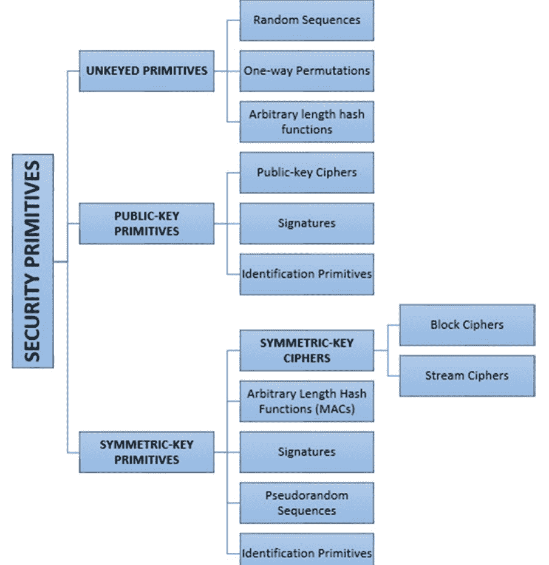
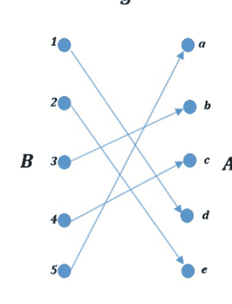
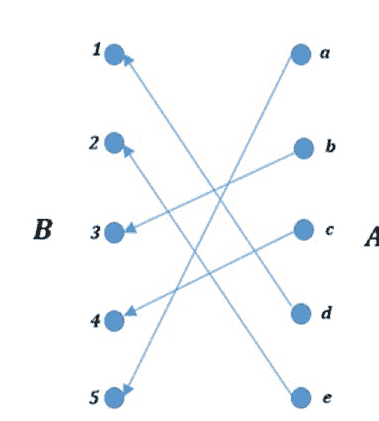
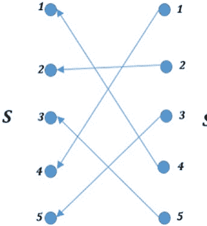
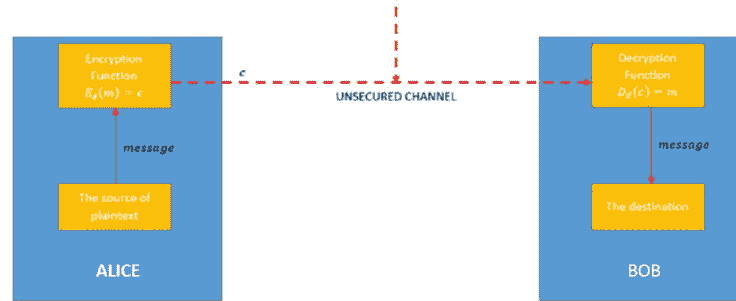
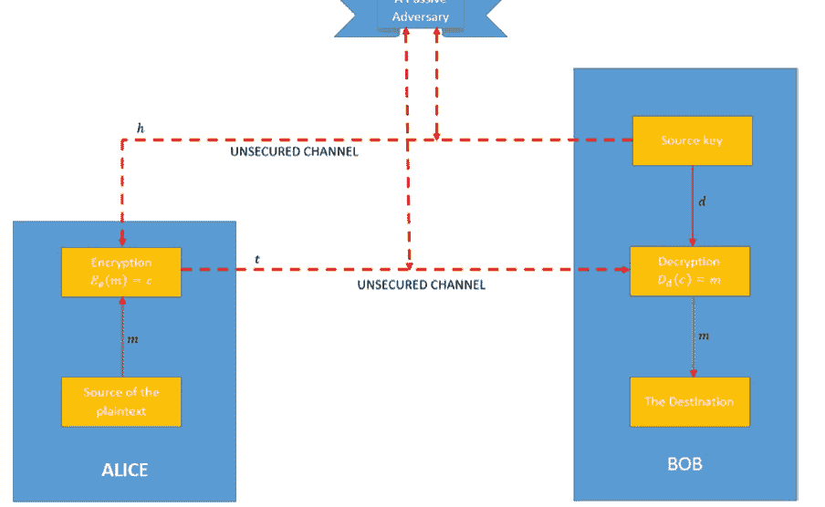
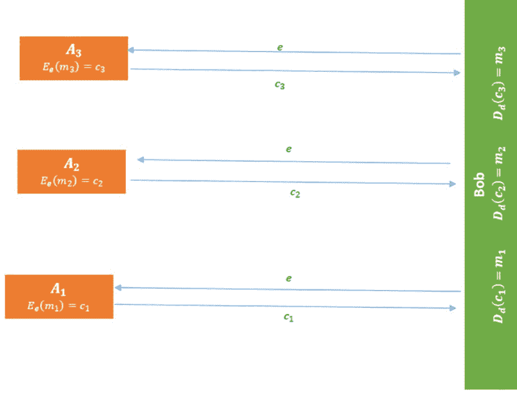
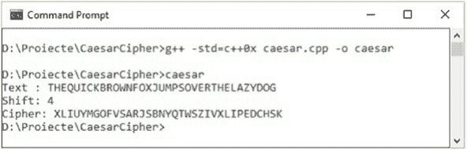
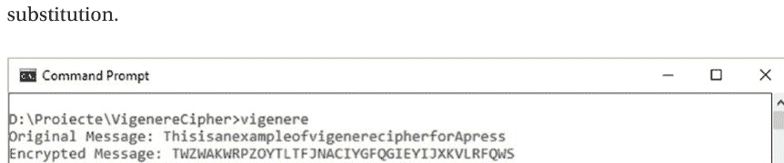

# 第 2 章

## 密码学
### 基础

密码学的历史极其漫长且引人入胜。一部伟大而全面的参考书是 2003 年出版的*密码全书：破译密码的秘密* [1]，它提供了非技术性的密码学历史。在书中，密码学的故事大约始于公元前 2000 年，当时埃及人首次（已知）使用密码学，并一直讲述到我们现在的时代。它介绍了所涵盖的每个时期密码学和信息隐藏的主要方面，并描述了密码学在两次世界大战中的巨大贡献。通常，密码学的艺术与外交、军事和政府相关联，因为其目的是保护敏感数据，如涉及国家安全的战略或秘密。

现代密码学的一个关键发展是 Diffie 和 Hellman 于 1976 年提出的工作论文*密码学新方向* [2]。该论文引入了一个改变人们对密码学看法的概念：公钥密码学。该论文的另一个重要贡献是创新的密钥交换方式；所提出的技术的安全性基于离散对数问题的困难性假设（基本上，通过困难性假设，我们指的是一个无法有效解决的问题）。尽管作者没有为其公钥加密方案提出实用的实现，但这个想法被非常清晰地提出，并开始受到国际密码学界的关注。

公钥加密方案的第一个实现是由 Rivest、Shamir 和 Adleman 于 1978 年完成的，他们提出并实现了他们的加密方案，即今天众所周知的 RSA [3]。RSA 中的困难性假设是大整数的因数分解。通过并行观察 RSA 的整数分解问题和 Shor 算法，请注意 Shor 算法对于量子计算机将以多项式时间运行。这代表了对于任何使用该困难性


对大整数因式分解的假设。因子分解问题日益增长的应用和兴趣导致了新的因子分解技术的出现。1980 年在这一领域取得了重要进展，但所提出的任何技术都未带来对 RSA 安全性的改进。另一类重要的实用公钥加密方案由 ElGamal [4] 于 1985 年设计。它基于离散对数问题的困难性假设。

公钥密码学中的另一个关键贡献是数字签名，该签名于 1991 年被国际标准 ISO/IEC 9796 采用 [5]。该标准的基石是 RSA 公钥加密方案。一种基于离散对数困难性假设的强大的数字签名方案是数字签名标准，该标准于 1994 年被美国政府采用。

如今，密码学的趋势包括设计和开发新的公钥方案，对现有密码机制进行改进，以及阐述安全性证明。

本书的目的是提供对实践中最重要密码学方面的原理、技术、算法和实现的最新更新的概览。我们将重点关注密码学的实际和应用方面。你将被警告有关困难的主题以及存在问题的主题。你将被引导至适当的参考资料，在那里你可以找到最佳实践和解决方案。书中介绍的大多数方面都将附带实现。这一目标是为了不掩盖密码学的真实本质。本书为实施者和研究人员提供了强有力的材料。本书描述了算法和软件系统及其交互。

## 信息安全与密码学

在本书中，我们将 *信息* 的术语和概念视为 *数量*。为了通过介绍密码学并展示其在呈现算法和实现技术（如 C++）方面的适用性，首先你需要对信息安全中经常出现的问题有背景知识。当发生特定交易时，参与该交易的所有各方必须确信（或得到保证）与信息安全相关的特定目标得以实现。安全目标的列表见表 2-1。

为了定义当信息以 *物理格式* 发送时（例如，文档）有关信息安全的问题，已经提出了几种协议和安全机制。有关信息安全的目标可以通过在需要保护的信息上应用数学算法或工作协议，以及遵循特定程序和法律来实现。物理文档保护的一个例子是密封的信封（保护机制），它覆盖着信件（需要保护的信息），由授权的邮政服务（可信方）递送。在此示例中，保护机制存在局限性，但技术框架有严格的规则，通过这些规则，任何未经授权打开信封的实体都可能受到惩罚。存在这样的情况，其中包含需要保护的信息的物理纸张本身可能具有证明数据/信息原创性的特殊特征。例如，为了防止银行券的伪造，纸币具有特殊墨水和材质。

**表 2-1。** *安全目标*

| 安全目标 | 描述 |
|---|---|
| **隐私/保密性** | 信息对未经授权的实体保密。 |
| **签名** | 一种将签名绑定到实体（例如，文档）的技术 |
| **授权** | 授权实体执行或成为某事物的行为，以便在发送方和接收方之间发送信息 |
| **消息认证** | 通过该过程/特征对数据的来源进行认证的过程；另一种含义是对信息来源的证实。 |
| **数据完整性** | 信息通过阻止未经授权的实体或未知手段的技术保持未被更改。 |
| **实体认证/识别** | 验证实体的身份的行为，该实体可能是计算机、个人、信用卡等。 |
| **验证** | 使可用（有限）数量的时间用于授权使用或操作数据或资源的行为 |
| **认证** | 由可信方确认信息的过程，或由可信认证对信息进行确认 |
| **访问控制** | 限制对资源的访问仅限于授权方的行为 |
| **时间戳** | 标记信息创建或存在的时间的元数据 |

## 表 2-1。 *(续)*

| 安全目标 | 描述 |
|---|---|
| **见证** | 由非数据创建者实体对信息创建/存在的验证行为 |
| **收据** | 确认接收信息的行为 |
| **所有权** | 将使用或转移特定信息/资源的法律权利授予实体的行为 |
| **确认** | 验证某些服务已完成的行为 |
| **撤销** | 撤回认证或授权的行为 |
| **不可否认性** | 限制对其他先前承诺或行为的否认的过程 |
| **匿名性** | 使参与特定操作/过程的实体的身份匿名化的行为 |

从概念上讲，信息是如何被操纵的并没有太大变化。我们在这里考虑的是存储、注册、解释和记录数据。然而，发生了显著变化的操纵是复制和修改信息。信息安全中的一个重要概念是 *签名*，它代表了更多过程的基础，例如不可否认性、数据来源认证、识别和见证。

为了实现电子通信中信息的安全性，应遵循法律和技术技能引入的要求。另一方面，并不能保证上述保护目标得到相应实现。信息安全的技术部分由密码学保证。

*密码学* 是研究与信息安全相关的数学技术和工具的领域，例如保密性、完整性（数据）、认证（实体）和认证的来源。密码学不仅提供信息的安全性，而且还提供一套特定的技术。

## 密码学目标

从表 2-1 中提出的安全目标来看，以下内容构成了可以推导出其他目标的基础：

- 隐私/保密性（定义 2.5 和 2.8）
- 数据完整性（定义 2.9）
- 认证（定义 2.7）
- 不可否认性（定义 2.6）

我们将详细解释这四个目标：

- *保密性* 是一种用于保护信息内容免受未经授权实体和访问的服务。保密性通过不同的技术得到保证，从使用数学算法到物理保护，将数据混淆成不可理解的形式。
- *数据完整性* 是一种防止信息被未经授权更改的服务。授权实体应具有发现和识别数据未经授权操纵的能力。
- *认证* 是一种在数据或应用程序被认证时发挥重要作用的服务。它意味着识别。认证过程应用于使用数据的两个端点（例如，发送方和接收方）。规则是每个参与方都应在通信过程中识别自己。非常重要的一点是，参与通信过程的双方应相互声明其身份（各方可以由个人或系统表示）。同时，数据的某些特征应伴随数据本身，例如其来源、内容、创建/发送时间等。从这个角度来看，密码学将认证分为两类：实体认证和数据来源认证。数据来源认证导致数据完整性。


- *不可否认性*是一种防止实体否认其先前行为的服务。当实体因否认其先前行为而发生冲突时，将由现有的可信第三方解决，该第三方将展示对数据所做的操作。

密码学的主要目标之一是在理论与实践两个方面实现上述四个目标。

## 密码学原语

在本书中，我们将介绍几种基础性的密码学工具，称为*原语*。原语的示例包括加密方案（定义 2.5 和 2.8）、哈希函数（定义 2.9）以及数字签名方案（定义 2.6）。图 2-1 给出了这些原语及其相互关系的示意描述。在本书中，我们将多次使用许多密码学原语，并且每次使用时都会提供实际实现。在真实应用中使用这些原语之前，应对其进行评估，以检查是否满足以下标准：

- **安全级别**：对安全级别进行量化略有难度。不过，可以将其量化为实现预期目标所需执行的操作次数。安全级别通常根据击败目标所需的工作量所给定的上界来定义。

- **功能性**：为实现安全目标，在许多情况下原语会被组合使用。你需要确保它们能正常工作。

- **操作方法**：使用原语时，它们需要不同的输入并具有不同的工作方式，从而产生不同的特性。在这些情况下，原语提供的功能差异很大，具体取决于操作模式。

- **性能**：这一概念与原语在特定操作模式下所能达到的效率有关。

- **易实现性**：这一概念与其说是一个标准，不如说是一个过程，指的是原语在实际中的使用情况。



## 图 2-1. 密码学原语分类

实际应用和可用资源赋予上述每项标准重要性。

密码学可以被视为一门由专业人士和专家实践的艺术，他们提出并开发了专门技术，目的是满足重要的信息安全需求。在过去的几十年里，密码学经历了

从艺术向科学和学科的转变。如今，在密码学和信息安全的许多领域都有专门的会议和活动。还有一些国际专业协会，例如国际密码研究协会（IACR），其目标是促进该领域取得最佳研究成果。

本书讲述密码学与密码分析，并使用 C++ 遵循标准实现算法和机制。

## 数学函数的背景

本书的目标不是成为一部关于抽象数学的专著。然而，熟悉一些基础数学概念是必要的，并且将在实际实现中非常有用。对密码学而言，最基础且最重要的概念之一是数学意义上的函数。函数在文献中也称为变换或映射。

## 函数：一对一、单向、陷门单向

让我们从集合这一概念入手。集合是一组不同的对象，这些对象称为该特定集合的元素。以下示例表示集合 A，其元素为 a、b、c，记为 A = {a, b, c}。

定义 2.1 [18]。密码学被定义为研究与信息安全各方面相关的数学技术的学科，这些方面包括机密性、数据完整性、实体认证和数据源认证。

定义 2.2 [18]。设两个集合 A 和 B 以及规则 f 定义一个函数。规则 f 将 A 中的每个元素赋予 B 中的一个元素。集合 A 称为刻画该函数的定义域，B 表示陪域。若 a 表示 A 中的一个元素，记作 a ∈ A，则 a 的像由借助规则 f 在 B 中对应的元素表示；a 的像 b 记作 b = f(a)。函数 f 从集合 A 到集合 B 的标准记法为 f: A → B。若 b ∈ B，则 b 有一个原像，即存在 a ∈ A 使得 f(a) = b。B 中至少有一个原像的所有元素构成的集合称为 f 的像，记作 Im(f)。

例 2.3（函数）。设集合 A = {a, b, c}，B = {1, 2, 3, 4}，从 A 到 B 的规则 f 定义为 f(a) = 2, f(b) = 4, f(c) = 1。图 2-2 展示了

该图表示思考函数的主要基本工具（在文献中可称之为函数图），如图 2-2 所示。定义域 A 中的每个元素恰好有一条从它出发的箭头。对于陪域 B 中的每个元素，可以有任意数量的箭头指向它（包括零条线）。

例 2.5（函数）。设集合 A = {1, 2, 3, …, 10⁵⁰}，并设 f 为规则 f(a) = rₐ，其中 rₐ 表示当 a² 除以 10⁵⁰ + 1 时的余数，对于所有 a ∈ A 成立。在这种情况下，像例 2.4 那样显式写出 f 是不可行的。尽管如此，该函数完全由定义域和刻画规则 f 的数学描述所确定。

## 一对一函数

定义 2.6 [18]。如果陪域 B 中的每个元素至多作为定义域 A 中一个元素的像，则称该函数或变换为 1 – 1（一对一）。

定义 2.7 [18]。如果陪域 B 中的每个元素都表示定义域中至少一个元素的像，则称该函数或变换为满射。同时，若 Im(f) = B，则函数 f: A → B 称为满射。

定义 2.8 [18]。设函数 f: A → B 既是 1 – 1 的，又满足 Im(f) = B。则称函数 f 为双射。

结论 2.9 [18]。如果 f: A → B 是 1 – 1 的，则 f: A → Im(f) 是一个双射。特殊情况下，如果 f: A → B 是 1 – 1 的，且 A 和 B 是大小相同的有限集合，则 f 是一个双射。

利用这种图示及其表示，如果 f 是双射，则 B 中的每个元素恰好有一条与它关联的线。例 2.3 和例 2.4 中的函数都不是双射。如例 2.3 所示，元素 3 不是定义域中任何元素的像。在例 2.4 中，陪域中的每个元素都有两个原像。

定义 2.10 [18]。如果 f 是从 A 到 B 的双射，那么定义从 B 到 A 的双射 g 是相当简单的：对于每个 b ∈ B，定义 g(b) = a，其中 a ∈ A 且 f(a) = b。函数 g 由 f 得到，称为 f 的反函数，记作 g = f⁻¹。





## 图 2-3. 双射 f 及其逆 g = f^{-1} 的表示

例 2.11（反函数）。设集合 A = {a, b, c, d, e} 和 Y = {1, 2, 3, 4, 5}，并设规则 f 由

图 2-3 中的连线给出和表示。f 是一个双射，其逆 g 通过反转箭头的方向形成。g 的定义域为 B，陪域为 A。

注意，如果 f 是双射，则 f⁻¹ 也是双射。密码学中的双射是用于消息加密的工具。逆变换用于解密。解密的主要条件是变换必须是双射。

## 单向函数

在密码学中，某些类型的函数起着重要作用。为了严谨起见，下面给出单向函数的定义。

定义 2.12 [18]。设函数 f 从集合 A 到集合 B，如果对所有 a ∈ A，计算 f(a) 简单容易，但对于 Im (f) 中“本质上所有”元素 b，设法找到任何 a ∈ A 使得 f(a) = b 在计算上是不可行的，则称 f 为单向函数。

注 2.13 [18]。本注提供了定义 2.12 中所用术语的一些补充说明和澄清。

- 1. 对于“容易”和“计算上不可行”这两个术语，虽然有必要给出严格定义，但这样做会分散对人们所认同的总体思想的注意力。就本章而言，简单直观的含义就足够了。
- 2. “本质上所有”一词表达的是：存在少数 b ∈ B 的值，使得容易找到 a ∈ A 满足 b = f(a)。例如，可以对少量 a 值计算 b = f(a)，然后通过查表获得这些值的逆。描述单向函数这一性质的另一种方式如下：对于任意随机的 b ∈ Im (f)，都能够在计算上可行地找到 a ∈ A 使得 f(a) = b。

下面的示例将展示单向函数背后的概念。

例 2.14（单向函数）。设 A = {1, 2, 3, ..., 16}，并定义 f(a) = rₐ 对所有 a ∈ A 成立，其中 rₐ 表示当 3ˣ 除以 17 时的余数。

| a | 1 | 2 | 3 | 4 | 5 | 6 | 7 | 8 | 9 | 10 | 11 | 12 | 13 | 14 | 15 | 16 |
|---|---|---|---|---|---|---|---|---|---|---|---|---|---|---|---|---|
| f(a) | 3 | 9 | 10 | 13 | 5 | 15 | 11 | 16 | 14 | 8 | 7 | 4 | 12 | 2 | 6 | 1 |


假设我们有一个位于 1 到 16 之间的数字。我们可以看到，很容易找到它在 f 下的像。没有表格在面前，例如，对于 7，很难找到一个使得 f(a) = 7 的 a。如果给你的数字是 3，那么很容易看出 a = 1 就是你实际需要的。

请记住，这个例子关注的是非常小的数字。这里的关键在于，测量 f(a) 所需的努力与给定 f(a) 时寻找 a 所需的工作量是不同的。此外，对于大数，f(a) 可以使用平方乘法算法 [20] 高效计算，而从 f(a) 寻找 a 的过程则更难找到。

例 2.15 [18]。（单向函数）素数定义为正整数。该整数大于 1 且其正整数除数是 1 和它本身。让我们考虑素数 p = 50633 和 q = 58411，计算 n = pq = 50633 · 58411 = 2957524163，并考虑 A = {1, 2, 3, …, n − 1}。我们将在 A 上定义一个函数 f，f(a) = r_a 对每个 a ∈ A，其中 r_a 表示 x³ 除以 n 时的余数。例如，让我们考虑 f(2489991) = 1981394214 因为 2489991³ = 5881949859 · n + 1981394214。计算 f(a) 代表一件简单的事情，但反转该过程却相当困难。

## Trapdoor One-Way Functions

定义 2.16 [18]。陷门单向函数表示为单向函数 f: A → B，具有额外属性，即通过拥有信息（也称为陷门信息）将更容易对任意给定的 b ∈ Im(f) 进行识别，找到 a ∈ A 使得 f(a) = b。

例 2.15 显示了陷门单向函数的概念。有了关于 n = 2957524163 的因子的额外信息，反转该函数变得容易得多。2957524163 的因子足够大，以至于手工计算很难识别它们。我们应该能够借助计算机程序非常容易地识别因子。例如，如果我们有非常大且不同的素数（每个数约有 200 位十进制数字）p 和 q，以今天的技术，从 n 找到 p 和 q 即使使用最强大的量子计算机也很困难。这是众所周知的因式分解问题，被称为整数因式分解问题。

单向和单向陷门函数构成了公钥密码学的根本基础。这些原则非常重要，并且在你探索密码技术实现时将会变得更加清晰。理解本节中的这些概念至关重要且重要，因为它们是本章后面实现的密码算法的主要方法和主要基础。

## Permutations

置换代表密码构造中的函数。

定义 2.17 [18]。设 S 为由元素构成的有限集合。S 上的置换 p 表示如定义 2.8 中定义的双射。该双射表示从 S 到自身，p : S → S。

例 2.18 [18]。此示例代表置换示例。让我们考虑以下置换：S = {1, 2, 3, 4, 5}。置换 p : S → S 定义为

p(1) = 2, p(2) = 5, p(3) = 4, p(4) = 2, p(5) = 1

置换可以用不同的方式描述。它可以写成上面那样，或写成数组形式，如

p = (1 2 3 4 5; 3 5 4 2 1),

其中数组的顶行由定义域表示，底行由 p 下的像作为映射表示。

由于置换是双射，它们有逆。如果置换写成数组（第二种形式），其逆可以通过交换数组中的行并相应地重新排序新顶行和底行的元素来轻松找到。在这种情况下，p 的逆定义如下：

p⁻¹ = (1 2 3 4 5; 5 4 1 3 2)

例 2.19 [18]。此示例代表置换示例。让我们考虑 A 为整数集合 {0, 1, 2, ..., p · q − 1}，其中 p 和 q 代表两个不同的大素数。我们还需要假设 p − 1 和 q − 1 都不能被 3 整除。函数 p(a) = rₐ，其中 rₐ 表示 a³ 除以 p q 时的余数，可以被证明并显示为逆置换。逆置换在计算上对今天的计算机来说是不可行的，除非已知 p 和 q。

## Involutions

对合已知为具有自身逆的函数。

**定义 2.20 [18].** 设 \(S\) 为有限集，\(f\) 定义为 \(S\) 到 \(S\) 的双射，记为 \(f:S\to S\)。在这种情况下，函数 \(f\) 将被记为 *对合* 如果 \(f=f^{-1}\)。另一种定义方式是 \(f(f(a))=a\) 对任意 \(a\in S\)。

**例 2.21 [18].** 此示例代表对合情况。图 2-4 显示了对合的示例。请注意，如果 \(j\) 是 \(i\) 的像，则 \(i\) 是 \(j\) 的像。



## Concepts and Basic Terminology

当处理该领域的科学方面时，使用难以理解的硬性抽象定义来理解密码是如何构建的非常困难。在以下各节中，我们将列出本章中使用最重要的术语和关键概念。

## Domains and Codomains Used for Encryption

- \(\mathcal{A}\) 显示为有限集，称为 *定义字母表*。我们将考虑 \(\mathcal{A}=\{0,1\}\) 作为示例，它代表二进制字母表，一个经常用作定义的字母表。
- \(\mathcal{M}\) 是称为 *消息空间* 的集合。消息空间具有来自字母表 \(\mathcal{A}\) 的符号字符串。作为示例，\(\mathcal{M}\) 可能具有二进制字符串、英文文本、法文文本等。



# 图 2-5. 应用加密的双方通信过程示例

## Digital Signatures

在本书中，我们将处理的另一种技术是数字签名。数字签名在某些过程中非常重要，如身份验证、授权或不可否认性。数字签名用于将个人的身份与信息片段映射。当“某物”被数字签名时，意味着消息和个人拥有的机密信息被转换为称为签名的标签。

签名过程的组成部分为

- ℳ 是可以被签名的消息集合。
- 𝒮 是签名的集合。它们可以具有预定义长度的二进制字符串形式。
- 𝒮_A 代表 ℳ 与 𝒮 之间的转换，称为签名转换，由实体 A 完成。实体将保持 𝒮_A 秘密并用它来签名来自 ℳ 的消息。
- V_A 是 ℳ×𝒮 到集合 {true,false} 之间的转换。笛卡尔积 ℳ×𝒮 包含元素对 (m,s)，其中 m∈ℳ 且 s∈𝒮。转换 V_A 是公开的，并被不同实体用于检查签名是否由实体 A 创建。

### Signing Process

实体 A，称为签名者，为特定消息 m ∈ M 创建签名 s ∈ S，按以下步骤进行：

- 计算 s = S_A(m)。
- 将对 (m, s) 传输给期望的接收者。

### Verification Process

当接收实体 B 想检查实体 A 是否为消息 m 创建了签名 s 时，它按如下操作进行：

- 获取实体 A 的验证函数 V_A。
- 计算 u = V_A(m, s)。
- 如果 u = true，则签名由实体 A 创建；如果 u = false，则签名未由实体 A 创建。

## Public-Key Cryptography

公钥密码学（PKC）在 C++ 中具有重要作用，当需要合并类似算法时。许多重要的商业库实现了开发者特定的公钥密码学解决方案，如 [21-30]。

接下来，你将看到公钥密码学的工作方式。为此，请回忆 K 是密钥空间。让我们考虑加密转换的集合为 {E_e : e ∈ K} 和解密转换的集合为 {D_d : d ∈ K}。此外，让我们考虑加密和解密转换的对为 (E_e, D_d)，其中 E_e 可以被任何人学习，对每个 e。从 E_e 来确定 D_d 必须在计算上不可实现；换句话说，从随机密文 c ∈ C 不可能找出消息 m ∈ M，使得 E_e(m) = c。该属性很强，这意味着相应的解密密钥 d（必须保密/私有）不能从给定的 e（公开）计算/确定。

在上述设置下，查看图 2-6 并让我们考虑两个参与方，即 Alice 和 Bob 之间的通信信道。


-   鲍勃选择一对密钥，$(e, d)$。
-   鲍勃将加密密钥 $e$ 公开，让爱丽丝可以通过任何渠道访问它，并将解密密钥 $d$ 秘密且安全地保存。在专业文献中，PKC 的加密密钥被称为公钥，解密密钥被称为秘密/私钥。
-   当爱丽丝想要向鲍勃发送消息 $m \in \mathcal{M}$ 时，她使用鲍勃的公钥 $e$ 来确定加密变换 $E_e$，并将其应用于 $m$。最后，爱丽丝得到密文 $c = E_e(m) \in \mathcal{C}$ 并发送给鲍勃。
-   当鲍勃想要解密收到来自爱丽丝的密文 $c \in \mathcal{C}$ 时，他使用自己的私钥 $d$ 来确定解密变换 $D_d$，并将其应用于 $c$。最后，他得到 $m = D_d(c) \in \mathcal{M}$。



图 2-6. 使用公钥机制的加密过程

无需对加密密钥 $e$ 保密；它可以公开。这样，任何人都可以向鲍勃发送加密消息，而这些消息只能由鲍勃解密。图 2-7 说明了这一思想，其中 A₁、A₂ 和 A₃ 代表不同的实体。请记住，如果 A₁ 在将消息 m₁ 加密为 c₁ 后销毁了 m₁，那么即使 A₁ 也无法从 c₁ 中恢复 m₁。

让我们用下面的类比来简单说明。考虑一个金属盒子，其盖子由一把带有特定密码组合的锁固定。鲍勃是唯一知道如何打开这把锁的人。如果锁保持打开状态并向公众开放用于不同目的，那么有人可以把消息放进去并锁上锁。



图 2-7. 公钥加密的使用方式

## 哈希函数

哈希函数是现代密码学中的主要原语之一。哈希函数又称单向哈希函数，是一种计算高效的函数，它将任意长度的二进制字符串映射为固定长度的二进制字符串，即哈希值。

作为哈希函数实现的一个示例（SHA-256，见图 2-8），我们将研究以下使用 C++20 新特性的 C++ 实现（见清单 2-1）。该实现符合 NIST 标准²。

```
Command Prompt
D:\Proiecte\SHA256>g++ -std=c++0x sha256.cpp -o sha256
D:\Proiecte\SHA256>sha256 thequickbrownfoxjumpsoverthelazydog
---- The current State of the Block ----
block[0] binary: 01110100      hex val: 0x00000074
block[1] binary: 01101000      hex val: 0x00000068
block[2] binary: 01100101      hex val: 0x00000065
block[3] binary: 01110001      hex val: 0x00000071
block[4] binary: 01110101      hex val: 0x00000075
block[5] binary: 01101001      hex val: 0x00000069
block[6] binary: 01100011      hex val: 0x00000063
block[7] binary: 01101011      hex val: 0x0000006b
block[8] binary: 01100010      hex val: 0x00000062
block[9] binary: 01110010      hex val: 0x00000072
block[10] binary: 01101111      hex val: 0x0000006f
block[11] binary: 01110111      hex val: 0x00000077
block[12] binary: 01101110      hex val: 0x0000006e
block[13] binary: 01100110      hex val: 0x00000066
block[14] binary: 01101111      hex val: 0x0000006f
block[15] binary: 01111000      hex val: 0x00000078
block[16] binary: 01101010      hex val: 0x0000006a
block[17] binary: 01110101      hex val: 0x00000075
block[18] binary: 01101101      hex val: 0x0000006d
block[19] binary: 01110000      hex val: 0x00000070
block[20] binary: 01110011      hex val: 0x00000073
block[21] binary: 01101111      hex val: 0x0000006f
block[22] binary: 01110110      hex val: 0x00000076
block[23] binary: 01100101      hex val: 0x00000065
block[24] binary: 01110010      hex val: 0x00000072
block[25] binary: 01110100      hex val: 0x00000074
block[26] binary: 01101000      hex val: 0x00000068
block[27] binary: 01100101      hex val: 0x00000065
block[28] binary: 01101000      hex val: 0x0000006c
block[29] binary: 01100001      hex val: 0x00000061
block[30] binary: 01111010      hex val: 0x0000007a
block[31] binary: 01111001      hex val: 0x00000079
block[32] binary: 01100100      hex val: 0x00000064
block[33] binary: 01101111      hex val: 0x0000006f
block[34] binary: 01100111      hex val: 0x00000067
block[35] binary: 10000000      hex val: 0x00000080
3453a0a7f1e11fc6e9e0e8071193dea04eaf96cbfe4318539859876aa85fb15
D:\Proiecte\SHA256>
```

图 2-8. SHA-256 执行示例

## 清单 2-1. SHA256 实现的源代码

```
#include <iostream>      //** standard input/output library
#include <sstream>      //** templates and types for interoperation
                      //** between flow buffers and string objects
#include <bitset>       //** storing bits library
#include <vector>       //** for representing arrays as containers
#include <iomanip>      //** for manipulation of the parameters
#include <cstring>      //** for manipulation of the strings

using namespace std;    //** for avoiding writing "std::"

//** ASCII string will be converted as a binary representation
vector<unsigned long> binaryConversion(const string);

//** for adding padding to messages and making sure that they are
//** multiple of 512 bits
vector<unsigned long> addPadOf512Bits(const vector<unsigned long>);

//** We will change the n 8 bit blocks to 32 bits words
vector<unsigned long> resizingTheBlock(vector<unsigned long>);

//** will contain the actual hash value
string computingTheHash(const vector<unsigned long>);

//** variables and constants using during debugging
string displayAsHex(unsigned long);
void outputTheBlockState(vector<unsigned long>);
string displayAsBinary(unsigned long);
const bool displayBlockStateAddOne = 0;
const bool displayDistanceFrom512Bit = 0;
const bool displayResultsOfPadding = false;
const bool displayWorkVariablesForT = 0;
const bool displayT1Computation = false;
const bool displayT2Computation = false;
const bool displayTheHashSegments = false;
const bool displayWt = false;
```

```
//** defined in accordance with the NIST standard
#define ROTRIGHT(word,bits) (((word) >> (bits)) | ((word) << (32-(bits))))
#define SSIG0(x) (ROTRIGHT(x,7) ^ ROTRIGHT(x,18) ^ ((x) >> 3))
#define SSIG1(x) (ROTRIGHT(x,17) ^ ROTRIGHT(x,19) ^ ((x) >> 10))
#define CH(x,y,z) (((x) & (y)) ^ (~(x) & (z)))
#define MAJ(x,y,z) (((x) & (y)) ^ ((x) & (z)) ^ ((y) & (z)))

//** in accordance with the latest updates of the NIST standard
//** we will replace BSIG0 with EP0 and BSIG1 with EP0 in our
//** implementation
#define BSIG0(x) (ROTRIGHT(x,7) ^ ROTRIGHT(x,18) ^ ((x) >> 3))
#define BSIG1(x) (ROTRIGHT(x,17) ^ ROTRIGHT(x,19) ^ ((x) >> 10))

#define EP0(x) (ROTRIGHT(x,2) ^ ROTRIGHT(x,13) ^ ROTRIGHT(x,22))
#define EP1(x) (ROTRIGHT(x,6) ^ ROTRIGHT(x,11) ^ ROTRIGHT(x,25))

//** we will verify if the process of checking (testing) is enabled
//** by the missed arguments in the command line.
//** The steps are as follows:
//** (1) Take the ascii string and convert it in n 8 bit segments by
//** representing the ascii value of each independently character
//** (2) add paddings to the message in order to get a 512 bit long
//** (3) take separately each 8 bit ascii value and convert it to 32
//** bit words and create a combination of them.
//** (4) calculate the hash and get the value
//** (5) if we are doing test, take the result and compare it with
//** expected result
int main(int argc, char* argv[])
{
    string theMessage = "";
    bool testing = 0;

    switch (argc) {
        case 1:
            cout << "There is no input string found. The test will be run using random first three letters abc.\n";
            theMessage = "abc";
            testing = true;
```

```
//** if testing is found on true the software app will execute
//** a self check by checking if the hash value computed for
//** "abc" is equal with the expected hash
if (testing) {
    const string theCorrectHashForABC =
    "ba7816bf8f01cfea414140de5dae2223b00361a3961
    77a9cb410ff61f20015ad";
    if (theCorrectHashForABC.compare(myHash) != 0) {
        cout << "\tThe test didn't occur with success!\n";
        return(1); }
    else {
        cout << "\tTest has been done with success!\n";
        return(0); } }

cout << myHash << endl;
return 0; }

//** the function purpose is to resize the blocks from 64 and 8 bit
//** to 16 and 32 bit sections. The function as input will take a
//** vector of individual 8 bit ascii values. As output we will get a
//** vector with 32 bit words that are found within a combination of
//** ascii values.
vector<unsigned long> resizingTheBlock(vector<unsigned long>
inputOf8BitAsciiValues)
{
    vector<unsigned long>
outputOf32BitWordsCombinedAsAsciiValues(16);

    //** parse all 64 sections using a 4 step and merge them
//** accordingly
    for(int i = 0; i < 64; i = i + 4) {
        //** create for beginning a big 32 bit section first
        bitset<32> temporary32BitSection(0);
```


# 第 2 章 密码学基础

```cpp
/** create a shifting of the blocks on their assigned
/** positions
        temporary32BitSection = (unsigned long)
inputOf8BitAsciiValues[i] << 24;
temporary32BitSection |= (unsigned long)
inputOf8BitAsciiValues[i + 1] << 16;
        temporary32BitSection |= (unsigned long)
inputOf8BitAsciiValues[i + 2] << 8;
        temporary32BitSection |= (unsigned long)
inputOf8BitAsciiValues[i + 3];
        /** set the new 32 bit word within the proper output of
/** the array location
        outputOf32BitWordsCombinedAsAsciiValues[i/4] =
        temporary32BitSection.to_ulong(); }

    return outputOf32BitWordsCombinedAsAsciiValues; }

/** the function display the contents of all the blocks as binary
/** format. The function is used only for debugging purpose.
void outputTheBlockState(vector<unsigned long>
vectorOfCurrentBlocks) {
        cout << "---- The current State of the Block ----\n";
        for (int i = 0; i < vectorOfCurrentBlocks.size(); i++) {
                cout << "block[" << i << "] binary: " <<
displayAsBinary(vectorOfCurrentBlocks[i])
                << "    hex y: 0x" <<
displayAsHex(vectorOfCurrentBlocks[i]) << endl; }}

/** the function will display in hex format the content of the
/** blocks.
string displayAsHex(unsigned long input32BitBlock) {
        bitset<32> theBitSet(input32BitBlock);
        unsigned number = theBitSet.to_ulong();

        stringstream theStringStream;
        theStringStream << std::hex << std::setw(8) <<
std::setfill('0') << number;
```

```
string temporary;
theStringStream >> temporary;

return temporary; }

//** the function will show the content of the blocks in hex. We are
//** using this function in order to avoid changing the stream from
//** hexa to dec and reversed as well.
string displayAsBinary(unsigned long input320OrLessBitBlock) {
    bitset<8> theBitSet(input320OrLessBitBlock);
    return theBitSet.to_string(); }

//** based on the string, it will take the entire set of the
//** characters and converts them into ascii binary.
vector<unsigned long> binaryConversion(const string
inputOfAnyLength) {
    //** the vector used to store all the ascii characters
    vector<unsigned long> vectorBlockHoldingAsciiCharacters;

    //** take each character and convert the ascii character to
    //** the binary representation
    for (int i = 0; i < inputOfAnyLength.size(); ++i) {
        //** create a temporary variable. Use it to store the 8
        //** bit template for ascii value
        bitset<8> bitSetOf8Bits(inputOfAnyLength.c_str()[i]);

        //** the template of 8 bit add it into the block
        vectorBlockHoldingAsciiCharacters.
        push_back(bitSetOf8Bits.to_ulong());}

    return vectorBlockHoldingAsciiCharacters; }

//** get the ascii values stored as a vector in binary and add padding to
it in order to obtain a total of 512 bits.
vector<unsigned long> addPadOf512Bits(vector<unsigned long>
vectorBlockHoldingAsciiCharacters) {
    //** you can keep the variables names as given in the NIST
    //** for our implementation I have used my personal names for
    //** variables in order to get a uniqueness of the code
```

```
//** the variable will store the length of the message in bits
int lengthOfMessageInBits = vectorBlockHoldingAsciiCharacters.size() * 8;

    int zeroesToAdd = 447 - lengthOfMessageInBits;

//** add another 8 bit block with the first bit being set to 1
    if(displayBlockStateAddOne)
        outputTheBlockState(vectorBlockHoldingAsciiCharacters);

    unsigned long t1Block = 0x80;
    vectorBlockHoldingAsciiCharacters.push_back(t1Block);

    if(displayBlockStateAddOne)
        outputTheBlockState(vectorBlockHoldingAsciiCharacters);
        outputTheBlockState(vectorBlockHoldingAsciiCharacters);

    //** we have 7 zeroes. We will need to substract 7 from
//** zeroesToAdd
    zeroesToAdd = zeroesToAdd - 7;

    //** debug mode. Find how much we need to get close to 512 bit
    if (displayDistanceFrom512Bit) {
        cout << "lengthOfMessageInBits = " <<
lengthOfMessageInBits << endl;
        cout << "zeroesToAdd = " << zeroesToAdd + 7 << endl; //
Plus 7 so this follows the paper. }

    //** debug mode
    if (displayDistanceFrom512Bit)
        cout << "adding " <<
zeroesToAdd / 8 << " empty eight bit blocks!\n";

//** add blocks of 8 bit length that will contains zero's
    for(int i = 0; i < zeroesToAdd / 8; i++)
        vectorBlockHoldingAsciiCharacters.push_back(0x00000000);

    //** we are finding ourself in 488 bits out 512 phase. Next
//** step is adding 1 in the binary representation in order to
//** form of eight bit blocks.
```

```
bitset<64> theBig64BlobBit(lengthOfMessageInBits);
if (displayDistanceFrom512Bit)
    cout << "l in a 64 bit binary blob: \n\t" <<
theBig64BlobBit << endl;

//** divide the 64 bit big into 8 bit segments
string big_64bit_string = theBig64BlobBit.to_string();

//** take the first block and push it on the 56 position
bitset<8> temp_string_holder1(big_64bit_string.substr(0,8));
vectorBlockHoldingAsciiCharacters.
push_back(temp_string_holder1.to_ulong());

//** take the rest of the blocks with 8 bits length and push
for(int i = 8; i < 63; i=i+8)    {
    bitset<8>
temporaryStringHolder2(big_64bit_string.substr(i,8));
vectorBlockHoldingAsciiCharacters.
push_back(temporaryStringHolder2.to_ulong()); }

//** just show in the console everything in order to know what
//** is happening in this freakin code
if (displayResultsOfPadding)    {
    cout << "Current 512 bit pre-processed hash in binary: \n";
    for(int i = 0; i < vectorBlockHoldingAsciiCharacters.size();
    i=i+4)
        cout << i << ": " << displayAsBinary(vectorBlockHolding
AsciiCharacters[i]) << "      "
        << i + 1 << ": " << displayAsBinary(vectorBlock
HoldingAsciiCharacters[i+1]) << "      "
        << i + 2 << ": " << displayAsBinary(vectorBlock
HoldingAsciiCharacters[i+2]) << "      "
        << i + 3 << ": " << displayAsBinary(vectorBlockHoldingAsciiCharacters[i+3]) << endl;

cout << "Current 512 bit pre-processed hash in hex: \n";
for(int i = 0; i < vectorBlockHoldingAsciiCharacters.size(); i=i+4)
```

```
cout << i << ": " << "0x" + displayAsHex(vectorBlockHoldingAsciiCharacters[i]) << "      "
    << i + 1 << ": " << "0x" + displayAsHex(vectorBlockHoldingAsciiCharacters[i+1]) << "      "
    << i + 2 << ": " << "0x" + displayAsHex(vectorBlockHoldingAsciiCharacters[i+2]) << "      "
    << i + 3 << ": " << "0x" + displayAsHex(vectorBlockHoldingAsciiCharacters[i+3]) << endl; }
return vectorBlockHoldingAsciiCharacters; }

/** the goal of the function is to compute the hash of the message
string computingTheHash(const vector<unsigned long>
blockOf512BitPaddedMessage)
{

    /** the following words are from the NIST standard.
    unsigned long constantOf32BitWords[64] = {
    0x428a2f98,0x71374491,0xb5c0fbcf,0xe9b5dba5,0x3956c25b,0x59f111f1,
    0x923f82a4,0xab1c5ed5,0xd807aa98,0x12835b01,0x243185be,0x550c7dc3,
    0x72be5d74,0x80deb1fe,0x9bdc06a7,0xc19bf174,0xe49b69c1,0xefbe4786,
    0x0fc19dc6,0x240ca1cc,0x2de92c6f,0x4a7484aa,0x5cb0a9dc,0x76f988da,
    0x983e5152,0xa831c66d,0xb00327c8,0xbf597fc7,0xc6e00bf3,0xd5a79147,
    0x06ca6351,0x14292967,0x27b70a85,0x2e1b2138,0x4d2c6dfc,0x53380d13,
    0x650a7354,0x766a0abb,0x81c2c92e,0x92722c85,0xa2bfe8a1,0xa81a664b,
    0xc24b8b70,0xc76c51a3,0xd192e819,0xd6990624,0xf40e3585,0x106aa070,
    0x19a4c116,0x1e376c08,0x2748774c,0x34b0bcb5,0x391c0cb3,0x4ed8aa4a,
    0x5b9cca4f,0x682e6ff3,0x748f82ee,0x78a5636f,0x84c87814,0x8cc70208,
    0x90befffa,0xa4506ceb,0xbef9a3f7,0xc67178f2 };

    /** the initial hash values
    unsigned long static InitialHashValueFor32Bit_0 = 0x6a09e667;
    unsigned long static InitialHashValueFor32Bit_1 = 0xbb67ae85;
    unsigned long static InitialHashValueFor32Bit_2 = 0x3c6ef372;
    unsigned long static InitialHashValueFor32Bit_3 = 0xa54ff53a;
    unsigned long static InitialHashValueFor32Bit_4 = 0x510e527f;
    unsigned long static InitialHashValueFor32Bit_5 = 0x9b05688c;
    unsigned long static InitialHashValueFor32Bit_6 = 0x1f83d9ab;
    unsigned long static InitialHashValueFor32Bit_7 = 0x5be0cd19;
```


```cpp
if ((t == 20) & displayT1Computation) {
    cout << "h: 0x" << hex << h << "  dec:" << dec << h
         << "  sign:" << dec << (int)h << endl;
    cout << "EP1(e): 0x" << hex << EP1(e) << "  dec:"
         << dec << EP1(e) << "  sign:" << dec << (int)EP1(e)
         << endl;
    cout << "CH(e,f,g): 0x" << hex << CH(e,f,g) << "  dec:"
         << dec << CH(e,f,g) << "  sign:" << dec
         << (int)CH(e,f,g) << endl;
    cout << "constantOf32BitWords[t]: 0x" << hex
         << constantOf32BitWords[t] << "  dec:" << dec
         << constantOf32BitWords[t] << "  sign:" << dec
         << (int)constantOf32BitWords[t] << endl;
    cout << "Word[t]: 0x" << hex << Word[t]
         << "  dec:" << dec << Word[t] << "  sign:" << dec
         << (int)Word[t] << endl;
    cout << "temporary_1 = 0x" << hex << temporary_1
         << "  dec:" << dec
         << temporary_1 << "  sign:" << dec << (int)temporary_1 << endl;
}

//** according to the NIST Standard and Specification,
//** the BSIG0 is incorrect. We will replace it with EP0
temporary_2 = EP0(a) + MAJ(a, b, c);

//** in order to get T2 we will display the variables
//** and operations
if ((t == 20) & displayT2Computation) {
    cout << "a: 0x" << hex << a << "  dec:" << dec << a
         << "  sign:" << dec << (int)a << endl;
    cout << "b: 0x" << hex << b << "  dec:" << dec << b
         << "  sign:" << dec << (int)b << endl;
    cout << "c: 0x" << hex << c << "  dec:" << dec << c
         << "  sign:" << dec << (int)c << endl;
    cout << "EP0(a): 0x" << hex << EP0(a) << "  dec:"
         << dec << EP0(a) << "  sign:" << dec << (int)EP0(a)
         << endl;
    cout << "MAJ(a,b,c): 0x" << hex
         << MAJ(a, b, c) << "  dec:"
         << dec << MAJ(a, b, c) << "  sign:" << dec
         << (int)MAJ(a, b, c) << endl;
    cout << "temporary_2 = 0x" << hex << temporary_2
         << "  dec:" << dec
         << temporary_2 << "  sign:" << dec << (int)temporary_2 << endl;
}

//** according to the NIST standard
h = g;
g = f;
f = e;

//** Get the guarantee that we are still using 32 bits
e = (d + temporary_1) & 0xFFFFFFFF;
d = c;
c = b;
b = a;

//** Get the guarantee that we are still using 32 bits
a = (temporary_1 + temporary_2) & 0xFFFFFFFF;

//** display the content of each of the variables from
//** above according to the NIST standard.
if (displayWorkVariablesForT) {
    cout << "t= " << t << " ";
    cout << displayAsHex(a) << " " << displayAsHex(b)
         << " " << displayAsHex(c) << " " << displayAsHex(d) << " "
         << displayAsHex(e) << " " << displayAsHex(f) << " "
         << displayAsHex(g) << " " << displayAsHex(h) << " " << endl;
}

//** display the content of each of the hash segment
if (displayTheHashSegments) {
    cout << "InitialHashValueFor32Bit_0 = " << displayAsHex
         (InitialHashValueFor32Bit_0) << " + " << displayAsHex(a) << " " <<
         displayAsHex(InitialHashValueFor32Bit_0 + a) << endl;

    cout << "InitialHashValueFor32Bit_1 = " << displayAsHex
         (InitialHashValueFor32Bit_1) << " + " <<
         displayAsHex(b) << " " << displayAsHex
         (InitialHashValueFor32Bit_1 + b) << endl;

    cout << "InitialHashValueFor32Bit_2 = " << displayAsHex
         (InitialHashValueFor32Bit_2) << " + " <<
         displayAsHex(c) << " " << displayAsHex
         (InitialHashValueFor32Bit_2 + c) << endl;

    cout << "InitialHashValueFor32Bit_3 = " << displayAsHex
         (InitialHashValueFor32Bit_3) << " + " <<
         displayAsHex(d) << " " << displayAsHex
         (InitialHashValueFor32Bit_3 + d) << endl;

    cout << "InitialHashValueFor32Bit_4 = " << displayAsHex
         (InitialHashValueFor32Bit_4) << " + " <<
         displayAsHex(e) << " " << displayAsHex
         (InitialHashValueFor32Bit_4 + e) << endl;

    cout << "InitialHashValueFor32Bit_5 = " << displayAsHex
         (InitialHashValueFor32Bit_5) << " + " <<
         displayAsHex(f) << " " << displayAsHex
         (InitialHashValueFor32Bit_5 + f) << endl;

    cout << "InitialHashValueFor32Bit_6 = " << displayAsHex
         (InitialHashValueFor32Bit_6) << " + " <<
         displayAsHex(g) << " " << displayAsHex
         (InitialHashValueFor32Bit_6 + g) << endl;

    cout << "InitialHashValueFor32Bit_7 = " << displayAsHex
         (InitialHashValueFor32Bit_7) << " + " << displayAsHex
         (h) << " " << displayAsHex(InitialHashValueFor32Bit_7
         + h) << endl;
}

//** for each hash add all the variables in order to be sure that
//** we are still on the page with the 32 bit values
InitialHashValueFor32Bit_0 = (InitialHashValueFor32Bit_0 + a) & 0xFFFFFFFF;
InitialHashValueFor32Bit_1 = (InitialHashValueFor32Bit_1 + b) & 0xFFFFFFFF;
InitialHashValueFor32Bit_2 = (InitialHashValueFor32Bit_2 + c) & 0xFFFFFFFF;
InitialHashValueFor32Bit_3 = (InitialHashValueFor32Bit_3 + d) & 0xFFFFFFFF;
InitialHashValueFor32Bit_4 = (InitialHashValueFor32Bit_4 + e) & 0xFFFFFFFF;
InitialHashValueFor32Bit_5 = (InitialHashValueFor32Bit_5 + f) & 0xFFFFFFFF;
InitialHashValueFor32Bit_6 = (InitialHashValueFor32Bit_6 + g) & 0xFFFFFFFF;
InitialHashValueFor32Bit_7 = (InitialHashValueFor32Bit_7 + h) & 0xFFFFFFFF;

//** add the hash section in one piece one after the other in
//** order to obtain the 256 bit hash
return displayAsHex(InitialHashValueFor32Bit_0) +
       displayAsHex(InitialHashValueFor32Bit_1) +
       displayAsHex(InitialHashValueFor32Bit_2) +
       displayAsHex(InitialHashValueFor32Bit_3) +
       displayAsHex(InitialHashValueFor32Bit_4) +
       displayAsHex(InitialHashValueFor32Bit_5) +
       displayAsHex(InitialHashValueFor32Bit_6) +
       displayAsHex(InitialHashValueFor32Bit_7);
}
```

哈希函数通常用于数字签名和数据完整性。在处理数字签名时，长消息通常会被哈希，而只有哈希值会被签名。接收消息的各方随后会对收到的消息进行哈希，并检查收到的签名是否对该哈希值正确。下面可以看到带密钥的密码学哈希函数的分类（见表 2-2）和不带密钥的密码学哈希函数的分类（见表 2-3）。大多数函数已在 NIST 标准或其他可信资源中以 C++ 实现，例如 CrypTool³。

## 表 2-2. 带密钥的密码学哈希函数

| 名称 | 标签长度 | 类型 | 参考文献 |
|---|---|---|---|
| BLAKE2 | 任意 | 带前缀-MAC 的带密钥哈希函数 | [31][42] |
| BLAKE3 | 任意 | 带提供初始化向量（IV）的带密钥哈希函数 | [32] |
| HMAC | - | - | [33] |
| KMAC | 任意 | 基于 Keccak | [34][35] |
| MD6 | 512 bits | 带有 NLFSR 的 Merkle 树 | [37] |
| PMAC | - | - | [38] |
| UMAC | - | - | [39] |

## 表 2-3. 不带密钥的密码学哈希函数

| 名称 | 长度 | 类型 | 参考文献 |
|---|---|---|---|
| BLAKE-256 | 256 bits | HAIFA 结构 [41] | [40] |
| BLAKE-512 | 512 bits | HAIFA 结构 [41] | [40] |
| GOST | 256 bits | Hash | [43] |
| MD2 | 128 bits | Hash | |
| MD4 | 128 bits | Hash | [44] |
| MD5 | 128 bits | Merkle-Damgård 构造 [36] | [45] |
| MD6 | Up to 512 bits | Merkle-tree NLFSR | [37] |
| RIPEMD | 128 bits | Hash | [46] |
| RIPEMD-128 | 128 bits | Hash | [46][47][48] |
| RIPEMD-256 | - | Hash | |
| RIPEMD-160 | 160 bits | Hash | |
| RIPEMD-320 | 320 bits | Hash | |
| SHA-1 | 160 bits | Merkle-Damgård 构造 [36] | [61] |

# 第 2 章 密码学基础



**图 2-9.** *Caesar 密码的执行*

该应用程序非常简单且易于交互。

## 列表 2-2. 凯撒密码实现的源代码

```cpp
#include <iostream>
using namespace std;

// This function receives text and shift and
// returns the encrypted text
string encrypt(string text, int s)
{
    string result = "";

    // traverse text
    for (int i = 0; i < text.length(); i++)
    {
        // apply transformation to each character
        // Encrypt Uppercase letters
        if (isupper(text[i]))
            result += char(int(text[i] + s - 65) % 26 + 65);

        // Encrypt Lowercase letters
        else
            result += char(int(text[i] + s - 97) % 26 + 97);
    }

    // Return the resulting string
    return result;
}
```


// Driver program to test the above function
int main()
{
    string text="THEQUICKBROWNFOXJUMPSOVERTHELAZYDOG";
    int s = 4;
    cout << "Text : " << text;
    cout << "\nShift: " << s;
    cout << "\nCipher: " << encrypt(text, s);
    return 0;
}
```

## C++20 中的 Vigenère 密码实现

Vigenère 密码（见图 2-10 和清单 2-3）是使用基于关键词密钥的不同凯撒密码序列对字母文本进行加密的经典方法之一。你可以在某些文档中看到它被归为一种多字母替换类型。



图 2-10. Vigenère 密码

该密码的简短代数描述如下。数字被视为数字（A = 0，B = 1，等等）并执行模 26 的加法运算。使用 K 作为密钥的 Vigenère 加密 E 可以写成

C_i = E_K (M_i) = (M_i + K_i) mod 26

而使用密钥 K 的解密 D 为

M_i = D_K (C_i) = (C_i - K_i) mod 26
其中 *M* = *M*₁...*M*ₙ 是消息，*C* = *C*₁...*C*ₙ 表示密文，*K* = *K*₁...*K*ₙ 表示通过重复关键词 ⌈*n*/*m*⌉ 次得到的密钥，其中 *m* 表示关键词长度。

### 清单 2-3. Vigenère 密码的源代码

```cpp
#include <iostream>
#include <string>
using namespace std;
class Vigenere {
    public:
        /** represents the key */
        string key;

        /** the constructor of the class */
        /** the chosen key */
        Vigenere(string chosenKey) {
        for (int i = 0; i < chosenKey.size(); ++i) {
            if (chosenKey[i] >= 'A' && chosenKey[i] <= 'Z')
                this->key += chosenKey[i];
            else if (chosenKey[i] >= 'a' && chosenKey[i] <= 'z')
                this->key += chosenKey[i] + 'A' - 'a';
        }
    }
    string encrypt(string t)
    {
        string encryptedOutput;
        for (int i = 0, j = 0; i < t.length(); ++i) {
            char c = t[i];
            if (c >= 'a' && c <= 'z')
                c += 'A' - 'a';
            else if (c < 'A' || c > 'Z')
                continue;
            /** added 'A' to bring it in range */
            /** of ASCII alphabet [ 65-90 | A-Z ] */
```

## 结论

在本章中，我们对密码学原语和机制的基础进行了简短介绍。本章涵盖了以下内容：

- 安全和信息安全目标
- 在设计和实现密码学函数中，一对一、单向和陷门单向函数的重要性
- 数字签名及其工作原理
- 公钥密码学及其对开发应用程序的影响
- 哈希函数
- 案例研究，用于说明在进入高级密码学概念之前需要了解的基本概念

下一章将介绍概率论、信息论、数论和有限域的基础知识。我们将讨论它们的重要性以及它们与已存在于 C++ 中的实现之间的关系，以及它们对你作为开发人员的有用性。

## 参考文献

[1] Simon Singh, *The Code Book: The Secrets Behind Codebreaking*, 2003.

[2] W. Diffie and M. Hellman, “New directions in cryptography” in *IEEE Trans. Information Theory*. 22, 6 (September 2006), 644–654. 2006. DOI: https://doi.org/10.1109/TIT.1976.1055638.

[3] R. L. Rivest, A. Shamir, and L. Adleman, “A method for obtaining digital signatures and public-key cryptosystems,” in *Communications ACM*, vol. 21, no. 2, pp. 120–126, 1978.

[4] T. ElGamal, “A Public Key Cryptosystem and a Signature Scheme Based on Discrete Logarithms” in G.R. Blakley and D. Chaum (eds) *Advances in Cryptology. CRYPTO 1984. Lecture Notes in Computer Science, vol 196*. Springer, Berlin, Heidelberg.

[5] ISO/IEC 9796-2:2010 – Information Technology – Security Techniques – Digital Signature schemes giving message recovery. Available: https://www.iso.org/standard/54788.html.

[6] Bruce Schneier and Phil Sutherland, *Applied Cryptography: Protocols, Algorithms, and Source Code in C*, second edition. ISBN: 978-0-471-12845-8. USA: John Wiley & Sons, Inc. 1995.

[7] William Stallings, *Cryptography and Network Security: Principles and Practice*. Upper Saddle River, N.J: Prentice Hall, 1999. Print.

[8] Douglas R. Stinson, *Cryptography: Theory and Practice*, first edition. ISBN: 978-0-8493-8521-6, CRC Press, Inc., USA. 1995.

[9] Neal Koblitz, *A Course in Number Theory and Cryptography*. New York: Springer-Verlag, 1994. Print.

[10] Neal Koblitz and A J. Menezes, *Algebraic Aspects of Cryptography*, 1999. Print.

[11] Oded Goldreich, *Foundations of Cryptography: Basic Tools*. Cambridge: Cambridge University Press, 2001. Print.

[12] Oded Goldreich, *Modern Cryptography, Probabilistic Proofs and Pseudorandomness*. Berlin: Springer, 1999. Print.

[13] Michael G. Luby, *Pseudorandomness and Cryptographic Applications*. Princeton, NJ: Princeton University Press, 1996. Print.

[14] Bruce Schneier, *Secrets and Lies: Digital Security in a Networked World*. New York: John Wiley, 2000.

[15] Peter Thorsteinson and Arun Ganesh, *.NET Security and Cryptography*. Prentice Hall Professional Technical Reference, 2003.

[16] Adrian Atanasiu, *Criptografie (Cryptography) – Volume 1*. Publisher House: InfoData. ISBN: 978-973-1803-29-6, 978-973-1803-16-6. 2007. Available in Romanian Language.

[17] Adrian Atanasiu, *Protocoale de Securitate (Security Protocols)* - Volume 2. Publisher House: InfoData. ISBN: 978-973-1803-29-6, 978-973-1803-16-6. 2007. Available in Romanian Language.

[18] Alfred J. Menezes, Scott A. Vanstone, and Paul C. Van Oorschot, *Handbook of Applied Cryptography* first edition. CRC Press, Inc., USA, ISBN: 978-0-8493-8523-0. 1996.

[19] Namespace System.Security.Cryptography. Available: https://docs.microsoft.com/en-us/dotnet/api/system.security.cryptography?view=netframework-4.8.

[20] Henri Cohen, Gerhard Frey, Roberto Avanzi, Christophe Doche, Tanja Lange, Kim Nguyen, and Frederik Vercauteren, *Handbook of Elliptic and Hyperelliptic Curve Cryptography*, second edition. Chapman & Hall/CRC. 2012.

[21] OpenPGP Library for .NET. Available online: www.didisoft.com/net-openpgp/

[22] Bouncy Castle .NET. Available online: www.bouncycastle.org/csharp/.

[23] Nethereum. Available from: https://github.com/Nethereum.

[24] Botan. Available online: https://botan.randombit.net/.

[25] Cryptlib. Available online: www.cs.auckland.ac.nz/~pgut001/cryptlib/.

[26] Crypto++. Available online: www.cryptopp.com/.

[27] Libgcrypt. Available online: https://gnupg.org/software/libgcrypt/.

[28] Libsodium. Available online: https://nacl.cr.yp.to/.

[29] Nettle. Available: www.lysator.liu.se/~nisse/nettle/.

[30] OpenSSL. Available: www.openssl.org/.

[31] J. Guo, P. Karpman, I. Nikolić, L. Wang, and S. Wu, “Analysis of BLAKE2. In: Benaloh J. (eds) Topics in Cryptology – CT-RSA 2014” in Lecture Notes in Computer Science, vol 8366. Springer, Cham. 2014.

[32] Blake3. Available online: https://github.com/BLAKE3-team/BLAKE3/.

[33] H. Krawczyk, M. Bellare, and R. Canetti, “HMAC: keyed – Hashing for Message Authentication.” RFC 2104, 1997.

[34] API KMAC. Available online: www.cryptosys.net/manapi/api_kmac.html.

[35] John Kelsey, Shu-jen Chang, Ray Perlner, “SHA-3 Derived Functions: cSHAKE, KMAC, TupleHash and ParallelHash” in NIST Special Publication 800-185. National Institute of Standards and Technology, December 2016.

[36] I.B. Damgard, “A design principle for hash functions” in LNCS 435 (1990), pp. 516-527.

[37] Ronald L. Rivest, “The MD6 hash function. A proposal to NIST for SHA-3.” Available online: http://groups.csail.mit.edu/cis/md6/submitted-2008-10-27/Supporting_Documentation/md6_report.pdf.

[38] PMAC. Available online: https://web.cs.ucdavis.edu/~rogaway/ocb/pmac.htm.

[39] UMAC. Available online: http://fastcrypto.org/umac/.

[40] BLAKE-256. Available online: https://docs.decred.org/research/blake-256-hash-function/.

[41] Eli Biham and Orr Dunkelman, “A Framework for Iterative Hash Functions - HAIFA. Second NIST Cryptographic Hash Workshop” via Cryptology ePrint Archive: Report 2007/278. August 24, 2006.

[42] BLAKE2 Official Implementation. Available online: https://github.com/BLAKE2/BLAKE2.

[43] GOST. Available online: https://tools.ietf.org/html/rfc5830.


[44] Roland L. Rivest，“The MD4 message digest algorithm,” LNCS, 537, 1991, pp. 303-311.

[45] Roland L. Rivest，“The MD5 message digest algorithm,” RFC 1321, 1992.

[46] RIPEMD-128. Available online: https://homes.esat.kuleuven.be/~bosselae/ripemd/rmd128.txt.

[47] RIPEMD-160. Available online: https://homes.esat.kuleuven.be/~bosselae/ripemd160.html.

[48] RIPEMD-160. Available online: https://ehash.iaik.tugraz.at/wiki/RIPEMD-160.

[49] The Sponge and Duplex Construction. Available online: https://keccak.team/sponge_duplex.html.

[50] Henri Gilbert and Helena Handschuh，“Security Analysis of SHA-256 and Sisters” in Selected Areas in Cryptography 2003: pp175–193.

[51] SHA256 .NET Class. Available online: https://docs.microsoft.com/en-us/dotnet/api/system.security.cryptography.sha256?view=netframework-4.8.

[52] SHA384 .NET Class. Available online: https://docs.microsoft.com/en-us/dotnet/api/system.security.cryptography.sha384?view=netframework-4.8.

[53] SHA512 .NET Class. Available online: https://docs.microsoft.com/en-us/dotnet/api/system.security.cryptography.sha512?view=netframework-4.8.

[54] Descriptions of SHA-256, SHA-384, and SHA-512. Available online: www.iwar.org.uk/comsec/resources/cipher/sha256-384-512.pdf.

[55] A 224-bit One-way Hash Function: SHA 224. Available online: www.iwar.org.uk/comsec/resources/cipher/sha256-384-512.pdf.
