# CHAPTER 3
## 数学背景及其适用性

本章将讨论概率论及其工具对于现代密码学的重要性。我们将展示概率论中的元素和概念如何能在现实生活应用和程序中实现，并解释专业密码学家在密码算法实现过程中应遵循的最重要步骤。

将概率论应用于密码学代表了密码学和密码分析的一个具有挑战性的方面。1941年至1942年间，艾伦·图灵（1912-1954）撰写了一篇题为“概率在密码学中的应用”¹的论文（该论文由政府通信总部（GCHQ）向国家档案馆 HW/25/37² 公开）。该论文描述了概率论在破译密码中的应用。他以维吉尼亚密码开始了论文。图灵通过引入并设计一种独特的方法提供了实践方面的证明，该方法的目标是将密码学中数学装置的全部复杂性隐藏起来，将过程简化为使用常规加法和一点试错的简单练习。他在论文中引入的工具是*对数*和*概率*。要完全理解工具的应用方式，就必须理解密码的工作原理。

本章中引入的概念将帮助你理解基础数学，以便充分理解后来开发的解决方案。

我们将通过在算法实现过程中使用的方程和数学表达式来呈现每个数学概念，并提供 C++ 实现的示例。实现将作为案例研究呈现，从 1 到 10 计数（见图 3-1 至 3-12 和清单 3-1 至 3-13）。

### 预备知识

在本节中，我们将介绍主要概念，给出*实验*、*概率分布*、*事件*、*补事件*和*互斥*的最合适的定义。定义的方式使你能够以非常时尚且易于遵循的方式找到理论与实践之间的交集。本章描述的概念将帮助你清楚地理解和概述密码学和密码分析机制的基本概念是什么以及它是如何使用概率投射的 [1]。

**Definition 2.1 [1].** *实验*可以被视为一种产生提及集合中一个结果的程序。每个结果都是独立的。可能的结果称为简单事件。由可能结果组成的整个集合被称为*样本空间*。

在以下各节中，我们将讨论具有有限可能结果的*离散样本空间*。我们将样本空间的简单事件写为 S 标记为 s₁, s₂, …, sₙ。

**Definition 2.2 [1].** 概率分布 K 在 S 上由一系列数字 k₁, k₂, …, kₙ ≥ 0 定义，且这些数字之和等于 1（k₁ + k₂ + … + kₙ = 1）。数字 kᵢ 可以被解释为 sᵢ 的*概率*。这是处理实验的结果。

**Definition 2.3 [1].** *事件* E 表示样本空间 S 的一个子集。在这种情况下，事件 E 发生的*概率*，记为 P(E)，定义为属于 E 的所有简单事件 sᵢ 的概率 kᵢ 之和。如果 sᵢ ∈ S，P({sᵢ}) 简单记为 P(sᵢ)。

**Definition 2.4 [1].** 设 E 为一个事件。*补事件*定义为不属于 E 的简单事件集合，记为 **Ē**。

**Demonstration 2.1 [1].** 如果 E ⊆ S 表示一个事件，应考虑以下内容：
- 0 ≤ P(E) ≤ 1。此外，P(S) = 1 且 P(φ) = 0，其中 φ 表示空集。
- P(Ē) = 1 − P(E)。
- 如果 S 中的结果同样可能，我们可以认为 P(E) = |E| / |S|。

**Definition 2.5 [1].** 设 E₁ 和 E₂ 为两个互斥事件。它们是互斥的如果 P(E₁ ∩ E₂) = 0。一个或两个事件的显示性质将有机会排除另一个事件发生的可能性。

**Definition 2.6 [1].**
- P(E₁) ≤ P(E₂) 将在 E₁ ⊆ P(E₂) 时成立。
- P(E₁ ∪ E₂) + P(E₁ ∩ E₂) = P(E₁) + P(E₂)。因此，如果 E₁ 和 E₂ 被认为互斥，则以下表达式成立：P(E₁ ∪ E₂) = P(E₁) + P(E₂)。

### 条件概率

**Definition 2.7 [1].** 设 E₁ 和 E₂ 为两个事件，且 P(E₂) > 0。

E₁ 给出 E₂ 的条件概率写为 P(E₁|E₂) 且表示为

P(E₁|E₂) = P(E₁ ∩ E₂) / P(E₂)。

P(E₁|E₂) 衡量在 E₂ 已发生的情况下事件 E₁ 发生的概率。

**Definition 2.8 [1].** 设 E₁ 和 E₂ 为两个事件。它们的关系是独立的如果 P(E1 ∩ E₂) = P(E₁)P(E₂)。

**Definition 2.9 (Bayes’ Theorem) [1].** 假设我们有两个事件 E₁ 和 E₂，且 P(E₂) > 0，则

P(E₁|E₂) = P(E₁) P(E₂|E₁) / P(E₂)。

### 随机变量

设样本空间 $S$ 具有分布概率 $P$。

**Definition 2.10 [1].** 设 $X$ 为*随机变量*。声明一个应用于 $S$ 的函数到实数集合。对于每个事件 $s_i \in S$，$X$ 将分配一个实数 $X(s_i)$。

**Definition 2.11 [1].** 设 $X$ 为 $S$ 上的随机变量。$X$ 的*均值或期望值*定义如下：

$$E(X)=\sum_{s_i\in S}X(s_i)P(s_i).$$

有关均值或期望值的 C++ 实现，请参阅案例研究 3：计算概率分布的均值。

**Demonstration 2.12 [1].** 设 $X$ 为 $S$ 上的随机变量。在这种情况下，我们有以下表达式：

$$E(X)=\sum_{x\in\mathbb{R}}x\cdot P(X=x).$$

**Demonstration 2.13 [1].** 设 $S$ 的以下随机变量为：$X_1, X_2, \ldots, X_m$。以下为实数：$a_1, a_2, \ldots, a_m$。则有以下表达式需要满足：

$$E\left(\sum_{i=1}^{m}a_iX_i\right)=\sum_{i=1}^{m}a_iE(X_i).$$

**Definition 2.14.** 设 $X$ 为随机变量。$X$ 的*方差*均值 $\mu$ 由非负数定义，表示为

$$Var(X)=E\left((X-\mu)^2\right).$$

有关均值或期望值的 C++ 实现，请参阅案例研究 4：计算方差。

$X$ 的*标准差*定义为 $Var(X)$ 的非负平方根。

有关均值或期望值的 C++ 实现，请参阅案例研究 5：计算标准差。


# 生日问题

**定义 2.15 [1].** 考虑两个正整数 $a,b$ 且 $a\ge b$，其中数 $m^{(n)}$ 定义如下：

$$m^{(n)}=m(m-1)(m-2)\ldots(m-n+1).$$

**定义 2.15 [1].** 考虑两个非负整数 $a,b$ 且 $a\ge b$。*第二类斯特林数*，表示并记为 $\left\{\begin{matrix}a\\b\end{matrix}\right\}$，表示如下：

$$\left\{\begin{matrix}a\\b\end{matrix}\right\}=\frac{1}{b!}\sum_{i=0}^{n}(-1)^{b-i}\binom{b}{i}i^a.$$

$\left\{\begin{matrix}0\\0\end{matrix}\right\}=1$ 的情况被视为例外。

**演示 2.16 [1].** 作为示例，让我们考虑经典的占用问题，通过用一个包含 $a$ 个球的 urn 来说明。球从 1 到 $m$ 编号（或标记）。设想一个场景，其中 $b$ 个球一次一个地从 urn 中取出并同时放回，并列出其编号。抽到 $l$ 个不同球的概率（机会）为

$$P_1(a,b,l)=\left\{\begin{matrix}b\\l\end{matrix}\right\}\frac{a^{(l)}}{a^b},\quad 1\le l\le b.$$

*生日问题是占用问题的特例。*

**演示 2.17 [1].** 我们考虑生日问题，其中我们有一个装有 $a$ 个球的 jar，球从 1 到 $a$ 编号。假设从 urn 中一次一个地取出并放回特定数量的球，$h$，并列出其编号。

**案例 2.17.1 [1].** 至少出现一次重复的概率，例如一个球从 urn 中至少被抽到两次，是

$$P_2(a,h)=1-P_1(a,h,h)=1-\frac{a^{(h)}}{a^h},\quad 1\le h\le m.$$

**案例 2.17.2 [1].** 设 $h$ 为从 jar 中取出的球数。如果 $h=O(\sqrt{a})$ 且 $a\to\infty$，则以下表达式成立：

$$P_2(a,h)\to1-\exp\left(-\frac{h(h-1)}{2a}+O\left(\frac{1}{\sqrt{a}}\right)\right)\approx1-\exp\left(-\frac{h^2}{2a}\right).$$

我们提供的证明解释了为什么该概率分布被称为 *生日惊喜* 或 *生日悖论*。在 23 人房间中至少有 2 人生日相同的概率为 $P_2(365, 23) \approx 0.507$，这令人惊讶地大。$P_2(365, h)$ 随着 $h$ 的增加而增加。作为示例，$P_2(365, 30) \approx 0.706$。

有关生日悖论的 C++ 实现，请参阅案例研究 4：生日悖论。

## 信息论

## 熵

设 $X$ 为一个随机变量，取有限集合的值 $x_1, x_2, ..., x_n$，其概率为 $P(X = x_i) = p_i$，其中 $0 \le p_i \le 1$ 对每个 $i$ 成立，$1 \le i \le n$，其中以下和表达式成立：

$$\sum_{i=1}^{n} p_i = 1.$$

同样，设 $Y$ 和 $Z$ 为随机变量，它们将取有限集合的值 [1]。$A$ 的熵定义为一种数学度量，其特征为观察 $o$ 提供的信息的量。

**定义 2.18 [1].** 设 $A$ 为随机变量，则 $A$ 的 *熵* 或不确定性由表达式定义

$$H(A) = -\sum_{j=1}^{m} p_j \lg p_j = \sum_{j=1}^{m} p_j \lg\left(\frac{1}{p_j}\right)$$

其中，按惯例，

$$p_i \cdot \lg p_i = p_i \cdot \lg\left(\frac{1}{p_i}\right) = 0, \text{ if } p_i = 0.$$

**定义 2.19 [1][5].** 设 $A$ 和 B 为两个随机变量。*联合熵* 由表达式定义

$$H(A,B) = \sum_{a,b} P(A = a, B = b) \lg\bigl(P(A = a, B = b)\bigr),$$

其中 $a$ 和 $b$ 遍历随机变量 $A$ 和 $B$ 中的所有值。

## 定义 2.20 [1].

设 A 和 B 为两个随机变量，并假设在 B = v 时 A 的条件熵表示为

```
H(A|B = v) = - Σ_m P(A = m|B = v) lg(P(A = m|B = v))
```

其中 $m$ 遍历随机变量 $A$ 中的所有值。在这种情况下，$A$ 在给定 $B$ 的条件熵，也称为 $B$ 关于 $A$ 的模糊度，声明为

```
H(A|B) = Σ_m P(B = m) H(A|B = m)
```

其中 $m$（作为索引）遍历 $B$ 的所有值。

## 数论

## 整数

从整数集合 {..., −3, −2, −1, 0, 1, 2, 3, ...} 由符号 ℤ 表示的想法出发，以下定义将出现。

## 定义 2.21 [1].

设我们有两个整数 $x$ 和 $y$。我们从 $x$ 整除 $y$ 的想法开始，如果存在整数 $d$ 使得 $y = x \cdot d$。如果 $x$ 整除 $y$，则我们可以说 $x | y$。

## 定义 2.22（整数的除法算法）[1].

考虑两个整数 $x$ 和 $y$ 且 $y \ge 1$。$x$ 除以 $y$ 的普通长除法保持整数商 quot（商）和 rem（余数）使得

```
x = quot · y + rem, where 0 ≤ rem < y.
```

## 定义 2.23 [1].

设 $d$ 为整数。注意 $x$ 和 $y$ 的公约数存在如果 $d | x$ 且 $d | y$。

## 定义 2.24 [1].

设 $e$ 为非负整数。非负整数 $e$ 被称为整数 $x$ 和 $y$ 的最大公约数（gcd）。我们记为 $e = gcd(x, y)$，如果

+ a. $e$ 是 $x$ 和 $y$ 的公约数；
+ b. $d | x$ 且 $d | y$，则 $d | e$。

## 定义 2.25 [1].

设 $e$ 为非负整数。非负整数 $e$ 被称为整数 $x$ 和 $y$ 的最小公倍数（lcm）。我们记为 $e = lcm (x, y)$，如果

+ a. $x | e$ 且 $y | e$；
+ b. $x | d$ 且 $y | d$，则 $e | d$。

## ℤ 中的算法

设 $a$ 和 $b$ 为两个非负整数，且 $a \le n$。注意 $n$ 的二进制表示的位数表示为 $\lfloor lg n \rfloor + 1$。该值将近似为 $lg n$。使用经典算法的整数四种基本运算相关的位运算如表 3-1 所示。

## 表 3-1. ℤ 中基本运算的位复杂度

| 操作 |  | 位复杂度 |
|---|---|---|
| 加法 | a + b | O(lga + lgb) = O(lgn) |
| 减法 | a − b | O(lga + lgb) = O(lgn) |
| 乘法 | a · b | O((lga)(lgb)) = O((lgn)²) |
| 除法 | a = q · b + r | O((lgq)(lgb)) = O((lgn)²) |

## 演示 2.26 [1].

整数 $a$ 和 $b$ 为正数且 $a > b$，因此 $gcd(a, b) = gcd (b, a mod b)$。

## 算法 2.27 [1]. 计算两个整数 gcd 的欧几里得算法

输入：$a$ 和 $b$，两个非负整数且满足 $a \ge b$

输出：gcd

+ 1. 当 $b \neq 0$ 时
+ 1.1. 设 $r \leftarrow a mod b$, $a \leftarrow b$, $b \leftarrow r$.
+ 2. 返回 $(a)$。

欧几里得算法可以扩展，使其不仅产生两个整数 $a$ 和 $b$ 的 gcd，而且还产生整数 $x$ 和 $y$，它们将满足 $ax + by = d$。

## 算法 2.28 [1]. 扩展欧几里得算法的伪代码

输入：$x$ 和 $y$，非负数且满足以下条件 $a \ge b$

输出：$h = gcd(x,y)$ 和整数 $w,z$ 满足 $xw + yz = h$

+ 1. 如果 $y = 0$，则
+ $h \leftarrow x$
+ $w \leftarrow 1$
+ $z \leftarrow 0$
+ 返回$(h,w,z)$。

+ 2. 声明并初始化 $w₂ \leftarrow 1$, $w₁ \leftarrow 0$, $z₂ \leftarrow 0$, $z₁ \leftarrow 1$。

+ 3. 当 $y > 0$ 时，
+ 3.1. $quotient \leftarrow x / y$
+ $remainder \leftarrow x − quotient·y$;
+ $w \leftarrow w₂ − quotient·w₁$; $z \leftarrow z₂ − quotient·z₁$.
+ 3.2. $x \leftarrow y$
+ $y \leftarrow remainder$
+ $w₂ \leftarrow w₁$
+ $w₁ \leftarrow w$
+ $z₂ \leftarrow z₁$
+ $z₁ \leftarrow z$.

+ 4. 设 $h \leftarrow x$, $w \leftarrow w₂$, $z \leftarrow z₂$.
+ 返回$(h,w,z)$。

在案例研究 7：（扩展）欧几里得算法中，我们提供了使用 C++ 实现的两种算法的 C++ 实现，欧几里得和扩展欧几里得算法。

## 整数模 n

设 $p$ 为正整数。

定义 2.30 [1]. 设 $i$ 和 $j$ 为两个整数。我们断言 $i$ 与 $j$ 模 $q$ 同余。使用的记号是

$i ≡ j (mod q)$，如果 $q$ 整除 $(i − j)$。

因此 $q$ 被称为同余的模数。

定义 2.31 [1]. 设 $n ∈ Z_q$。$n$ 模 $q$ 的乘法逆元由整数 $x ∈ Z_q$ 表示，使得 $n x ≡ 1 (mod q)$。如果存在这样的 $n$，则该 $n$ 是唯一的，我们说 $n$ 是可逆的，或是一个单位。$n$ 的逆元记为 $n⁻¹$。

案例研究 8：计算模 $m$ 下的乘法逆元提供了模 $q$ 下乘法逆元的 C++ 实现。

定义 2.32. 中国剩余定理（CRT）[1]. 整数 $n₁, n₂, ..., n_k$ 表示成对（成对出现）互质。设由同时同余式组成的以下系统

$j ≡ v₁ (mod g₁)$
$j ≡ v₂ (mod g₂)$
:
$j ≡ v_k (mod g_k)$

作为模 $g = g₁ g₂⋯g_k$ 下具有唯一解的系统。

案例研究 9：中文剩余定理提供了中国剩余定理的 C++ 实现。

定义 2.33. 高斯算法 [1]. 如你在中文剩余定理中所见，同时同余的解 $y$ 可以计算为 $y = Σ_{h=1}^l b_h · R_h · L_h mod q$，其中 $R_i = q / q_h$ 且 $L_h = R_h⁻¹ mod q_i$。所列操作可以在 $O((lg q)²)$ 位运算中完成。


## Legendre 符号与 Jacobi 符号

为了检查一个整数在特定模数下是否为二次剩余，Legendre 符号是此目的的完美工具。

### 定义 2.36 [1]。

设 \(q\) 为奇素数且 \(x\) 为整数。*Legendre 符号*，记作 \(\left(\frac{x}{q}\right)\)，定义为

\[
\left(\frac{x}{q}\right)=
\begin{cases}
0, & \text{if } q\mid x,\\
1, & \text{if } x\in W_q,\\
-1, & \text{if } x\in \overline{W_q}.
\end{cases}
\]

### 属性 2.37. Legendre 符号的性质 [1]。

以下性质将被考虑。以下性质被称为 Legendre 符号的性质。对于以下性质，设 \(m\) 为奇素数。令两个整数 \(x,y\in\mathbb{Z}\)。Legendre 符号特有的下述性质列出为

- 1. \(\left(\frac{x}{m}\right)\equiv x^{\frac{m-1}{2}}\pmod m\)。在特定情况下，\(\left(\frac{1}{m}\right)=1\) 且
  \[
  \left(\frac{-1}{m}\right)=(-1)^{\frac{m-1}{2}}.
  \]
  由于 \(-1\in W_m\) 当 \(m\equiv1\pmod4\) 且 \(-1\in\overline{W_m}\) 当 \(m\equiv3\pmod4\)。

- 2. \(\left(\frac{xy}{m}\right)=\left(\frac{x}{m}\right)\left(\frac{y}{m}\right)\)。由于若 \(x\in\mathbb{Z}_m^*\)，则 \(\left(\frac{x^2}{m}\right)=1\)。

- 3. 若 \(x\equiv y\pmod m\)，则 \(\left(\frac{x}{m}\right)=\left(\frac{y}{m}\right)\)。

- 4. \(\left(\frac{2}{m}\right)=(-1)^{\frac{m^2-1}{8}}\)。由于 \(\left(\frac{2}{m}\right)=1\) 当 \(m\equiv1\) 或 \(7\pmod8\)，且
  \(\left(\frac{2}{m}\right)=-1\) 当 \(m\equiv3\) 或 \(5\pmod8\)。

- 5. 若 \(t\) 表示与 \(m\) 不同的奇素数，我们有
  \[
  \left(\frac{t}{m}\right)=\left(\frac{m}{t}\right)(-1)^{\frac{(t-1)(m-1)}{4}}.
  \]

Jacobi 符号表示 Legendre 符号对于整数 \(n\) 的推广，该整数为奇数且不一定是素数。

### 定义 2.38. Jacobi 定义 [1]。

设 \(m \ge 3\) 表示一个奇整数，其素因子分解为

\[
m = v_1^{h_1}v_2^{h_2}\cdots v_j^{h_j}.
\]

Jacobi 符号 \(\left(\frac{x}{m}\right)\) 具有以下表达式：

\[
\left(\frac{x}{m}\right)=\left(\frac{x}{v_1}\right)^{h_1}\left(\frac{x}{v_2}\right)^{h_2}\cdots\left(\frac{x}{v_j}\right)^{h_j}.
\]

我们需要考虑到如果 \(m\) 为素数，Jacobi 符号将为 Legendre 符号。

### 属性 2.39. Jacobi 符号性质 [1]。

设 \(x \ge 3\) 和 \(y \ge 3\) 为奇整数，且 \(i,j \in \mathbb{Z}\)。Jacobi 符号将具有以下性质：

- 1. \(\left(\frac{i}{y}\right)=0,1,\) 或 \(-1\)。更进一步，\(\left(\frac{i}{y}\right)=0\) 当且仅当 \(\gcd(i,y)\ne 1\)。

- 2. \(\left(\frac{ij}{y}\right)=\left(\frac{i}{y}\right)\left(\frac{j}{y}\right)\)。因此若 \(i\in\mathbb{Z}_y^*\)，则 \(\left(\frac{i^2}{y}\right)=1\)。

- 3. \(\left(\frac{i}{yx}\right)=\left(\frac{i}{y}\right)\left(\frac{i}{x}\right)\)。

- 4. 若 \(i\equiv j\pmod y\)，则 \(\left(\frac{i}{y}\right)=\left(\frac{j}{y}\right)\)。

- 5. \(\left(\frac{1}{y}\right)=1\)。

- 6. \(\left(\frac{-1}{y}\right)=(-1)^{\frac{y-1}{2}}\)。因此 \(\left(\frac{-1}{y}\right)=1\) 当 \(y\equiv1\pmod4\)，且 \(\left(\frac{-1}{y}\right)=-1\) 当 \(y\equiv3\pmod4\)。

- 7. \(\left(\frac{2}{y}\right)=(-1)^{\frac{y^2-1}{8}}\)。因此 \(\left(\frac{2}{y}\right)=1\) 当 \(y\equiv1\) 或 \(7\pmod8\)，且 \(\left(\frac{2}{y}\right)=-1\) 当 \(y\equiv3\) 或 \(5\pmod8\)。

- 8. \(\left(\frac{x}{y}\right)=\left(\frac{y}{x}\right)(-1)^{\frac{(x-1)(y-1)}{4}}\)。换句话说，\(\left(\frac{x}{y}\right)=\left(\frac{y}{x}\right)\) 除非 \(x\) 和 \(y\) 都同余于 \(3\) 模 \(4\)，在这种情况下 \(\left(\frac{x}{y}\right)=-\left(\frac{y}{x}\right)\)。

### 算法 2.40. Jacobi 符号的伪代码 [1]。

JACOBI(h,k)

**INPUT:** 奇整数 \(k \ge 3\) 和整数 \(h\)，\(0 \le h < k\)

**OUTPUT:** Jacobi 符号 \((h/k)\)

1. 若 \(h = 0\)，则返回 0。
2. 若 \(h = 1\)，则返回 1。
3. 写 \(h = 2^t h_1\)，其中 \(h_1\) 为奇数。
4. 若 \(t\) 为偶数，则设 \(g \leftarrow 1\)。否则若 \(k \equiv 1\) 或 \(7 \pmod 8\) 则设 \(g \leftarrow 1\)，或若 \(k \equiv 3\) 或 \(5 \pmod 8\) 则设 \(g \leftarrow -1\)。
5. 若 \(k \equiv 3 \pmod 4\) 且 \(h_1 \equiv 3 \pmod 4\)，则设 \(g \leftarrow -g\)。
6. 设 \(k_1 \leftarrow k \bmod h_1\)。
7. 若 \(h_1 = 1\)，则返回 \(g\)；否则返回 \(g \cdot \text{JACOBI}(k_1, h_1)\)。

## 有限域

### 基本概念

### 定义 2.41 [1]。

设 \(F\) 为包含有限个元素的有限域。\(F\) 的阶表示 \(F\) 中元素的个数。

### 定义 2.42 [1]。

有限域通过一种特殊的唯一性来表征。

- 1. 设 \(P\) 表示一个有限域，则 \(P\) 将包含 \(h^j\) 个元素，其中 \(h\) 为素数且整数 \(j \ge 1\)。
- 2. 对于每个素数幂阶 \(h^j\)，我们有一个唯一的阶为 \(h^j\) 的有限域。该域记为 \(\mathbb{F}_{h^j}\) 或在某些其他文献中记为 \(GF(h^j)\)。

### 定义 2.43 [1][5]。

若 \(\mathbb{F}_h\) 表示阶为 \(h = p^m\) 的有限域，\(p\) 为素数，则 \(\mathbb{F}_h\) 的特征为 \(p\)。更进一步，\(\mathbb{F}_h\) 包含 \(\mathbb{Z}_p\) 的一个拷贝作为子域。由于 \(\mathbb{F}_h\) 可视为 \(\mathbb{Z}_p\) 的次数为 \(m\) 的扩域。

## 多项式与欧几里得算法

下面两个算法代表了理解如何计算两个多项式 \(g(x)\) 和 \(h(x)\) 的最大公约数的基础，这两个多项式均在 \(\mathbb{Z}_p[x]\) 中。

### 算法 2.43. \(\mathbb{Z}_p[x]\) 的欧几里得算法 [1]

```
**INPUT:** 两个多项式 \(g(x), h(x) \in \mathbb{Z}_p[x]\)

**OUTPUT:** \(g(x)\) 和 \(h(x)\) 的 \(\gcd\)

1. 当 \(h(x) \ne 0\) 时，
   
   设 \(r(x) \leftarrow g(x) \bmod h(x)\)，\(g(x) \leftarrow h(x)\)，\(h(x) \leftarrow r(x)\)。

2. 返回 \(g(x)\)。
```

### 算法 2.44. \(\mathbb{Z}_p[x]\) 的扩展欧几里得算法 [1]

```
**INPUT:** 两个多项式 \(g(x), h(x) \in \mathbb{Z}_p[x]\)

**OUTPUT:** \(d(x)=\gcd(g(x),h(x))\) 和多项式 \(s(x),t(x)\in\mathbb{Z}_p[x]\)，它们将满足 \(s(x)g(x)+t(x)h(x)=d(x)\)。

1. 若 \(h(x)=0\)，则设 \(d(x)\leftarrow g(x)\)，\(s(x)\leftarrow 1\)，\(t(x)\leftarrow 0\)；返回 \((d(x),s(x),t(x))\)。

2. 设 \(s_2(x)\leftarrow 1\)，\(s_1(x)\leftarrow 0\)，\(t_2(x)\leftarrow 0\)，\(t_1(x)\leftarrow 1\)。

3. 当 \(h(x)\ne 0\) 时，
   
   a. \(q(x)\leftarrow g(x)\mathbin{div} h(x)\), \(r(x)\leftarrow g(x)-h(x)q(x)\)
   
   b. \(s(x)\leftarrow s_2(x)-q(x)s_1(x)\), \(t(x)\leftarrow t_2(x)-q(x)t_1(x)\)
   
   c. \(g(x)\leftarrow h(x)\), \(h(x)\leftarrow r(x)\)
   
   d. \(s_2(x)\leftarrow s_1(x)\), \(s_1(x)\leftarrow s(x)\), \(t_2(x)\leftarrow t_1(x)\), 且 \(t_1(x)\leftarrow t(x)\)。

4. 设 \(d(x)\leftarrow g(x)\), \(s(x)\leftarrow s_2(x)\), \(t(x)\leftarrow t_2(x)\)。

5. 返回 \(d(x),s(x),t(x)\)。
```

## 案例研究 1：计算事件发生的概率

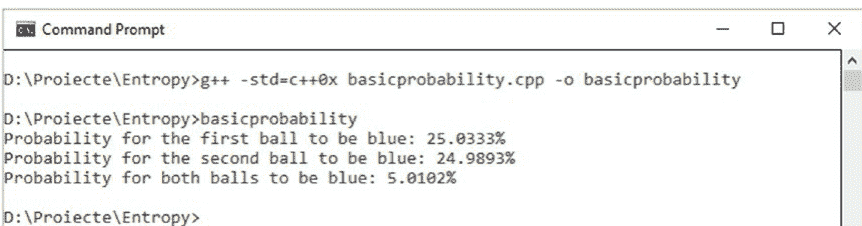

图 3-1. 计算概率的输出

### 列表 3-1. 源代码

```cpp
#include <iostream>
#include <vector>
#include <random>
#include <algorithm>

enum ColorTypes {
    Blue,
    NotBlue } ;

//** create a sequence container
typedef std::vector<ColorTypes> backpack;

backpack initializeBackpack(unsigned blue_balls, unsigned differentBalls)
{
    backpack backpackOfBalls ;

    for (unsigned i=0; i<blue_balls; ++i)
        backpackOfBalls.emplace_back(Blue);

    for (unsigned i=0; i<differentBalls; ++i)
        backpackOfBalls.emplace_back(NotBlue);

    return backpackOfBalls; }

void randomize(backpack & backpackOfBalls) {
    //** Mersenne Twister - pseudo-random generator
    //** on 32-bit number using the state size of 19937 bits
    //** std::random_device() will help us to generate a
    //** non-deterministic random numbers
    static std::mt19937 engine((std::random_device()));
        //** we will rearrange the elements in the
        //** following range [first, second] as follows first =
        //** backpackOfBalls.begin() and second =
        //** backpackOfBalls.end()
        //** using "engine" declared above as a uniform random
        //** number generator
    std::shuffle(backpackOfBalls.begin(),
                backpackOfBalls.end(), engine);
}

int main()
{
    //** constants initializations
    const unsigned theTotalOfSamples = 1000000;
    const unsigned blue_balls = 4;
    const unsigned differentBalls = 12;

    unsigned theFirstIsBlue = 0;
    unsigned bothAreBlue = 0;
    unsigned theSecondIsBlue = 0;

    auto backpackOfBalls = initializeBackpack(blue_balls,
                        differentBalls);

    for (unsigned i=0; i<theTotalOfSamples; ++i)
    {
        randomize(backpackOfBalls);

        if (backpackOfBalls[0] == Blue)
            ++theFirstIsBlue;

        if (backpackOfBalls[1] == Blue)
            ++theSecondIsBlue;
```


```cpp
if (backpackOfBalls[0]==Blue&&backpackOfBalls[1]==Blue)
    ++bothAreBlue;
}

float probabilityOfFirstBallToBeBlue =
                    static_cast<float>(theFirstIsBlue) /
                                theTotalOfSamples;

float probabilityForBothBallsToBeBlue =
                         static_cast<float>(bothAreBlue) /
                                    theTotalOfSamples;

float probabilityForSecondBallToBeRed =
                         static_cast<float>(theSecondIsBlue) /
                                    theTotalOfSamples;

std::cout << "Probability for the first ball to be blue: "
          << probabilityOfFirstBallToBeBlue * 100.0 << "%\n" ;

std::cout<< "Probability for the second ball to be blue: "
          << probabilityForSecondBallToBeRed * 100.0 << "%\n" ;

std::cout << "Probability for both balls to be blue: "
          << probabilityForBothBallsToBeBlue * 100.0 << "%\n" ;
}
```

## 案例研究 2：计算概率分布

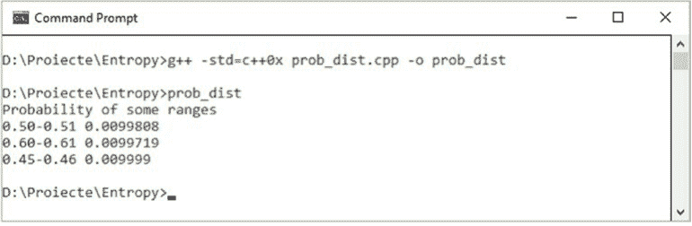

*图 3-2.* 概率分布的输出

## 代码清单 3-2. 源代码

```cpp
/** this will be used for computing the distribution
#include <random>
#include <iostream>

using namespace std;

int main() {
    /** declare default_random_engine object
    /** we will use it as a random number
    /** we will provide a seed for default_random_engine
    /** if a pseudo random is necessary
    default_random_engine gen;
    double x=0.0, y=1.0;

    /** initialization of the probability distribution
    uniform_real_distribution<double> dist(x, y);

    /** the number of experiments
    const int numberOfExperiments = 10000000;

    /** the number of ranges
    const int numberOfRanges = 100;
    int probability[numberOfRanges] = {};
    for (int k = 0; k < numberOfExperiments; ++k) {
        // using operator() function
        // to give random values
        double no = dist(gen);
        ++probability[int(no * numberOfRanges)]; }

    cout << "Probability of some ranges" << endl;
    /** show the probability distribution of some ranges
    /** after 1000 times values are generated
    cout << "0.50-0.51" << " " <<
        (float)probability[50]/(float)numberOfExperiments<<endl;
    cout << "0.60-0.61" << " " <<
        (float)probability[60]/(float)numberOfExperiments<<endl;
}
```

```cpp
cout << "0.45-0.46" << " " <<
    (float)probability[45]/(float)numberOfExperiments << endl;

return 0;
}
```

## 案例研究 3：计算概率分布的均值

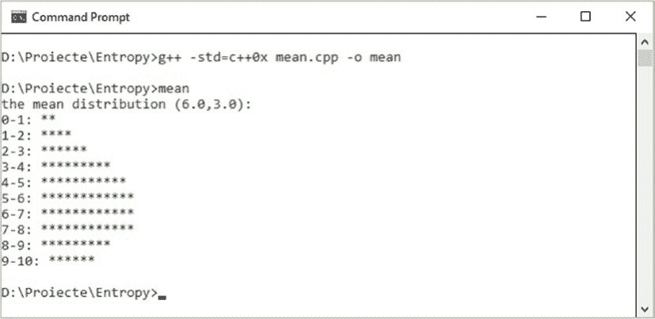

**图 3-3.** *概率分布均值的输出*

## 代码清单 3-3. 源代码

```cpp
#include <iostream>
#include <string>
#include <random>

int main()
{
    /** the constant represents the number of experiments
    const int numberOfExperiments=10000;
    /** the constant represents the
//** maximum number of stars to distribute
const int numberOfStarsToDistribute=100;

std::default_random_engine g;
std::normal_distribution<double> dist(6.0,3.0);

int prob[10]={};

for (int k=0; k<numberOfExperiments; ++k) {
    double no = dist(g);
    if ((no>=0.0)&&(no<10.0)) ++prob[int(no)];
}

std::cout << "the mean distribution (6.0,3.0):" << std::endl;

for (int l=0; l<10; ++l) {
    std::cout << l << "-" << (l+1) << ": ";
    std::cout <<
        std::string(prob[l]*numberOfStarsToDistribute/
numberOfExperiments,'*') << std::endl;
}

return 0;
}
```

## 案例研究 4：计算方差

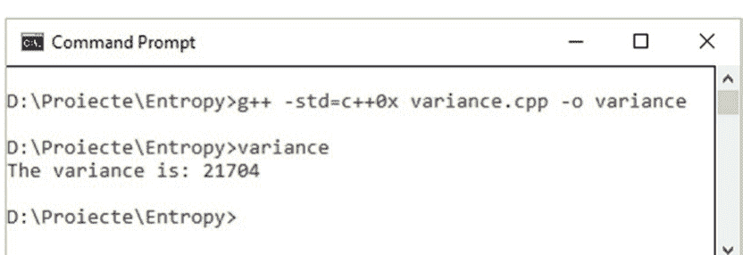

图 3-4. 方差的输出

# 第 3 章　数学背景及其适用性

### 代码清单 3-4. 源代码

```cpp
#include<iostream>

using namespace std;

/** the below function is used
/** for computing the variance
int computingVariance(int n[], int h)    /**a=n, n=h
{
    /** will compute the mean
    /** average of the elements
    int sum = 0;
    for (int k = 0; k < h; k++)
        sum += n[k];
    double theMean = (double)sum /
                     (double)h;

    /** calculate the sum squared
    /** differences with the mean
    double squared_differences = 0;
    for (int t=0; t<h; t++)
        squared_differences += (n[t] - theMean) *
                                (n[t] - theMean);
    return squared_differences / h;
}

int main()
{
    int arr[] = {600, 470, 170, 430, 300};
    int n = sizeof(arr) / sizeof(arr[0]);
    cout << "The variance is:"
         << computingVariance(arr, n) << "\n";
    return 0;
}
```

```cpp
cout << "Add 10 elements: ";
for(n = 0; n < 10; ++n)
    cin >> elements_array[n];

cout << endl << "The Standard Deviation is = " <<
    computeStandardDeviation(elements_array)<<endl;

return 0;
}

float computeStandardDeviation(float elements_array[])
{
    float theSum = 0.0, theMean, theStandardDeviation = 0.0;

    int j,k;

    for(j = 0; j < 10; ++j)
    {
        theSum += elements_array[j];
    }

    theMean = theSum/10;

    for(k = 0; k < 10; ++k)
        theStandardDeviation += pow(elements_array[k] -
                                    theMean, 2);

    return sqrt(theStandardDeviation / 10);
}
```

## 案例研究 6：生日悖论

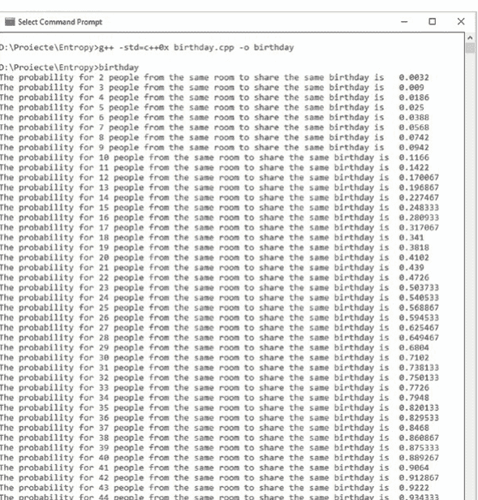

图 3-6. 生日计算的输出

## 代码清单 3-6. 源代码

```cpp
#include <ctime>
#include <cstdlib>
#include <iostream>

using namespace std;

int main(int argc, const char *argv[])
{
    const int processes = 15000;
    short int no_of_birthdays[365];
    int processesWithSuccess;
```

# 第 3 章    数学背景及其适用性

```cpp
bool IsSharedBirthday;

/** we will time(NULL) as seed to be used for the
/** pseudo-random number generator srand()
srand(time(NULL));

for (int no_of_people=2;no_of_people<45;
++no_of_people)
{
    processesWithSuccess = 0;
    for (int i = 0; i < processes; ++i)
    {
        /** all birthdays will be set to 0
        for (int j=0;j<365;no_of_birthdays[j++] = 0);
        IsSharedBirthday = false;
        for (int j = 0; j < no_of_people; ++j)
        {
            /** if our given birthday is shared (this
/** means that is assigned for more than one
/** person) this will be a shared birthday
/** and we will need to stop verifying.
            if (++no_of_birthdays[rand() % 365] > 1){
                IsSharedBirthday = true;
                break;
            }
        }
        if (IsSharedBirthday) ++processesWithSuccess;
    }

    cout << "The probability for " << no_of_people << " people from the
    same room to share the same birthday is \t"<<(float(processesWithSucc
    ess)/float(processes))<<endl;
}
return 0;
}
```

## 案例研究 7：扩展欧几里得算法

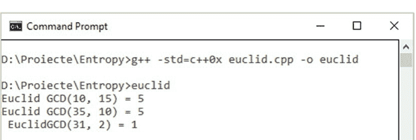

图 3-7. 欧几里得算法的输出

## 代码清单 3-7. 源代码

```cpp
//** NOTE: bits/stdc++ does not represent
//** a standard header file of GNU C++ library.
//** If the code will be compiled with other
//** compilers than GCC it will fail
#include<stdio.h>

using namespace std;

//** the function will compute
//** the GCD for two number
int g(int x, int y) {
    if (x == 0)
        return y;
    return g(y % x, x);
}

int main()
{
    int x = 10, y = 15;
    cout << "Euclid GCD(" << x << ", "
         << y << ") = " << g(x, y)
         << endl;
```

```cpp
x = 35, y = 10;
cout << "Euclid GCD(" << x << ", "
    << y << ") = " << g(x, y)
        << endl;

x = 31, y = 2;
cout << " EuclidGCD(" << x << ", "
    << y << ") = " << g(x, y)
        << endl;

return 0;
}
```

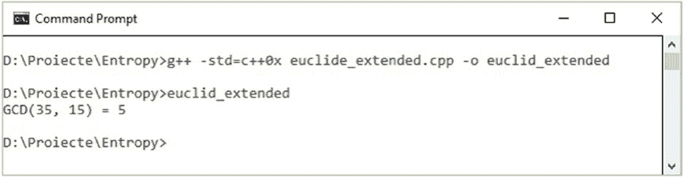

图 3-8. 扩展欧几里得算法的输出

## 代码清单 3-8. 源代码

```cpp
#include <bits/stdc++.h>
using namespace std;

//** computing extended euclidean algorithm
int g_e(int x, int y, int *w, int *z)
{
    //** this is the basic or ideal case
    if (x == 0)
    {
        *w = 0;
        *z = 1;
        return y;
    }
```


//** variables for storing the results
//** for the recursive call
int a1, b1;
int g = g_e(y%x, x, &a1, &b1);

//** with help of the recursive call
//** update a and b with the results
*w = b1 - (y/x) * a1;
*z = a1;

return g;
}

// Driver Code
int main()
{
    int a, b, w = 35, y = 15;
    int g = g_e(w, y, &a, &b);
    cout << "g_e(" << w << ", " << y << ") = " << g << endl;
    return 0;
}

# Case Study 8: Computing the Multiplicative Inverse Under Modulo q

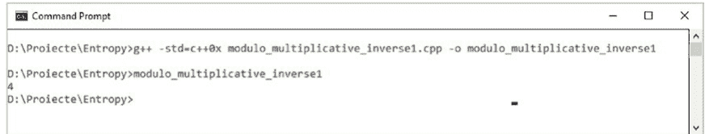

Figure 3-9. Output of the modular multiplicative inverse (a basic and tricky form of the implementation)

## Listing 3-9. Code for Computing the Modular Multiplicative Inverse (Tricky Method)

```
#include<iostream>
using namespace std;

//** this represents the basic method or tricky method
//** for finding modulo multiplicative inverse of
//** x under modulo m
int modulo_inverse(int x, int m)
{
    x = x%m;
    for (int y=1; y<m; y++)
        if ((x*y) % m == 1)
            return y;
}

int main()
{
    int x = 3, m = 11;
    cout << modulo_inverse(x, m);
    return 0;
}
```

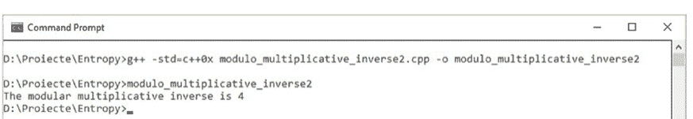

## Figure 3-10. Output of the modular multiplicative inverse (when the number is coprime)

## Listing 3-10. Source Code

```
#include<iostream>
using namespace std;

//** function for computing extended euclidean algorithm
int gcd_e(int x, int y, int *w, int *z);
```

```
void modulo_inverse(int h, int modulo)
{
    int i, j;
    int g = gcd_e(h, modulo, &i, &j);
    if (g != 1)
        cout << "There is no inverse.";
    else
    {
        //** we add the modulo in
        //** order to handle negative i
        int result = (i%modulo + modulo) % modulo;
        cout << "The modular multiplicative inverse is " <<
            result;
    }
}

//** we will compute the extended euclidean algorithm
int gcd_e(int h, int k, int *w, int *z) {
    //** the "happy" case
    if (h == 0){
        *w = 0, *z = 1;
        return k; }

    //** storing results of our recurive invoke
    int a1, b1;    //** x1=a1, y1=b1
    int g = gcd_e(k%h, h, &a1, &b1);

    //** with recursive invocation results
    //** we will update x and y
    *w = b1 - (k/h) * a1;
    *z = a1;

    return g;
}
```

```
```cpp
int main()
{
    int x = 3, modulo = 11;
    modulo_inverse(x, modulo);
    return 0;
}
```
```

## Case Study 9: Chinese Remainder Theorem

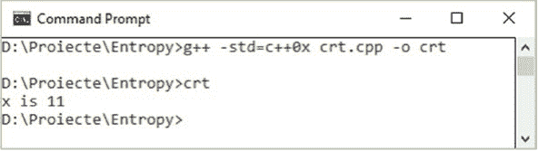

*Figure 3-11.* Output for the Chinese Remainder Theorem

*Listing 3-11.* Source Code

```
```cpp
#include<iostream>

using namespace std;

int inverse(int x, int modulo)
{
    int modulo0 = modulo, k, quotient;
    int a0 = 0, a1 = 1;

    if (modulo == 1)
        return 0;

    /** we will apply extended euclidean algorithm
    while (x > 1)
    {
        quotient = x / modulo;

        k = modulo;

        /** modulo represents the remainder
        /** continue with the process same as
```

```
//** euclid's algorithm
modulo = x%modulo, x=k;

k = a0;

a0 = a1 - quotient * a0;

a1 = k;
}

//** make a1 positive
if (a1 < 0)
    a1 += modulo0;

return a1;
}

int lookForMinX(int numbers[], int remainders[], int l)
{
    //** computing the product for all the numbers
    int product = 1;
    for (int j = 0; j < l; j++)
        product *= numbers[j];

    //** we initialize the result with 0
    int result = 0;

    //** apply the formula mentioned above
    for (int j = 0; j < l; j++)
    {
        int pp = product / numbers[j];
        result += remainders[j] * inverse(pp, numbers[j]) * pp;
    }

    return result % product;
}

int main(void) {
    int numbers[] = {3, 4, 5};
    int remainders[] = {2, 3, 1};
    int k = sizeof(numbers)/sizeof(numbers[0]);
```

```
cout << "x is " << lookForMinX(numbers, remainders, k);
return 0;
}
```

## Case Study 10: The Legendre Symbol

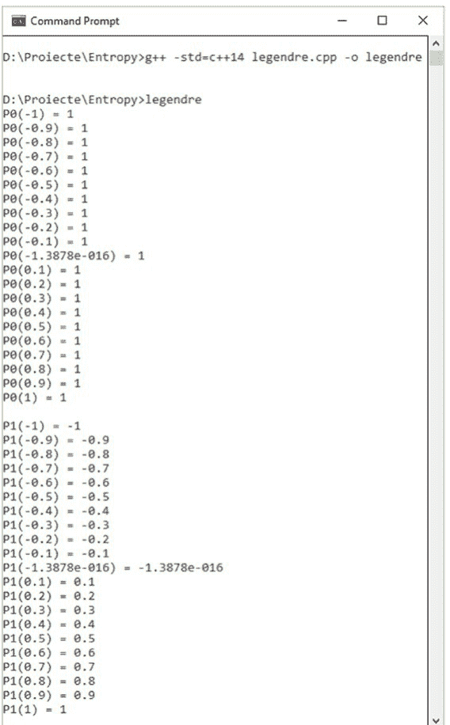

Figure 3-12. Output of the Legendre symbol

The source code for the implementation of the Legendre symbol is structured in two files:

+   - legendre.cpp (see Listing 3-12)
+   - legendre.h (see Listing 3-13)

To compile the source code, the following command needs to be run:

```
g++ -std=c++2a legendre.cpp -o legendre
```

## Listing 3-12. Source Code (legendre.cpp)

```
#include <iostream>
#include "legendre.h"

using namespace std ;
using namespace LegendreStorage::Legendre ;

int main()
{
    double p_n;

    cout.precision(5) ;
    for (unsigned int v = 0 ; v <= 5 ; v++)
    {
        for (double b = -1.0 ; b <= 1.0 ; b = b + 0.1)
        {
            p_n = Polynom_n<double>(v, b) ;
            cout << "P" << v << "(" << b << ") = " << p_n << endl ;
        }
        cout << endl ;
    }

    return 0 ;
}
```

## Listing 3-13. Source Code for the Legendre Symbol (legendre.h)

```
#ifndef __LEGENDRESYMBOL_H__
#define __LEGENDRESYMBOL_H__

namespace LegendreStorage {
    namespace Legendre{
        //** when n=0
        template <class T> inline auto Polynom0(const T& x){
            return static_cast<T>(1);
        }

        //** when n=1
        template <class T> inline auto Polynom1(const T& x){
            return x;
        }

        //** when n=2
        template <class T> inline auto Polynom2(const T& x){
            return ((static_cast<T>(3)*x*x) - static_cast<T>(1)) / static_cast<T>(2);
        }

        //** polynom(x)
        template <class T> inline auto Polynom_n(unsigned int h, const T& y)
        {
            switch(h){
                case 0:
                    return Polynom0<T>(y);

                case 1:
                    return Polynom1<T>(y);

                case 2:
                    return Polynom2<T>(y);

                default:
                    break;}

```

```
auto polynom_1(Polynom2<T>(y));
auto polynom_2(Polynom1<T>(y));
T polynom;

for (auto a=3u; a<=h; ++a){
    polynom = ((static_cast<T>((2 * a) - 1)) * y *
                polynom_1
        - (static_cast<T>(a - 1) * polynom_2)) /
                static_cast<T>(a);
    polynom_2 = polynom_1;
    polynom_1 = polynom;    }
    return polynom;    }}
#endif
```

# Conclusion

This chapter discussed the importance of some mathematical tools that are used in most modern cryptography algorithms. We showed how they can be implemented and we explained the important steps of the algorithms. We also covered the important aspects of mathematical foundations, such as the probability theory, information theory, number theory, and finite fields.

For each mathematical foundation, we presented the necessary equations and mathematical expressions that are used in the implementation of the algorithms. Each equation or mathematical expression was demonstrated through a software application implemented in C++, entitled as a case study. Each case study demonstrated the skills and knowledge required by you in order to develop secure and reliable code. By reaching to the end of the chapter, you should now understand of the important notions and terms, the programming concepts and algorithms used, both theoretical and practical, and how to move from theory to practice in a very short time.

# References

[1] Alfred J. Menezes, Paul van Oorschot, and Scott A. Vanstone, *Handbook of Applied Cryptography*. CRC Press. ISBN 0-8493-8523-7. 1996.

[2] A. R. Meijer, *Algebra for Cryptologists*, first edition, 2016 edition. New York, NY: Springer, 2016.

[3] J. Hoffstein, J. Pipher, and J. H. Silverman, *An Introduction to Mathematical Cryptography*, second edition, 2014 edition. New York: Springer, 2014.

[4] S. Rubinstein-Salzedo, *Cryptography*, 1st ed. 2018 edition. New York, NY: Springer, 2018.

[5] W. Stallings, *Cryptography and Network Security: Principles and Practice*, 6th edition. USA: Prentice Hall Press, 2013.

[6] Khan Academy, *Cryptography: Data and Application Security*. Independently published, 2017.

[7] C. T. Rivers, *Cryptography: Decoding Cryptography! From Ancient To New Age Times*. JR Kindle Publishing, 2014.

[8] D. Stinson, *Cryptography: Theory and Practice*, Second edition. CRC/C&H, 2002.

[9] H. Delfs and H. Knebl, *Introduction to Cryptography: Principles and Applications*, third edition, 2015 edition. New York, NY: Springer, 2015.

[10] J. Katz and Y. Lindell, *Introduction to Modern Cryptography*, second edition. Boca Raton: Chapman and Hall/CRC, 2014.

[11] X. Wang, G. Xu, M. Wang, and X. Meng, *Mathematical Foundations of Public Key Cryptography*, first edition. Boca Raton: CRC Press, 2015.

[12] T. R. Shemanske, *Modern Cryptography and Elliptic Curves*. Providence, Rhode Island: American Mathematical Society, 2017.


[13] S. Y. Yan, *Primality Testing and Integer Factorization in Public-Key Cryptography*, first edition. Springer, 2013.

[14] L. M. Batten, *Public Key Cryptography: Applications and Attacks*. Hoboken, N.J.: Wiley-Blackwell, 2013.

[15] J.-P. Aumasson, *Serious Cryptography*. San Francisco: No Starch Press, 2017.

[16] S. Khare, *The world of Cryptography: incl. cryptosystems, ciphers, public key encryption, data integration, message authentication, digital signatures.*

[17] Adrian Atanasiu, *Securitatea Informației (Information Security) - Criptografie (Cryptography) - volume 1*, InfoData Publisher, ISBN: 978-973-1803-29-6, 978-973-1803-16-6. 2007. [Romanian Language]

[18] Adrian Atanasiu, *Securitatea Informației (Information Security) – Protocoale de Securitate (Security Protocols) - volume 2*, InfoData Publisher, ISBN: 978-973-1803-29-6, 978-973-1803-18-0. 2007. [Romanian Language]

[19] *Vasile Preda, Emil Simion, and Adrian Popescu, Criptanaliza. Rezultate și Tehnici Matematice (Cryptanalysis. Results and Mathematical Techniques)*, Universitatea Bucuresti Publisher, ISBN: 973-575-975-6. 2004. [Romanian Language]
