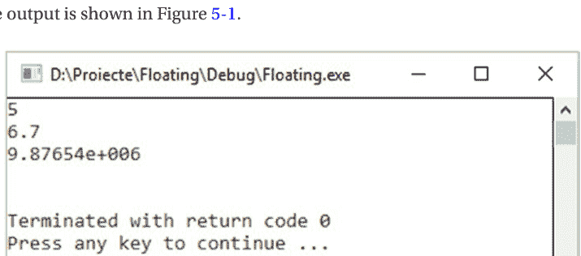
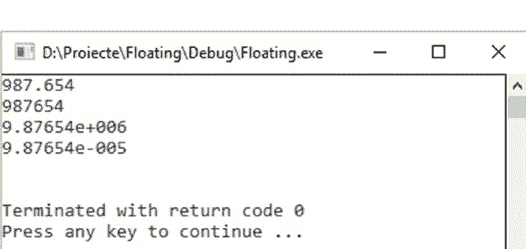
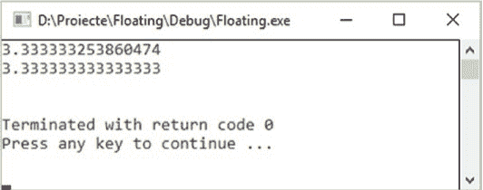

# 第4章 大整数算术

### 清单4-7 使用 tmath::UInt<>

```cpp
#include <ttmath/ttmath.h>
#include <iostream>

int main()
{
    ttmath::UInt<2> firstA, secondB, thirdC;

    a = "8765";
    b = 3456;
    c = a*b;

    std::cout << thirdC << std::endl;
}
```

## 结论

本章讨论了大整数的通用表示及其运算。我们分析了最重要的大整数库，重点介绍了这些库在您搭建密码算法开发环境时的优势。

## 参考文献

+ 1. C++ 大整数库。可在线访问：https://mattmccutchen.net/bigint/。最后访问日期：2020年5月16日。
+ 2. BigInteger 类 L3HARRIS Geospatial。可在线访问：www.harrisgeospatial.com/docs/BIGINTEGER.html。
+ 3. Boost 库文档。可在线访问：www.boost.org/doc/libs/1_72_0/。
+ 4. S.L. Nita 和 M. Mihailescu，*《实用并发 Haskell：大数据应用》*。Apress。2017年。
+ 5. S.L. Nita 和 M. Mihailescu，*《Haskell 快速语法参考》*。Apress。2019年。
+ 6. Bellard。可在线访问：https://bellard.org/libbf/。
+ 7. IEEE 754-2019 – 浮点运算标准。可在线访问：https://standards.ieee.org/content/ieee-standards/en/standard/754-2019.html。
+ 8. LibBF 库。可在线访问：https://bellard.org/libbf/。
+ 9. 大数库。可在线访问：www.ttmath.org/。
+ 10. TTMath 示例。可在线访问：www.ttmath.org/samples。
+ 11. A.S. Mena，*《实用 Haskell：真实世界的编程指南》*。Apress。2019年。

```
int a{4};      //** 4 is an integer
double b{3.0};   //** 3.0 represents a floating point (with no
                 //** suffix - double type by default)
float c{6.0f};   //** 6.0 represents a floating point (f is the
                 //** suffix which means a float type)
```

# 显示浮点数

让我们考虑清单5-1中的示例。

## 清单5-1 显示常见浮点数

```
#include <iostream>

using namespace std;

int main()
{
    cout << 5.0 << endl;
    cout << 6.7f << endl;
    cout << 9876543.21 << endl;

    return 0;
}
```

输出如图5-1所示。



图5-1 常见浮点数的输出

通过观察程序的输出，您可以发现：在第一种情况下，输出是 5，但源代码显示的是 5.0。这是因为小数部分等于 0。在第二种情况下，打印出的数字与源代码中的完全相同。在第三种情况下，数字以科学计数法显示，这对密码学算法而言是一项重要特性。

# 浮点数的范围

让我们看看 IEEE 754 表示，并考虑以下大小及其范围和精度。见表5-1。

## 表5-1 IEEE 754 标准表示

| 尺寸 | 范围 | 精度 |
|---|---|---|
| 4 字节 | ±1.18 × 10⁻³⁸ 至 ± 3.4 × 10³⁸ | 6-9 是最重要的数字。通常约为 7 位数字。 |
| 8 字节 | ±2.23 × 10⁻³⁰⁸ 至 ± 1.80 × 10³⁰⁸ | 15-18 是最重要的数字。通常约为 16 位数字。 |
| 80 位（通常使用 12 或 16 字节） | ±3.36 × 10⁻⁴⁹³² 至 ± 1.18 × 10⁴⁹³² | 18-21 是最重要的数字。 |
| 16 字节 | ±3.36 × 10⁻⁴⁹³² 至 ± 1.18 × 10⁴⁹³² | 33-36 是最重要的数字。 |

当今处理器上的 80 位浮点数使用 12 或 16 字节实现。处理器可以轻松处理该大小。

# 浮点精度

让我们考虑用分数 1/3 表示的示例。其十进制表示为 0.3333333…，3 无限循环。

使用计算机时，无限长度的数字需要无限内存来存储。这种内存限制将浮点数的存储限制在特定数量的有效数字。浮点数及其精度定义了在不丢失任何信息的情况下可以表示多少位有效数字。

在密码学中，如果我们输出一个浮点数，cout 具有 6 位的隐式精度。在图5-2中，您可以看到清单5-2中的 cout 如何将值截断为六位数字。

## 清单5-2 浮点精度的表示

```
#include <iostream>

using namespace std;

int main()
{
    cout << 7.56756767f << endl;
    cout << 765.657667f << endl;
    cout << 345543.564f << endl;
    cout << 9976544.43f << endl;
    cout << 0.00043534345f << endl;

    return 0;
}
```



图5-2 浮点精度的输出

请记住，上述每种情况都只有六位有效数字。

请注意，在某些情况下，使用 std::cout 的输出将采用科学计数法表示。根据所使用的编译器，指数通常会被填充到最少位数。所显示的指数位数取决于所使用的编译器。例如，Visual Studio 使用三位，其他编译器使用两位（它们是根据 C99 指令和标准实现的）。

表示浮点数及其精度的位数取决于存储的大小和具体值。float 值以 6 到 9 位数字作为精度表示，大多数值至少有 7 位有效数字。double 值以 15 到 18 位数字作为精度表示。long double 值至少以 15 或 33 位有效数字的精度表示，具体取决于字节的占用方式。

清单5-3中的代码通过使用 setprecision() 函数覆盖了 cout 或 std::cout 显示的默认精度。setprecision() 函数定义在 iomanip 头文件中。输出见图5-3。

## 清单5-3 默认精度

```
#include <iostream>
#include <iomanip>

using namespace std;

int main()
{
    std::cout << std::setprecision(16);
    std::cout << 3.333333333333333333333333333333333f << endl;
    std::cout << 3.333333333333333333333333333333333 << endl;

    return 0;
}
```



图5-3 覆盖默认精度


在上面的示例中，我们将精度设置为 16 位。每个数字都以 16 位精度显示。精度引发的问题不仅会影响小数；它们会影响任何具有多个重要数字的数字。

# 浮点运算的下一级

在第 [12] 章中，我们将介绍一种复杂的加密类型。同态加密是一种特殊的加密类型，它被用作隐私保护的专业技术，并将存储和计算外包。这种加密允许数据在加密状态下被加密并外包到商业（或公共）环境中进行处理，同时数据保持加密状态。同态加密源自环学习与误差（参见第 [13] 章）并与私有集合交集 [1] 相关。

进入复杂的密码系统，浮点表示代表了加密/解密机制的核心，找到以适当的方式近似实数的方法，以便在范围和精度之间取得平衡。

如前所述，“浮点”一词意味着数字的小数点可以浮动。这意味着它可以相对于数字的重要数字设置在任何位置。更准确地说，在处理复杂的密码系统时，例如同态加密，浮点数 *a* 可以表示为四个整数，例如

$$a = \pm d.n^{f-j}$$

其中 *n* 表示基数，*f* 表示指数，*j* 表示精度，*d* 表示重要或有效数字，必须满足以下关系：

$$0 \le d \le n^f - 1$$

C++ 提供了浮点操作的函数 fmod、remainder 和 remquo。这些函数可以在 cmath 头文件中找到。从 C++11 开始，这些基本函数用于处理与浮点数相关的简单数学计算，这些计算对于通用编程和密码学（低级和简单概念）是必要的。对于高级密码算法，这些函数相当有限，它们没有为密码学家提供必要的设备。要实现大实数的复杂计算，您可以使用

专业库，如 Boost Multiprecision Library、TTMath、LibBF、GNU Multi-Precision Library 等。它们将帮助您使用复杂的密码系统实现复杂任务。

## 结论

本章讨论了浮点数的一般表示以及它们在复杂密码系统中的使用。我们解释了浮点运算对于复杂密码系统的重要性，例如同态加密、混沌密码学、基于格的密码学或环学习与误差。如果没有对浮点运算的正确理解，先进的密码系统无法正确实现。错误的实现可能导致商业云计算或大数据环境出现巨大灾难。

## 参考文献

- [1] H. Chen, K. Laine, and P. Rindal, *Fast Private Set Intersection from Homomorphic Encryption*. 2018.
- [2] Leo Ducas and Daniele Micciancio, “FHEW: bootstrapping homomorphic encryption in less than a second,” in *Advances in Cryptology–Eurocrypt 2015*. pp. 617–640. Springer; Berlin, Germany. 2015.
- [3] S. Halevi and V. Shoup, “Algorithms in HElib,” in *Crypto’14*, vol. 8616. Springer; Heidelberg, Germany. 2014.
- [4] P. Sharma Campos, E. Jantunen, D. Baglee, and L. Fumagalli, “-e challenges of cybersecurity frameworks to protect data required for the development of advanced maintenance” in *Procedia CIRP*, *vol. 47*. p. 227. 2016.
- [5] C. Burnikel and J. Ziegler, “Fast recursive division,” *Max-Planck-Institut fur Informatik Research Report MPI-I-98-1-022*, Max-Planck–Institut fur Informatik, Saarbrucken, Germany, 1998.

# 第 5 章   浮点运算

[6] N. Dowlin, R. Gilad-Bachrach, K. Laine, K. Lauter, M. Naehrig, and J. Wernsing, “Manual for using homomorphic encryption for bioinformatics” in *Proceedings of the IEEE*, vol. 105, no. 3. 2017.

[7] J. H. Cheon, A. Kim, M. Kim, and Y. Song, “Homomorphic encryption for arithmetic of approximate numbers,” in *Proceedings of the International Conference on the Theory and Application of Cryptology and Information Security (ASIA-CRYPT’17)*, pp. 409–437. Hong Kong, China. December 2017.

# 第 6 章

## C++20 的新特性

在 C++20 中，引入了新特性。这些新特性将影响代码的编写方式，提高优雅性、可靠性和安全性指标。

密码学家和信息安全工程师将在这些特性中找到新的挑战和有趣的概念，可以将其纳入其实现源代码中。在本章中，我们将介绍最重要的特性以及它们如何用于改进密码学应用的代码。

C++20 的新特性分为三类：*语言特性*、*库特性* 和 *头文件特性*。我们将从密码学和密码分析的角度检查大多数特性，并介绍它们如何在密码算法的实现中使用。

## 特性测试

根据标准提案，C++20 为测试提供了新特性，通过定义一组特定于预处理器的宏来对应 C++ 语言。在以下各节中，我们将讨论两个可用于密码算法实现过程的重要特性。这两个特性将帮助您控制内存以及密码结构和操作如何表示和设计。

## carries_dependency

尽管 carries_dependency 在 C++11 中引入，但值得一提，因为它在安全应用中有用。在密码学中，处理内存可能是在算法的每个步骤中的一项艰巨任务。在 carries_dependency 的帮助下，我们可以跳过内存的限制和保护 [1]。

从 C++20 开始，std::memory_order 枚举类结构如下 [1]：

```
enum class memory_order: {
    relaxed, consume, acquire, release, acq_rel, seq_cst
};
inline constexpr memory_order memory_order_relaxed =
    memory_order::relaxed;
inline constexpr memory_order memory_order_consume =
    memory_order::consume;
inline constexpr memory_order memory_order_acquire =
    memory_order::acquire;
inline constexpr memory_order memory_order_release =
    memory_order::release;
inline constexpr memory_order memory_order_acq_rel =
    memory_order::acq_rel;
inline constexpr memory_order memory_order_seq_cst =
    memory_order::seq_cst;
```

std::memory_order 指定内存如何被访问，基于最常见的原子操作。

例如，让我们考虑一个 memory_order::relaxed 内联指令并查看它如何使用。作为警告，您应该谨慎使用它，因为根据官方文档，“不对其他读取或写入施加任何同步或排序约束；仅保证此操作的原子性。”¹ 这对于复杂的密码算法和安全方案非常有用，例如可搜索加密、同态加密或基于椭圆曲线数学的密码系统。在 [1] 中有一组示例，旨在解释如何使用 memory_order 工作内存。fetch_add 的第一个参数表示接受的值类型。如果您不需要读取或写入操作之间的任何同步，这一点至关重要。

```
std::atomic<int> counter = {0}
counter.fetch_add(1, std::memory_order_relaxed)
```

常数 memory_order_relaxed、memory_order_consume 和 memory_order_release 是密码实现最常用于内存工作负载的常数。非常重要的是要理解它们的含义以及如何使用它们。

- memory_order_relaxed：它意味着读取或写入操作没有同步。
- memory_order_consume：使用此常数的密码操作是对所引用内存位置的消费操作。
- memory_order_release：当前线程内的读取或写入不允许重新排序。

在下一个示例中，您可以看到 std::memory_order_release 如何在您想要对变量的内存进行释放时使用。请注意，在示例中，cryptoKey 变量代表存储密码密钥（公钥或私钥）的一般情况。在这种情况下，在算法的任何一点，密钥一旦被释放就可以被更改。

```
std::string* cryptoKey = new std::string("passkey");
ptr.store(p, std::memory_order_release)
```

## no_unique_address

前面有 no_unique_address 的数据成员不需要具有与其类中的所有其他数据成员不同的地址 [2]。

在下面的示例中，您可以看到一个空类 CryptographyOps。接下来是两个类 Encryption 和 Decryption。在 Encryption 类中，您可以看到空的 CryptographyOps，这意味着大小必须至少为 1，即使类型是空类，如本例所示。这是为了保证不同对象及其地址与相同类型始终不同所必需的。在第二个类 Decryption 中，您在 CryptographyOps 类前面添加 [[no_unique_address]]，这将确保不会提供不同的地址。


```
struct CryptographyOps {}; // empty class

struct Encryption {
    int i;
    CryptographyOps CryptoOps;
};

struct Decryption {
    int i;
    [[no_unique_address]] CryptographyOps CryptoOps;
};
```

## C++20 中的新头文件

在本节中，我们将介绍 C++20 中最重要的头文件。它们旨在帮助改进密码学领域的开发过程。

### `<concepts>` 头文件

这个新的 C++20 概念是概念库的一部分。概念库包含基本概念，可用于执行编译时验证。验证是针对模板和类的参数进行的。其第二个目的是实现基于类型属性的分派过程。

### 核心语言概念

大多数与核心语言相关的概念都与对象和类型有关。在密码学中，这些概念包括 std::floating_point、std::destructible、std::integral、std::signed_integral 和 std::unsigned_integral。在接下来的小节中，我们将通过一些示例来展示如何在密码学中使用这些概念。大多数此类概念可用于密码学实现中，以检查类型，并确保你在类、对象、结构体、变量等类型上与预期保持一致。

### std::floating_point

让我们考虑以下类声明：

```
//** the class is a general class for working with cryptographic
//** operations related to floating numbers.
class FloatingClassExample {};
```

如果我们调用

```
std::cout << std::floating_point<FloatingClassExample>::value;
```

输出将为 false。但如果我们有

```
std::cout << std::floating_point<float>::value;
```

输出将为 true。

### std::destructible

在密码学中，一旦某个操作（例如加密或解密）结束，建议销毁所有函数、结构体、类、对象和类型。

要通过 std::destructible 实现销毁过程，我们只需将类型传递给 destructible<>，如下所示：

```
class AESClass {};
std::cout << std::destructible<AESClass>::value;
```

输出将为 true。

### std::integral, std::signed_integral, std::unsigned_integral

这些概念的使用方式与上面列出的示例相同。让我们考虑以下类型测试：

```
std::cout << std::integral<AESClass>::value;
std::cout << std::integral<int>::value;
std::cout << std::integral<float>::value;
```

输出将分别为 false、true 和 false。对于 signed_integral 和 unsigned_integral，情况也如此。

### 比较概念

在 C++20 中，有四个比较概念：equality_comparable、equality_comparable_with、totally_ordered 和 totally_ordered_with [4]。它们通过 ==、!=、<、>、<=、>= 等比较运算符对指定类型进行操作。尽管这些比较概念都使用上述运算符，但它们之间存在细微差别。totally_ordered 概念侧重于对类型产生严格全序的比较结果 [3]，而 totally_ordered_with<operand1, operand2> 则侧重于混合操作数，其结果也产生严格全序。

### 对象概念

对象概念涉及对象的主要操作，例如移动、交换和复制。有四个对象概念用于处理对象操作：movable、copyable、semiregular 和 regular。这些概念在密码学中非常有用，尤其是在处理复杂的密码学对象时，这些对象在不同的软件基础设施、操作系统和软件应用程序之间进行交换的过程中需要被移动、复制或交换。通过这种方式，我们可以提高应用程序互操作性的安全性。

作为示例，让我们快速查看以下内容：

```
template <class AESCrypto>
concept movable =
    std::is_object_v<AESCrypto> &&
    std::move_constructible<AESCrypto> &&
    std::assignable_from<AESCrypto&, AESCrypto> &&
    std::swappable<AESCrypto>;
```

### 可调用概念

首先，让我们澄清一下“可调用”这个术语的含义，并将可调用概念定义为可以被调用的“某种东西”，例如函数。通常，它是 object() 或 object(arguments)。一个对象之所以可调用，是因为重载了 operator() 函数。

在 C++20 中，涵盖了以下概念：invocable/regular_invocable、predicate、relation、equivalence_relation 和 strict_weak_order。在密码学中，我们更多会用到 predicate 和 relation。一旦充分理解了这两个概念，其余概念就简单了。

使用 predicate 概念时，提供的参数将产生布尔结果。相较于 relation 概念，我们有如下示例：

```
template<class AESCrypto, class Encryption, class Decryption>
concept relation =
    std::predicate<AESCrypto, Encryption, Encryption> &&
    std::predicate<AESCrypto, Encryption, Decryption> &&
    std::predicate<AESCrypto, Decryption, Encryption> &&
    std::predicate<AESCrypto, Decryption, Decryption>;
```

正如你所观察到的，根据 relation<AESCrypto, Encryption, Decryption>，AESCrypto 将根据由 Encryption 或 Decryption 编码的类型和值所表征的一组表达式来定义二元关系。

### `<compare>` 头文件

`<compare>` 头文件 [5] 处理比较运算符，它是通用工具库的一个组件。

从 C++20 开始，通过该头文件我们可以使用强大的概念（three_way_comparable 和 three_way_comparable_with）、类（partial_ordering、weak_ordering 和 strong_ordering）以及定制点对象（strong_order、weak_order 和 partial_order）。

如你在“比较概念”一节中所见，其机制是相同的。如果你正在使用线程处理复杂应用程序，并且这些线程上使用和传输的数据是敏感的，那么发送方和接收方可以通过比较函数和概念来验证数据是否被正确发送和接收，完整性是否得到保证。这些函数扩展了密码学算法的能力，并让你能够自由地创建复杂的机制，在两端比较和处理敏感数据。

### `<format>` 头文件

在密码学中，我们处理各种规则。我们有数字表示规则、字符串规则、字符规则、表达式上的数学规则等等。

`<format>` 头文件在 C++20 中扩展了其能力，为格式化规则的定义和实现带来了新的见解。尽管在撰写本书时，format 头文件尚未包含在 C++ 标准库中，但它在密码学应用中的潜力值得关注。C++ 库和功能的更新可在 [6] 中找到。

作为示例，请考虑清单 6-1 中的程序。

**清单 6-1. `<format>` 头文件**

```
#include <format>
#include <iostream>

//** let's define a wrapper for class AESCryptography
template<class AESCryptography>
struct Encryption {
    AESCryptography value;
};

template<class AESCryptography, class CharAESCryptography>
struct std::formatter<Encryption<AESCryptography>,
    CharAESCryptography>:
std::formatter<AESCryptography, CharAESCryptography>
{
    template<class FormatContext>
    auto format(Encryption<AESCryptography>
        encAESCrypto, FormatContext& theFormatContext)
    {
        return std::formatter<AESCryptography,
            CharAESCryptography>::format
            (encAESCrypto.value, theFormatContext);
    }
};

int main()
{
    Encryption<int> encrypted = { 32 };
    std::cout << std::format("{:#x}", encrypted);
}
```

## 结论

在本章中，我们讨论了 C++20 中最重要的特性，以及它们如何帮助应用密码学领域的专业人员。我们重点关注了密码学算法实现过程中的关键点。本章收录的这些特性旨在覆盖与内存和类型比较相关的主要密码学操作：

- 测试 C++20 语言预处理器的特性
- 内存洞察力，以及如何更专业、更优雅地操作内存
- carries_dependency 和 no_unique_address 概念，这些概念对内存操作非常有用
- `<concepts>`、`<compare>` 和 `<format>` 头文件及其最强大的类和函数，可用于处理密码学机制，例如密钥生成操作、加密和解密函数，以及类型测试和验证

## 参考文献

- [1] std::memory_order。在线获取：https://en.cppreference.com/w/cpp/atomic/memory_order.
- [2] C++20 – no_unique_address。在线获取：https://en.cppreference.com/w/cpp/language/attributes/no_unique_address.


- [3] 全序。在线获取：https://en.wikipedia.org/wiki/Total_order#Strict_total_order.
- [4] std::totally_ordered, std::totally_ordered_with。在线获取：https://en.cppreference.com/w/cpp/concepts/totally_ordered.
- [5] 标准库头文件&lt;compare&gt;，概念。在线获取：https://en.cppreference.com/w/cpp/utility/compare/three_way_comparable.
- [6] 标准库头文件&lt;format&gt;。在线获取：https://en.cppreference.com/w/cpp/header/format.
- [7] C++ 编译器支持。在线获取：https://en.cppreference.com/w/cpp/compiler_support.

信任代表了应用程序可以在其中进行开发和测试的最关键环境。任何开发者、IT安全官员或软件分析师都不应该攻击自己的代码。这个环境是舒适区。一旦应用程序离开这个舒适区并进入真实环境，问题就会开始出现。信任边界的划定既困难又容易。在舒适区和真实区域之间画出一条界线并非易事，尤其是当应用程序运行在虚拟化基础设施、云或大数据环境中时。

在舒适区中，安全威胁由恶意最终用户代表。恶意最终用户的目标是破坏软件应用程序的机密性和/或完整性。提出的一个有趣概念是*软件混淆*。

## 安全编码检查表

在本节中，我们将讨论并提出一个安全编码检查表（也可以看作一个流程）。表7-1展示了这样一个检查表的示例，你可以根据需要任意扩展。该检查表包含用C++编写代码时可以检查的条目的最小示例，无论代码运行在哪种操作系统上。开发者中常见的一种做法是抑制警告，这并没有益处。

在“CERT 编码标准和规则”一节中，我们将讨论最重要的规则并按顺序列出它们，以便你可以将它们应用到开发加密算法的过程中。每条规则在指南中都有详细的解释。

### 表7-1. 安全编码检查表示例

| 编号 | 要检查的项目 | 描述 | 是/否 | 备注 |
|---|---|---|---|---|
| 1 | *编译器警告* | 确保编译器会输出，并且对于以下条目列出的潜在错误会触发一个标志，以便接收通知：<br>- ✓ Wall<br>- ✓ Wmissing-declarations<br>- ✓ Wmissing-prototypes<br>- ✓ Wredundant-decls<br>- ✓ Wshadow<br>- ✓ Wstrict-prototypes<br>- ✓ Wformat=2<br><br>有关更多标志及其定义和操作，请参阅“GCC 用于请求或抑制警告的选项”一节 [1]。如果要实现复杂的加密算法和安全方案，这将非常有用。 |  |  |
| 2 | *处理字符串时，为缓冲区分配足够的内存。* | 检查以下函数，在复制过程遇到`\0`（NULL）之前，目标缓冲区是否存在上限。为了避免这种情况，建议在数据复制到目标缓冲区之前，为目标缓冲区分配足够的内存空间。<br>- ✓ strcpy()<br>- ✓ strcat()<br>- ✓ sprintf()<br>- ✓ scanf()<br>- ✓ gets() |  |  |
| 3 | 检查是否存在直接破坏系统安全的行为。 | 检查不受信任的输入，这些输入将导致应用程序安全性的直接破坏。通过此步骤，你可以保护应用程序免受恶意用户和攻击者利用元字符（metachars）对你程序进行的攻击。<br>- ✓ system()<br>- ✓ popen()<br>- ✓ fork(2)<br>- ✓ exec(2)<br>- ✓ s_popen()<br>- ✓ HXproc_* [2] |  |  |
| 4 | 检查参数大小错误以及得到意外结果的情况。 | 当编写复杂程序时，例如第2章清单2-1中的SHA-256实现，为某个参数分配错误的大小或进行错误的算术运算可能会导致严重缺陷，应立即进行修复。确保为参数分配的大小与目标端的大小相同。作为最佳实践，尤其是在实现加密算法时，最好使用size_t类型。要保持类型安全，不要产生溢出。<br>- ✓ strncpy()<br>- ✓ strncat()<br>- ✓ snprintf() |  |  |
| 5 | **检查是否分配了过多内存。** | 分配了过多的内存，而外部参数只占大小的一部分。如果遇到这种情况，你就是在处理错误的内存分配，并且会遭遇*拒绝服务*。为避免这种情况发生，最好遵循以下标准：<br>- `malloc(), calloc(), alloca()`<br>- 不发生整数溢出<br>- 避免算术问题<br>- 验证任何可能使用不受信任的整数导致整数溢出的操作。 |  |  |
| 6 | **避免错误的类型转换。** | 避免像下面这样编码。编译器会认为`malloc`返回一个int，这是完全错误的。它会产生一个容易被黑客利用的缺陷。<br><code>char *a = malloc(10) – bad cast<br>class BaseClass {};<br>class DerivedClass: public BaseClass {};<br><br>BaseClass b; BaseClass* pb;<br>DerivedClass d; DerivedClass* pd;<br><br>//good cast<br>pb = dynamic_cast&lt;BaseClass*&gt;(&amp;d);<br><br>//bad cast<br>pd = dynamic_cast&lt;DerivedClass*&gt;(&amp;b);</code> |  |  |
| 7 | **避免可变参数列表。** | 当你实现基于字符串的安全方案时，你可能会遇到一种新型问题，安全分析师或道德黑客在测试时喜欢利用这类问题。道德黑客通常用来检查不受信任数据的一个简单测试是，检查某个函数是否允许变量作为参数列表，例如`printf()`。不受信任的数据（由道德黑客创建）被直接用作字符串格式，而不是作为参数。对于任何类似情况，请遵循以下逻辑：<br>- 错误方式：`snprintf(buffer, sizeof(buffer), the_input_of_the_user)`<br>- 正确方式：`snprintf(buffer, sizeof(buffer), "%s", the_input_of_the_user)` |  |  |
| 8 | **文件操作** | 在进行加密操作处理文件时，尽量使用`mkstemp()`。 |  |  |
| 9 | **文件权限** | 并非每个人都应该拥有读取或写入文件的权限。为了创建具有正确权限的文件，请养成使用`umask()`的习惯。<br>- 在文件开头使用`umask(077)`。 |  |  |

## CERT 编码标准

CERT C++ 编码标准仅针对 ISO/IEC 14882-2014 标准定义的 C++ 编程语言版本而制定。

该编码标准组织得非常好，并遵循特定的结构：标识符、不合规代码示例和合规解决方案、异常、风险评估、自动检测、相关漏洞和相关指南 [7]。

我们将逐一检查该结构的每个条目，并解释其主要目标和目的。

### 标识符

每个标识符由三个部分组成：

- 一个表示标准内章节的三字母助记符
- 一个00到99范围内的两位数字值
- 与其关联的语言，以后缀（-CPP、-C、-J、-PL）表示
    - -CPP：SEI CERT C++ 编码标准 [7]
    - -C：SEI CERT C 编码标准 [8]
    - -J：SEI CERT Oracle Java 编码标准 [9]
    - -PL：SEI CERT Perl 编码标准 [10]

三字母助记符用于对相关编码实践进行分组，并指出相关编码属于哪个类别。

### 不合规代码示例和合规解决方案

不合规代码示例展示了违反指南的代码。务必牢记它们只是示例。移除示例的所有出现并不意味我们正在分析的代码符合SEI CERT标准。

### 异常

异常具有信息性特征，不强制要求遵循。任何规则都可能有一组异常，这些异常详细说明了在什么情况下不需要遵循该指南，以确保软件的功能安全、信息安全或可靠性。

对于任何类型的异常，无论编程语言是什么，原则都是相同的。有必要对异常给予额外关注，捕获任何可能的异常并从中学习。不要忽视它们，也不要认为一种编程语言是完美的，没有任何缺陷或可被利用的门。


## 风险评估

CERT C++ 编码标准中的每一条准则都包含风险评估部分。风险评估部分的目的是为软件开发人员提供不遵循或未处理特定规则或建议的潜在后果。风险评估看起来像一个指标，其主要目的是帮助软件应用程序和复杂项目的修复过程。

每条规则和建议都有一个 *优先级*。为了分配优先级，建议理解 IEC 60812 [11]。优先级是使用一个指标进行评估和分配的，该指标由三种类型的分析表征：失效模式、影响和临界度。每条规则还具有在 1 到 3 之间分配的值，例如严重性、可能性和修复成本（见表 7-2）。

**表 7-2. _为每条规则分配值_ [7]**

| 严重性：如果忽略该规则会有什么后果？ |  |  |
|---|---|---|
| **值** | **含义** | **不同漏洞的示例** |
| 1 | 低 | 拒绝服务攻击、意外终止 |
| 2 | 中 | 信息泄露且无意愿会导致数据完整性违规。 |
| 3 | 高 | 随机运行代码 |

**可能性：** 统计上讲，通过避免和忽略规则规范在代码中引入缺陷的概率是多少，从而导致可能被恶意用户利用的漏洞？

| **值** | **定义** |
|---|---|
| 1 | 不太可能 |
| 2 | 可能 |
| 3 | 很可能 |

**修复成本：** 遵循和遵守该规则的成本是多少？

| **值** | **定义** | **检测** | **修正** |
|---|---|---|---|
| 1 | 高 | 手动 | 手动 |
| 2 | 中 | 自动 | 手动 |
| 3 | 低 | 自动 | 自动 |

对于每条规则，这些值相乘。表 7-3 中的指标为您提供了一个可用于在应用程序内确定规则优先级的度量。值从 1 到 27。所有 27 个值中，只有 10 个不同的值在大多数情况下出现和使用：1、2、3、4、6、8、9、12、18 和 27。表 7-3 列出了优先级的可能解释和含义。

## 表 7-3. 级别和优先级 [7]

| 级别 | 优先级 | 可能的解释 |
|---|---|---|
| L1 | 12, 18, 27 | 高严重性，很可能，修复 inexpensive |
| L2 | 6, 8, 9 | 中等严重性，可移植，修复成本中等 |
| L3 | 1, 2, 3, 4 | 低严重性，不太可能，修复成本高 |

## 自动化检测

规则和建议有描述自动化检测过程的部分。提到的部分有一组可作为分析器使用的工具，可帮助自动诊断任何违规行为。安全编码验证套件 [12] 可用于对分析器提供对 ISO/IEC TS 17961:2013 [14] 指定的规则违规的诊断的能力进行测试，该标准与 SEI CERT C 编码标准 [13] 的规则相关。

## 相关准则

本节在软件应用程序开发时有一个特殊位置。根据标准，“相关准则”部分包含链接、技术规范和准则集合，例如信息技术 – 编程语言、其环境和系统软件接口 – C 安全编码规则 [14]；信息技术 – 编程语言 – 通过语言选择和使用避免编程语言漏洞的指导 [15]；MISRA C++ 2008：关键系统中使用 C++ 语言的指南 [16]；以及 MITRE 的通用弱点枚举（CWE）中的 CWE ID [17]。 [18]

## 规则

在以下各节中，我们将对主要适用于使用 C++20 实现加密算法和安全方案的规则进行简要概述。最好遵循这些规则。请注意，我们只会检查 10 条规则中的六条。所有解释和示例均在指南 [19] 中提供。

对于某些规则，还有适用于 C++ 的 C 编程语言规则。以下规则可在表 7-1 中解释的安全编码指南的程序中使用。

任何信息安全官、安全分析师或道德黑客的职责都是通过遵循此类清单来改进代码。此外，清单也可以用作开发人员在开发关键加密算法时的指南。

建议对算法中相当脆弱的部分进行代码审查，并确保尽可能遵循规则（规则 1 至规则 7）（见表 7-4 至表 7-9）。

遵循这些规则将使您作为安全分析师或道德黑客对安全机制（加密算法、安全协议、安全方案和其他加密原语）已得到正确实现且常见漏洞已被消除产生一定程度的信任。

## 规则 1 - 声明和初始化 (DCL)

表 7-4. 规则 1 - 声明和初始化 [19]

| 规则 | 标题 |
|------|-------|
| DCL50-CPP | 不要定义 C 风格的可变参数函数。 |
| DCL51-CPP | 不要声明或定义保留标识符。 |
| DCL52-CPP | 切勿用 const 或 volatile 限定引用类型。 |
| DCL53-CPP | 不要编写语法上模棱两可的声明。 |
| DCL54-CPP | 在同一作用域中成对重载分配和释放函数。 |
| DCL55-CPP | 在跨越信任边界传递类对象时避免信息泄露。 |
| DCL56-CPP | 避免在静态对象初始化期间出现循环。 |
| DCL57-CPP | 不要让异常从析构函数或释放函数中逃逸。 |

### 表 7-4. *(续)*

| 规则 | 标题 |
|---|---|
| DCL58-CPP | 不要修改标准命名空间。 |
| DCL59-CPP | 不要在头文件中定义无名命名空间。 |
| DCL60-CPP | 遵守单一定义规则。 |
| DCL30-C | 使用适当的存储期声明对象。 |
| DCL39-C | 在跨越信任边界传递结构时避免信息泄露。 |
| DCL40-C | 不要创建同一函数或对象的 incompatible 声明。 |

## 规则 2 – 表达式 (EXP)

### 表 7-5. 规则 2 – 表达式 [19]

| 规则 | 标题 |
|---|---|
| EXP50-CPP | 不要依赖副作用的求值顺序。 |
| EXP51-CPP | 不要通过错误类型的指针删除数组。 |
| EXP52-CPP | 不要依赖未求值操作数中的副作用。 |
| EXP53-CPP | 不要读取未初始化的内存。 |
| EXP54-CPP | 不要在对象生命周期之外访问对象。 |
| EXP55-CPP | 不要通过 cv 未限定类型访问 cv 限定对象。 |
| EXP56-CPP | 不要使用不匹配的语言链接调用函数。 |
| EXP57-CPP | 不要转换或删除指向不完整类的指针。 |
| EXP58-CPP | 向 va_start 传递正确类型的对象。 |
| EXP59-CPP | 在有效类型和成员上使用 offsetof()。 |
| EXP60-CPP | 不要在执行边界之间传递非标准布局类型对象。 |
| EXP61-CPP | lambda 对象不得超出其引用捕获对象的生命周期。 |
| EXP62-CPP | 不要访问不属于对象值表示的对象的位表示。 |
| EXP63-CPP | 不要依赖已移动对象的价值。 |

## 规则 3 - 整数 (INT)

**表 7-6.** *规则 3 – 整数* [19]

| 规则 | 标题 |
|---|---|
| INT50-CPP | 不要转换到超出范围的枚举值。 |
| INT30-C | 确保无符号整数运算不会回绕。 |
| INT31-C | 确保整数转换不会导致数据丢失或误解。 |
| INT32-C | 确保对有符号整数的操作不会导致溢出。 |
| INT33-C | 确保除法和余数运算不会导致除零错误。 |
| INT34-C | 不要将表达式向负数位或大于或等于操作数中存在的位数进行移位。 |
| INT35-C | 不要使用不匹配的语言链接调用函数。 |
| INT36-C | 将指针转换为整数或整数转换为指针 |

## 规则 5 - 字符和字符串 (STR)

**表 7-7.** *规则 5 – 字符和字符串* [19]

| 规则 | 标题 |
|---|---|
| STR50-CPP | 确保字符串的存储空间足以容纳字符数据和空终止符。 |
| STR51-CPP | 不要尝试从空指针创建 `std::string`。 |
| STR52-CPP | 使用有效的引用、指针和迭代器引用 `basic_string` 的元素。 |
| STR53-CPP | 范围检查元素访问。 |
| STR30-C | 不要尝试修改字符串字面量。 |
| STR31-C | 确保字符串的存储空间足以容纳字符数据和空终止符。 |


**表 7-7.（续）**

| 规则 | 标题 |
|------|-------|
| STR32-C | 不要将非空终止的字符序列传递给期望字符串的库函数。 |
| STR34-C | 在转换为较大整数大小之前，将字符转换为 unsigned char。 |
| STR37-C | 字符处理函数的参数必须可表示为 unsigned char。 |
| STR38-C | 不要混淆窄字符和宽字符字符串及函数。 |

### 规则 6 - 内存管理 (MEM)

**表 7-8. 规则 6 - 内存管理 [19]**

| 规则 | 标题 |
|------|-------|
| MEM50-CPP | 不要访问已释放的内存。 |
| MEM51-CPP | 正确释放动态分配的资源。 |
| MEM52-CPP | 检测并处理内存分配错误。 |
| MEM53-CPP | 在手动管理对象生命周期时显式构造和析构对象。 |
| MEM54-CPP | 为 placement new 提供指向足够存储容量的正确对齐指针。 |
| MEM55-CPP | 遵守替换动态存储管理要求。 |
| MEM56-CPP | 不要将已拥有的指针值存储在无关的智能指针中。 |
| MEM57-CPP | 避免对过度对齐的类型使用默认 operator new。 |
| MEM30-C | 不要访问已释放的内存。 |
| MEM31-C | 不再需要时释放动态分配的内存。 |
| MEM34-C | 仅释放动态分配的内存。 |
| MEM35-C | 为对象分配足够的内存。 |
| MEM36-C | 不要通过调用 realloc() 来修改对象的对齐方式。 |

### 规则 7 - 输入/输出 (FIO)

**表 7-9. 规则 7 - 输入/输出 [19]**

| 规则 | 标题 |
|------|-------|
| FIO50-CPP | 在没有 intervening 定位调用的情况下，不要交替地从文件流中输入和输出。 |
| FIO51-CPP | 不再需要时关闭文件。 |
| FIO30-C | 将用户输入排除在格式字符串之外。 |
| FIO32-C | 不要对仅适用于文件的设备执行操作。 |
| FIO34-C | 区分从文件中读取的字符与 EOF 或 WEOF。 |
| FIO37-C | 不要假设 fgets() 或 fgetws() 在成功时返回非空字符串。 |
| FIO38-C | 不要复制 FILE 对象。 |
| FIO39-C | 在没有 intervening 刷新或定位调用的情况下，不要交替地从流中输入和输出。 |
| FIO40-C | 在 fgets() 或 fgetws() 失败时重置字符串。 |
| FIO41-C | 不要使用具有副作用的流参数调用 getc()、putc()、getwc() 或 putwc()。 |
| FIO42-C | 不再需要时关闭文件。 |
| FIO44-C | 仅使用从 fgetpos() 返回的值用于 fsetpos()。 |
| FIO45-C | 访问文件时避免 TOCTOU 竞态条件。 |
| FIO46-C | 不要访问已关闭的文件。 |
| FIO47-C | 使用有效的格式字符串。 |

## 结论

在本章中，你学习了规则和建议。你通过了关于在开发密码算法和安全方案过程中需要考虑的最重要安全方面的旅程。

理解 *规则* 和 *建议* 之间的区别非常重要。总体思路是 *规则* 必须遵循特定数量的标准，而 *建议* 则是改进代码质量的建议。

你现在拥有足够的知识来执行源代码的安全分析，创建安全编码检查清单，筛选对你的应用程序至关重要的方面，并在开发人员实现密码算法和编写相关源代码时指导他们如何进行。

## 参考文献

- 1. GCC Options to Request or Suppress Warnings. Available online: https://gcc.gnu.org/onlinedocs/gcc/Warning-Options.html#Warning-Options.
- 2. HXprox_*, libHX – Get Things Done. Available online: http://libhx.sourceforge.net/.
- 3. [ISO/IEC TR 24772:2013] ISO/IEC. Information Technology—Programming Languages—Guidance to Avoiding Vulnerabilities in Programming Languages through Language Selection and Use. TR 24772-2013. ISO. March 2013.
- 4. [ISO/IEC TS 17961:2012] ISO/IEC TS 17961. Information Technology—Programming Languages, Their Environments and System Software Interfaces—C Secure Coding Rules. ISO. 2012.
- 5. [ISO/IEC 14882-2014] ISO/IEC 14882-2014. *Programming Languages — C++, Fourth Edition*. 2014.
- 6. A. Ballman, SEI CERT C++ Coding Standard (2016 edition) 435. 2016.
- 7. SEI CERT C++ Coding Standard: Available online: https://wiki.sei.cmu.edu/confluence/pages/viewpage.action?pageId=88046682 (accessed 4.9.20).
- 8. SEI CERT C Coding Standard. Available online: https://wiki.sei.cmu.edu/confluence/display/c (accessed 4.9.20).
- [9] SEI CERT Oracle Coding Standard for Java. Available online: https://wiki.sei.cmu.edu/confluence/display/java (accessed 4.9.20).
- [10] SEI CERT Perl Coding Standard. Available online: https://wiki.sei.cmu.edu/confluence/display/perl (accessed 4.9.20).
- [11] [IEC 60812 2006] IEC (International Electrotechnical Commission). Analysis Techniques for System Reliability—Procedure for Failure Mode and Effects Analysis (FMEA), second edition (IEC 60812). Geneva, Switzerland: IEC. 2006.
- [12] Secure Coding Validation Suite. Available online: https://github.com/SEI-CERT/scvs.
- [13] SEI CERT C Coding Standard: Rules for Developing Safe, Reliable, and Secure Systems (2016 edition), n.d. 534.
- [14] [ISO/IEC TS 17961:2012] ISO/IEC TS 17961. Information Technology—Programming Languages, Their Environments and System Software Interfaces—C Secure Coding Rules. ISO. 2012.
- [15] [ISO/IEC TR 24772:2013] ISO/IEC. Information Technology—Programming Languages—Guidance to Avoiding Vulnerabilities in Programming Languages through Language Selection and Use. TR 24772-2013. ISO. March 2013.
- [16] MISRA Limited. MISRA C++ 2008 Guidelines for the Use of the C++ Language in Critical Systems. ISBN 978-906400-03-3 (paperback); ISBN 978-906400-04-0 (PDF). June 2008.
- [17] MITRE. Common Weakness Enumeration, Version 1.8. February 2010. Available online: http://cwe.mitre.org/.
- [18] How this Coding Standard is Organized. Available online: https://wiki.sei.cmu.edu/confluence/display/cplusplus/How+this+Coding+Standard+Is+Organized.
- [19] Rules. Available online: https://wiki.sei.cmu.edu/confluence/pages/viewpage.action?pageId=88046322.
