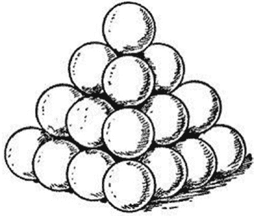
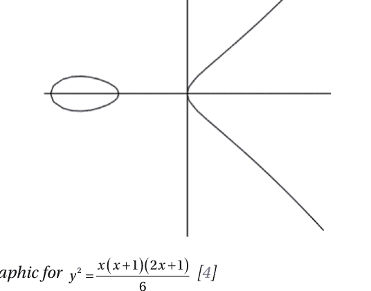
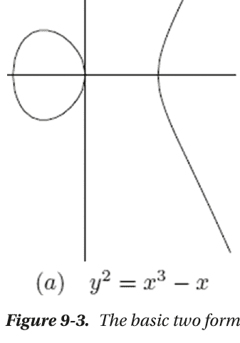
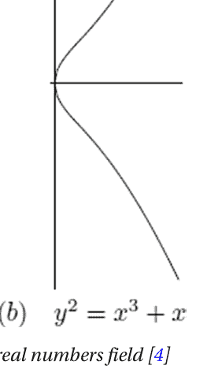
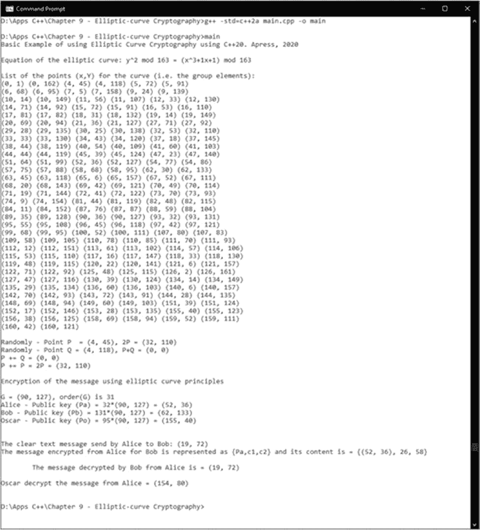
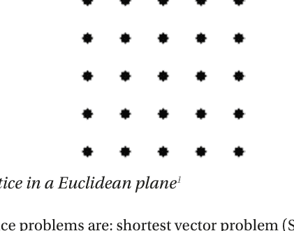
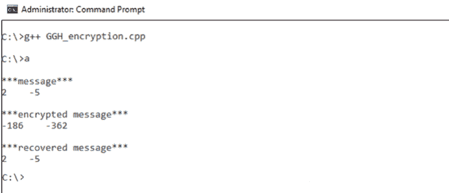

# 第 9 章

## 椭圆曲线密码学

椭圆曲线密码学（ECC）代表了一种公钥密码学方法。它基于有限域上椭圆曲线的代数结构。ECC 可用于密码学应用和原语，例如 *密钥协商*、*数字签名* 和 *伪随机生成器*。它也可以通过密钥协商与对称加密方案的结合用于加密操作。一些其他有趣的用途可以在几种基于椭圆曲线（EC）的整数分解算法中看到，这些算法在密码学中有应用，例如 Lenstra 椭圆曲线分解（L-ECC）[1]。椭圆曲线首次出现在丢番图的著作中[3]，并且一直是与丢番图几何[2]密切相关的主题。

椭圆曲线密码学的起点始于公钥密码学（PKC）。在 ECC 中使用 PKC，我们有一个专门的、特殊的椭圆曲线点操作案例以及它们是如何生成的。操作包括两种情况，*乘法* 和 *加法*。

ECC 的 *主要优势* 是我们可以使用更短的密钥获得一定级别的安全性，与大多数其他密码学算法相比，后者为相同的安全级别需要更多资源。

*第二个优势* 是在某些情况下，椭圆曲线密码学对某些攻击具有相当强的抵抗力。这些攻击是针对整数分解和离散对数设计的，并且已被证明不成功。

在继续进行实际实现之前，将介绍一些基本理论概念，以便让你熟悉椭圆曲线密码学概念及其工作原理。以下部分描述了将在实现部分中也找到的所需概念，其中你会看到 Listing 9-1 和 Listing 9-2。

## 理论基础

在本节中，我们将描述在继续进行实际实现之前必须理解的主要基础。图形内容和部分方程的表示取自并引用自[4]。

让我们从以下示例开始，我们假设我们有一组球，并将它们排列成一个规则的金字塔，这样在顶层我们只有一个球，在下一层我们有四个球，在下一层我们有九个球，依此类推（见图 9-1）。



*图 9-1.* *球的金字塔* [4]

一个合乎逻辑的问题是，如果金字塔坍塌，是否有办法将球重新排列成一个方阵？如果金字塔只有三层，重新排列过程无法完成，因为有 1 + 4 + 9 = 19 个球，这不是一个完全平方。如果我们只有一个球，金字塔将以一层组织，并且有一个行和一列的方阵。

如果金字塔有 x 高度，那么我们将有

$$1^2 + 2^2 + 3^2 + \ldots x^2 = \frac{x(x+1)(2x+1)}{6}\text{ balls.}$$


意图是该数是一个完全平方数。为此，我们需要求解以下方程：

```
y² = x(x+1)(2x+1)/6 in N.
```

此类方程代表椭圆曲线方程。见图 9-2。



## Figure 9-2. Graphic for y² = x(x+1)(2x+1)/6 [4]

图 9-2 中所示的 y² = x(x+1)(2x+1)/6 方程可使用丢番图方法求解，利用已知点寻找其他点。利用 (0, 0) 和 (1, 1) 点，我们可以得到以下直线方程：y = x。当我们将得到的曲线与直线方程相交时，我们得到以下关系：

```
x² = x(x+1)(2x+1)/6 = 1/3 x³ + 1/3 x² + 1/6 x
```

等价于

```
x³ - 3/2 x² + 1/2 x = 0.
```

我们已知该方程的两个根，x = 0 和 x = 1，它们是直线方程与曲线交点在 Ox 轴上的坐标。对于三个实数 a, b, c，我们知道

```
(x − a)(x − b)(x − c) = x³ + (a + b + c)x² + (ab + ac + bc)x − abc.
```

在我们的情况下，对于根 0, 1, x 我们将得到 0 + 1 + x = 3/2，求得坐标点 (1/2, 1/2)。由于曲线的对称性，我们也有坐标点 (1/2, −1/2)。

继续使用上述技术对点 (1/2, −1/2) 和 (1, 1)，我们将得到直线方程 y = 3x − 2，它将与给定曲线相交，得到以下结果：

```
(3x − 2)² = x(x + 1)(2x + 1) / 6
```

等价于

```
x³ − 51/2 x² + … = 0.
```

我们已知根 1/2 和 1，所以我们将得到

```
1/2 + 1 + x = 51/2,
```

由此我们得到 x = 24 和 y = 70，这意味着

```
1² + 2² + 3² + … + 24² = 70².
```

如果有 4900 个球，它们可以排列成一个高度为 24 的金字塔，并且可以排列成一个有 24 行和 24 列的正方锥。

## Weierstrass Equation

在下一节中，将使用 Weierstrass 方程提供实际解法。

## Definition 9-1. 设椭圆曲线 E 为以下集合：

{(x,y)|y² = x³ + Ax + B}，其中元素 A, B, x, y 是来自域 K 的元素，定义为 K ∈ {ℚ,ℝ,ℂ,ℤₚ,ℤ_q}，其中 p 表示素数，q = p^k，k ≥ 1，且 A, B 为常数。

## Definition 9-2. 根据定义 9-1 定义的方程称为 Weierstrass 方程。

## Definition 9-3. 如果 K 是一个域且 A, B ∈ K，我们将说 E 在域 K 上定义。

对于坐标在 L ⊆ K 中的点，我们将写成 E(L)。根据定义，我们向此集合添加一个不属于仿射平面的点，该点记为 ∞：

```
E(L) = {∞} ∪ {(x,y) ∈ L × L, y² = x³ + Ax + B}
```

直观上，考虑实数域上椭圆曲线的图像是有用的。它有两个基本形式，如图 9-3 所示。方程 y² = x³ − x 有三个实根，而方程 y² = x³ + x 有一个实根。不允许有重根，因此我们需要提到以下条件：4A³ + 27B² ≠ 0。





## Figure 9-3. The basic two forms of the elliptic curve over a real numbers field [4]

如果根为 \(r_1, r_2, r_3\)，则

\[((r_1-r_2)(r_1-r_3)(r_2-r_3))^2=-(4A^3+27B^2).\]

**Definition 9-4.** 椭圆方程在 \(K\) 域上的一般形式称为 *Weierstrass 广义方程*，其形式为

\[y^2+a_1xy+a_3y=x^3+a_2x^2+a_4x+a_6\]

其中 \(a_1\ldots a_6\) 是来自 \(K\) 的常数。此形式非常有用，尤其是在我们稍后进行实现时。

广义 Weierstrass 方程对于具有二或三特征的域很有用。对于具有不同特征的域，我们将得到

\[\left(y+\frac{a_1x}{2}+\frac{a_3}{2}\right)^2=x^3+\left(a_2+\frac{a_1^2}{4}\right)x^2+\left(a_4+\frac{a_1a_3}{2}\right)x+\left(\frac{a_3^2}{4}+a_6\right),\]

等价于

\[y_1^2=x^3+a'_2x^2+a'_4x+a'_6,\]

其中 \(y_1=y+\frac{a_1}{2}x+\frac{a_3}{2}\) 且 \(a'_2,a'_4,a'_6\) 为常数。对于特征不同于三的域，我们有

\[x_1=x+\frac{a'_2}{3}.\]

我们将得到

\[y_1^2=x_1^3+Ax_1+B,\]

其中 \(A\) 和 \(B\) 为常数。

## Group Law

在实际实现时，群律对于处理点之间的运算非常重要。需要遵循一个定理以便进行适当的实现。定理 9-1 描述了椭圆曲线的性质。这些性质已在列表 9-2 中实现。

## Theorem 9-1. 在椭圆曲线 E 上加点的性质如下：

+   1. (交换律) P₁ + P₂ = P₂ + P₁, ∀ P₁, P₂ ∈ E;
+   2. (单位元) P + ∞ = P, ∀ P ∈ E;
+   3. (逆元存在) ∀ P ∈ E, ∃ P′ ∈ E 使得 P + P′ = ∞。该点 P′ 通常记为 −P。
+   4. (结合律) (P₁ + P₂) + P₃ = P₁ + (P₂ + P₃), ∀ P₁, P₂, P₃ ∈ E。

## Practical Implementation

本节讨论使用 C++20 实现 ECC 的实际实现，并逐步提供 ECC 的基本实现。

我们提供的示例（见图 9-4、列表 9-1 和列表 9-2）表示在阶为 P 的有限域上椭圆曲线的实现。以下椭圆曲线方程将用于我们的实现：

y² mod P = x³ + a x + b mod P。

实现分为两个部分：

+   - 有限域有限元引擎的实现 (FFE_Engine.hpp) – 列表 9-1：该文件包含以下操作和函数的签名：
+     - int ExtendedGreatestCommongDivisor(): 该函数计算扩展最大公约数。
+     - int InverseModular(): 该函数的目的是求解线性同余方程 x × z = 1 (mod n)。
+     - FFE operator-() const: 该运算符表示取负运算。
+     - FFE& operator=(int i): 该运算符处理与整数的赋值。
+     - FFE<P>& operator=(const FFE<P>& rhs): 来自域元素的赋值的运算符

+   - *主程序*，列于 *列表 9-2*：该文件包含椭圆曲线密码学的核心实现。在主程序中，特别关注上述运算符的实现。另一个重要的方面是，在程序开始时可以观察到曲线是在有限域（伽罗瓦域）上定义的，并且椭圆曲线中的任何点都由伽罗瓦域内的两个元素形成。这些点是在椭圆曲线本身的声明实例创建后创建的。为了执行椭圆曲线实现，我们需要以下两个声明：`typedef EllipticCurve<OrderFFE_EC> this_t` 和 `typedef class EllipticCurve<OrderFFE_EC>::EllipticCurvePoint point_t`。一旦我们有了这些声明，我们就可以进一步使用构造函数将 Weierstrass 方程表示为 $y^2 = x^3 + ax + b$，如下所示通过 EllipticCurve 类的构造函数表示：

```
//** the Weierstrass equation as y^2 = x^3 + ax + b
EllipticCurve(int CoefA, int CoefB)
    : ECParameterA(CoefA),
      ECParameterB(CoefB),
      tableOfPoints(),
      tableFilledComputated(false)
{}
```

下一步是计算点并将 tableFilledComputated 布尔变量设为 true，用于指示点表是否已填充以供进一步计算。其余函数相当直接，表示 Alice 和 Bob 之间以及 Oscar（试图解密消息的恶意第三方）之间的基本密码学操作。

# CHAPTER 9    ELLIPTIC-CURVE CRYPTOGRAPHY



## Figure 9-4. The output of the example

## Listing 9-1. Implementation of the Field Finite Element Engine (FFE_Engine)

```
```cpp
namespace EllipticCurveCryptography
{

        /** basic functions for
        /** Finite Field Elements (FFE)
```
```


namespace HelperFunctionFFE
{
    //** Computing Extended GCD gives g = a*u + b*v
    int ExtendedGreatestCommonDivisor(int a, int b,
                                    int& u, int &v)
    {
        u = 1;
        v = 0;
        int g = a;
        int u1 = 0;
        int v1 = 1;
        int g1 = b;
        while (g1 != 0)
        {
            //** division using integers
            int q = g/g1;
            int t1 = u - q*u1;
            int t2 = v - q*v1;
            int t3 = g - q*g1;
            u = u1; v = v1; g = g1;
            u1 = t1; v1 = t2; g1 = t3;
        }
        return g;
    }

    //** providing solution and solving
    //** the linear congruence equation
    //** x * z == 1 (mod n) for z
    int InvMod(int x, int n)
    {
        //** "%" represents the remainder
        //** function, 0 <= x % n < |n|
        x = x % n;
        int u,v,g,z;
        g = ExtendedGreatestCommonDivisor(x, n,u,v);

if (g != 1)
{
    //** x and n has to be primes
    //** in order to exist an x^-1 mod n
    z = 0;
}
else
    z = u % n;

return z;
}
}

//** represents the element from a Galois field
//** we will use a specific behaviour for the
//** modular function in which (-n) mod m will
//** return a negative number.
//** The implementation is done in such way that
//** it will offer a support for the basic
//** arithmetic operations, such as:
//** + (addition), - (subtraction), / (division)
//** and scalar multiplication.
//** The P served as an argument represents the
//** order for the field.
template<int P>
class FFE
{
int i_;

void assign(int i)
{
    i_ = i;
    if ( i<0 )
    {
        //** The correction behaviour
        //** is important.
        //** Using (-i) mod p we will make sure

//** implementation of "!=" operator
friend bool operator!=(const FFE<P>& lhs, int rhs)
{
    return (lhs.i_ != rhs);
}

// implementation of "a/b" operator
friend FFE<P> operator/(const FFE<P>& lhs,
                    const FFE<P>& rhs)
{
    return FFE<P>( lhs.i_ *
        HelperFunctionFFE::InvMod(rhs.i_,P));
}

//** implementation of "a+b" operator
friend FFE<P> operator+(const FFE<P>& lhs,
                    const FFE<P>& rhs)
{
    return FFE<P>( lhs.i_ + rhs.i_);
}

//** implementation of "a-b" operator
friend FFE<P> operator-(const FFE<P>& lhs,
                    const FFE<P>& rhs)
{
    return FFE<P>(lhs.i_ - rhs.i_);
}

// implementation of "a + int" operator
friend FFE<P> operator+(const FFE<P>& lhs, int i)
{
    return FFE<P>( lhs.i_+i);
}

//** implementation of "int + a" operator
friend FFE<P> operator+(int i, const FFE<P>& rhs)
{
    return FFE<P>( rhs.i_+i);
}

//** implementation of "int * a" operator
friend FFE<P> operator*(int n, const FFE<P>& rhs)
{
    return FFE<P>( n*rhs.i_);
}

//** implementation of "a * b"
friend FFE<P> operator*(const FFE<P>& lhs,
                    const FFE<P>& rhs)
{
    return FFE<P>( lhs.i_ * rhs.i_);
}

//** the operator ostream for
//** showing and displaying in
//** readable format
template<int T>
friend ostream& operator<<(ostream& os,
                    const FFE<T>& g)
{
    return os << g.i_;
}
};
}

## Listing 9-2. Implementation of the Main Program

```
//** Leave everything as it is.
//** Don't change the order of the inputs or namespaces.

#include <cstdlib>
#include <iostream>
#include <vector>

using namespace std;

#include <math.h>
#include "FFE_Engine.hpp"

namespace EllipticCurveCryptography
{
    //** Elliptic Curve over a finite field of order P:
    //** y^2 mod P = x^3 + ax + b mod P
    template<int OrderFFE_EC> class EllipticCurve
    {
        public:
            //** this curve is defined over the finite
            //** field (Galois field) Fp, this is the
            //** typedef of elements in it
            typedef FFE<OrderFFE_EC> ffe_element;

            //** any point on elliptic curve is formed
            //** from two elements that are within Fp
            //**field (Galois Field). The points are
            //** created once we declare an instance of
            //** Elliptic Curve itself.
            class EllipticCurvePoint
            {
                friend class EllipticCurve<OrderFFE_EC>;
                typedef FFE<OrderFFE_EC> ffe_element;
                ffe_element xCoordValue_;
                ffe_element yCoordValue_;
                EllipticCurve *ellipticCurve_;
```

# CHAPTER 9    ELLIPTIC-CURVE CRYPTOGRAPHY

```
/** core of the doubling multiplier
/** algorithm (see below)
/** multiplies acc by m as a series of
/** "2*accumulatorContainer's"
void DoublingMultiplierAlgorithm(int
                         multiplier, EllipticCurvePoint&
                         accumulatorContainer)
{
    if (multiplier > 0)
    {
        EllipticCurvePoint doublingValue =
                         accumulatorContainer;
        for (int counter=0; counter <
                         multiplier; ++counter)
        {
            /** doubling step
            doublingValue += doublingValue;
        }
        accumulatorContainer =
                         doublingValue;
    }
}

/** Implementation of doubling
/** multiplier algorithm.
/** The process stands on multiplying
/** intermediateResultAccumulator for
/** storing the intermediate
/** results with inputScalar.
/** This is done through
/** expansion in multiple
/** by 2 between the first of the
/** binary representation of inputScalar.
```

EllipticCurvePoint MultiplyUsingScalar(int
    inputScalar, const EllipticCurvePoint&
    intermediateResultAccumulator)
{
    EllipticCurvePoint
        accumulatorContainer =
        intermediateResultAccumulator;
    EllipticCurvePoint outputResult =
        EllipticCurvePoint(0,0,
        *ellipticCurve_);

    int i = 0, j = 0;
    int iS = inputScalar;

    while(iS)
    {
        if (iS&1)
        {
//** Setting up the bit.
//** The computation is done by following the formula:
//** accumulatorContainer = 2^(i-j)*accumulatorContainer
DoublingMultiplierAlgorithm(i-j,accumulatorContainer);

outputResult += accumulatorContainer;

//** last setting for the bit
j = i;
        }
        iS >>= 1;
        ++i;
    }
    return outputResult;
}

//** the function deals with
//** adding two points on the curve

if (xCoord1 == xCoord2 && yCoord1 == yCoord2)
{
    //** computing 2*P
    s = (3*(xCoord1.i()*xCoord1.i()) + ellipticCurve_->a()) / (2*yCoord1);
    xCoordR = ((s*s) - 2*xCoord1);
}
else
{
    //** computing P+Q
    s = (yCoord1 - yCoord2) / (xCoord1 - xCoord2);
    xCoordR = ((s*s) - xCoord1 - xCoord2);
}

if (s!=0)
{
    yCoordR = (-yCoord1 + s*(xCoord1 - xCoordR));
}
else
{
    xCoordR = yCoordR = 0;
}

EllipticCurvePoint(int xPoint, int yPoint)
: xCoordValue_(xPoint),
  yCoordValue_(yPoint),
  ellipticCurve_(0)
{}

# CHAPTER 9   ELLIPTIC-CURVE CRYPTOGRAPHY

EllipticCurvePoint(int xPoint, int yPoint,
                    EllipticCurve<OrderFFE_EC> &
                    EllipticCurve)
    : xCoordValue_(xPoint),
      yCoordValue_(yPoint),
      ellipticCurve_(&EllipticCurve)
    {}

EllipticCurvePoint(const ffe_element&
                   xPoint, const ffe_element& yPoint,
                   EllipticCurve<OrderFFE_EC> &
                   EllipticCurve)
    : xCoordValue_(xPoint),
      yCoordValue_(yPoint),
      ellipticCurve_(&EllipticCurve)
    {}

public:
    static EllipticCurvePoint ONE;

    /** constructor
    EllipticCurvePoint(const
                       EllipticCurvePoint& rhsPoint)
    {
        xCoordValue_ = rhsPoint.xCoordValue_;
        yCoordValue_ = rhsPoint.yCoordValue_;
        ellipticCurve_ =
            rhsPoint.ellipticCurve_;
    }

    /** the assignment process
    EllipticCurvePoint& operator=(const
                       EllipticCurvePoint& rhsPoint)
    {
        xCoordValue_ = rhsPoint.xCoordValue_;
        yCoordValue_ = rhsPoint.yCoordValue_;
        ellipticCurve_ =
            rhsPoint.ellipticCurve_;
    }


```cpp
return *this;
}

//** access x component as element of Fp
ffe_element GetX() const { return xCoordValue_; }

//** access y component as element of Fp
ffe_element GetY() const { return yCoordValue_; }

//** calculate the order of this point by
//** brute-force additions
unsigned int ComputingOrderBruteForceAddition(
    unsigned int maximum_period = ~0) const
{
    EllipticCurvePoint ecPoint = *this;
    unsigned int order = 0;
    while (ecPoint.xCoordValue_ != 0 &&
           ecPoint.yCoordValue_ != 0)
    {
        ++order;
        ecPoint += *this;
        if (order > maximum_period) break;
    }
    return order;
}

//** negation operator (-) that
//** gives the inverse of a point
EllipticCurvePoint operator-()
{
    return EllipticCurvePoint(xCoordValue_, -yCoordValue_);
}

//** equal (==) operator
friend bool operator==(const EllipticCurvePoint& lhsPoint,
                       const EllipticCurvePoint& rhsPoint)
{
    return (lhsPoint.ellipticCurve_ == rhsPoint.ellipticCurve_)
        && (lhsPoint.xCoordValue_ == rhsPoint.xCoordValue_)
        && (lhsPoint.yCoordValue_ == rhsPoint.yCoordValue_);
}

//** different (!=) operator
friend bool operator!=(const EllipticCurvePoint& lhsPoint,
                       const EllipticCurvePoint& rhsPoint)
{
    return (lhsPoint.ellipticCurve_ != rhsPoint.ellipticCurve_)
        || (lhsPoint.xCoordValue_ != rhsPoint.xCoordValue_)
        || (lhsPoint.yCoordValue_ != rhsPoint.yCoordValue_);
}

//** Implementation of a + b operator
friend EllipticCurvePoint operator+(const EllipticCurvePoint& lhsPoint,
                                    const EllipticCurvePoint& rhsPoint)
{
    ffe_element xResult, yResult;
    lhsPoint.ETwoPointsAddition(
        lhsPoint.xCoordValue_,
        lhsPoint.yCoordValue_,
        rhsPoint.xCoordValue_,
        rhsPoint.yCoordValue_,
        xResult, yResult);
    return EllipticCurvePoint(xResult, yResult, *lhsPoint.ellipticCurve_);
}

//** multiplying with scalar * int
friend EllipticCurvePoint operator*(int scalar,
                                    const EllipticCurvePoint& rhsPoint)
{
    return EllipticCurvePoint(rhsPoint).operator*=(scalar);
}

//** Implementation of += operator
EllipticCurvePoint& operator+=(const EllipticCurvePoint& rhsPoint)
{
    ECTwoPointsAddition(xCoordValue_, yCoordValue_,
                        rhsPoint.xCoordValue_, rhsPoint.yCoordValue_,
                        xCoordValue_, yCoordValue_);
    return *this;
}

//** Implementation of *= int operator
EllipticCurvePoint& operator*=(int scalar)
{
    return (*this = MultiplyUsingScalar(scalar, *this));
}

//** display and print the point
//** using ostream
friend ostream& operator<<(ostream& os, const EllipticCurvePoint& p)
{
    return (os << "(" << p.xCoordValue_ << ", " << p.yCoordValue_ << ")");
}
};
```

# 第9章 椭圆曲线密码学

```cpp
typedef EllipticCurve<OrderFFE_EC> this_t;
typedef class EllipticCurve<OrderFFE_EC>::EllipticCurvePoint point_t;

//** the Weierstrass equation
//** as y^2 = x^3 + ax + b
EllipticCurve(int CoefA, int CoefB)
    : ECParameterA(CoefA),
      ECParameterB(CoefB),
      tableOfPoints(),
      tableFilledComputed(false)
{
}

//** compute all the points
//** (from the group of elements) for
//** Weierstrass equation. Note the
//** fact that if we are
//** having a high order for the curve,
//** the computation process
//** will take some time
void CalculatePoints()
{
    int x_val[OrderFFE_EC];
    int y_val[OrderFFE_EC];
    for (int counter = 0; counter < OrderFFE_EC; ++counter)
    {
        int nsq = counter * counter;
        x_val[counter] = ((counter * nsq) +
                          ECParameterA.i() * counter +
                          ECParameterB.i()) % OrderFFE_EC;
        y_val[counter] = nsq % OrderFFE_EC;
    }

    for (int counter1 = 0; counter1 < OrderFFE_EC; ++counter1)
    {
        for (int counter2 = 0; counter2 < OrderFFE_EC; ++counter2)
        {
            if (x_val[counter1] == y_val[counter2])
            {
                tableOfPoints.push_back(
                    EllipticCurvePoint(counter1, counter2, *this));
            }
        }
    }
    tableFilledComputed = true;
}

//** obtain the point (from the group of
//** elements) for the curve
EllipticCurvePoint operator[](int n)
{
    if (!tableFilledComputed)
    {
        CalculatePoints();
    }

    return tableOfPoints[n];
}

//** the number of the elements
//** in the group
size_t Size() const { return tableOfPoints.size(); }

//** the degree of the point for
//** the elliptic curve
int Degree() const { return OrderFFE_EC; }

//** the "a" parameter, as an element of Fp
FFE<OrderFFE_EC> a() const { return ECParameterA; }

//** the "b" parameter, as an element of Fp
FFE<OrderFFE_EC> b() const { return ECParameterB; }

//** print and show the elliptic curve in a
//** readable format using ostream human
//** readable form
template<int ECT>
friend ostream& operator<<(ostream& os,
                           const EllipticCurve<ECT>& EllipticCurve);

//** print and display all the elements
//** of the elliptic curve group
ostream& PrintTable(ostream& os, int columns = 4);

private:
    typedef std::vector<EllipticCurvePoint> TableWithPoints;

    //** table with the points
    TableWithPoints tableOfPoints;

    //** first parameter of the
    //** elliptic curve equation
    FFE<OrderFFE_EC> ECParameterA;

    //** second parameter of the
    //** elliptic curve equation
    FFE<OrderFFE_EC> ECParameterB;

    //** boolean value to show if the
    //** table has been computed
    bool tableFilledComputed;
};

template<int ECT>
typename EllipticCurve<ECT>::EllipticCurvePoint
EllipticCurve<ECT>::EllipticCurvePoint::ONE(0, 0);

template<int ECT>
ostream& operator<<(ostream& os,
                    const EllipticCurve<ECT>& EllipticCurve)
{
    os << "y^2 mod " << ECT << " = (x^3" << showpos;
    if (EllipticCurve.ECParameterA != 0)
    {
        os << EllipticCurve.ECParameterA << "x";
    }

    if (EllipticCurve.ECParameterB.i() != 0)
    {
        os << EllipticCurve.ECParameterB;
    }

    os << noshowpos << ") mod " << ECT;
    return os;
}

template<int P>
ostream& EllipticCurve<P>::PrintTable(ostream& os, int columns)
{
    if (tableFilledComputed)
    {
        int col = 0;
        typename EllipticCurve<P>::TableWithPoints::iterator iter =
            tableOfPoints.begin();
        for (; iter != tableOfPoints.end(); ++iter)
        {
            os << "(" << (*iter).xCoordValue_.i() <<
                  ", " << (*iter).yCoordValue_.i() << ") ";
            if (++col > columns)
            {
                os << "\n";
                col = 0;
            }
        }
    }
    else
    {
        os << "EllipticCurve, F_" << P;
    }
    return os;
}
}

namespace utils
{
    float frand()
    {
        static float norm = 1.0f / (float)RAND_MAX;
        return (float)rand() * norm;
    }

    int irand(int min, int max)
    {
        return min + (int)(frand() * (float)(max - min));
    }
}

using namespace EllipticCurveCryptography;
using namespace utils;

int main(int argc, char *argv[])
{
    typedef EllipticCurve<163> elliptic_curve;
    elliptic_curve myEllipticCurve(1, 1);

    cout << "Basic Example of using Elliptic Curve Cryptography using C++20. Apress, 2020\n\n";

    //** display some information about the
    //** elliptic curve and display some of the properties
    cout << "Equation of the elliptic curve: " << myEllipticCurve << "\n";

    //** compute the points for the elliptic
    //** curve for equation from the above
    myEllipticCurve.CalculatePoints();

    cout << "\nList of the points (x,Y) for the curve (i.e. the group elements):\n";
    myEllipticCurve.PrintTable(cout, 5);
    cout << "\n\n";

    elliptic_curve::EllipticCurvePoint P = myEllipticCurve[2];
    cout << "Randomly - Point P = " << P << ", 2P = " << (P + P) << "\n";

    elliptic_curve::EllipticCurvePoint Q = myEllipticCurve[3];
    cout << "Randomly - Point Q = " << Q << ", P+Q = " << (P + Q) << "\n";

    elliptic_curve::EllipticCurvePoint R = P;
    R += Q;
    cout << "P += Q = " << R << "\n";
```


# 第9章 椭圆曲线密码学

```
R = P;
R += R;
cout << "P += P = 2P = " << R << "\n";

cout << "\nEncryption of the message using
                   elliptic curve principles\n\n";

/** as an example we will use Menes-Vanstone
/** scheme that is based on elliptic
/** curve for message encryption
elliptic_curve::EllipticCurvePoint G = myEllipticCurve[0];
while((G.GetY() == 0 || G.GetX() == 0) ||
      (G.ComputingOrderBruteForceAddition()<2))
{
    int n = (int)(frand()*myEllipticCurve.Size());
    G = myEllipticCurve[n];
}

cout << "G = " << G << ", order(G) is " <<
                   G.ComputingOrderBruteForceAddition() << "\n";

/** Suppose that Alice wish to communicate with Bob
/** Alice and its public key
int a = irand(1,myEllipticCurve.Degree()-1);

/** generating the public key
elliptic_curve::EllipticCurvePoint Pa = a*G;
cout << "Alice - Public key (Pa) = " << a << "*" << G << "\n"
                                  " = " << Pa << endl;

/** Bob and is public key
int b = irand(1,myEllipticCurve.Degree()-1);

/** the public key
elliptic_curve::EllipticCurvePoint Pb = b*G;
cout << "Bob - Public key (Pb) = " << b << "*" << G << " =
                                  " << Pb << endl;
```

```
elliptic_curve::ffe_element m1d = c1/Pk.GetX();
elliptic_curve::ffe_element m2d = c2/Pk.GetY();

cout << "\tThe message decrypted by Bob from Alice is = (" << m1d << ", " << m2d << ")" << endl;

//** Oscar will intercept the message and
//** and he/she will try to decrypt it
//** using his/her key
Pk = o*Pa;
m1d = c1/Pk.GetX();
m2d = c2/Pk.GetY();

cout << "\nOscar decrypt the message from Alice = (" << m1d << ", " << m2d << ")" << endl;

cout << endl;
}
```

## 结论

在本章中，我们讨论了椭圆曲线密码学以及如何在实践中实现它。

既然你已经读完了本章的结尾，你现在可以

+   - 理解实现椭圆曲线密码学的理论基础。
+   - 将理论机制和定理应用于群律运算的实践。
+   - 实现基本操作并将其转化为实用的椭圆曲线密码学。

## 参考文献

+   [1] Lenstra Elliptic-Curve Cryptography. Available online: https://en.wikipedia.org/wiki/Lenstra_elliptic-curve_factorization.
+   
+   [2] Diophantine Geometry. Available online: https://en.wikipedia.org/wiki/Diophantine_geometry.
+   
+   [3] Diophantus. Available online: https://en.wikipedia.org/wiki/Diophantus.
+   
+   [4] L. Washington, *Elliptic curves: number theory and cryptography*, second edition. Chapman & Hall/CRC, Taylor & Francis Group, LLC, 2008.

在上述构造中，$a_i$ 是一个整数，$b_i$ 是基 $b$ 的第 $i$ 个元素。此外，可以观察到 $\mathcal{L}$ 是所有具有整数系数的线性组合的集合。格的一个直接例子是 $\mathbb{Z}^n$，由 $\mathbb{R}^n$ 中的标准基生成。图 10-1 显示了欧几里得平面中的一个格。



# 图 10-1. 欧几里得平面中的一个格

格问题的例子有：最短向量问题（SVP）、最近向量问题（CVP）、最短独立向量问题（SIVP）、GapSVP、GapCVP、有界距离译码、覆盖半径问题和最短基问题。在密码学中，SVP 和 CVP 主要用作密码系统中的困难性假设。

对于 SVP，给出以下元素：向量空间 $V$、向量空间中的基 $b$，以及范数 $N$。已知格 $\mathcal{L}(b)$，需要计算最短向量 $v \in V$，使得 $v$ 在 $V$ 中的范数表示 $\mathcal{L}$ 中定义的最小距离。换句话说，需要找到向量 $v \in V$，使得

```
$\|v\| = \lambda\left(\mathcal{L}(b)\right)$
```

在上述关系中，$\| . \|$ 表示 $V$ 中的范数，$\mathcal{L}(b)$ 是在基 $b$ 上定义的格，$\lambda$ 是在 $\mathcal{L}(b)$ 中定义的最小距离。该关系给出了 SVP 的搜索变体。其他两个变体是

+   - **计算**：给定基 $b$ 和格 $\lambda\left(\mathcal{L}(b)\right)$，求格 $\lambda\left(\mathcal{L}(b)\right)$ 中的最小距离。

+   - **判定**：给定基 $b$、格 $\lambda\left(\mathcal{L}(b)\right)$ 和实值 $d > 0$，判定 $\lambda\left(\mathcal{L}(b)\right) \le d$ 还是 $\lambda\left(\mathcal{L}(b)\right) > d$。

SVP 的一个推广是 CVP，其中，通俗地说，给定向量 $v \in V$，需要找到 $\mathcal{L}(b)$ 中最接近 $v$ 的向量 $u$。请注意，$v$ 不一定在 $\mathcal{L}(b)$ 中。在某些情况下，还有一个附加条件：$v$ 与 $u$ 之间的距离不应超过给定值。

有关密码学中使用的格的更多信息，可以参考 [2]、[3]。

# 示例

在本节中，我们介绍一种使用格的 GGH 加密方案 [1]。GGH 是一种非对称加密方案，即使用公钥进行加密，使用私钥进行解密。密码系统的算法是众所周知的密钥生成、加密和解密。在下面，我们按 [1] 中提出的方案介绍它们：

+   - **密钥生成**：给定一个安全参数，在定义在 $n$ 维空间上的格 $\mathcal{L}$ 中生成一个具有良好性质的基 $b$（例如包含近乎正交的向量）以及一个幺模矩阵 $A$。基和矩阵组成私钥。公钥计算为 $B = A \cdot b$。

+   - **加密**：给定消息 $m = (m_1, ..., m_n)$ 和误差 $e = (e_1, ..., e_n)$，加密为 $c = m \cdot B + e$。

+   - **解密**：给定加密 $c = (c_1, ..., c_n)$，消息计算分为两步：

+   1. 计算 $c \cdot b^{-1}$。这会得到 $c \cdot b^{-1} = (m \cdot B + e) b^{-1} = m \cdot A \cdot b \cdot b^{-1} + e \cdot b^{-1} = m \cdot A + e \cdot b^{-1}$。

+   2. 使用 Babai 逼近等技术去除 $e \cdot b^{-1}$ 并计算 $m = m \cdot A \cdot A^{-1}$。

此外，我们提供了 GGH 的加密和解密实现（列表 10-1），使用的密钥值为：

$b = \begin{pmatrix} 17 & 0 \\ 0 & 19 \end{pmatrix}; A = \begin{pmatrix} 2 & 3 \\ 3 & 5 \end{pmatrix}$

结果显示在图 10-2 中。



# 图 10-2. 列表 10-1 的结果

# 列表 10-1. GGH 密码系统的加密和解密算法

```
#include <iostream>
#include "math.h"

using namespace std;

void encrypt(double message[100], double public_B[100][100], double error_vals[100], int dimension, double output_encrypted_text[100]);
void decrypt(int dimension, double encrypted_message[100], double private_basis[100][100], double unimodular_matrix[100][100], double output_message[100]);
double matrix_determinant(double square_matrix[100][100], int dimension);
void matrix_inverse(double matrix[100][100], int dimension, double output_inverse[100][100]);
void matrix_multiplication(double matrix1[100][100], double matrix2[100][100], double output[100][100], int dimension);
void matrix_addition(double matrix1[100][100], double matrix2[100][100], double output_sum[100][100], int dimension);
void get_cofactor(double matrix[100][100], double aux[100][100], int p, int q, int n);
void adjoint_matrix(double matrix[100][100], double adjoint[100][100], int dimension);
bool inverse_matrix(double matrix[100][100], double inv_matrix[100][100], int dimension);
```

```
void vector_to_matrix(double v[100], int dimension, double output_matrix[100][100]);
void matrix_to_vector(double matrix[100][100], double output_v[100], int dimension);
void print_matrix(double matrix[100][100], int n, string message);
void print_vector(double vect[100], int n, string message);
void print_message(string message);

int main()
{
    int message_length = 2;

    double b[100][100] = {{17.0, 0.0}, {0.0, 19.0}}; // the private basis -> b
    double b_inverse[100][100];

    inverse_matrix(b, b_inverse, message_length);

    double A[100][100] = {{2.0, 3.0}, {3.0, 5.0}}; // the private unimodular matrix -> A
    double A_inverse[100][100];
    inverse_matrix(A, A_inverse, message_length);

    double B[100][100]; // the public key -> B
    matrix_multiplication(A, b, B, message_length);

    // Encryption
    double enc_message[100]; // stores the encryption of the message -> c
    double message[100] = {2, -5}; // the message -> m
    double error_vals[100] = {1, -1}; // the error values -> e

    print_vector(message, message_length, "message");
    encrypt(message, B, error_vals, message_length, enc_message);
    print_vector(enc_message, message_length, "encrypted message");

    // Decryption
    double recovered_message[100];
    decrypt(message_length, enc_message, b, A, recovered_message);
    print_vector(recovered_message, message_length, "recovered message");
}
```


```cpp
// Auxiliary function that prints a matrix on the console
void print_matrix(double matrix[100][100], int n, string message)
{
    cout<<endl<<"***"<<message<<"***"<<endl;

    for(int i = 0; i < n; i++)
    {
        for(int j = 0; j < n; j++)
            cout<<matrix[i][j]<<"    ";

        cout<<endl;
    }

    cout<<endl;
}

// Auxiliary function that prints a vector on the console
void print_vector(double vect[100], int n, string message)
{
    cout<<endl<<"***"<<message<<"***"<<endl;

    for(int i = 0; i < n; i++)
    {
        cout<<vect[i]<<"    ";
    }

    cout<<endl;
}

// Auxiliary function that prints a string message on the console
void print_message(string message)
{
    cout<<endl<<"***"<<message<<"***"<<endl;
}

void encrypt(double message[100], double public_B[100][100], double error_vals[100], int dimension, double output_encrypted_text[100])
{
    // c=mB+e
    double aux_message[100][100], aux_enc_message[100][100], aux_error_vals[100][100];
    vector_to_matrix(message, dimension, aux_message);

    // Compute m•B -> aux_enc_message
    matrix_multiplication(aux_message, public_B, aux_enc_message, dimension);
    vector_to_matrix(error_vals, dimension, aux_error_vals);

    // Compute m•B+e -> output_encrypted_text
    matrix_addition(aux_enc_message, aux_error_vals, aux_enc_message, dimension);
    matrix_to_vector(aux_enc_message, output_encrypted_text, dimension);
}

void decrypt(int dimension, double encrypted_message[100], double private_basis[100][100], double unimodular_matrix[100][100], double output_message[100])
{
    // (1) Compute c * (b^(-1))
    // (2) Remove e * (b^(-1))
    // (3) Compute m * A * (A^(-1))
    double aux_enc_message[100][100], aux_message[100][100];
    double recovered_message[100][100];

    // Compute the inverse of the basis -> b_inverse
    double b_inverse[100][100];
    inverse_matrix(private_basis, b_inverse, dimension);

    // Compute the inverse of the unimodular matrix -> A_inverse
    double A_inverse[100][100];
    inverse_matrix(unimodular_matrix, A_inverse, dimension);

    // (1) Compute c * (b^(-1)) -> aux_enc_message
    vector_to_matrix(encrypted_message, dimension, aux_enc_message);
    matrix_multiplication(aux_enc_message, b_inverse, aux_message, dimension);

    // (2) Remove e * (b^(-1)) from aux_enc_message
    // Basically, the value aux_message[i][j] is rounded to the neareast integer
    for (int i=0; i<2; i++)
    {
        for (int j=0; j<2; j++)
            aux_message[i][j] = round(aux_message[i][j]);
    }

    // (3) Compute m * A * (A^(-1))
    matrix_multiplication(aux_message, A_inverse, recovered_message, dimension);
    matrix_to_vector(recovered_message, output_message, dimension);
}

// Computes the matrix multiplication between two matrices
void matrix_multiplication(double matrix1[100][100], double matrix2[100][100], double output[100][100], int dimension)
{
    for (int i = 0; i < dimension; i++)
    {
        for (int j = 0; j < dimension; j++)
        {
            output[i][j] = 0;
            for (int k = 0; k < dimension; k++)
                output[i][j] += matrix1[i][k] * matrix2[k][j];
        }
    }
}

// Computes the matrix sum between two matrices
void matrix_addition(double matrix1[100][100], double matrix2[100][100], double output_sum[100][100], int dimension)
{
    for(int i = 0; i < dimension; ++i)
        for(int j = 0; j < dimension; ++j)
            output_sum[i][j] = matrix1[i][j] + matrix2[i][j];
}

// Computes the cofactor of the element matrix[p][q]
void get_cofactor(double matrix[100][100], double aux[100][100], int p, int q, int n)
{
    int i = 0, j = 0;

    for (int row = 0; row < n; row++)
    {
        for (int col = 0; col < n; col++)
        {
            if (row != p && col != q)
            {
                aux[i][j++] = matrix[row][col];

                if (j == n - 1)
                {
                    j = 0;
                    i++;
                }
            }
        }
    }
}

// computes the determinant of a square matrix
double matrix_determinant(double square_matrix[100][100], int dimension)
{
    double matrix_det = 0.0;
    double aux_matrix[100][100];

    if (dimension == 1)
        return square_matrix[0][0];

    if (dimension == 2)
        return ((square_matrix[0][0] * square_matrix[1][1]) - (square_matrix[1][0] * square_matrix[0][1]));

    for (int i=0; i<dimension; i++)
    {
        for (int j=0; j<dimension; j++)
        {
            get_cofactor(matrix, aux, i, j, dimension);
            sign = ((i + j) % 2 == 0) ? 1 : -1;
            adjoint[j][i] = (sign)*(matrix_determinant(aux, dimension - 1));
        }
    }

    // Computes the inverse of a matrix
    bool inverse_matrix(double matrix[100][100], double inv_matrix[100][100],
    int dimension)
    {
        double det = matrix_determinant(matrix, dimension);
        if (det == 0)
        {
            return false;
        }

        double adj[100][100];
        adjoint_matrix(matrix, adj, dimension);

        for (int i=0; i<dimension; i++)
            for (int j=0; j<dimension; j++)
            {
                if(adj[i][j] / det == -0)
                    adj[i][j] = 0.0;

                inv_matrix[i][j] = adj[i][j] / det;
            }

        return true;
    }
}
```

## 结论

在本章中，我们讨论了基于格的密码学及其重要性。在本章结束时，你现在已经了解以下内容：

- 基于格的密码学的重要性及其对密码学未来的影响
- 如何使用 GGH 密码体制进行加密和解密
- 如何实现与格和矩阵相关的实用函数和方法

## 参考文献

[1] O. Goldreich、S. Goldwasser 和 S. Halevi，“基于格归约问题的公钥密码体制”，载于 *Annual International Cryptology Conference*（第112-131页）。Springer；柏林，海德堡。1997年8月。

[2] D. Micciancio 和 O. Regev，“基于格的密码学”，载于 *Post-quantum cryptography*（第147-191页）。Springer；柏林，海德堡。2009年。

[3] H. Knospe, *A Course in Cryptography*（第40卷）。美国数学学会。2019年。
