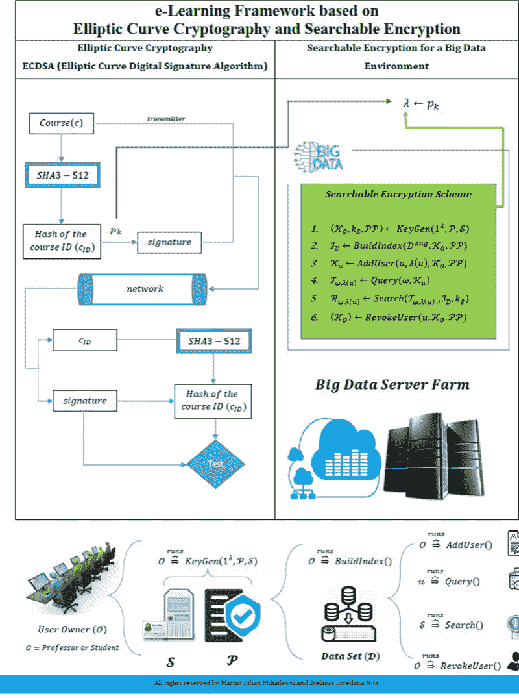
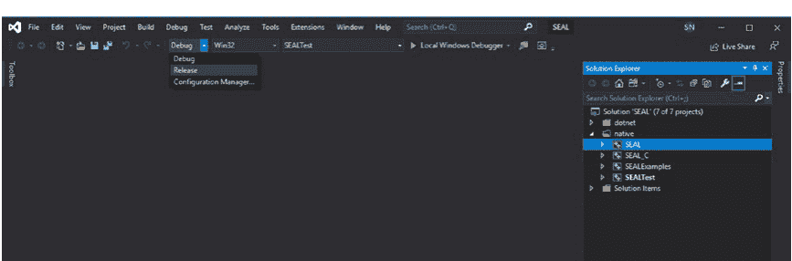
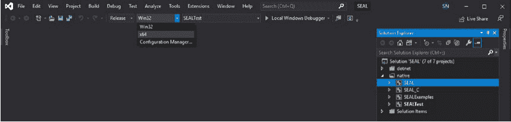
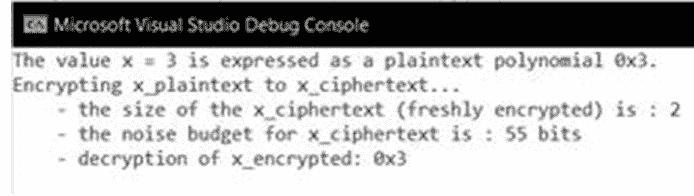
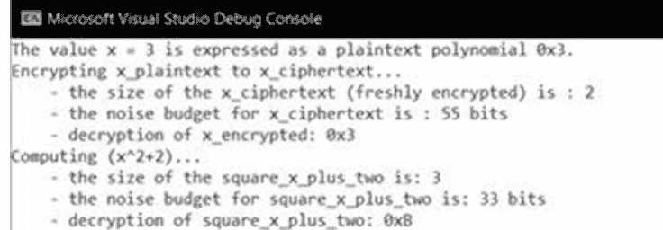
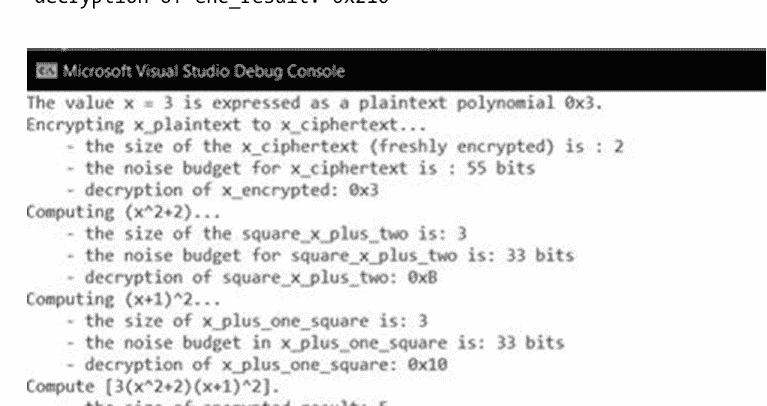
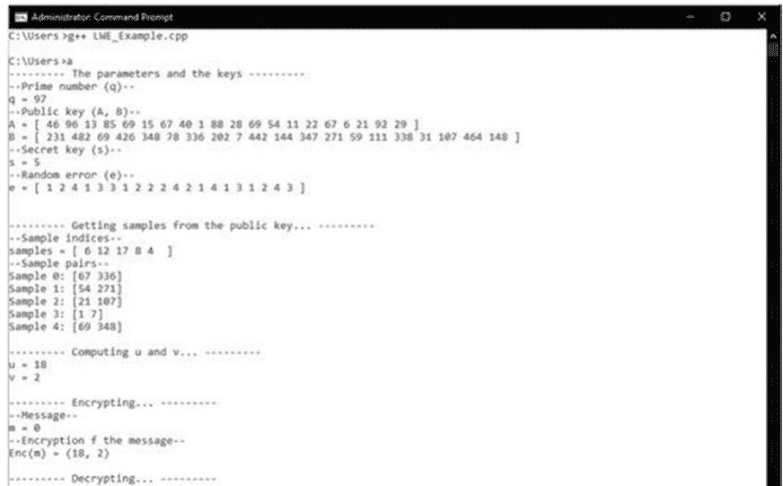

# 第11章
## 可搜索加密

可搜索加密（SE）是一种加密技术，允许将加密数据外包给可能不可信的第三方服务提供商，同时允许用户直接对加密数据安全地进行搜索操作。可搜索加密可以被视为一种全同态加密，后者将在第12章讨论。

为了理解可搜索加密技术，请考虑以下场景。有一组由数据所有者A拥有并存储在服务器上的文档，但允许数据用户B以特定方式（稍后将详细说明）访问这些文档。为了确保安全，A使用B的公钥加密文档，然后将它们存储在服务器上。在这种场景下，B仅被允许搜索文档（注意文档是加密格式）或阅读文档（注意B只有在从服务器检索并解密后才能阅读文档）。假设B想从服务器检索包含特定关键字（例如“编程”）的任何文档。为此，B基于查询词“编程”和B拥有的密钥构造一个称为陷门的值，然后将陷门值提交给服务器。服务器将执行可搜索加密方案给出的搜索算法，并将结果（加密格式）发送给B。

另一个更实际的例子如下：某实体开发了一个软件解决方案，该方案在某些时候需要其客户的社会安全号码（SSN）。规则和良好实践建议在使用SSN时对其进行加密。这可能具有挑战性，因为员工会用到SSN，例如在他们需要搜索用户账户时。一种解决方案是员工在加密的SSN中搜索特定的SSN（而不以任何方式解密它们）。可搜索加密方案将使这成为可能。

既然你已经了解了可搜索加密，可以说它具有巨大潜力，能让数据用户在加密数据上搜索特定内容。可搜索加密的一个直接应用是在医疗保健领域，其中患者的


medical files can be searched in an encrypted form. Other applications are in education, business, and basically in any domain that requires search processes through data.

## Components

The components of a searchable encryption scheme are as follows: the entities and the algorithms. In this section, we present these components in a detailed view.

## Entities

When a software solution is implemented, more aspects should be clarified before the implementation itself: the clients who will use the application, the entity that will maintain it, the type of data, the roles supported by the application, and so on.

In a system that uses a searchable encryption scheme, the following entities are involved in the whole process:

- **Data owner:** The data owner, who is assumed to be a trusted party, has a number of *n* documents, *D* = {*D*₁, …, *Dₙ}, which are characterized by keywords (note that these keywords are not metadata). Both the documents and the keywords will be outsourced. Prior to outsourcing the documents (and the keywords, which are often organized into a structure called *index structure*) on the server, they are encrypted by the data owner using an encryption algorithm of a searchable encryption scheme.

- **Data user:** The data user, who is an authorized user of the data, may trigger the search process. Using the query keyword for which the search will be made, the data user generates a trapdoor value that will be used when searching over the encrypted data. Also, the data user may decrypt the documents from the search process if the data user possesses the private key. Note that the data owner can be a data user.

- **Server:** The server, which is considered semi-trusted or honest-but-curious, stores the encrypted data and performs the search algorithms based on the trapdoor value that it receives from the data user. *Semi-trusted or honest-but-curious* means that it performs the search algorithms as instructed but can analyze the data that was given to it.

## Types

From the cryptographic point of view, searchable encryption schemes can be categorized as follows: *symmetric searchable encryption* (SSE) schemes and *public key encryption with keyword search* (PEKS) schemes. Symmetric searchable encryption schemes use just a key for the encryption or decryption of the content and additionally in other specific algorithms, as you will see below. Public-key encryption schemes with keyword search use two keys, namely a public key to encrypt content and a private (or secret) key to decrypt the encrypted content.

The SSE schemes contain the following algorithms [1]:

- **KeyGeneration**: The data owner runs this algorithm. The input is a security parameter λ, and the output is the secret key SK.
- **BuildIndex**: The data owner runs this algorithm. Its purpose is to generate a structure of indices that will contain the keywords that describe the documents. The input is the secret key SK and the set of documents D that will be stored on the server, while the output is an index structure I. Specifically, this algorithm begins with an empty index structure and for every document of the set, it appends to the index structure some keywords that describe the current document. Note that the keywords are encrypted using the secret key SK in a specific way that can be different from the encryption of the documents before being added to the index structure. The index structure can be a tree, a hash table, a list, etc.
- **Trapdoor**: The data user runs this algorithm. The input for the trapdoor algorithm is the desired query keyword kw, for which the search process is triggered, and the secret key SK, while the output is a value T_kw called trapdoor. Note that the trapdoor algorithm does not just encrypt the query keyword kw. Instead, it adds a noise value or works with something of the sort.
- **Search**: The server runs the search algorithm. The input for the search algorithm is the trapdoor value T_kw obtained from the previous algorithm and the index structure I obtained from the BuildIndex algorithm. Note that the search algorithm does not just try to match the trapdoor T_kw in I. The search algorithm should specify how the trapdoor value T_kw is searched in the index structure (remember that T_kw is not a simple encryption of a plain keyword).

If the search algorithm returns one or more documents that contain the query keyword, the documents are sent to the data user, or else the server sends a proper message. Note that the encryption and decryption algorithms are not listed above. That is because two different encryption schemes can be chosen by the data owner, namely one to encrypt the documents and one for the searchable encryption scheme. This situation is possible because the searchable encryption scheme does not directly involve the documents. All algorithms of an SSE scheme work only with the keywords and/or the index structure of encrypted keywords.

A little different from the SSE version, the algorithms of a PEKS scheme are as follows [2]:

- **KeyGeneration**: This algorithm is similar to the KeyGeneration from SSE, and the data owner runs this algorithm, too. The input is also a security parameter λ, while this time the output of the key generation is a pair of keys, namely the public and the private keys (PK, SK).
- **Encryption**: The data owner runs this algorithm, for which the public key PK and a keyword KW are the input values, while the output is the encrypted value SW of KW.
- **Trapdoor**: Similar to the trapdoor algorithm from SSE, the data user runs this algorithm to generate the trapdoor value. The input is the secret key SK and the query keyword KW for which the search is made, while the output is the trapdoor value T_KW corresponding to the keyword KW.
- **Test**: The server runs the test algorithm, for which the input is the public key PK, an encrypted value C (representing the encryption of a keyword KW'), and the trapdoor value T_KW. The output of the test algorithm is 1 if KW' = KW, and 0 otherwise.

The same remarks apply to the trapdoor and the test algorithm; the algorithms do not just offer encryption or simple matches, respectively. Still, the above algorithms for the SSE schemes and PEKS schemes are presented according to their introductions in this field in early works [1] and [2]. Since then, the algorithms were adapted alongside the options that the search process supported. Namely, multiple keywords search is allowed in some works, others enable fuzzy search (which allows small typos or inconsistencies of the format) based on keywords [3, 4], and yet others enable a semantic search (the search process returns documents that contain keywords from the semantic field of the query keyword) [5], etc. Other works focus on the documents (specifically, the documents can be updated directly on the server, without it being necessary to retrieve them from the server, decrypt, update, encrypt, and store them again on the server); other works focus on the index structure that can be updated directly on the server [6]. However, the algorithms contained in any searchable encryption scheme are the trapdoor and the search/test algorithms, and, of course, the encryption and decryption.

## Security Characteristics

There are some things that need to be protected in a searchable encryption such as the *search pattern* and the *access pattern*. The *search pattern* is the information that can be discovered from the fact that two different search results belong to the same query keywords. The *access pattern* is the set of documents resulting from a trapdoor corresponding to a given keyword *KW*. Besides, searchable encryption schemes should meet security requirements related to search queries, too. According to [7], SE schemes should have the following characteristics: controlled searching (search queries may be submitted only by authorized users), encrypted queries (the search query itself should be encrypted before being submitted to the server), and query isolation (the server learns nothing from the queries that it receives).

The SSE schemes should be IND1-CKA and/or IND2-CKA (chosen keyword attack for indexes) resistant, which means that the index structure cannot be compromised. In IND1-CKA, the same number of keywords is chosen for all documents used in the build index structure, while in IND2-CKA the documents can be described by a different number of keywords. On the other hand, the PEKS scheme should be resistant to the chosen keyword attack (which is a challenge between an attacker and the structure that manages the PEKS scheme).

Recently introduced security requirements are forward and backward privacy for the dynamic SE schemes, which allow inserting, updating, or deleting to be applied over the set of documents or the keywords directly on the server, without the need of decrypting them. Backward and forward privacies refer to the information that can be discovered in the process of inserting/deleting/updating. *Backward privacy* refers to the information that is discovered when the search is made for a keyword for which documents have been deleted before the current search, while *forward privacy* means that the current update operation is not related to previous operations.


## 一个示例

以下示例 [18] 显示了可搜索加密（SE）是一种非常强大的加密技术。其优势在于用户可以在加密文档中搜索关键字。回想一下，系统的参与者是数据用户，他拥有文档集合 S = {D₁, ..., Dₙ}，通过生成密钥准备系统，加密文档和关键字并将其存储在云服务器上；数据所有者，被允许在云服务器上提交搜索查询；以及云服务器，它以加密格式存储文档并运行搜索算法。

工作 [18] 在可搜索加密方案中使用了椭圆曲线（参见第 9 章）。如今，椭圆曲线被用于区块链（[14]、[15]）或物联网（[16]、[17]）等重要领域。

图 11-1 [18] 显示了一个使用椭圆曲线密码学并为大数据环境设计的示例可搜索加密方案（参见第 15 章）。在工作 [18] 中，椭圆曲线数字签名算法（ECDSA）用于保护 e-learning 平台上供学生使用的课程内容。可搜索加密方案的密钥生成算法的安全参数（λ）是 ECDSA 算法的私钥。

目前，由于该技术的复杂性，尚无可在实际环境中使用的可搜索加密方案的实用实现，尽管已有尝试。在对当前研究进行深入研究后，我们目前找不到以库、模块或框架形式存在的实用实现。对于实现可搜索加密方案，在开始实现之前应考虑以下基本指导原则：

- 软件应用程序的架构（服务器、数据库、服务等）
- 硬件组件及其管理方式，用于当前应用程序，其中包括安全和密码技术
- 架构应设计为可搜索加密中的进程表示为独立算法，以便在终端用户和现有网络基础设施之间正确部署。



**图 11-1.** [18]。一个实用的可搜索加密方案示例

请注意，图 11-1 中提出的可搜索加密方案被划分为更多步骤。每个步骤都是一个算法，可以被视为可搜索加密方案的独立实例。此外，实例可以实现为软件模块或服务或物联网设备（例如，像 Intel NUC PC 或 Raspberry PI 这样的设备）。软件模块或服务的分发和部署可以在分布式网络中实现，例如在云计算网络或中小型企业架构的常规网络上。

下面的算法 [18] 显示了图 11-1 中的步骤，展示了针对大数据环境的可搜索加密。在实现步骤之前，有必要了解步骤是如何组织为独立算法的。以下是步骤：

- 1. (K_O, K_s, PP) ← KeyGeneration(1^λ, P, S)。数据所有者 O 运行此概率算法，其输入值为安全参数 λ、策略 P。输出是由所有者的密钥 K_O、服务器密钥 K_s 和公共参数 PP 组成的元组。
- 2. I_D ← BuildIndex(D^aug, K_O, PP)。数据所有者 O 运行此概率算法，其输入值为数据集 D^aug 的描述（即描述每个文档的关键字）和所有者的密钥（K_O），输出为索引结构 I_D。
- 3. K_U ← (u, λ(u), K_O, PP)。数据所有者 O 运行此概率算法以在 e-learning 平台系统中注册新用户。算法的输入值为新用户的身份、用户的访问级别（用户角色）和所有者 O 的密钥。输出为新用户的密钥。
- 4. Trapdoor_(ω,λ(u)) ← Query(ω, K_u)。具有适当权限 λ(u) 生成搜索查询的数据用户运行此概率算法。输入值为关键字 ω ∈ Δ（其中 Δ 是关键字词典）和用户的密钥。输出为查询令牌（trapdoor 值）Trapdoor_(ω,λ(u))。
- 5. R_(ω,λ(u)) ← Searching(Trapdoor_(ω,λ(u)), I_D, K_s)。服务器（S）运行此概率算法，搜索包含查询关键字 ω 的数据项。输入值为搜索查询和索引，输出为 R_(ω, λ(u))，其中包含数据项 d_j ∈ D_ω, λ(u) 的标识符集合，这些数据项包含查询关键字 ω 且 λ(d_j) ≤ λ(u)，其中 λ(u_j) 是触发搜索查询的用户的访问级别，或失败符号 φ。
- 6. (K_O) ← RevokeUser(u, K_O, PP)。数据所有者 O 运行此概率算法以将特定用户从系统中撤销。输入值为用户的 id、数据所有者的密钥和服务器，而输出为所有者和服务器的新密钥。

本章设计的此可搜索加密方案是正确的，如果对于所有 k ∈ N，对于 KeyGen(1^λ, P) 输出的所有 K_O、K_S，对于所有 D^aug，对于 BuildIndex(D^aug, K_O) 输出的所有 I_D，对于所有 ω ∈ Δ，对于所有 u ∈ U 对于 AddUser(K_O, u, λ(u), PP) 输出的所有 K_u，Search(I_D, T_ω, λ(u)) = D_ω, λ(u)。

## 伪代码 11-1. 实现可搜索加密方案的指导原则

```
#include <iostream>
#include <fstream>

class KeyGeneration
{
// Step 1
// The data owner runs the algorithm
// from KeyGeneration step (algorithm)

// global variables
public: string securityParameter;
       string ownerID;
       string policyContent;
       string serverIdentity;
```

```
// the function will return the policy,
// as a content or file
public: string GetPolicy(ifstream& policyContent)
{
string content = "";
if (policyContent.is_open())
{
    while (getline (policyContent, line))
    {
        content += line;
    }
    policyContent.close();
}
else policyContent = "Cannot read the policy file";
return policyContent
}
// getting server identity can be tricky and it has
// different meanings, such as the name of computer,
// IP, active directory reference name etc...
// For the current example we will use the hardware ID
public: string GetServerIdentity()
{
string serverIdentity = "";

// here goes the implementation for getting the server identity
// for this method, Windows WMI can be used
// this link provides more details:
// https://docs.microsoft.com/en-us/windows/win32/wmisdk/wmi-start-page?redirectedfrom=MSDN

return serverIdentity
}
// class constructor
public: KeyGeneration(){}
```

```
// let's generate the secret key, server key
// and public parameters
// "#" represents the separator
public: string ReturnParameters(KeyGeneration kp)
{
string sbParameters = "";
sbParameters += kp.ownerSecretKey + "#" + kp.serverKey + "#" + 
kp.publicParameters;
return sbParameters;
}
}

class BuildIndex
{
// Step 2
// the algorithm from BuildIndex step (algorithm)
// are run and invoked by the data owner

// constructor of the class
public: void BuildIndex(){}

// the function centralize the build index parameters
// after their initialization and processing
public: void UseBuildIndexParameters()
{
list<string> descriptionDataSet;
string ownerPrivateKey = "";
string outputIndex = "";
}

//simulation of getting the data set and their
//descriptions
public: list<string> GetDataSet()
{
list<string> ll;
```


for(int i = 0; i < dataSet.size(); i++)
{
ll.push_back(description[i]);
}
}

// getting the private of the owner
public: string ownerPrivateKey()
{
string privateKey = "";

// get the private key and work with it around

return privateKey;
}

// get the index
public: string Index()
{
string index = "";

// implement the query for getting
// or generating the index

return index;
}
}

class AddUser
{
// Step 3
// the algorithm from AddUser step (algorithm)
// are run and invoked by the data owner
// constructor of the class AddUser
public: AddUser() {}
```
// property for getting the identity of the user
// see below the Class Student
public: string IdentityOfTheUser()
{
string identity = "";

// implement the way of getting
// the identity of the user

return identity;
}

// property for getting the owners key
public: string OwnerSecretKey()
{
string secretKey = "";

// implement the way of querying
// for secret key

return secretKey;
}

public: void AssignSecretKeyToUser()
{
AddUser u = new AddUser();
Student stud = new Student(u.OwnerSecretKey);
}
}

class Query
{
// Step 4
// the algorithm from Query step (algorithm)
// are run and invoked by the user

// constructor of the class Query
public: Query() {}
```
// function for getting the keywords
public: string Keyword()
{
string kw = "";

// query for the keywords;

return kw;
}

// function for getting the secret key of the users
public: string UserSecretKey()
{
string secretKey = "";

// implement the way of querying
// for secret key

return secretKey;
}

// the generation of the output as query
// token for the trapdoor
public: string QueryToken()
{
string query_token = "";

// generate and build
// the query token for trapdoor

return query_token;
}
}

class Search
{
// Step 5
// the algorithm from Search step (algorithm)
// are run and invoked by the server
```
// the constructor of the Search class
public: Search() {}

public: string SearchQuery()
{
string query = "";

// take the search query

return query;
}

public: string Index()
{
string index = "";

// take the search query

return index;
}

public: string ReturnResult()
{
string result = "";
string setOfIdentifiers = "";

// based on the search query and index,
// get the set identifiers of the data items
setOfIdentifier = "query for identifiers";

// build the result. "#" is the separator for
// illustration purpose only
result = SearchQuery + "#" + Index;

return result;
}
}

# CHAPTER 11 SEARCHABLE ENCRYPTION

```cpp
class RevokeUser
{
// Step 6
// the algorithm from Search step (algorithm)
// are run and invoked by the data owner

// constructor of RevokeUser class
public: RevokeUser(){}

// second constructor of the class
// this can be implemented as a
// solution for revoking a user
public: RevokeUser(string userID, string secretKeyDataOwner, string
secretKeyServer)
{
// implement the revoking process

// output the new key for data owner

// output the new key for server
}
}

public class Course
{
// the db_panel represents an instance of the
// file which contains classes for each of tables
// from the database
public: Database db_panel;

// Class Courses it is a generated class and assigned
// to the table Courses from the database
public: Courses c;

// student ID
string demoStudentID = "435663";
```
```
```csharp
// select the course ID based on the student
public: string GetCourse()
{
    // select the courses for a
    // specific user (student)
    Course c = db_panel.GetCourse(student.Id);

    return c;
}
}

class Student
{
    public: string secretKey {get; set;}
    public: int StudentId {get; set;}
    public: string CourseID {get; set;}
    public: string StudentName {get; set;}
    public: string StudentIdentity {get; set;}
    public: string StudentPersonalCode {get; set;}

    public: void Student(string secret_key)
    {
        secretKey = secret_key;
    }
}

string queryKeyword =
    SecureSearch.GetPrefix("123456789");

string resultStudent = SecureSearch.GetStudent.StartsWith(searchPrefix);
```

# Conclusion

In this chapter, we presented searchable encryption schemes and provided guidelines for a possible practical use that supports searchable encryption.

[8] J. Ghareh Chamani, D. Papadopoulos, C. Papamanthou, and R. Jalili, “New constructions for forward and backward private symmetric searchable encryption” in *Proceedings of the 2018 ACM SIGSAC Conference on Computer and Communications Security* (pp. 1038-1055). January, 2018.

[9] C. Zuo, S.F. Sun, J.K. Liu, J. Shao, and J. Pieprzyk, “Dynamic searchable symmetric encryption with forward and stronger backward privacy” in *European Symposium on Research in Computer Security* (pp. 283-303). Springer, Cham. September, 2019.

[10] Crypteron documentation. Available online: www.crypteron.com/docs/.

[11] C. Ma, Y. Gu, and H. Li, “Practical Searchable Symmetric Encryption Supporting Conjunctive Queries without Keyword Pair Result Pattern Leakage.”

[12] S. Fu, Q. Zhang, N. Jia, and M. Xu, "A Privacy-preserving Fuzzy Search Scheme Supporting Logic Query over Encrypted Cloud Data" in *Mobile Networks and Applications*, 1-12. 2020.

[13] Dan Boneh et al. “Public key encryption with keyword search” in *International conference on the theory and applications of cryptographic techniques*. Springer; Berlin, Heidelberg, 2004.

[14] Ernest Bonnah and Ju Shiguang, “Privacy Enhancement Scheme (PES) in a Blockchain-Edge Computing Environment” in *IEEE Access 2020*. October, 2019.

[15] Mohammad Shahriar Rahman et al, “Accountable cross-border data sharing using blockchain under relaxed trust assumption” in *IEEE Transactions on Engineering Management*. 2020.

[16] C. Bösch, P. Hartel, W. Jonker, and A. Peter, “A Survey of Provably Secure Searchable Encryption” in *ACM Comput. Surv.*, vol. 47, no. 2 (pp. 1–51). 2014.

# CHAPTER 11 SEARCHABLE ENCRYPTION

[17] Prabhat Kumar Panda and Sudipta Chattopadhyay, “A secure mutual authentication protocol for IoT environment” in *Journal of Reliable Intelligent Environments* (pp. 1-16). 2020.

[18] Marius Iulian Mihailescu, Nita Stefania Loredana, and Pau Valentin Corneliu, “E-Learning System Framework using Elliptic Curve Cryptography and Searchable Encryption” in *Proceedings of International Scientific Conference for e-Learning and Software for Education, Volume 1* (pp 545-552). DOI: 10.12753/2066-026X-20-071. 2020.

# CHAPTER 12

## Homomorphic Encryption

Important types of encryption schemes are those that fall into the homomorphic encryption (HE) category, which allows calculations to be computed directly on the encrypted data, without needing a preceding decryption operation. The most important condition in homomorphic encryption is that the value achieved by decrypting the result obtained by applying the calculations over the encrypted data must be the same as the value achieved by applying the same calculations on the plain data. With these properties, the HE schemes are considered to have great potential because they enable third-party entities to apply functions (therefore, to apply algorithms) on the encrypted data, but without the need for any access of the plain data. In this way, the data is protected and secured while being processed. For a real-life example, suppose you are on vacation into a foreign city and you want to search the Internet, using your phone or another device, for local attractions such as museums, exhibitions, art galleries, and so on. Even this simple search on the Internet may reveal a lot of information about you, such as your exact location, your cultural interests, the time of the search query, and so on. If the search engine used a homomorphic approach, then nothing would be revealed to anyone including the search engine itself, because all of the information and even the search query would be encrypted. The results that you receive would be also encrypted, therefore only you could decrypt them. Homomorphic encryption has applications in many areas, such as finance/business, healthcare, and any domain that works with sensitive data. Further, some formal aspects of homomorphic encryption are given.

The function *g: A → B* is called *homomorphic over the operation ∗* if the following condition is satisfied:

$$g(x_1) * g(x_2) = g(x_1 * x_2), \forall x_1, x_2 \in A$$

> *Remember that a general encryption system consists of the following algorithms: key generation, encryption, and decryption. Besides these three algorithms, the homomorphic encryption schemes have an additional algorithm called evaluation, which is usually*


*以 Eval 表示，它形式化地描述了上述最重要的规则。Eval 算法的输入和输出均为加密格式。在 Eval 算法中，函数 g 被应用于加密数据 c₁ 和 c₂ 上，而无需访问明文数据 m₁ 和 m₂，并具有以下性质：*

Dec(key_priv, Eval_g(key_eval, c₁, c₂)) = f(m₁, m₂)

在同态加密中，只需具备两种运算即可具有同态性质，即加法和乘法。这是因为任意函数都可以仅使用对应于加法运算（或门）和乘法运算（与门）的门电路来表示。同态加密的思想始于 20 世纪 70 年代末，当时被称为*隐私同态* [1]。最早具有同态性质的加密方案中包括无填充 RSA 算法 [2]，其中具有同态性质的操作是乘法：

Encryption(m₁) Encryption(m₂) = m₁^e m₂^e mod n
= (m₁ m₂)^e mod n
= Encryption(m₁ · m₂)

在上面的计算中，m₁、m₂ 是两个明文消息，*Encryption* 是加密函数。

同态加密方案可分为以下三类：

- **部分同态加密（PHE）**：此类方案仅支持对加密数据无限次数地应用一种运算。PHE 方案的例子包括 RSA [2]、Goldwasser-Micali [3] 和 El-Gamal [4]。此类中的大多数方案构成了其他同态方案的基础。
- **近似同态加密（SWHE）**：此类方案支持对加密数据应用两种运算，但次数有限。文献 [5] 中的加密方案是 SWHE 的一个例子。
- **全同态加密（FHE）**：此类方案支持对加密数据无限次数地应用两种运算。全同态加密被认为是“密码学的圣杯”或“密码学的瑞士军刀”[6]，因为它能够对加密数据执行任意次数的任意计算。2009 年，第一个 FHE 方案 [7] 被提出，作为基础的数学对象是带有称为理想陪集问题的困难性假设（即关于某个无法在有效时间内（多项式时间内）求解的问题的假设）的理想格。文献 [7] 中的方案在密码学中非常重要，因为它为 FHE 方案开辟了道路，尽管由于其复杂性和抽象性，该方案在提出时的形式并不实用，但它为后续方案奠定了基础。此外，[7] 中还提出了一个 FHE 方案的通用框架。

## 全同态加密

本节将更详细地解释全同态加密（FHE），因为它是密码学中一个重要的主题，可以解决许多安全问题和隐患。一种称为玻色子散射的特定量子计算模型能够实现一种量子同态加密，提供理论上有限的安全性。

由于这类方案的存在，我们不禁要问：量子方法能否生成理论上安全的 FHE 方案？在文献 [25] 中，作者证明了量子技术无法实现有效的、理论上安全的、能完全隐藏明文的 FHE 方案。

如上一节所述，第一个 FHE 方案由 Craig Gentry 于 2009 年提出，作为基础的数学对象是带有称为理想陪集问题的困难性假设（即关于某个无法在有效时间内（多项式时间内）求解的问题的假设）的理想格。继 Gentry 的方案之后，人们提出了大量基于不同数学技术的 FHE 方案。后续工作 [8] 中的 FHE 方案使用整数算术。然而，[7] 和 [8] 中方案引入的噪声增长很快，这是一个缺点，因为它对适用性和安全性影响很大，因此同态能力受到限制。由于噪声的增长，超过某一点后便无法进行解密。

第二代 FHE 方案（包括 [9] 和 [10] 等作品）更高效地处理噪声，这意味着性能得到提升，并在各种困难性假设下具有强大的安全性。*层级加密方案*和*可自举加密方案*是这一代的成果。前者评估具有给定多项式深度的电路，而后者可以修改为 FHE 方案。如果一个加密方案能够评估其解密电路以及一个额外的与非门，那么它就是一个可自举加密方案。

第三代 FHE 方案由 [11] 的工作开启，该工作使用一种新技术来处理噪声。第三代方案的性能不如第二代方案，但它们的困难性假设可以更弱。这一代许多方案的基础是非对称乘法。也就是说，考虑两个密文 c₁ 和 c₂，乘积 c₁ • c₂ 与乘积 c₂ • c₁ 不同，尽管两个乘积加密的都是明文 b₁ 和 b₂ 的相同乘积 b₁ • b₂。

FHE 可用于密码学的许多领域，例如：

- **外包：** 如果私有数据存储在第三方存储中或由第三方实体分析，则可以保证其安全。一个典型的例子是公司将其数据存储在云存储中。在将数据上传到云之前，所有者需要对其进行加密。FHE 在此类场景中非常有用，因为云提供商可以在不访问明文数据的情况下，以加密格式分析公司的数据。此外，云计算提供商会将计算结果以加密格式发送给数据所有者，在那里只有解密密钥的持有者才能解密。
- **私有信息检索（PIR）或私有查询：** 当查询数据库或应用程序使用搜索引擎时，PIR 和私有查询非常有用。另一种场景是客户端想向数据库服务器发送查询，但客户端希望服务器对其查询内容一无所知。解决方案如下：客户端对查询进行加密并将其发送给服务器，然后服务器对加密数据应用加密查询，并返回加密结果。
- **两个实体之间的通用计算**（两方计算）：考虑 A 和 B 两方。每一方分别拥有一个秘密输入 x 和 y，并且双方都知道一个共同的函数 F。为了对其私有输入 x 应用函数 F，A 方计算 r = F(x, y)。由此，A 只了解 r 的值，而对 y 一无所知。另一方面，B 对 x 或 r 一无所知。这等同于 B 在半诚实模型中计算 Fᵧ(x)，其中 A 加密 x 并发送给 B，因为语义安全性保证了 B 不会了解与 x 对应的明文值。在这种情况下，使用 FHE 会简化事情，因为 A 只需将 F 作为 F(x, y) 来应用，并以加密格式获得结果，但它不需要也不了解其他任何信息，因为所有内容（包括 F）都是加密的。

## 使用 FHE 的实际示例

有多个用于 C++ 的库实现了全同态加密。以下是一些著名的 C++ FHE 库：

- HElib [12]，由 IBM 开发，实现了 BFV（Brakerski/Fan-Vercauteren）[17] 和 CKKS（Cheon-Kim-Kim-Song）[18] 方案，可用于 Linux 和 MacOS 发行版。
- TFHE [13] 实现了 [15] 中提出的方案，可用于 Linux 发行版。同一篇论文中对该库进行了描述。
- PALISADE [14] 实现了 BGV（Brakerski-Gentry-Vaikuntanathan）[16]、BFV [17]、CKKS [18] 和 FHEW [19] 方案，以及 TFHE 方案 [13] 的更安全版本，包括自举（bootstrapping）。它支持 Linux、Windows 和 macOS 发行版。
- SEAL [20]-[23] 实现了 BFV [17] 和 CKKS [18] 方案，可用于 .Net 或 C++。此外，SEAL 库可用于 Windows、Linux 或 MacOS 环境。


**图 12-1.** SEAL.sln 解决方案的结构

用于 C++ 开发的文件夹是解决方案中的 native 文件夹。要在你自己的 C++ 应用程序中使用 SEAL 库，你首先需要生成 seal.lib 库。为此，你需要生成图 12-1 中的 SEAL 项目。从工具栏中选择 Release 配置和 x64 平台（图 12-2(a) 和图 12-2(b)），然后右键单击 SEAL 项目并选择“生成”。之所以需要 Release 配置，是因为它比 Debug 配置运行得更快，而且你实际上只需要生成 seal.lib，而不是调试它。右键单击 native 文件夹下的 SEAL 项目，选择“生成”或“重新生成”。



**图 12-2(a).** 选择用于生成 SEAL 的配置



**图 12-2(b).** *选择用于生成 SEAL 的平台*

如果一切正常，应会得到与清单 12-1 类似的消息。

**清单 12-1.** 生成 SEAL 项目的结果

```text
...
1>-- Configuring done
1>-- Generating done
1>-- Build files have been written to: C:/libs/SEAL-master/.config/16.0/x64
1>SEAL.vcxproj -> C:\libs\SEAL-master\native\src\..\..\lib\x64\Release\seal.lib
========== Build: 1 succeeded, 0 failed, 0 up-to-date, 0 skipped ==========
```

检查路径 `C:\libs\SEAL-master\lib\x64\Release`，你应该能找到库 seal.lib。现在你可以开始创建使用 FHE（全同态加密）的应用程序了。在 Visual Studio 中，创建一个名为 SealCPPExample 的 C++ 空控制台应用项目，并在“源文件”文件夹下添加一个名为 SealExample.cpp 的 cpp 文件。然后添加一个空的 main 函数，如清单 12-2 所示。

**清单 12-2.** 初始的 main 函数

```cpp
int main()
{
    return 0;
}
```

此外，需要按下述方式对应用程序进行配置以使用 SEAL 库。首先，右键单击 SealCPPExample 解决方案，并转到“属性”。在这里，确保选择了“所有配置”和“所有平台”（图 12-3）。

**图 12-5(a).** 使用 SEAL 库的设置（3）

**图 12-5(b).** 使用 SEAL 库的设置（4）

为了确保 SEAL 被正确添加，只需在 main 函数中加入清单 12-3 中的代码行，然后生成解决方案。不要忘记选择 Release 配置和 x64 平台，然后右键单击解决方案并选择“生成”。

**清单 12-3.** 检查 SEAL 是否已正确添加

```cpp
EncryptionParameters BFV_parameters(scheme_type::BFV);
```

如果返回成功消息，则可以继续；否则，如果返回类似 `'for_each_n': is not a member of 'std'` 的错误消息，则还需要执行一步：将 C/C++ > 语言下的 C++ 语言标准从“默认”更改为“ISO C++17 标准 (/std:c++17)”。

创建一个名为 seal_example_bfv 的函数，在其中添加 SEAL 库为 BFV 加密方案提供的功能。首先，应添加加密参数：环中多项式的次数（n）、明文系数的模数（t）和密文系数的模数（q）。要使用 SEAL 功能，应添加清单 12-4 中的库。应用程序会被告知使用的是 BFV 方案，并使用清单 12-5 中的代码行实例化参数。

**清单 12-4.** SEAL 所包含的库

```cpp
#pragma once

#include "seal/seal.h"
#include <iostream>
#include <algorithm>
#include <chrono>
#include <cstddef>
#include <fstream>
#include <iomanip>
#include <iostream>
#include <limits>
#include <memory>
#include <mutex>
#include <numeric>
#include <random>
#include <sstream>
#include <string>
#include <thread>
#include <vector>

using namespace std;
using namespace seal;
```

**清单 12-5.** 实例化 BFV 参数

```cpp
void seal_example_bfv()
{
    EncryptionParameters BFV_parameters(scheme_type::BFV);
}
```

实例化 BFV 参数后，它们都应被赋予一个值。*多项式模数的次数*是 2 的幂，表示一个分圆多项式[¹](https://en.wikipedia.org/wiki/Cyclotomic_polynomial)的次数。该参数的推荐值为 {1024, 2048, 4096, 8192, 16384, 32768}。多项式次数越高，可对加密数据执行越复杂的计算，但缺点是性能下降。4096 是一个合适的值，它可以以良好的性能执行可接受数量的计算，因此我们为应用程序选择了这个值。*明文系数的模数*通常是一个正整数。在我们的示例中，该参数的值是 2 的幂。根据应用的目的，该模数可以是素数。明文系数的模数用于提供明文数据的位大小，并为乘法运算中的消耗设定限制。最后一个参数是*密文系数的模数*，它是一个大整数值。该模数的值应表示为素数的乘积。选择较大的值时，可以对加密数据进行更多计算。然而，多项式模数的次数与密文系数模数的位大小之间存在关系，因此 4096 对应的值为 109。关于方案参数的全面解释可在 [20] 和 [21] 中找到。

另一个需要简单说明的功能是*噪声预算*，它表示位数。简而言之，初始噪声预算是根据加密参数以及同态操作（加法和乘法）消耗它的速率来设定的。对噪声预算设置影响最大的参数是系数模数。选择的值越高，预算就越高。当密文的噪声预算变为 0 时，密文将无法再解密，因为它包含的噪声值太大。

基于这些简要说明，可以使用清单 12-6 中的代码行（添加到函数 seal_example_bfv 中）对参数进行初始化。

**清单 12-6.** BFV 参数的初始化

```cpp
size_t polynomial_degree = 4096;
BFV_parameters.set_poly_modulus_degree(polynomial_degree);
BFV_parameters.set_coeff_modulus(CoeffModulus::BFVDefault(polynomial_degree));
BFV_parameters.set_plain_modulus(1024);
```

SEAL 上下文会检查参数的正确性：

```cpp
auto seal_context = SEALContext::Create(BFV_parameters);
```

此外，需要实例化 BFV 加密方案的类，如清单 12-7 所示（代码添加到函数 seal_example_bfv 中）。

**清单 12-7.** 实例化 BFV 加密方案的类

```cpp
KeyGenerator keygen(seal_context);
PublicKey encryption_key = keygen.public_key();
SecretKey decryption_key = keygen.secret_key();
Encryptor bfv_encrypt(seal_context, encryption_key);
Evaluator bfv_evaluate(seal_context);
Decryptor bfv_decrypt(seal_context, decryption_key);
```

接下来，在本例中，将对多项式 p(x) = 3x⁴ + 6x³ + 9x² + 12x + 6 在 x = 3 处求值。若要快速验证，你可以使用 x = 3 进行加密，然后解密它。清单 12-8 展示了这一过程和一些指标（代码添加在 `seal_example_bfv` 函数中）。

**清单 12-8.** 加密和解密 x=3

```cpp
int value_x = 3;
Plaintext x_plaintext(to_string(value_x));
cout << "The value x = " + to_string(value_x)
     + " is expressed as a plaintext polynomial 0x"
     + x_plaintext.to_string() + "." << endl;

Ciphertext x_ciphertext;
cout << "Encrypting x_plaintext to x_ciphertext..." << endl;
bfv_encrypt.encrypt(x_plaintext, x_ciphertext);

cout << "  - the size of the x_ciphertext (freshly "
        "encrypted) is : "
     << x_ciphertext.size() << endl;
cout << "  - the noise budget for x_ciphertext is : "
     << bfv_decrypt.invariant_noise_budget(x_ciphertext)
     << " bits" << endl;
Plaintext value_x_decrypted;
cout << "  - decryption of x_encrypted: ";
bfv_decrypt.decrypt(x_ciphertext, value_x_decrypted);
cout << "0x" << value_x_decrypted.to_string() << endl;
```

接下来，在 main 函数中按如下方式调用 seal_example_bfv：

```cpp
int main()
{
    seal_example_bfv();
    return 0;
}
```

若要运行应用程序，请不要忘记选择 Release 配置和 x64 平台，然后按 CTRL+F5。结果应类似于清单 12-9 和图 12-6。


### Listing 12-9. 加密、解密和指标的输出

```
The value x = 3 is expressed as a plaintext polynomial 0x3.
Encrypting x_plaintext to x_ciphertext...
  - the size of the x_ciphertext (freshly encrypted) is: 2
  - the noise budget for x_ciphertext is: 55 bits
  - decryption of x_encrypted: 0x3
```



### Figure 12-6. 加密、解密和指标的输出

Plaintext 构造函数将明文值转换为次数低于模多项式的多项式，其系数以十六进制值表示。在 SEAL 中，密文以两个或多个多项式表示，其系数为 CoeffModulus 表示的素数乘积模下的整数值。对象 x_ciphertext 实例化类 Ciphertext 并通过调用对象 bfv_encrypt 的 encrypt 方法接收 x_plaintext 加密的值。该方法有两个参数，即需要加密的对象（x_plaintext）和应放入第一个参数加密结果的对象（x_ciphertext）。多项式的数量给出密文的大小；新鲜加密的密文大小为 2，由对象 x_ciphertext 的 size() 方法返回。噪声预算由 bfv_decrypt 对象的 invariant_noise_budget() 方法计算，该方法以对象 x_ciphertext 作为参数。invariant_noise_budget() 实现在 Decryptor 类中，因为它显示在计算的某个阶段解密是否会起作用。要解密获得的加密值，请使用 bfv_decrypt 对象调用的 decrypt 方法。解密之所以有效，是因为十六进制表示中的值 0x3 意味着 3。

为优化，建议将多项式化为包含尽可能少乘法运算的形式，因为它们是代价高昂的操作，会快速降低噪声预算。因此，p(x) 可分解为

p(x) = 3(x² + 2)(x + 1)²,

这意味着你将首先计算 (x² + 2)，然后计算 (x + 1)²，然后将结果相互相乘并与 3 相乘。要计算 (x² + 2)，请按 Listing 12-10 中所示进行操作（在 seal_example_bfv 函数中添加的代码）。

### Listing 12-10. 计算 (x² + 2)

```
cout << "Computing (x^2+2)..." << endl;
Ciphertext square_x_plus_two;
bfv_evaluate.square(x_ciphertext, square_x_plus_two);
Plaintext plain_value_two("2");
bfv_evaluate.add_plain_inplace(square_x_plus_two,
    plain_value_two);

cout << "  - the size of the square_x_plus_two is: "
    << square_x_plus_two.size() << endl;
cout << "  - the noise budget for square_x_plus_two is: "
    << bfv_decrypt.invariant_noise_budget(square_x_plus_two)
    << " bits" << endl;

Plaintext decrypted_result;
cout << "  - decryption of square_x_plus_two: ";
bfv_decrypt.decrypt(square_x_plus_two, decrypted_result);
cout << "0x" << decrypted_result.to_string() << endl;
```

运行应用程序后，你将获得 Listing 12-11 和 Figure 12-7 的结果。

### Listing 12-11. 计算 (x² + 2) 的结果

```
The value x = 3 is expressed as a plaintext polynomial 0x3.
Encrypting x_plaintext to x_ciphertext...
  - the size of the x_ciphertext (freshly encrypted) is: 2
  - the noise budget for x_ciphertext is: 55 bits
  - decryption of x_encrypted: 0x3
Computing (x^2+2)...
  - the size of the square_x_plus_two is: 3
  - the noise budget for square_x_plus_two is: 33 bits
  - decryption of square_x_plus_two: 0xB
```



### Figure 12-7. 计算 (x² + 2) 的结果

为检查，如果你计算 3² + 2 你得到 11，其十六进制表示为 0xB；噪声预算大于 0，这意味着可以进行解密。

请注意 bfv_evaluate 对象允许直接对加密数据应用操作。此示例的收集变量为 square_x_plus_two。首先，该变量保存加密值平方后的值，即 x²，使用方法 square()。此外，你通过方法 add_plain_inplace() 添加明文值 2，得到 x² + 2。请记住在此示例中 x = 3。方法 square() 和 add_plain_inplace() 具有两个参数，即源和目标。

类似地，你使用收集变量 x_plus_one_square 计算 (x + 1)²（见 Listing 12-12）。

### Listing 12-12. 计算 (x + 1)²

```
cout << "Computing (x+1)^2..." << endl;
Ciphertext x_plus_one_square;
Plaintext plain_value_one("1");
bfv_evaluate.add_plain(x_ciphertext, plain_value_one,
        x_plus_one_square);
bfv_evaluate.square_inplace(x_plus_one_square);
cout << "  - the size of x_plus_one_square is: "
    << x_plus_one_square.size() << endl;
cout << "  - the noise budget in x_plus_one_square is: "
    << bfv_decrypt.invariant_noise_budget(x_plus_one_square)
    << " bits" << endl;
```

确实，如果你计算 (3 + 1)² 你得到 10，其十六进制表示为 0x10；噪声预算大于 0，因此解密仍然有效。

最终结果 3(x² + 2)(x + 1)² 收集到加密结果变量中（见 Listing 12-14）。

### Listing 12-14. 计算 3(x² + 2)(x + 1)²

```
cout << "Compute [3(x^2+2)(x+1)^2]." << endl;
Ciphertext enc_result;
Plaintext plain_value_three("3");
bfv_evaluate.multiply_plain_inplace(square_x_plus_two,
    plain_value_three);
bfv_evaluate.multiply(square_x_plus_two, x_plus_one_square,
    enc_result);
cout << "  - the size of encrypted_result: "
    << enc_result.size() << endl;
cout << "  - the noise budget for encrypted_result: "
    << bfv_decrypt.invariant_noise_budget(enc_result)
    << " bits" << endl;
cout << "NOTE: If the noise budget is zero, the decryption can be incorrect." << endl;
cout << "  - decryption of enc_result: ";
bfv_decrypt.decrypt(enc_result, decrypted_result);
cout << "0x" << decrypted_result.to_string() << endl;
```

运行应用程序后你将获得 Listing 12-15 和 Figure 12-9 所示的结果。

### Listing 12-15. 计算 3(x² + 2)(x + 1)² 的输出

```
The value x = 3 is expressed as a plaintext polynomial 0x3.
Encrypting x_plaintext to x_ciphertext...
  - the size of the x_ciphertext (freshly encrypted) is: 2
  - the noise budget for x_ciphertext is: 55 bits
  - decryption of x_encrypted: 0x3
Computing (x^2+2)...
  - the size of the square_x_plus_two is: 3
  - the noise budget for square_x_plus_two is: 33 bits
  - decryption of square_x_plus_two: 0xB

Computing (x+1)^2...
  - the size of x_plus_one_square is: 3
  - the noise budget in x_plus_one_square is: 33 bits
  - decryption of x_plus_one_square: 0x10

Compute [3(x^2+2)(x+1)^2].
  - the size of encrypted_result: 5
  - the noise budget for encrypted_result: 4 bits

NOTE: If the noise budget is zero, the decryption can be incorrect.

  - decryption of enc_result: 0x210
```



### Figure 12-9. 计算 3(x² + 2)(x + 1)² 的输出

确实，如果你计算 3(3² + 2)(3 + 1)² 你得到 528。不要忘记明文模数为 1024，因此 528 mod 1024 = 528，其十六进制表示为 0x210。噪声预算大于 0，这使你能够解密最终的加密结果。

把所有内容放在一起，参见 SealExample.cpp 文件中的代码（Listing 12-16）。

### Listing 12-16. 整个代码

```
#pragma once

#include "seal/seal.h"
#include <iostream>
#include <algorithm>
#include <chrono>
#include <cstddef>
#include <fstream>
#include <iomanip>
#include <iostream>
#include <limits>
#include <memory>
#include <mutex>
#include <numeric>
#include <random>
#include <sstream>
#include <string>
#include <thread>
#include <vector>

using namespace std;
using namespace seal;

void seal_example_bfv()
{
    EncryptionParameters BFV_parameters(scheme_type::BFV);

    size_t polynomial_degree = 4096;
    BFV_parameters.set_poly_modulus_degree(polynomial_degree);
    BFV_parameters.set_coeff_modulus(CoeffModulus::BFVDefault(polynomial_degree));
    BFV_parameters.set_plain_modulus(1024);

    auto seal_context = SEALContext::Create(BFV_parameters);
```


KeyGenerator keygen(seal_context);
PublicKey encryption_key = keygen.public_key();
SecretKey decryption_key = keygen.secret_key();
Encryptor bfv_encrypt(seal_context, encryption_key);
Evaluator bfv_evaluate(seal_context);
Decryptor bfv_decrypt(seal_context, decryption_key);

int value_x = 3;
Plaintext x_plaintext(to_string(value_x));
cout << "The value x = " + to_string(value_x) + " is expressed as a plaintext polynomial 0x" + x_plaintext.to_string() + "." << endl;

Ciphertext x_ciphertext;
cout << "Encrypting x_plaintext to x_ciphertext..." << endl;
bfv_encrypt.encrypt(x_plaintext, x_ciphertext);

cout << "  - the size of the x_ciphertext (freshly encrypted) is : " << x_ciphertext.size() << endl;
cout << "  - the noise budget for x_ciphertext is : " << bfv_decrypt.invariant_noise_budget(x_ciphertext) << " bits" << endl;

Plaintext value_x_decrypted;
cout << "  - decryption of x_encrypted: ";
bfv_decrypt.decrypt(x_ciphertext, value_x_decrypted);
cout << "0x" << value_x_decrypted.to_string() << endl;

cout << "Computing (x^2+2)..." << endl;
Ciphertext square_x_plus_two;
bfv_evaluate.square(x_ciphertext, square_x_plus_two);
Plaintext plain_value_two("2");
bfv_evaluate.add_plain_inplace(square_x_plus_two, plain_value_two);

cout << "  - the size of the square_x_plus_two is: " << square_x_plus_two.size() << endl;
cout << "  - the noise budget for square_x_plus_two is: " << bfv_decrypt.invariant_noise_budget(square_x_plus_two) << " bits" << endl;

Plaintext decrypted_result;
cout << "  - decryption of square_x_plus_two: ";
bfv_decrypt.decrypt(square_x_plus_two, decrypted_result);
cout << "0x" << decrypted_result.to_string() << endl;

cout << "Computing (x+1)^2..." << endl;
Ciphertext x_plus_one_square;
Plaintext plain_value_one("1");
bfv_evaluate.add_plain(x_ciphertext, plain_value_one, x_plus_one_square);
bfv_evaluate.square_inplace(x_plus_one_square);
cout << "  - the size of x_plus_one_square is: " << x_plus_one_square.size() << endl;
cout << "  - the noise budget in x_plus_one_square is: " << bfv_decrypt.invariant_noise_budget(x_plus_one_square) << " bits" << endl;
cout << "  - decryption of x_plus_one_square: ";
bfv_decrypt.decrypt(x_plus_one_square, decrypted_result);
cout << "0x" << decrypted_result.to_string() << endl;

cout << "Compute [3(x^2+2)(x+1)^2]." << endl;
Ciphertext enc_result;
Plaintext plain_value_three("3");
bfv_evaluate.multiply_plain_inplace(square_x_plus_two, plain_value_three);
bfv_evaluate.multiply(square_x_plus_two, x_plus_one_square, enc_result);
cout << "  - the size of encrypted_result: " << enc_result.size() << endl;
cout << "  - the noise budget for encrypted_result: " << bfv_decrypt.invariant_noise_budget(enc_result) << " bits" << endl;
cout << "NOTE: If the noise budget is zero, the decryption can be incorrect." << endl;
cout << "  - decryption of enc_result: ";
bfv_decrypt.decrypt(enc_result, decrypted_result);
cout << "0x" << decrypted_result.to_string() << endl;
}

int main()
{
    seal_example_bfv();
    return 0;
}

本节中，我们提供了一个易于理解的示例，说明如何在 Windows 发行版上使用 C++ 使用 SEAL 库。然而，现实生活中的应用程序要复杂得多，这就需要在更复杂的函数和算法方面进行处理。

SEAL 库非常有用，其最大的优势在于它不依赖于其他外部库。当应用程序使用整数的精确值时，SEAL 库中实现的 BFV 加密方案非常出色。如果应用程序需要处理实数或复数，则 CKKS 加密方案是更好的选择，该方案也在 SEAL 库中实现。

## 结论

在本章中，

- 你学习了同态加密是什么以及同态加密的类型。
- 你对全同态加密有了更深入的了解，并看到了它为何如此重要。
- 你在多项式求值的简单示例中使用了微软的 SEAL 库，该库实现了 BFV 加密方案。

## 参考文献

> [1] R.L. Rivest, L. Adleman, and M.L. Dertouzos, “On data banks and privacy homomorphisms” in Foundations of Secure Computation, 4(11) (pp. 169-180). 1978.

[2] Ronald L. Rivest, Adi Shamir, and Leonard Adleman. “A method for obtaining digital signatures and public-key cryptosystems” in Communications of the ACM 21.2 (pp. 120-126). 1978.

[3] Shafi Goldwasser and Silvio Micali, “Probabilistic encryption: how to play mental poker keeping secret all partial information” in Proceedings of the Fourteenth Annual ACM Symposium on Theory of Computing. 1982.

[4] Taher ElGamal, “A public key cryptosystem and a signature scheme based on discrete logarithms” in IEEE Transactions on Information Theory 31.4 (pp. 469-472). 1985.

[5] Dan Boneh, Eu-Jin Goh, and Kobbi Nissim, “Evaluating 2-DNF formulas on ciphertexts” in Theory of Cryptography Conference. Springer; Berlin, Heidelberg. 2005.

[6] B. Barak and Z. Brakerski, “The Swiss Army knife of cryptography”, http://windowsontheory.org/2012/05/01/the-swiss-army-knife-of-cryptography/, 2012.

[7] Craig Gentry, “Fully homomorphic encryption using ideal lattices” in Proceedings of the Forty-First Annual ACM Symposium on Theory of Computing. 2009.

[8] Marten Van Dijk et al, “Fully homomorphic encryption over the integers” in Annual International Conference on the Theory and Applications of Cryptographic Techniques. Springer; Berlin, Heidelberg, 2010.

[9] Zvika Brakerski and Vinod Vaikuntanathan, “Efficient fully homomorphic encryption from (standard) LWE” in SIAM Journal on Computing 43.2 (pp. 831-871). 2014.

[10] Craig Gentry, Z. Brakerski, and V. Vaikuntanathan, “Fully homomorphic encryption without bootstrapping” in Security 111.111 (pp. 1-12). 2011.

[20] Hao Chen, Kim Laine, and Rachel Player, “Simple encrypted arithmetic library-SEAL v2.1” in *International Conference on Financial Cryptography and Data Security*. Springer, Cham, 2017.

[21] Kim Laine, “Simple encrypted arithmetic library 2.3.1.” Microsoft Research. www.microsoft.com/en-us/research/uploads/prod/2017/11/sealmanual-2-3-1.pdf. 2017.

[22] Microsoft SEAL. Available online: www.microsoft.com/en-us/research/project/microsoft-seal/.

[23] GitHub: microsoft/SEAL. Available online: https://github.com/Microsoft/SEAL.

[24] Martin R. Albrecht, “On dual lattice attacks against small-secret LWE and parameter choices in HElib and SEAL” in *Annual International Conference on the Theory and Applications of Cryptographic Techniques*. Springer, Cham, 2017.

[25] L. Yu, C.A. Pérez-Delgado, and J.F. Fitzsimons, “Limitations on information-theoretically-secure quantum homomorphic encryption” in *Physical Review A*, 90(5), 050303. 2014.

RLWE 密码算法可以分为以下三类：

- **RLWE 密钥交换 (RLWE-KE)**：2011 年，辛辛那提大学的 Jintai Ding 利用矩阵乘法的结合性提出了基于 LWE 和 RLWE 的密钥交换初步方案 [10]。该研究于 2012 年发表，在想法被申请专利后。基于这项工作，2014 年 Chris Peikert 提出了一种密钥传输方案 [11]。
- **RLWE 签名 (RLWE-S)**：Feige、Fiat 和 Shamir 在 [12] 中提出的身份验证协议是 Lyubashevsky 于 2011 年提出的数字签名的基础。GLP（Gunesyu、Lyubashevsky 和 Popplemann）在 [14] 中提出了数字签名 [13] 的进一步改进。
- **RLWE 同态加密 (RLWE-HE)**：在第 12 章中，你看到了同态加密使计算能够直接在加密数据上应用。其中最早使用 RLWE 的全同态加密方案之一是 [15]，该方案由 Brakersky 和 Vaikuntanathan 于 2011 年提出。

在下一节中，我们提供了 LWE 和 RLWE 的最小数学背景。

## 数学背景

### 学习带误差

在量子计算机时代（我们目前正处于其中，尽管仍处于早期阶段），当前的大多数公钥加密系统都将很容易被破解，这导致了创建基于量子抗性硬度假设的密码系统的自然需求。LWE 具有这种能力。基本上，LWE 问题的难度在于计算求解该方程的值：

$b = a s + e$

在这种形式的方程中，$a$ 和 $b$ 可以构成公钥，$s$ 可以是私钥，$e$ 可以是误差值（或噪声）。


在密码学中，LWE 问题可用于不同的主题。例如，基于 LWE，可以构造出可抵御选择明文攻击或选择密文攻击的公钥加密方案。此外，LWE 还可以作为盲传输、完全同态加密或基于身份加密的基础。

在文献 [1] 中，上面的等式变为 $b = A \times s + e$，因为它应用于线性方程。这里，$A$ 成为一个二维矩阵，如果 $s$ 是一个一维矩阵，则 $b$、$e$ 是一维矩阵。另一种可能是 $A$ 和 $b$ 是一维矩阵，$s$ 是一个标量值。

下面，基于 LWE 的一个简单加密方案被提出 [4]。请注意，在示例中，$p \in \mathbb{Z}$ 表示一个素数。

## 密钥生成：
以下元素被随机选择：向量 $s \in \mathbb{Z}_p^n$，具有 $m$ 行的矩阵 $A$，其为 $m$ 个独立的均匀分布向量，以及误差分布 $e = (e_1, ..., e_m)$ 定义在 $\mathbb{Z}$ 上。然后，计算值 $b = As + e$。秘密密钥是值 $s$，公钥是二元组 $(A, b)$。

## 加密：
给定将要加密的消息 $m \in \{0, 1\}$，从 $A$ 和 $b$ 中随机抽样，得到 $v_A = \sum a_i$ 和 $v_b = \sum b_j - \frac{p}{2} m$。值 $a_i$ 和 $b_i$ 分别表示来自 $A$ 和 $b$ 的样本。$m$ 的加密是二元组 $(u, v)$。

## 解密：
计算 $val = v_b - s v_A \pmod p$。如果 $val \le \frac{p}{2}$，则消息为 $m = 0$；否则，消息为 $m = 1$。

在上面的示例中，你可以看到 LWE 的工作原理。基于 LWE 问题的公钥加密方案的例子有 [2] 和 Lindner-Peikert 加密方案。

LWE 问题分为两类：LWE 搜索和 LWE 判定。接下来，我们介绍这两种变体。

### 定义（LWE 搜索）：
设 $m$、$n$、$p \in \mathbb{Z}$ 为整数值，设 $\chi_s$ 和 $\chi_e$ 为定义在整数集合 $\mathbb{Z}$ 上的两个分布。选择值 $s \leftarrow \chi_s^n$，$e_i \leftarrow \chi_e$ 和 $a_i \leftarrow \mathcal{U}(\mathbb{Z}_p^n)$ 并计算值 $b_i := \langle a_i, s \rangle + e_i \mod p$，其中 $i = 1, ..., m$。给定元组 $(n, m, p, \chi_s, \chi_e)$，*学习带误差搜索* 变体问题在于已知 $(a_i, b_i)_{i=1}^m$ 确定 $s$。

在此定义中，$s$ 表示具有 $n$ 个值的列向量，$a_i$ 表示具有来自 $\mathbb{Z}_p$ 的 $n$ 个值的行向量，$b$ 表示具有来自 $\mathbb{Z}_p$ 的 $m$ 个元素的列向量。表示 $x \leftarrow S$ 表示 $x$ 是从有限集合 $S$ 中选择的随机变量。

### 定义（LWE 判定）：
设 $n, p \in \mathbb{Z}$ 为整数值，设 $\chi_s$ 和 $\chi_e$ 为定义在整数集合 $\mathbb{Z}$ 上的两个分布。选择值 $s \leftarrow \chi_s^n$ 并选取以下两个预言机：

- $\mathcal{O}: a \leftarrow U(\mathbb{Z}_p^n), e \leftarrow \chi_e$；输出 $(a, \langle a,s \rangle + e \bmod p)$
- $\mathcal{U}: a \leftarrow U(\mathbb{Z}_p^n), u \leftarrow U(\mathbb{Z}_p)$；输出 $(a,u)$

给定元组 $(n,p,\chi_s,\chi_e)$，*学习带误差判定* 变体意味着区分 $\mathcal{O}$ 和 $\mathcal{U}$。

## 环学习带误差

将 LWE 问题应用于系数在有限域上的多项式环称为环学习带误差问题。RLWE 在密码学的不同领域中使用，例如，在密钥交换、同态加密和签名中。RLWE 的功能与简单 LWE 的功能相似。对于 RLWE，第一个等式中的变量 $a$、$b$、$s$、$e$ 为多项式。此外，我们展示了 LWE 变体的两个定义如何为 RLWE 适配。

### 定义（RLWE 搜索）：
设 $n, p \in \mathbb{Z}$ 为整数值，其中 $n=2^k$，设 $R$ 为 $R=\frac{\mathbb{Z}[X]}{X^n+1}$ 且 $R_p=\frac{R}{pR}$，并设 $\chi_s$ 和 $\chi_e$ 为定义在环 $R_p$ 上的两个分布。选择 $s \leftarrow \chi_s$，$e \leftarrow \chi_e$ 和 $a \leftarrow U(R_p)$ 并计算值 $b:=as+e$。给定元组 $(n,p,\chi_s,\chi_e)$，*环学习带误差搜索* 变体问题在于已知 $(a,b)$ 确定 $s$。

在此定义中，$R_p$ 实际上是 $R_p=\frac{\mathbb{Z}_p[X]}{X^n+1}$。

### 定义（RLWE 判定）：
设 $n, p \in \mathbb{Z}_+$ 为整数值，并设 $\chi_s$ 和 $\chi_e$ 为定义在环 $R_p$ 上的两个分布。选择值 $s \leftarrow \chi_s$ 并选取以下两个预言机：

- $\mathcal{O}: a \leftarrow U(R_p), e \leftarrow \chi_e$；输出 $(a, as+e)$
- $\mathcal{U}: a \leftarrow U(R_p), u \leftarrow U(R_p)$；输出 $(a,u)$

## 列表 13-1. 基于文献 [4] 的简单 LWE 示例实现

```
#include <iostream>
#include <math.h>
#include <ctime>
using namespace std;

int main()
{
    srand(time(0));

    int no_of_values = 10;
    int public_key [no_of_values];
    int values [no_of_values];
    int secret_key = 5;
    int error_value = 12;
    int message = 1;
    int value = 0;

    for (int i = 0; i < no_of_values; i++)
    {
        //** generate random values between 0 and 23
        values[i] = rand() % (23 + 1 - 0) + 0;
        //** compute the public key
        public_key[i] = values[i] * secret_key + error_value;
    }

    cout<<"--Message: "<< message<<"--";
    cout<<endl<<"--Random values--"<<endl;
    for(int i = 0; i < no_of_values; i++)
    {
        cout<<values[i]<<" ";
    }

    cout<<endl<<"--Public Key--"<<endl;
    for(int i = 0; i < no_of_values; i++)
    {
        cout<<public_key[i]<<" ";
    }
}
```

```
//** get half random samples from the public_key
int noOfSamples = floor(no_of_values / 2);
int samples [noOfSamples];
for(int i=0; i < noOfSamples; i++)
{
    //** generate a number of 5 random indices between 0 and 10
    samples[i] = rand() % ((no_of_values-1) + 1 - 0) + 0;
}
cout<<endl<<"--Sample indices--";
cout<<endl<<"samples = [ ";
for (int i=0; i < noOfSamples; i++)
{
    cout << samples[i] << " ";
}
cout<<" ]" << endl;

int sum = 0;
for (int i = 0; i < noOfSamples; i++)
{
    sum += public_key[samples[i]];
}

cout<<endl<<"--The sum: " << sum << "--";

if (message == 1)
    sum+=1;

cout<<endl<<"--The encryption of the message is:" << sum <<" --";

int decryption = sum % secret_key;

if (decryption % 2 == 0)
    cout<<endl<<"--The decryption is: 0--";
else
    cout<<endl<<"--The decryption is: 1--";

return 0;
}
```

此外，我们在列表 13-2 中提供了基于文献 [5] 的使用 LWE 的更复杂的公钥加密示例。运行程序的结果显示在图 13-2 中。

## 列表 13-2. 基于 Oded Regev 在 [5] 中提出的 LWE 加密方法实现

```
#include <iostream>
#include <math.h>
#include <ctime>
using namespace std;

int main()
{
    srand(time(0));

    int numberOfRandVals = 20;
    int values_A [20]; //** values_A is a set of random numbers; represents the public key
    int secretValue = 5; //** represents the secret key
    int values_error [numberOfRandVals]; //** represents the error values
    int values_B [numberOfRandVals]; //** values_B is computed based on values_A, secretValue, values_error; represents the public key

    int q = 97; //** q is a prime number

    //** generate random values
    //** the number of random values is numberOfRandVals = 20
    //** the range is 0 - q=97
    for(int i=0; i < numberOfRandVals; i++)
    {
        //** to generate a random value in a range MIN - MAX,
        //** we proceed as folloes: val = rand() % (MAX + 1 - MIN) + MIN;

        //** generate random values between 0 - 97
        values_A[i] = rand() % (q + 1 - 0) + 0;
        //** generate small error values, between 1 - 4
        values_error[i] = rand() % (4 + 1 - 1) + 1;
```


```cpp
cout<< endl << endl << "-------- Encrypting... --------";

cout<<endl<<"--Message--";
cout<<endl<<"m = "<<message;
cout<<endl<<"--Encryption of the message--";
cout<<endl<<"Enc(m) = (" << u << ", " << v << ")";

cout<< endl << endl << "-------- Decrypting... --------";
int result = (v - secretValue * u) % q;

int decryption;
if (result > q/2)
    decryption = 1;
else
    decryption  = 0;
cout<<endl<<"The message is: " << decryption;

return 0;
}
```



Figure 13-2. The result of running the program of the public-key LWE example

Listing 13-2 provides the example of public key encryption based on LWE, which was proposed in the work [5]. We first create a secret value `secretValue` which represents the private key. In the next step, we create the public key. The public key is formed by the values from a set of random numbers `values_A` and a set of values `values_B`, which are computed based on `values_A`, `secretValue`, and random errors `values_error`. This example is implemented for a single bit.

A simple workflow for this example is:

- Between 0 and q (in the example, q=97), we select a random set of 20 values `values_A` that represent one of the components of the public key.
- Further, we define the set `values_B` where every element is computed as `values_B[i]=values_A[i] x secretValue+values_error[i] mod q`, where `secretValue` is the secret key, and where `values_error` represents a list of small random values called *the errors values*.
- The sets `values_A`, `values_B` form the public key and `secretValue` represents the secret key. At this point, we can share `values_A` and `values_B` with anyone who wants to proceed with an encryption of a message (with the condition to keep `secretValue` secret). In the encryption process, we use samples from `values_A` and `values_B`. Moving forward, based on those samples we take a bit message and compute the following two values:
  - `u = ∑ (values_A_samples)(mod q)`
  - `v = ∑(values_B_samples) + q/2 × message (mod q)`
- At this point, we can say that the encrypted message is `(u, v)`. To proceed with the decryption, we need to compute:
  - `decryption = v − s × u (mod q)`
- If `decryption < q/2`, the message is equal with 0; otherwise 1.

The procedure described above is summarized from Oded Regev’s paper [5] in order to make it easy to follow and to give you a clear understanding of how you can transpose the complexity of LWE in reality.

# Conclusion

In this chapter, we discussed Ring Learning with Errors cryptography and we implemented two examples of encryption schemes using the C++ programming language as proposed in the works [4] and [5]. RLWE can be a space for many challenges for professionals and a starting point for significant contributions to this cryptographic primitive.

Through the chapter, you experienced an interesting journey with LWE from which you gained the following:

- A solid but short mathematical background of the main concepts and definitions on which RLWE is based and without which a practical implementation will have many gaps to fill
- Experience experimenting with the challenges brought by RLWE’s mathematical concepts and their transposition in practice
- The ability to implement simple examples of public-key encryption schemes based on LWE

# References

- [1] Oded Regev, The Learning with Errors Problem, https://cims.nyu.edu/~regev/papers/lwesurvey.pdf.
- [2] O. Regev, “On lattices, learning with errors, random linear codes, and cryptography” in *Journal of the ACM (JACM)*, 56(6) (pp. 1-40). 2009.
- [3] R. Lindner and C. Peikert, “Better key sizes (and attacks) for LWE-based encryption” in *Cryptographers’ Track at the RSA Conference* (pp. 319-339). Springer; Berlin, Heidelberg. February, 2011.
- [4] O. Regev, “The Learning with Errors Problem (Invited Survey)” in *2010 IEEE 25th Annual Conference on Computational Complexity* (pp. 191-204). Cambridge, MA. doi: 10.1109/CCC.2010.26. 2010.
- [5] D. Micciancio and O. Regev. “Lattice-based cryptography” in (eds. D. J. Bernstein and J. Buchmann) *Post-quantum Cryptography*. Springer. 2008.
- [6] C. Peikert, “Some recent progress in lattice-based cryptography” in Slides for invited tutorial at TCC ’09, 2009.
- [7] D. Micciancio, “Cryptographic functions from worst-case complexity assumptions” in (eds. P. Q. Nguyen and B. Vallée) *The LLL Algorithm: Survey and Applications, Information Security and Cryptography* (pp. 427–452). Springer. 2008. Prelim. version in LLL25, 2007.
- [8] O. Regev, “Lattice-based cryptography” in *CRYPTO* (pp. 131–141). 2006.
- [9] NewHope – Post-quantum Key Encapsulation. Available online: [https://newhopecrypto.org/](https://newhopecrypto.org/).
- [10] Jintai Ding, Xiang Xie, and Xiaodong Lin, “A Simple Provably Secure Key Exchange Scheme Based on the Learning with Errors Problem.” January 1, 2012. Available online: [https://eprint.iacr.org/2012/688](https://eprint.iacr.org/2012/688).
- [11] C. Peikert, “Lattice Cryptography for the Internet” in (ed. M. Mosca) *Post-Quantum Cryptography*. PQCrypto 2014. *Lecture Notes in Computer Science*, vol 8772. Springer, Cham. 2014.
- [12] Y. Desmedt, “Fiat–Shamir Identification Protocol and the Feige–Fiat–Shamir Signature Scheme” in (eds. H.C.A. van Tilborg and S. Jajodia) *Encyclopedia of Cryptography and Security*. Springer, Boston, MA. 2011.
- [13] V. Lyubashevsky “Lattice Signatures without Trapdoors” in (eds. D. Pointcheval and T. Johansson) *Advances in Cryptology – EUROCRYPT 2012. EUROCRYPT 2012. Lecture Notes in Computer Science*, vol 7237. Springer; Berlin, Heidelberg. 2012.
- [14] Tim Güneysu, Vadim Lyubashevsky, and Thomas Pöppelmann, “Practical Lattice-Based Cryptography: A Signature Scheme for Embedded Systems” in (eds. Emmanuel Prouff and Patrick Schaumont) *Lecture Notes in Computer Science* (pp. 530–547). Springer; Berlin, Heidelberg. doi:10.1007/978-3-642-33027-8_31. ISBN 978-3-642-33026-1. 2012.
- [15] Zvika Brakerski and Vinod Vaikuntanathan, “Fully Homomorphic Encryption from Ring-LWE and Security for Key Dependent Messages” in (ed. Phillip Rogaway) *Lecture Notes in Computer Science* (pp. 505–524). Springer; Berlin Heidelberg. doi:10.1007/978-3-642-22792-9_29. ISBN 978-3-642-22791-2. 2011.
