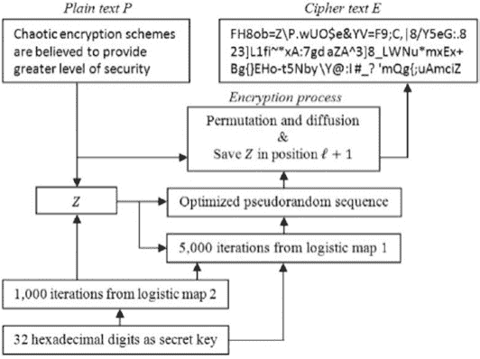
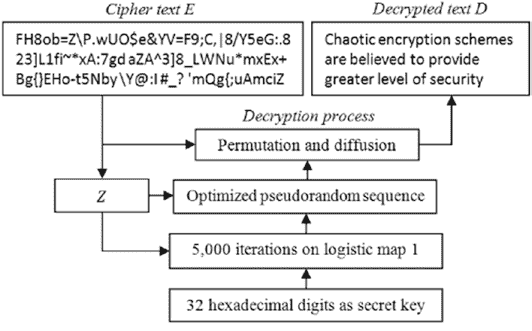
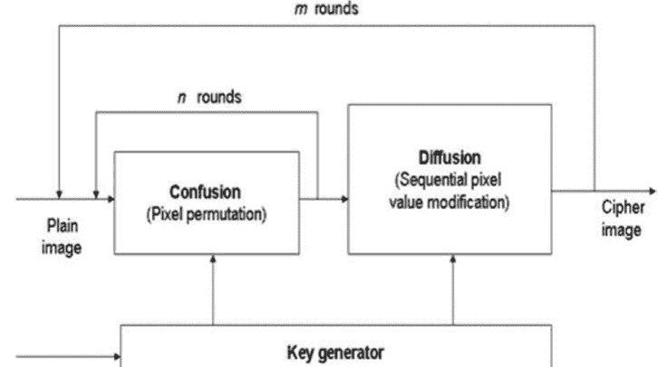
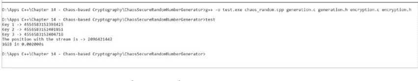

# CHAPTER 14: Chaos-Based Cryptography

In chaos-based cryptography, the chaos theory and its mathematical background are applied for creating novel and unique cryptographic algorithms. The first attempt of using the chaos theory in cryptography was initiated by Robert Matthews in 1989 through the work [1], which attracted much interest.

In contrast to the regular cryptographic primitives used daily, the chaos theory and its system are used in an efficient way by implementing the chaotic maps towards confusion and diffusion. Through this chapter, the cryptographic algorithm is referred to as the chaotic system.

To understand the similarities and differences between chaotic systems and cryptographic algorithms, we present a set of correspondences in Table 14-1 introduced by L. Kocarev in [2].

Table 14-1. Similarities and Differences Between Chaotic Systems and Cryptographic Algorithms

| Chaotic System | Cryptographic Algorithm |
|---|---|
| Phase space: (sub) set of real numbers | Phase space: finite set of integers |
| Iterations | Rounds |
| Parameters | Key |
| Sensitivity to a change in initial conditions and parameters | Diffusion |
| ? | Security and Performance |

Further, we demonstrate the similarities and the differences from Table 14-1 using an example of a chaotic system, the shift map:

$$x(t+1)=ax(t)\pmod{1}$$

where the phase space x=[0,1] is the unit interval and a>1 is an integer value.

From the chaos theory perspective, cryptography can use different functions and discrete-time systems. By analyzing them, the phase space will become a finite set of integers and the parameters will be integer values. The version of the shift map that uses the discrete phase-space is one of the common examples:

$$p(t+1)=ap(t)\pmod{N}$$

where $a>1$, $N$ and $p$ are integer values, with the restrictions $p \in \{0,1,\ldots,N-1\}$, and $N$ is coprime to $a$. This representation of the shift map is invertible, which means that all trajectories placed within a dynamical system with a finite phase space are called *periodical*. This fact introduces a new concept, namely the period function $P_N$ that describes the least period of the map $F$, denoted $F^{P_N}$ as its identity, and $P_N$ is minimal as it is a function within a system of size $N$.

Another very important metric used in the practical chaotic systems is the *Lyapunov exponent* (LE), whose trivial value is 0. The reason for it is the case in which the orbit is periodic and it will reiterate itself.

With this information, below are presented two concepts of block diagrams (for text encryption and image encryption) that demonstrate an encryption scheme based on the chaos theory. Figures 14-1 and 14-2 show the encryption process and the decryption process, respectively, based on the logistic map. Figure 14-3 shows an example of image encryption and decryption.

Following the examples of the block diagrams, we can examine the former papers and the other papers listed in this chapter’s references to observe that the encryption models and the way in which they are built are different according to the chaotic map used. Before designing new cryptographic approaches and mechanisms based on the chaos theory, it is very important to comprehend the way in which different chaotic maps work.

A good starting point is to use the following block diagrams as a guide from theory to practice, because the models are created according to the similarities and differences from Table 14-1.


# 第14章 混沌基密码学



**图 14-1.** 使用 logistic 映射进行文本加密的框图 [14]



**图 14-2.** 使用 logistic 映射进行文本解密的框图 [14]



图 14-3. 图像加密密码系统的框图 [15]

## 安全分析

在本节中，我们以寻找密码系统中弱点或安全漏洞的技术形式呈现安全分析，然后我们获取加密图像或明文或密钥的一部分或全部，而无需了解算法或解密密钥。

对加密图像的攻击示例在 [3] 和 [4] 中给出。设计混沌系统或进行密码分析攻击时应考虑以下方法、技术和分析：

- **密钥空间分析**：这是寻找解密密钥的尝试次数，是通过从加密系统的密钥空间中尝试所有可能的密钥来进行的。重要的一点是，随着密钥大小的增加，密钥空间呈指数增长。
- **密钥敏感性分析**：对于图像的良好加密系统，应考虑的一个重要因素是密钥的敏感性。如果在密钥中仅修改一个位，则输出图像应为完全不同的图像（关于加密或解密）。
- **统计分析：** 此分析的目的是证明原始图像与加密图像之间的关系。
- **相关系数分析：** 需要研究的一个重要图形工具是直方图，即动态系统轨迹生成的值的分布。在直方图分析中，明文图像像素与加密图像像素之间的相关性是另一种重要技术，因为它是在垂直、水平和对角线分布的两个像素之间进行的。
- **信息熵分析：** 基于熵的分析测试加密算法的鲁棒性。明文图像熵与加密图像熵之间的比较非常重要，这表明加密图像的熵约为 8 位深度。这对于证明加密技术对抗熵攻击很有用。
- **差分分析：** 差分分析确定密码系统对算法中任何细微变化的敏感性。敏感性可以根据两个标准计算：NPCR（像素变化率）和 UACI（统一平均变化强度）。当进行这两个测试时，高值显示明文图像中发生的微小变化，导致加密图像中产生显著修改。

## 用于明文和图像加密的混沌映射

本节根据其加密目标（文本加密或图像加密）介绍混沌映射。

下面列表（表 14-2）中的许多图像加密算法已被提出它们的作者使用上述技术进行了分析和测试。验证性能并评估加密方案的鲁棒性很有用。所有参考文献均根据其分析和测试被分析并选为良好参考。

### 表 14-2. 用于图像加密的混沌映射（系统）

| 混沌映射（系统） | 指标 熵 | NPCR | UACI | 密钥空间 | 敏感性 | 参考文献 |
|---|---|---|---|---|---|---|
| Lorenz | 7.9973 | - | - | 2^128 | 高 | [5] |
| Baker |  |  |  |  |  |  |
| Lorenz | - | - | - | 大 | 中等 | [6] |
| Henon Map | 7.9904 | 0.0015% | 0.0005% | 2^128 | 高 | [7] |
| Logistic Map | 7.9996 | 99.6231% | 33.4070% | 10^45 | 高 | [8] |
| Trigonometry Maps | - | 0.25% | 0.19% | 2^302 | - | [9] |
| Arnold Cat Map | 7.9981 | 99.62% | 33.19% | 2^148 | 高 | [10] |
| Chebyshev Map | 7.9902 | 99.609% | 33.464% | 2^167 | 高 | [11] |
| Circle Map | 7.9902 | 99.63% | 33% | 2^256 | 高 | [12] |
| Arnold Map | - | 0.0015% | 0.004% | - | - | [13] |

## Rössler 吸引子

Rössler 吸引子是由三个非线性常微分方程构成的系统。这些方程定义了一个连续时间动力系统，表现出与吸引子的分形特性相关的混沌动力学。

Rössler 系统的方程如下：

```
dx/dt = -y - z
dy/dt = x + a y
dz/dt = b + z (x - c)
```

当 Rössler 应用于现实生活时，计算不动点是首要挑战之一。要计算不动点，只需将方程设为零并通过求解所得方程计算每个不动点的 (x,y,z) 坐标即可。我们有以下每个不动点坐标的一般方程：

```
⎧ x = (c ± √(c² − 4ab)) / 2
  y = −( (c ± √(c² − 4ab)) / (2a) )
  z = (c ± √(c² − 4ab)) / (2a)
```

这些方程被转换为能够显示与参数值集合相关联的当前不动点的方式。

```
( (c + √(c² − 4ab)) / 2 , (−c − √(c² − 4ab)) / (2a) , (c + √(c² − 4ab)) / (2a) )
```

```
( (c − √(c² − 4ab)) / 2 , (−c + √(c² − 4ab)) / (2a) , (c − √(c² − 4ab)) / (2a) )
```

上述方程在我们来自列表 X 的示例中使用，其中我们实现了解决方案，用于使用 Rössler 吸引子的混沌视角生成安全随机数。

## 复数 – 简要概述

复数代表实数的扩展。复数的动机在于希望提供一种求解代数方程的方法，这些方程通常（使用传统的实数）没有解。例如，x² + 1 = 0 没有实数解。对于这种情况，创建了一个符号解，它被称为虚数单位 i，具有以下性质：

```
i² = −1
```

复数由两个分量表示，称为 *实部* 和 *虚部*。我们有以下：

$$z = x + y i$$

其中 $real(z) = x$ 表示实部，$imag(z) = y$ 表示虚部，$i$ 表示虚数单位。

复数背后的算术相当直接，是实数算术的扩展。为了理解前面的陈述，我们定义两个数 $z$ 和 $w$ 如下：

$$z + w = (x + y i) + (u + v i) = (x + u) + (y + v) i.$$

我们分别添加实部和虚部。下一步是按如下方式相乘：

$$z \cdot w = (x + y i)(u + v i) = x u + x v i + y u i + y v i^2 = (x u - y v) + (x v + y u) i.$$

请注意 $y v i^2$ 表示乘积的实部变为 $-y v$，这是由于上述定义的性质，即 $i^2 = -1$。

在列表 X 中给出的示例中，我们使用具有混沌和分形属性的复数来提供加密和解密操作。

## 实际实现

使用混沌系统的应用程序和程序具有 *明文加密* 和 *图像加密* 的适用性。如果我们查看密码学的其他领域（例如本书记述的领域），研究界有大量的理论贡献。缺乏实际实现和方向为研究人员和专业人员带来了多重困难和挑战。

如果我们查看混沌密码学的实用性，并没有太多实际实现。下面我们将列出一些实际方法（这里我们指的是伪代码算法），可以在 [16] 中找到。 [16] 的工作提供了非常深入的结构以及关于如何基于混沌理论实现不同密码系统的非常好的思想和方法。思想以伪代码形式提供。该工作涵盖了以下密码系统类型：


- 基于混沌的公钥密码学
- 密码学中的伪随机数生成
- 高维混沌映射的形成及其在密码学中的应用
- 基于混沌的哈希函数
- 基于混沌的视频加密算法
- 混沌密码的密码分析
- 基于混沌密码的硬件实现
- 基于混沌安全光通信系统的硬件实现

在 [16] 中，从第 2 章开始，作者提出了一种有趣的基于混沌方法的公钥密码系统，它包含三个步骤：密钥生成算法（见伪代码 14-1）、加密算法（见伪代码 14-2）和解密算法（见伪代码 14-3）。场景是两个用户实体 Alice 和 Bob 之间典型的通信。下面我们将提供每个算法的结构，并在最后提供实现以证明其适用性。

## 伪代码 14-1. 密钥生成算法 [16]

开始。Alice 需要在通信前生成密钥。为此她将完成以下操作：

- 必须生成一个大整数 a。
- 根据选为 p ∈ [−1, 1] 的随机数计算 Gₐ(p)。
- Alice 将其公钥设为 (p, G(p))，私钥设为 a。

## 伪代码 14-2. 加密算法 [16]

开始。Bob 想加密一条消息。为此必须完成以下操作：

- 获取 Alice 的真实公钥 (p, Gₐ(p))。
- 计算并将消息表示为一个数 M ∈ [−1, 1]。
- 生成一个大整数 r。
- 计算 $G_r(p)$, $G_{r·a(x)} = G_r(G_a(p))$ 和 $X = M · G_{r·s}(p)$。
- 取密文并发送为 $C = (G_r(p), X)$ 给 Alice。

## 伪代码 14-3. 解密算法 [16]

开始。Alice 想读取文本并为此她必须从密文 C 中恢复 M。为此执行以下步骤：

- Alice 必须使用她的私钥 a 并计算 $G_{a·t} = G_a(G_t(p))$。
- 消息 M 将通过计算 $M = \frac{X}{G_{a·r}(p)}$ 得到。

## 使用混沌 Rössler 吸引子的安全随机数生成器

在本节中，我们将介绍使用混沌 Rössler 吸引子的安全随机数生成器的实现。该应用程序有五个文件（encryption.h、generation.h、encryption.c、generation.c 和 chaos_random.cpp）。要编译和运行应用程序，我们需要在终端中运行以下命令：

```
g++ -o test.exe chaos_random.cpp generation.c generation.h encryption.c encryption.h
```

下面我们将检查每个文件并讨论最重要的代码行。

图 14-4 显示了程序的执行以及为每个密钥生成的数字。如你在 Rössler 吸引子部分所见，需要计算三个固定点来求解方程。每个固定点由一个密码密钥表示（例如 key 1、key 2、key 3）。



图 14-4. 安全随机数生成器

列表 14-1 包含用于定义加密过程签名函数 encryption 的头文件（encryption.h）。该函数有三个输入值：

- struct generation *g: 用于生成用于获得实数归一化形式的尾数、指数和符号的结构对象。结构的定义可以在文件 generation.h 中找到（见列表 16-2）。
- uint8_t *buffer: 用于加密的数据缓冲区
- size_t length: 缓冲区的长度

## 列表 14-1. 头文件 encryption.h

```
#ifndef ENCRYPTION_H
#define ENCRYPTION_H

#include "generation.h"
#include <stddef.h>

void encryption(struct generation *g, uint8_t *buffer, size_t length);

#endif
```

列表 14-2 包含 generation.h 头文件的实现，其中包含 Rössler 吸引子的定义（见 ROSSLER(x,n)）、坐标（A、B 和 C）、积分近似（APPROXIMATION 常数）、去除噪声常数（REMOVE_NOISE）、两个用于在 16 位和 32 位上生成初始化的函数（generation_initialization 和 generation 32）、描述实数归一化的联合和结构类型，包含双精度数的尾数、指数和符号（realbits 联合），以及一个结构（generation 结构）用于生成过程，其中包含三个变量代表固定点（例如 x、y 和 z）。

## 列表 14-2. 头文件 generation.h

```
#ifndef GENERATION_H
#define GENERATION_H

#include <inttypes.h>
#include <math.h>
```

length。函数相当自解释，其主要思想基于数据流中的位置，并且调用次数起着重要作用，因为它使用缓冲区的长度并向右移动 2 位。

## 列表 14-3. 文件 encryption.c

```
#include "encryption.h"
#include "generation.h"

#include <iostream>

using namespace std;

// performing the encryption operation
void encryption(struct generation *g, uint8_t *buffer, size_t length)
{
    uint32_t position_in_stream;
    size_t number_of_calls = length >> 2;
    size_t l_neighbour = length & 3;
    uint8_t *temporary = (uint8_t *)&position_in_stream;

    for(size_t index = 0; index < number_of_calls; ++index)
    {
        position_in_stream = generation32(g);
        buffer[(index<<2)] ^= temporary[0];
        buffer[(index<<2)+1] ^= temporary[1];
        buffer[(index<<2)+2] ^= temporary[2];
        buffer[(index<<2)+3] ^= temporary[3];
    }

    if(l_neighbour != 0)
    {
        position_in_stream = generation32(g);
        for(size_t index = 0; index < l_neighbour; ++index)
            buffer[(number_of_calls<<2)+index] ^= temporary[index];
    }

    std::cout<<"The position with the stream is -> "<<position_in_stream<<endl;
}
```

列表 14-4 包含用于生成固定点和执行初始化过程所需的各种操作的实现。在这里我们也使用了列表 14-2 中定义的 ROSSLER 函数。

## 列表 14-4. 文件 generation.c

```
#include "generation.h"

static void initialization(struct generation *gen, double initValueX,
double initValueY, double initValueZ)
{
    gen->x.d = initValueX;
    gen->y.d = initValueY;
    gen->z.d = initValueZ;
}

static void perform_iteration(struct generation *gen)
{
    gen->x.d = gen->x.d + APPROXIMATION * (-gen->y.d - gen->z.d);
    gen->y.d = gen->y.d + APPROXIMATION * (gen->x.d + A_Coordinate * gen->y.d);
    gen->z.d = gen->z.d + APPROXIMATION * (B_Coordinate + gen->z.d * (gen->x.d - C_Coordinate));
}

void generation_initialization(struct generation *gen, uint64_t keyValue[3])
{
    initialization(gen,
        (double)keyValue[0] / 9007199254740992,
        (double)keyValue[1] / 8674747684896687,
        (double)keyValue[2] / 6758675765879568);

    for(uint8_t index = 0; index < REMOVE_NOISE - 1; ++index)
        perform_iteration(gen);
}
```

```
uint32_t generation32(struct generation *gen)
{
    uint32_t message[6];
    message[0] = (uint32_t)(gen->x.rb.mantisa >> 32);
    message[1] = (uint32_t)(gen->x.rb.mantisa);
    message[2] = (uint32_t)(gen->y.rb.mantisa >> 32);
    message[3] = (uint32_t)(gen->y.rb.mantisa);
    message[4] = (uint32_t)(gen->z.rb.mantisa >> 32);
    message[5] = (uint32_t)(gen->z.rb.mantisa);
    perform_iteration(gen);

    message[0] += message[1];
    message[2] += message[3];
    message[4] += message[5];

    for(uint8_t index = 0; index < 4; ++index)
    {
        ROSSLER(message[0],7); ROSSLER(message[3],13);
        message[5] ^= (message[4] + message[3]);
        message[1] ^= (message[2] + message[0]);
        message[2] = message[2] ^ message[0] ^ message[5];
        message[4] = message[4] ^ message[3] ^ message[1];
    }

    message[2] += message[4];
    return message[2];
}
```

列表 14-5 包含主程序的实现。请注意，包含随机数的文件的路径（类似于 UNIX OS 中的 urandom）必须根据读者喜好进行调整。必须修改路径的行以粗体显示如下：

```
if((folder = open("D:/Apps C++/Chapter 14 - Chaos-based Cryptography/ ChaosSecureRandomNumberGenerator/dev/urandom", 0_RDONLY)) == -1)
```


## Listing 14-5. 主程序

```cpp
#include "encryption.h"
#include "generation.h"

#include <fcntl.h>
#include <stdlib.h>
#include <stdio.h>
#include <string.h>
#include <unistd.h>
#include <windows.h>
#include <time.h>
#include <inttypes.h>
#include <iostream>

using namespace std;

const size_t MESSAGE_LENGTH = 2000000000;

uint64_t generateStringOfBytes()
{
    int folder = 0;
    ssize_t resourceFile = 0;
    uint64_t buffer = 0;

    if((folder = open("D:/Apps C++/Chapter 14 - Chaos-based Cryptography/ChaosSecureRandomNumberGenerator/dev/urandom",
    O_RDONLY)) == -1)
        exit(-1);

    if((resourceFile = read(folder, &buffer, sizeof buffer)) < 0)
        exit(-1);

    buffer &= ((1ULL << 53) - 1);
    close(folder);
    return buffer;
}

int main(void)
{
        struct generation gen;
        uint64_t key[3] = {generateStringOfBytes()+rand()%3000, generateStringOfBytes()+rand()%5000, generateStringOfBytes()+rand()%8000};
        cout<<"Key 1 -> "<<key[0]<<endl;
        cout<<"Key 2 -> "<<key[1]<<endl;
        cout<<"Key 3 -> "<<key[2]<<endl;

        // generate 1GiB of 1s
        uint8_t *message = (uint8_t*)malloc(MESSAGE_LENGTH);
        memset(message, 1, MESSAGE_LENGTH);

        // perform encryption
        generation_initialization(&gen, key);
        clock_t s = clock();
        encryption(&gen, message, MESSAGE_LENGTH);
        clock_t e = clock();
        double spent = (double)(e - s) / CLOCKS_PER_SEC;
        printf("1GiB in %lfs\n", spent);

        free(message);
}
```

## Cipher Using Chaos and Fractals

在本节中，我们将讨论并实现一种使用混沌和分形概念的加密/解密操作的解决方案。

Listing 14-6 包含了处理起始点表示的主要函数声明，并对 x 和 y 两个轴执行投影。需要提到的是，使用分形和混沌系统时最具挑战性的操作和任务之一是识别路径并识别主根（参见函数 identifyFirstRoot()）。Listing 14-6 和 14-7 中的代码相当自解释，并且包含必要的注释以便完全理解。参见图 14-5 查看应用程序的执行。

```cpp
// get the sign of a double number
inline double getSign(double number)
{
    // in case that d is less than 0, return -1.0, making the number
    // negative
    // contrary make the number positive
    if (number<0)
        return(-1.0);
    else
        return(1.0);
};

// Value 'yValue' will be projected over an integer matrix or grid.
// We have choose this for achieving the scaling goal and performing
//     tests.
// The projection process is a matter of personal choice, any other
// idea or
// solution can be implemented by reader.
inline unsigned int PerformProjectionFor_Y(double yValue)
{
    unsigned long q;
    const double scale=(32768.0/2.0);
    const double offset=(32768.0);

    // do the projection as a positive integer projection to positive
    //     integer
    q=(yValue*scale)+offset;

    // getting the LSB (least significant bit)
    q&=1;
    return q;
}

// Value 'xValue' will be projected over an integer matrix or grid.
// We have choose this for achieving the scaling goal and performing
//     tests.
// The projection process is a matter of personal choice, any other
// idea or
// solution can be implemented by reader.
inline unsigned int PerformProjectionFor_X(double xValue)
{
    // used for storing the decomposition value
    double decompositionValue;

    // power value (exponent)
    int n;

    // with frexp() we will decompose the double point (xValue) as
    // argument into a normalized fraction and an integral power
    decompositionValue = frexp (xValue , &n);

    // with ldexp() we will return the result of multiplying
    // 'decompositionValue'
    // (the significand) with 2 and raised to the power '51'
    // (exponent)
    decompositionValue = ldexp(decompositionValue,51);

    // Test if the difference between 'decompositionValue' and
    // floor(decompositionValue) is less than 0.5
    // if yes return '1', otherwise '0'.
    // With floor() we round 'decompositionValue', returning the
    // largest
    // integral value that is not greater than 'decompositionValue'
    return (((decompositionValue-floor(decompositionValue))<0.5)?1:0);
}

inline void identifyFirstRoot()
{
    /* Zn*Zn=Z(n+1)-c */
    z_xCoordinatePoint=z_xCoordinatePoint-c_xCoordinatePoint;
    z_yCoordinatePoint=z_yCoordinatePoint-c_yCoordinatePoint;
}

// r represents the length of the vector from the origin to the point
// r = |z| = sqrt(x*x+y*y)
double r;

// the new point z = (x,y)
double z_xNewPointValue, z_yNewPointValue;      //NewZx, NewZy
r=sqrt(z_xCoordinatePoint*z_xCoordinatePoint+z_yCoordinatePoint*z_yCoordinatePoint);

// the below code sequence represents the implementation of the algorithm presented in [17], from page 361 to 362.
// case 1: z>0
if (z_xCoordinatePoint>0)
{
    z_xNewPointValue=sqrt(0.5*(z_xCoordinatePoint+r));
    z_yNewPointValue=z_yCoordinatePoint/(2*z_xNewPointValue);
}

// for cases when z<0 and z=0
else
{
    // case 2: z<0
    if (z_xCoordinatePoint<0)
    {
        z_yNewPointValue=getSign(z_yCoordinatePoint)*sqrt(0.5*(-z_xCoordinatePoint+r));
        z_xNewPointValue=z_yCoordinatePoint/(2*z_yNewPointValue);
    }

    // case 3: z=0
    else
    {
        z_xNewPointValue=sqrt(0.5*fabs(z_yCoordinatePoint));
        if (z_xNewPointValue>0) z_yNewPointValue=z_yCoordinatePoint/(2*z_xNewPointValue);
        else z_yNewPointValue=0;
    }
}

};
// end of the implementation

// the values for x and y coordinates
z_xCoordinatePoint=z_xNewPointValue;
z_yCoordinatePoint=z_yNewPointValue;
};
public:
    // gets the encrypted value
    unsigned int getEncryptedMessageA(unsigned int plainValue);
    unsigned int getDecryptedMessageB(unsigned int encryptedValue);
    unsigned int getEncryptedMessageC(unsigned int stream);
    unsigned int getDecryptedMessageD(unsigned int stream);

    // gets the single bit
    unsigned int bitCodeEncryptedMessageA(unsigned int plainValue);
    unsigned int bitCodeDecryptedMessageB(unsigned int encryptedValue);
    unsigned int bitCodeEncryptedMessageC(unsigned int stream);
    unsigned int bitCodeDecryptedMessageD(unsigned int stream);

    // constructor
    CryptoFractalCipher(double cx,double cy);

    // destructor
    virtual ~CryptoFractalCipher();
};
#endif
```

## Listing 14-7. 主程序

```cpp
#include "FractalCipherCrypto.h"
#include <climits>
#include <assert.h>
#include <math.h>
#include <iostream>

using namespace std;

// implementing bitCodeEncryptedMessageA from FractalCipherCrypto.h file
unsigned int CryptoFractalCipher::bitCodeEncryptedMessageA(unsigned int bit_from_plaintext)
{
    // below we will create a cryptographic stream from the clear stream
    int crypto_bit=0;
    {
        identifyFirstRoot();

        // quadratic value
        unsigned long quadraticValue = PerformProjectionFor_X(
        z_yCoordinatePoint);

        // Do the encoding process and provide the
        // cryptographic stream from the clear stream
        // Variables used:
        //          - iV: the input value
        //          - oV: the output value
        //          - rV: the route value in the expansion of the fractal
        unsigned int iV, oV, rV;
        {
            unsigned int result1, result2, result3;
            iV=(bit_from_plaintext) & 1;

            // obtained from the iteration of the quadratic value
            result1=quadraticValue;

            // input value
            result2=iV;

            // we will copy the bits if it is set in one operand but not both
            result3=result1^result2;

            // the final output value
            oV=result3;

            // the route value that need to be followed within the expansion of the fractal
```


rV=result2;
}
crypto_bit=(oV);

if ((rV) != 0)
{
    // use the route on the second root point
    z_xCoordinatePoint=-z_xCoordinatePoint;
    z_yCoordinatePoint=-z_yCoordinatePoint;
}
}
return crypto_bit;
};

unsigned int CryptoFractalCipher::bitCodeDecryptedMessageB(unsigned int bit_from_encoding)
{
    // decode the clear value from the cryptographic stream
    int bit_from_plaintext=0;
    {
        identifyFirstRoot();

        // computing the quadratic value
        unsigned long quadraticValue = PerformProjectionFor_X(z_yCoordinatePoint);

        // decoding process for obtaining the clearstream from the cryptographic stream
        // Variables used:
        //           - iV: the input value
        //           - oV: the output value
        //           - rV: the route value in the expansion of the fractal
        unsigned int iV, oV, rV;
        {
            unsigned int result1,result2,result3;

            iV=(bit_from_encoding) & 1;

            // obtained from the iteration of the quadratic value
            result1=quadraticValue & 1;

            // input value
            result3=iV;

            // we will copy the bits if it is set in one operand but not both
            result2=result1^result3;

            // the output value
            oV=result2;

            // the route value that need to be followed within the expansion of the fractal
            rV=result2;
        }
        bit_from_plaintext=(oV);

        if ((rV) != 0)
        {
            // use the route on the second root point
            z_xCoordinatePoint=-z_xCoordinatePoint;
            z_yCoordinatePoint=-z_yCoordinatePoint;
        }
    }
    return bit_from_plaintext;
};
unsigned int CryptoFractalCipher::bitCodeEncryptedMessageC(unsigned int bit_from_stream)
{
    // generate the cryptographic stream from the clear stream
    int bit_from_coding=0;
    {
        identifyFirstRoot();

        unsigned long quadraticValueForY = PerformProjectionFor_X(
         z_yCoordinatePoint);
        unsigned long quadraticValueForX = PerformProjectionFor_X(
         z_xCoordinatePoint);

        // encoding process
        unsigned int iV, oV, rV;

        {  unsigned int result1, result2, result3, result4;
           iV=(bit_from_stream);

              // from the iteration of the 'y' quadratic
              result1=quadraticValueForY;

              // from the iteration of the 'x' quadratic
              result2=quadraticValueForX;

              // we will copy the bits if it is set in one operand but not
                 both
              result3=iV^result1;
              result4=iV^result2;

              // the output value
              oV=result3;
              rV=result4; // branch in path to follow through IIM
        }
        bit_from_coding=(oV);

        if ((rV) != 0)
        {
              // use the route on the second root point
              z_xCoordinatePoint=-z_xCoordinatePoint;
              z_yCoordinatePoint=-z_yCoordinatePoint;
        }
    }
    return bit_from_coding;
};

unsigned int CryptoFractalCipher::bitCodeDecryptedMessageD(unsigned int bit_from_stream)
{
    // generate the cryptographic stream from the clear stream
    int bit_from_coding = 0;
    {
        identifyFirstRoot();

        unsigned long quadraticValueForY = PerformProjectionFor_X(
        z_yCoordinatePoint);
        unsigned long quadraticValueForX = PerformProjectionFor_X(
        z_xCoordinatePoint);

        // encoding process
        unsigned int iV, oV, rV;
        {
            unsigned int result1, result2, result3, result4;
            iV=(bit_from_stream) & 1;

            // from iterated quadratic y and x
            result1=quadraticValueForY;
            result2=quadraticValueForX;

            // we will copy the bits if it is set in one operand but not both
            result3=iV^result1;
            result4=result3^result2;

            // output value
            oV=result3;

            // the route value
            rV=result4;
        }
        bit_from_coding=(oV);

        if ((rV) != 0)
        {  //take branch to second root
            z_xCoordinatePoint=-z_xCoordinatePoint;
            z_yCoordinatePoint=-z_yCoordinatePoint;
        }
    }
    return bit_from_coding;
};

unsigned int CryptoFractalCipher::getEncryptedMessageA(unsigned int clearstream)
{
    // for creating the cryptographic stream from the clear stream
    int cryptographic_stream=0;

    for (int iterationIndex=0; iterationIndex<32; (iterationIndex++))
    {
        // encoding process for obtaining cryptographic stream from clear stream
        unsigned int iV,oV;
        iV=(clearstream>>iterationIndex) & 1;
        oV=bitCodeEncryptedMessageA(iV);
        cryptographic_stream+=((oV)<<iterationIndex);
    }

    return cryptographic_stream;
};

unsigned int CryptoFractalCipher::getDecryptedMessageB(unsigned int cryptstream)
{
    // for creating the clear stream from the cryptographic stream
    int clearstream=0;

    for (int iterationIndex=0; iterationIndex<32; (iterationIndex++))
    {
        // decoding process for obtaining the clear stream from the
        // cryptographic stream
        unsigned int iV, oV;
        iV=(cryptstream>>iterationIndex) & 1;
        oV=bitCodeDecryptedMessage(iV);
        clearstream+=((oV)<<iterationIndex);
    }
    return clearstream;
};

unsigned int CryptoFractalCipher::getEncryptedMessage(unsigned int stream)
{
    // construct the cryptographic stream from clear stream
    // cv - the code value
    int cV=0;

    for (int iterationIndex=0; iterationIndex<32; (iterationIndex++))
    {
        // encoding process for generating the cryptographic stream from
        // clear stream
        unsigned int iV,oV;
        iV=(stream>>iterationIndex) & 1;
        oV=bitCodeEncryptedMessage(iV);
        cV+=((oV)<<iterationIndex);
    }
    return cV;
};

unsigned int CryptoFractalCipher::getDecryptedMessage(unsigned int stream)
{
    // construct the cryptographic stream from clear stream
    // cv - the code value
    int cV=0;

    for (int iterationIndex=0; iterationIndex<32; (iterationIndex++))
    {
        // encoding process for generating the cryptographic stream from clear stream
        unsigned int iV, oV;
        iV=(stream>>iterationIndex) & 1;
        oV=bitCodeDecryptedMessageD(iV);
        cV+=((oV)<<iterationIndex);
    }
    return cV;
};

CryptoFractalCipher::CryptoFractalCipher(double cPoint_xValue,double cPoint_yValue)
{
    c_xCoordinatePoint=cPoint_xValue;
    c_yCoordinatePoint=cPoint_yValue;
    z_xCoordinatePoint=z_yCoordinatePoint=0;
    // use repeating digits as for encoding process using PI value with the goal to find a fixed point
    for(int index=0; index<32; index++)
        getEncryptedMessageA(3141592653);
}

// destructor implementation - only if it is necessary
CryptoFractalCipher::~CryptoFractalCipher()
{
}

int main(void)
{
    // CryptoKey_rValue and CryptoKey_iValue are represented as
    // a point that is situated near the boundary of the Mandelbrot set
    // the real value of a complex number (cryptographic key)
    double CryptoKey_rValue=-0.687;
    // the imaginary unit
    double CryptoKey_iValue=-0.312;

    unsigned int Plaintext[50];
    unsigned int EncryptionA[50];
    unsigned int EncryptionB[50];
    unsigned int DecryptionOfAWithB[50];
    unsigned int DecryptionOfBWithA[50];

    // generate randomly message
    for (int i=0;i<50;i++)
        Plaintext[i]=rand()%1000;

    // perform message encoding using getEncryptedMessageA for A
    {
        CryptoFractalCipher CFC(CryptoKey_rValue, CryptoKey_iValue);
        for (int i=0;i<50;i++)
            EncryptionA[i]=CFC.getEncryptedMessageA(Plaintext[i]);
    }

    // perform message encoding using getDecryptedMessageB for B
    {
        CryptoFractalCipher CFC(CryptoKey_rValue, CryptoKey_iValue);
        for (int i=0;i<50;i++)
            EncryptionB[i]=CFC.getDecryptedMessageB(Plaintext[i]);
    }

    // perform message decoding A with B using getDecryptedMessageB for B
    {
        CryptoFractalCipher CFC(CryptoKey_rValue, CryptoKey_iValue);
        for (int i=0;i<50;i++)
            DecryptionOfAWithB[i]=CFC.getDecryptedMessageB(EncryptionA[i]);
    }
    // perform message decoding B with A using getDecryptedMessageB for A
    {
        CryptoFractalCipher CFC(CryptoKey_rValue, CryptoKey_iValue);
        for (int i=0;i<50;i++)
            DecryptionOfBWithA[i]=CFC.getEncryptedMessageA(EncryptionB[i]);
    }

    // display the output value and the results
    for (int i=0;i<50;i++)
    {
            cout
            <<i
            <<")  (Plaintext Value="<<Plaintext[i]
            <<")  (Encryption -> First Method (A) = "<<EncryptionA[i]
            <<")  (Encryption -> Second Method (B) = "<<EncryptionB[i]
            <<")  (Decryption -> A with B = "<<DecryptionOfAWithB[i]
            <<")  (Decryption -> B with A = "<<DecryptionOfBWithA[i]
            <<")"<<endl;
    };
}

## 结论

在本章中，我们讨论了一种不同的密码学方法，即基于混沌的密码学。新的密码算法使用混沌函数，以不同于我们所熟知的传统方式生成新的密码学原语。

在本章结束时，你将了解以下内容：

- 基于混沌的密码学原语是如何构建的，以及它们与普通密码学原语的不同之处
- 混沌系统是如何为文本加密和图像加密设计的
- 如何使用混沌方法实现基于数字发生器的密码系统，以及如何使用混沌系统和分形执行加密和解密操作

## 参考文献

[1] Robert Matthews, 《论“混沌”加密算法的推导》，载于 *Cryptologia* 第13卷，第1期（第29-42页），1989年。


[2] L. Kocarev, “Chaos-based cryptography: A brief overview” in *IEEE Circuits and Systems Magazine*, vol. 1, no. 3 (pp. 6-21). doi: 10.1109/7384.963463. 2001.

[3] Ali Soleymani, Zulkarnain Md Ali, and Md Ian Nordin, “A Survey on Principal Aspects of Secure Image Transmission” in *World Academy of Science, Engineering and Technology* 66 (pp. 247–254). 2012.

[4] D. Chattopadhyay1, M. K. Mandall, and D. Nandi, “Symmetric key chaotic image encryption using circle map” in *Indian Journal of Science and Technology*, Vol. 4 No. 5 (pp 593–599). ISSN: 0974-6846. May 2011.

[5] A. Anto Steffi and Dipesh Sharma, “Modified Algorithm of Encryption and Decryption of Images using Chaotic Mapping” in *International Journal of Science and Research (IJSR), India Online Volume* 2 Issue 2. ISSN: 2319-7064, February 2013.

[6] K. Sakthidasan Sankaran and B.V. Santhosh Krishna, “A New Chaotic Algorithm for Image Encryption and Decryption of Digital Color Images” in *International Journal of information and Education Technology*, Vol. 1, No. 2. June 2011.

[7] Somaya Al-Maadeed, Afnan Al-Ali, and Turki Abdalla, “A New Chaos-Based Image-Encryption and Compression Algorithm” in *Journal of Electrical and Computer Engineering*, Volume 2012. Hindawi Publishing Corporation. Article ID 179693. 2012.

[8] Hazem Mohammad Al-Najjar and Asem Mohammad AL-Najjar, “Image Encryption Algorithm Based on Logistic Map and Pixel Mapping Table.”

[9] Sodeif Ahadpour and Yaser Sadra, “A Chaos-based Image Encryption Scheme using Chaotic Coupled Map Lattices.”

[10] Kamlesh Guptal and Sanjay Silakari, “New Approach for Fast Color Image Encryption Using Chaotic Map” in *Journal of Information Security* 2 (pp. 139–150). 2011.
