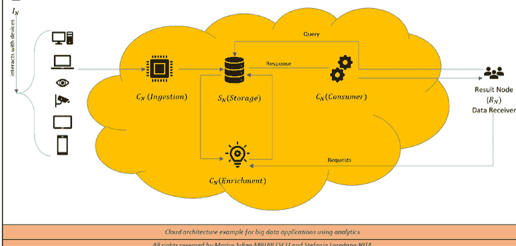
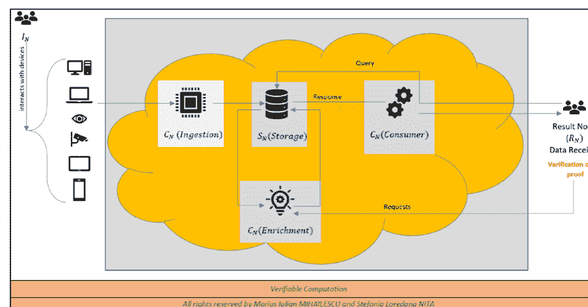
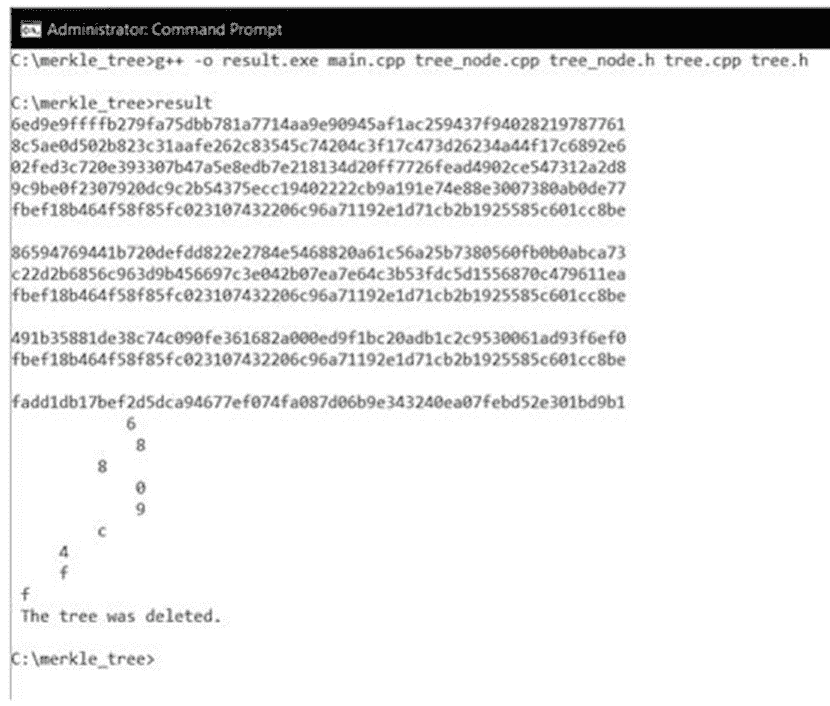

# CHAPTER 15

## 大数据密码学

*大数据*可以被视为对大尺寸数据集（范围从数太字节到数泽字节）进行提取、处理和分析的过程。这些技术与传统技术不同，因为大数据包含不同类型的数据，结构化或非结构化（视频或音频文件、图像、文本等）。

大数据密码学与数据的保密性、完整性和真实性相关，代表了一个需要认真对待的重要主题，因为每个业务都有其计算模型和软硬件架构。与大数据相关的密码学方法与传统方法不同，因为加密系统及其相关概念是根据访问控制、云基础设施和存储管理与技术策略的不同而定义不同的。

本章首先描述了一种适用于云环境的通用计算模型，该模型能够实现并简化涉及大数据分析的应用程序的实现。接下来，我们将介绍云架构中节点的分类及其在大数据分析过程中的作用。节点类型基于 [1] - [3] 中的分类，并且符号略有扩展以定义以下类型的节点：

- *I_N* 表示 *输入节点*，处理应用程序中使用的原始数据。这类节点从前端用户收集数据，或从不同传感器读取或捕获的数据（如指纹读取器、全息签名、温度传感器等）。
- *C_N* 表示 *计算节点*，在应用程序的计算过程中具有重要作用。这些节点的基础是摄取节点，其包含在计算节点中。在此分类中，摄取节点称为 *消费节点*，其目的是扫描和细化输入数据，即为分析过程准备数据并将其传递给 *丰富节点*，在该节点中数据实际被处理。

- $S_N$ 表示 *存储节点*，在对数据应用密码技术方面具有重要作用。其目的是存储涉及在不同类型的终端用户和第三方之间应用的计算过程的数据。数据分析的输入数据和输出数据由这些节点存储。
- $R_N$ 表示 *结果节点*，接收正在执行的某些过程的输出。它可以根据分析过程的输出做出自动决策，或将输出发送给特定客户端。

图 15-1 显示了包含上述元素的大数据分析云架构示例。该模型可以代表描述广泛的大数据应用程序的模式。话虽如此，我们将注意到以下一组一个或多个类型为 $H$ 的节点，如下所示 $H^+$，其中 $H \in \{I_N, C_N, S_N, R_N\}$。



### Figure 15-1. Example of cloud architecture with big data analytical applications

图 15-1 显示了一个可应用于需要数据集的应用程序的通用云模型。在示例中，节点 $I_N$ 启动收集参考数据集的过程。输入节点将数据序列发送到 $C_N$(摄取) 节点。在摄取节点中，数据序列被计算过程使用并进行解析。当计算过程结束时，输出数据被组织成文件或数据库。在下一步中，文件和数据库被发送到存储节点 S_N (存储)。不时地，丰富节点 C_N (丰富) 对存储节点中的数据执行计算。大多数情况下，这些过程是离线进行的，并根据用户的需求更新相关元数据。在我们的示例中，R_N (数据接收器) 代表将数据集与参考数据集进行关联的用户。

云计算为流经其组件之间的数据带来了许多安全挑战。为了遵循云密码学的保护技术路径，我们需要考虑三个主要安全目标，即 CIA 三元组：

- **保密性**：数据严格指计算的输入和输出，需要保密并防止不受信任方、恶意方或其他潜在对手的攻击。
- **完整性**：对数据进行的任何未经授权的更改必须立即被检测到。请注意，完整性问题并不总是由恶意行为者引起；它们也可能由软件中的错误或数据传输问题引起。无论如何，必须强制执行数据的完整性。
- **可用性**：数据所有者和授权数据用户可以访问数据和计算资源。

让我们关注可用性，因为它是云最重要的特征之一，但它不包含任何密码学手段。因此，保密性和完整性需要在云和大数据架构中尽可能地参与。数据存储方式对于安全和密码学目的也很相关。保密性和完整性的实现方式取决于云的部署方式。在开发应用程序时，从一开始就确定哪个参与者控制云的哪个组件以及对每个组件和参与者授予的信任程度非常重要。基于此，我们将考虑以下类型的云：

- **受信任云**：它由政府组织或机构部署，并且完全与外部（网络或对手）隔离。微软等公共云厂商为美国政府用户提供区域。微软与 DOD 的 Jedi 合同也涵盖此类用途以及授权用于秘密和绝密使用的 Azure 云资源。用户或客户端的文件被安全存储，无需担心损坏或被盗。然而，在某些情况下，一些节点会暴露，因为它们可能与外部网络通信。因此，在这些情况下，恶意软件或内部人员可能会影响此类节点。
- **半受信任云**：在此类云中，并未明确说明云是否完全可信或完全不可信。然而，一个良好的做法是提及受控制的组件，并提供在给定时间内监控对抗性活动的解决方案。
- **不受信任云**：云内的节点或云本身对数据用户完全不可信。此场景意味着不提供任何安全保证，包括数据或计算的保密性或完整性水平。在这种情况下，云用户应拥有自己的解决方案和保护机制以确保（一定程度的）保密性和完整性。主要来说，不受信任的云与公共云模型相关联。

在对云和大数据元素进行了简要描述后，我们可以进一步讨论可在这些环境中应用的 *密码技术*。为了确保大数据和云计算的安全，密码技术非常复杂，很难在没有专用第三方软件库或经验丰富的专业人员的情况下在现实场景中应用它们。

本章重点介绍三种可用于特别实现部署在云环境中的大数据应用程序安全的密码技术，例如

- 同态加密 (HE)：参见第 12 章
- 可验证计算 (VC)：代表本章的第一个目标
- 安全多方计算 (MPC)

其他可成功应用于实现云计算和大数据安全的密码技术有

- 功能加密 (FE)


- 身份基加密 (IE)
- 属性基加密 (AE)

在下一节中，我们介绍了一种有前景且可应用于真实环境的技术。许多属于 FE、IE 或 AE 类型的加密方案在实践中很难使用，因为许多工作基于理论假设，而且大多数都没有考虑到业务或行业应用的需求和要求。在理论与实践之间，理论家和实践者需要共同走过一段漫长的道路。他们需要密切合作，以找到在真实环境中解决安全问题的解决方案，并解决存在的问题和差距。

## 可验证计算

可验证计算或可验证计算是指机器能够将某些函数(s)的计算量卸载给他人，例如状态不可信的客户端，同时结果会持续被验证。参见图 15-2。



图 15-2. 可验证计算示例。云中的节点对完整性保护没有任何可信度

可验证计算在真实环境中的一个重要应用是 Merkle 树，其目的是检查数据的完整性。在大数据中，Merkle 树代表一种用于验证项目、数据、行、数据集等不同属性完整性的数据结构。Merkle 树的一个非常有用的特性是它可以用于大量数据（因此在大数据上下文中），并且在此方向上通过将可验证计算算法与 Merkle 树结合起来已取得了许多改进。

在列表 15-1 至列表 15-6 中，我们介绍了一个 Merkle 树自平衡的场景。示例只是一个模拟（参见列表 15-1、列表 15-6 和图 15-3）。在真实的大数据环境中部署应用程序将需要适当的调整。

代码组织在以下文件中：

- tree_node.cpp 包含与树节点一起使用的方法的实现。
- tree_node.h 包含树节点的定义。
- tree.cpp 包含与树一起使用的方法的实现。
- tree.h 包含树的定义。
- tree_handling.h 包含打印节点内信息并计算其 sha256 值的函数。
- picosha2.h 按原样从源 [4] 下载，表示用于计算输入的 sha256 哈希值的头文件。其内容可以在源 [4] 或本书 GitHub 仓库的本章代码文件夹中找到。
- main.cpp 是项目的 main 文件。

## 列表 15-1. tree_node.h 文件的内容

```
#ifndef TREE_NODE
#define TREE_NODE

#include <string>
using namespace std;
```

```
struct merkle_tree {
    tree_node* tree_root;
    merkle_tree(vector<tree_node*> vector_nodes);
    ~merkle_tree();
    void print_merkle_tree(tree_node *node, int index);
    void delete_merkle_tree(tree_node *node);
};

#endif
```

## 列表 15-4. tree.cpp 文件的内容

```
#include <iostream>
#include <iomanip>
#include "tree.h"

using namespace std;

merkle_tree::merkle_tree(vector<tree_node*> vector_nodes)
{
    vector<tree_node*> aux_nodes;
    while (vector_nodes.size() != 1)
    {
        print_hash_values(vector_nodes);
        for (int i = 0, n = 0; i < vector_nodes.size(); i = i + 2, n++) {
            if (i != vector_nodes.size() - 1) // check if there is a neighbour block
            {
                // merges the neighbour nodes and computes the hash value
                // of the new node
                aux_nodes.push_back(new tree_node(compute_sha256(vector_nodes[i]->hash_value + vector_nodes[i + 1]->hash_value)));
                // link the new node with the left neighbour and the right neighbour
                aux_nodes[n]->l_neighbour = vector_nodes[i];
                aux_nodes[n]->r_neighbour = vector_nodes[i + 1];
            } else
```

```
{
    aux_nodes.push_back(vector_nodes[i]);
}
}
cout << "\n";
vector_nodes = aux_nodes;
aux_nodes.clear();
}

// picks the first node as the root of the tree
this->tree_root = vector_nodes[0];
}

merkle_tree::~merkle_tree()
{
    delete_merkle_tree(tree_root);
    cout << "The tree was deleted." << endl;
}

void merkle_tree::print_merkle_tree(tree_node *node, int index)
{
    if (node) {
        if (node->l_neighbour) {
            print_merkle_tree(node->l_neighbour, index + 4);
        }
        if (node->r_neighbour) {
            print_merkle_tree(node->r_neighbour, index + 4);
        }
        if (index) {
            cout << setw(index) << ' ';
        }
        cout << node->hash_value[0] << "\n ";
    }
}
```

```
void merkle_tree::delete_merkle_tree(tree_node *node)
{
    if (node) {
        delete_merkle_tree(node->l_neighbour);
        delete_merkle_tree(node->r_neighbour);
        node = NULL;
        delete node;
    }
}
```

## 列表 15-5. tree_handling.h 文件的内容

```
#ifndef TREE_MISC
#define TREE_MISC

#include <iostream>
#include <string>
#include "tree.h"
#include "picosha2.h"

using namespace std;

// computes the hash value of the input using SHA256
inline string compute_sha256(string input_string)
{
    string hash_string = picosha2::hash256_hex_string(input_string);
    return hash_string;
}

// display the hash values from a vector of tree nodes
inline void print_hash_values(vector<tree_node*> vector_nodes)
{
    for (int i = 0; i < vector_nodes.size(); i++)
    {
        cout << vector_nodes[i]->hash_value << endl;
    }
}

#endif
```

## 列表 15-6. main.cpp 文件的内容

```
#include <iostream>
#include "tree.h"

using namespace std;

int main() {
    vector<tree_node*> nodes_set;

    //create sample data
    nodes_set.push_back(new tree_node(compute_sha256("Merkle ")));
    nodes_set.push_back(new tree_node(compute_sha256("tree ")));
    nodes_set.push_back(new tree_node(compute_sha256("node ")));
    nodes_set.push_back(new tree_node(compute_sha256("example.")));
    nodes_set.push_back(new tree_node(compute_sha256("This is an example of merkle tree.")));

    // initialize leaves
    for (unsigned int i = 0; i < nodes_set.size(); i++) {
        nodes_set[i]->l_neighbour = NULL;
        nodes_set[i]->r_neighbour = NULL;
    }

    merkle_tree *hash_tree = new merkle_tree(nodes_set);
    std::cout << hash_tree->tree_root->hash_value << std::endl;
    hash_tree->print_merkle_tree(hash_tree->tree_root, 0);

    for (int k = 0; k < nodes_set.size(); k++) {
        delete nodes_set[k];
    }

    delete hash_tree;

    return 0;
}
```

要编译代码，在终端中使用以下命令：

```
g++ -o result.exe main.cpp tree_node.cpp tree_node.h tree.cpp tree.h
```

要运行代码，在终端中输入：

```
result
```

结果可以在图 15-3 中看到。



图 15-3. 自平衡 Merkle 树实现的实现结果

## 结论

在本章中，我们讨论了部署在大数据环境中的应用程序的重要性以及如何通过不同的密码机制（如可验证计算）实现安全性。有关云计算、大数据和安全性的更多信息，您可以查阅本章参考文献中的任何作品。

在本章结束时，您将具备以下知识：

- 理解云和大数据环境中安全的主要概念
- 如何将复杂的密码原语和协议（如可验证计算）付诸实践

## 参考文献

[1] P. Laud and A. Pankova, “Verifiable Computation in Multiparty Protocols with Honest Majority” in (eds. S.S.M. Cho, J.K. Liu, L.C.K. Hui, and S.M. Yiu) *Provable Security. ProvSec 2014. Lecture Notes in Computer Science, vol 8782.* Springer, Cham. 2014.

[2] D. Bogdanov, S. Laur, and R. Talviste, “A Practical Analysis of Oblivious Sorting Algorithms for Secure Multi-party Computation” in (eds. K. Bernsmed and S. Fischer-Hübner) *Secure IT Systems. NordSec 2014. Lecture Notes in Computer Science, vol 8788.* Springer, Cham. 2014.

[3] D. Bogdanov, L. Kamm, S. Laur, and P. Pruulmann-Vengerfeldt, “Securemulti-party data analysis: End user validation and practical experiments,” 2014.

[4] PicoSHA2 - a C++ SHA256 hash generator. Available online: https://github.com/okdshin/PicoSHA2

[5] B. Özçakmak, A. Özbilén, U. Yavanoğlu, and K. Çin, "Neural and Quantum Cryptography in Big Data: A Review" in *2019 IEEE International Conference on Big Data (Big Data)* (pp. 2413-2417). Los Angeles, CA, USA. doi: 10.1109/BigData47090.2019.9006238. 2019.

[6] S. Yakoubov, V. Gadepally, N. Schear, E. Shen, and A. Yerukhimovich, “A survey of cryptographic approaches to securing big-data analytics in the cloud,” in *2014 IEEE High Performance Extreme Computing Conference (HPEC)* (pp.106). Waltham, MA. doi: 10.1109/HPEC.2014.7040943. 2014.

## 什么是 Rec 模式

Rec 模式是 Android 系统中一种特殊的恢复模式，主要用于系统备份、恢复、升级和清除数据等操作。

MIUI 12 增强版针对 Rec 模式进行了全面优化，支持更多功能，让用户可以更方便地管理自己的设备。

## Rec 模式的主要功能

- 系统备份与恢复
- 清除数据（恢复出厂设置）
- 安装系统更新包
- 挂载分区
- 高级功能设置

进入 Rec 模式的方法：关机状态下，同时按住电源键和音量上键，即可进入恢复模式。

在 Rec 模式中，使用音量键进行选择，电源键确认操作。

注意事项：在 Rec 模式中进行清除数据或刷机操作前，请务必备份重要数据，以免造成不必要的损失。


[7] S.L. Nita 和 M.I. Mihailescu，“基于椭圆曲线的可搜索加密方案”载于（eds. L. Barolli, F. Amato, F. Moscato, T. Enokido, 和 M. Takizawa）Web、人工智能与网络应用。WAINA 2020。智能系统与计算进展，第1150卷。Springer, Cham。2020年。

[8] S.L. Nita 和 M.I. Mihailescu，“云计算的混合可搜索加密方案”载于（eds. J.L. Lanet 和 C. Toma）信息技术与通信的创新安全解决方案。SECITC 2018。计算机科学讲义，第11359卷。Springer, Cham。2019年。

[9] V. C. Pau 和 M. I. Mihailescu，“物联网及其在生物识别技术和电子学习应用中的作用”载于2015年现代电力系统工程第13届国际会议（EMES），（第1-4页）。Oradea。doi: 10.1109/EMES.2015.7158430。2015年。

[10] S. L. Nita 和 M. I. Mihailescu，“云计算安全中人工神经网络的应用——综述”载于2018年电子、计算机与人工智能第10届国际会议（ECAI），（第1-6页）。Iasi, Romania。doi: 10.1109/ECAI.2018.8679086。2018年。

[11] Marius Iulian Mihailescu, Stefania Loredana Nita, 和 Ciprian Racuci，“基于可搜索加密和多方计算的身份验证协议在地球科学中的应用”载于海军学院科学公报，第XXIII卷（第221-230页），doi: 10.21279/1454-864X-20-I1-030。2020年。

[12] Marius Iulian Mihailescu, Stefania Loredana Nita, 和 Ciprian Racuci，“基于可搜索对称加密的多级访问在地球科学中的应用”载于海军学院科学公报，第XXIII卷（第221-230页）。doi: 10.21279/1454-864X-20-I1-030。2020年。

[13] Stefania Loredana Nita, Marius Iulian Mihailescu, 和 Ciprian Racuci，“使用 MapReduce 的云计算安全文档搜索”载于*海军学院科学公报，第XXIII卷*（第221-230页）。doi: 10.21279/1454-864X-20-I1-030。2020年

[14] RSA Extension for Big Data Analytics. Available online: www.rsa.com/en-us/company/news/rsa-extends-big-data-analytics-to-help-organizations-identify.

[15] Claudio Orlandi, “Is Multiparty Computation Any Good In Practice?” Available online: www.cs.au.dk/~orlandi/icassp-draft.pdf.
