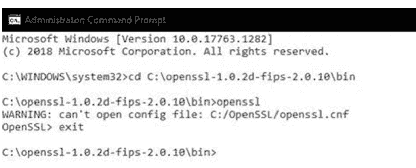
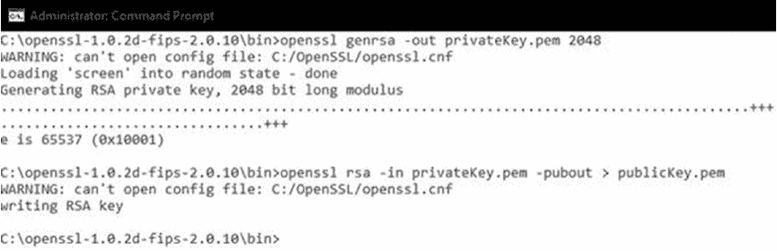
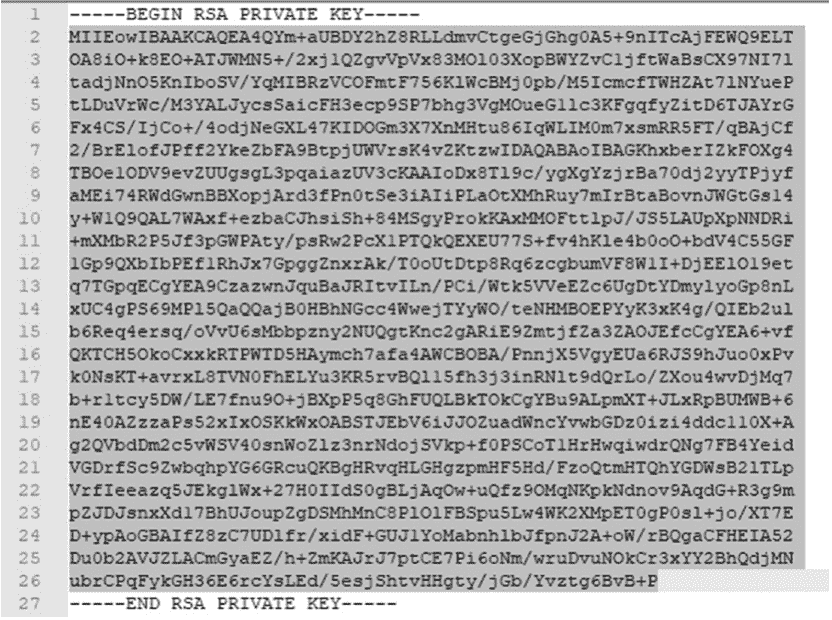
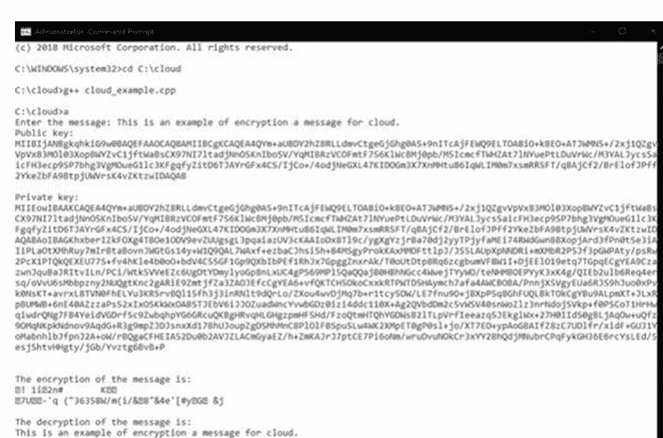

# CHAPTER 16

### Cloud Computing Cryptography

云计算中的密码学在过去几年中获得了大量关注。如今它是密码学和网络安全中最重要的主题之一。它代表了设计和实现安全云应用的关键点。云计算的密码学涉及用于保护存储在云环境中并在其中使用的数据的复杂加密方法和技术。

组织迅速采用了三种主要类型的云技术：IaaS（基础设施即服务）、PaaS（平台即服务）和 SaaS（软件即服务）。云为其用户提供了许多好处，例如效率、灵活性和可扩展性，从而降低了客户的总体成本。由于其复杂性和类型（公有云、私有云或混合云），云计算继承了其组件的安全问题。来源 [1] 提供了云计算安全问题的良好分类。安全问题可能发生在以下层面：通信层面（涉及共享基础设施、虚拟网络及其配置）、架构层面（涉及虚拟化、数据存储、应用程序和 API 以及访问控制）以及合同和法律层面（例如涉及服务等级协议）。

为了确保云安全，以下密码技术和机制正受到研究界和工业界的高度关注：

- 可搜索加密（参见第11章）
- 同态加密（参见第12章）
- 结构化加密（STE），用于加密数据结构。STE 方案使用令牌来查询数据结构。STE 的一个特殊例子是可搜索加密（SE）。请记住，可搜索加密允许在加密格式的数据中搜索关键字。STE 的另一个例子是使用图结构来加密数据库。在云环境中，这是一个很好的例子，因为应用程序处理用于分析和统计的大型数据库。
- 功能加密（FE）可以被视为公钥加密的概括，其中私钥所有者允许授权用户了解正在加密的密文的函数。功能加密有更多类型：谓词加密（PE）、基于身份的加密（IBE）、基于属性的加密（ABE）、隐藏向量加密（HVE）和内积谓词。
- 私有信息检索（PIR）实际上是一种协议，用于客户端在不让数据库其他用户知道客户端检索了哪个元素的情况下检索数据库中的一个元素。

### A Practical Example

对于本示例，让我们设想以下云场景：一个组织使用云消息平台管理其与客户的行政关系。例如，组织通过该平台向客户发送有关其产品或可用更新的通知，客户也可以通过该平台向组织发送消息。因此，云平台属于软件即服务类别。为了确保消息被授权接收者读取，消息应从组织和客户双方进行加密，并且双方都应使用可信方来生成用于加密和解密的密钥。

为了模拟此示例，我们将使用 OpenSSL [1] 作为可信方，它将为 RSA 算法生成公钥和私钥，这些密钥将在我们的加密技术中使用。来源 [1] 提供了不同发行版的文档、GitHub 仓库的源代码链接、示例等。注意，我们在 Windows 平台上创建了此示例。你不会下载源代码自行编译然后使用它。相反，你将直接下载可在来源 [3] 找到的 OpenSSL 库的编译版本（或可从本书的 GitHub 仓库下载）。下载存档后，你将其解压到 C:\ 分区上的 OpenSSL 文件夹中。接下来，你打开终端并将当前目录更改为 OpenSSL 父文件夹中的 bin 文件夹，然后输入 openssl 并按 Enter（图 16-1）。



# Figure 16-1. Checking the openssl command

消息警告显示是因为我们使用了 OpenSSL 包并且它未在计算机上编译。为本节目的，你无需自行编译和安装 OpenSSL，但其完整的安装指南可在来源 [2] 中找到

下一步是为 RSA 算法生成私钥。为此，在终端中输入以下命令并查看图 16-2：

```
C:\openssl-1.0.2d-fips-2.0.10\bin>openssl genrsa -out privateKey.pem 2048
```

上述命令表示 openssl 库用于生成 RSA 私钥（genrsa），输出文件为 privateKey.pem，长度为 2048 位。

然后，要生成公钥，在终端中输入以下命令并查看图 16-2：

```
C:\openssl-1.0.2d-fips-2.0.10\bin>openssl rsa -in privateKey.pem -pubout > publicKey.pem
```

上述命令表示 openssl 库用于根据输入文件（私钥）privateKey.pem 计算密码系统的公钥，保存到输出文件 publicKey.pem 中。



文件 `publicKey.pem` 和 `privateKey.pem` 生成在 openssl 库所在的同一文件夹中，即 bin 文件夹。如果你检查这些文件的内容，它们应如下图 16-3a 和 16-3b 所示。




## 图16-3b 公钥

在这两张图中，请注意密钥长度的差异。此外，要在C++程序中使用它们，你需要从.pem文件中读取。首先，需要从文件中移除不属于密钥的额外信息，即文件的第一行和最后一行。确保密钥末尾没有多余的空格字符，以免改变它们。

继续云计算平台消息传递的模拟，加密和解密过程如清单16-1所示，输出结果如图16-4所示。这里，为了演示目的，我们使用了一个简单的XOR异或算法进行加密和解密。确保publicKey.pem和privateKey.pem与包含下方代码的.cpp文件位于同一文件夹。

## 清单16-1 消息的加密与解密

```
#include <iostream>
#include <fstream>
#include <string>
using namespace std;
// the encryption scheme is a simple XOR-ing process
// XOR-ing is used for both encryption and decryption
// parameter "message" can be the plain message or the encrypted message, according to user's needs
string xor_string(string message, string key)
{
    string out_message(message);
    unsigned int key_len(key.length()), message_len(message.length()), pos(0);
```

```
-----BEGIN PUBLIC KEY-----
MIJBJ ANBgkqhkiG9w0BAQEFAAOCAQ8AMI IBCgKCAQEA4QYm+aUBDYh2Z8RLLdmv
CtgeGjGhg0AS+9nITcAjFEWQ9ELTOA8i0+k8EO+ATJWMN5+/2xj1QZgvVPvx83MO
1O3XopBWYZvCljftWaBsCX97NI71tadjNn05KnIboSV/YqMIB RzVCOF mtF756KIW
cBMj0pb/M5Ic mcfTWHZAc71NYuePtLD uVrWc/M3YALJycsSaicFH3ecp9SP7bhg3
VgM oueGllc3K FqgfyZitDE7JAYrGFx4CS/IjCo+/4odjNeGXL47KIDOGm3X7XnMH
tu86IqWLIM0m7xsmRR5FT/qBAjCf2/BrElofJ Pff2Yke2bFA9BtpjUWVsKs4v2Kt
zwIDAQAB
-----END PUBLIC KEY-----
```

```
if (private_key_file.is_open())
{
    while (getline (private_key_file, row2) )
    {
        private_key += row2;
    }
    private_key_file.close();
}
// to check that the public key is read correctly, it is displayed on
    the console
cout<<"Private key:"<<endl<<private_key<<endl<<endl;

// the encryption of the plain message is stored into encrypted_message
string encrypted_text = xor_string(plain_text, public_key);
cout << endl << "The encryption of the message is: " << endl <<
encrypted_text << endl;

// to decrypt the message, the receiver should proceed with some steps
// 1. the receiver should xor his/her private key with his/her public key
string xor_keys = xor_string(public_key, private_key);

// 2. the receiver should xor the encrypted text with the result from
    the step 1
string xor_result = xor_string(encrypted_text, xor_keys);

// 3. the decryption is made by xor-ing the result from previous step
    with the private key
string decrypted_message = xor_string(xor_result, private_key);

cout << endl << "The decryption of the message is: " << endl <<
decrypted_message << endl;
return 0;
}
```



## 图16-4 清单16-1的输出

在图16-4中，注意私钥和公钥不包含最初在.pem文件中的额外信息。

## 结论

本章涵盖了云环境中最重要的密码学原语。学完本章后，你应该理解云计算安全问题，以及可用于预防这些问题的先进概念和密码学原语。

云计算密码学带来了严峻挑战，大量文献提供了多种理论框架，但这些框架并不具备实际指导意义。这为专业人士和研究人员提供了强大的研究方向，以便开发新的想法来改进云环境中的安全性，除了云解决方案提供商提供的标准安全策略之外。

# 第17章

### 密码分析入门

本书第三部分讨论密码分析及其方法。正如我们在本书开头提到的，*密码分析*是一门研究在密码算法和安全系统中发现漏洞的方法和途径的学科。最终目标是获取加密消息或密码密钥的真实本质。

*密码分析*应该由授权人员进行，例如专业人士（道德黑客、信息安全官员等）。任何超出法律框架的密码分析活动被称为*黑客行为*，其中包括个人和非个人利益。

在本部分中，我们将介绍进行密码分析的最重要方法和技术，涵盖一般性和深入的内容。我们将讨论必要的知识和工具，如软件工具、方法、密码分析类型和算法，以及渗透测试平台。

进行密码分析可能是一项棘手而困难的任务，在开始之前必须考虑许多方面。如果你以*合法实体*的身份进行密码分析，事情会容易得多。如果密码分析是由*非合法实体*进行的，那么你将面对一个更复杂的过程，并且涉及黑客方法——这些方法将在我们后面的讨论中介绍。即便如此，无论哪种方式，你都需要亲自动手。密码分析的过程非常耗时，并且由于许多原因可能会出现许多障碍和阻挠，例如系统复杂性、密码密钥的尺寸较大、硬件平台、访问权限等。

与密码学相比，密码分析更加激动人心且更具挑战性。密码分析师需要具备的知识非常广泛和复杂。它涵盖了几个复杂的领域，可以分为三大类：*信息学（计算机科学）*、*计算机工程*和*数学*。让我们分别指明每个类别的重要学科如下：

-   信息学（计算机科学）
    -   计算机网络
    -   编程语言
    -   数据库
    -   操作系统
-   计算机工程与硬件
    -   FPGA（现场可编程门阵列）
    -   编程语言（例如VHDL）
    -   开发平台（Xilinx等）
-   数学
    -   数论
    -   代数
    -   组合学
    -   信息论
    -   概率论
    -   统计分析
    -   椭圆曲线数学
    -   离散数学
    -   微积分
    -   格理论
    -   实分析
    -   复分析
    -   傅里叶分析

## 第三部分结构

本书第三部分的目的是为实现和提供方法、算法、攻击实现，以及设计和实施密码分析策略提供工具。

第三部分的结构如下：

-   *第18章*：本章将介绍密码分析的分类以及与密码分析领域相关的技术。我们将讨论算法复杂性理论、统计信息分析、无扰动编码、经典密码的密码分析、分组密码的密码分析等。
-   *第19章*：本章将讨论线性和差分密码分析。在进行密码分析时，它们的重要性相当关键。
-   *第20章*：本章将涵盖积分密码攻击，它只能应用于基于替换-置换网络的分组密码。
-   *第21章*：本章将研究软件应用程序在遭受不同攻击时以及源代码被利用时的行为。
-   *第22章*：本章将涵盖文本表征中最重要的技术。我们将讨论卡方统计；单字母组、双字母组和三字母组频率计数；四字母组统计作为适应度度量，等等。
-   *第23章*：本章将介绍一些实施密码分析方法的案例研究。

## 密码分析术语

在本节中，我们将介绍密码分析领域中常用的一组关键字和术语。在继续之前，熟悉这些术语非常重要。这将帮助你清楚地了解过程以及谁与什么交互。


## 表 17-1. *密码分析术语*

| 关键字/术语 | 定义 |
|---|---|
| Black hat hacker | *黑帽黑客*是指怀有恶意并入侵计算机系统或网络的人。他的意图是利用任何安全漏洞谋取经济利益；窃取和破坏机密和私人数据；关闭系统和网站；破坏网络通信等等。 |
| Gray hat hacker | *灰帽黑客*是指被称为*cracker*的人，他利用计算机系统或软件产品的弱点，目的是将这些弱点告知所有者。与*黑帽黑客*相比，灰帽黑客的行为没有恶意。灰帽的*总体目标*是提供解决方案并改善计算机系统和网络安全。 |
| White hat hacker/ethical hacker | *白帽黑客*是获得授权的人员或认证黑客，为政府或组织工作或受雇于其，目的是执行渗透测试并在其系统中识别漏洞。 |
| Green hat hacker | *绿帽黑客*是业余人士，但与*脚本小子*不同。他们的目的是成为一名真正的黑客。 |
| Script kiddies | *脚本小子*是最危险的黑客。*脚本小子*是技能不多的人，使用其他黑客提供的脚本或下载的脚本。他们的目标是攻击网络基础设施和计算机系统。他们想给自己的社区或朋友留下深刻印象。 |
| Blue hat hacker | *蓝帽黑客*与脚本小子类似。他们是黑客领域的初学者。如果有人敢嘲笑脚本小子，那么蓝帽黑客就会报复。蓝帽黑客会对任何挑战他们的人进行报复。 |
| Red hat hacker | 也被称为鹰眼黑客，他们的目标是阻止黑帽黑客。运作模式不同。他们在处理来自黑帽黑客的恶意软件行为时毫不留情。红帽黑客执行的攻击非常具有侵略性。 |
| Hacktivist | 他们被称为网络活动人士。黑客活动人士是黑客团体的一员，能够未经授权访问存储在政府计算机和网络中的文件，这些文件服务于社会或政治党派和团体。 |
| Malicious insider/whistleblower | 此类人员可能是了解机构内部非法行为的公司或政府机构员工。这可能导致通过勒索机构而获得个人利益。 |
| State- or nation-sponsored hackers | 这类黑客是由政府安排和指派的人员，目的是提供信息安全服务并获取来自不同国家的机密信息。例如，2010年的恶意计算机蠕虫 Stuxnet 就是设计和制造用于破坏伊朗核计划的。另一个例子是美国第8航空队，该部队在2009年成为美国网络司令部。 |

## 一点点密码分析历史

全面介绍密码分析历史非常具有挑战性，因此在本节中我们将介绍一些影响密码分析作为一个独立领域并在不同历史时期演变的一些方面和时刻。

密码分析的历史始于 Al-Kindi（801-873），阿拉伯哲学的创始人。他发现并发展了一种基于字母出现频率变化的方法，该方法帮助他分析和利用破解密码的不同方法（例如频率分析）。Al-Kindi 的工作受到了 Al-Khalil（717-786）工作的启发。Al-Khalil 写了 *《密码信息书》*，其中包含所有可能的阿拉伯单词的排列和组合（两种类型的单词，有元音和无元音）。

学习密码分析和密码学的历史最好的方法之一是将主题划分为时间段。必须尊重密码学来审视密码分析历史。下面，我们提供密码分析历史的简短分类，并重点介绍每个时期的最重要成就。

- **公元前600年：** *斯巴达人* 发明了斯基塔莱，目的是在战斗中发送秘密信息。该装置由皮带和木制杆组成。为了解密消息，木制杆的尺寸必须特定，即加密消息时使用的尺寸。如果接收者或恶意人员没有相同尺寸的木制杆，消息就无法解密。
- **公元前60年**：* Julius Caesar* 为第一个替换密码奠定了基础，该密码使用字符移位技术对消息进行编码，使用三个位置：A 变为 D，B 变为 E，以此类推。这种密码的实现可以在 XXX 中看到。
- **1474年**：*Cicco Simonetta* 写了一本用于破译拉丁文和意大利文加密的手册。
- **1523年**：*Blaise de Vigenère* 介绍了他的加密密码，被称为维热纳密码。
- **1553年**：*Giovan Battista Bellaso* 创造了使用加密密钥的第一个密码的基础。加密密钥被表征为发送方和接收方商定的一个词。
- **1854年**：*Charles Wheatstone* 创造了 Playfair 密码。该密码加密一组特定字母，而不是逐字母加密。这提高了密码的复杂性，最终使其更难破解。
- **1917年**：*Eduard Hebern* 制造了第一台机电机器，其中机器的转子用于加密操作。加密密钥存储在旋转盘中。它有一个用于替换的表格，每输入一个字符就会被修改。
- **1918年**：*Arthur Scherbius* 制造了 Enigma 机器。第一个原型用于商业用途。与 Edward Hebern 的机器使用一个转子相比，Enigma 机器使用多个转子。德国军事情报部门立即采用他的发明来编码他们的传输。
- **1932年**：*Marian Rejewski* 研究了 Enigma 机器并发现了它的工作原理。从1939年开始，法国和英国情报部门使用波兰提供的信息，使 Alan Turing 等密码学家能够破解每天都会更改的密钥。这对盟军在第二次世界大战中的胜利至关重要。
- **1945年：** Claude E. Shannon 发表了题为 *《密码学的数学理论》* 的著作。这是经典密码学时期结束和现代密码学开始的转折点。
- **1970年代末：** IBM 创建了一种分组密码，目的是保护客户数据。
- **1973年：** 美国采用了该分组密码并将其设为国家标准，称为 DES（数据加密标准）。
- **1975年：** 公钥密码学被引入。
- **1976年：** Diffie-Hellman 密钥交换被发明。
- **1982年：** *Richard Feynman* 提出了一种量子计算机的理论模型。
- **1997年：** DES 被破解。
- **1994年：** *Peter Shor* 提出了一种用于量子计算机的整数分解算法。
- **1998年：** 量子计算被引入。
- **2000年：** DES 正式被 AES（高级加密标准）取代。AES 通过公开竞赛获胜。
- **2016年：** IBM 推出 IBM Q Experience，配备五量子位量子处理器。
- **2017年：** 微软推出的 Q#（Q Sharp）出现，这是一种用于实现量子算法和密码学应用的领域特定编程语言。

这个列表可以继续并改进。我们列出了促成密码分析作为概念、模型和框架出现的关键事件。

## 渗透工具和框架

在本节中，我们将介绍几种渗透工具和框架，这些工具和框架可以在渗透测试过程中成功使用，该过程由认证专业人员执行。


我们将工具分为两类：*Linux 黑客发行版* 和 *渗透工具/框架*：

- **Linux 黑客发行版**
- **Kali Linux**：最先进的渗透测试平台。它支持不同的设备和硬件平台。
- **BackBox**：用于渗透测试的 Linux 发行版。它还包括安全评估。
- **Parrot Security OS**：该发行版在该领域相当新。其目的和目标是云环境。它提供在线匿名性和强大的加密系统。
- **BlackArch**：渗透测试平台和安全研究。它建立在 Arch Linux 之上。
- **Bugtraq**：一个令人印象深刻的平台，拥有取证和渗透工具。
- **DEFT Linux**：数字证据与取证工具包（DEFT）是一个非常重要的计算机取证发行版，可以作为实时系统运行。
- **Samurai Web Testing Framework**：该框架和发行版是一套非常强大的工具，可用于 Web 渗透测试。值得一提的是，它作为虚拟机文件提供，受 VirtualBox 和 VMWare 支持。
- **Pentoo Linux**：基于 Gentoo，该发行版的意图是安全和渗透测试。可作为实时系统使用。
- **CAINE**：计算机辅助调查环境，它是一个功能强大的发行版，提供了一套严肃的系统取证模块和分析。
- **Network Security Toolkit**：最受欢迎的工具和发行版之一是 Network Security Toolkit，一个基于 Fedora 的实时 ISO。它包含一套非常重要的开源网络安全工具。它为网络和系统管理、网络监控工具和分析提供专业的 Web 用户界面。
- **Fedora Security Spin**：一款专业的安全审计和测试发行版。它可被各种专业人士使用，从行业到学术界。
- *ArchStrike*：也称为 ArchAssault，它是基于 Arch Linux 为安全和渗透测试专业人士构建的发行版。
- **Cyborg Hawk**：包含超过 750 种工具供安全专业人员进行渗透测试。
- **Matriux**：该发行版相当有前景，可用于渗透测试、道德黑客、取证调查、漏洞分析等等。
- **Weakerth4n**：在黑客或密码分析领域并不为人所知，Weakerth4n 提供了对渗透测试的有趣方法，并且使用 Debian（Squeeze）构建。

- **渗透工具/框架（Windows 和 Linux 平台）**
  - **Wireshark**：一个非常著名的数据包嗅探器。提供强大的网络数据包和协议分析工具集。
  - **Metasploit**：渗透测试最重要的框架之一，该框架将开发和执行漏洞利用。
  - **Nmap**：Network Mapper 是安全专业人士使用的非常强大的网络发现和安全审计工具。其目标是利用其目标。对于您扫描的每个端口，您可以看到安装了什么操作系统，正在运行什么服务，安装和使用什么防火墙等。

## 结论

在本节中，我们讨论了密码分析的一般情况，并涵盖了密码分析的基础、其工具和工作方法。本章结束时，您应该能够

- 理解密码分析的使命和目标
- 了解历史过程中的主要事件以及不同密码和算法的出现如何影响密码分析学科
- 定义常用术语以及不同类型黑客之间的差异
- 了解黑客和渗透平台发行版
- 了解可根据操作系统平台独立使用的最重要的框架和渗透工具

## 参考文献

[1] F. Cohen，“密码学的简史。” New World Encyclopedia，1990 年。（2007 年）。2009 年 5 月 4 日检索自 www.all.net/books/ip/Chap2-1.html。

[2] Cryptography。2009 年 5 月 4 日检索自 www.newworldencyclopedia.org/entry/Cryptography。

[3] M. Pawlan，“密码学：秘密信息的古老艺术。” 1998 年 2 月。2009 年 5 月 4 日检索自 www.pawlan.com/Monica/crypto/。

[4] J. Rubin，“Vigenere Cipher。” 2008 年。2009 年 5 月 4 日检索自 www.juliantrubin.com/encyclopedia/mathematics/vigenere_cipher.html。

[5] K. Taylor，“数论 1。” 2002 年 7 月 31 日。2009 年 5 月 4 日检索自 http://math.usask.ca/encryption/lessons/lesson00/page1.html。

[6] M. Whitman 和 H. Mattord，*信息安全原理*。[University of Phoenix Custom Edition e-text]。加拿大，Thomson Learning, Inc. 2005 年。2009 年 5 月 4 日检索自 University of Phoenix, rEsource, CMGT/432。

[7] Simon Singh，*密码书。密码与破译的秘密历史。* 1999

[8] A. Ibrahim，“Al-Kindi：密码学的起源：阿拉伯人的贡献”载于 *Cryptologia*，第 16 卷，第 2 期（第 97-126 页）。1992 年 4 月。www.history.mcs.st-andrews.ac.uk/history/ Mathematicians/Al-Kindi.html。

[9] Abu Yusuf Yaqub ibn Ishaq al-Sabbah Al-Kindi。www.trincoll.edu/depts/phil/philo/phils/muslim/kindi.html。

[10] 哲学家：Yaqub Ibn Ishaq al-Kindi Kennedy-Day, K. al-Kindi, Abu Yusuf Ya’qub ibn Ishaq (d. c.866-73)。www.muslimphilosophy.com/ip/kin.html。

[11] Ahmad Fouad Al-Ehwany，“Al-Kindi”载于 *A History of Muslim Philosophy*，第 1 卷（第 421-434 页）。新德里：Low Price Publications。1961 年。

[12] Ismail R. Al-Faruqi 和 Lois Lamya Al-Faruqi，*Cultural Atlas of Islam*（第 305-306 页）。纽约：Macmillan Publishing Company。1986 年。

[13] Encyclopaedia Britannica（第 352 页）。Encyclopaedia Britannica, Inc. 芝加哥：William Benton。1969 年。

[14] J.J. O’Connor 和 E.F. Robertson，“Abu Yusuf Yaqub ibn Ishaq al-Sabbah Al-Kindi。” 1999 年。
