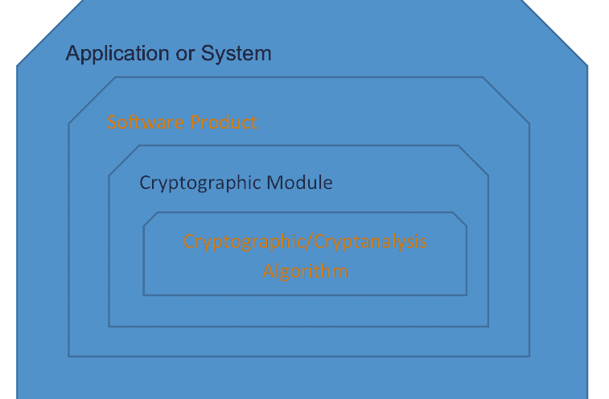

# 第 18 章

## 密码分析攻击和技术

在本章中，我们将介绍最重要的有用的密码分析标准、验证方法、分类和密码分析攻击。

密码分析学科非常广泛，撰写它可能需要数千页。在以下各节中，我们将介绍开发人员在日常活动中需要使用的所有必要元素。

## 标准

当您仅出于商业目的进行密码分析攻击时，旨在测试组织内的安全性，了解标准的重要性非常重要。

提供密码学和密码分析方法、框架和算法的高标准的主要机构和组织是

- **IEFT 公钥基础设施（X.509）**：该组织负责标准化基于公钥系统的互联网协议。
- **国家标准与技术研究所（NIST）**：该研究所负责制定美国政府的 FIPS 标准。
- **美国国家标准协会（ANSI）**：其目的是管理私营部门的标准。

## 图 18-1. 验证和测试框架

为了进行适当的测试和验证过程，需要并且必须有两步最小步骤，即密码/密码分析算法和密码模块。例如，如果您正在开发加密产品或桌面或 Web 软件应用程序，则公司/研究所/开发人员必须执行测试并将其发送至 CMVP¹（密码模块验证计划），以便根据 FIPS 140-2² 和 FIPS 140-3³ 进行测试。

密码模块代表软件和硬件过程的专门组合。使用经过验证的密码和密码分析模块的主要优点如下：

- 确保模块已满足必要的要求
- 确保授权和技术人员在共同商定并经过测试的标准内得到告知和指导。

¹CMVP, https://csrc.nist.gov/projects/cryptographic-module-validation-program
²FIPS 140-2, https://csrc.nist.gov/publications/detail/fips/140/2/final
³FIPS 140-3, https://csrc.nist.gov/publications/detail/fips/140/3/final

- 确保最终用户（终端用户）意识到该密码模块已按照某些明确定义的安全要求进行了验证和测试
- 安全的高可靠性，需要在开发类似和特定应用的目标下得到满足

FIPS 140-2 的安全要求包含 11 项用于设计和实现密码模块的指标。对于每个经过验证的密码模块，都需要满足以下要求。在验证过程中，密码模块会获得 1 到 4 的等级，该等级与所保证的安全级别成正比。

经过验证的密码模块包含的信息有制造商名称、地址、模块名称、模块版本、模块类型（软件或硬件）、验证日期、验证级别以及模块描述。

## Cryptanalysis Operations

设计密码系统时必须遵循以下简单 *原则*：

- 不应低估对手。
- 密码系统的安全性可以由密码分析员进行评估。
- 在对密码系统进行评估之前，会考虑到对评估的密码系统的对手的了解。
- 密码系统的秘密必须依赖于密钥。
- 密码系统评估的过程必须考虑到系统内的所有元素，例如密钥分发、加密内容等。

根据信息论之父 Claude Elwood Shannon⁴，在对密码系统进行评估时必须考虑以下几点：

- 密码分析员的一项胜利是在成功解密消息时获得的
- 密钥长度和复杂度
- 执行加密-解密过程的复杂度水平
- 加密文本的大小与文本大小相符
- 错误传播的方式

获得每个密码本解决方案的基本操作如下：

- 查找并确定所使用的语言
- 确定密码系统
- 为密码系统重建特定密钥，或对流密码系统进行部分或完全重建
- 重建此类系统或建立完整的明文

## Classification of Cryptanalytics Attacks

本节涵盖对密码算法、密码密钥以及协议上的身份验证协议、系统和硬件攻击的攻击类型。

## Attacks on Cipher Algorithms

*Table 18-1. Attacks on Ciphering Algorithms*

| Attack Title | Attack Description |
|---|---|
| Known plaintext attack | 密码分析员拥有加密文本，而他的通信对象拥有明文。此攻击的目标是让密码分析员从信息中分离出加密密钥。 |
| Chosen text attack | 密码分析员有机会指定将被加密的明文。密码分析员将尝试从文本信息中分离出加密密钥，有可能通过特定方法获得加密算法或密钥。 |
| Cipher-cipher text attack | 密码分析员持有明文，而他的通信对象持有用两个或多个不同密钥加密的相同文本。 |
| Divide-et-imperia attack | 密码分析员有机会在算法的不同输入和输出之间建立一系列相关性，以将算法中的不同输入分开，从而将问题分解为两个或多个易于解决的问题。 |
| Linear syndrome attack | 密码分析方法包括为伪随机生成器设计和创建特定的线性方程组，并用加密文本验证该方程组，从而以高概率获得明文。 |
| Consistency linear attack | 密码分析方法包括从等效加密密钥开始为伪随机生成器制定线性方程组，并以概率趋近于 1 通过伪随机生成器验证该系统，从而以高概率获得明文。 |
| Stochastic attack | 也称为预测攻击，如果生成器的输出是自相关的，则攻击是可能的，密码分析员能够将伪随机生成器的输出和加密文本作为输入数据。在这种情况下，明文被获得。 |
| Informational linear attack | 也称为线性复杂度攻击，如果有任何机会将生成器与 Fibonacci 算法等同，并且此外如果生成器的线性复杂度较低，则攻击是可能的。通过这种类型的攻击，可以构建类似的算法和类似的加密密钥。 |
| Virus attack | 如果加密算法被实现并在易受攻击且未受保护的 PC 上运行，则此攻击是可能的。 |

## Attacks on Cryptographic Keys

最常见的对密码密钥的攻击在表 18-2 中列出。

## Table 18-2. Attacks on Cryptographic Keys

| Attack Title | Attack Description |
|---|---|
| Brute force attack | 攻击包括对密钥和密码进行穷举验证，如果加密密钥大小较小且加密密钥空间较小，则可能实现。 |
| Intelligent brute force attack | 加密密钥的密钥随机性水平较低（熵较小），并且允许找到与所使用语言中的单词相似的密码。 |
| Backtracking attack | 攻击基于回溯类型方法的实现，该方法包括存在继续向所需方向搜索的条件。 |
| Greedy attack | 攻击提供最优局部密钥，而该密钥可能与最优全局密钥不同。 |
| Dictionary attack | 攻击包括使用字典搜索密码或密钥。 |
| Hybrid dictionary attack | 此攻击是通过修改字典中的单词，使用字典中的单词初始化暴力攻击来完成的。 |
| Viruses attack | 如果密钥存储在未受保护的 PC 上，则此攻击是可能的。 |
| Password hash attack/ cryptographic key | 如果密码的哈希值较短或错误处理，则会发生此攻击。 |
| Substitution attack | 原始密钥被第三方替换并在整个网络中替换。这可以通过病毒来完成。 |
| Storing encryption key | 如果以错误的方式完成（与加密数据一起以明文形式存储且没有任何物理保护措施或加密软件或硬件），则可能导致对加密消息的攻击。 |
| Storing of old encryption keys | 此攻击将危及加密的旧文档。 |
| Key compromise | 如果对称密钥被泄露，只有分配给该密钥的文档会被泄露。如果公钥被泄露，可以在不同服务器上找到，攻击者可以代替数据的合法所有者，从而对网络产生负面影响。 |
| Master keys | 代表密码系统中的不同阶段。 |
| Key lifetime | 它是一个基本组成部分，排除了未被检测到的成功攻击的可能性。 |

## Attacks on Authentication Protocols

身份验证协议会受到不同类型的攻击。表 18-3 列出了最重要且经常使用的攻击。请注意，系统的身份验证协议非常重要且至关重要。一旦被破坏，重要信息可能会泄露，攻击者可能会获得很多好处：个人、财务等等。

## Table 18-3. Attacks on Authentication Protocols

| Attack Title | Attack Description |
|---|---|
| Attack on the public key | 攻击发生在协议内的签名上。这仅适用于具有公钥的系统。 |
| Attack on the symmetric algorithm | 攻击发生在身份验证协议内的签名上。只有在使用对称密钥时才可用。 |
| Passive attack | 攻击者拦截并监控通道上的通信，而不进行任何干预。 |
| Attack using a third person | 通信信道中两个合作伙伴的通信被第三方主动拦截。 |
| The fail-stop signature | 一种密码协议，发送方可以提供证据证明其签名是否被伪造。 |

## 结论

本章涵盖了最重要的且实用的密码分析以及密码分析指南和方法。你现在可以用以测试和验证密码算法和方法的实现为目标的标准来管理标准。作为总结，你学习了关于

- 密码分析攻击分类
- 密码分析操作
- 标准 FIPS 140-2 和 FIPS 140-3
- 标准 15408
- 密码系统的验证

## 参考文献

[1] Adrian Atanasiu, *Matematici in criptografie*. US Publishing House, Editor: Universul Stiintific, ISBN: 978-973-1944-48-7. 2015.

[2] Adrian Atanasiu, *Securitatea Informatiei vol 1 (Criptografie)*. InfoData Publishing House, ISBN: 978-973-1803-18-0. 2007.

[3] Adrian Atanasiu, *Securitatea Informatiei vol 2 (Protocoale de securitate)*. InfoData Publishing House, ISBN: 978-973-1803-18-0. 2009.

[4] S.J. Knapskog, “Formal specification and verification of secure communication protocols,” 58–73.

[5] K. Koyama, “Direct demonstration of the power to break public-key cryptosystems,” 14–21.

[6] P.J. Lee, “Secure user access control for public networks,” 46–57.

[7] R. Lidl and W.B. Muller, “A note on strong Fibonacci pseudoprimes,” 311–317.

[8] Menezes, S. Vanstone, “The implementation of elliptic curve cryptosystems,” 2–13.

[9] M.J. Mihaljević and J.D. Golić, “A fast iterative algorithm for a shift register initial state reconstruction given the noisy output sequence,” 165–175.
