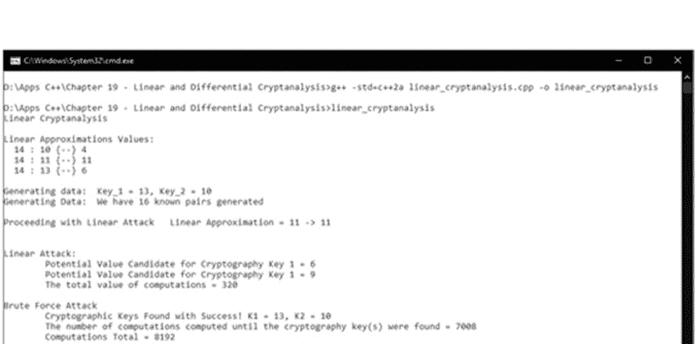

# 第19章

## 线性与差分密码分析

在本章中，我们将讨论两种重要的密码分析类型：*线性* 和 *差分密码分析*。为了说明如何将理论概念与实践相结合，在开始时我们将介绍一套基本概念和高级技术，说明专业人士如何实现这两种类型的密码分析。

尽管某些差分和线性机制已经过时，但仍有大量空间可以找到新的挑战，以便获得新的结果。关于线性与差分密码分析的研究文献提供了大量的理论方法和机制，但只有少数理论能够在实践中应用，以开发针对差分和线性密码分析攻击的专业解决方案。

理论密码分析与应用密码分析之间的差异非常巨大。过去12年中发表的结果，例如算法、方法、博弈论方面等，使研究人员和专业人士走向了不同的道路。其中大多数是奇想的梦幻生物（没有实际应用性的复杂数学系统）和花哨的算法；其他一些在实践中取得了成功的应用。

在密码分析领域开展研究并提高其在实践中和不同场景下的应用潜力需要时间、经验，以及理论家与实践者之间持续的跨协作，而不存在这两种类别之间的隔离。它们在密码分析领域的重要性至关重要，提供必要的工具和机制来构建针对分组密码和流密码的密码分析攻击方案。

### 差分密码分析

差分密码分析由 E. Biham 和 A. Shamir 在90年代初期实现。差分密码分析的目的是检查密文是否以大于其他概率的概率追踪密钥的某些位置。检查过程可以用任何1级顺序进行。实际上，该测试代表了2阶测试周期的复杂近似。

通过差分密码分析，我们将暴露密码算法的弱点。以下差分密码分析示例说明了流密码算法。在下面的伪代码中，我们将按如下方式说明算法：

```
INPUT:  The key is chosen as K = (k₁, ..., kₙ) with kᵢ ∈ {0,1}
```

```
OUTPUT: The weak points of the cryptography
algorithm together with the resistance decision for
differential cryptanalysis
```

- 1. α←拒绝率值
- 2. 选择 n 套具有扰动属性的密钥，从密钥 K 开始。

```
for i = 1 to n do K⁽ⁱ⁾ = (δ₁ᵢ ⊕ k₁, ..., δₙᵢ ⊕ kₙ):
```

```
δₗᵢ = { 1, if j ≠ i, 0, if j = i. }
```

for i,j=1,...,n. 在上述形式中，第 i 个密钥是通过改变第 i 个位置的位从基本密钥获得的。

- 3. 构造密文：第一步是使用基本密钥、扰动密钥和明文 M 构建 n + 1 个密文。我们将得到的密文表示为 C⁽ⁱ⁾，i = 1, ..., n + 1。作为明文 M，我们可以选择文本 0 - 到处都是。

- 4. 构造相关矩阵：这里我们为相关值 C 构建 (n + 1) × (n + 1) 矩阵：

```
cᵢⱼ = correlation(cryptogram i, cryptogram j).
```

相关 $c_{ij}$ 表示应用于序列 ($cryptogram i \oplus cryptogram j$) 的统计测试的值。矩阵 $C$ 表示为对称矩阵，主对角线上有 1。

5. **显著值的计算过程：** 它计算位于主对角线以上的显著相关值的数量。一个值被称为 *显著* 如果

$c_{i,j} \notin \left[ u_{\frac{\alpha}{2}} ; u_{1-\frac{\alpha}{2}} \right]$.

设 $T$ 为显著值的数量，表示相关测试的拒绝次数。

6. **决策和结果解释：** 如果

$\frac{T - \alpha \cdot \frac{n(n+1)}{2}}{\sqrt{\alpha(1-\alpha) \cdot \frac{n(n+1)}{2}}} \notin \left[ u_{\frac{\alpha}{2}} ; u_{1-\frac{\alpha}{2}} \right]$,

计算后，我们可以决定对差分密码分析的非抗性（$u_{\frac{\alpha}{2}}$ 和 $u_{1-\frac{\alpha}{2}}$）表示正态分布的 $\frac{\alpha}{2}$ 和 $1-\frac{\alpha}{2}$ 阶的分位数，并固定 $n \ge i > j \ge 1$ 的 $(i,j)$ 元素，其中 $c_{ij}$ 显著。这些元素代表算法的弱点。否则我们就无法谈论对这种类型攻击的抗性。

列表 19-1 显示了上述伪代码在 C++ 中的实现，图 19-1 所示的输出是自解释的且相当直观。源代码分为七个步骤：

- 生成差分结构作为矩阵
- 计算差异
- 计算使用差分生成的中间值
- 生成已知密钥对
- 计算并寻找一对好的密钥

```
int known_ciphertext_1[10000];
int good_plaintext_0, good_plaintext_1, good_ciphertext_0, good_ciphertext_1;
int pairs_of_numbers;
int characters_dataSet_0[16];
int characters_data_max = 0;
int round_function(int integer_input, int cryptoKey)
{
    return theSBox[cryptoKey ^ integer_input];
}

int encryption(int integer_input, int key_0, int key_1)
{
    int x_value_0 = round_function(integer_input, key_0);
    return x_value_0 ^ key_1;
}

void find_differences()
{
    printf("\nXOR Differential Structure:\n");

    int a, b, c, f;    //c, d, e, f

    for(a = 0; a < 16; a++)
    {
        for(b = 0; b < 16; b++)
        {
            characters[a ^ b][theSBox[a] ^ theSBox[b]]++;
        }
    }

    for(a = 0; a < 16; a++)
    {
        for(b = 0; b < 16; b++)
            printf(" %x ", characters[a][b]);
        printf("\n");
    }
}
```

```
```c
printf("\nShowing the most important differences:\n");

for(a = 0; a < 16; a++)
{
    for(b = 0; b < 16; b++)
    {
        if (characters[a][b] == 6)
        {
            printf("  6/16:  %i {--} %i\n", a, b);
        }
    }
}

void generate_characters_data(int input_differences,
                              int output_differences)
{
    printf("\nIntermediate values generated using the\ndifferentials(%i --> %i):\n", input_differences,
           output_differences);

    characters_data_max = 0;
    int f;
    for(f = 0; f < 16; f++)
    {
        int computations = f ^ input_differences;

        if ((theSBox[f] ^ theSBox[computations]) ==
            output_differences)
        {
            printf("  The possibility:  %i + %i {--}\n"
                   "                     %i + %i\n", f, computations,
                   theSBox[f], theSBox[computations]);
            characters_dataSet_o[characters_data_max] = f;
            characters_data_max++;
        }
    }
}
```
```


void generate_pairs(int input_differences)
{
    printf("\nKnown pairs %i generated. The pairs are based on
            the differentials served as input of %i.\n",
            pairs_of_numbers, input_differences);

    //** generate substitution keys
    int real_key_0 = rand() % 16;
    int real_key_1 = rand() % 16;

    printf("  Real Key 0 = %i\n", real_key_0);
    printf("  Real Key 1 = %i\n", real_key_1);

    int c;

    //** using XOR, pairs for plaintexts and
    //** ciphertexts are generated
    for(c = 0; c < pairs_of_numbers; c++)
    {
        known_plaintext_0[c] = rand() % 16;
        known_plaintext_1[c] = known_plaintext_0[c] ^
                              input_differences;
        known_ciphertext_0[c] = encryption(known_plaintext_0[c], real_key_0,
                                    real_key_1);
        known_ciphertext_1[c] = encryption(known_plaintext_1[c], real_key_0,
                                    real_key_1);
    }
}

void identifying_good_pair(int output_differences)
{
    printf("\nLooking for good pair:\n");
    int c;

    //** test if the pair of ciphertexts meet
    //** the characteristics
for(c = 0; c < pairs_of_numbers; c++)
{
    if ((known_ciphertext_0[c] ^ known_ciphertext_1[c]) == output_differences)
    {
        good_ciphertext_0 = known_ciphertext_0[c];
        good_ciphertext_1 = known_ciphertext_1[c];
        good_plaintext_0 = known_plaintext_0[c];
        good_plaintext_1 = known_plaintext_1[c];
        printf("  A good pair has been found: (P0 = %i, P1 = %i) {--} (C0 = %i, C1 = %i)\n", good_plaintext_0, good_plaintext_1, good_ciphertext_0, good_ciphertext_1);
        return;
    }
}
printf("There was no good pair found!\n");
}

int key_testing(int key_test_0, int key_test_1)
{
    int c;
    int crap = 0;
    for(c = 0; c < pairs_of_numbers; c++)
    {
        if ((encryption(known_plaintext_0[c], key_test_0, key_test_1) != known_ciphertext_0[c]) || (encryption(known_plaintext_1[c], key_test_0, key_test_1) != known_ciphertext_1[c]))
        {
            crap = 1;
            break;
        }
    }
}
```c
if (crap == 0)
    return 1;
else
    return 0;
}

void brute_cracking()
{
    printf("\nReducing the space of the key using brute force:\n");

    int f;

    /** based on the characteristics, we will
    /** test each of the possible value
    for(f = 0; f < characters_data_max; f++)
    {
        int key_test_0 = characters_dataSet_0[f] ^
                         good_plaintext_0;
        int key_test_1 = theSbox[characters_dataSet_0[f]] ^
                         good_ciphertext_0 ;

        if (key_testing(key_test_0, key_test_1) == 1)
            printf("\n\nThe Key! (%i, %i), ", key_test_0,
                   key_test_1);
        else
            printf(" (%i, %i), ", key_test_0, key_test_1);
    }
}
int main()
{
    /** generate random value once the program is run
    srand(time(NULL));

    /** look in the s-boxes for good differences
    find_differences();
}

//** define number of known pairs
pairs_of_numbers = 8;

//** look for inputs that meet specific characteristics
generate_characters_data(4, 7);

//** let's generate pairs of chosen-plaintext
generate_pairs(4);

//** pick a pair which meet the characteristic
identifying_good_pair(7);

//** find the key
brute_cracking();
}

## 线性密码分析

线性密码分析被开发为数据加密系统 DES 的理论框架，并在 1993 年得以实现。线性密码分析通常用于分组密码内部，并且是设计和执行复杂攻击的非常好的起点。

线性密码分析被定义为密钥、明文结构和密文结构之间建立的线性关系。明文被结构化并表示为字符或位。需要具有由异或构成的操作链结构，如下所述，

$A_{i_1} \oplus A_{i_2} \dots \oplus A_{i_u} \oplus B_{j_1} \oplus B_{j_2} \oplus \dots \oplus B_{j_v} = Key_{k_1} \oplus Key_{k_2} \oplus \dots Key_{k_w}$

其中 ⊕ 表示作为二元操作的 XOR 操作，$A_i$ 表示输入结构 $A = [A_1, A_2, ...]$ 的第 $i$ 个位置的位，$B_j$ 表示输出结构 $B = [B_1, B_2, ...]$ 的第 $j$ 个位置的位，而 $Key_k$ 表示密钥 $Key = [Key_1, Key_2, ...]$ 的第 $k$ 个位。

## 执行线性密码分析

通常，在最重要情况下，执行线性密码分析始于我们了解并承认加密算法除了私钥之外的想法。对分组密码执行线性密码分析被表示为如下所述的框架：

## 表 19-1. S-Box 示例

|  | 11 | 10 | 01 | 00 |
|---|---|---|---|---|
| 00 | 0000 | 0001 | 0010 | 0011 |
| 01 | 1000 | 1001 | 1111 | 1011 |
| 10 | 1100 | 1101 | 1110 | 1010 |
| 11 | 0100 | 0101 | 0010 | 0111 |

在表 19-2 中，输入位示例与输出位示例之间的映射操作得以演示。

## 表 19-2. 输入与输出之间的映射

| 输入 (J) | 输出 (Q) |
|---|---|
| 0000 | 0011 |
| 0001 | 0010 |
| 0010 | 1011 |
| 0011 | 1111 |
| 0100 | 1010 |
| 0101 | 1110 |
| 0110 | 0111 |
| 0111 | 0010 |
| 1000 | 0001 |
| 1001 | 0000 |
| 1010 | 1001 |
| 1011 | 1000 |
| 1100 | 1101 |
| 1101 | 1100 |
| 1110 | 0101 |
| 1111 | 0100 |

## S-Box 的线性近似

我们从想要近似上述所示的替换盒结构开始的思想出发。基于该信息，我们对各种线性近似具有相当高的精度。我们包含 256 个这样的线性近似，具有以下形式：

$d_1J_1 \oplus d_2I_2 \oplus d_3J_3 \oplus a_4I_4 = g_1Q_1 \oplus g_2Q_2 \oplus g_3Q_3 \oplus g_4Q_4$

其中 $J_1$ 和 $Q_1$ 表示输入 ($J$) 和输出 ($Q$) 的第 $i$ 个位，其特征为 $d_i$ 和 $g_i$，它们为 0 或 1。作为示例，让我们使用以下线性近似 $J_2 = Q_1 \oplus Q_4$，由 $d = 0100_2$ 和 $g = 1001_2$ 给出。

## 线性近似的串联

是时候形成、设计和投影整个系统的线性近似了。为了实现这一点，我们需要两件事：

- 首先，我们需要已经计算出构成系统的每个组件的线性近似。
- 其次，进行组合。为此，我们只需使用异或对不同组合中的整个方程集求和。这样我们就得到一个单一的方程，该方程消除了中间变量。

## 组合两个变量

让我们考虑 $B_1$ 和 $B_2$，两个随机二进制变量。它们之间的线性关系为 $B_1 \oplus B_2 = 0$。接下来，我们用 $l$ 表示概率 $B_1 = 0$，用 $m$ 表示概率 $B_2 = 0$。基于两个随机独立变量，我们有

```
$P(B_1 = a, B_2 = b) = \begin{cases} l \cdot m & \text{for } a = 0, b = 0 \\ l(1 - m) & \text{for } a = 0, b = 1 \\ (1 - l) \cdot q & \text{for } a = 1, b = 0 \\ (1 - l) \cdot (1 - m) & \text{for } a = 1, b = 1 \end{cases}$
```

继续前进，我们可以证明以下内容：

P(B₁ ⊕ B₂ = 0) =
= P(B₁ = B₂)
= P(B₁ = 0, B₂ = 0) + P(B₁ = 1, B₂ = 1)
= l·m + (1−l)(1−m)

下一步是计算 $B_1 \oplus B_2 = 0$ 的偏差；它将由 ζ₁·ζ₂ 给出。

话虽如此，现在是时候在 C++ 中进行实现（见列表 19-2）以进行线性密码分析（见图 19-2），并展示上述概念如何在实践中被使用。



图 19-2. 线性密码分析输出仿真程序

## 列表 19-2. 线性密码分析仿真

```
#include <stdio.h>
#include <stdlib.h>
#include <time.h>

int sBox_content[16] = {9, 11, 12, 4, 10, 1, 2, 6, 13, 7, 3,
                    8, 15, 14, 0, 5};

int sBox_content_revision[16] = {14, 5, 6, 10, 3, 15, 7, 9,
                               11, 0, 4, 1, 2, 8, 13, 12};

int approximation_array[16][16];
int known_plaintext[500];
int known_ciphertext[500];
int numbers_known = 0;

int using_mask(int inputValue, int mask_value)
{
    int value = inputValue & mask_value;
    int total = 0;

    while(value > 0)
    {
        int temporary = value % 2;
        value /= 2;

        if (temporary == 1)
        {
            total = total ^ 1;
        }
    }
    return total;
}

void looking_for_approximation()
{
    int a, b, c;
```


//** the output of mask value
for(a = 1; a < 16; a++)
{
    //** the input of mask value
    for(b = 1; b < 16; b++)
    {
        //** input
        for(c = 0; c < 16; c++)
        {
            if (using_mask(c, b) ==
                using_mask(sBox_content[c], a))
            {
                approximation_array[b][a]++;
            }
        }
    }
}

void display_approximation()
{
    printf("Linear Approximations Values: \n");
    int a, b, c;
    for(a = 1; a < 16; a++)
        for(b = 1; b < 16; b++)
            if (approximation_array[a][b] == 14)
                printf(" %i : %i {--} %i\n",
                    approximation_array[a][b], a, b);
    printf("\n");
}

int round_function(int inputValue, int substitution_key)
{
    return sBox_content[inputValue ^ substitution_key];
}

void filling_known_numbers()
{
    int substitution_key_1 = rand() % 16;
    int substitution_key_2 = rand() % 16;

    printf("Generating data:  Key_1 = %i, Key_2 = %i\n", substitution_key_1, substitution_key_2);

    int total = 0;

    int c;
    for(c = 0; c < numbers_known; c++)
    {
        known_plaintext[c] = rand() % 16;
        known_ciphertext[c] = round_function(round_function(known_plaintext[c], substitution_key_1), substitution_key_2);
    }

    printf("Generating Data:  We have %i known pairs generated\n\n", numbers_known);
}

void keys_testing(int key_1, int key_2)      //testKeys
{
    int c;
    for(c = 0; c < numbers_known; c++)
    {
        if (round_function(round_function(known_plaintext[c], key_1), key_2) != known_ciphertext[c])
        {
            break;
        }
    }
    printf("# ");
}

int main()
{
    printf("Linear Cryptanalysis\n\n");

    srand(time(NULL));

    looking_for_approximation();
    display_approximation();

    int input_approximation = 11;
    int output_approximation = 11;

    /** how many numbers we known
    numbers_known = 16;
    filling_known_numbers();

    int cryptographic_key_score[16];
    int reaching_threshold = 0;

    printf("Proceeding with Linear Attack");
    printf("\tlinear Approximation = %i -> %i\n",
           input_approximation, output_approximation);

    printf("\n\n");

    int b, h;
    for(b = 0; b < 16; b++)
    {
        cryptographic_key_score[b] = 0;
        for(h = 0; h < numbers_known; h++)
        {
            reaching_threshold++;
            int middle_round = round_function(known_plaintext[h], b);

            if ((using_mask(middle_round, input_approximation)
                == using_mask(known_ciphertext[h],
                output_approximation)))
                cryptographic_key_score[b]++;

else
    cryptographic_key_score[b]--;
}
}

int maximum_score_value = 0;

for(b = 0; b < 16; b++)
{
    int score_value = cryptographic_key_score[b] *
                      cryptographic_key_score[b];
    if (score_value > maximum_score_value)
        maximum_score_value = score_value;
}

int good_cryptographic_keys[16];

for(h = 0; h < 16; h++)
    good_cryptographic_keys[h] = -1;

h = 0;
printf("Linear Attack:\n");
for(b = 0; b < 16; b++)
{
    if ((cryptographic_key_score[b] *
         cryptographic_key_score[b]) == maximum_score_value)
    {
        good_cryptographic_keys[h] = b;
        printf("\tPotential Value Candidate for
                 Cryptography Key 1 = %i\n",
               good_cryptographic_keys[h]);
        h++;
    }
}

int guessing_cryptographic_key_1;
int guessing_cryptographic_key_2;

for(h = 0; h < 16; h++)
{
    if (good_cryptographic_keys[h] != -1)
    {
        int cryptography_key_test_1 =
            round_function(known_plaintext[0],
            good_cryptographic_keys[h]) ^
            sBox_content_revision[
                known_ciphertext[0]];

        int tested = 0;
        int e;
        int bad = 0;
        for(e = 0;e < numbers_known; e++)
        {
            reaching_threshold += 2;
            int testOut = round_function(round_function
                (known_plaintext[e],
                good_cryptographic_keys[h]),
                cryptography_key_test_1);
            if (testOut != known_ciphertext[e])
                bad = 1;
        }
        if (bad == 0)
        {
            printf("\tFound Keys! K1 = %i, K2 = \n", good_cryptographic_keys[h],
                cryptography_key_test_1);
            guessing_cryptographic_key_1 =
                good_cryptographic_keys[h];
            guessing_cryptographic_key_2 =
                cryptography_key_test_1;
            printf("\tComputations Until Key Found = \n", reaching_threshold);
        }
    }
}
}
}

printf("\tThe total value of computations = %i\n\n", reaching_threshold);

reaching_threshold = 0;

printf("Brute Force Attack\n");
for(h = 0; h < 16; h++)
{
    for(b = 0; b < 16; b++)
    {
        int e;
        int bad = 0;
        for(e = 0;e < numbers_known; e++)
        {
            reaching_threshold += 2;
            int testOut = round_function(round_function(
                known_plaintext[e], h), b);
            if (testOut != known_ciphertext[e])
                bad = 1;
        }
        if (bad == 0)
        {
            printf("\tCryptographic Keys Found with
                Success! K1 = %i, K2 = %i\n", h, b);
            printf("\tThe number of computations
                computed until the cryptography
                key(s) were found = %i\n",
                reaching_threshold);
        }
    }
}
printf("\tComputations Total = %i\n", reaching_threshold);
}

# Conclusion

本章讨论了差分和线性密码分析攻击，以及这些攻击如何在实际中进行设计和实现。我们介绍了理论背景要素和主要基础，在设计此类密码分析攻击之前必须理解这些要素。

在本章结束时，你现在可以

- 在理论上识别密码分析师应重点关注的主要组件
- 理解这些组件的脆弱性如何以及如何被利用
- 实现线性和差分密码分析攻击

# References

[1] Joan Daemen, Lars Knudsen, and Vincent Rijmen “The Block Cipher Square. Fast Software Encryption (FSE)” in Volume 1267 of Lecture Notes in Computer Science (pp. 149–165). Haifa, Israel: Springer-Verlag. CiteSeerX 10.1.1.55.6109. 1997.

[2] H. Heys, “A Tutorial on Linear and Differential Cryptanalysis” in Cryptologia, vol. XXVI, no. 3 (pp. 189-221). 2002.

[3] M. Matsui, “Linear Cryptanalysis Method for DES Cipher” in Advances in Cryptology - EUROCRYPT ’93 (pp. 386-397). Springer-Verlag. 1994.

[4] E. Biham, “On Matsui’s linear cryptanalysis” in (ed. A. De Santis) Lecture Notes in Computer Science, vol. 950 (pp. 341–355). Springer-Verlag; Berlin. 1995.

[5] A. Biryukov, C. De Cannière, and M. Quisquater, “On Multiple Linear Approximations” in (ed. M. Franklin) Advances in Cryptology, proceedings of CRYPTO 2004, Lecture Notes in Computer Science 3152 (pp. 1-22). Springer-Verlag. 2004.

[6] L. Keliher, H. Meijer, and S.E. Tavares (2001). “New method for upper bounding the maximum average linear hull probability for SPNs” in (ed. B. Pfitzmann) LNCS, vol. 2045 (pp. 420–436). Springer-Verlag; Berlin. 2001.

[7] L.R. Knudsen and J.E. Mathiassen, “A chosen-plaintext linear attack on DES” in (ed. B. Schneier) Lecture Notes in Computer Science, vol. 1978 (pp. 262-272). Springer-Verlag; Berlin. 2001.

[8] M. Matsui and A. Yamagishi, “A new method for known plaintext attack of FEAL cipher” in (ed. R.A. Rueppel) Lecture Notes in Computer Science, vol. 658 (pp. 81-91). Springer-Verlag; Berlin. 1993.

[9] M. Matsui, “The first experimental cryptanalysis of the data encryption standard” in (ed. Y.G. Desmedt) Lecture Notes in Computer Science, vol. 839 (pp. 1-11). Springer-Verlag; Berlin. 1994.

[6] L. Keliher, H. Meijer, and S.E. Tavares (2001). “New method for upper bounding the maximum average linear hull probability for SPNs” in (ed. B. Pfitzmann) LNCS, vol. 2045 (pp. 420–436). Springer-Verlag; Berlin. 2001.

[7] L.R. Knudsen and J.E. Mathiassen, “A chosen-plaintext linear attack on DES” in (ed. B. Schneier) Lecture Notes in Computer Science, vol. 1978 (pp. 262-272). Springer-Verlag; Berlin. 2001.

[8] M. Matsui and A. Yamagishi, “A new method for known plaintext attack of FEAL cipher” in (ed. R.A. Rueppel) Lecture Notes in Computer Science, vol. 658 (pp. 81-91). Springer-Verlag; Berlin. 1993.

[9] M. Matsui, “The first experimental cryptanalysis of the data encryption standard” in (ed. Y.G. Desmedt) Lecture Notes in Computer Science, vol. 839 (pp. 1-11). Springer-Verlag; Berlin. 1994.
