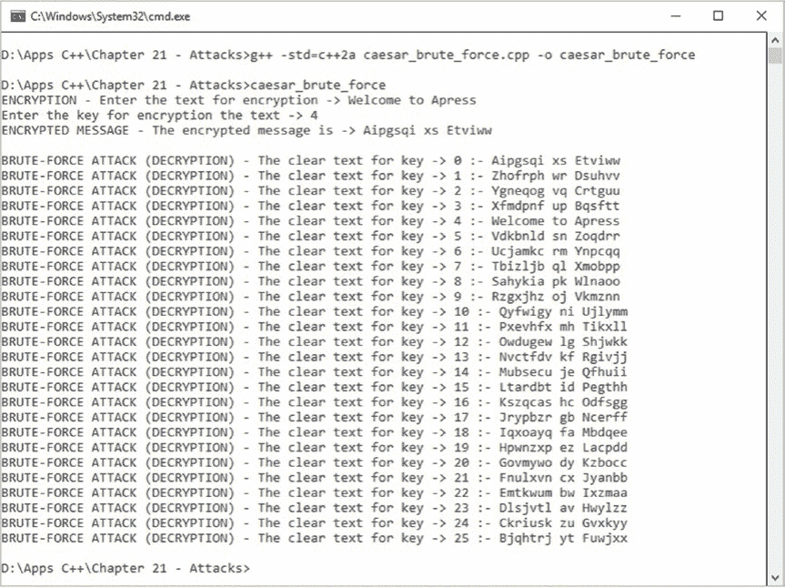
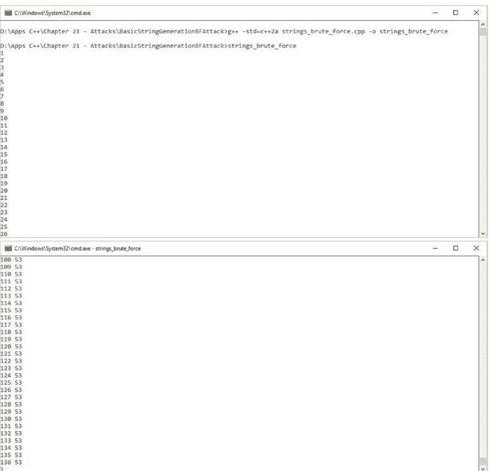
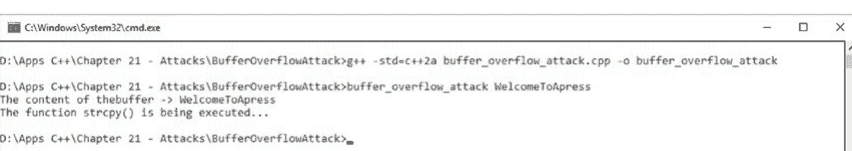

# 第21章

## 暴力破解与缓冲区溢出攻击

本章介绍两种重要攻击，*缓冲区溢出*攻击和*暴力破解*攻击，它们经常被用于针对 C++ 应用程序和程序。

一类特殊的攻击者会使用应用程序/程序或设备来发起暴力破解或缓冲区溢出攻击。它们的方法会评估确认表单的单词的不同组合。在某些情况下，攻击者会尝试通过扫描会话 ID 等过程来破坏 Web 应用程序。例如。攻击者的目标包括窃取数据、用恶意软件破坏目标机器，并索取特定金额的钱。一些攻击者出于个人选择而以物理方式执行暴力破解攻击。今天，大多数暴力破解和缓冲区溢出攻击都是由机器人执行的。

为了保护组织和企业免受此类攻击，请考虑以下建议：

- 不要使用可以在网上找到的数据或信息。
- 使用尽可能多的字符。
- 使用字母、数字和特殊字符的组合（例如符号）。
- 不要使用常见模式（例如 qwerty）。
- 为每个用户账户使用不同的密码。
- 定期更改密码（例如每两个月）。
- 使用并生成长且强密码。如果您没有想法，可以使用密码生成器（例如 KeyPass 的密钥生成）。
- 实现多因素认证 [1]。
- 如果可能，使用生物识别 [2]。

## 暴力破解攻击

暴力破解攻击代表一种复杂的攻击，其中攻击者会提交大量密码或密码短语，目标是猜出正确的密码。攻击者会逐一检查每个密码或密码短语，直到找到正确的密码。此外，攻击者可能猜测密钥。密钥通常由密码通过密钥派生函数创建。此过程称为穷举密钥搜索。

暴力破解攻击有许多类型：

- **基于彩虹表的攻击**：彩虹表是预定义和预计算的表。目标是逆转密码哈希容量的过程。
- **基于逆向暴力破解攻击的攻击**：攻击基于使用通用密码或特定密码集针对多个用户名。
- **凭据攻击**：攻击使用密码-用户名集针对各种网站。
- **混合暴力破解攻击**：攻击用于弄清楚使用何种密码变体才能成功。之后，它会继续进行处理不同变体的一般检查过程。

我们将通过以下示例说明这种攻击，以展示攻击如何在现实生活情况（算法）中被使用和部署。提供的示例有

- **对凯撒密码的暴力破解攻击**：该示例（见图 21-1 和清单 21-1）基于凯撒密码。选择该示例作为展示暴力破解攻击的第一个案例是由于其简单性。
- **暴力破解攻击的字符串生成**：该示例（见图 21-2 和清单 21-2）展示了如何进行基本字符串生成，目标是创建可用于暴力破解攻击的复杂列表和字典。

# 第21章　暴力破解与缓冲区溢出攻击



**图 21-1。** *运行暴力破解攻击*

### 清单 21-1. 对凯撒密码的暴力破解攻击

```
```cpp
#include<iostream>
using namespace std;

// the function will be used to encrypt the plaintext
// string msg - the message
// int keytValue - the key
string encrypt(string msg,int keyValue)
{
        // variable used to hold the cipher value of the plaintext
    string cipher="";
```
```

```
```cpp
for(int i=0;i<encMessage.length();i++)
{
    // check if the character is upper case
    if(isupper(encMessage[i]))
    {
        if((encMessage[i] - keyTry - 65)<0)
            plaintext += 91 + (encMessage[i] - keyTry - 65);
        else
            plaintext += (encMessage[i] - keyTry - 65)%26 + 65;
    }
    // check if the character is lower case
    else if(islower(encMessage[i]))
    {
        if((encMessage[i] - keyTry - 97) < 0)
            plaintext += 123 + (encMessage[i] - keyTry - 97);
        else
            plaintext += (encMessage[i] - keyTry - 97)%26 + 97;
    }
    else
        plaintext += encMessage[i];
}
cout << "BRUTE-FORCE ATTACK (DECRYPTION) - The clear text for key -> " << keyTry << " :- " << plaintext << endl;
}
}

int main()
{
    int encKey;
    string cleartext;
    cout << "ENCRYPTION - Enter the text for encryption -> ";
    getline(cin,cleartext);

    cout << "Enter the key for encryption the text -> ";
    cin >> encKey;
```
```

```
string encryptedMessage = encrypt(cleartext,encKey);
cout << "ENCRYPTED MESSAGE - The encrypted message is -> "
<< encryptedMessage << endl << endl;

//** brute force attack
decrypt(encryptedMessage);
}
```



图 21-2. 暴力破解攻击的基本字符串生成（生成字符串的不同状态）

### 清单 21-2. 基本字符串生成源代码

```
#include <string.h>
#include <stdio.h>
#include <stdlib.h>

// We are using a linked list data structure.
// The reasong is to avoid some of the restrictions
//      based on the generation of the string length.
// Our list has to be converted to string in
//      such way that it can be used. The current conversion
//      might be a little slower comparing with other methods
//      due to the fact that the conversion is happening with
//      each cycle.

// Another solution consists in implementing a solution based
//      on the generation of the allocation for the string with
//      a fixed size equal with 20 characters (which is more than
//      enough).

// the structure definition for holding the characters (strings)
typedef struct charactersList charlist_t;
struct charactersList
{
    // the character
    unsigned char character;
    // the next character
    charlist_t* nextCharacter;
};

// The method will return a new initialized charlist_t element.
// The element returned is charlist_t
charlist_t* new_characterList_element()
{
    charlist_t* elementFromTheList;
```

```
if ((elementFromTheList = (charlist_t*) malloc(sizeof(charlist_t))) != 0)
{
    elementFromTheList->character = 0;
    elementFromTheList->nextCharacter = NULL;
}
else
{
    perror("The allocation using malloc() has failed.");
}

    return elementFromTheList;
}

// allocation free memory by the characters list
// listOfCharacters - represents a pointer for the first element within the list
void freeAllocation_CharactersList(charlist_t* listOfCharacters)
{
    charlist_t* currentCharacter = listOfCharacters;
    charlist_t* nextCharacter;

    while (currentCharacter != NULL)
    {
        nextCharacter = currentCharacter->nextCharacter;
        free(currentCharacter);
        currentCharacter = nextCharacter;
    }
}

// the function display the current list of characters
// the function will iterate through the whole list and it will print all the characters
void showCharactersList(charlist_t* list)
{
    charlist_t* nextCharacter = list;
```

```
while (nextCharacter != NULL)
{
    printf("%d ", nextCharacter->character);
    nextCharacter = nextCharacter->nextCharacter;
}
printf("\n");
}

// the function will return the next sequence of characters.
// the characters are treated as numbers 0-255
// the function proceeds by incrementation of the character from the first
    position
void nextCharactersSequence(charlist_t* listOfCharacters)
{
    listOfCharacters->character++;
    if (listOfCharacters->character == 0)
    {
        if (listOfCharacters->nextCharacter == NULL)
        {
            listOfCharacters->nextCharacter = new_characterList_element();
        }
        else
        {
            nextCharactersSequence(listOfCharacters->nextCharacter);
        }
    }
}

int main()
{
    charlist_t* sequenceOfCharacters;
    sequenceOfCharacters = new_characterList_element();

    // this while will work for all possibles combinations
    // this has to be stopped manually
```


```cpp
while (1)
{
    nextCharactersSequence(sequenceOfCharacters);
    showCharactersList(sequenceOfCharacters);
}

freeAllocation_CharactersList(sequenceOfCharacters);
}
```

## 缓冲区溢出攻击

缓冲区代表用于存储数据的临时区域。当程序或系统进程放置更多数据时，就会发生额外的数据溢出。

在缓冲区溢出攻击中，被存储的额外数据可以存储由黑客或恶意用户设计的特定指令以执行操作。例如，数据可以触发一个事件（函数或进程）来销毁文件或泄露用户隐私数据。

攻击者利用缓冲区溢出来从正在执行并等待用户交互的程序中获得优势。缓冲区溢出有两种类型：基于栈的和基于堆的。在基于堆的溢出中，基于淹没程序及其执行所保留的内存空间来发起和执行攻击是非常困难的。在基于栈的溢出中，对应用程序和程序的利用是在内存栈上进行的，而内存栈是用于存储用户输入数据的内存空间。

以下示例（见图 21-3 和列表 21-3）展示了此类情况对 C++ 应用程序的危险性。在提供的示例中，我们不会对恶意代码注入做任何实现。我们展示缓冲区溢出的主要过程。作为现代编译器与旧编译器之间的比较，现代编译器在编译或链接过程中提供溢出检查选项，但在运行时，如果没有异常处理等保护机制，很难检查这种情况。



图 21-3. 缓冲区溢出执行

列表 21-3. 缓冲区溢出示例的实现

```cpp
#include <stdio.h>
#include <string.h>
#include <stdlib.h>

int main(int argc, char *argv[])
{
    // We allocate a buffer of 5 bytes which includes also the termination, NULL.
    // The allocation should be done as 8 bytes which is two double words.
    // For overflowing process we will need more than 8 bytes.
    // if the user provides more than 8 characters for the input,
    // an access violation and fault segmentation
    char buffer_test_example[5];
    // execution of the program
    if (argc < 2)
    {
        printf("Function strcpy() will not be executed...\n");
        printf("The syntax: %s <characters>\n", argv[0]);
        exit(0);
    }
    // Take the input from the user and copy it to the buffer.
    // The process is done without verifying the bound
    strcpy(buffer_test_example, argv[1]);
    printf("The content of the buffer -> %s\n", buffer_test_example);
    printf("The function strcpy() is being executed...\n");
    return 0;
}
```

## 结论

本章涵盖了两种重要的攻击：暴力攻击和缓冲区溢出攻击。你现在能够

- 理解暴力攻击和缓冲区溢出攻击
- 理解构成设计此类攻击基础的主要概念
- 理解基于栈和基于堆的缓冲区溢出之间的局限性

## 参考文献

- [1] M. I. Mihailescu and S. Loredana Nita, “Three-Factor Authentication Scheme Based on Searchable Encryption and Biometric Fingerprint” in 2020 13th International Conference on Communications (COMM). Bucharest, Romania, 2020, pp. 139-144, doi: 10.1109/COMM48946.2020.9141956.
- [2] M. I. Mihailescu, S. L. Nita, and V. C. Pau. “Applied Cryptography in Designing e-Learning Platforms” in 16th International Scientific Conference “eLearning and Software for Education.” Bucharest, Apr. 2020, vol. 2, pp. 179–189, doi: 10.12753/2066-026X-20-108.
