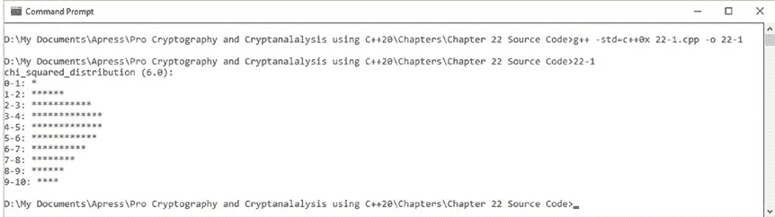
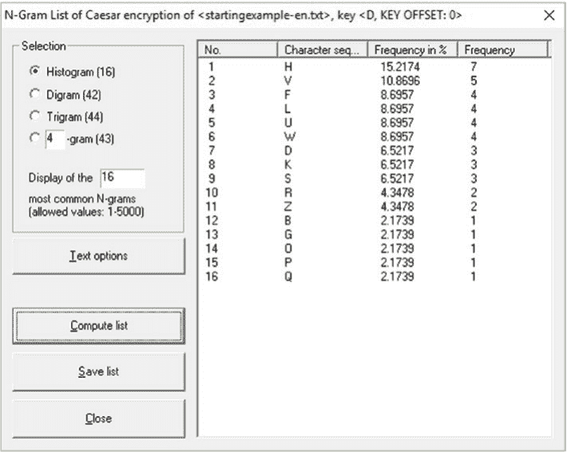
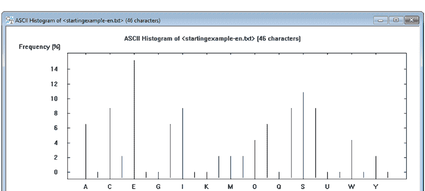
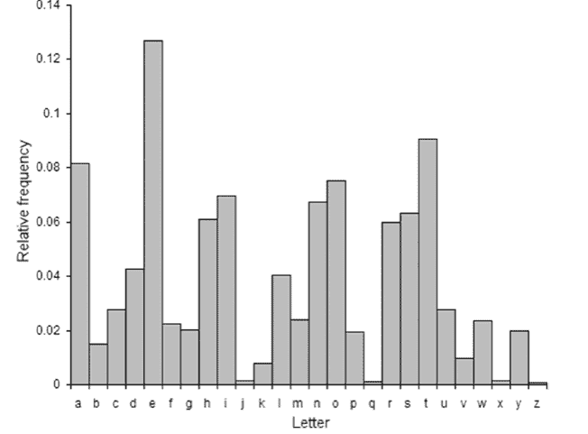

# 第 22 章：文本特征化

在本章中，我们将分析密码和明文分析的两个重要指标：卡方统计量和模式搜索（单字母、双字母和三字母）。在处理经典和现代密码学时，文本特征化作为一种技术是密码分析工具包中非常重要的一部分。

### 卡方统计量

卡方统计量是一个重要的指标，用于计算两个概率分布之间的相似百分比。当卡方统计量的结果等于 0 时有两种情况；这意味着两个分布相似。如果分布差异很大，则会输出更高的数值。

卡方统计量由以下公式定义：

$$\chi^2(C,E)=\sum_{i=A}^{i=Z}\frac{(C_i - E_i)^2}{E_i}$$

在以下示例（见列表 22-1）中，我们将计算卡方分布的一个示例。

列表 22-1. 卡方分布源代码

```cpp
#include <iostream>
#include <random>

int main()
{
    const int number_of_experiments=10000;
    const int number_of_stars_distribution=100;    // maximum number of stars to distribute

    std::default_random_engine theGenerator;
    std::chi_squared_distribution<double> theDistribution(6.0);

    int p[10]={};

    for (int i=0; i<number_of_experiments; ++i)
    {
        double no = theDistribution(theGenerator);
        if ((no>=0.0)&&(no<10.0)) ++p[int(no)];
    }

    std::cout << "chi_squared_distribution (6.0):" << std::endl;

    for (int i=0; i<10; ++i) {
        std::cout << i << "-" << (i+1) << ": ";
        std::cout << std::string(p[i]*number_of_stars_distribution/number_of_experiments,'*') << std::endl;
    }

    return 0;
}
```



图 22-1. 卡方分布示例的输出

#### 卡方分布示例如何在密码分析和密码学中提供帮助？

必须采取的第一步是计算密文中的字符频率。第二步是将用于加密的假设语言（例如英语）的频率分布与将两个频率分布相互偏移进行比较。这样我们就有机会找到加密过程中使用的 *偏移*。此过程是一种标准且简单的程序，可用于诸如凯撒密码之类的密码。这发生在英语字符的频率与密文的频率对齐时。图 22-2 显示了英语字符出现频率。

例如，让我们考虑以下使用凯撒密码加密的示例，共 46 个字符：

```
ZHOFPRHWRDSUHVWKLVLHQFUBSHGWZLWKFDHVDUFLSKHU
```

非常重要的一点是要理解卡方统计量基于计数而不是概率。例如，如果我们有字母 E，其出现概率为 0.127，那么期望在 100 个字符中出现 12.7 次。



要计算期望计数，必须将密文的长度乘以概率。上面的密文总共有 46 个字符。按照上面的 E 统计，期望 E 字母出现 46 · 0.127 = 5.842 次。

为了破解凯撒密码，我们需要使用每种 25 种可能的密钥，使用字母或字母在字母表中的位置。对于这一点，计数从 0 开始还是从 1 开始非常重要。必须为每个密钥计算卡方。过程包括将字母的计数数与如果文本是英语时我们期望的计数进行比较。

为了计算我们密文的卡方统计量，我们将统计每个字母。我们发现字母 H 出现了七次。如果使用的语言是英语，它应该出现 46 · 0.082 = 3.772 次。基于输出，我们可以计算如下：

$$\frac{(7-3.772)^2}{3.772}=\frac{3.228^2}{3.772}=\frac{10.420}{3.772}=2.762$$

此过程对剩余的字母执行并对所有概率进行加法（见图 22-3）。

一旦密文被解密，明文应为

```
WELCOMETOAPRESSTHISISENCRYPTEDWITHCAESARCIPHER
```



图 22-3. 加密字母频率（%）

¹字母加密频率使用 CrypTool 生成，www.cryptool.org/en/


## 使用单字母、双字母和三字母频率计数进行密码分析

频率分析是寻找密文中字符出现次数的最佳实践之一，其目标是破解密码。基于模式分析的分析可用于测量和计数文本中出现的字符对，即双字母（或双图），该方法用于测量文本中出现的字符对。三字母频率分析测量由三个字母组成的组合的出现次数。

在本节中，我们将重点介绍使用双字母和三字母对文本进行表征的方法，这些方法可用于解决诸如 Playfair 之类的密码。

## 计数单字母

计数单字母是替代密码（如凯撒密码、波利比乌斯方阵等）中使用最有效的方法之一。该方法之所以非常有效，是因为英语有特定的频率分布。这也意味着它不会被替代密码所隐藏。该分布如图 22-4 所示。



图 22-4. 英语字母频率

## 计数双字母

双字母计数基于与单字母计数相同的思想。不同之处在于，你不是统计单个字符的出现次数，而是统计字符对的出现频率。

图 22-5 列出了密码分析过程中遇到的一些常见双字母。在清单 22-2 中，我们实现了一个统计双字母出现次数的解决方案。图 22-6 显示了此双字母计数示例的输出。清单 22-2 中的源代码使用名为 bigram.txt 的文件，其中包含一个示例文本以说明双字母计数过程。

图 22-5. 双字母

```
TH 11699784
HE 10068926
IN 87674002
ER 77134382
AN 69775179
RE 60923600
ES 57070453
ON 56915252
ST 54018399
NT 50701084
EN 48991276
AT 48274564
ED 46647960
ND 46194306
TO 46115188
OR 45725191
EA 43329810
TI 42888666
AR 42353262
TE 42295813
NG 38567365
AL 38211584
IT 37938534
AS 37773878
IS 37349981
HA 35971841
ET 32872552
SE 31532272
OU 31112284
OF 30540904
```

图 22-6. 计数双字母

## 清单 22-2. 计数双字母

```
#include <stdio.h>

int main(void)
{
    int alphabet_counting['z' - 'a' + 1]['z' - 'a' + 1] = {{ 0 }};
    int character0 = EOF, character1;
    FILE *fileBigramSampleText = fopen("bigram.txt", "r");

    if (fileBigramSampleText != NULL)
    {
        while (((character1 = getc(fileBigramSampleText)) != EOF))
        {
            if (character1 >= 'a' && character1 <= 'z' && character0 >= 'a'
            && character0 <= 'z')
            {
                alphabet_counting[character0 - 'a'][character1 - 'a']++;
            }
            character0 = character1;
        }
        fclose(fileBigramSampleText);
        for (character0 = 'a'; character0 <= 'z'; character0++)
        {
            for (character1 = 'a'; character1 <= 'z'; character1++)
```

```
char *position0 = NULL;
int character1;
FILE *fileTextForCountingBigrams = fopen("bigram.txt", "r");

memset(count, 0, sizeof(count));

if (fileTextForCountingBigrams != NULL)
{
    while ((character1 = getc(fileTextForCountingBigrams)) != EOF)
    {
        char *p1 = (char*)memchr(alphabet, character1, length_of_alphabet);
        if (p1 != NULL && position0 != NULL)
        {
            count[position0 - alphabet][p1 - alphabet]++;
        }
        position0 = p1;
    }
    fclose(fileTextForCountingBigrams);
    for (size_t i = 0; i < length_of_alphabet; i++)
    {
        for (size_t j = 0; j < length_of_alphabet; j++)
        {
            int n = count[i][j];
            if (n > 0)
            {
                printf("%c%c: %d\n", alphabet[i], alphabet[j], n);
            }
        }
    }
}
return 0;
}
```

## 计数三字母

三字母计数遵循与双字母计数相同的原理；不同之处在于计数三个字符。

## 结论

本章介绍了文本表征的概念，并展示了其在密码分析过程中的重要性。你现在可以处理卡方统计量，并可以使用单字母、双字母和三字母来解密替代密文。总结来说，你学习了关于

- 文本表征的概念
- 使用单字母、双字母和三字母
- 实现卡方统计量
- 单字母、双字母和三字母的实现

## 参考文献

[1] Simon Singh, *The Code Book: The Science of Secrecy from Ancient Egypt to Quantum Cryptography*. ISBN 0-385-49532-3. 2000

[2] Helen F. Gaines, *Cryptanalysis: A Study of Ciphers and Their Solution*. 1989.
