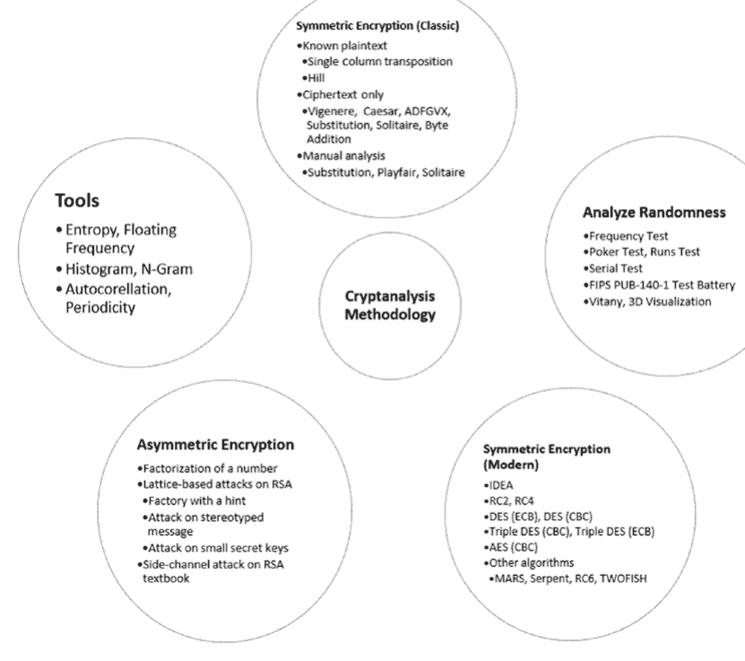
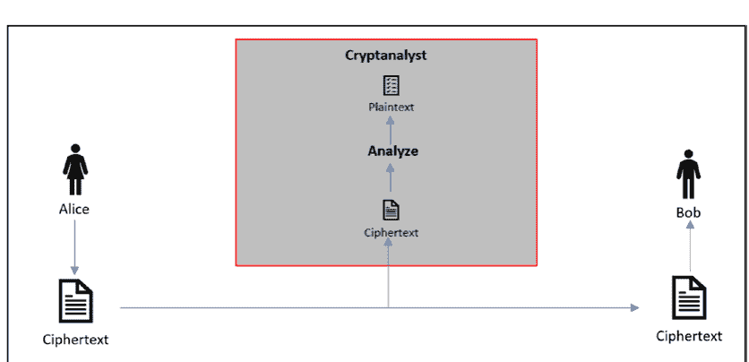
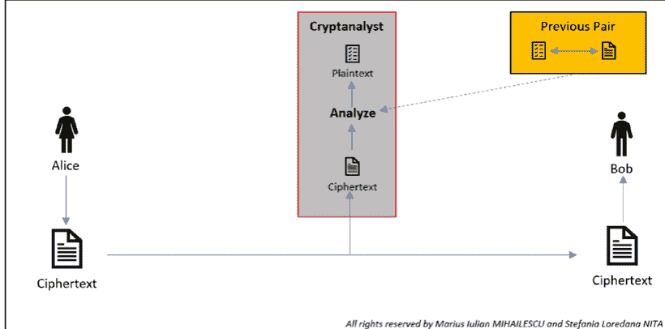
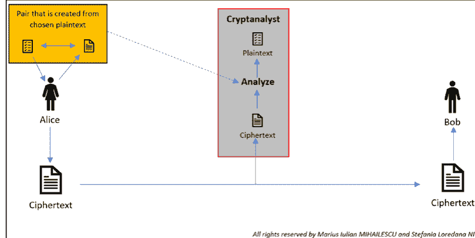
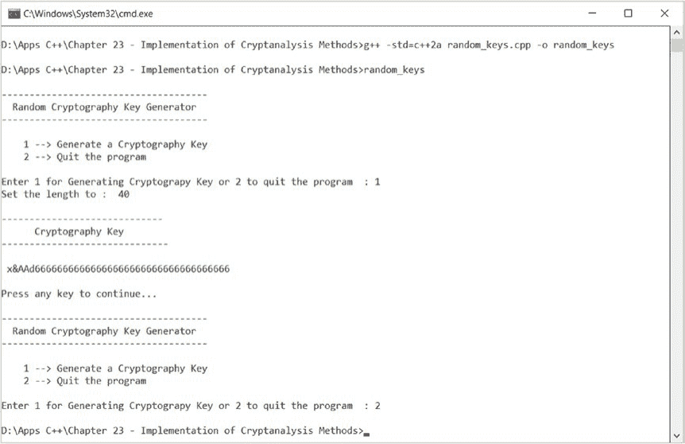

# 第 23 章

## 密码分析方法的实现与实践方法

本章是对密码分析方法的方法论的一般讨论，以及这些方法如何以快速高效的方式应用。所提出的方法论是经典和现代的密码学/密码分析算法和方法。量子密码学目前不包含在内。

所提出的方法论（见图 23-1）旨在帮助你，密码分析员，在密码分析过程中了解自己的位置。你可以使用图 23-1 中呈现的地图来为你的工作选择合适的工具或方法。

如果没有关于加密方法的正确信息，实现密码分析方法可能是一项非常繁琐的任务。以下将介绍识别进行密码分析过程所需元素的简短流程。密码分析过程包括两个总体步骤：

- *步骤 1* 基于确定应进行何种类型的密码分析。
- *步骤 2* 包括收集你所知道的关于密码算法的一切。在正确且尽可能认真地执行了这两个步骤之后，你可以继续进行额外步骤。
- *步骤 3* 是你构建适当的 *攻击模型* 时。
- *步骤 4* 是你选择适当的工具时。

*步骤 1.* 此步骤涉及应执行何种密码分析。在此步骤中，密码分析员将在业务环境中决定其将扮演的角色：合法且授权的密码分析员、道德黑客或恶意破解者。一旦你决定了自己的角色，就可以进入步骤 2。

*步骤 2.* 如果密码分析员是合法的，他们在开始之前必须意识到两件事：*密码算法* 和 *加密密钥*。根据一些密码分析员的经验，这不是必要要求，但在某些情况下知道这些信息将非常有用。一旦你了解了密码算法和加密密钥，你就可以轻松开始密码分析过程，通过应用适当的方法并测试业务应用程序的安全性。

*步骤 3.* 此步骤基于设置攻击模型或攻击类型。攻击模型和攻击类型将指出一个定量变量，用于表示密码分析员在对加密消息执行破解方法时将能够访问多少信息。最重要的攻击是

- 仅密文攻击
- 已知明文攻击
- 选择明文攻击
- 选择密文攻击
  - 自适应选择密文攻击
  - 不分选择的密文攻击

步骤 4. 在选择了攻击模型或创建并根据案例和要求正确调整了其他模型之后，你进入下一步，即选择软件工具。从已存在的工具中选择软件工具或创建自己的工具可能耗时，但实践中将产生巨大贡献。总结如下，这里有一些可在密码分析过程中使用的工具，具体取决于你试图测试的内容。

- **渗透工具：** Kali Linux, Parrot Security, BackBox
- **取证：** DEFT, CAINE, BlackArch, Matriux
- **数据库：** sqlmap（独立版本）, Metasploit framework（独立版本）, VulDB


- **Web and network:** Wireshark, Nmap, Nessus, Burp Suite, Nikto, and OpenVas
- **Other tools:** CrypTool (very useful and amazing tool)

The tools mentioned above represent a selection that are very used in practice and can produce desired results.



Figure 23-1. The cryptanalysis methodology

## Ciphertext-Only Attack

A ciphertext-only attack (COA) represents the weakest attack because it can easily be used by the cryptanalyst due to the fact that they just encoded the message.

The attacker-cryptanalyst has access to a set of ciphertexts. The attack is fully successful if the corresponding plaintexts are deduced together with the key.

In this type of attack (see Figure 23-2), the attacker/cryptanalyst will be able to observe the ciphertext. Everything that the cryptanalyst will see is represented by a set of scrambled and nonsense characters that create the output based on the encryption process.



Figure 23-2. COA representation

## Known-Plaintext Attack

The known-plaintext attack (KPA) helps the cryptanalyst to generate the ciphertext based on the fact that he is aware of the ciphertext.

The cryptanalyst follows a simple procedure by selecting the plaintext, but they will observe the pair that is compounded from the plaintext and ciphertext. The chance of success is better compared to COA. Simple ciphers are quite vulnerable to this attack. See Figure 23-3.



Figure 23-3. KPA representation

## Chosen-Plaintext Attack

In a chosen-plaintext attack (CPA), the cryptanalyst has the ability to select the plaintext that has been sent encrypted using an encryption algorithm and they can observe how the ciphertext is generated. This can be observed as an active model where the cryptanalyst has the chance to select the plaintext and to realize the encryption.

Based on the ability to select and pick any plaintext, the cryptanalyst has the chance to observe vital details about the ciphertext, which gives them a strong advantage in understanding how the algorithm works inside and the chance to get the secret key.

A professional cryptanalyst will have a strong database that contains known plaintexts, ciphertexts, and possible keys. In Listing 23-1 and Figure 23-5, we have provided an example of generating possible keys automatically. It is a very simple example for illustrating how possible keys can be generated. They can be used with the pairs to determine the cipher text input (see Figure 23-4).



Figure 23-4. CPA representation

### Listing 23-1. Automatic Generation of Random Keys

```
#include <stdio.h>
#include <time.h>
#include <iostream>

using namespace std;

//** generate an integer that is situated between 1 to 4
int generateInteger() {
    //** pseudo-random generator (srand).
    //** time(NULL) represents the seed
    srand(time(NULL));

    //** generate a random value and store
    //** the remainder of rand() to 5
    int randomValue = rand() % 5;

    //** if the value is equal with 0, move to the
    //** next value of i and return that value
    if (randomValue == 0)
        randomValue++;

return randomValue;
}

//** the function will generate randomly
//** an integer situated between 0 and 25
int generateRandomlyInteger(){
    //** pseudo-random generator (srand).
    //** time(NULL) represents the seed
    srand(time(NULL));

    //** generate a random value and store
    //** the remainder of rand() with 26
    int random_key = rand() % 26;
    return random_key;
}

//** based on the length provided, the function
//** will generate a cryptographic key
void generate_crypto_key(int length){
    //** create a string variable for cryptography
    //** key and initialize it with NULL
    string crypto_key = "";

    //** variable used for cryptography key generation
    string alphabet_lower_case = "abcdefghijklmnopqrstuvwxyz";
    string alphabet_upper_case = "ABCDEFGHIJKLMNOPQRSTUVWXYZ";
    string special_symbols = "!@#$%&";
    string digits_and_numbers = "0123456789";

    //** local variables and their initializations
    int key_seed;
    int lowerCase_Alphabet_Count = 0;
    int upperCase_Alphabet_Count = 0;
    int digits_And_numbers_count = 0;
    int special_symbols_count = 0;

    //** the variable count will save the length
    //** of the cryptography key.
    //** initially we will set it to zero
int countingLengthCryptoKey = 0;
while (countingLengthCryptoKey < length) {
    /** generateInteger() function will return a number that
    /** is situated between 1 and 4.
    /** The number that is generated will be used in
    /** assignation with one of the strings that has been
    /** defined above (for example: alphabet_lower_case,
    /** alphabet_upper_case, special_symbols, and
    /** digits_and_numbers).
    /** This being said, the following correspondence will
    /** be applied: (1) for alphabet_lower_case, (2) for
    /** alphabet_upper_case, (3) for special_symbols, and
    /** (4) digits_and_numbers
    int string_type = generateInteger();

    /** For the first character of the cryptography key we
    /** will put a rule in such way that it should be a
    /** letter, in such way that the string that will be
    /** selected will be an lower case alphabet or an upper
    /** case alphabet. The IF condition is quite vital as
    /** the switch is based on it and the value that
    /** string_type variable will have.
    if (countingLengthCryptoKey == 0) {
        string_type = string_type % 3;
        if (string_type == 0)
            string_type++;
    }

    switch (string_type) {
        case 1:
            /** based on the IF condition, it is
            /** necessary to check the minimum
            /** requirements of the lower case alphabet
            /** characters if they have been accomplished
            /** and fulfilled. If we are dealing with the
            /** situation in which the requirement has
            /** not been achieved we will situate ourself
            /** in the break phase.
if ((lowerCase_Alphabet_Count == 2)
    && (digits_And_numbers_count == 0
    || upperCase_Alphabet_Count == 0
    || upperCase_Alphabet_Count == 1
    || special_symbols_count == 0))
    break;

key_seed = generateRandomlyInteger();
crypto_key = crypto_key +
    alphabet_lower_case[key_seed];
lowerCase_Alphabet_Count++;
countingLengthCryptoKey++;
break;

case 2:
    //** based on the IF condition, it is
    //** necessary to check the minimum
    //** requirements of the upper case alphabet
    //** characters if they have been accomplished
    //** and fulfilled. If we are dealing with the
    //** situation in which the requirement has
    //** not been achieved we will situate ourself
    //** in the break phase.
    if ((upperCase_Alphabet_Count == 2)
        && (digits_And_numbers_count == 0
        || lowerCase_Alphabet_Count == 0
        || lowerCase_Alphabet_Count == 1
        || special_symbols_count == 0))
        break;
    key_seed = generateRandomlyInteger();
    crypto_key = crypto_key +
        alphabet_upper_case[key_seed];
    upperCase_Alphabet_Count++;
    countingLengthCryptoKey++;
    break;

case 3:
    /** based on the IF condition, it is
     ** necessary to check the minimum
     ** requirements of the numbers if they have
     ** been accomplished and fulfilled. If we
     ** are dealing with the situation in which
     ** the requirement has not been achieved we
     ** will situate ourself in the break phase.
     */
    if ((digits_And_numbers_count == 1)
            && (lowerCase_Alphabet_Count == 0
            || lowerCase_Alphabet_Count == 1
            || upperCase_Alphabet_Count == 1
            || upperCase_Alphabet_Count == 0
            || special_symbols_count == 0))
        break;
    key_seed = generateRandomlyInteger();
    key_seed = key_seed % 10;
    crypto_key = crypto_key +
                 digits_and_numbers[key_seed];
    digits_And_numbers_count++;
    countingLengthCryptoKey++;
    break;

case 4:
    /** based on the IF condition, it is
     ** necessary to check the minimum
     ** requirements of the special characters if
     ** they have been accomplished and
     ** fulfilled. If we are dealing with the
     ** situation in which the requirement has
     ** not been achieved we will situate ourself
     ** in the break phase.
     */
```


```
if ((special_symbols_count == 1)
    && (lowerCase_Alphabet_Count == 0
    || lowerCase_Alphabet_Count == 1
    || upperCase_Alphabet_Count == 0
    || upperCase_Alphabet_Count == 1
    || digits_And_numbers_count == 0))
    break;

key_seed = generateRandomlyInteger();
key_seed = key_seed % 6;
crypto_key = crypto_key +
    special_symbols[key_seed];
special_symbols_count++;
countingLengthCryptoKey++;
break;
}
}
cout << "\n---------------------------\n";
cout << "      Cryptography Key      \n";
cout << "---------------------------\n\n";
cout << " " << crypto_key;
cout << "\n\nPress any key to continue... \n";
getchar();
}

int main() {
    int option;
    int desired_length;

    //** designing the menu
do {
    cout << "\n-------------------------------\n";
    cout << "  Random Cryptography Key Generator   \n";
    cout << "-------------------------------\n\n";
    cout << "  1 --> Generate a Cryptography Key"
    << "\n";
```

```
printf("Enter ( 1 ) to generate cryptography\nkey and ( 2 ) to quit the program.\n");
cout << "Enter a key and try again \n";
getchar();}
break; }
} while (option != 2);
return 0;
}
```



*图 23-5.* 生成的密钥和可能的密码。我们选择三个字符以缩短处理时间

## 选择密文攻击

在选择密文攻击（CCA）中，密码分析者可以对信息执行加密和解密操作。在此攻击中（参见图 23-6），密码分析者可以选择明文、对其进行加密、观察密文的生成方式，并逆转整个过程。

## 参考文献

+   [1] 阿布·优素福·雅各布·伊本·伊沙克·萨巴赫·金迪。在线获取：www.trincoll.edu/depts/phil/philo/phils/muslim/kindi.html。
+   [2] 哲学家：雅各布·伊本·伊沙克·金迪 Kennedy-Day, K. al-Kindi, Abu Yusuf Ya‘qub ibn Ishaq (卒于约 866–73 年)。在线获取：www.muslimphilosophy.com/ip/kin.html。
+   [3] 艾哈迈德·福阿德·埃尔-赫瓦尼，“金迪”，载于 *《穆斯林哲学史》第 1 卷*（第 421-434 页）。新德里：低价出版社。1961 年。
+   [4] 伊斯梅尔·R·法鲁基和洛伊丝·拉姆娅·法鲁基，*《伊斯兰文化地图集》*（第 305-306 页）。纽约：麦克米伦出版公司。1986 年。
+   [5] *《不列颠百科全书》*（第 352 页）。不列颠百科全书股份有限公司。芝加哥：威廉·本顿。1969 年。
+   [6] J.J. 奥康纳和 E.F. 罗伯逊，*阿布·优素福·雅各布·伊本·伊沙克·萨巴赫·金迪*。1999 年。
