## 索引

## 您可能感兴趣的其他书籍


## 前言

Google Cloud Platform (GCP) 是一款领先的云服务，其规模逐年呈指数级增长。GCP 提供了一系列服务，可供各种组织利用，以充分发挥其基础设施的潜力。本书是 GCP 的完整指南，将教你各种有效利用 GCP 服务满足业务需求的方法。你还将熟悉通过 Google 的 Professional Cloud Architect 认证考试所需的主题。

遵循 Professional Cloud Architect 认证的官方考试大纲，你将[content]

## Preface

Google Cloud Platform (GCP) is a leading cloud offering that has grown exponentially year on year. GCP offers an array of services that can be leveraged by various organizations to bring the best out of their infrastructure. This book is a complete guide to GCP and will teach you various methods to effectively utilize GCP services for your business needs. You will also become acquainted with the topics required to pass Google's Professional Cloud Architect certification exam.

Following the Professional Cloud Architect certification's official exam syllabus, you will be introduced to GCP. You will then be taught about the core services that GCP offers, such as computing, storage, and network. Additionally, you will learn methods of how to scale and automate your cloud infrastructure and make it compliant and secure. Finally, you will also learn how to process big data and embrace machine learning services.

By the end of this book, you will have all the information required to ace Google's Professional Cloud Architect exam and become an expert in GCP services.

## Who this book is for

If you are a cloud architect, cloud engineer, administrator, or anyone who would like to learn different ways to implement Google Cloud services in your organization, as well as get yourself certified with the Professional Cloud Architect's certificate, then this is the book for you.

## What this book covers

Chapter 1, GCP Cloud Architect Professional, discusses the benefits of becoming a certified architect, how to register for the exam, and what to expect when you are in the test center.

Chapter 2, Getting Started with Google Cloud Platform, covers the basics of GCP and how it positions itself on the market. You will learn about all the major GCP services that are available.

Chapter 3, Google Cloud Platform Core Services, examines the most important GCP services, including computing, storage, networking, big data, and machine learning.

* Chapter 4, Working with Google Compute Engine, examines how to create and run virtual machine instances on top of the Google Compute Engine (GCE) service.
* Chapter 5, Exploring Google App Engine as a Compute Option, discusses how to define and run applications on Google App Engine.
* Chapter 6, Managing Kubernetes Clusters with Google Kubernetes Engine, explains the basis of containers and microservices. It looks at running and managing Kubernetes clusters on the Google Kubernetes Engine (GKE) service.
* Chapter 7, Deploying Cloud-Native Workloads with Cloud Run, discusses running cloud-native workloads in GCP with a serverless experience. Cloud Run does this without the need to understand complex Kubernetes resource definitions.
* Chapter 8, Managing Cloud-Native Workloads with Anthos, introduces one of the newest and most exciting GCP products available. We will learn how we can run cloud-native workloads on Kubernetes anywhere. This includes not only all three major public cloud providers, but also on-premises. We will see how to keep the Anthos clusters in sync with predefined configuration and policies as well as how to control and observe traffic in a microservice architecture using Anthos Service Mesh.
* Chapter 9, Running Serverless Functions with Google Cloud Functions, looks into running serverless functions on Google Cloud Functions.
* Chapter 10, Networking Options in GCP, discusses Google's networking services. Understanding networking is key to completing the architect exam. We will introduce you to concepts such as Virtual Private Cloud (VPC) before diving further into other concepts such as Virtual Private Network (VPN), networks, subnetworks, and routes.
* Chapter 11, Exploring Storage and Database Options in GCP – Part 1, considers different storage options. This will allow us to choose the right storage for a given use case. We will discuss object storage alongside relational and non-relational databases.
* Chapter 12, Exploring Storage and Database Options in GCP – Part 2, looks at storage options such as Cloud Spanner and BigTable.
* Chapter 13, Analyzing Big Data Options, discusses how big data is another key topic in the architect exam. Understanding what big data is, and what services GCP offers to handle the complexities of data analytics, will really help you in the test center when taking the exam. In this chapter, we will look at the various services that are available, and when we might choose one over the other.

Chapter 14, Putting Machine Learning to Work, examines Machine Learning (ML) in general as well as GCP-related services. This will allow us to understand the use cases and possible implementations of machine learning using Google Cloud.

Chapter 15, Security and Compliance, covers security, which is a feature of all GCP services. In this chapter, we will cover IAM in more detail than we have in previous chapters, to allow you to understand custom roles and service accounts. Additionally, we will look at Google's commitments to compliance through the Payment Card Industry (PCI) regulations.

Chapter 16, Google Cloud Management Options, shows you that there are several ways to manage your GCP infrastructure and its services. In this chapter, we will look at how to manage your GCP infrastructure and the key management options that are available, including Cloud Shell, SDK, and gcloud, and the steps that are needed to access or install these tools.

Chapter 17, Monitoring Your Infrastructure, looks at monitoring your infrastructure using Stackdriver.

Chapter 18, Case Studies, discusses how, in the exam, some questions may refer you to several case studies. You should be familiar with these case studies before you take the exam. These involve hypothetical business and solution concepts. In this chapter, we will cover how to find these case studies; additionally, we will also take a look at an example case study and analyze it in order to design an appropriate solution.

Chapter 19, Test Your Knowledge, goes through exam tips and sample tests.

## To get the most out of this book

As the practical examples throughout the book involve the use of GCP, a GCP free-tier account is required.

| OS requirements |
|---|
| Windows, macOS X, and Linux (any) |

## Download the color images

We also provide a PDF file that has color images of the screenshots/diagrams used in this book. You can download it here: https://static.packt-cdn.com/downloads/9781801812290_ColorImages.pdf.

## Conventions used

There are a number of text conventions used throughout this book.

Code in text: Indicates code words in the text, database table names, folder names, filenames, file extensions, pathnames, dummy URLs, user input, and Twitter handles. Here is an example: "Now, we need to update our configuration file. Let's save this and call it multi.yaml."

A block of code is set as follows:

```
apiVersion: apps/v1
kind: Deployment
metadata:
  name: nginx-deployment
  labels:
    app: nginx
spec:
  replicas: 3
```

Any command-line input or output is written as follows:

```
kubectl apply -f definition.yaml
```

Bold: Indicates a new term, an important word, or words that you see on screen. For example, words in menus or dialog boxes appear in the text like this. Here is an example: "Let's check out the Deployment Manager menu, where we can see that our deployments have been successful."

> Tips or important notes
> Appear like this.

## Get in touch

Feedback from our readers is always welcome.

General feedback: If you have questions about any aspect of this book, mention the book title in the subject of your message and email us at customercare@packtpub.com.

**Errata:** Although we have taken every care to ensure the accuracy of our content, mistakes do happen. If you have found a mistake in this book, we would be grateful if you would report this to us. Please visit www.packtpub.com/support/errata, selecting your book, clicking on the Errata Submission Form link, and entering the details.

**Piracy:** If you come across any illegal copies of our works in any form on the internet, we would be grateful if you would provide us with the location address or website name. Please contact us at copyright@packt.com with a link to the material.

**If you are interested in becoming an author:** If there is a topic that you have expertise in and you are interested in either writing or contributing to a book, please visit authors.packtpub.com.

## Share Your Thoughts

Once you've read *Professional Cloud Architect Google Cloud Certification Guide*, we'd love to hear your thoughts! Please click here to go straight to the Amazon review page for this book and share your feedback.

Your review is important to us and the tech community and will help us make sure we're delivering excellent quality content.


# Section 1:
介绍 GCP

本节将介绍 Google Cloud Platform 并概述 Professional Cloud Architect 考试。

本书的这一部分包含以下章节：

- Chapter 1, GCP Cloud Architect Professional
- Chapter 2, Getting Started with Google Cloud Platform
- Chapter 3, Google Cloud Platform Core Services

# 1
## GCP Cloud Architect Professional

向云迁移并不是新鲜事，多年来，公司一直利用公共云厂商的经济高效解决方案，摆脱传统的本地架构。如今技术发展速度之快，使得管理自身基础设施的公司越来越难以充分发挥其 IT 系统的效能。

虽然 Amazon Web Services (AWS) 和 Microsoft Azure 目前在企业级公司中领先，Google Cloud Platform (GCP) 是 IT 专业人士中最受欢迎的解决方案之一，且对其的兴趣稳步增长。似乎 Google 在打一场很长的仗。2018 年第三季度，Google Cloud 前 CEO Diane Greene 估计只有 10% 的工作负载在公共云中，显示出市场份额仍有巨大的空间。

鉴于公司持续转向多云解决方案以分发其工作负载或对数据存储的位置和方式有更多控制权，这意味着 IT 云架构师和工程师需要了解的不只是目前的前两大提供商。

此外，2020 年的全球大流行加速了云采用，因为公司转向居家办公，协作工具如 Google Meet 在公司中变得至关重要，以维持稳定。它也凸显出，传统 IT 模式因在需要时无法及时扩展而对企业构成重大风险，例如。

> **重要提示**
> 一篇 Forbes 文章最近显示，**Google Cloud Certified Professional Cloud Architect** 是 2019 年和 2020 年的最高薪认证。你可以在 https://www.forbes.com/sites/louiscolumbus/2020/02/10/15-top-paying-it-certifications-in-2020/?sh=390a9e48358e 上阅读它。

无论你参加考试的原因是什么，保持对期望的现实都很重要。

### Registering for the exam

**GCP Professional Architect** 考试的费用约为 200 美元（到你阅读本文时可能会有所变化），并且可以用多种语言预订，例如英语、日语、西班牙语和葡萄牙语。2020 年中期，Google 引入了可在家中远程参加考试的功能。注册流程相同。你可以通过以下步骤注册考试：

- 1. 第一步是访问 Google 认证网页。有两个链接：
  - https://cloud.google.com/certification
  - https://cloud.google.com/certification/register
- 2. 点击首选语言安排考试，如以下屏幕截图所示：

# Register for your certification

Refer to the chart below to find which Google Cloud Certifications are offered in multiple languages.

To schedule your exam, select your preferred language. Each language requires a separate Google Cloud Webassessor account.

# Select your preferred language to schedule an exam

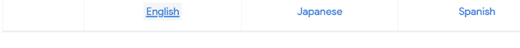

Figure 1.1 – Select your preferred language

3. 接下来，你将被重定向到 Webassessor 登录页面。你需要一个 Webassessor 账户来预订考试。你可以按照 Webassessor 页面上的指南创建新账户（如需）。

4. 接下来，点击以下屏幕截图所示的 REGISTER FOR AN EXAM 按钮：

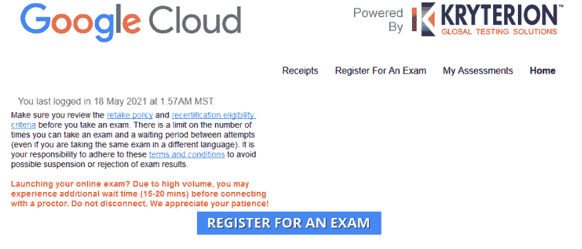

Figure 1.2 – The REGISTER FOR AN EXAM button

5. 浏览到 Google Cloud Certified – Professional Cloud Architect 考试并展开加号 (+) 标志。你将有在测试中心参加考试（Onsite Proctored）或远程参加考试（Remote Proctored）的选项，如下所示：

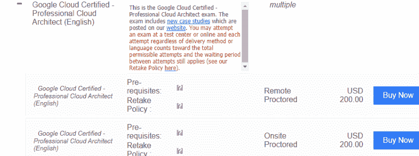

Figure 1.3 – Selecting Remote Proctored or Onsite Proctored

6. 如果你选择在测试中心参加考试，你将被提示选择一个地点，如以下屏幕截图所示：

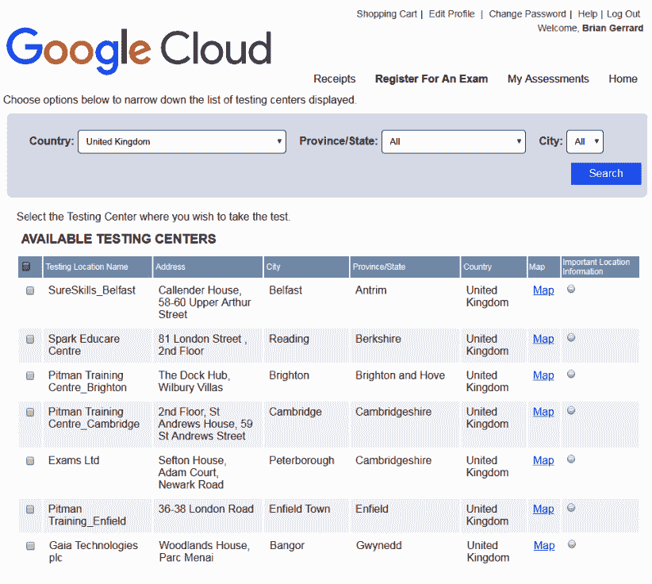

Figure 1.4 – Selecting a test center (if applicable)

7. 接下来，选择日期和时间，如以下屏幕截图所示。请注意，时间以测试中心当地时间为准：

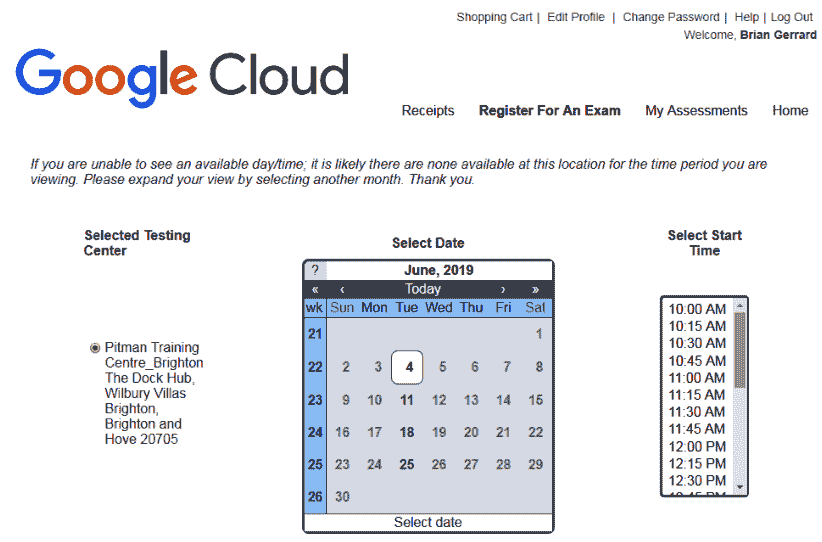

Figure 1.5 – Selecting a date and time

8. 最后，查看并点击 Check Out。此时，你可以支付考试费用，即可开始。如有优惠券或代金券代码，请在此提交，如下所示：


Shopping Cart | Edit Profile | Change Password | Help | Log Out

Welcome, Brian Gerrard

Receipts   Register For An Exam   My Assessments   Home

| Exam | Details | Price | Actions |
|---|---|---|---|
| Exam: Google Cloud Certified - Professional Cloud Architect (English) Length : 120 minutes | Schedule : Tuesday, 04 June 2019 Start Time : 10:30 (UTC+01:00) Location: [ Change ] Pitman Training Centre, Brighton The Dock Hub, Wilbury Villas Brighton, Brighton and Hove 20705 | 200.00 | Remove |

Coupon/Voucher Code: [ ] Submit

Subtotal: 200.00

Total Price: USD 200.00

*Charges are made in USD, currency conversion fees may apply

Empty Cart   Add Another Exam   Return Home   Check Out

Figure 1.6 – Confirming the purchase

请记住，考试预订后你可以更改所选日期。现场考试可在 72 小时前、远程考试可在 24 小时前免费重新安排。请注意，在这些时间范围内进行的任何更改都将收取重新安排费用。

本节向我们展示了如何注册考试。需要认识到的主要一点是，我们现在有在家参加考试的选项。在下一节中，我们将了解考试的预期内容。

### What to expect from the exam

Google 建议你利用多个资源来准备考试。这些包括在线培训课程、讲师指导培训和实践实验室。所有这些信息都可以在云架构师网页 https://cloud.google.com/certification/cloud-architect 上找到。

此外，通过访问考试指南网页 https://cloud.google.com/certification/guides/professional-cloud-architect/，你可以查看考试申请者预期的科目知识。考试蓝图对任何考试都至关重要，GCP 架构师也不例外。你应该查看本指南并确保理解每个部分。

像大多数考试一样，一些实际经验也会有所帮助。该考试是为具有软件开发和多云/混合云环境经验的云架构师设计的。也就是说，只要有足够的学习和对 GCP 环境的接触，即使你没有实际动手经验，也没有理由不能通过此考试。

Google 提供 Qwiklabs，这是一个自学平台，可用于获得服务经验。建议你注册以熟悉 GCP 的布局和服务。Qwiklabs 可以通过月度订阅付费，提供实验室无限访问，或通过购买积分付费。每个实验室将花费一定数量的积分，具体取决于实验室的复杂程度。10 积分的典型费用为 10 美元，且批量购买有折扣。GCP Essentials 提供了对 GCP 的绝佳介绍，可在 https://google.qwiklabs.com/quests/23?utm_source=gcp&utm_medium=site&utm_campaign=certification 找到。完成此实验室大约需要 5 小时。

考试本身将包括多项选择题，需要选择一个或多个答案。此外，你将被询问虚构公司的案例研究。然而，你可以在考试前访问这些案例研究，并在考试期间参考它们。在第 18 章，案例研究，我们将更详细地介绍这些内容。考试大约有 60 道题，你有 2 小时完成。你将收到一条屏幕消息，仅显示通过或未通过，且不显示分数。Google 认为评分结果对考生没有意义且可能被误解。确认邮件也将发送到你的注册电子邮件地址确认结果。

通过考试将验证你的技能 2 年。然后，你需要通过再次参加完整且最新的考试来重新认证。如果你尝试失败，你必须等待 14 天后才能重考。如果你第二次尝试失败，你必须等待 60 天，而第三次失败后，你必须等待 1 整年后才能重考。每次尝试都需要全额费用。


## 在线监考考试

由于 COVID-19 大流行，自 2020 年初起，Google 加速了其在线监考考试的交付计划。在 2020 年下半年，*专业数据工程师* 考试成为首个提供在线的 Google 考试，随后专业云架构师考试也紧跟其后。与传统的考场方式相比，考试的价格、时长或内容方面没有区别。然而，在考试前的几分钟内存在差异。你必须下载 **Sentinel** 软件并对你的机器拥有完全的管理员控制权。如果使用的是公司机器，这可能会导致问题。还必须满足系统要求；例如，操作系统必须是 Windows 8.1 或 10，或 Mac OS X 10.13-11.1。你的网络浏览器需要 Chrome、Firefox 或 Safari 的最新版本。此外，还需要网络摄像头。你还必须进行面部扫描以建立生物识别档案，并且必须在考试前完成。

当你准备参加考试时，你应处于安全、安静且光线充足的房间。你将被要求用网络摄像头展示周围的房间。你还需要一面镜子或你的手机来展示其屏幕，如果网络摄像头是内置的。房间内不得有其他人，也不得有食物、饮料或其他纸张或书写工具。完整的测试要求列表可在 Google Cloud 认证网页 https://support.google.com/cloud-certification/answer/9907748?hl=en 上找到。

完成考试后，你将获知结果，与在考场中一样，只会显示通过或未通过的消息。

几天后，你将收到结果已发送给 Google 进行验证的确认。一周后，你应收到正式确认，以及指向你证书的链接。

## 建议提示和技巧

在考试中，我们建议你利用可以标记问题以便稍后返回的功能。当然这是个人偏好，但我们建议你不要在某个问题上纠结太久。你大约有每题 2 分钟的时间来提供答案。有些问题的答案会直接跃入你的视野，而另一些则需要你花费更多时间来确定正确答案。如果你花费的时间过长，则将其标记为待审并继续，因为重要的是要完成测试，以确保你获得最大分数。

我们还建议你预约考试以给你动力。很容易拖延或过于担心自己准备不足。这是自然的感觉，但有明确的截止日期会让你更专注和坚定。我们建议你打印出考试指南并逐点进行，确保你理解每个目标。

此外，2 小时是很长的时间。确保你在一天中最清醒的时间预约考试，以给你最大的成功机会。有了远程考试的选项，找到适合你的时间段应该会更容易，但你必须确保找到一个既私密又安静的空间。此外，确保你有稳定的互联网连接，如果你使用的是这种类型的设备，则确保笔记本电脑电量充足。对于某些人来说，参加考场考试可能仍然是首选。

## 总结

在本章中，我们介绍了考试的预期内容以及如何注册考试，以及成为 GCP 认证架构师的好处。在整本书中，我们将向你介绍成功所需的服务。本书的最终目标是帮助你通过考试；然而，我们鼓励你做更多阅读，使用 Qwiklabs，或在 GCP 控制台中尝试操作，如果你希望深入研究阅读本书时遇到的特定主题或服务。

在下一章中，我们将开始使用 GCP。

## 延伸阅读

阅读以下文章以获取有关本章所涵盖内容的更多信息：

- **Google Cloud Certificate:** https://cloud.google.com/certification.

## 2
开始使用 Google Cloud Platform

在本章中，我们将介绍云计算的概念，以便更好地理解 **Google Cloud Platform (GCP)** 是什么。我们将查看 GCP 资源及其层级结构。之后，我们将创建我们的第一个账户并设置一个项目。此外，我们将讨论可用的计费选项。我们将研究如何创建计费账户并将其与项目关联。最后，我们将查看如何导出计费信息。在开始讨论 GCP 服务之前，进行此介绍非常重要。这既有助于你通过考试，也有助于你在甚至开始使用服务之前为现实场景实施 GCP 的基本设置。我们积极鼓励你设置自己的免费试用 Google Cloud 账户，以便获得实践经验并建立信心。

在本章中，我们将涵盖以下主题：

- 介绍云
- 了解 GCP
- 考试技巧

**考试提示**
对 GCP 资源有良好的理解对于通过 **GCP 云架构师** 考试至关重要。确保你仔细、认真地阅读本章。如有必要，多读几次，并使用你的免费试用账户尝试创建项目和计费账户。尝试将计费数据导出到文件和 BigQuery。你需要记住计费的各个 **身份和访问管理 (IAM)** 角色。确保你对服务范围有良好的理解。

### 介绍云

在深入 GCP 之前，首先，让我们根据以下图表了解云是什么：


图 2.1 – 云是什么

没错——*没有云：它只是别人的电脑。* 使用云时，我们实际上是在访问托管在别人电脑上的资源并消费服务。如果我们想更精确地说，云是一池电脑。

现在，让我们看一下 Google 使用的更准确、更专业的定义，该定义来自美国国家标准与技术研究院 https://csrc.nist.gov/publications/detail/sp/800-145/final：

> "云计算是一种模型，可实现对共享的、可配置的计算资源池（例如网络、服务器、存储、应用程序和服务）的普遍、便捷的按需网络访问，这些资源可以快速配置和释放，且管理成本或服务提供商交互最少。这种云模型由五个基本特征、三种服务模型和四种部署模型组成。"

云的五个基本特征如下：

- **按需自助服务：** 服务在无需人工提供商干预的情况下自动配置，并且你只为所使用的付费。
- **广泛网络访问：** 资源可在整个网络中访问。
- **资源池化：** 资源从共享池中汇集，使用户感觉位置独立。对于某些资源，位置可能受限。
- **快速弹性：** 服务可以弹性配置和取消配置，容量由提供商管理。
- **可计量服务：** 资源使用情况会被监控并可报告。

四种部署模型如下：

- **私有云：** 由特定组织使用，但可由第三方管理。
- **公有云：** 由公众使用。
- **社区云：** 由特定社区使用。
- **混合云：** 由两个或多个不同的云组成。

当我们查看 GCP 时，它满足所有五个特征并符合公有云部署模型。在下一节中，我们将查看 GCP 本身。

### 了解 GCP

Google 多年来一直在开发自己的工具来提供 Gmail、YouTube 和 Google Workspace 等服务。这些工具已被转换为可供他人消费的服务。消费者获得了 Google 为自身目的必须使用的惊人可扩展性。GCP 允许你从计算、存储、网络、大数据和 **机器学习 (ML)** 服务中进行选择，在其之上构建你的应用程序。服务的数量不断增长，几乎每周都会发布新公告。新的服务和功能首先以 alpha 版本发布，然后以 beta 版本发布，最后在全球范围内提供。早期版本甚至更早地提供给选定的客户和合作伙伴。这使得服务甚至在正式发布之前就能被外部各方测试！


Google 支持多种服务模型，包括以下几种：

- **Infrastructure-as-a-Service (IaaS)**
- **Platform-as-a-Service (PaaS)**
- **Container-as-a-Service (CaaS)**
- **Function-as-a-Service (FaaS)**
- **Managed services**

正如你所见，GCP 中的服务范围非常广泛。让我们快速分析一下 GCP 提供的这些服务范围。我们将从非常简单的 IaaS 开始，例如传统的數據中心，并以使用 FaaS 结束，在 FaaS 中我们可以运行代码而无需管理任何服务器基础设施。服务选择取决于我们的需求。简单来说，如果我们需要对 **Virtual Machines (VMs)** 具有灵活性和控制权，我们就会使用 **Compute Engine**。该服务允许我们配置 VM 实例，或直接将机器从现有环境迁移过来。然而，代价是您需要负责管理 VM 实例之上的所有层级。这包括操作系统、任何中间件以及其上的任何应用程序。

当我们从 IaaS 转向 PaaS、CaaS 或 FaaS 时，维护基础设施的责任就从我们身上移除了。使用 **Cloud Functions**，我们真正关心的只是用 GCP 支持的语言编写函数。完成并发布后，我们通过 HTTP(S) 协议访问它。

最后，当我们转向托管服务时，我们只需开始使用能为我们带来特定业务价值的服务，而无需担心任何底层组件。它们可以在 **Software-as-a-Service (SaaS)** 模式下使用，并通过 API 消费。一个例子是 **Dataprep**，这是一种数据服务，可让您清理和准备数据以进行进一步分析。另一个例子是预训练的 ML 模型，**Vision API**。开发人员可以通过使用 RESTful API 分析图像来使用此服务，而无需编写任何代码，除非是调用本身。

希望现在你明白 GCP 不仅仅是一个托管服务。它为你提供了一套工具、服务和资源，帮助你开发和交付应用程序。你将使用的服务选择完全取决于你拥有的需求集。如果这让你感到不知所措，那么不用担心。本书旨在帮助你逐步了解 GCP。

在 *Chapter 3, Google Cloud Platform Core Services* 中，你将对最重要的 GCP 服务有一个概述。在接下来的章节中，我们将更深入地探讨其中每一个，以便为考试做好准备。

## GCP differentiators

每个云提供商都有一些使其与其他提供商区别开来的特点。每个提供商在如何为客户提供价值方面都有自己的策略，GCP 也不例外。让我们来看看使 GCP 脱颖而出的关键功能：

- **Google Cloud's operations suite**（前身为 **The Google Network**）：Google Network 是使 GCP 与其他云提供商区别开来的因素。Google 声称全球约 40% 的互联网流量由 Google Network 承载，使其成为全球最大的网络。这使得 Google Network 能够以非常低的延迟响应，尽可能接近终端用户。
- **Global scope**：GCP 是在考虑全球可用性的前提下开发的。你会注意到，与其他提供商不同，诸如负载均衡之类的服务在全球范围内可用，而非区域性可用。这使客户端能够专注于开发并采用开箱即用的高可用性和弹性。
- **ML services**：GCP 为数据科学家和可能对 ML 知识有限的普通开发人员提供了大量 ML 服务。ML 服务允许使用预训练模型，并提供 *AutoML* 服务。后者允许你在不知道它们是如何创建的情况下训练 ML 模型。这些服务的组合正在迅速增长。Google 的关键目标是让企业能够利用 ML 做出更快、更明智的决策。
- **Developer-focused**：GCP 是以开发人员为重点构建的。如果查看 GCP 的历史，它始于 2008 年 App Engine 的预览版发布，App Engine 是一个完全无服务器的平台，允许开发人员最初运行用 Python 编写的应用程序，后来增加了对 Java 和 Go 等其他语言的支持。它提供开箱即用的负载均衡和自动扩缩。开发人员只需选择想要开发的平台即可开始编码。此外，如果你查看 **Google Cloud's operations suite**（前身为 **Stackdriver**，GCP 监控工具）本身，它提供了可直接与应用程序集成的多个工具。这使开发人员能够使用它们来监控和调试其应用程序。Google 非常明确地表示 GCP 是为开发人员创建的，以帮助他们应对挑战。实现这一目标后，他们现在正瞄准大型企业。
- **Pricing**：VM 实例按秒计费，最短运行时间为一分钟。这使你能够运行机器进行短期测试，而无需支付一整小时的使用费用。

截至撰写本文时，GCP 拥有以下资源：

- 28 个区域
- 85 个区域
- 146 个网络边缘位置

这些数字正在迅速增长，截至撰写本文时，Google 已在 Google Cloud Next 大会上宣布新增两个区域。要获取最新信息，请参阅 https://cloud.google.com/about/locations。以下地图显示了全球当前和未来的区域和区域：

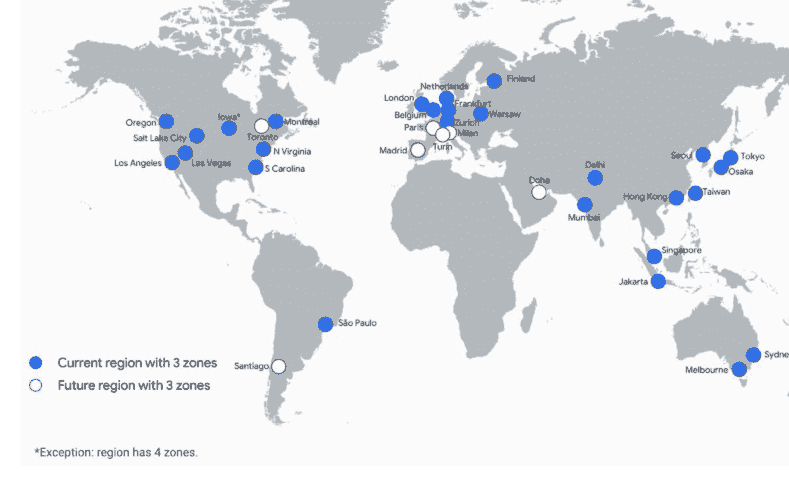

Figure 2.2 – GCP locations (Source: https://cloud.google.com/about/locations/)

上图以蓝色显示当前区域，以白色显示计划中的区域。还应注意，并非所有服务都可在每个区域中使用。例如，Cloud Functions 在全球可用后，仅在有限的几个位置推出。

## Resource manager

GCP 由组织、文件夹和项目等容器组成，以分层方式对资源进行分组。这使您可以管理其配置和访问控制。资源可以通过 API 以编程方式管理。此外，Google 还提供了 Google Cloud Console 和命令行实用程序等工具，它们是 API 调用的封装。现在，让我们查看以下图表中呈现的层次结构，并熟悉每个资源：

Google Cloud Platform

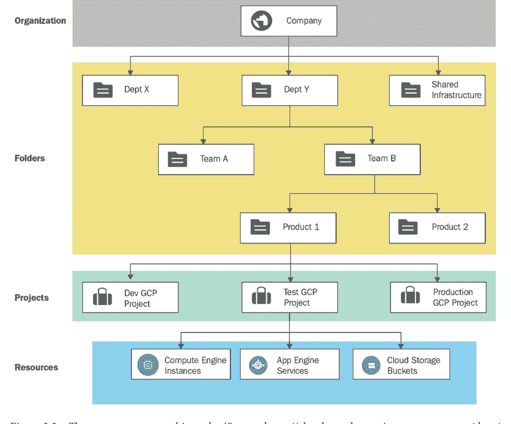

Figure 2.3 – The resource manager hierarchy (Source: https://cloud.google.com/resource-manager/docs/cloud-platform-resource-hierarchy, License: https://creativecommons.org/licenses/by/4.0/legalcode)

上图显示了资源管理器层次结构。从顶部开始，我们有一个可映射到公司的 **Organization**。接下来，我们有可代表公司部门的 **Folders**。接下来，我们有 **Projects**，它们进一步划分实际的公司项目或环境，例如开发和生产。最后，在 **Projects** 之下，我们有 GCP **Resources**。我们将在以下各节中分别介绍这些内容。

### Organizations

在层次结构的顶部，我们有组织。然而，请注意，这是一个可选资源，您可以在没有它的情况下很好地使用 GCP。组织仅对 **Google Workspace**（前身为 *G-Suite*）和 **Cloud Identity** 的用户可用，这些产品位于 GCP 之外。

为了提供一些背景信息，Google Workspace 是一套协作工具的集合，包括 Gmail、Google Drive、Hangouts 和 Google Docs。用户使用这些工具，它们存储在 Google Workspace 域中。

Cloud Identity 是一种 **Identity-as-a-Service (IDaaS)** 服务。同样，它允许您创建一个域并从一个点管理您的用户、应用程序和设备帐户。您可以在 *Chapter 15, Security and Compliance* 中了解更多关于 Cloud Identity 的信息。

单个 Google Workspace 或 Cloud Identity 帐户只能与单个组织关联。这意味着组织仅绑定到一个域。在 Google Workspace 和 Cloud Identity 中，都有超级管理员的角色定义。当您创建组织时，这些用户将在组织及其底层资源中拥有最高权限。请确保此帐户不用于日常操作。

相反，超级管理员应将组织管理员角色分配给指定用户。此角色进一步用于定义 IAM 策略、资源层次结构，并使用 IAM 角色委派权限。

> **Important Note**
> 创建新组织时，域中的所有用户都会获得项目创建者和 Billing Account Creator IAM 角色。这使他们能够在该组织中创建新项目。同样，我们将在 *Chapter 15, Security and Compliance* 中更详细地讨论这个问题。


## Global resources

Global resources are globally available within the same project and can be accessed from any zone. These include the following objects:

- **Addresses**: These are reserved external IP addresses and can be used by global load balancers.
- **Images**: These are either predefined or user-customized. They can be used to provision VMs.
- **Snapshots**: Snapshots of a persistent disk allow the creation of new disks and VMs. Note that you can also expose a snapshot to a different project. Snapshots can also act as a backup for VMs.
- **Instance templates**: These can be used for the creation of managed instance groups.
- **Virtual Private Cloud (VPC) networks**: These are virtual networks that you can connect your workloads to.
- **Firewall**: These are defined per VPC but are globally accessible.
- **Routes**: Routes allow you to direct your network traffic and are assigned to VPCs, but they are also considered global.

## Regional resources

Regional resources are only accessible by other resources within the same region. These include the following objects:

- **Addresses**: Static, external IP addresses can only be used by instances that are in the same region.
- **Subnets**: These are associated with VPC networks and allow the assignment of IP addresses to VMs.
- **Regional managed instance groups**: These allow you to scale groups of instances. The scope can be set to either regions or zones.
- **Regional persistent disks**: These provide replicated, persistent storage to VM instances. They can also be shared between projects for the creation of snapshots and images, but not disk attachments.

## Zonal resources

Zonal resources are only accessible by other resources within the same zone. These include the following objects:

- **VM instances**: These reside in a particular zone.
- **Zonal persistent disks**: These provide persistent storage to VM instances. They can also be shared as disks between projects for the creation of snapshots and images, but not disk attachments.
- **Machine types**: These define the hardware configuration for your VM instances and are defined for any particular zone.
- **Zonal managed instance groups**: These allow you to autoscale groups of instances. The scope can be set to either regions or zones.

Now that we understand the theory, let's take a look at how to create a project. Note that if you have not done so yet, navigate to https://cloud.google.com/free to create your free-tier GCP account.

## Managing projects

To create a new project, perform the following steps:

1. Log in to the GCP console at https://console.cloud.google.com. Then, click on the drop-down arrow next to the name of the project you are currently logged into. A **Select a project** window will pop up. Click on **NEW PROJECT** in the upper-right corner:

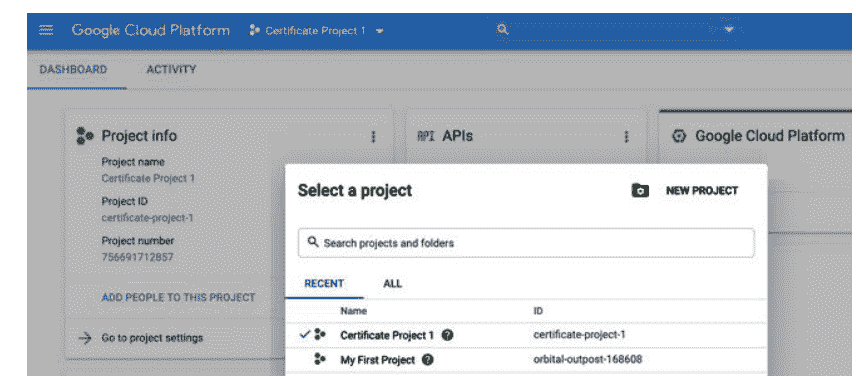

Figure 2.4 – Managing projects

2. Fill in the name and choose the billing account. You can attach the project to an organization or a folder. Choose the default billing account. In the following steps, we will show you how to create a new billing account and associate it with the project we are now creating. Click on the **CREATE** button, as shown in the following screenshot:

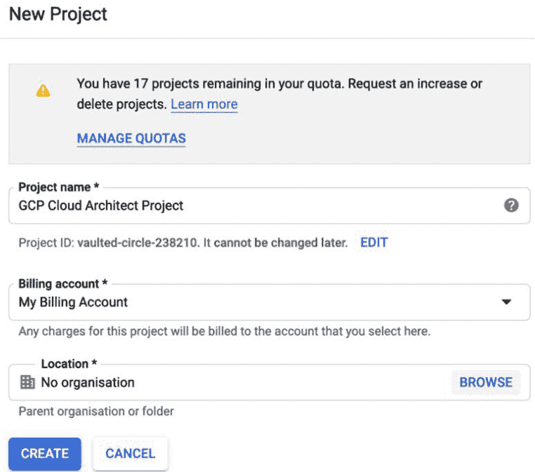

Figure 2.5 – The New Project pane

Note that the **Billing account** option will not be shown if you don't own an organization and use a private account.

3. A new project has been created. You can now manage it from the GCP console:

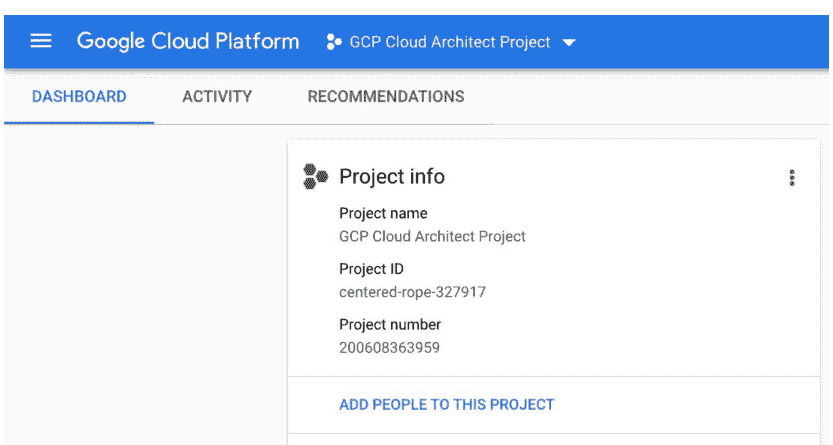

Figure 2.6 – The Project info pane

4. To start using the GCP services, click on the hamburger icon. A menu will pop up. You can access all of the GCP services from here, as shown in the following screenshot:

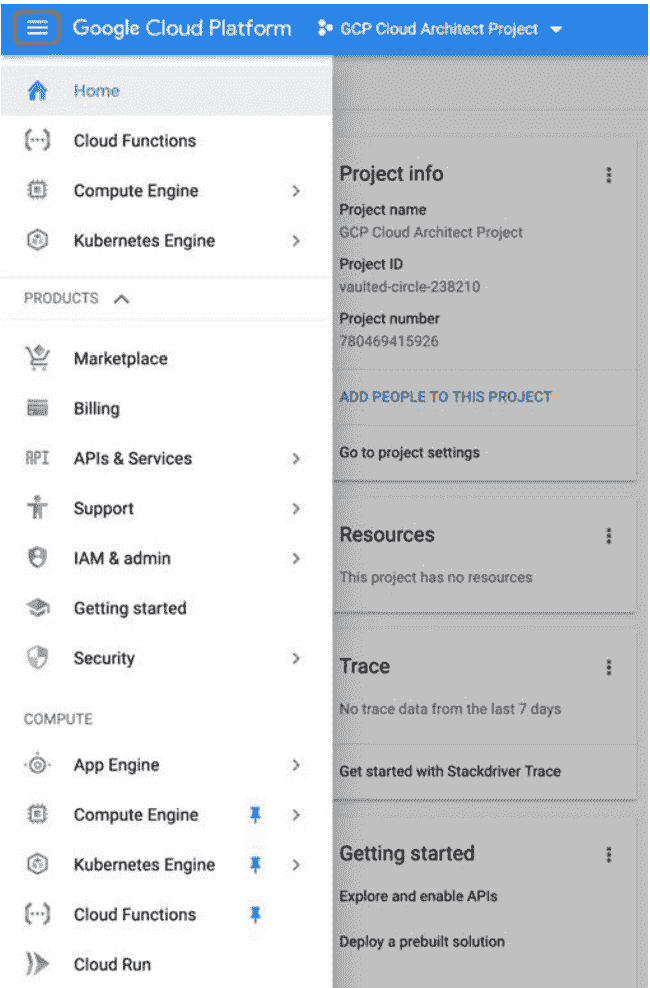

Figure 2.7 – Start using the new project

In the following chapter of this book, we will take a look at each of the services that are relevant to the exam. Don't get scared by the number of options available.

## Granting permissions

In the IAM section of *Chapter 15, Security and Compliance*, you will find more details about how to assign permissions to your GCP resources.

For the sake of this introduction, we will now learn how to add a member and assign previously defined roles to them. Essentially, roles are the settings of permissions.

Here are the step-by-step instructions to grant permissions:

1. To add a new member to your project, go to the **IAM** section of the **IAM & admin** pane.
2. Select the **MEMBERS** tab and click on **ADD**. Now, select a member and choose a role. Click on **Save** to confirm:

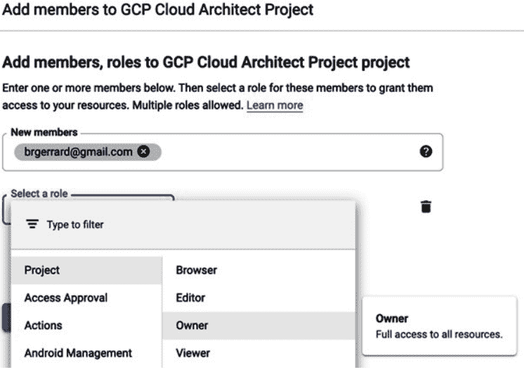

Figure 2.8 – Adding members to roles

3. The user has been added and has been granted the permissions of the defined role:


Figure 2.9 – Users added to the role

Brian Gerrard has been sent an invitation to join the project as an owner. The triangle with an exclamation mark will be displayed until the invitation has been accepted.

## Billing

Depending on your company structure, you might have different requirements regarding billing. With GCP, you have the option to create a single or multiple billing accounts. As shown in the following diagram, the billing accounts can be associated with one or more projects. The actual payment details are created in the payment profiles that are attached to the billing account, as follows:

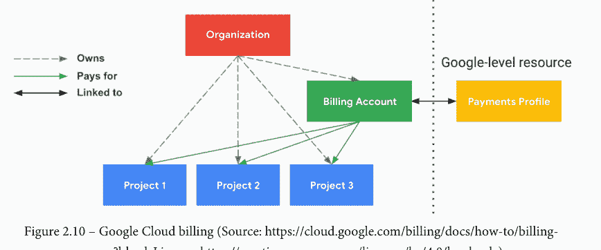

Figure 2.10 – Google Cloud billing (Source: https://cloud.google.com/billing/docs/how-to/billing-access?hl=pl, License: https://creativecommons.org/licenses/by/4.0/legalcode)

Here, you can see that the smallest entity you are billed for is a single project. Therefore, you cannot split your bill inside the project. This affects how you can split the billing within your organization. Do you have multiple departments that need separate billing—for example, finance, engineering, and human resources—or do you manage it centrally?

In the first scenario, you might want multiple projects with multiple billing accounts; however, in the latter scenario, you might require multiple projects with a single billing account.

## Managing billing accounts

The first billing account will be created upon the creation of your GCP account. However, as we have just learned, you might require multiple billing accounts.

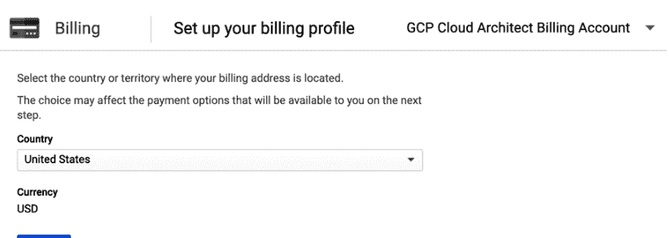

Figure 2.13 – Setting up the billing profile

5. Now, you can choose an existing payment profile or create a new one. Note that we do not see any existing profiles. This is because my existing payment profiles are set to Polish PLN, while the new billing profile is set to USD. Fill in the customer information and scroll down to Payment method:

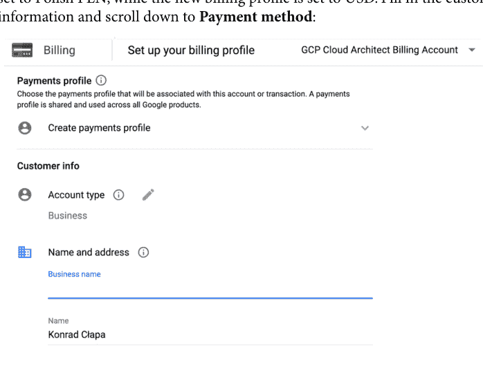

Figure 2.14 – Setting up the customer information

6. Fill in your payment details, and click on the Submit and enable billing button:

Payment method
Add credit or debit card
Card number
Cardholder name
Konrad Clapa
Credit or debit card address is same as above
Submit and enable billing

Figure 2.15 – Payment details

7. Now, your billing account has been created, and you can manage it from the Billing window:

Billing
CREATE BUDGET
DELETE
Billing account
My Billing Account
Overview
Reports
Cost table
Cost breakdown
Commitments
Commitment analysis
Budgets & alerts
Billing export
Pricing
Documents
Transactions
Payment settings
Payment method
Account management
Billing
Budgets & alerts
Avoid surprises on your bill by creating budgets to monitor all your Google Cloud charges in one place. After you’ve set a budget, you can create budget alerts to email billing admins and users when charges exceed a certain amount.
CREATE BUDGET

Figure 2.16 – The billing account has been created


We can now assign a project to the newly created billing account.

## Assigning a project to a billing account

As mentioned already, you can assign multiple projects to one billing account. In the following screenshot, you can see that we now have three billing accounts and multiple projects assigned to them. Our newly created billing account has no project assigned to it; therefore, let’s move our GCP Cloud Architect project to that billing account, as follows:

- 1. Click on **Billing** and then click on **Account Management**. Now, click on the three-dots next to the project name and choose **Change billing**:

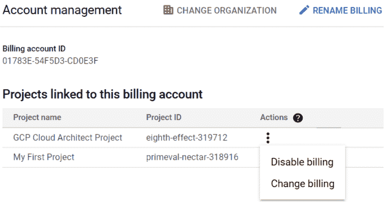

Figure 2.17 – Changing the billing account

2. In the next window, we select the billing account we want the project to be attached to and click on SET ACCOUNT:

### Set the billing account for project GCP Cloud Architect Project

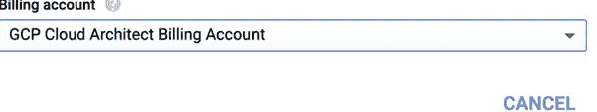

Figure 2.18 – Selecting the billing account for the project

The project is now attached to its proper billing account.

## Exporting billing

GCP allows you to export the billing information to a BigQuery dataset. This can be useful if you need to prepare reports or carry out an analysis of the cost of your cloud consumption.

> **Important Note**
> We will learn about BigQuery and Google Storage in the big data and storage chapters of this book. To understand billing exports, you just need to know that BigQuery is a GCP data warehouse service.

To perform the export, follow these steps:

- 1. Go to **Billing** and choose **Billing export**. Select the **BIGQUERY EXPORT** option.
- There are different levels of details available for exports:

### Google Cloud Platform

### Billing export

### BIGQUERY EXPORT

### FILE EXPORT

BigQuery export sends your billing data to a BigQuery dataset. Learn more about [BigQuery](https://) and [how to export data to BigQuery](https://)

### Standard usage cost

Disabled

SHOW ME HOW THIS WORKS

The selected BigQuery dataset will be updated each day with your daily cost detail per SKU.

EDIT SETTINGS

### Detailed usage cost

Disabled

The selected BigQuery dataset will be updated each day with your detailed usage cost. [Learn more about the Detailed usage cost export and supported regions.](https://)

EDIT SETTINGS

### Pricing

Disabled

The selected BigQuery dataset will contain your SKU prices. It will be updated whenever your pricing changes.

EDIT SETTINGS

Figure 2.19 – Billing export

- 2. To export a standard report, click on the **EDIT SETTINGS** in the **Standard usage cost** section. Then, fill in the information regarding the dataset and click on **SAVE**. If you currently have no datasets set up in BigQuery, then you will be prompted to create one from the drop-down menu:

### Billing export

BIGQUERY EXPORT
FILE EXPORT

### Daily cost detail

BigQuery export sends your billing data to a BigQuery dataset. Learn more about BigQuery and how to export data to BigQuery

Projects *
GCP Cloud Architect Project

This is where your billing data will be stored. Select a project with BigQuery enabled and with an existing BigQuery dataset.

Dataset ID *

CREATE NEW DATASET
Launches a form to create a new dataset before continuing

Loaded datasets

SAVE
CANCEL

Figure 2.20 – Daily cost detail

3. Next, you can create a new dataset with the values you require:

### Create dataset

Dataset ID *
billing_dataset
Letters, numbers, and underscores allowed

Data location
European Union (EU)

### Default table expiration

Enable table expiration

Default maximum table age
30
Days

### Encryption

Google-managed encryption key
No configuration required

Customer-managed encryption key (CMEK)
Manage via Google Cloud Key Management Service

CREATE DATASET
CANCEL

Figure 2.21 – Dataset values

4. After the data has been exported to BigQuery, you can perform queries on it. For example, you can check which service has generated the most costs:

```
Query editor
1 SELECT
2   invoice.month,
3   service.description,
4   ROUND(SUM(cost) + SUM(IFNULL((
5     SELECT
6       SUM(c.amount)
7     FROM
8       UNNEST(credits) c,
9     0))) AS cost_after_credits
10 FROM
11   `data-analytics-pocs:public.gcp_billing_export_EXAMPLE_E0XD3A_DB33F1`
12 WHERE
13   invoice.month = "201906"
14 GROUP BY
15   1,
16   2
17 ORDER BY
18   3 DESC ;
```

Run Save query Save view Schedule query More

Query results SAVE RESULTS EXPLORE WITH DATA STUDIO

Query complete (1.2 sec elapsed, 57.6 MB processed)

Job information Results JSON Execution details

| Row | month | description | cost_after_credits |
|---|---|---|---|
| 1 | 201906 | Compute Engine | 1607.0 |
| 2 | 201906 | Cloud Storage | 411.0 |
| 3 | 201906 | App Engine | 86.0 |
| 4 | 201906 | BigQuery | 73.0 |
| 5 | 201906 | Cloud Functions | 0.0 |
| 6 | 201906 | Cloud Scheduler | 0.0 |
| 7 | 201906 | Cloud Pub/Sub | 0.0 |
| 8 | 201906 | Stackdriver Logging | 0.0 |

Figure 2.22 – BigQuery billing query (Source: https://cloud.google.com/billing/docs/how-to/visualize-data, License: https://creativecommons.org/licenses/by/4.0/legalcode)

This information is very useful when you wish to create all sorts of billing reports. In addition to the reporting, we would also like to be informed, upfront, whether we are exceeding our budget. In the next section, let's examine how this can be done.

## Budgets and alerts

Budgets and alerts can be set for each billing account or project. You can set up a specific threshold. Once the amount spent is higher than the defined threshold, billing administrators and billing account users will be notified. This will not stop the usage of any services, and charges will continue to apply for the running resources. By default, there are three alert thresholds: 50%, 90%, and 100%. Both the number of thresholds and their values can be modified:

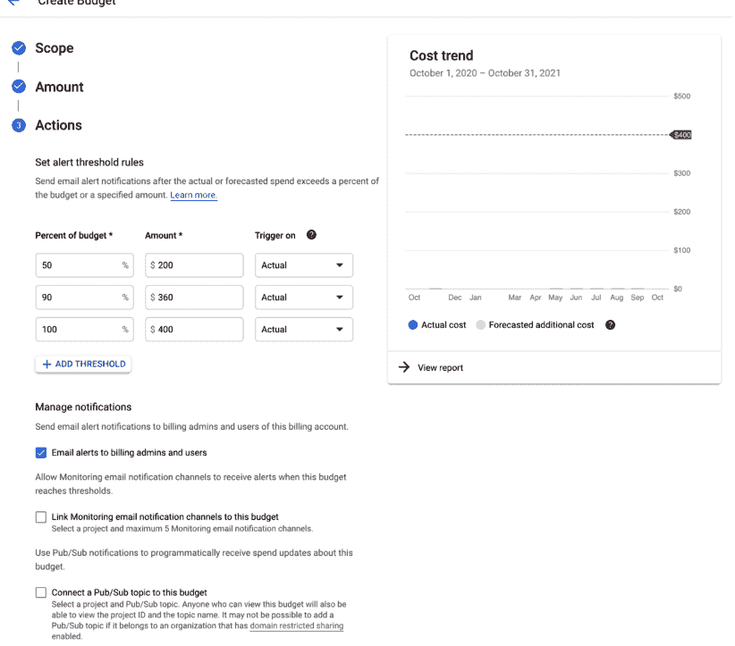

Figure 2.23 – Creating a budget

There are two types of notification targets: email and a Pub/Sub topic. If the mail channel is chosen, the billing administrators and users can be notified or a specific notification channel with an associated email address can be selected. If a Pub/Sub topic is selected, an already existing topic can be selected or a new topic can be created.

> **Exam Tip**
> If the alerts and budgets are attached to a billing account, and you have multiple projects attached to the alerts, this will count toward the total cost generated in all of those projects together. Remember the default thresholds for the alerts.

## Billing account roles

Surely, you would want to have control over who has access to your billing and who can manage the payments. The following list shows the roles that can be used to control the billing:

- - **Billing Account Creator**: This is used for the initial billing setup, including signing up for GCP with a credit card.
- - **Billing Account Administrator**: This is the owner of the billing account. This role is allowed to link and unlink projects and manage other users' roles for the billing account. This role can manage payment instruments, billing exports, and view cost information.
- - **Billing Account User**: In combination with the project creator role, the Billing Account User role is allowed to create new projects linked to the billing account on which the role has been granted.
- - **Billing Account Viewer**: This role allows access to view the billing information. It can be used by the finance team.
- - **Billing Account Costs Manager**: This role allows you to view and export the cost information of the billing account.
- - **Project Billing Manager**: This role enables the attachment of the project to a billing account without rights to resources.

> **Exam Tip**
> Make sure you understand the billing roles; in particular, ensure you have a good understanding of who can manage new billing accounts and who can only view the data.


## Summary

在本章中，我们学习了 GCP 的基础知识。我们讨论了资源及其范围和层级。我们设置了第一个账号，为其他用户创建了访问权限，并配置了计费。我们还学习了如何导出计费信息。最后，我们学习了如何设置警报和预算来控制 GCP 使用成本。

在下一章中，我们将浏览 GCP 的核心服务，并在随后的章节中继续深入研究每一项服务。

## Further reading

有关 GCP 计费和安全性的更多信息，请参考以下资源：

- **IAM:** https://cloud.google.com/billing/docs/how-to/billing-access
- **Visualizing billing:** https://cloud.google.com/billing/docs/how-to/visualize-data?hl=pl
- **SLA:** https://cloud.google.com/terms/sla/
- **Security in GCP:** https://cloud.google.com/security/
- **Comparing GCP services to AWS and Azure:** https://cloud.google.com/free/docs/aws-azure-gcp-service-comparison

## 3
Google Cloud Platform Core Services

在深入研究 Google Cloud Platform (GCP) 服务之前，让我们先进行一次概览，介绍所有最重要的核心服务。这将帮助我们更好地理解整体情况。熟悉所有核心服务非常重要，不仅是为了考试——它还能让你为你的使用场景选择最佳方案。

Google 将服务分为以下逻辑组，它们将是本章我们要涵盖的内容：

- Understanding computing and hosting services
- Exploring storage services
- Getting to know about networking services
- Going through big data services
- Understanding Machine Learning (ML) services
- Learning about identity services

> **Exam Tip**
> 作为一名云架构师，你需要从高层次理解大多数服务的工作原理。本章应能解答考试中的一些基本问题。请注意，Google 经常发布新服务；不过，新服务发布和考试更新之间总会有延迟。

## Understanding computing and hosting services

在 GCP 中进行 **computing** 时，我们有多种选择。根据我们的需求和灵活性，我们可以从以下四个选项中选择一个，我们将在接下来的部分中进行探讨：

- **Infrastructure-as-a-Service (IaaS): Google Compute Engine (GCE)**
- **Container-as-a-Service (CaaS): Google Kubernetes Engine (GKE)**
- **Platform-as-a-Service (PaaS): Google App Engine (GAE)**
- **Function-as-a-Service (FaaS): Cloud Functions**

> **Exam Tip**
> 请注意，还有一些额外的计算选项可能尚未出现在考试中，但在 2019 年已宣布。**GKE On-Prem** 是一种可在本地环境中安装并从 Google 控制台管理的 GKE 服务。**Cloud Run** 是一种 FaaS 方案，允许你定义会监听 HTTP 请求的容器。这使你能够使用 Cloud Functions 不支持的语言。要了解有关这些服务的更多信息，请查看 *Further reading links.*

- **Fully managed container platform: Cloud Run**

我们做出的选择可能取决于多个因素。例如，我们是否需要完全控制基础设施，还是想要一个完全托管的服务？从 **Compute Engine** 开始，我们可以控制 **Virtual Machine (VM)** 实例。这给了我们最大的灵活性，但也意味着我们需要负责其上的堆栈。对于 **Cloud Functions**，我们受支持编程语言的限制很大（JavaScript、Python、Node.js、Java、.NET、Ruby、PHP 和 Go）。Cloud Functions 的优势在于你无需担心基础设施和扩展。你只需专注于开发你的函数。如果你需要使用 Cloud Functions 不支持的语言，你将无法使用它。

GCP 中的计算选项如下图所示：

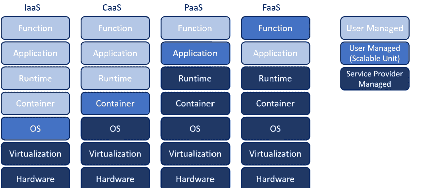

Figure 3.1 – Computing options

让我们看一下每种计算选项，并了解 Google 为我们管理的内容与我们获得的灵活性之间的对比：

- GCE: GCE 是一种 IaaS 方案。它允许最大的灵活性，因为它提供了计算基础设施来配置 VM 实例。这意味着你对虚拟化硬件和操作系统有控制权。请注意，这可能受可用机器类型的限制。你可以使用标准 GCP 镜像或自己的自定义镜像。你可以控制 VM 和存储在区域和区域中的位置。你对网络有精细控制，包括防火墙和负载均衡。使用实例组，你可以根据需要自动扩展控制和容量。Compute Engine 在大多数情况下都很适用，但可能不是最优解决方案。

- GKE: GKE 是一种 CaaS 方案。它允许你按需创建 Kubernetes 集群，从而省去了自行安装集群的重活。它利用 Compute Engine 来托管集群节点，但客户无需担心基础设施，可以专注于编写代码。配置的集群可以自动更新和扩展。GCP 软件定义网络与 GKE 集成，允许用户在应用程序部署时按需创建网络对象，例如负载均衡器。多个服务与 GKE 集成，例如 Artifact Registry，它允许你存储和扫描容器镜像。

- **App Engine:** App Engine 是一种 PaaS 方案。它允许你专注于编写代码，而 Google 负责托管、扩展、监控和更新。它面向不需要理解基础设施复杂性的开发人员。GAE 提供两种类型的环境，如下所示：

- **Standard:** 支持一组常用语言，包括 Python、Go、Java、Node.js、PHP、Ruby 和 Go。

- **Flexible:** 支持更多语言，并可创建自定义运行时。使用灵活环境，你会失去一些开箱即用的集成，但会获得更多灵活性。

GAE 与 GCP 服务紧密集成，包括数据库和存储。它允许对应用程序进行版本控制，以便轻松进行发布和回滚：

- **Cloud Functions:** Cloud Functions 是一种 FaaS 方案。它允许你专注于使用其中一种受支持语言编写函数。它非常适合执行数据处理、移动后端和 IoT 的简单任务。该服务完全无服务器，所有底层层级均由 Google 管理。函数可以通过事件触发或 HTTP 端点执行。

- **Cloud Run:** 将 FaaS 的简易性和 CaaS 的可移植性结合在一起。它允许你在完全托管的无服务器平台上开发和部署可自动扩展的容器化应用程序。它与 Knative 兼容，因此你可以将工作负载迁移到任何可在云中或本地运行 Kubernetes 的环境。

- **Anthos:** Anthos 是一种现代应用程序管理平台，为云和本地环境提供一致的开发和运营体验。Anthos 本身不是计算选项，但允许你在多云和混合环境中在 Anthos 上运行 Google Kubernetes Engine 和 Cloud Run。

- **Google Cloud VMware Engine (GCVE)** 是托管在 GCP 中的完全托管的原生 VMware Cloud Foundation 软件堆栈。它允许你通过将托管在 vSphere 上的 VM *原样* 迁移到 Google Cloud 来加速向 GCP 的迁移。

现在我们已经研究了计算服务，让我们在下一节中了解一下存储服务。

## Exploring storage services

**Storage** 是云计算的重要组成部分，因为它保存了应用程序的数据和状态。GCP 提供了多种存储，从对象存储到托管数据库。我们将要查看的不同存储服务如下：

- **Cloud Storage**: Cloud Storage 是一种完全托管的面向对象的存储服务，具有几乎无限的容量。它允许创建存储数据的存储桶，并通过 API 和 `gsutil` 等工具进行访问。它提供不同的存储类别和位置，以最好地满足你的需求，即数据被访问的频率和应位于的位置。请记住，每个层级的价格都不同。做出深思熟虑的决定将有助于你节省成本。你可以选择以下选项：

- **Standard**: 在多个地理位置具有最高可用性
- **Nearline**: 用于每月访问少于一次的数据
- **Coldline**: 用于每季度访问少于一次数据的极低成本
- **Archive**: 用于每年访问少于一次数据的最低成本

> **Important Note**
> 之前，Google Cloud Storage 提供的存储类别与上述提到的略有不同。考试可能尚未更新，因此了解旧选项也很重要，如下所示：
> **Multi-regional**: 在多个地理位置具有最高可用性
> **Regional**: 在固定位置具有高可用性
> **Nearline**: 低成本，用于每月访问少于一次的数据
> **Coldline**: 用于备份和灾难恢复的最低成本

使用 Cloud Storage，你无需担心容量不足。以下列表告知我们其他 Google Cloud Storage 选项：

- **Cloud Filestore**: Filestore 是一种托管文件存储服务。它允许用户配置可与 GCE 和 GKE 集成的 **Network Attached Storage (NAS)** 服务。它提供两个性能层级——**standard** 和 **premium**，提供不同的 **Input/Output operations Per Second (IOPS)** 和吞吐量。


- **Cloud SQL**：Cloud SQL 是一种完全托管的关系型数据库服务，可用于 MySQL、PostgreSQL 或 SQL Server 数据库。它提供数据复制、备份、数据导出和监控功能。当你需要将当前实例从本地迁移到云端并希望将数据库维护委托给 Google 时，它是理想的选择。
- **Cloud Datastore**：Cloud Datastore 是一种完全托管的非 SQL 数据库。它非常适合依赖大规模高可用结构化数据的应用程序。其扩展性和高可用性通过分布式架构实现，并对用户进行了抽象。每个项目中只有一个数据库可用。Cloud Datastore 提供类 SQL 语言来查询数据。它已被 Cloud Firestore 取代。
- **Cloud Firestore**：Cloud Firestore 是 Cloud Datastore 的下一代产品，具有多项增强功能。它可以在 Native 或 Datastore 模式下运行。前者与 Cloud Datastore 兼容。Google 已开始在没有任何停机或用户干预的情况下将所有 Datastore 客户端迁移到 Cloud Firestore。所有新项目都应创建在 Cloud Firestore 而不是 Datastore 中。
- **Cloud Spanner**：Cloud Spanner 是一种完全托管的全球分布式数据库服务。它提供关系型数据库的强一致性，同时具有非关系型数据库的扩展能力。用户可以定义架构并利用行业标准的 **American National Standards Institute (ANSI)** 2011 SQL。它提供高性能事务，服务等级协议 **Service-Level Agreement (SLA)** 可达 99.999% 可用性，意味着几乎没有停机时间。Cloud Spanner 适用于金融交易、保险、全球呼叫中心、电信、游戏和电子商务等用例。全局一致性使其非常适合全球可访问的应用程序。
- **Bigtable**：Bigtable 是一种完全托管的超大规模 NoSQL 数据库服务，对大型分析和运营工作负载提供稳定的亚 10ms 延迟。Google 使用它来提供 Gmail 和 Google Maps 等服务。它非常适合金融科技、物联网和机器学习存储用例。它可轻松与大数据产品系列如 **Dataproc** 和 **Dataflow** 集成。它基于开源 Apache HBase，可使用其 API。Bigtable 的成本远高于 Datastore，因此应谨慎选择数据库。
- **Custom databases**：你也可以选择使用 Compute Engine 安装自选数据库，例如 MongoDB；但是，这将是一个非托管服务。
- **Persistent Disks**：这些是持久的网络存储设备，可以被我们的实例像物理磁盘一样访问。它们与我们的 VM 实例独立存在，可以分离并移动以在 VM 被删除后仍保持数据安全。

至此，我们结束了对存储服务的介绍；让我们在下一节中查看网络服务。

## Getting to know about networking services

GCP 网络基于 **Software-Defined Networks (SDNs)**，允许用户以编程方式交付所有网络服务。所有服务均完全托管，用户只需根据其需求进行配置。我们将要查看的网络服务如下：

- **Virtual Private Cloud (VPC)：** VPC 是 GCP 网络的基础。项目可以包含多个 VPC 网络。除非你创建了禁止此操作的组织策略，否则新项目会默认启动一个默认网络（自动模式 VPC 网络），在每个区域中都有一个子网络（子网）。你可以将其视为物理网络的云版本。每个 VPC 网络可以包含一个或多个区域子网。VPC 创建了一个全局逻辑边界，允许同一 VPC 网络内的资源之间进行通信，须遵守适用的网络防火墙规则。要允许 VPC 之间通信，流量需要经过互联网或使用 VPC 对等互连。

- **Load balancer：** 负载均衡器允许在工作负载之间分配流量。它们可用于 GCE、GAE 和 GKE。对于 GCE，你可以选择具有全局或区域范围的负载均衡器。选择还取决于网络类型。以下负载均衡器可用：
  - HTTP(S) load balancer
  - SSL proxy
  - TCP proxy
  - External network load balancer
  - Internal TCP/UDP load balancer
  - Internal HTTP(S) load balancer

- **Cloud Router：** Cloud Router 是一项服务，允许你通过使用 **Border Gateway Protocol (BGP)**：https://www.wikipedia.org/wiki/Border_Gateway_Protocol 在 VPC 和本地网络之间动态交换路由。它消除了创建静态路由的需要。

- **Virtual Private Network (VPN)：** VPN 允许通过互联网上的 IPsec 隧道在本地网络与 GCP VPC 之间建立连接。仅支持站点到站点 VPN。传输中的流量会被加密。支持静态和动态路由，后者需要云路由器。应将 VPN 视为将环境连接到 GCP 的初始方法，因为它成本最低。如果有低延迟、高可靠性和高带宽需求，则应考虑 Cloud Interconnect。

- **Cloud Interconnect**：如果需要在本地网络与 Google Cloud VPC 网络之间建立低延迟且高度可用的连接，则应考虑互连。在这种情况下，流量不会经过互联网。有两种互连选项，分别是：
  - **Dedicated Interconnect**：10 或 100 Gbps 直接连接到 Google 数据中心
  - **Partner Interconnect**：50 Mbps-50 Gbps 通过 Google 合作伙伴传输

- **Cloud DNS**：Cloud DNS 是一种托管 DNS 服务，SLA 为 100%。它将域名解析为对应的 IP 地址。它可轻松发布和管理数百万个 DNS 区域和记录。Cloud DNS 还可以托管仅可从你指定的一个或多个 VPC 网络访问的私有区域。

- **Cloud Content Delivery Network (CDN)**：Cloud CDN 是一项服务，允许缓存来自各种类型后端（包括 Cloud Storage 存储桶）的 HTTP(S) 负载均衡内容。缓存可减少内容交付时间和成本。它还可以保护你免受 **Distributed Denial-of-Service (DDoS)** 攻击。数据缓存在 Google 全球分布的边缘节点上。在首次请求时，如果内容未被缓存，数据将从后端源检索。后续对相同数据的请求将直接从缓存提供，直到过期时间到达。

- **Cloud NAT**：Cloud NAT 是一项区域服务，允许没有外部 IP 的 VM 与互联网通信。它是一个分布式、软件定义的管理服务，可以配置为自动扩展其使用的 NAT IP 地址数量。它适用于 GCE 和 GKE。它是用户需要管理的 NAT 实例的更好替代方案。

- **Firewall**：GCP Firewall 是一项允许微分段的服务。防火墙规则按 VPC 创建，可以基于 IP、IP 范围、标签和服务账号。默认创建了多个防火墙规则，但可以修改。

- **Identity-Aware Proxy (IAP)**：IAP 是一项服务，当用户从不受信任的网络工作时可替代 VPN。它根据用户身份、设备状态和 IP 地址控制对应用程序的访问。它是 Google BeyondCorp (`https://cloud.google.com/beyondcorp`) 零信任安全模型的一部分。

- **Cloud Armor**：Cloud Armor 是一项服务，利用 Google 的全球基础设施和安全系统保护免受基础设施 DDoS 攻击。它与全局 HTTP(S) 负载均衡器集成，并根据 IP 地址或范围阻止流量。预览模式允许用户在不切断常规用户的情况下分析攻击模式。


Phew! 我们已经涵盖了大量关于网络服务的内容。现在，让我们在下一节中了解大数据服务。

## 了解大数据服务

大数据服务使用户能够处理大量数据以提供复杂问题的答案。GCP 提供了许多紧密集成的服务，可创建 **端到端 (E2E)** 数据分析管道。这些服务如下：

- **BigQuery**：BigQuery 是一种高度可扩展且完全托管的云数据仓库。它允许用户使用内置 ML 执行分析操作。BigQuery 完全无服务器，可托管 PB 级数据。底层基础设施可无缝扩展并允许并行数据处理。数据可以存储在 BigQuery Storage、Cloud Storage、Bigtable、Sheets 或 Google Drive 中。用户定义包含表的数据集。BigQuery 使用熟悉的符合 ANSI 的 SQL 进行查询，并提供 ODBC 和 JDBC 驱动程序。用户可从两种付费模式中选择——一种是灵活的，按存储和查询付费，另一种是固定费率，每月成本稳定。它非常适合预测分析、物联网和日志分析等用例，并与 GCP 的大数据产品系列集成。

- **Pub/Sub**：这是一种完全托管的异步消息传递服务，可让您松散地耦合应用程序组件。它是无服务器的，具有全球可用性。您的应用程序可以向主题发布消息或订阅主题以提取消息。Pub/Sub 还提供基于推送的消息传递，将消息作为 HTTP POST 请求推送到 **Webhooks**。

- **Dataproc**：Dataproc 是一种完全托管的 **Apache Spark** 和 **Hadoop** 集群服务。它允许用户按需创建集群，并在需要数据处理时才使用。按秒计费。它允许用户将已有的本地集群迁移到云端而无需重构代码。使用抢占式实例可进一步降低成本。

- **Cloud Dataflow**：Cloud Dataflow 是一种完全托管的服务，用于流式和批处理数据。它基于开源 Apache Beam，完全无服务器，并提供几乎无限的容量。它将为用户管理资源和作业平衡。它可用于在线欺诈分析、物联网、医疗保健和物流等用例。

- **Dataprep**：这是一种可用于执行数据准备和可视化的工具。我们可以在无需任何编码技能的情况下探索和转换数据。数据可以交互式地为进一步分析做好准备。

- **Datalab**：Datalab 是一款内置于 **Jupyter**（前身为 **IPython**）的工具，允许用户探索、分析和转换数据。它还允许用户构建 ML 数据模型并利用 Compute Engine。

- **Data Studio**：这是一种允许您从源消费数据并以报告和仪表板形式可视化数据的工具。
- **Cloud Composer**：这是一种基于开源 **Apache Airflow** 的完全托管服务。它允许您创建和编排大数据管道。
- **Data Fusion**：这是一种完全托管的企业数据集成服务。它提供了一个 UI，允许您构建和管理管道以清理、准备、混合、传输和转换数据。

最后，让我们在下一节中研究 ML 服务。

## 了解机器学习服务

Google 的长期 **机器学习 (ML)** 经验是其最强的一点之一。GCP 提供了围绕 ML 的多个服务。您可以选择预训练模型或自行训练模型。ML 下包含的各种服务如下：

- **Pretrained APIs**：ML API 是允许您利用多个预训练模型以分析视频的服务。目前可用的 API 如下：
  - Google Cloud Video Intelligence
  - Google Cloud Speech
  - Google Cloud Vision
  - Google Cloud Natural Language
  - Google Cloud Translation
  - Google Recommendations AI

以下模型列表可在无需任何关于其工作原理的背景知识的情况下使用。作为示例，我们可以分析文本进行情感分析：

- **AutoML**：AutoML 是一项服务，开发人员可利用它在没有广泛数据科学知识的情况下训练模型。例如，通过向 AutoML 提供标记样本，它可以被训练以识别 Vision API 无法识别的对象。以下是 AutoML 的标记样本：
  - AutoML Translation
  - AutoML Natural Language
  - Video Intelligence
  - AutoML Tables

- **Dialogflow:** 这是一项服务，允许您构建可与人类交互的对话应用程序。界面可与许多兼容平台交互，例如 Slack 或 Google Assistant。它还可以与 **Firebase** 函数集成，使用通用 API 与第三方平台集成。
- **AI Platform:** 这是一项完全托管的服务，允许端到端开发机器学习模型。在其进入通用可用性之前，Google 发布了 Vertex AI 并弃用了 AI Platform。
- **Vertex AI:** 这是一个统一的机器学习平台，用于构建、部署和扩展 AI 模型。它将 AutoML 和 AI Platform 集成到统一的 API、客户端库和用户界面中。使用 Vertex AI，您可以执行 AutoML 训练和自定义训练。对于这两个选项，您都可以使用 Vertex AI 保存模型、部署模型并请求预测。

ML 服务将在 *第 14 章，将机器学习付诸实践* 中进一步讨论。在下一节中，我们将介绍 *Google 的身份和访问管理* 服务。

## 了解身份服务

**身份和访问管理 (IAM)** 是任何云最重要的方面之一。它允许您控制谁有权访问云，但也可以为您的应用程序提供身份服务。简而言之，这是通过角色和权限的组合实现的。角色分配给用户或组。让我们看看 GCP 中有哪些选项：

- **IAM:** IAM 允许 GCP 管理员控制对 GCP 服务的授权。管理员可以创建具有细粒度权限的角色。然后可以将角色分配给用户，或最好分配给一组用户。
- **Cloud Identity:** Cloud Identity 是一种 **身份即服务 (IDaaS)** 方案。它位于 GCP 之外，但可以轻松与 GCP 集成。它允许您创建组织、组和用户并集中管理它们。如果您已有现有的用户目录，可以将其与 Cloud Identity 同步。

IAM 非常重要，因为它决定了您的 GCP 架构将如何创建。我们将在 *第 15 章，安全性和合规性* 中更详细地讨论这个问题。

# 第 2 部分：
管理、设计和
规划云解决方案
架构

在本节中，我们将更详细地关注各种 GCP 服务。通过检查这些服务，我们将演示如何基于 GCP 管理、设计和规划解决方案。

本书的这一部分包含以下章节：

- 第 4 章，使用 Google Compute Engine
- 第 5 章，将 Google App Engine 作为计算选项进行探索
- 第 6 章，使用 Google Kubernetes Engine 管理 Kubernetes 集群
- 第 7 章，使用 Cloud Run 部署云原生工作负载
- 第 8 章，使用 Anthos 管理云原生工作负载
- 第 9 章，使用 Google Cloud Functions 运行无服务器函数
- 第 10 章，GCP 中的网络选项
- 第 11 章，探索 GCP 中的存储和数据库选项 – 第 1 部分
- 第 12 章，探索 GCP 中的存储和数据库选项 – 第 2 部分
- 第 13 章，分析大数据选项
- 第 14 章，将机器学习付诸实践

# 4
使用 Google Compute Engine

**Google Compute Engine (GCE)** 是 **Google Cloud Platform (GCP)** 内部的基础服务之一。虽然公共云继续从传统的 **虚拟机 (VM)** 转移，但这些机器仍有使用场景，就像其他供应商一样，GCE 允许我们在 GCP 上创建和运行 VM。Google 将 GCP 中的 VM 称为 Compute Engine 实例。Compute Engine 使查找符合我们要求的 VM 变得容易，无论是小型 VM 还是大型数据处理 VM。

GCE 是一种纯粹的 **基础设施即服务 (IaaS)** 解决方案；因此，您需要根据需要管理和扩展 VM，但这使其成为从本地迁移到公共云的 **迁移** 的理想解决方案。您可以使用自己的定制操作系统，就像在自己的数据中心一样，也可以选择预定义的 Google、Windows 或 Linux 镜像。您也可以自带 Windows 许可证，但这会带来一些注意事项。在本章的 GCE 部分中，我们将了解如何部署简单的 GCE 实例、部署时可用的选项，以及更复杂的解决方案，使我们能够轻松扩展。


在本章中，我们将更深入地了解 Compute Engine。具体来说，我们将涵盖以下主题：

- 部署我们的第一个 GCE 实例
- 部署选项
- 实例模板和实例组
- 自动扩缩容
- 自动修复
- 配额和限制
- IAM 角色
- 价格

## 部署我们的第一个 GCE 实例

让我们从配置新 VM 的基础开始。我们可以从 GCP 控制台完成此操作。在本节中，我们将查看部署 VM 所需的最基本内容。我们将在本章下一节更详细地查看部署选项：

1. 首先，我们应登录 GCP 控制台，然后浏览到导航菜单，并进入 Compute Engine | VM 实例，如以下屏幕截图所示：

> 重要提示
> 使用 Compute Engine 首次时，您可能会被提示启用 Compute Engine API。

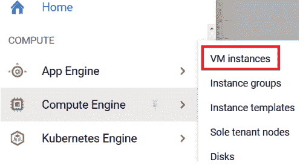

图 4.1 – 浏览到 VM 实例

2. 点击 **ENABLE** 以启用 Compute Engine API（在我们创建第一个 Compute Engine 实例时为一次性启用）：

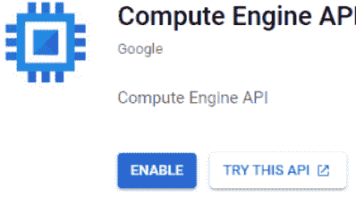

图 4.2 – 启用 API

3. 点击 **CREATE INSTANCE**，如以下屏幕截图所示：

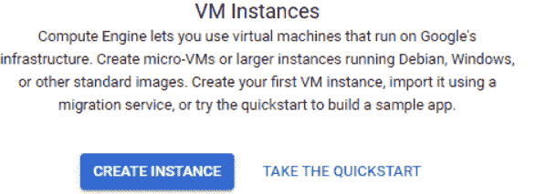

图 4.3 – 创建实例

4. 为您的 VM 指定名称；在本示例中，我们将其命名为 `cloudarchitect`。我们可以选择区域和区域以及机器的大小。某些区域的价格比其他区域更贵，您会注意到，根据区域和机器类型，我们可以看到实例成本的估算值发生变化：

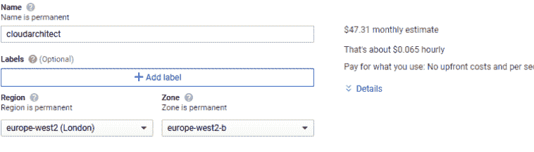

图 4.4 – 选择区域和区域

5. 如果我们查看 **Machine configuration** 菜单下的选项，我们可以选择想要的机器系列。这给了我们选择用于常见工作负载、高性能工作负载、内存密集型或针对机器学习优化的机器的选项。以下屏幕截图显示我们从 **General-purpose** 机器系列中选择了 **E2** 系列机器：

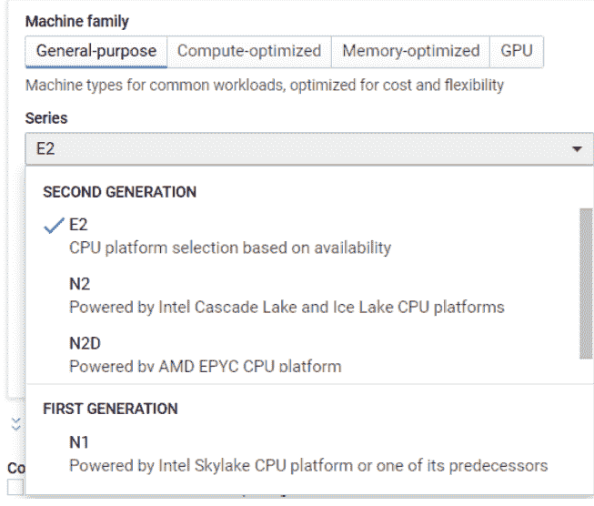

图 4.5 – 选择机器配置

6. 然而，如果这不符合我们的要求，我们也可以选择自定义机器类型并选择所需的确切资源。我们应将 1 vCPU 视为 1 个超线程核心：

### 图 4.6 – 自定义类型

7. 启动盘选择允许我们选择所需的镜像。现在，让我们选择 Windows Server 2019 Datacenter，如以下屏幕截图所示（请注意，Windows Server 实例不再有资格作为免费试用的一部分）：

### 图 4.7 – 选择启动盘

8. 将其他所有内容保留为默认值；我们将在本节稍后更详细地查看其他设置。点击 Create 开始部署。

9. 现在我们有了 VM，需要连接到它。在 **Compute Instance** 部分，我们现在会看到新的 VM。只需点击 RDP 旁边的箭头并选择 **Set Windows password**。设置密码后，点击 **RDP** 按钮：

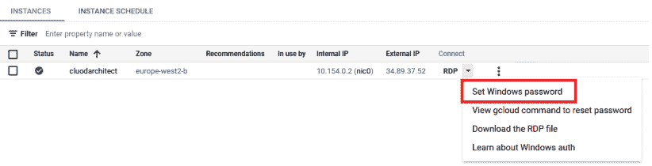

图 4.8 – 设置 Windows 密码

> **重要提示**
> 
> **Remote Desktop Protocol (RDP)** 允许我们通过网络连接连接到另一台 Windows 服务器。

10. 点击 **SET**，如以下屏幕截图所示：

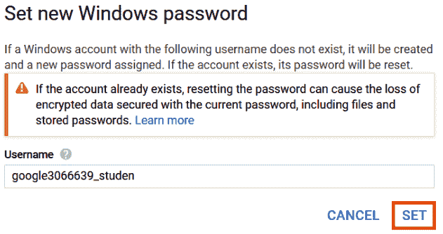

图 4.9 – 设置密码

11. 我们现在可以复制此密码并使用它通过 RDP 连接到我们的 GCE 实例：

### 新 Windows 密码

以下为 google3066639_studen 的新 Windows 密码。
复制并妥善保管。它将不会再次显示。

LP*igUh/A(?> &cX

图 4.10 – 复制密码

12. 如果我们使用基于 Linux 的操作系统创建了 Compute Engine 实例，那么我们只需点击 SSH，如以下屏幕截图所示：

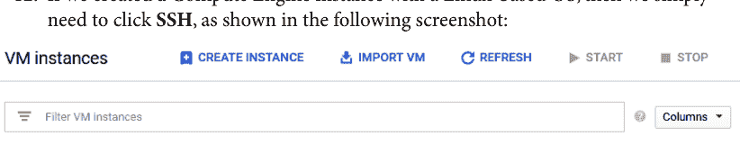

图 4.11 – SSH

> 考试提示
> 如果您没有外部 IP，则应使用堡垒主机，也称为终端服务器。如果您需要访问仅具有内部 IP 地址的资源，则堡垒主机配置了外部 IP 地址并充当内部资源的网关。

如预期，我们也可以从命令行部署 GCE 实例。创建 VM 的首选 CLI 是通过 Cloud Shell 的 gcloud。我们将在第 16 章《Google Cloud Management Options》中更详细地介绍 Cloud Shell，但现在只需了解它是从 GCP 控制台直接提供的命令行，并且它使我们能够快速创建 VM 实例：

1. 要激活它，请点击右上角的 Cloud Shell 图标：

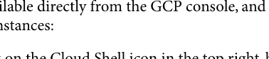

图 4.12 – 激活 Cloud Shell

需要注意的一个功能是，在按照上述流程从 GUI 创建 VM 后，在 Create 按钮下方，您会找到等效的 REST 或命令行选项，如以下屏幕截图所示：

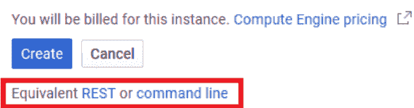

图 4.13 – REST 或命令行

2. 点击命令行选项以打开您需要使用 gcloud 命令创建的确切 CLI：

### gcloud 命令行

这是您选择的 gcloud 命令行及其参数。

```
gcloud compute --project=qwiklabs-gcp-e847de8dac6d39c7 instances create NAME --zone=europe-west2-b --machine-type=n1-standard-1 --subnet=default --network-tier=PREMIUM --maintenance-policy=MIGRATE --service-account=727867390611-compute@developer.gserviceaccount.com --scopes=https://www.googleapis.com/auth/devstorage.read_only,https://www.googleapis.com/auth/logging.write,https://www.googleapis.com/auth/monitoring.write,https://www.googleapis.com/auth/servicecontrol,https://www.googleapis.com/auth/service.management.readonly,https://www.googleapis.com/auth/trace.append --image=windows-server-2016-dc-v20190411 --image-project=windows-cloud --boot-disk-size=50GB --boot-disk-type=pd-standard
```

图 4.14 – 命令行示例

您可以复制文本或点击 RUN IN CLOUD SHELL，这将激活您的 Cloud Shell 实例并执行请求。

## 部署选项

您会注意到有一些选项我们保留为默认值。让我们更详细地查看这些，以确保我们理解创建 Compute Engine 实例所需的所有设置。

### 区域

区域是由三个或更多区域组成的地理位置。我们需要选择一个可以运行 VM 的区域。要求可能与预期的大多数流量所在位置有关。如我们所述，某些区域的价格比其他区域更贵：

美洲

- northamerica-northeast1（蒙特利尔）
- southamerica-east1（圣保罗）
- us-central1（爱荷华）
- us-east1（南卡罗来纳）
- us-east4（弗吉尼亚北部）
- us-west1（俄勒冈）
- us-west2（洛杉矶）
- us-west3（盐湖城）
- us-west4（拉斯维加斯）

欧洲

- europe-central2（华沙）
- europe-north1（芬兰）
- europe-west1（比利时）
- europe-west2（伦敦）
- europe-west3（法兰克福）
- europe-west4（荷兰）
- europe-west6（苏黎世）

图 4.15 – 区域

确保所选区域基于您的要求而有意义。

### 区域

确保您选择一个符合您要求的区域。考虑网络延迟并选择靠近您服务点的区域或区域：

区域
europe-west1（比利时）
机器类型
自定义以选择核心、内存和 GPU。

- europe-west1-b
- europe-west1-d
- europe-west1-c

图 4.16 – 区域

同一区域内的所有区域都通过高带宽、低延迟网络连接——通常在每个区域之间往返时间低于 5 分钟。

### 启动盘

我们已经看到可以从中选择许多预定义镜像。这些镜像的默认存储为平衡持久盘。此类磁盘由 **Solid State Drives (SSDs)** 支持，并在性能和成本之间取得平衡。这可以更改为由标准 HDD 支持的标准持久盘，或由 SSD 支持的 SSD 持久盘。默认大小将根据所选操作系统镜像而变化，但可以调整：

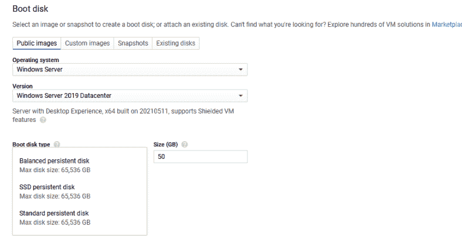

图 4.17 – 启动盘类型

与默认值的更改将再次影响实例的成本。

**自定义镜像** 可按项目使用，可以从源磁盘、镜像、快照或存储在云存储中的镜像创建。

### 快照

可以对持久盘进行快照并将其用作新实例创建的一部分，即使它仍附加到正在运行的实例。快照可用于创建新的自定义镜像或实例。快照可出于多种原因创建，其中之一是数据保护。建议采用快照计划以减少数据丢失。快照也是全局资源，这意味着它们可被同一项目中的任何资源访问。


要从控制台创建快照，我们应浏览到导航菜单，然后进入 **Compute Engine | Snapshots**。然后，我们必须为快照命名并选择要使用的源磁盘。最后，我们可以选择要存储快照的位置，如以下屏幕截图所示：

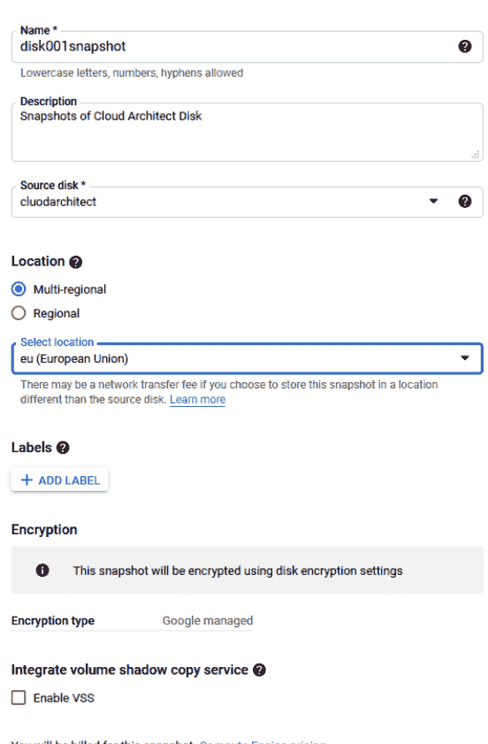

图 4.18 – 创建快照

下图展示了多个快照的工作流程。第一个快照将是对磁盘上所有数据的完整快照，后续快照将是增量的：

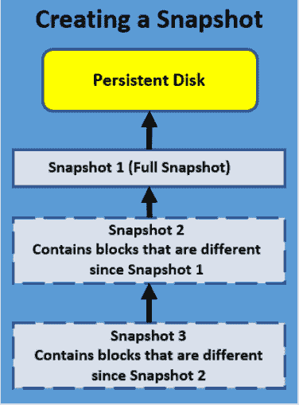

图 4.19 – 多个快照

> **重要说明**
> 
> 快照是增量的，因此将包含与上一个快照不同的块。因此，如果你定期创建快照，其成本低于定期创建磁盘的完整映像。每个快照在 GCP 内的多个位置存储以实现冗余。只要有正确的权限，快照可以跨项目存储。

考试不会对快照进行详细介绍，但可以在此处找到更多信息：https://cloud.google.com/compute/docs/disks/create-snapshots。

## 现有磁盘

现有磁盘也可以附加到新实例。要创建新磁盘，我们可以浏览到导航菜单并进入 **Compute Engine | Disk**。以下屏幕截图显示我们正在创建新的空白磁盘：

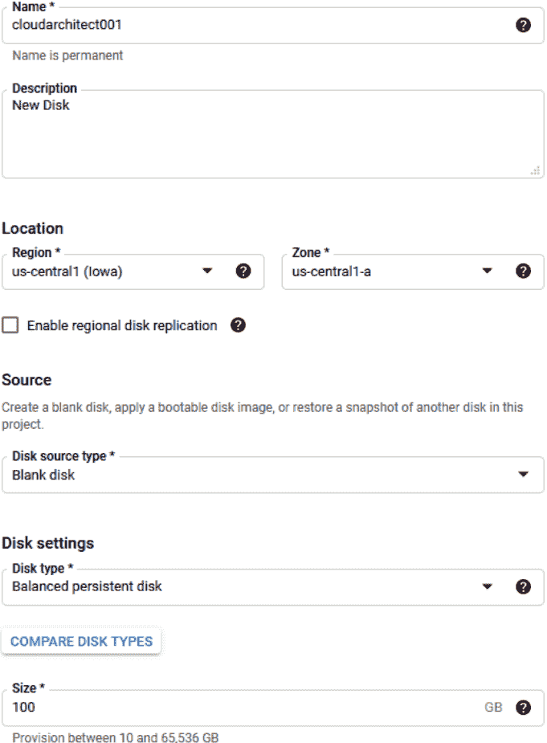

图 4.20 – 一个新磁盘

创建成功后，我们可以在部署新的 Compute Engine 实例时使用此新磁盘。以下屏幕截图显示了当我们点击“现有磁盘”选项卡时其外观。我们可以看到所有可用的磁盘：

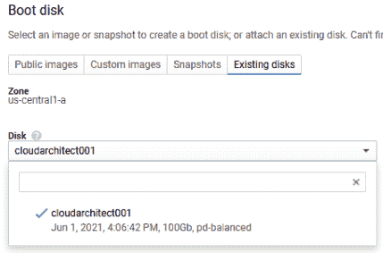

图 4.21 – 现有磁盘

我们也可以从前面的屏幕截图中看到，我们可以使用磁盘的快照作为启动盘。我们在本章前面讨论了如何拍摄快照。

## 标签

还有许多其他可修改的选项。为了对相关资源进行分组，对 VM 实例进行标记是有益的。这有助于组织和筛选计费与报告。标签使用键值对工作，可用于例如区分项目、环境等。只需点击添加标签，你将被提示添加键值对，它将被保存并添加到主创建实例屏幕中，如下所示：

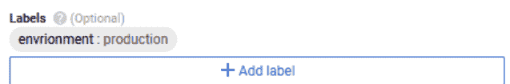

图 4.22 – 标签

前面的屏幕截图是此示例，其中我们可以将实例标记为生产环境。

## 机密 VM 服务

启用此选项可在使用时加密数据。这将在处理期间保持数据在内存中加密，且 Google 无法访问加密密钥：

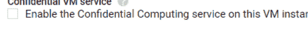

图 4.23 – 机密 VM 服务

## 容器

启用此选项可使用 Container-Optimized OS (COS) 部署和启动 Docker 容器。请注意，每个 VM 实例只能部署一个容器。这与 Google Kubernetes Engine (GKE) 不同，我们将在第 6 章《使用 Google Kubernetes Engine 管理 Kubernetes 集群》中讨论该主题：

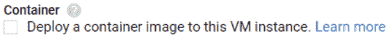

图 4.24 – 容器

前面的图显示了部署容器映像的简单复选框。

## 删除保护

启用此选项可防止 GCE 实例被意外删除。勾选此框将在实例资源上设置 deletionProtection 属性。通常，只有需要无限期运行的关键 VM 实例才会勾选此选项。即使勾选后，实例仍可被重置、停止，甚至在项目终止后被移除。只有具有 compute.instance.create 权限的用户才能修改此标志以允许受保护的 VM 被删除。

## 预留

可以在特定区域为 VM 实例创建预留，使用自定义或预定义机器类型。使用预留可确保在需要时为你的工作负载提供资源；然而，一旦创建预留，你将立即开始为其付费，直到预留被删除。使用预留前应考虑需求增长。此选项允许你选择现有预留、创建新预留或不使用。

## 元数据

向 GCE 实例添加元数据允许未来的查询提取有关实例的信息。元数据存储在元数据服务器上，可以通过 Compute Engine API 或实例本身进行查询。我们可以提取诸如主机名、实例 ID 或我们应用的任何自定义元数据等信息。我们还可以使用元数据向应用程序提供配置信息，从而无需将此数据存储在应用程序本身中。

我们还使用元数据引用在实例部署期间执行的启动脚本。假设我们在名为 deployments 的 Cloud Storage 存储桶上托管名为 startup.sh 的启动脚本。为了确保其执行，我们需要添加存储桶和启动脚本的路径：

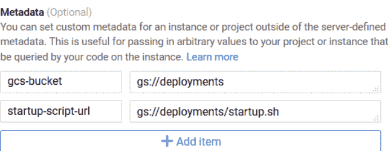

图 4.25 – 元数据

前面的屏幕截图显示了在控制台中其外观。

## 启动脚本

在填充 GCE 部署的变量时，我们也可以设置启动脚本。这是实例启动或重启时运行的脚本。常见示例包括安装特定软件或确保服务已启动。这些脚本通过我们之前提到的同一元数据服务器指定，并使用启动脚本元数据键。同样，这些脚本也可以通过 gcloud 命令以及在控制台中添加。让我们看一下来自 CLI 的示例命令。这是在安装 apache2 并填充主页。请注意，运行此代码后，GCP 会要求我们确认区域：

```
gcloud compute instances create cloudarchitect --tags http-server \
--metadata startup-script='#! /bin/bash
# Installs apache and a custom homepage
```

```bash
sudo su -
apt-get update
apt-get install -y apache2
cat <<EOF > /var/www/html/index.html
<html><body><h1>Hello World</h1>
<p>This page was created from a simple start up script!</p>
</body></html>
EOF'
```

也可以指定位于 Google Cloud Storage 上的脚本。同样，从 gcloud CLI，我们可以指定存储桶位置。在此示例中，我们的存储桶名为 `cloudarchitectbucket`：

```bash
gcloud compute instances create example-instance --scopes
storage-ro \
    --metadata startup-script-url=gs://cloudarchitectbucket/
startupscript.sh
```

> **考试提示**
> 
> 如果我们想指定关机脚本，则会浏览到元数据部分并添加 `shutdown-script` 作为键，并将脚本内容作为值添加。

我们应注意，启动脚本仅在网络可用时执行。

## 可抢占性

可抢占性会降低实例成本，但通常最多只能持续 24 小时，然后将被终止。某些操作，例如停止和启动实例，将重置此计数器。部署生命周期如此有限的 VM 听起来可能很奇怪，但如果我们在应用层具有容错能力，则利用可抢占实例可以带来显著的成本节约。让我们以批处理作业为例。

这些可以在可抢占实例上运行，如果某些实例被终止，处理会变慢但不会完全停止。这允许批处理在不给现有实例增加额外工作负载的情况下进行。我们应注意，然而，由于可抢占实例的性质，没有 GCP **服务等级协议 (SLA)** 适用，且它们可在仅提前 30 秒通知的情况下被提供商移除。


要设置一个可抢占实例，只需在创建新实例时在 **Availability policy** 下选择 **On**：

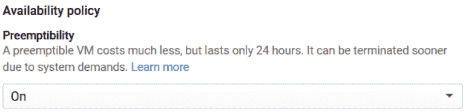

图 4.26 – 可抢占性

## Availability policy

Compute Engine 会对其基础设施进行维护，这可能需要将你的 VM 实例迁移到另一台主机。如果实例的可用性策略设置为使用此功能，GCE 将对你的实例进行实时迁移。因此，你的应用不会遭受任何停机，但可能会出现一定的性能下降。实时迁移是实例的默认设置。

或者，如果你在应用层内置了高可用性，那么你可能希望将此设置更改为在另一台主机上终止并重新启动。此设置意味着你的实例将被干净地关闭并在新的主机上重新启动。Google 会根据所选设置报告任何维护问题以及它对你的实例的影响。

## Automatic restart

如果底层硬件导致你的实例崩溃，则 GCE 提供了一个设置来自动重启实例。此设置默认设置为 **On (recommended)**。你可以通过从下拉菜单中选择将其设置为 **Off**：

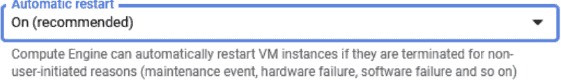

图 4.27 – 自动重启

Google 会在 **Compute Engine** 菜单下的 **Operations** 中报告任何自动重启，如前面的屏幕截图所示。选择此项后，我们可以查看任何警报：

Operations

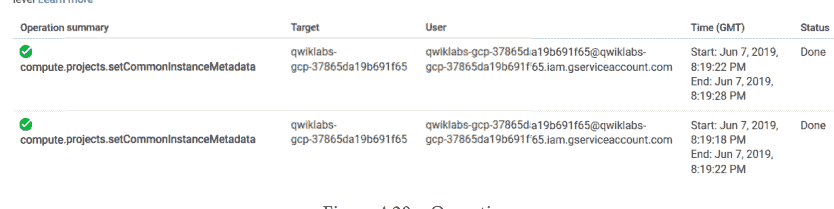

图 4.28 – Operations

前面的屏幕截图显示了这些警报在 **Operations** 屏幕上的外观。

## Shielded VM

让我们现在查看安全部分。第一个选项是 Shielded VM。GCP 提供了使用安全控制来加固你的 VM 实例的能力，这将抵御 rootkits、bootkits 和内核级恶意软件。GCP 使用 **虚拟可信平台模块 (vTPM)** 来提供虚拟信任根，以验证 VM 的身份并确保它们属于指定的项目或区域。vTPM 在客户操作系统级别生成和存储加密密钥。需要注意的是，这不会为你的 VM 部署增加任何额外成本。

## Deletion rule

在 **Disks** 部分下，我们会找到 **Deletion rule**。此选项允许我们在实例被删除时删除或保留启动磁盘：

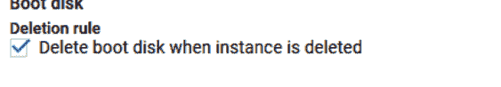

图 4.29 – 磁盘选项

如果有保留启动磁盘的特定用例，请确保取消选中该复选框。你还可以选择如何加密你的数据。默认情况下将使用 Google 管理的密钥，但你可以更改为使用其他选项。

## Node affinity labels

Sole tenancy 于 2018 年引入 GCE，是一种专为你的专用使用而设计的物理 Compute Engine 服务器。换句话说，底层主机硬件和 hypervisor 仅处理你的 GCE 实例。此设置的一个用例可能是安全要求。许多公司有合规或法规要求，需要对其计算资源进行物理隔离。

下图显示了这种分割。我们可以看到，在左侧，不同的客户共享相同的硬件，但在右侧，我们为特定客户提供了专用硬件，并且只有他们的 VM 驻留在上面：

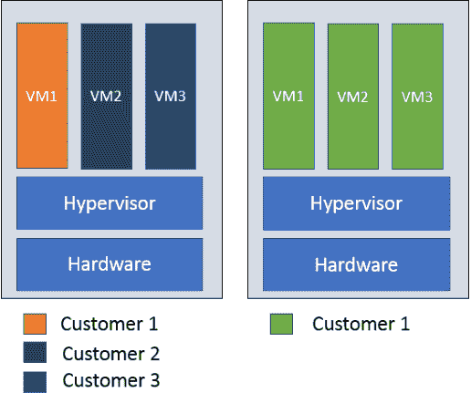

图 4.30 – 节点亲和性

VM 仍将具有相同的实时迁移功能和共享实例，但存在成本影响。并非所有区域和区域都支持 sole tenancy。

当我们创建 VM 时，我们有选项添加一个标签来定义新实例将被部署的位置。要使用 sole tenancy，我们首先必须从控制台在 **Compute Engine | Sole tenant nodes** 下创建一个 sole-tenant 节点。请注意，我们也可以为此使用 `gcloud` 命令。点击 **Create a node template**，并设置 **Region** 和 **Node type**。以下屏幕截图显示了可用的不同选项。我们也可以利用标签来提供键/值对，例如 `Environment:HighSecureArea`：

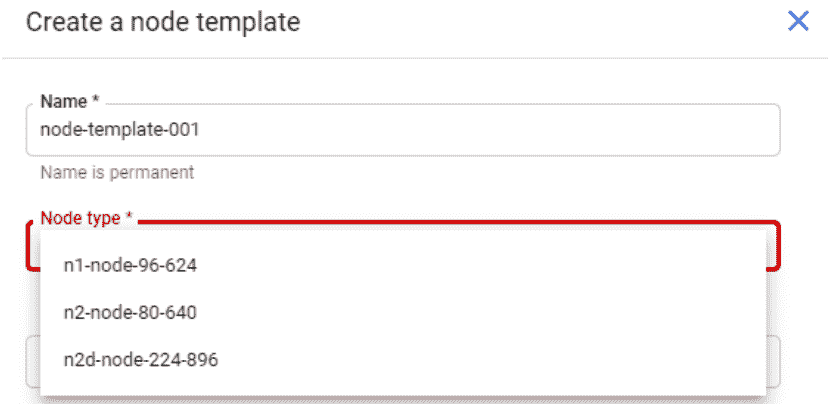

图 4.31 – 创建节点模板

模板创建后，在同一菜单页面上，我们现在可以创建一个 sole-tenant 节点。同样，我们可以提供名称，选择区域和模板，并定义我们需要的节点数量。请注意，区域需要与你创建模板的区域匹配：

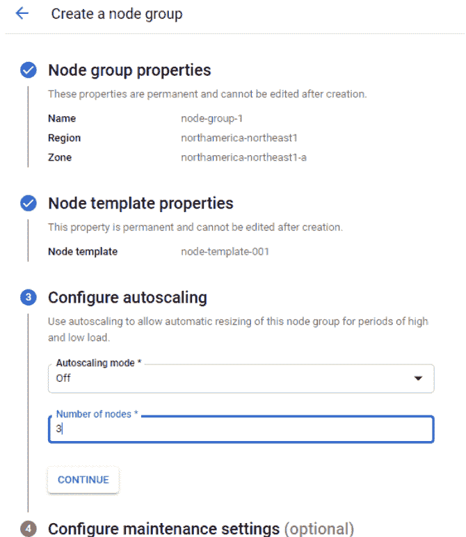

图 4.32 – Sole-tenant 节点

我们现在可以从 sole tenancy 中创建 VM。还可以进行一些更高级的设置，但我们将在后面的章节中更深入地探讨这些设置：

- 有关防火墙，请参阅 *第 10 章，GCP 中的网络选项*。
- 有关安全和加密设置，请参阅 *第 15 章，安全与合规*。

## GPUs and TPUs

除了标准的 vCPU 外，Compute Engine 还提供 **图形处理单元 (GPUs)**。这些可用于图形密集型工作负载，例如 3D 渲染或虚拟应用。我们在此应注意，GPU 只能附加到预定义或自定义机器类型，并且仅在某些区域可用。它们也有资格获得我们从标准 vCPU 获得的折扣（请注意，我们将在本章后面更详细地讨论持续使用折扣）。当我们创建新实例时，我们可以通过展开 **CPU platform and GPU** 部分来添加 GPU，如以下屏幕截图所示：

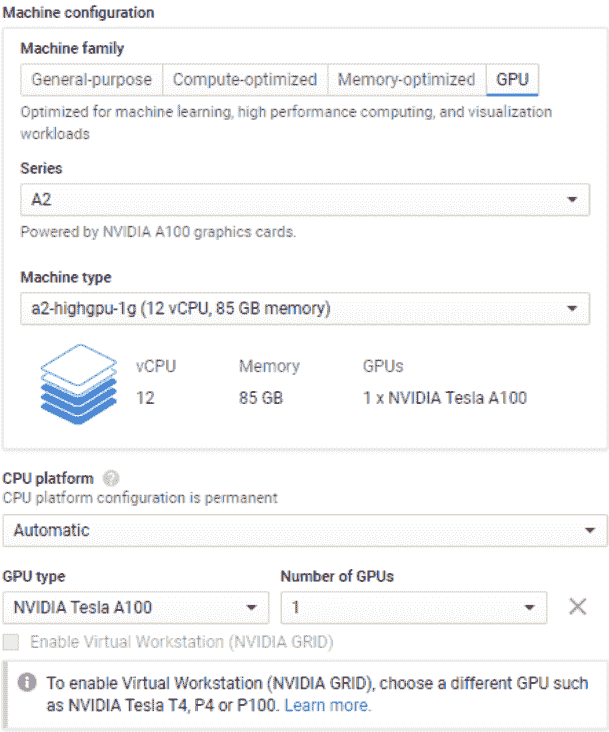

图 4.33 – GPU 配置

**张量处理单元 (TPUs)** 是使用 Google 在 **机器学习 (ML)** 方面的经验设计定制的专用集成电路，可用于在构建 TensorFlow 计算集群和其他 ML 工作负载时最大化性能和灵活性。我们可以从导航菜单访问 TPU 并进入 **Compute Engine | TPUs**。一旦启用 API，我们就可以创建我们的第一个 TPU 节点。从以下屏幕截图中，你可以看到我们可以分配 **Zone**、**TPU type**、**TPU software version**、**Network** 和 **IP address range**。TPU 应与你要连接的 Compute Engine 实例位于同一区域：

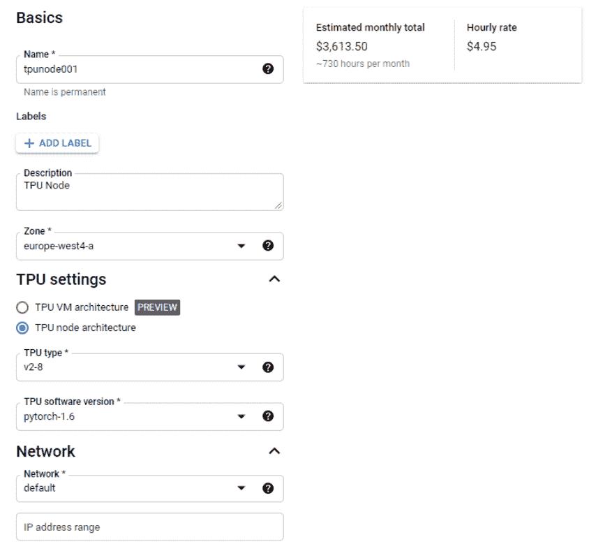

图 4.34 – TPU 配置

在 TPU 配置的管理部分，我们还可以为 TPU 节点启用可抢占性。

## Instance templates and instance groups

即使我们想到本地架构，许多关键要求也围绕高可用性和可扩展性。当然，当我们在公有云中进行架构时，这不会改变，但它们变得更容易且更便宜！

我们之前见过如何部署单个 GCE 实例，但很少有组织会迁移到公有云来托管单个 VM。业务需求取决于对需求的反应能力以及对任何实例故障的反应能力。

部署到实例组中的每个 VM 实例都来自同一个实例模板，该模板定义了机器类型、启动磁盘映像、标签以及我们在本章前面讨论过的其他实例属性。实例模板是全局资源，这意味着它们与特定区域或区域无关。模板本身中的区域资源将限制模板只能在该资源所在的区域中使用。例如，模板可能包含绑定到特定区域的磁盘。

了解实例组有两种类型很重要：

- **Managed instance groups**：这种类型的实例组允许你的工作负载通过组中的自动化服务（如自动扩缩或自动修复）实现可扩展性和高可用性。Google 建议使用这种类型的组，除非由于预先存在的配置或需要对不相似的实例进行分组而无法避免。

- **Unmanaged instance groups**：这种类型的实例组允许对非相同的 VM 集群进行负载均衡。它们由用户管理，因此不支持自动扩缩和自动修复。


让我们看一个创建新的实例模板和组的示例：

+   1. 从导航菜单中，我们应浏览到 **Compute Engine | Instance templates**：

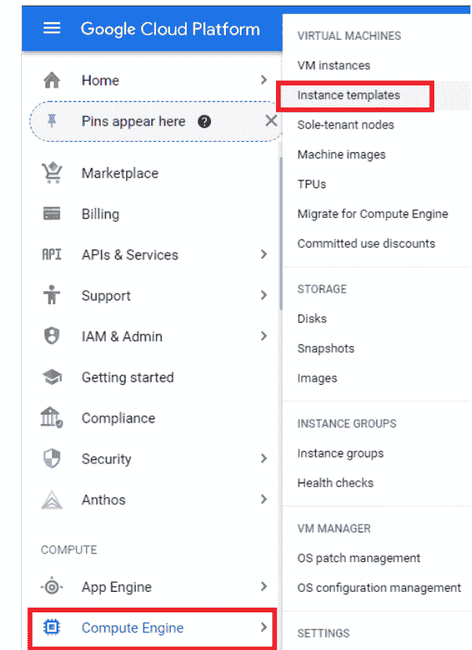

图 4.35 – Instance templates

2. 我们可以像创建新的 VM 实例一样命名并更新设置。在之前的示例中，我们通过 gcloud 命令设置了启动脚本，但在本次示例中，让我们从控制台进行设置。我们在 Metadata 选项中添加此项，并使用 startup-script-url 键，gs://cloudarchitect/startup.sh 作为其值：

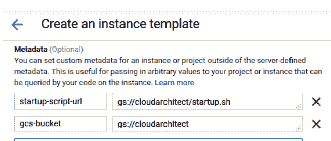

图 4.36 – Metadata

3. 点击 Instance Groups，然后创建一个新的实例组：

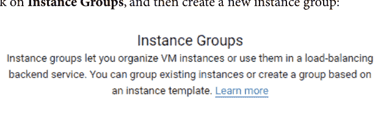

图 4.37 – Creating an instance group

让我们看看在创建实例组时我们可以指定的不同选项。

## Setting the location

在这里，我们可以设置是否需要多个或单个区域。此选择将基于您的可用性要求。如果您需要高可用性，那么最好选择多个区域；不过，您需要注意，这会将您的组类型限制为 *managed only*。它还提供了一个名为 **Target distribution shape** 的额外字段，其中默认值为 **Even**。默认情况下，区域托管实例组会在所选区域中均匀分布托管实例。然而，如果例如您需要某些在所选区域中不可用的硬件，则可能需要更改此设置。还有其他形状可用，但需要注意的是，**Balanced** 和 **Any** 选项不支持自动扩缩、canary 更新或主动实例重新分布。您需要删除默认的自动扩缩配置才能选择 **Balanced** 或 **Any**：

Location
为确保更高的可用性，请为实例组选择多个区域位置。
Learn more

+   - Single zone
+   - Multiple zones
+     Only managed instance groups can exist in multiple zones.

Region
Region is permanent
europe-north1

Configure zones

Target distribution shape
您只能在创建实例组时设置目标分布形状。之后无法更改。

+   - Even
+     在各区域中均匀分布托管实例
+   - Balanced
+     根据各区域的资源可用性尽可能均匀地分布托管实例
+   - Any
+     根据各区域的资源可用性将托管实例部署到一个或多个区域

Instance redistribution
Enable instance redistribution

图 4.38 – Multiple zones

我们可以在前面的屏幕截图中看到，选择 **Multiple zones** 后，我们被告知 **Only managed instance groups can exist**。此外，如果我们选择 **Configure zones** 下拉菜单，我们可以选择要在其中分布实例的区域内的区域。

## Port name mapping

如果我们选择 **Single zone** 选项，则会显示一个可选设置，称为 **Port Name Mapping**。我们可以在与负载均衡器结合使用时使用此功能。我们可以指定端口名称和相关联的端口号，并将传入流量映射到此特定号码。

当然，我们还需要指定要为此托管组使用的实例模板。此选项仅在组类型选项中选择托管实例组时可用。我们还需要选择实例组要部署的实例数量。

我们有能力打开、关闭或调整自动扩缩。自动扩缩允许根据需求的增加或减少动态增长或确实删除您的 VM 实例。我们将在本章中更详细地讨论自动扩缩。

当我们填入所需的一切后，我们可以点击 **Create Instance Group**。组现在将创建我们在实例组中指定的 VM 数量。在 **Compute Engine | Instance groups** 下，我们可以看到连接到实例组的正在运行的实例。

## Autoscaling

我们之前提到了自动扩缩，它值得单独一个章节。自动扩缩是云计算的基本原则。它允许资源具有弹性，并可以根据需求增加和减少实例数量。需要提醒的是，我们只能对托管实例组使用自动扩缩。这是因为只有托管实例组会使用专用模板，而该模板又可作为同质 VM 实例池的基础。

一旦在实例组中启用自动扩缩，它还会启用 **autoscaling policy** 下的许多设置。这些策略可以基于 CPU 使用率、HTTP 负载均衡使用率或 Google Cloud operations suite-monitoring 指标。我们还应在此处注意，可以基于自定义指标进行自动扩缩，因此我们不仅依赖开箱即用的指标。

以下示例基于 CPU 使用率，这是最简单的自动扩缩形式。自动扩缩器会收集组中实例的 CPU 利用率，并决定是否需要扩缩组或应保持当前 VM 实例数量。

查看以下屏幕截图，让我们看看应填写的设置：

+   - **Target CPU usage:** 这设置为 60%。这意味着自动扩缩器应保持实例组中所有 vCPU 的平均 CPU 使用率为 60%。
+   
+   - **Minimum number of instances:** 这是自动扩缩器应缩容到的实例最小数量。
+   
+   - **Maximum number of instances:** 这是自动扩缩器应扩容到的实例最大数量。
+   
+   - **Predictive autoscaling:** 托管实例组可以配置为根据负载自动添加或删除虚拟机实例。如果例如应用程序初始化需要几分钟时间，这可能不适合所有应用程序。预测性自动扩缩会根据历史趋势预测扩缩指标，并每隔几分钟重新计算一次。它需要至少 3 天的历史记录来收集服务使用模式，因此在创建新的自动扩缩配置时无法启用。它也只能在应用了 CPU 利用率指标时启用。
+   
+   - **Cool down period:** 此数字表示自动扩缩器在 VM 实例启动后等待多少秒才开始从中收集信息。对于缩容决策，它必须考虑所有实例的使用数据，无论实例是否仍处于冷却期内。对于扩容决策，它必须忽略仍处于冷却期内的实例的数据。如果启用了预测模式，冷却期会告知预测自动扩缩器应进一步扩容，以确保应用程序在负载到达时已初始化。

通常，这是您期望应用程序从启动到准备好提供服务所需的时间。默认时间为 60 秒，低于此时间可能会被认为会向自动扩缩器提供错误信息。但是，建议您测试应用程序初始化所需的时间：

## New metric

Metric type

CPU utilization

Target CPU utilization

60 %

Done Cancel

+ Add new metric

+ Add new scaling schedule

## Predictive autoscaling

使用预测性自动扩缩根据历史 CPU 负载预测未来的容量需求。

Learn more

Off
未使用任何预测方法。自动扩缩器根据实时指标将组扩缩至满足当前需求。

Optimize for availability
预测性自动扩缩通过监控每日和每周的 CPU 负载模式并在预期需求之前扩容来提高可用性。

要启用预测自动扩缩器，您的组需要至少有 3 天的自动扩缩配置。

## Cool down period

指定从启动时间到应用程序准备好提供服务所需的时间。

Cool down period

60 seconds

Minimum number of instances
1

Maximum number of instances
10


我们还应理解，随着托管实例组规模的增长，添加相同规模的 VM 所带来的影响会减小。让我们澄清一下这里的意思。假设我们将 CPU 利用率设置为 75%，实例组中的最小实例数为三台。自动扩缩器会检查 VM 实例的总体平均值是否高于 75%。如果自动扩缩器添加了第四台 VM，它就为该组增加了 25% 的容量。

如果我们实例组的最大值为 10 台 VM，那么第十台 VM 仅贡献了 10% 的额外容量——因此第十个节点的<|message|>影响与第四个节点不同。在设置利用率和最大容量时，我们应牢记这一点。还需要注意的是，自动扩缩始终会保守地向上取整统计数据。它宁愿启动一个实际上不需要的额外 VM 实例，也不愿可能耗尽资源。

基于 HTTP 负载均衡的扩缩将根据 VM 实例的负载进行扩缩。负载均衡器会在创建 HTTP 负载均衡器时配置的后端服务之间分配负载。当实例组用于后端时，外部负载均衡器提供两种平衡模式——**utilization**，允许我们为实例组中所有实例的平均后端利用率指定一个最大目标，以及 **rate**，我们必须指定每秒请求数的目标值。这是按实例或按组进行的。

自动扩缩策略中的 **Target HTTP load balancing utilization** 值应为负载均衡器设置中配置值的分数。例如，如果将策略设置为每秒 100 个请求，那么明智的做法是略低于此值进行扩缩，并将策略中的使用量设置为大约每秒 80 个请求（80%）：

## New metric

Metric type

HTTP load balancing utilization

Target HTTP load balancing utilization

80 %

Done

Cancel

+ Add new metric

+ Add new scaling schedule

## Predictive autoscaling

Use predictive autoscaling to predict future capacity needs based on historical CPU load.

Learn more

Off
No predictive method is used. The autoscaler scales the group to meet current demand based on real-time metrics.

Optimize for availability
Predictive autoscaling improves availability by monitoring daily and weekly CPU load patterns and scaling out ahead of anticipated demand.

Predictive autoscaling can only be enabled when a CPU utilization metric is applied.

## Cool down period

Specify how long it takes for your app to initialize from boot time until it is ready to serve.

Cool down period

60 seconds

Minimum number of instances

Maximum number of instances

1

10

Figure 4.40 – Autoscaling – HTTP utilization

## Tip

We will discuss load balancers in more detail in Chapter 10, Networking Options in GCP.

我们也可以基于 Google Cloud operations suite 指标进行扩缩，其中所选指标将为托管实例组中的每个实例或整个组提供数据。这些指标可以是开箱即用的，也可以是你创建的自定义指标。请注意，在撰写本文时，在某些文档中，该选项在设置中仍被称为 **Stackdriver**；不过，你应注意该名称已重新品牌为 Google Cloud's operations suite。

> **Important Note**
> 如果你有时需要将扩缩缩小到零个实例，那么你应该使用按组指标。

让我们再看一个例子，使用 Google 提供的演示指标 `custom.googleapis.com/appdemo_queue_depth_01` 作为自定义指标。

在本例中，**Utilization target type** 设置为 **Gauge**，因为这将指示自动扩缩器计算过去几分钟内收集的数据的平均值并将其与目标值进行比较：


Figure 4.41 – Autoscaling – Stackdriver (Google Cloud's operations suite) metrics

假设我们现在在实例模板上有一个启动脚本，该脚本将调用另一个负责生成这些自定义指标的脚本。我们可以从实例组内的图表监控标签页中看到，我们的实例组的负载在下午 5:55 左右开始增加，但在下午 6 点左右又下降了：


Figure 4.42 – Monitoring load

鉴于队列深度出现峰值，我们可以预期 **autoscaling policy** 会生成一个新实例。如果我们检查自动扩缩器日志，可以确认这一点。它随后添加了第三个实例，然后在需求再次下降时减少回两个实例：


Figure 4.43 – Adding and removing instances

这就是真正的弹性计算！这些是自动扩缩工作原理的小例子，我们建议你确保能够创建自己的策略并复制任何导致机器实例增加和减少的负载。

**Important Note**
每个托管实例组只能创建一个自动扩缩器。

## Autohealing

Autohealing 也是托管实例组设置的一部分，但值得单独一个章节来进一步讨论。GCP 的托管实例组负责验证我们组中每个 VM 实例是否正在运行并准备好接受客户端请求。为了执行此验证，它需要一个健康检查，这基本上是一个探针，用于联系实例组中的每个成员以检查其当前健康状况。策略可以基于某些协议，即 HTTP(S)、TCP 或 SSL。

我们还需要配置标准来告知健康检查多久检查一次实例、可以接受无响应的时间以及对其探针的连续失败次数。这些设置定义了 VM 何时会被归类为不健康。如果特定实例不再健康，自动扩缩器将添加一个新实例：


Figure 4.44 – Autohealing configuration

在健康检查中，我们还必须指定健康阈值。此数值用于确定在将不健康实例标记为健康并将流量导向它之前，必须返回多少次连续成功的检查。

然后我们可以将此健康检查作为自动修复策略应用于我们的实例组。以下屏幕截图显示了本例中选择的健康检查：


Figure 4.45 – Autohealing information

自动修复策略还可以提高应用程序的可用性。在下一节中，我们将查看 Compute Engine 上的容器。

## Containers on Compute Engine

作为运行 GKE 的替代方案，GCP 提供了在 Compute Engine 上运行容器的能力。容器将在第 6 章《Managing Kubernetes Clusters with Google Kubernetes Engine》中更详细地介绍；不过，重要的是要注意，容器可以在 Linux 和 Windows 服务器 VM 实例或 Compute Engine 内部提供的容器优化操作系统上运行。Docker 和 Podman 是两种常见的容器技术，可让我们运行容器化应用程序。

我们应注意，Container-Optimized OS 确实存在一些限制：

- 它不包含包管理器，因此我们不能直接在实例上安装软件包。
- 它不支持执行非容器化应用程序。
- 内核被锁定。
- 它在 GCP 环境之外不受支持。

## Running a simple Windows container on Compute Engine

假设我们有一台正在运行的 Windows VM，并使用 *Windows Server 2019 DC core for containers* 镜像。我们可以像在 *Deploying our first GCE instance* 部分中所做的那样开始 RDP 到它。由于容器运行的是 Windows 的核心版本，因此它运行的是具有最小 UI 的操作系统。我们能看到的只有命令提示符窗口。

如果我们运行 `docker images` 命令，我们可以看到默认安装了哪些镜像：


让我们创建一个新镜像并运行它：

- 1. 运行 `mkdir my-new-container` 命令。
- 2. 运行 `cd my-new-container` 命令。
- 3. 运行 `mkdir content` 命令。
- 4. 运行 `notepad content\index.html` 命令。
- 5. 输入以下文本以创建一个简单的 **Internet Information Services (IIS)** 服务器：

```
<html>
    <head>
        <title>Windows containers</title>
    </head>
    <body>
        <p>This is my test windows container!</p>
    </body>
</html>
```

- 6. 使用记事本创建一个名为 Dockerfile 的文件。


7. 输入以下文本以创建 Dockerfile 的内容：

```
FROM mcr.microsoft.com/windows/servercore/iis:windowservercore-ltsc2019
RUN powershell -NoProfile -Command Remove-Item -Recurse C:\inetpub\wwwroot\*
WORKDIR /inetpub/wwwroot
COPY content/ .
```

8. 让我们通过运行以下命令来构建 Docker 镜像并将其存储在 Google Container Registry 中（请注意命令末尾的 .）：
`docker build -t gcr.io/my-project-id/iis-site-windows ...`

9. 当输出返回类似 `Successfully tagged gcr.io/my-project-id/iis-site-windows:latest.` 的内容时，您将看到构建已成功完成。

10. 如果您重新运行 Docker 镜像，您现在将看到新创建的镜像可用。

11. 让我们现在使用 `docker run -d -p 80:80 gcr.io/my-project-id/iis-site-windows` 命令运行一个 Windows 容器。

12. 最后，让我们浏览 VM 实例的外部 IP。


图 4.47 – Docker 上的 Web 服务器

13. 我们可以从前面的图像中看到，我们已成功运行了一个在 Windows 容器上运行的非常简单的 Web 服务器。

Tip
需要注意的是，在较早版本的 Windows 上构建的容器在具有较新版本 Windows 的 Compute Engine 实例中无法工作。

# 快速了解 Google Cloud VMware Engine

Google Cloud VMware Engine 于 2020 年 5 月宣布推出，这是一项完全托管的服务，允许我们在 Google Cloud 中运行 VMware 平台。Google 将管理基础设施、网络和管理服务，以便您可以高效、安全地使用 VMware 平台。简而言之，这是一种 VMware 即服务，可在大约 30 分钟内部署。它使用 VMware Cloud Foundation 在专用的 Google 裸机服务器上运行，并且可以与 Google 的大数据和 ML 服务集成。

该服务基于部署了 VMware 服务的超融合节点进行销售。ESXi、vSAN 和 NSX-T 位于裸机服务器之上，而 vCenter、NSX Manager 和 HCX 也已安装以实现部署、监控、修补和升级的自动化。Google 负责所有这些工作，而客户将保留对任何虚拟机以及 VMware 管理工具和服务的责任，例如 vRealize 套件。许可也完全集成到服务中；因此，消费者无需担心与每插槽核心相关的任何 VMware 许可问题。

> Tip
> Professional Cloud Architect 考试不会深入 Google Cloud VMware Engine 服务；但是，您应该知道该服务的存在，因为对于希望使用迁移和提升方法快速迁移到 Google Cloud 的公司来说，这可能是一个里程碑。

## 用例

Google Cloud VMware Engine 有许多用例，例如数据中心扩展或迁移，以允许公司在保持现有工作负载兼容性的同时扩展到公共云。灾难恢复也是该服务的另一个巨大优势，因为公司可以利用 Google 的全球基础设施来提高可用性。HCX 用于迁移和灾难恢复。本地数据中心与 Google Cloud 之间专用互连链路的存在允许在两个端点之间轻松迁移虚拟机和服务。Google 正在努力将其作为进入云的最快、最简单的方式进行销售。对于一些不想因迁移到云以实现目标而感到被迫重新培训员工或重构应用程序以保持运营连续性的公司来说，这可能是一件重要的事情。

需要注意的一件重要事情是，基于角色的访问控制（RBAC）和计费都归属于您的 Google 账户下。所有内容都在一个[content]
7. 输入以下文本以创建 Dockerfile 的内容：

```
FROM mcr.microsoft.com/windows/servercore/iis:windowservercore-ltsc2019
RUN powershell -NoProfile -Command Remove-Item -Recurse C:\inetpub\wwwroot\*
WORKDIR /inetpub/wwwroot
COPY content/ .
```

8. 让我们通过运行以下命令来构建 Docker 镜像并将其存储在 Google Container Registry 中（请注意命令末尾的 .）：
`docker build -t gcr.io/my-project-id/iis-site-windows ...`

9. 当输出返回类似 `Successfully tagged gcr.io/my-project-id/iis-site-windows:latest.` 的内容时，您将看到构建已成功完成。

10. 如果您重新运行 Docker 镜像，您现在将看到新创建的镜像可用。

11. 让我们现在使用 `docker run -d -p 80:80 gcr.io/my-project-id/iis-site-windows` 命令运行一个 Windows 容器。

12. 最后，让我们浏览 VM 实例的外部 IP。


图 4.47 – Docker 上的 Web 服务器

13. 我们可以从前面的图像中看到，我们已成功运行了一个在 Windows 容器上运行的非常简单的 Web 服务器。

Tip
需要注意的是，在较早版本的 Windows 上构建的容器在具有较新版本 Windows 的 Compute Engine 实例中无法工作。

# 快速了解 Google Cloud VMware Engine

Google Cloud VMware Engine 于 2020 年 5 月宣布推出，这是一项完全托管的服务，允许我们在 Google Cloud 中运行 VMware 平台。Google 将管理基础设施、网络和管理服务，以便您可以高效、安全地使用 VMware 平台。简而言之，这是一种 VMware 即服务，可在大约 30 分钟内部署。它使用 VMware Cloud Foundation 在专用的 Google 裸机服务器上运行，并且可以与 Google 的大数据和 ML 服务集成。

该服务基于部署了 VMware 服务的超融合节点进行销售。ESXi、vSAN 和 NSX-T 位于裸机服务器之上，而 vCenter、NSX Manager 和 HCX 也已安装以实现部署、监控、修补和升级的自动化。Google 负责所有这些工作，而客户将保留对任何虚拟机以及 VMware 管理工具和服务的责任，例如 vRealize 套件。许可也完全集成到服务中；因此，消费者无需担心与每插槽核心相关的任何 VMware 许可问题。

> Tip
> Professional Cloud Architect 考试不会深入 Google Cloud VMware Engine 服务；但是，您应该知道该服务的存在，因为对于希望使用迁移和提升方法快速迁移到 Google Cloud 的公司来说，这可能是一个里程碑。

## 用例

Google Cloud VMware Engine 有许多用例，例如数据中心扩展或迁移，以允许公司在保持现有工作负载兼容性的同时扩展到公共云。灾难恢复也是该服务的另一个巨大优势，因为公司可以利用 Google 的全球基础设施来提高可用性。HCX 用于迁移和灾难恢复。本地数据中心与 Google Cloud 之间专用互连链路的存在允许在两个端点之间轻松迁移虚拟机和服务。Google 正在努力将其作为进入云的最快、最简单的方式进行销售。对于一些不想因迁移到云以实现目标而感到被迫重新培训员工或重构应用程序以保持运营连续性的公司来说，这可能是一件重要的事情。

需要注意的一件重要事情是，基于角色的访问控制（RBAC）和计费都归属于您的 Google 账户下。所有内容都在一个横幅下。这允许 VMware 平台轻松集成到 Google 的原生服务中。

在使用该服务之前有一些先决条件和要求。在高层次上，这里有一些需要考虑的事项。首先，我们需要启用 **VMware Engine API**。我们可以直接从 GCP 主菜单中执行此操作：


图 4.48 – VMware Engine

然后我们必须设置私有服务访问，这是在您的虚拟私有云（VPC）与 VMware Engine 中的网络之间的私有连接。您还必须保留不会与任何本地子网、VPC 子网或计划的工作负载子网重叠的地址范围。最后，VMware Engine 有一套特定的 IAM 角色，因此应考虑确保应用最小权限原则。

## 配额和限制

Compute Engine 带有预定义的配额。虚拟机实例是区域配额的一部分，因此对可在给定区域中存在的虚拟机实例数量施加了限制。这些默认配额可以在控制台中通过汉堡菜单更改，然后进入 IAM & Admin | Quotas。从此菜单中，我们可以查看当前配额并请求提高这些限制。我们建议您了解每个服务的限制，因为这可能会影响您的可扩展性。

## IAM 角色

对 GCE 的访问通过 IAM 保护。让我们看一下预定义角色的列表，以及每个角色的简短描述：

- **Compute 管理员角色**：此角色有权访问所有 Compute Engine 资源。
- **Compute 镜像用户角色**：此角色有权列出和读取镜像。
- **Compute 实例管理员（v1）角色**：此角色有权完全管理 Compute Engine 实例、实例组、磁盘、快照和镜像。它还对所有 Compute Engine 网络资源具有读取访问权限。
- **Compute 实例管理员角色**：此角色有权创建、修改和删除虚拟机实例。此外，它有权创建、修改和删除磁盘，并配置受保护虚拟机设置。
- **Compute 负载均衡器管理员角色**：此角色有权创建、修改和删除负载均衡器及其相关资源。
- **Compute 网络管理员角色**：此角色有权创建、修改和删除网络资源，但防火墙规则和 SSL 证书除外。此外，该角色对防火墙规则、SSL 证书和实例（以查看其临时 IP 地址）具有只读权限。使用此角色，您无法创建、启动、停止或删除实例。
- **Compute 网络用户角色**：此角色有权访问共享 VPC 网络。
- **Compute 网络查看者角色**：此角色对所有网络资源具有只读权限。
- **Compute OS 管理员登录角色：** 此角色有权以管理员身份登录到 Compute Engine 实例。
- **Compute 组织防火墙策略管理员角色：** 此角色对 Compute Engine 组织防火墙策略具有完全控制权。
- **Compute 组织防火墙策略用户角色：** 此角色可以查看或使用 Compute Engine 防火墙策略将其与组织或文件夹关联。
- **Compute 组织安全策略管理员角色：** 此角色对 Compute Engine 组织安全策略具有完全控制权。
- **Compute 组织防火墙策略用户角色：** 此角色可以查看或使用 Compute Engine 安全策略将其与组织或文件夹关联。
- **Compute 组织资源管理员角色：** 此角色对组织或文件夹的 Compute Engine 防火墙策略关联具有完全控制权。
- **Compute OS 登录角色：** 此角色有权以管理员身份登录到 Compute Engine 实例。
- **Compute OS 登录外部用户角色：** 此角色仅在组织级别可用。它为外部用户提供访问权限，以便设置与该组织关联的 OS 登录信息。
- **Compute 数据包镜像管理员角色：** 此角色提供指定要镜像的资源的访问权限。
- **Compute 数据包镜像用户角色：** 此角色提供使用被镜像资源的访问权限。
- **Compute 公共 IP 管理员角色：** 此角色对 Compute Engine 的公共 IP 地址管理具有完全控制权。
- **Compute 安全管理员角色：** 此角色有权创建、修改和删除防火墙规则和 SSL 证书。该角色还有权配置受保护虚拟机设置。
- **Compute 存储管理员角色：** 此角色有权创建、修改和删除磁盘、镜像和快照。
- **Compute 查看者角色：** 此角色对 Compute Engine 资源具有只读访问权限。它无权读取存储在其上的数据。
- **Compute 共享 VPC 管理员角色：** 此角色有权管理共享 VPC 主项目。该角色由组织管理员在组织上设置。


- **补丁部署管理员角色：** 这提供了对补丁部署的完全访问权限。
- **补丁部署查看者角色：** 这提供了查看补丁部署的访问权限。
- **路径作业执行者角色：** 这提供了执行补丁作业的访问权限。
- **补丁作业查看者角色：** 这提供了获取补丁作业列表的访问权限。
- **DNS 管理员角色：** 这对所有云 DNS 资源具有读写权限。
- **DNS 对等角色：** 这具有使用 DNS 对等区域定位网络的权限。请注意，在撰写本文时，该功能处于 beta 阶段。
- **DNS 读者角色：** 这对所有云 DNS 资源具有只读访问权限。
- **服务账号管理员角色：** 这具有创建和管理服务账号的权限。
- **创建服务账号角色：** 这具有创建服务账号的权限。
- **删除服务账号角色：** 这具有删除服务账号的权限。
- **服务账号密钥管理员角色：** 这具有创建和管理服务账号密钥的权限。该角色具有轮换密钥的权限。
- **服务账号令牌创建者角色：** 这具有冒充服务账号的权限。
- **服务账号用户角色：** 这具有以服务账号身份运行操作的权限。
- **工作负载身份用户角色：** 这具有从 GKE 工作负载冒充服务账号的权限。对于更细粒度的访问，您也可以使用所有者、编辑者和查看者等原始角色，但我们应始终遵循最小权限原则。

> **考试提示**
> 如果您想调试 VM 实例中的问题，请授予计算实例管理员角色，而不是计算管理员角色。后者对所有 Compute Engine 资源具有完全控制权，而前者权限较低。

在下一节中，我们将查看定价。

## 定价

Google 的计费模式意味着您按每 1 秒计费 vCPU、GPU 和 GB 内存，最低计费为 1 分钟。然而，Google 还提供了大幅降低月度账单的机会。持续使用折扣可降低运行特定 GCE 资源的成本。

持续使用折扣会自动应用于特定 Compute Engine 资源，并可为以下资源的 vCPU 和内存带来月度节省：

- 通用型自定义和预定义机器类型
- 计算优化型机器类型
- 内存优化型机器类型

独占租户节点也将获得折扣。我们在前面的章节中更详细地讨论了它们。此外，对 GPU 设备也适用节省。

如果我们运行上述资源超过一个月的 25%，则 GCE 会自动对您使用的每分钟进行折扣。折扣会随着使用量的增加而增加，每月最高可达 30% 的折扣。例如，通用型 N2 和 N2D 预定义和自定义镜像以及计算优化型机器类型可为我们提供高达 20% 的折扣。对于通用型 N1 预定义和自定义机器类型、独占租户节点和 GPU，可为我们提供高达 30% 的折扣。只有在月初创建 VM 实例时才能充分利用折扣，因为折扣会在每月开始时重置。如果我们在月中部署实例，则预计折扣约为 10%。

需要重点注意的一点是如何计算账单。在高层次上，让我们看一个在同一区域创建但在月份不同时间运行的两种不同机器类型的示例：

- 从月初到月中运行的 n1-standard-4 实例，拥有 4 个 vCPU 和 15 GB 内存
- 从月中到月末运行的 n1-standard-16 实例，拥有 16 个 vCPU 和 60 GB 内存

在此示例中，Compute Engine 会将机器类型整理为单独的 vCPU 和内存资源并合并其使用量。它会将其分解为以下内容：

- 全月 4 个 vCPU
- 半个月 12 个 vCPU
- 全月 15 GB 内存
- 半个月 45 GB 内存

因此，我们可以看到在 n1-standard-4 实例中创建的 4 个 vCPU 和 15 GB 内存的折扣会转移到 n1-standard-16 实例，这意味着对 4 个 vCPU 和 15 GB 内存有完整的 30% 折扣。附加到 n1-standard-16 实例的剩余 12 个 vCPU 和 45 GB 内存仅从第 2 周开始才有折扣，这意味着折扣为 10%。

另一种提供的折扣方法是 **承诺使用** 折扣，即我们可以购买特定数量的 vCPU 和内存，期限为 1 年或 3 年。折扣可达大多数自定义机器类型的 57%，甚至对更内存优化的机器类型可达 70%。没有预付费用，但折扣会应用于您的月度账单。您将在约定的期限内每月被收取所选的 vCPU 和内存费用。

折扣通过购买承诺来应用。假设例如，我们承诺使用 8 个核心，但运行 16 个核心 10 小时。我们将对 10 小时内的 8 个核心获得折扣，但剩余的 8 个核心将按标准计费。然而，剩余的核心仍有资格获得持续使用折扣。同样，如果我们在一个月的周期内未使用 8 个承诺的核心，我们仍会被收取费用，因此我们应确保只承诺我们将使用的资源。承诺使用折扣还有一些其他重要的注意事项。

折扣按以下顺序应用于资源：

1. 自定义机器类型
2. 独占租户节点组
3. 预定义机器类型

让我们再举一个例子来更清楚地说明。假设我们有一个自定义机器，拥有 5 个 vCPU 和 50 GB 内存，以及一台预定义机器。如果我们为承诺使用购买 10 个 vCPU 和 15 GB 内存，折扣将首先应用于我们自定义机器类型的 5 个 vCPU，剩余的 5 个折扣 vCPU 将应用于预定义机器类型。同样，承诺使用内存的全部 15 GB 折扣将应用于我们的自定义类型内存。

## 总结

在本章中，我们介绍了 GCP 的 IaaS 产品——Compute Engine。这是 Google 的基础产品，与传统的 VM 相符。我们讨论了如何部署实例以及如何将实例添加到实例组以自动扩展我们的服务，因此我们现在可以确信在 GCP 中运行 VM 实例是多么容易。此外，我们还查看了部署 Compute Engine 实例时可以选择的各种可选设置。我们还介绍了容器以及 VMware Engine 如何加快向公有云的迁移。在下一章中，我们将远离 IaaS 并介绍 GKE。

## 延伸阅读

我们建议您查看以下网址以获取更多信息：

- **Compute Engine:** https://cloud.google.com/compute/docs/
- **Compute Engine IAM 角色和权限:** https://cloud.google.com/compute/docs/access/iam

# 5
探索 Google App Engine 作为计算选项

App Engine 是一种 **平台即服务 (PaaS)** 产品。它是让您的应用程序在 Google Cloud 上运行的最快方式。它适用于 Web、移动和物联网应用程序，免除了管理执行环境的开销，并可按需快速扩展。支持多种语言，例如 **Node.js、Java、Ruby、C#、Go、Python** 和 **PHP**。这样，开发人员就可以专注于交付代码。应用程序是版本化的，并且可以将流量定向到多个版本，从而允许我们执行 A/B 或金丝雀测试。App Engine 中的应用程序可以使用防火墙、IAM 角色和 SSL 证书进行保护，并可使用 Web Security Scanner 服务扫描常见漏洞。

本章将涵盖以下主题：

- App Engine 组件
- 选择合适的区域
- 使用 App Engine
- 环境类型


- 部署 App Engine 应用
- 版本
- 拆分流量
- 迁移流量
- 防火墙规则
- 设置
- 扩缩容
- Cron 作业
- Memcache
- IAM
- 配额和限制
- 价格

> **考试提示**
> 在 Cloud Architect 考试中，预计会出现几个关于 App Engine 的问题。然而，还有另一门考试（Cloud Developer）会详细测试你对 App Engine 的知识。对于本考试，确保你了解 App Engine 的工作原理、两种 App Engine 环境类型——即标准和灵活——两种类型的 Memcache 及其用例、版本控制、如何拆分迁移流量、cron 作业的用途、自定义域名以及可以使用哪些 SSL 证书。

## App Engine 组件

首先，我们需要明白每个项目只能托管一个 App Engine 应用。

该应用可以拥有多个服务，每个服务有多个版本，如下图所示：


图 5.1 – App Engine 组件

向终端用户提供哪个版本是基于网络流量的配置。我们决定将多少百分比的流量导向特定版本。这意味着进行新的发布甚至回滚变得非常容易。

## 选择合适的区域

App Engine 中的应用按区域部署。这意味着用于托管它的基础设施分布在该区域内的各个区域中，以实现高可用性。选择区域时主要考虑的是你的终端用户将从何处连接。然而，你还应该记住你的应用可能会使用其他 GCP 资源。这也会影响延迟和成本。请查阅文档以查看 App Engine 服务可用的区域，因为这可能会发生变化。

**重要说明**
一旦应用部署完成，就无法更改其区域。

## 使用 App Engine

部署本身相当容易。我们定义一个 app.yaml 文件来定义应用并开发代码。通过使用 gcloud app deploy，应用将被部署到 App Engine：


图 5.2 – 使用 App Engine

前面的示例非常简单，你可以创建更复杂的应用程序。Cloud Architect 考试不需要你深入了解如何定义 app.yaml 文件或如何编写应用程序的细节。然而，我们建议你查看“进一步阅读”部分，因为它可能有助于你更好地理解 App Engine 概念。

## 环境类型

App Engine 包含两种环境类型，即标准和灵活。如果没有特殊要求，例如不支持的语言或需要自定义执行环境，始终选择标准。请记住，灵活的 App Engine 将使你更轻松地迁移工作负载，因为你的工作负载已经容器化。让我们来看看这些环境类型。

## App Engine 标准环境

标准环境使用在 GCP 中运行的 **容器**。这些容器针对每个可用的执行环境进行了标准化。流向你的应用的流量通过负载均衡进行分发。应用在未使用时可以缩减至零，并在需求上升时在几秒钟内扩展。支持以下执行环境：

- Python 2.7 和 3.7
- Java 8 和 11
- Node.js 8 和 10
- PHP 5.5、7.2 和 7.3
- Go 1.9、1.11 和 1.12

> **考试提示**
> App Engine 标准通常也定义为开发人员的沙箱。

我们现在来看灵活环境。

## 灵活环境

灵活环境使用 GCE **虚拟机实例**。它也会自动扩缩容并使用负载均衡分发流量。然而，它始终至少需要一个实例运行。启动实例需要几分钟，而在标准环境中则需要几秒钟。支持以下执行环境：

- Java 8
- Python 2.7 和 3.6
- Node.js
- Ruby
- PHP 5.6、7.0、7.1 和 7.2
- .NET Core
- Go 1.9、1.10 和 1.11
- 自定义

请注意，运行时可以自定义。你甚至可以创建自己的运行时。这可以通过提供自定义 Docker 镜像或 Dockerfile 来完成。

> **考试提示**
> 如你所见，App Engine 标准环境可以缩减至零，而灵活环境将始终至少运行一个实例。这会影响运行应用的成本。

App Engine 灵活环境服务允许你通过安全 shell，即 SSH，以 root 账户访问实例。然而，默认情况下这是禁用的。请记住，实例每周会重启一次以应用必要的补丁。

## 部署 App Engine 应用

我们已经在高层次上看到了如何将应用部署到 App Engine。现在，让我们来看看实际需要采取的步骤。在这里，我们将部署一个 Hello World 应用。该应用利用 Python Flask Web 服务器。正如你可能想象的那样，该应用将在网站上显示静态的 Hello World 文本。让我们开始吧：

1. 首先，前往 Google Cloud 控制台并切换到你的应用将被部署到的项目。从汉堡菜单中选择 App Engine。在欢迎屏幕上，点击创建应用按钮：


图 5.3 – 欢迎使用 App Engine

2. 在 **创建应用** 窗口中，选择一个区域并点击 **创建应用**，如下截图所示：

# Create app

1 Select a location — 2 Get started

# Region

Region is permanent.


Select a region *
europe-west

NEXT

图 5.4 – 选择区域

我们选择了 europe-west 作为我们的区域。

3. 在开始窗口中，选择运行时语言。我们选择了 Python：


图 5.5 – 选择语言

4. 从环境下拉菜单中选择标准或灵活。由于我们不需要运行时自定义，我们选择了标准环境：


图 5.6 – 选择环境

5. 现在，我们可以使用机器上的安装 SDK 或使用 Cloud Shell 机器。要了解如何使用这两个工具，请查看 *第 16 章，Google Cloud 管理选项。*

我们将打开 Cloud Shell，因为它已预装并配置了 SDK。打开控制台并运行以下命令：

```
gcloud config set project $PROJECT
```

这里，<project_id> 是你在 Google Cloud 控制台中使用的项目的 ID。

6. 现在，让我们下载 Google 在 GitHub 上提供的示例 Python 应用：

```
git clone https://github.com/GoogleCloudPlatform/python-docs-samples
```

7. 更改目录以浏览到应用：

```
cd python-docs-samples/appengine/standard_python3/hello_world
```

8. 现在，你可以使用任何文本编辑器查看 main.py 文件的内容，其中包含我们的应用代码。通过运行以下命令在编辑器中打开文件：

```
cloudshell edit main.py
```

9. 你会看到应用正在使用 **Flask Web 服务器** 并在主页面显示 `Hello World!`：

```
main.py
1  # Copyright 2018 Google LLC
2  #
3  # Licensed under the Apache License, Version 2.0 (the "License");
4  # you may not use this file except in compliance with the License.
5  # You may obtain a copy of the License at
6  #
7  #       http://www.apache.org/licenses/LICENSE-2.0
8  #
9  # Unless required by applicable law or agreed to in writing, software
10 # distributed under the License is distributed on an "AS IS" BASIS,
11 # WITHOUT WARRANTIES OR CONDITIONS OF ANY KIND, either express or implied.
12 # See the License for the specific language governing permissions and
13 # limitations under the License.
14
15 # [START gae_python38_app]
16 # [START gae_python3_app]
17 from flask import Flask
18
19
20 # If `entrypoint` is not defined in app.yaml, App Engine will look for an app
21 # called `app` in `main.py`.
22 app = Flask(__name__)
23
24
25 @app.route('/')
26 def hello():
27     """Return a friendly HTTP greeting."""
28     return 'Hello World!'
29
30
31 if __name__ == '__main__':
32     # This is used when running locally only. When deploying to Google App
33     # Engine, a webserver process such as Gunicorn will serve the app. This
34     # can be configured by adding an `entrypoint` to app.yaml.
35     app.run(host='127.0.0.1', port=8080, debug=True)
36 # [END gae_python3_app]
37 # [END gae_python38_app]
38
```

图 5.7 – main.py 文件


10. 如果我们查看该 `app.yaml` 文件，会发现我们只需要定义运行时类型，而无需任何额外参数：

```
app.yaml
1  # Copyright 2021 Google LLC
2  #
3  # Licensed under the Apache License, Version 2.0 (the "License");
4  # you may not use this file except in compliance with the License.
5  # You may obtain a copy of the License at
6  #
7  #       http://www.apache.org/licenses/LICENSE-2.0
8  #
9  # Unless required by applicable law or agreed to in writing, software
10 # distributed under the License is distributed on an "AS IS" BASIS,
11 # WITHOUT WARRANTIES OR CONDITIONS OF ANY KIND, either express or implied.
12 # See the License for the specific language governing permissions and
13 # limitations under the License.
14
15 runtime: python39
```

图 5.8 – `app.yaml` 文件

11. 最后，我们将查看 `requirements.txt` 文件，该文件定义了我们在 Python 代码中使用的模块：

```
main.py  requirements.txt
1  Flask==2.0.1
2
```

图 5.9 – `requirements.txt` 文件

12. 现在我们知道了配置和代码是什么，我们可以将应用程序部署到 App Engine。在包含所有文件的文件夹中，运行以下命令：

```
gcloud app deploy app.yaml --project $PROJECT
```

在控制台被询问时确认此操作。部署可能需要一两分钟。

13. 应用程序部署后，我们可以通过运行以下命令来检查分配给应用程序的 URL：

```
gcloud app browse
```

14. 复制 URL 并粘贴到浏览器中。你会看到应用程序已在 App Engine 中运行。简单，不是吗？


图 5.10 – 查看应用程序

接下来，让我们来看版本。

## 版本

现在，假设我们想用新内容更新应用程序：

- 1. 让我们将欢迎消息修改为 Hello Packt people!：

```
24 @app.route('/')
25 def hello():
26     """Return a friendly HTTP greeting."""
27     return 'Hello Packt people!'
```

图 5.11 – 修改应用程序

- 2. 我们将保存更改并再次部署应用程序：

```
gcloud app deploy app.yaml --project <project_id>
```

- 3. 现在，如果我们切换到 Google Cloud 控制台并进入 App Engine | 版本，我们会看到已部署了应用程序的新版本：


图 5.12 – 流量分配

请注意，所有流量都指向新版本。

返回浏览器并刷新以查看应用程序的新版本已部署：


图 5.13 – 查看新的应用程序版本

在下一节中，我们将查看流量拆分。

## 拆分流量

现在，假设我们想在少量用户上测试所做的更改。我们可以通过点击右上角的拆分流量来做到这一点。这将带我们进入一个窗口，我们可以在其中选择有多少流量被定向到应用程序的每个版本。选择适当的百分比并点击保存按钮：


图 5.14 – 拆分流量

### 重要说明
如果看不到旧版本，请点击添加版本按钮。

## 迁移流量

除了拆分流量外，我们还可以一次性迁移流量。也有渐进式流量迁移选项，以便我们可以优雅地更改版本。按照以下步骤操作：

- 1. 选择新版本旁边的复选框，然后点击屏幕顶部的迁移流量。从弹出窗口中，点击迁移，如以下屏幕截图所示：


图 5.15 – 迁移流量

流量现在将被迁移到新版本。

### 考试提示
请特别注意如何在不同版本之间切换流量。这可用于推出新版本以及回滚到上一个稳定版本。

2. 现在，如果我们检查控制台，我们会看到所有流量都已分配给新版本：


图 5.16 – 流量迁移到旧版本

3. 如果我们浏览到 URL，我们会看到应用程序的新版本现在正在提供服务：


图 5.17 – 查看应用程序

在这里，我们可以看到应用程序的旧版本。

## 防火墙规则

App Engine 的防火墙非常简单。它包含允许或拒绝从特定 IP 范围访问应用程序的规则列表。请注意，这些规则适用于应用程序的所有资源。规则按优先级排序，值为 1 的优先级最高，2147483647 的优先级最低：


图 5.18 – 防火墙规则

允许所有 IP 范围的所有流量的默认规则具有最低优先级，并且始终最后评估。

## 设置

从汉堡菜单进入 **App Engine | 设置**。在这里，你会找到两个重要设置：**自定义域名** 和 **SSL 证书**。让我们现在回顾一下。

## 自定义域名

正如你所知，当你部署应用程序时，你会被分配一个形如 `<project_id>.appspot.com` 的 URL。

但是，你可以添加自定义域名或注册新域名。你可以从 **App Engine | 设置 | 自定义域名** 菜单中执行此操作：


图 5.19 – 自定义域名

如果你选择注册新域名，你将能够从 Google Domains 服务购买它。

## SSL 证书

由于 App Engine 中的流量是负载均衡的并使用 SSL，GCP 提供全球分布的 SSL 端点，以便你可以为应用程序用户提供服务。具有自定义域名的应用程序默认分配有托管 SSL 证书。证书将在到期前自动配置和续订。当你删除自定义域名时，证书将被撤销：


图 5.20 – SSL 证书

如果你希望使用自己的证书，你有责任管理其生命周期。

## 扩缩容

App Engine 最重要的功能之一是其能够扩缩容多个实例。我们可以选择希望使用的自动化程度。App Engine 提供三个选项，如下所示：

- **手动扩缩容**：在此设置中，你指定将运行的实例数量，无论负载如何。由于实例保留内存状态，因此可用于依赖它们的应用程序。
- **自动扩缩容**：在此设置中，多个实例取决于请求速率、响应延迟和其他应用程序指标。它还允许你指定无论负载如何都应始终运行的实例数量。
- **基础扩缩容**：在此设置中，当应用程序收到请求时，会创建一个实例。当应用程序变得空闲时，实例将被关闭。它可用于由用户活动驱动的应用程序。

### 重要说明
扩缩容是 App Engine 的一个非常重要的主题。我们希望确保应用程序能够处理负载，但我们也希望控制成本。请记住，你为实例运行的时间付费。你可以使用定义应用程序的 YAML 中的参数来控制扩缩容行为。查看进一步阅读部分，了解有关 App Engine 扩缩容的更多信息。

## Cron 作业

使用 cron 作业，你可以安排在定义时间或定期间隔运行的任务。cron 作业的用例包括需要重复的管理任务。例如，也许你需要每天发送一封包含环境报告的电子邮件。

对于每种语言，cron 作业的配置略有不同。请参阅进一步阅读部分以获取各种语言的详细配置信息。cron 作业以 YAML 格式定义并放置在 `cron.yaml` 文件中。

以下是一个 YAML 文件，每 24 小时运行一次任务：

- 1. 实际任务是使用 `url` 参数下定义的处理器运行它：

```
cron:
  - description: "daily summary job"
    url: /tasks/summary
    target: beta
    schedule: every 24 hours
```

- 2. 要部署 cron 作业，请使用以下命令：

```
gcloud app deploy cron.yaml --project <project_id>
```


3. 部署后，作业将通过 Cloud Scheduler 可见。在 Google Cloud Console 中，在 App Engine | Cron jobs 下，点击 GO TO CLOUD SCHEDULER 按钮：


图 5.21 – Cron jobs

点击 APP ENGINE CRON JOBS 选项卡：


图 5.22 – Cron job summary

至此，你新建的作业已创建完成，并将每 24 小时运行一次。请注意，如果你之前未使用过，可能需要启用 Cloud Scheduler API。

> Exam Tip
> 请记住，cron 作业是一种周期性触发作业的方式，是使用 Compute Engine 搭配原生第三方工具的替代方案。

## Memcache

缓存是加快我们访问频繁使用数据的常见方式。这包括会话数据、用户偏好设置，或任何不经常变化的其他查询。如果多个查询访问相同的数据，则是缓存的完美候选。Memcache 是内置于 App Engine 的服务。它允许你在内存中保存键值对，其访问速度远快于查询数据库。Memcache 有两种服务级别，如下所示：

- **Shared**：这是 Memcache 的默认且免费版本。请注意，该服务按尽力而为的方式提供缓存容量。资源与 App Engine 平台内的多个应用程序共享。
- **Dedicated**：这是 Memcache 的可选付费版本。它提供专用于你的应用程序的固定缓存容量。按每 GB/小时计费。这应用于需要可预测性能的应用程序。

你可以通过访问 **App Engine | Memcache** 菜单来添加要缓存的值：


图 5.23 – Memcache

> **Exam Tip**
> 确保你理解标准缓存是按尽力而为方式提供的，可能不适合所有用例。如果想要可预测的性能，请使用专用缓存。

接下来，我们将查看 App Engine 所需的 IAM 角色。

## IAM

访问 Google App Engine 由 IAM 保护。让我们看一下预定义角色的列表，以及每个角色的简短说明：

- **App Engine Admin**：有权读取、写入和修改所有应用程序配置和设置的访问权限。
- **App Engine Creator**：有权为项目创建 App Engine 资源。
- **App Engine Service Admin**：对应用程序配置和设置具有只读权限。它还允许写入服务和版本设置，但不允许我们部署应用程序版本。
- **App Engine Deployer**：提供对应用程序配置和设置的只读访问。它允许我们部署和创建新版本并删除旧版本。然而，我们无法修改现有版本的流量配置。
- **App Engine Viewer**：提供对应用程序配置和设置的只读访问。
- **App Engine Code Viewer**：提供对应用程序配置、设置和已部署代码的只读访问。

对于更粗粒度的访问，你也可以使用原始角色，如 **Owner**、**Editor** 和 **Viewer**。

### Quotas and limits

Google App Engine 带有预定义的配额。这些默认配额可以通过汉堡菜单，在 **IAM & Admin | Quotas** 下进行更改。从此菜单中，我们可以查看当前配额并请求提高这些限制。你应该了解每个服务的限制，因为这会影响你的可扩展性。

对于 App Engine，我们应注意以下配额：

- **Free quotas**：对于每个应用程序，你被允许免费使用一定数量的资源。此配额仅可对付费应用程序超出。
- **Spending limits**：此配额用于控制你的支出限制。它可以由 **project owner** 或 **billing administrator** 设置。
- **Safety limits**：此配额由 Google 设置以保护 App Engine。

## Pricing

App Engine 的价格由多个因素组成，且标准环境和灵活环境不同。对于标准环境实例，手动和基础扩缩服务按运行时间按小时计费。对于灵活环境，应用程序部署在虚拟机实例中，按每秒计费，最低使用时间为 1 分钟。

除此之外，你还需要包含应用程序使用的额外资源的成本。要获取最新价格，请查看以下链接：
https://cloud.google.com/appengine/pricing.

## Summary

在本章中，我们查看了 App Engine，这是一个 PaaS 产品。我们区分了两种环境类型，即标准和灵活。然后，我们查看了如何部署 App Engine 应用程序以及如何将其更新到新版本。我们还学习了如何在版本之间拆分和迁移流量。最后，我们了解了 cron 作业，它允许我们运行计划作业。

在下一章中，我们将查看 Cloud Functions，这是一个 Function-as-a-Service（FaaS）产品。

## Further reading

要了解更多关于 App Engine 的信息，请查看以下链接：

- **app.yaml reference:** https://cloud.google.com/appengine/docs/standard/python/config/appref
- **Environments:** https://cloud.google.com/appengine/docs/the-appengine-environments
- **Memcache:** https://cloud.google.com/appengine/docs/standard/python/memcache/
- **Firewall:** https://cloud.google.com/appengine/docs/standard/python/creating-firewalls
- **Cron Jobs for Python:** https://cloud.google.com/appengine/docs/standard/python/config/cron
- **Cron Jobs for Java**: https://cloud.google.com/appengine/docs/standard/java/config/cron
- **Cron Jobs for Go**: https://cloud.google.com/appengine/docs/standard/go/config/cron
- **Custom domains**: https://cloud.google.com/appengine/docs/standard/python/mapping-custom-domains
- **SSL certificates**: https://cloud.google.com/appengine/docs/standard/python/securing-custom-domains-with-ssl
- **App Engine scaling**: https://cloud.google.com/appengine/docs/standard/python/how-instances-are-managed
