# 6
使用 Google Kubernetes Engine 管理 Kubernetes 集群

在上一章中，我们深入探讨了 Google Compute Engine，它提供 Infrastructure-as-a-Service（IaaS）。在本章中，我们将查看一个 Container-as-a-Service（CaaS）产品。Google Kubernetes Engine（GKE）允许我们按需创建托管的 Kubernetes 集群。在开始讨论 GKE 之前，我们需要了解一些概念，例如微服务、容器和 Kubernetes 本身。

> **Exam Tips**
> GKE 在云架构师考试中被重点考察。确保你理解容器、微服务、Kubernetes 以及 GKE 特定主题的基本概念。特别注意 *Kubernetes* 部分。很多问题与 Kubernetes 相关，而非 GKE 特定。确保你理解 Kubernetes 架构和资源，特别注意网络和服务，以便了解应用程序如何被访问，了解如何使用 IAM 和 RBAC 保护集群，以及最后，了解如何管理、扩缩和升级 GKE 集群。

如果你从未听说过这些，不用担心——我们将带你了解所有基本概念。本章将涵盖以下主题：

- 微服务的介绍
- 容器
- Kubernetes
- Google Kubernetes Engine

## An introduction to microservices

让我们先回顾一下微服务的概念。在传统世界中，应用程序以单体架构交付。这意味着多个服务托管在单个节点上。在微服务架构中，应用程序被划分为多个微服务，每个微服务托管在单独的节点上，如下所示：

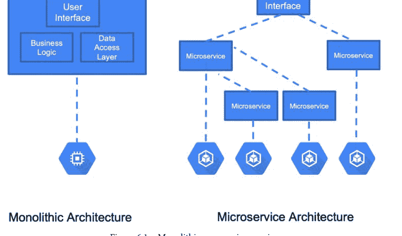


每个微服务负责单一的功能。微服务之间松耦合，可以单独开发和管理。它们通过 API 彼此通信。正因如此，每个微服务甚至可以用不同的编程语言开发。当你需要升级应用程序时，可以只升级单个服务，而不会影响其他组件。通过将应用程序拆分为微服务，你还可以控制应用程序的扩展方式和时机。你可以细粒度地扩展需要扩展的服务，而不影响其他服务。最后，微服务让你能够拥抱 CI/CD，并在部署可以以非常受控的方式推出时更快地交付功能。

> **重要说明**
> **持续集成和持续交付和/或持续部署（CI/CD）** 是一种简化软件交付的方法论。
> **持续集成** 是一种实践，开发人员会频繁地将代码提交到公共仓库。代码会被审查和测试。验证后，会触发自动构建。**持续交付** 允许你自动化发布流程，以便软件可以在任何时间点部署到目标环境。在 **持续部署** 中，开发人员所做的任何更改，只要通过所有测试，就会自动部署到生产环境。

## 容器

要理解容器，让我们将其与传统的虚拟机进行比较。虽然虚拟机虚拟化硬件，但容器虚拟化操作系统。它们将应用程序及其所有依赖项抽象为一个单元。多个容器可以托管在一个操作系统上，作为一个隔离的进程运行：

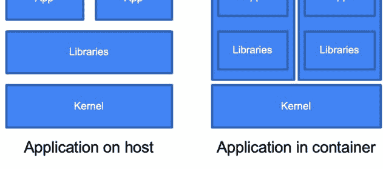

图 6.2 – 容器中的应用程序

容器带来以下优势：

- **隔离**：应用程序可以使用其库，而不会与来自其他应用程序的库冲突。
- **资源限制**：应用程序可以限制资源的使用。
- **可移植性**：应用程序是自包含的，包含所有依赖项，不受操作系统或云提供商的限制。
- **轻量级**：应用程序的占用空间要小得多，因为容器共享一个公共内核。

允许容器运行的软件称为 **容器运行时**。

虽然有许多容器运行时可用，但 Google 建议使用 **containerd**（`https://containerd.io`）。多年来，标准是 **Docker** 运行时，但最近发生了变化。**Containerd** 被确定为最安全和高效的，已成为 Kubernetes 乃至 GKE 的新标准。如果你使用 Docker 运行 GKE 节点，Google 建议你计划迁移。请注意，你仍然可以使用 Docker 构建容器，因为这是一个在 Kubernetes 集群外部发生的独立过程。

## Kubernetes

Kubernetes，也称为 K8s，是一个开源容器编排器，最初由 Google 开发并捐赠给 Cloud Native Computing Foundation。它允许你部署、扩展和管理容器化应用程序。作为一个开源平台，它可以在本地环境以及公共云中的多个环境上运行。它适用于无状态和有状态应用程序。

> **考试提示**
> Kubernetes 是一个重要的考试主题。幸运的是，考试并不要求你对其有深入的了解。在本节中，我们将讨论管理层和 Kubernetes 对象。我们希望你理解管理层，因为理解 GKE 本身是必要的。至于 Kubernetes 对象，请确保你至少理解本书中提到的对象，包括 Pods、Deployments、Services 和 Namespaces。Kubernetes 本身值得一本书，市面上有很多相关书籍。如果你想了解更多，请参考 *进阶阅读部分。*

## Kubernetes 架构

在下面的图中，我们可以看到 Kubernetes 集群的基本架构。集群由多个节点组成。在高层次上，master 节点负责管理集群，而 worker 节点托管工作负载。worker 节点托管所谓的 Pods，它们是 Kubernetes 的最原子单元。这些 Pods 可以包含一个或多个容器。对 Pods 中容器的访问是通过服务提供的。在下面的图中，我们可以看到 Kubernetes 集群以及托管在每种类型节点上的服务：

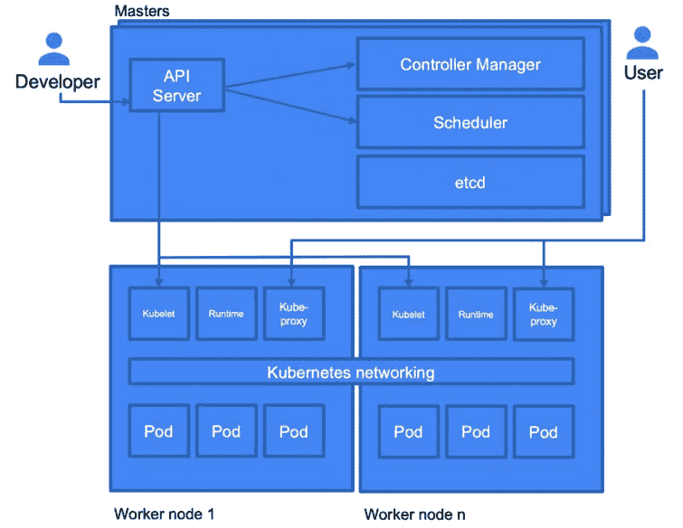

图 6.3 – Kubernetes 架构

现在，让我们更仔细地看看 master 和 worker 节点。

## master 节点

master 节点是一个控制平面，负责维护集群的期望状态。它监控 Kubernetes 对象定义（YAML 文件），并确保它们被调度到 worker 节点上。

> **重要说明**
> **YAML Ain't Markup Language（YAML）** 是一种人类友好的数据序列化标准，主要用于配置文件。它是 XML 或 JSON 等格式的替代方案。

它本质上是集群的控制平面。其工作方式如下：

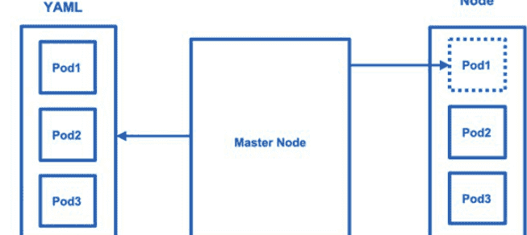

图 6.4 – 控制平面

master 节点运行多个进程：

- **API server**：公开 Kubernetes API。它是控制平面的前端。
- **Controller manager**：多个控制器负责集群的整体健康状况。
- **etcd**：一个托管集群状态信息的数据库。
- **Scheduler**：负责在节点之间放置 Pods 以平衡资源消耗。

集群可以用一个 master 完美运行，但为了高可用性和冗余目的，应该运行多个节点。没有 master，控制平面本质上是宕机的。你执行的所有集群管理操作都通过 master API 进行。因此，对于生产工作负载，建议你使用 *多个 master* 节点配置。

```
selector:
  matchLabels:
    app: nginx
  template:
    metadata:
      labels:
        app: nginx
    spec:
      containers:
      - name: nginx
        image: nginx:1.7.9
        ports:
        - containerPort: 80
```

无论我们定义什么类型的对象，都需要在其中包含以下数据：

- apiVersion：我们想要使用的 Kubernetes API 的版本
- kind：要创建的对象的类型
- metadata：有助于唯一标识对象的数据，例如其名称
- spec：对象的规范，根据其类型而定

要创建或更新现有对象，我们可以使用以下命令：

```
kubectl apply -f definition.yaml
```

这里，definition.yaml 是包含对象定义的<|message|>。 要运行我们的第一个部署，我们必须将前面的定义保存在 definition.yaml 文件中并运行 kubectl 命令。

你可以使用多个命令来管理 Kubernetes。kubectl 是最常用的，因为它允许我们创建、删除和更新 Kubernetes 对象。查看以下链接以了解可使用 kubectl 执行的操作：https://kubernetes.io/docs/reference/kubectl/overview/。请注意，kubectl 默认已安装在 GCP Cloud Shell 控制台中，但如果你想从任何其他机器使用它，则需要安装它。

现在，让我们逐个查看每个对象，从 Pods 开始。

> **选择器和标签**
> 你会注意到 Kubernetes 对象具有称为 **labels** 和 **selectors** 的参数。
> 
> 这些参数用于将不同的对象相互关联。假设你想将 Deployment 与 Service 关联。在 Deployment 定义中，你将使用诸如 app: myapp 的 label 属性，而在 Service 定义中，你将使用诸如 app: myapp 的 selector。

## Pods

Pod 是 Kubernetes 中部署的原子单元。Pod 包含一个或多个容器和存储资源。通常，Pod 内只有一个容器。当我们需要小型辅助服务时，可以向 Pod 添加额外的容器。每个 Pod 都有一个唯一的 IP 地址，与其内部的容器共享。Pod 本质上是临时的，并在需要重新调度时重新创建。如果它们不使用持久卷，卷的内容在 Pod 重新创建时会消失。要创建 Pod，我们可以使用 kind 值 Pod 并定义我们想要使用的镜像，如下所示：

```
apiVersion: v1
kind: Pod
metadata:
  name: my-pod
  labels:
    app: myapp
spec:
  containers:
  - name: my-container
    image: nginx:1.7.9
```

在这里，我们可以看到一个 Pod 的定义，其中包含从 nginx 镜像部署的容器。


## ReplicaSets

ReplicaSet 对象用于管理在给定时间运行的 Pod 数量。ReplicaSet 监控正在运行的 Pod 数量，并部署新的 Pod 以达到期望的副本数。要定义一个 ReplicaSet，可以使用 kind 值为 ReplicaSet。运行的 Pod 数量定义在 replicas 参数下：

```
apiVersion: apps/v1
kind: ReplicaSet
metadata:
  name: frontend
  labels:
    app: guestbook
    tier: frontend
spec:
  # modify replicas according to your case
  replicas: 3
  selector:
    matchLabels:
      tier: frontend
  template:
    metadata:
      labels:
        tier: frontend
    spec:
      containers:
      - name: php-redis
        image: gcr.io/google_samples/gb-frontend:v3
```

ReplicaSets 是 replication controller 对象的继任者。创建 ReplicaSets 并不是很常见。相反，你应该创建 Deployments，我们将在下一节中查看。

## Deployments

Deployments 用于部署、更新和控制 Pod。这些部署会在无需单独定义的情况下创建 ReplicaSets。通过说明需要多少个副本，相应的 ReplicaSet 对象将为你创建。通过更改容器中的镜像，我们可以将应用程序更新到新版本。Deployment 对象同时支持金丝雀和蓝绿部署方法。

## Namespaces

Namespaces 本质上是 Kubernetes 集群内的虚拟集群。在大型环境中，可能有多个团队在开发应用程序。通过创建命名空间，用户可以重用资源名称。这些名称需要在命名空间内唯一，但在集群范围内则不需要。默认情况下，Kubernetes 集群自带三个预定义的命名空间：

- `default`: 没有其他命名空间的对象默认命名空间
- `kube-system`: 用于 Kubernetes 创建的资源
- `kube-public`: 保留供将来使用：

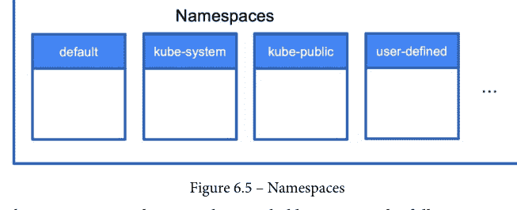

图 6.5 – Namespaces

可以根据需要通过运行以下命令创建额外的命名空间：

```
kubectl create namespace <namespace-name>
```

这里，<namespace-name> 是新命名空间的名称。

要部署到新的命名空间，你应该使用 --namespace 标志，如下所示：

```
kubectl --namespace=<namespace-name> run nginx --image=nginx
```

或者，你可以在对象定义中定义 namespace 属性。

命名空间可以使用网络策略相互隔离。要了解有关网络策略的更多信息，请查看本章的 Further reading 部分。你还可以使用资源配额来限制命名空间可用的资源。以下配额请求/保留总共 1 个 CPU 和 1 GB 内存。它还将 CPU 限制为 2，内存限制为 2 GB：

```
apiVersion: v1
```

```
kind: ResourceQuota
```

```
metadata:
  name: quota-demo
spec:
  hard:
    requests.cpu: "1"
    requests.memory: 1Gi
    limits.cpu: "2"
    limits.memory: 2Gi
```

正如你所见，命名空间是分离环境的良好方式。在决定部署新的 Kubernetes 集群之前，你可能想先考虑创建新的命名空间。

## Services

Services 用于将 Pod 分组到单个端点。正如我们所知，Pod 会来来去去。服务有一个稳定的 IP 地址，因此请求可以发送到它并转发到 Pod。用于执行转发的算法取决于服务类型。我们将在下一节中查看每种服务类型。让我们看一个服务的简单定义。这里，我们使用 kind 值为 Service。

正如我们之前提到的，你可以在服务定义中使用 selector，并在 Pod 定义中使用 label 将 Pod 分配给服务。

以下是简单的服务定义：

```
apiVersion: v1
kind: Service
metadata:
  name: service-demo
spec:
  selector:
    app: myapp
  ports:
  - protocol: TCP
    port: 80
    targetPort: 9376
```

让我们看一下服务类型。

## Types of services

在本节中，我们将查看最重要的服务类型。服务的区别在于它们如何处理流量，以及它们是否将 Pod 对外或对内暴露。我们将讨论的服务如下：

- `ClusterIP`
- `NodePort`
- `LoadBalancer`
- `ExternalName`

让我们详细讨论每种服务：

- `ClusterIP`: 这是默认服务，使用内部 `ClusterIP` 暴露 Pod。这意味着服务在集群外部不可用。`ClusterIP` 的用例是在集群内微服务之间的内部通信：

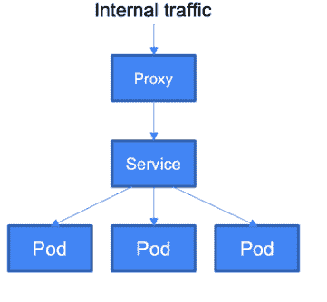

以下是 `ClusterIP` 类型的 `Service` 示例定义：

```
apiVersion: v1
kind: Service
metadata:
  name: clusterip-demo
spec:
  selector:
    app: myapp
```

```
type: ClusterIP
ports:
  - name: http
    port: 80
    targetPort: 80
    protocol: TCP
```

- NodePort: 这只是将每个节点在集群外部暴露。Pod 可以通过 <NodeIP>:<NodePort> 访问。如果有多个节点，则会暴露多个具有相同端口的 IP 地址：

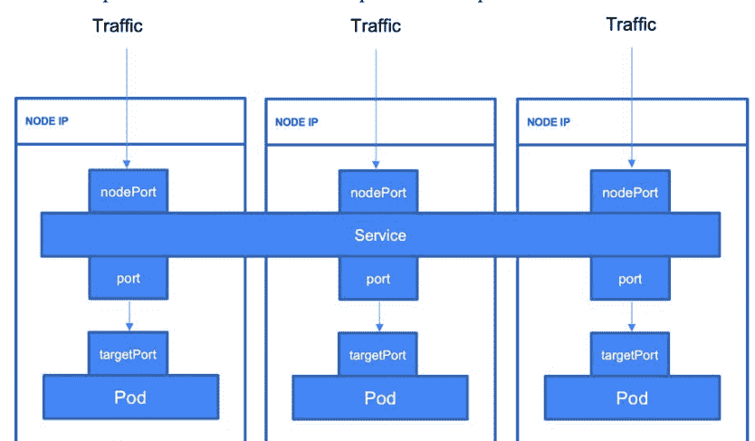

图 6.7 – The NodePort service type

以下是 NodePort 类型的 Service 示例定义：

```
apiVersion: v1
kind: Service
metadata:
  name: nodeport-demo
spec:
  selector:
    app: myapp
```

```
type: NodePort
ports:
  - name: http
    port: 80
    targetPort: 80
    nodePort: 30080
    protocol: TCP
```

- LoadBalancer: 这将动态创建提供商负载均衡器。在 GCP 的情况下，会为你创建网络负载均衡器。请记住它使用 Kubernetes 外部的对象并产生额外成本：

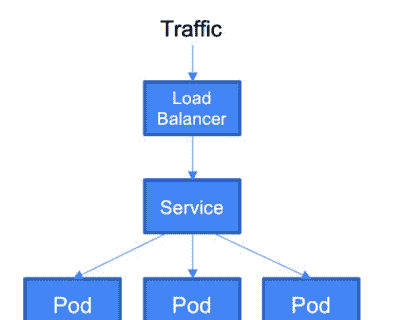

图 6.8 – The LoadBalancer service type

以下是 LoadBalancer 类型的 Service 示例定义：

```
kind: Service
apiVersion: v1
metadata:
  name: loadbalancer-demo
spec:
  selector:
    app: myapp
  ports:
    - protocol: TCP
      port: 80
      targetPort: 9376
  clusterIP: 10.115.240.5
```

```
loadBalancerIP: 70.10.10.19
type: LoadBalancer
status:
  loadBalancer:
    ingress:
      - ip: 160.160.160.155
```

- ExternalName: 此服务使用 ExternalName 规范中指定的 DNS 名称暴露。以下是 ExternalName 类型的 Service 示例定义：

```
kind: Service
apiVersion: v1
metadata:
  name: externalname-demo
spec:
  type: ExternalName
externalName: my.app.example.com
```

- Ingress: 这是一个对象，允许根据定义的规则（路径）路由 HTTP(S) 流量。它可以与一个或多个 Service 对象关联。这些服务进一步与 Pod 关联。在 GCP 的情况下，ingress 控制器创建 HTTP(S) 负载均衡器。这些负载均衡器使用 Ingress 对象中的定义自动配置：

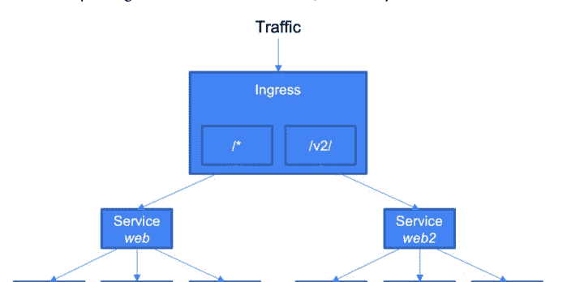

图 6.9 – Ingress diagram

让我们看一下 YAML 定义。ingress 使用 kind 值为 Ingress 定义。从这里，你定义规则。根据路径，你将流量定向到关联的服务。在以下示例中，/* 流量被定向到 web，/v2/* 流量被定向到 web2 服务：

```
apiVersion: networking.k8s.io/v1
kind: Ingress
metadata:
  name: example-ingress
spec:
  rules:
  - http:
    paths:
    - path: /*
      pathType: Prefix
      backend:
        service:
          name: web
          port:
            number: 8080
    - path: /v2/*
      pathType: Prefix
      backend:
        service:
          name: web2
          port:
            number: 8080
```

这总结了最重要的 Kubernetes 对象列表。在下一节中，我们将更详细地了解 GKE。

> Exam Tip
> 在 Google Cloud Certified Developer 等专业化考试中，你可以预期 Kubernetes 有更深入的问题。你可能会看到关于资源如 StatefulSets https://kubernetes.io/docs/concepts/workloads/controllers/statefulset) 或 DeamonSets https://kubernetes.io/docs/concepts/workloads/controllers/daemonset) 的问题。虽然我们不期望 PCA 考试中有这样的问题，但我们鼓励你查看官方 Kubernetes 文档。


# Google Kubernetes Engine

GKE 是一种完全托管的服务，允许我们按需配置 Kubernetes 集群。它免除了手动部署集群的负担，并提供托管的主节点。它还具有手动部署所不具备的诸多优势，例如以下内容：

- 自动化的集群配置
- 自动化的集群扩缩容
- 自动化的升级
- 自动修复
- 集成负载均衡
- 节点池
- 与 Google Cloud 操作套件集成，用于监控和日志记录

GKE 集群可以部署在两种模式下：区域或多区域。在区域部署中，仅部署一个主节点。在多区域部署中，三个主节点部署在不同的区域中。这在下图中显示：

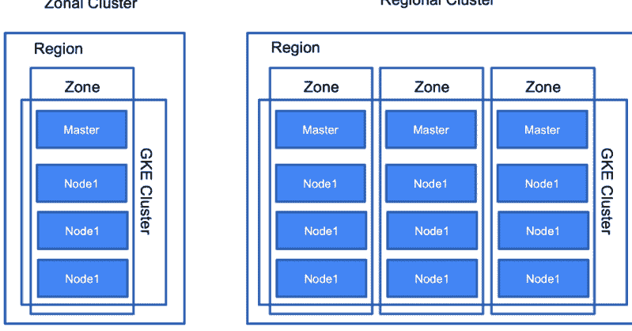

图 6.10 – GKE 集群

为了获得更高的可用性 SLA，并在升级管理平面时实现零停机，您应部署多区域集群。在此设置中，主节点可以逐个升级，以便在升级期间管理平面保持功能。

# GKE Autopilot

GKE Autopilot 是 GKE 集群除标准模式外的另一种运行模式。这是 Google 试图为客户提供比 GKE 标准模式更广泛服务范围的尝试。在 GKE Autopilot 的情况下，是 GKE 本身配置和管理集群、节点和节点池，为您提供优化的集群和完全托管的体验。您不再需要担心节点的健康状况或 Pod 的健康状况。它们由 Google 监控和管理。SLA 涵盖控制平面以及 Pod。另一个重要方面是您无需担心承载 Pod 所需的容量，因为服务会为您处理。

使用 GKE Autopilot，您按 Pod 运行期间请求的 CPU、内存和存储付费，而不是为 GKE 集群本身付费。您可以在此处了解有关 GKE Autopilot 的更多信息： `https://cloud.google.com/kubernetes-engine/docs/concepts/autopilot-overview`。

# Node pools

节点池用于将工作节点按相同配置分组。当您创建第一个集群时，所有节点都放在默认节点池中。如果您想要具有特定特征的组，例如本地 SSD、最小 CPU、特定的节点镜像或使用抢占式实例，您可能需要多个节点池：

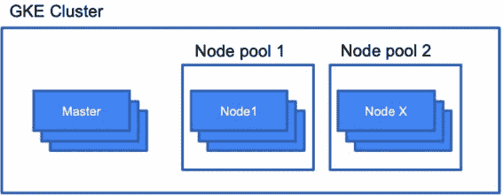

图 6.11 – 节点池

如果您的工作负载具有特殊资源需求，节点池可能会很有用。您可以使用 **节点污点** 和 **Pod 容忍** 的概念来允许您的工作负载调度到特定节点上。在 *进一步阅读* 部分，您将找到有关如何使用节点污点的文档链接。

### Exam Tip
请特别注意污点和容忍，因为这可能是考试中出现的话题。了解如何允许 Pod 在特定节点上运行。

节点池使用 gcloud container node-pools 命令进行管理。

我们将在 *调整集群大小* 部分稍后查看如何使用此命令来扩缩容我们的节点池。

# Container-Optimized OS (COS)

默认情况下，Kubernetes Engine 中的节点使用 Google 的 Container-Optimized OS。它是 Chromium OS 的锁定版本，用于运行容器化应用程序。镜像由 Google 维护和更新。更新会在后台自动下载。由于它移除了不必要的特性，与其他 Linux 发行版相比，其攻击面更小。

请注意，此操作系统不适合运行非容器化应用程序或当您需要 Linux 提供商的企业支持时。除非您有非常充分的理由使用其他 Linux 发行版，否则请使用 Container-Optimized OS 用于节点。虽然仍有使用 Docker 运行时镜像，但 Google 建议使用运行 containerd 运行时镜像的版本。

# Storage

在 GKE 中使用持久存储最简单的方法是使用 GCP 服务，例如 Cloud SQL、Datastore 或 Cloud Storage。但是，您也可以使用 Kubernetes 抽象层将存储直接暴露给 Pod。存储通过卷提供给 Pod 容器。这些卷可以由临时存储或持久存储支持。虽然临时存储适用于临时空间，但要持久化状态，需要持久存储：

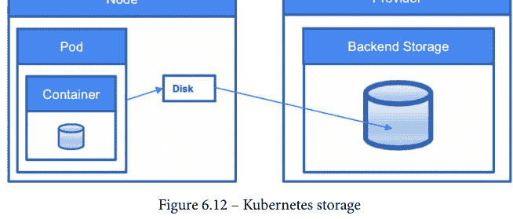

图 6.12 – Kubernetes 存储

当 Pod 崩溃并重新部署时，存储在 Pod 本地磁盘上的文件将会丢失。要保留状态，您需要使用 Pod 外部的外部存储。为此，您可以使用 **PersistentVolumes (PVs)**，其生命周期不受 Pod 生命周期限制。在 GKE 中，这些卷通常由 Google Cloud Compute Engine 持久磁盘支持，并且可以使用 **PersistentVolumeClaim (PVC)** 动态配置。以下是声明的示例。在这里，我们请求一个 20 GB 的卷，其访问模式允许将其附加到一个节点：

```
apiVersion: v1
kind: PersistentVolumeClaim
metadata:
  name: claim-demo
spec:
  accessModes:
    - ReadWriteOnce
  resources:
    requests:
      storage: 20Gi
```

要将此声明用作 Pod 的卷，您需要在 Pod 定义中引用该声明：

```
apiVersion: v1
kind: Pod
metadata:
  name: mypod
spec:
  containers:
    - name: myfrontend
      image: nginx
      volumeMounts:
        - mountPath: "/var/www/html"
          name: mypd
  volumes:
    - name: mypd
      persistentVolumeClaim:
        claimName: claim-demo
```

要了解有关 PersistentVolumes 的更多信息，请参阅 *进一步阅读* 部分。

# GKE cluster management

我们终于完成了理解 GKE 所需的理论。现在，让我们看一些管理 GKE 集群的实际示例。我们将从部署集群开始，然后查看扩缩容和升级的操作。

您可以使用以下几种工具来管理集群，包括：

- Google Cloud Console
- gcloud 命令行界面
- REST API

出于考试目的，我们将集中在前两种工具上。让我们开始吧！

# Creating a GKE cluster

部署集群最简单的方法是使用 Google Cloud Console。这也是在无需阅读命令行参考的情况下查看所有可用选项的好方法。让我们开始：

1. 从汉堡菜单中，选择 Kubernetes Engine | Clusters。从弹出窗口中，单击 CREATE 按钮，如以下屏幕截图所示：

> **重要提示**
> 如果您是首次使用 GKE，您需要启用 Kubernetes API。

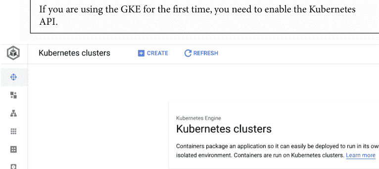

图 6.13 – 创建 Kubernetes 集群

2. 单击 **Create cluster**。您将能够选择模式。我们将使用标准模式，因为它提供了更多选择，并有助于您更好地理解 GKE。单击 **GKE Standard** 部分旁边的 **CONFIGURE**：

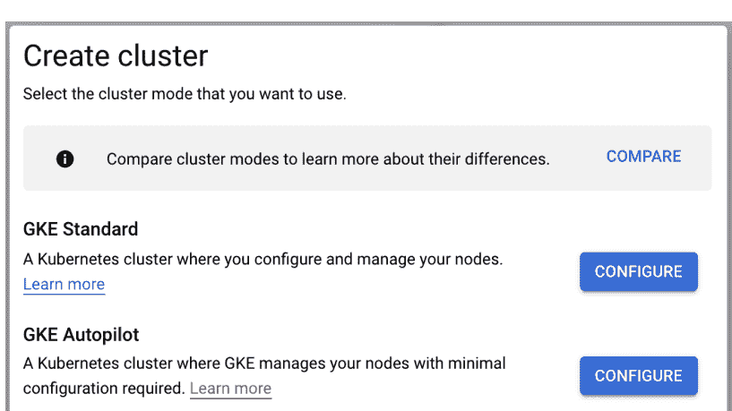

图 6.14 – 创建集群

3. 在以下窗格中，您可以根据工作负载类型选择集群模板。我们将使用 **Standard cluster**，因为我们要部署一个简单的 Web 应用程序。在右侧，我们可以选择集群的更详细设置。让我们更仔细地查看可用选项：

# Create a Kubernetes cluster

- Cluster basics
- NODE POOLS
- default-pool
- CLUSTER
- Automation
- Networking
- Security
- Metadata
- Features

# Cluster basics

新集群将使用您在此处指定的名称、版本和位置创建。集群创建后，名称和位置无法更改。

> 为了尝试经济实惠的集群，请尝试集群设置指南中的 My first cluster

Name
cluster-1

Location type
○ Zonal
○ Regional

Zone
us-central1-c

Specify default node locations
Current default: us-central1-c

# Control plane version

选择发布渠道以自动管理集群的版本和升级节奏。选择静态版本以更直接地管理集群的版本。了解更多。

○ Static version
● Release channel

Release channel
Regular channel (default)

Version
1.20.10-gke.301 (default)

这些版本已通过内部验证，被认为具有生产质量，但没有足够的历史数据来保证其稳定性。已知问题通常有已知的解决方法。发布说明

图 6.15 – 集群基础信息


4. 首先，选择集群的名称。接下来，决定集群是 **Zonal** 还是 **Regional**。如果我们选择 **Zonal**，我们会看到被要求选择要部署到的 **Zone**，如下图所示：

Figure 6.16 – Zonal cluster

5. 如果我们选择 **Regional**，我们将需要选择一个区域，如下图所示：

Figure 6.17 – Regional cluster

6. 无论我们选择哪种 **Location type**，我们都需要选择一个 **Master version**。默认情况下，选择了最稳定的版本。我们将保持默认值不变：

## Control plane version

选择用于自动管理集群版本和升级节奏的发布渠道。选择静态版本以更直接地管理集群的版本。了解更多。

Static version
Release channel

Release channel
Regular channel (default)

Version
1.20.10-gke.301 (default)

这些版本已通过内部验证，被认为具有生产质量，但历史数据不足以保证其稳定性。已知问题通常有已知的解决方法。发行说明

Figure 6.18 – Control plane version

在此窗口中，您还可以选择发布渠道。这里有三个选项：

- **Rapid channel**：供早期采用者使用。允许您在 Kubernetes 次要版本 **General Availability (GA)** 发布后几周内使用最新的功能。请注意，Google 对此选项不提供任何 SLA。
- **Regular channel**：在可靠性和可用功能之间提供平衡。发布后 2-3 个月后可用。
- **Stable channel**：这是最稳定且经过充分测试的。发布后 2-3 个月后可用。当可靠性对您至关重要时使用此版本。

7. 在左侧菜单中点击 **default-pool** 以配置节点池的设置。请记住，集群中可以有一个或多个池。如前所述，池将具有相同特征的节点分组。在此部分，我们可以选择池的 Name 参数、其 Size，并定义一些特征，例如 **auto-scaling** 和 **node locations**。默认情况下，自动修复和自动升级选项已启用。最后，您可以定义升级期间的 **maximum surge**（节点数）和 **maximum unavailable** 节点数。我们将在本章后面了解更多关于这些选项的信息：

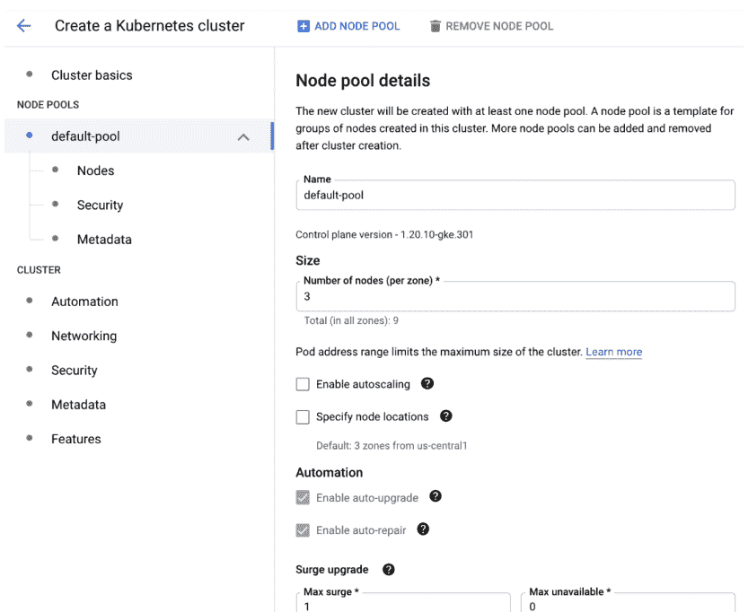

Figure 6.19 – Node pool details

8. 当我们点击 **Nodes** 菜单时，会出现更多设置。在这里，我们可以选择节点的镜像和将使用的机器类型。

如果我们选择多个 vCPU，则内存量将自动为我们填写。此外，我们还可以选择节点的磁盘类型和大小。我们可以使用客户管理的加密密钥加密启动磁盘，并且我们有使用抢占式节点的选项。最后，我们可以设置每个节点的 Pod 最大数量并分配网络标签以使用防火墙控制对节点的访问：

## Nodes

这些节点设置将在使用此节点池创建新节点时使用。

Image type
Container-Optimized OS with Containerd (cos_containerd) (default)

> 对于新创建的集群和版本为 1.20.10-gke.301 的节点池，默认节点镜像现在是 Container-optimized OS with Containerd。我们建议您开始测试和规划迁移。有关更多信息，请参阅 Migrating from the Docker runtime to the Containerd runtime。了解有关不同节点镜像的更多信息。

## Machine Configuration

Machine family
GENERAL-PURPOSE COMPUTE-OPTIMIZED MEMORY-OPTIMIZED GPU
Machine types for common workloads, optimized for cost and flexibility

Series
E2
CPU platform selection based on availability

Machine type
e2-medium (2 vCPU, 4 GB memory)
vCPU 1 shared core
Memory 4 GB

CPU PLATFORM AND GPU

Boot disk type
Standard persistent disk

Boot disk size (GB)
100

Enable customer-managed encryption for boot disk

Local SSD disks

Enable preemptible nodes

## Networking

> 集群设置指定每个节点最多 110 个 Pod，但您可以在节点池级别覆盖该设置。

Maximum Pods per node
110
Mask for Pod address range per node: /24

Network tags

Figure 6.20 – Nodes

点击 **Security** 部分。在这里，我们可以看到正在使用的服务账号是 **Compute Engine** 默认服务账号。这与 GCE 安全设置的工作方式非常相似。但是，请注意，此账号将被部署到节点池的工作负载使用。请记住使用最小权限原则：

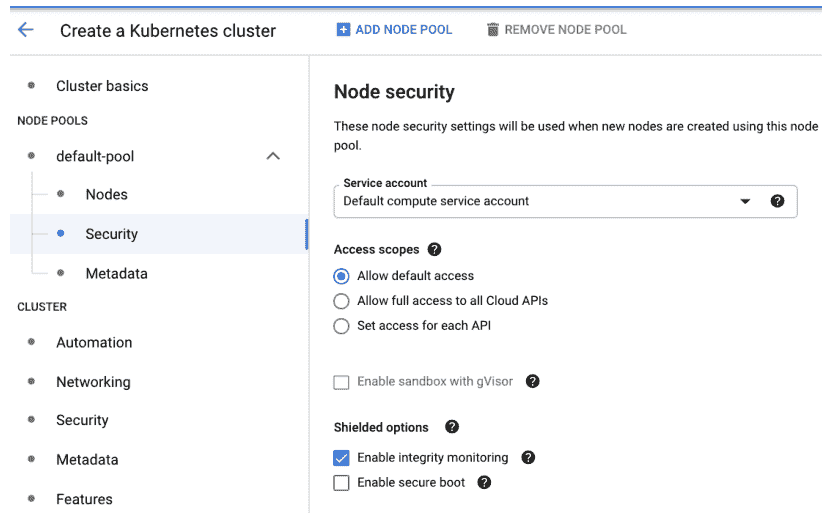

Figure 6.21 – Node security

我们还可选择启用使用 gVisor (https://github.com/google/gvisor) 的沙箱以及 Shielded 节点的选项。

在 **Metadata** 部分，我们可以设置 **Kubernetes labels** 和 **Node taints**，以及节点 GCE 实例的元数据：

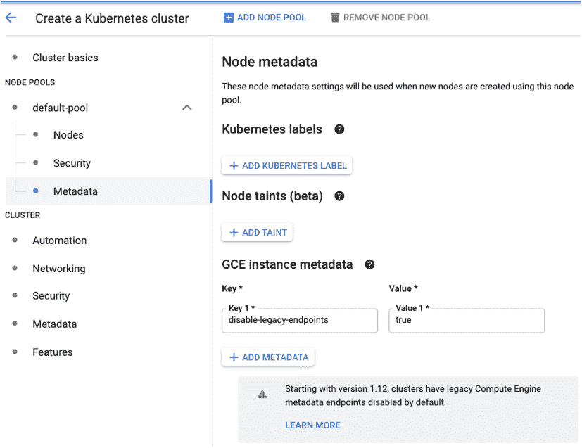

Figure 6.22 – Kubernetes labels and Node taints

至此，我们已完成第一个节点池的配置。如果需要额外的节点池，可以通过点击屏幕顶部的 ADD NODE POOL 链接来创建。新的节点池将列在 NODE POOLS 部分下。在本教程中，我们将继续使用单个节点池。以下截图仅显示当您决定添加新节点池时会发生什么：

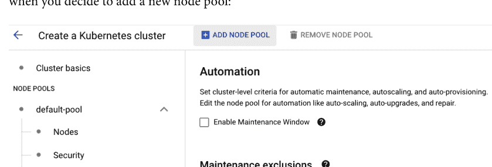

Figure 6.23 – Adding node pools

让我们继续到 Automation 部分。在这里，您可以为集群设置维护窗口，这将定义 Google 何时可以升级您的集群。您还可以启用升级通知、Vertical Pod Autoscaling 和 Node auto-provisioning。对于自动扩缩容配置文件，您可以从标准的 Balanced 模式更改为 Optimized，该模式会积极删除您的节点（这针对不敏感于启动延迟的批处理工作负载进行了优化）：

Figure 6.24 – Automation

接下来，让我们查看 Networking 部分。

## Networking

在这里，我们可以选择是否使用项目中的 VPC 或使用共享 VPC。
让我们开始：

> **Important Note**
> 在此情况下，我们有一个使用共享 VPC 的服务项目。

1. 首先，我们必须从将由节点使用的 VPC 中选择子网：

## Networking

定义此集群中应用程序如何相互通信以及与 Kubernetes 控制平面通信，以及客户端如何访问它们。

Networks in this project
Networks shared with me (from host project: prj-d-shared-base-de39)

Network *
vpc-d-shared-base

Node subnet *
sb-d-shared-base-us-central1

Public cluster
Private cluster

## Advanced networking options

Enable VPC-native traffic routing (uses alias IP)
Automatically create secondary ranges

Pod secondary CIDR range *
rn-d-shared-base-us-central1-gke-pod (192.168.96.0/19)

Maximum pods per node
110
Mask for pod address range per node: /24

Services secondary CIDR range *
rn-d-shared-base-us-central1-gke-svc (192.168.128.0/23)

Figure 6.25 – Networking

2. 接下来，我们将看到使用公共或私有集群的选项。私有意味着节点将仅具有私有 IP 地址。您还可以取消选中 Access the control plane using external IP address 以禁止从互联网连接控制平面。如果您选中 Enable control plane global access 框，这将允许您从任何 GCP 区域或本地访问控制平面。对于 Control Plane IP range，填写您要用于控制平面的 IP 范围：

Public cluster
Private cluster
Access control plane using its external IP address
Enable Control plane global access
Control plane IP range *
Example: 172.16.0.0/28
Disable Default SNAT

Figure 6.26 – Private cluster

> **Important Note**
> 如果您计划使用私有使用的公共 IP (https://cloud.google.com/architecture/configuring-privately-used-public-ips-for-GKE)，您需要选中 Disable Default SNAT 选项。

3. 保持选择 **Public cluster** 并移动到 **Advanced networking options** 部分。如果我们保持默认的 **VPC-native** 流量路由，我们将能够使用来自共享 VPC 的别名 IP 范围。这是 Google 推荐的最佳实践设置。我们选择提供的 Pod 和服务 IP 范围，并将每个节点的默认最大 Pod 数量保持不变：

## Advanced networking options

Enable VPC-native traffic routing (uses alias IP)
Automatically create secondary ranges
Pod secondary CIDR range *
rn-d-shared-base-us-central1-gke-pod (192.168.96.0/19)
Maximum pods per node
110
Mask for pod address range per node: /24
Services secondary CIDR range *
rn-d-shared-base-us-central1-gke-svc (192.168.128.0/23)

Figure 6.27 – Advanced networking options


4. 要能够使用 Kubernetes ingress 资源，我们必须保持 HTTP 负载均衡启用：

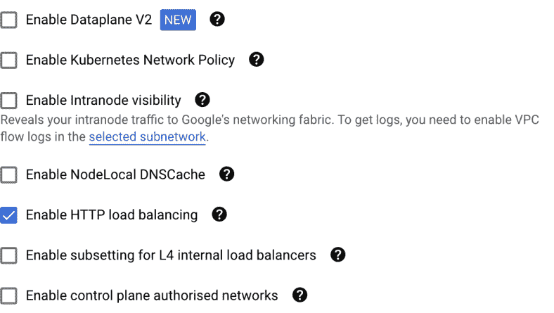

图 6.28 – HTTP 负载均衡

正如你所见，在本节中你可以启用一些有趣的功能，具体如下：

- **Enable Kubernetes Network Policy**：这允许你在集群内允许或禁止网络流量。
- **Enable Intranode visibility**：这允许你深入了解节点之间的网络流。
- **Enable control plane authorized networks**：这允许你定义可以从中连接到控制平面的网络。

现在，我们将查看 **Security** 选项。

5. 在 Security 部分，我们有一些默认情况下禁用的身份验证和授权设置：

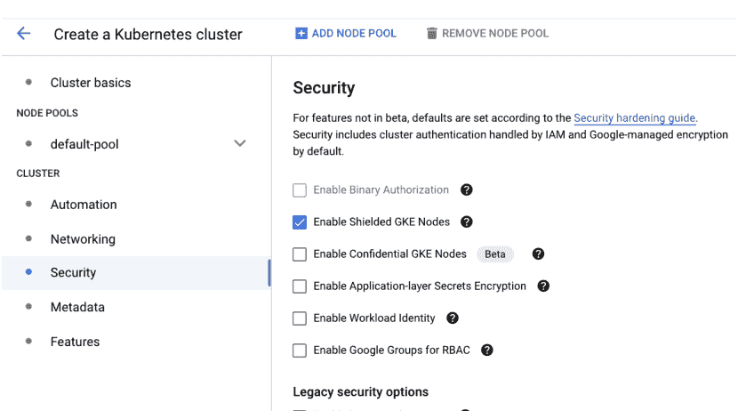

图 6.29 – Security

你可以在此处启用一些非常有用的服务，具体如下：

- **Binary Authorization**：禁止在集群上运行未签名的镜像
- **Shielded GKE Nodes**：为集群中的节点提供强大的加密身份
- **Confidential GKE nodes**：使用 Google 无权访问的密钥加密节点的内存
- **Application-layer Secrets Encryption**：使用 Cloud KMS 加密存储在 etcd 数据库中的密钥
- **Workload Identity**：允许你通过将 Kubernetes 服务账号映射到 Google 服务账号来安全地使用工作负载访问 Google API
- **Google Groups for RBAC**：将 Google 群组映射到集群中的角色和集群角色

这里还有一些遗留的安全选项，除非你有特殊用例并且对安全权衡有信心，否则不应使用。

在 **Metadata** 部分，你可以在集群中添加一些可选的描述和标签：

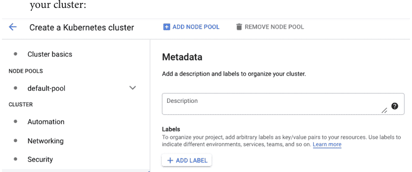

最后，我们可以进入 **Features** 部分。

6. 在 **Features** 部分，我们可以为你的 Kubernetes 版本启用新的 GKE 监控功能。你将在 *第 17 章，Monitoring Your Infrastructure* 中了解更多关于 GKE 监控的内容：

## Create a Kubernetes cluster

- Cluster basics
- NODE POOLS
- default-pool
- CLUSTER
- Automation
- Networking
- Security
- Metadata
- Features

## Features

## Developer productivity

Enable Cloud Run for Anthos

## Operations

Enable Cloud Logging

System and Workloads

Enable Cloud Monitoring

All 1 selected

System

Workloads Beta

CANCEL OK

Enable GKE usage metering

Enable Istio Beta

Enable Application Manager Beta

Enable Compute Engine Persistent Disk CSI Driver

Enable Filestore CSI Driver

Enable Config Connector

图 6.31 – Monitoring

7. 我们将保持系统和工作负载日志记录和监控选项不变。除了监控之外，还有一些有趣的功能，例如 Cloud Run for Anthos 和 Config Connector（我们将在第 8 章，Managing Cloud-Native Workloads with Anthos 中了解更多关于这些内容）。为了考试目的，请查看 Exam Tip 框以了解最重要的内容：

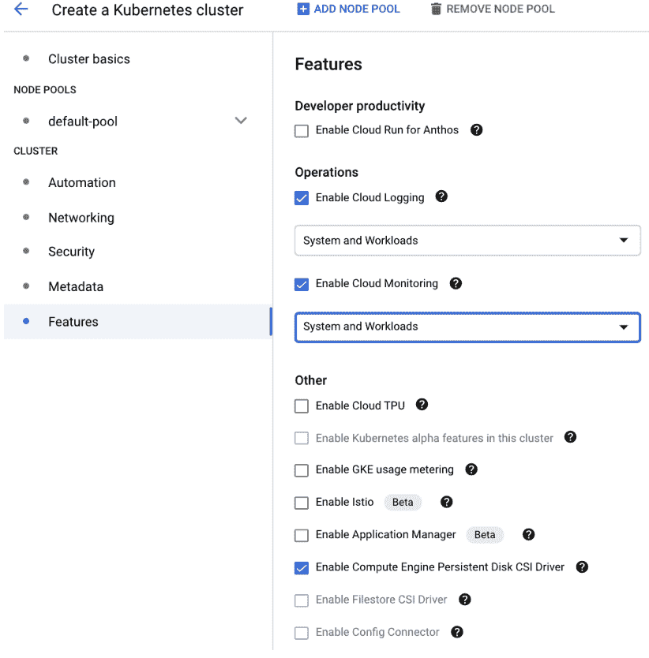

图 6.32 – Features

## Exam Tip

值得记住的是我们可以执行以下操作：

**Enable Cloud TPU**：我们将在 *第 14 章，Putting Machine Learning to Work* 中讨论此内容。

**Enable Istio (beta)**：这是一个服务网格产品，允许我们控制和观察网络流量。

8. 现在我们已经填充了所有设置，可以通过单击 **Create** 按钮创建集群。或者，我们可以通过单击相应的超链接生成 REST API 调用或命令行：


图 6.33 – REST or command line

9. 在单击 **Create** 之前，让我们通过单击 **command line** 链接查看命令行。如往常一样，你只需将其复制到 Cloud Shell 并执行即可。在以下代码中，你可以看到我们使用了在 beta 模式下可用的一些功能，例如 `gcloud beta container` 命令：

```
gcloud beta container --project "prj-bul-d-sample-base-6159" clusters create "standard-cluster-1" --zone "us-central1-c" --no-enable-basic-auth --cluster-version "1.19.9-gke.1900" --release-channel "regular" --machine-type "e2-medium" --image-type "COS_CONTAINERD" --disk-type "pd-standard" --disk-size "100" --metadata disable-legacy-endpoints=true --scopes "https://www.googleapis.com/auth/devstorage.read_only","https://www.googleapis.com/auth/logging.write","https://www.googleapis.com/auth/monitoring","https://www.googleapis.com/auth/servicecontrol","https://www.googleapis.com/auth/service.management.readonly","https://www.googleapis.com/auth/trace.append" --num-nodes "3" --enable-stackdriver-kubernetes --no-enable-ip-alias --network "projects/prj-d-shared-base-de39/global/networks/vpc-d-shared-base" --subnetwork "projects/prj-d-shared-base-de39/regions/us-central1/subnetworks/sb-d-shared-base-us-central1" --no-enable-intra-node-visibility --no-enable-master-authorized-networks --addons HorizontalPodAutoscaling,HttpLoadBalancing,GcePersistentDiskCsiDriver --enable-autoupgrade --enable-autorepair --max-surge-upgrade 1 --max-unavailable-upgrade 0 --enable-shielded-nodes --node-locations "us-central1-c"
```

> **Important Note**
> 此代码是一个示例，如果你自行操作部署，可能会略有不同。

10. 现在，我们可以单击 Create 并等待集群创建完成。一旦完成，我们将在集群名称旁边看到一个绿色勾号：

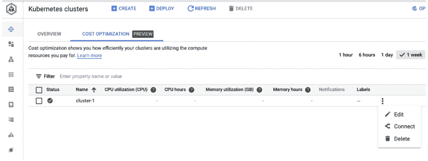

图 6.34 – Provisioned cluster

11. 单击三个点符号并选择 Connect 选项后，我们将看到有关如何连接到集群的信息：

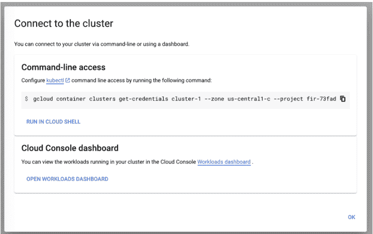

图 6.35 – Connect to the cluster

此信息可以复制到 Google Cloud Shell，以便我们将其与新创建的集群进行身份验证。在下一节中，我们将使用它并部署我们的第一个应用程序。

## Deploying our first application

现在我们已经创建了集群，可以部署我们的第一个应用程序。我们将使用三个 Pod 部署一个简单的 NGINX Web 服务器。为此，我们将使用 Deployment 对象。然后，我们将使用 Service 对象公开应用程序。

为了演示创建 Kubernetes 对象的不同方法，我们将同时使用 kubectl 和 Google Cloud Console。部署成功后，我们将检查其连通性。让我们开始：

> **Exam Tip**
> 预计会出现有关 GKE 和 Kubernetes 命令行工具的问题。
> 请记住，gcloud 用于管理 GKE 集群，而 kubectl 是原生的 Kubernetes 工具。因此，例如，如果你想扩展 GKE 集群，你将使用 gcloud，而要扩展部署，你将使用 kubectl。

1. 让我们打开 Cloud Shell 并运行以下命令，该命令是我们从 Google Cloud Console 复制的：

```
gcloud container clusters get-credentials standard-cluster-1 --zone us-central1-a --project qwiklabs-gcp-21ec218e55edd052
```

> **Important Note**
> 你需要调整集群名称和项目 ID，使其与你的环境匹配。

当要求授权时，请确认。这将为 kubectl 配置凭据。现在，我们可以将 Kubernetes 资源部署到集群。

2. 现在，让我们在编辑器模式下打开 Cloud Shell 并使用示例 Deployment 定义创建一个 `deploy.yaml` 文件。你可以在官方 Kubernetes 文档中找到类似的示例：https://kubernetes.io/docs/concepts/workloads/controllers/deployment/#creating-a-deployment。保存它并运行 `kubectl apply -f deploy.yaml` 文件：

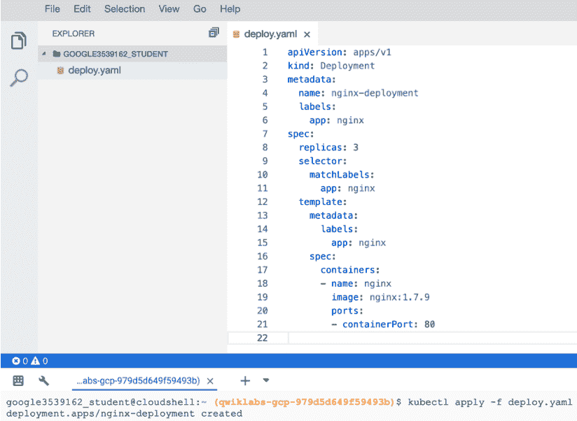

图 6.36 – The deploy.yaml file

3. 要验证 Pod 是否已创建，我们可以使用 `kubectl get pods` 命令：


```
google3539162_student@cloudshell:~ (qwiklabs-gcp-979d5d649f59493b)$ kubectl get pods
NAME                                 READY   STATUS    RESTARTS   AGE
nginx-deployment-5c689d88bb-2d7pq   1/1     Running   0          2m33s
nginx-deployment-5c689d88bb-srtn8   1/1     Running   0          2m33s
nginx-deployment-5c689d88bb-z4mkp   1/1     Running   0          2m33s
```

Figure 6.37 – Pods

4. 现在，我们需要返回到控制台并检查 Workloads 菜单。我们会看到 nginx-deployment 存在。点击 Name 查看其详细信息，如以下截图所示：

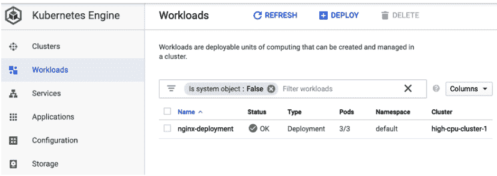

Figure 6.38 – Workloads

5. 点击 Name 列中的 nginx-deployment 链接以进入详细视图。在详细视图顶部，我们会被询问是否要公开服务。点击 Expose 按钮，如以下截图所示：

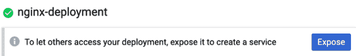

Figure 6.39 – Exposing a Deployment

6. 现在，我们可以选择一个 **Port** 和一个 **Target port**、一个 **Protocol**，以及最重要的 Service 类型。我们将选择一个 **Load balancer**。如果点击 **View YAML**，你会看到服务的定义。你可以复制它并使用 `kubectl` 从 shell 部署它。相反，我们将点击 **Expose** 按钮来看看如何在 GUI 中完成此操作：

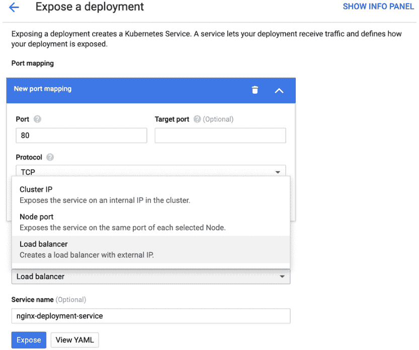

Figure 6.40 – Service settings

7. 部署服务需要几秒钟时间。部署完成后，它将在 **Kubernetes Engine** 菜单下的 **Services** 中可见。找到 `nginx-deployment-services` 服务并点击其名称以查看以下详细信息。找到 **Load balancer IP** 值并复制它：

| Cluster | high-cpu-cluster-1 |
| Namespace | default |
| Labels | app : nginx |
| Stackdriver logs | Deployment: nginx-deployment |
| Type | LoadBalancer |
| External endpoints | 35.194.21.47:80 |

# LoadBalancer

| Cluster IP | 10.39.252.240 |
| Load balancer IP | 35.194.21.47 |
| Load balancer | ac57afbda82f711e9b18142010a80008 |

# Deployments

| Name | Status | Pods |
| nginx-deployment | OK | 3/3 |

# Serving pods

| Name | Status | Restarts | Created on |
| nginx-deployment-5c689d88bb-2d7pq | Running | 0 | May 30, 2019, 6:20:12 PM |
| nginx-deployment-5c689d88bb-srtn8 | Running | 0 | May 30, 2019, 6:20:12 PM |
| nginx-deployment-5c689d88bb-z4mkp | Running | 0 | May 30, 2019, 6:20:12 PM |

# Ports

| Port | Node Port | Target Port | Protocol | |
| 80 | 31871 | 80 | TCP | Port forwarding |

Figure 6.41 – Service details

8. 将 IP 粘贴到你的网络浏览器中，或点击 External endpoints 键旁边的链接。你会看到以下 NGINX 欢迎信息：

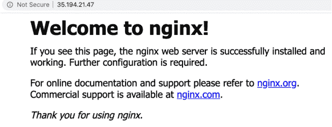

Figure 6.42 – Accessing the application

至此，我们已成功将第一个应用程序部署到 GKE 集群。正如你所见，你可以使用 GUI 或命令行来完成此操作。Google Cloud Console 允许你在无需手动定义 YAML 文件的情况下部署 Kubernetes 对象。它还会可视化最有用的对象及其关系。使用 GUI，你还可以执行一些第二天操作。此时，我们鼓励你获得一些实践经验，并尝试使用这两种方法部署你的应用程序。

## Cluster second-day operations

到目前为止，我们已经创建了一个集群并部署了第一个应用程序。一切都在运行。现在，让我们来看看第二天操作，例如升级和扩缩容。正如你所知，如果手动部署集群，这些操作可能非常耗时。当你使用 GKE 时，它会为你自动执行这些任务。你只需启动它，甚至可以允许 GKE 决定何时触发操作。让我们从升级开始。

## Upgrading the cluster

Google Kubernetes 允许我们无需手动安装任何东西即可简单地升级集群组件。master 和节点是分别升级的。请记住，master 只能与比其版本旧两个次要版本以内的节点一起工作。让我们开始：

- 1. 在运行任何命令之前，通过运行以下命令设置默认区域：

```
gcloud config set compute/zone us-central1-a
```

- 2. 要检查 master 和节点的当前版本，请使用以下命令：

```
gcloud container clusters describe $CLUSTER_NAME
```

- 3. Google 会自动升级 master，但你也可以通过运行以下命令手动触发 master 升级：

```
gcloud container clusters upgrade $CLUSTER_NAME --master
```

- 4. master 升级后，你可以通过运行以下命令升级节点：

```
gcloud container clusters upgrade $CLUSTER_NAME
```

GKE 会尝试将正在升级的节点上的 Pod 重新调度。节点将被替换为具有所需版本的新节点。当节点向 master 注册时，它们会被标记为可调度。

> **Important Note**
> 虽然你可以降级节点，但 Google 不推荐这样做。
> 你可以将节点降级到比 master 低一个补丁版本。

### Auto-upgrades

对于新创建的集群，自动升级默认启用。节点会被升级以跟上 master 的版本。升级在选定的维护窗口期间进行。一次只升级一个节点，并且只在集群的一个节点池内进行。在升级期间，驻留在正在升级的节点上的 Pod 会被重新调度。如果无法重新调度，Pod 会进入 pending 模式。要启用自动升级，请在创建或更新集群时使用 --enable-autoupgrade 标志。

### Auto-repair

自动修复选项允许你保持集群节点的健康。它监控节点的健康状态，并在需要时重新创建它们。当节点报告 NotReady 或大约 10 分钟内未报告时，会触发重新创建。如果节点大约 30 分钟内磁盘空间不足，也会触发。在重新创建之前，节点会被 drained。如果节点无响应，此操作可能不成功。要启用自动修复，请在创建或更新集群时使用 --enable-autorepair 标志。

### Resizing the cluster

GKE 集群可以通过增加或减少节点池中的节点数量来调整大小。要执行调整大小，请使用以下命令：

```
gcloud container clusters resize $CLUSTER_NAME --node-pool $POOL_NAME --num-nodes $NUM_NODES
```

这里，我们有以下选项：

- - $CLUSTER_NAME: 集群的名称
- - $POOL_NAME: 要调整大小的节点池的名称
- - $NUM_NODES: 池中运行的节点数

当你增加集群大小时，新的 Pod 可能会被调度到新节点上，但旧的 Pod 不会被迁移。当你减少集群大小时，托管在被移除节点上的 Pod 将被删除。它们只有在由复制控制器管理时才会在其他节点上重新创建。要在移除前 drained 节点，你可以使用 beta 命令：

```
gcloud beta container clusters resize $CLUSTER_NAME --node-pool $POOL_NAME --num-nodes $NUM_NODES
```

### Autoscaling a cluster

你也可以将集群设置为自动扩缩容。此扩缩容事件可由工作负载和资源使用情况的变化触发。自动扩缩容监控你的节点并检查是否应增加或减少。集群中运行的节点的最大数和最小数在以下命令中定义：

```
gcloud container clusters create $CLUSTER_NAME --num-nodes $NUM --enable-autoscaling --min-nodes $MIN_NODES --max-nodes $MAX_NODES --zone $COMPUTE_ZONE
```

这里，我们有以下选项：

- - $CLUSTER_NAME: 集群的名称
- - $NUM: 初始节点数
- - $MIN_NODES: 最小节点数
- - $MAX_NODES: 最大节点数


你也可以使用以下命令更改自动扩缩容设置：

```
gcloud container clusters update $CLUSTER_NAME --enable-autoscaling --min-nodes $MIN_NODES --max-nodes $MAX_NODES --zone $COMPUTE_ZONE --node-pool default-pool
```

这里，我们有以下选项：
- $CLUSTER_NAME：集群的名称
- $MIN_NODES：节点的最小数量
- $MAX_NODES：节点的最大数量

要为特定节点禁用自动扩缩容，请使用以下 --no-enable-autoscaling 标志：

```
gcloud container clusters update $CLUSTER_NAME --no-enable-autoscaling
```

## IAM

对 GKE 的访问通过 IAM 保护。让我们看一下预定义角色的列表，以及每个角色的简短描述：
- **Kubernetes Engine Admin**：有权访问集群及其 Kubernetes API 对象的管理
- **Kubernetes Engine Cluster Admin**：有权访问集群的管理
- **Kubernetes Engine Cluster Viewer**：对集群具有只读访问权限
- **Kubernetes Engine Developer**：对集群内部的 Kubernetes API 对象具有完全访问权限
- **Kubernetes Engine Host Service Agent User**：有权访问 GKE 主机服务代理
- **Kubernetes Engine Viewer**：对 GKE 资源具有只读访问权限

## Kubernetes 基于角色的访问控制

原生的 Kubernetes **基于角色的访问控制 (RBAC)** 可以与 Cloud IAM 结合使用。虽然 Cloud IAM 在项目级别工作，但 RBAC 授予对 Kubernetes 资源的权限。特权授予在集群或命名空间级别。以下是一个 Role 对象的示例，该对象授予对 mynamespace 命名空间中所有 Pod 的读取访问权限：

```
kind: Role
apiVersion: rbac.authorization.k8s.io/v1
metadata:
namespace: mynamespace
name: pod-reader
rules:
- apiGroups: [""] # "" indicates the core API group
  resources: ["pods"]
  verbs: ["get", "watch", "list"]
```

现在，让我们讨论 Artifact Registry。

## Artifact Registry

我们用于向 Kubernetes 部署应用程序的容器镜像存储在容器仓库中。Docker Hub (hub.docker.com) 是一个公共镜像仓库。我们可以使用它来拉取公共镜像。但如果我们想要一个本地仓库来存储我们的镜像怎么办？Google Cloud Platform 提供了一个名为 Artifact Registry 的服务（Google Container Registry 的演进版）。这本质上是一个单一位置，您可以在其中存储、执行漏洞扫描并控制对镜像的访问。由于它托管在 GCP 上，因此使用起来也比 Docker Hub 更快。GKE 集群默认情况下可以访问位于同一项目中的注册表。

要运行存储在 Artifact Registry 中的镜像，请使用以下命令：

```
kubectl run $NAME --image=$LOCATION-docker.pkg.dev/$PROJECT-ID/$REPOSITORY/$IMAGE:$TAG
```

这里，我们有以下选项：
- $NAME：Pod 名称
- $LOCATION：仓库的区域或多区域位置（https://cloud.google.com/artifact-registry/docs/repo-organize#locations）
- $REPOSITORY：镜像仓库的名称
- $PROJECT-ID：GCP 项目的 ID
- $IMAGE：我们将用于部署的镜像
- $TAG：镜像的标签

您也可以在 Kubernetes YAML 定义中使用 $LOCATION-docker.pkg.dev/$PROJECT-ID/$REPOSITORY/$IMAGE:$TAG 作为 image 参数。

## Cloud Build

Cloud Build 是一个源自 Container Builder 的服务。它最初用于构建容器镜像。Google 创建此服务是为了将其发展为 CI/CD 服务。当服务重新品牌化时，引入了额外的功能。Cloud Build 运行一个或多个构建步骤以生成工件。这些构建步骤使用所谓的 Cloud Builders，它们是安装了特定命令行工具的容器。这些包括 git、docker、kubectl、maven、gcloud、gsutil 等等。这些构建步骤在 YAML 配置文件中定义。以下 YAML 配置文件使用 Docker Cloud Builder 构建容器镜像然后将其推送到 Artifact Registry：

```
steps:
- name: 'gcr.io/cloud-builders/docker'
  args: ['build', '-t', 'us-central1-docker.pkg.dev/my-project/my-image', '.']
- name: 'gcr.io/cloud-builders/docker'
  args: ['push', 'us-central1-docker.pkg.dev/my-project/my-image']
```

如果标准构建器不够用，您可以搜索社区 cloud builder 或创建自己的构建器。这意味着您可以使用所需的任何工具。要了解有关自定义 Cloud Builders 的更多信息，请查看进一步阅读部分。

构建可以手动运行，也可以由代码仓库触发。Cloud Build 与常见的代码仓库集成，例如 Cloud Source Repository、GitHub 和 Bitbucket。

## 构建容器的最佳实践

Google 已定义了一组构建容器的最佳实践，这导致构建时间更短，以及更小、更安全的镜像。完整的推荐列表可以在此处找到：https://cloud.google.com/architecture/best-practices-for-building-containers。对于考试，您应该了解其中最重要的内容。这些建议已根据其重要性分类到以下列表中：
- **高重要性：**
  - 每个容器打包一个应用。
  - 正确处理 PID 1、信号处理和僵尸进程。
  - 优化 Docker 构建缓存。
- **中等重要性：**
  - 删除不必要的工具。
  - 构建尽可能小的镜像。
  - 扫描镜像是否存在漏洞。
  - 正确标记您的镜像。

这些建议的详细信息可以在上述链接的文档中找到。

## 配额和限制

GKE 具有以下限制：
- 每个区域最多 50 个集群，外加每个区域 50 个区域集群
- 每个集群最多 15,000 个节点
- 如果使用 GKE 入口控制器，每个集群最多 1,000 个节点
- 每个节点池区域最多 1,000 个节点
- 每个节点 110 个 Pod

请注意，GKE 使用 Compute Engine 来托管节点，因此 Compute Engine 配额也适用。

此外，集群本身还有资源配额。要查看配额，请使用 `kubectl get resourcequota gke-resource-quotas -o yaml` 命令。请注意，配额无法移除，因为它们是为了保护集群的稳定性。

## 定价

在底层，Kubernetes Engine 使用 Compute Engine 服务。您需要为作为集群节点的每个正在运行的虚拟机实例付费。由于 Kubernetes Engine 抽象了主节点，因此您不会为其付费。您需要为控制平面支付月费。您还将被收取支持您的 Service 和 Ingress 资源的负载均衡器的费用。

> **考试提示**
> 确保您了解考试的定价模式。请记住，您需要为节点和控制平面费用付费。

## 总结

在本章中，我们了解了 GKE 以及微服务和容器。我们介绍了基本的 Kubernetes 概念并描述了最重要的 Kubernetes 对象。我们还查看了使用 GKE 的优势，包括自动部署、自动扩缩容和自动升级。我们部署了一个集群并查看了第二天操作。我们还查看了如何使用 `kubectl` 命令连接到集群。如果您想做一些额外的阅读，请查看 *进一步阅读* 部分提供的链接。

在下一章中，我们将讨论 Cloud Run 服务，该服务允许您在无需配置 GKE 集群的情况下运行云原生工作负载。

## 进一步阅读

要了解本章涵盖的主题的更多信息，请查看以下资源：
- **Kubernetes:** https://kubernetes.io
- **微服务:** https://microservices.io/
- **Kubernetes 故事:** https://www.youtube.com/watch?v=4ht22ReBjn0&t=31s
- **kubectl:** https://kubernetes.io/docs/reference/kubectl/overview/
- **网络概述:** https://cloud.google.com/kubernetes-engine/docs/concepts/network-overview


- **Services:** https://cloud.google.com/kubernetes-engine/docs/concepts/service
- **Ingress:** https://cloud.google.com/kubernetes-engine/docs/concepts/ingress
- **Node pools:** https://cloud.google.com/kubernetes-engine/docs/concepts/node-pools
- **Node taints:** https://cloud.google.com/kubernetes-engine/docs/how-to/node-taints
- **Autoscaler:** https://cloud.google.com/kubernetes-engine/docs/concepts/cluster-autoscaler
- **Upgrading a cluster:** https://cloud.google.com/kubernetes-engine/docs/how-to/upgrading-a-cluster
- **PersistentVolumes:** https://kubernetes.io/docs/concepts/storage/persistent-volumes/
- **Network Policies:** https://kubernetes.io/docs/concepts/services-networking/network-policies/
- **Quotas:** https://cloud.google.com/kubernetes-engine/quotas
- **Container Registry:** https://cloud.google.com/container-registry/docs/overview
- **Cloud Build:** https://cloud.google.com/cloud-build/docs/configuring-builds/create-basic-configuration
- **Cloud builders:** https://cloud.google.com/cloud-build/docs/cloud-builders
- **Kubernetes RBAC:** https://kubernetes.io/docs/reference/access-authn-authz/rbac/
