# 7
部署
云原生
使用
Cloud Run 的工作负载

在上一章中，我们深入探讨了 **Google Kubernetes Engine (GKE)**，它提供了 Kubernetes 即服务。在本章中，我们将介绍 **Cloud Run** 服务。**Google Cloud Run** 允许我们在完全托管的无服务器平台上运行容器化工作负载。它将你在 GKE 中获得的体验提升了一个层次，通过简化开发和部署应用程序的过程。该服务基于开源 **Knative** (`https://knative.dev/docs/serving`) 项目，因此 Cloud Run 工作负载可以移植到任何运行 Kubernetes 的平台。使用 Cloud Run，你可以与 Google Cloud 服务实现完全集成，例如 Cloud IAM、Cloud Build 和 Google Cloud 的运维套件。你所要做的就是使用你喜欢的语言之一构建应用程序。完成之后，你可以在几秒钟内将其部署到 Cloud Run。服务将负责扩展和保持应用程序的运行。你只需为使用的资源付费，而不是为底层集群付费。

在本章中，我们将涵盖以下主题：

- 使用 Cloud Run 的介绍
- 部署服务到 Cloud Run
- Cloud Run IAM 角色
- Cloud Run 价格和限制

> **考试提示**
> Cloud Run 是一个重要的考试主题。专业云架构师考试已更新，包含越来越多的云原生技术，因为这是 Google 专注的方向。Cloud Run 与 App Engine 相似，因为它提供了出色的开发者体验，它是完全托管的，大量的底层实现细节对用户是抽象的。不同之处在于它基于 Kubernetes 和 Knative，这使其具有很强的可移植性。与考试的上一版本相比，App Engine 的题目数量已减少，并转向测试你的 Cloud Run 知识。
> 
> 如果你想了解 Cloud Run 在幕后是如何工作的，你可能想深入研究 Knative 本身。然而，你不需要这样做就能通过 PCA 考试，也不需要这样做就能使用 Cloud Run。

## 使用 Cloud Run

正如我们已经提到的，将应用程序部署到 Cloud Run 是一个无缝的体验。以下图表显示了构建容器并将其部署到 Cloud Run 的简化流程：

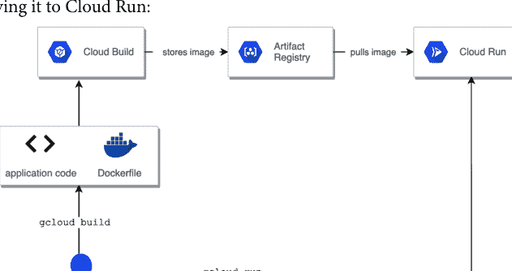

图 7.1 – 构建 Cloud Run 服务

你首先开发你的容器化应用程序，它可以侦听 HTTPS 或 gRPC (https://grpc.io/) 请求。为了从代码构建应用程序，你可以使用 Google Cloud Build 服务并将容器的镜像存储在 Artifact Registry 中。接下来，你必须告诉 Cloud Run 你的容器存储在哪里并定义一些参数，例如你一次想要运行的最大副本数或应用程序应如何触发。你请求部署，几秒钟后，你的应用即可为用户提供服务。

Cloud Run 将负责运行所有负责扩展应用程序和将流量负载均衡到你的 Cloud Run 服务的 Kubernetes 资源。它还将日志发送到 Cloud Logging 并将指标传递给 Cloud Monitoring。

如果你希望部署应用程序的新版本，可以直接从 Google 控制台进行操作。新版本可能包括应用程序代码的更改，这会导致构建新的容器。或者，它可能包括对参数的更改，例如服务的容器实例最大数量。

应用程序的新版本称为 Cloud Run 服务修订版 (https://github.com/knative/specs/blob/main/specs/serving/knative-api-specification-1.0.md#revision)，符合 Knative 命名约定：

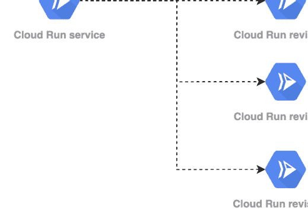

图 7.2 – Cloud Run 修订版

同样的问题能否用 GKE 实现？当然可以。不同之处在于，使用 Cloud Run，你在 GKE 中需要创建的所有 Kubernetes 资源，例如 Service、HorizontalPodAutoscalers 和 Deployments，都对你进行了抽象。这有助于你在无需掌握 Kubernetes 内部结构的情况下开发和部署云原生工作负载。

## Cloud Run 容器

在上一节中，我们查看了开发和部署 Cloud Run 应用程序的流程。该流程中的基本任务是构建容器。这是因为部署本身由 GCP 自动化，实施细节对开发者来说无关紧要。Cloud Run 容器需要满足多个要求才能执行。这在容器运行时契约中有很好的描述，你可以在这里找到：https://cloud.google.com/run/docs/reference/container-contract。让我们快速看一下要求清单：

- 你可以使用任何 *编程语言* 来开发你的应用程序。
- 可执行文件必须与 *Linux 64 位* 兼容（Linux x86_64 ABI 格式）。
- 你的应用程序必须侦听 *地址 0.0.0.0* 和你在 Cloud Run 配置中定义的一个端口。默认情况下，端口设置为 8080。配置的端口将作为 `PORT` 环境变量设置在容器中。
- 容器应侦听 HTTPS 或 gRPC 请求，并且 *TLS 不应在容器中直接实现*。TLS 在 Cloud Run 中实现并代理请求。
- 容器实例需要在服务部署期间指定的 *超时时间内返回响应*。如果连续出现超过 20 次超时，容器将被终止。
- 响应必须只包含 *可打印的非空白 ASCII 字符*（无冒号）。

另外，请注意，写入文件系统的数据驻留在容器实例的内存中，并在容器停止时不会持久保存。

## Cloud Run 触发器

正如我们已经了解的，Cloud Run 服务可以通过 HTTPS 或 gRPC 触发。然而，这些并不是唯一可用的选项。得益于与其他 Google Cloud 服务的集成，有一组触发器可与 Cloud Run 一起使用：

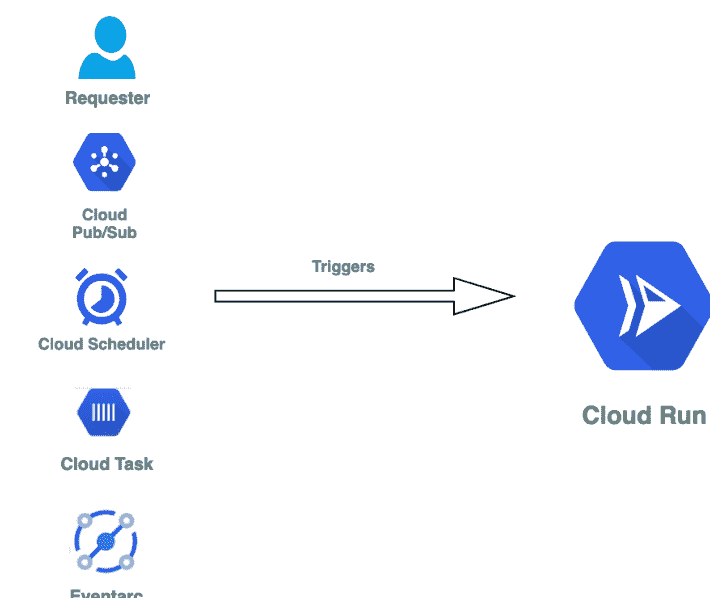

图 7.3 – Cloud Run 触发器

这些触发器如下：

- **HTTPS 或 gRPC 请求**：这是调用 Cloud Run 的最通用方式，可用于创建 Web API、中介软件、反向代理或 Web 应用程序。
- **Pub/Sub**：这可将 Cloud Run 用作 Webhook，Pub/Sub 消息将被推送。
- **Cloud Scheduler**：这允许你在计划的时间运行 Cloud Run。
- **Cloud Task**：异步执行 Cloud Run 服务。
- **Eventarc**：将 Cloud Run 连接到 Eventarc 支持的事件。

请查阅 Google Cloud Run 文档页面，了解如何将这些用于你的用例。如果这些触发器都不满足你的用例，你可能想查看 Eventarc，它提供了更大的灵活性。Eventarc 基于 Knative Eventing (https://knative.dev/docs/eventing/) 项目并提供更多触发器。


## 考试提示

我们不期望 PCA 考试中出现关于 Eventarc 的问题。但请留意考试指南，因为这可能会在没有通知的情况下发生变化。至少，你应该记住 Eventarc 允许你基于 Pub/Sub 和审计日志触发事件。后者极其强大，因为所有 Google Cloud 服务都可以生成审计日志。了解有关 Eventarc 的更多信息，请查看 https://cloud.google.com/eventarc/docs/creating-triggers。

## 部署到 Cloud Run

要能够使用 Cloud Run，你需要在 API 库中启用 Cloud Run API。如果只是想测试一个已经容器化的应用程序，你可以通过在 Cloud Shell 中运行以下命令将其部署到 Cloud Run：

```
gcloud run deploy [SERVICE] --image gcr.io/[PROJECT-ID]/[IMAGE]
```

这将使用存储在 gcr.io/[PROJECT-ID]/[IMAGE] 路径中的镜像部署名为 [SERVICE] 的 Cloud Run 服务。

## 重要说明

如果你尚未配置默认区域，将提示你进行配置。

对于考试，你应该了解可以为 Cloud Run 服务设置的高级设置。因此，让我们看看如何从 Cloud 控制台部署服务：

- 1. 从汉堡菜单中选择 Cloud Run。你将看到 Cloud Run 欢迎页面：


图 7.4 – Cloud Run 欢迎页面

2. 点击 CREATE SERVICE 链接。填写服务的名称并选择服务托管的区域。点击 NEXT 进入第 2 部分：

图 7.5 – 服务设置

3. 在第 2 部分，指定要用于部署的容器镜像路径并点击 NEXT：

图 7.6 – 配置服务的第一个版本

4. 或者，你也可以使用第二个选项；即 **从源代码库持续部署新版本**。下面，你会看到如果选择此选项，我们将需要提供代码所在的代码库。Cloud Build 将使用此代码为你构建镜像，将其存储在 Container Registry 中，并部署到 Cloud Run。在每次拉取请求时，流程都会再次执行。这样，你就可以为 Cloud Run 服务获得无缝的 GitOps 流程。点击 **ADVANCED OPTIONS** 下拉菜单：

## 使用 Cloud Build 设置

在 Cloud Build 驱动的持续部署下，对源代码库的更改会自动构建为 Container Registry 中的容器镜像并部署到 Cloud Run。

你的代码应监听 $PORT 上的 HTTP 请求。你的代码库必须包含 Dockerfile 或 Go、Node.js、Python、Java 或 .NET Core 的源代码才能构建为容器镜像。

## 1 源代码库

Repository Provider
GitHub

Repository *
konradclapa/hello-world-py
Can't find your repository? Manage connected repositories

I understand that GitHub content for the selected repositories will be transferred to this GCP project to provide the connected service. Members of this GCP project with sufficient permissions will be able to create and run triggers on these repositories, based on transferred GitHub content. I also understand that content from all GitHub app triggers in this GCP project may be transferred to GitHub in order to provide functionality like showing trigger names in GitHub build results. This will apply to all existing and future GitHub App triggers in this project. Learn more

ADVANCED OPTIONS

NEXT

## 2 Build Configuration

图 7.7 – 源代码库

5. 在 **Build Configuration** 步骤中，你可以配置将触发流程的分支，以及构建类型。你可以提供带有镜像清单的 Dockerfile，或使用 Google Cloud Buildpacks（https://cloud.google.com/blog/products/containers-kubernetes/google-cloud-now-supports-buildpacks）用于受支持的编程语言：

## Build Configuration

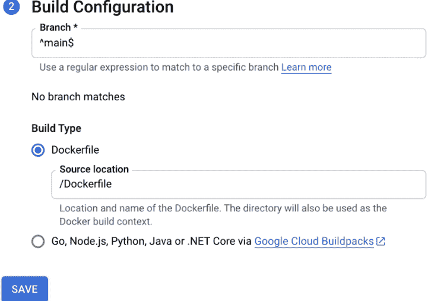

图 7.8 – Build Configuration

6. 在我们的场景中，我们将使用现有容器镜像继续部署。因此，我们必须返回到第 3 步的菜单并进入 **Advanced settings** 部分。此部分包含多个标签页。正如你将看到的，其中大多数设置是 Pod 或 Deployments Kubernetes 资源清单中也可以找到的参数。一些你可能不熟悉的其他设置来自 Knative Service（https://knative.dev/docs/serving）清单。

在 **CONTAINER** 标签页中，我们可以执行以下操作：

- 设置自定义容器端口。
- 定义应由容器执行的带参数的命令。
- 分配内存和 CPU。
- 设置请求超时。
- 配置 **每个容器的最大请求数。**
- 设置关于最小和最大实例数的自动扩缩：

## Advanced settings

CONTAINER
VARIABLES & SECRETS
CONNECTIONS
SECURITY

## General

Container port
8080
Requests will be sent to the container on this port. We recommend listening on $PORT instead of this specific number.

Container command
Leave blank to use the entry point command defined in the container image.

Container arguments
Arguments passed to the entry point command.

## Capacity

Memory allocated
512 MiB
Memory to allocate to each container instance.

CPU allocated
1
Number of vCPUs allocated to each container instance.

Request timeout
300 seconds
Time within which a response must be returned (maximum 3600 seconds).

Maximum requests per container
80
The maximum number of concurrent requests that can reach each container instance. What is concurrency?

## Autoscaling ?

Minimum number of instances *
0

Maximum number of instances
100

7. 在 **VARIABLES & SECRETS** 标签页中，你可以添加环境变量和密钥。这些环境变量可由你的应用程序用于存储配置。密钥对于向应用程序传递凭据很有用。了解有关使用密钥的更多信息，请访问 https://cloud.google.com/run/docs/configuring/secrets：

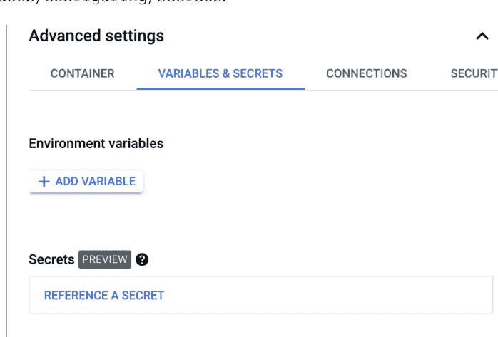

图 7.10 – VARIABLES & SECRETS

8. 在 **CONNECTIONS** 标签页中，你可以为服务启用 **HTTP/2 连接**（https://cloud.google.com/run/docs/configuring/http2）。请注意，默认情况下 Cloud Run 使用 HTTP/1。你还可以创建到 Cloud SQL 的连接以持久化数据。正如你可能回忆的那样，保存在容器中的所有数据在容器停止时都会消失。将数据存储在 Cloud SQL 中将允许你创建有状态应用程序。最后，你可以创建 VPC 连接器以与连接到 VPC 的任何工作负载进行通信：

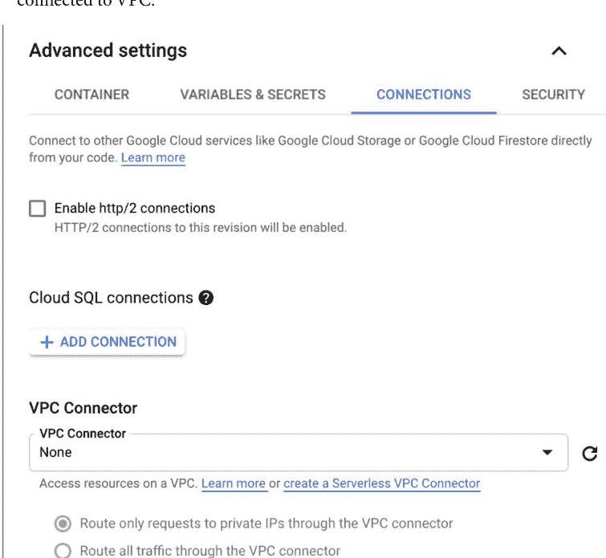

图 7.11 – CONNECTIONS

9. 在最后一个名为 SECURITY 的标签页中，你可以配置服务将使用的服务账号。你还可以配置 Binary Authorization（你将在第 8 章《使用 Anthos 管理云原生工作负载》中了解更多关于 Binary Authorization 的信息）和客户管理的加密密钥。我们将保持默认设置不变并点击 NEXT：

## Configure the service's first revision

A service can have multiple revisions. The configurations of each revision are immutable.

Deploy one revision from an existing container image

Container image URL *
us-docker.pkg.dev/cloudrun/container/hello
SELECT
E.g. us-docker.pkg.dev/cloudrun/container/hello
Should listen for HTTP requests on $PORT and not rely on local state. How to build a container?

Continuously deploy new revisions from a source repository

## Advanced settings

CONTAINER   VARIABLES & SECRETS   CONNECTIONS   SECURITY

Service account
Default compute service account
Identity to be used by the created revision.

Verify container deployment with Binary Authorization ? PREVIEW
Clicking the checkbox will enable the Binary Authorization API.

Use a customer-managed encryption key (CMEK) PREVIEW

NEXT

图 7.12 – SECURITY

10. 在第 3 阶段，我们定义服务将如何被触发。在 **Ingress** 部分，我们定义允许哪些流量。我们可以允许所有流量、允许内部流量和来自 Cloud Load Balancing 的流量，或仅允许内部流量。我们还必须选择身份验证方法。我们可以允许未经过身份验证的调用以实现公共访问，或使用 Cloud IAM 进行身份验证。通过点击 **+ ADD EVENTARC TRIGGER**，我们可以为服务定义触发器：

## 3 Configure how this service is triggered

A service can be invoked directly or via events. Click “Add Eventarc Trigger” to create a new event-based trigger. [Learn more](Learn more)

Ingress ?
● Allow all traffic
○ Allow internal traffic and traffic from Cloud Load Balancing
○ Allow internal traffic only

Authentication * ?
○ Allow unauthenticated invocations
Check this if you are creating a public API or website.
○ Require authentication
Manage authorized users with Cloud IAM.

+ ADD EVENTARC TRIGGER

图 7.13 – Configure how this service is triggered


11. 在此情况下，我们将使用默认的触发器，因此可以点击 DEPLOY 按钮。几秒钟后，我们将看到服务的单个修订版本已部署。所有请求都将定向到该修订版本。让我们点击 URL 链接，看看应用程序是否可以在互联网上访问：

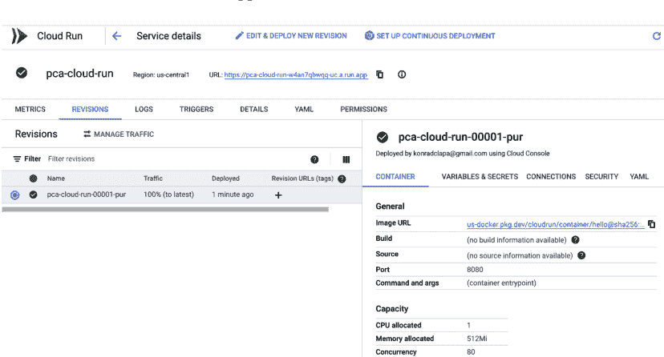

图 7.14 – 已部署的 Cloud Run 服务

正如我们所见，应用程序已成功部署，可以从互联网访问：

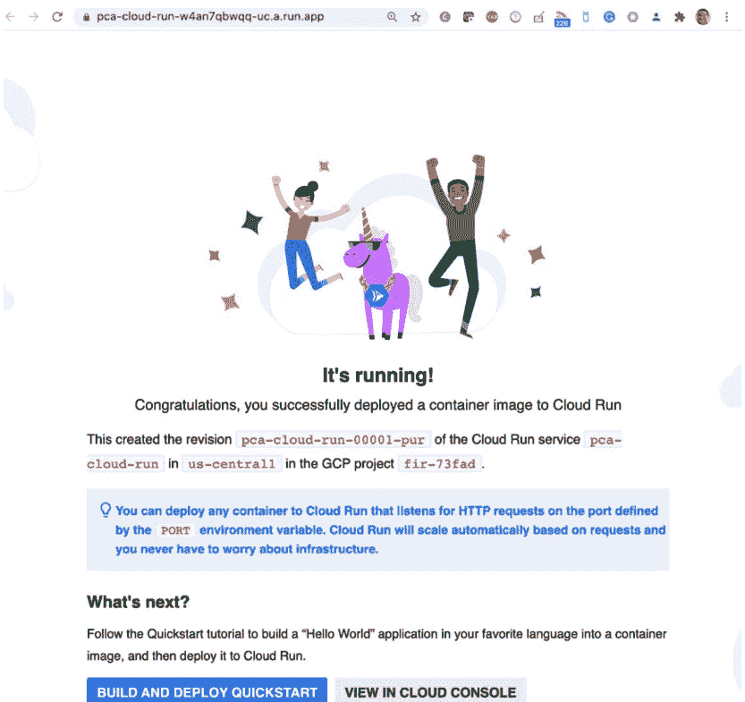

图 7.15 - 已部署的应用程序

恭喜 – 你已部署了第一个 Cloud Run 服务！现在，让我们学习如何部署应用程序的新修订版本。

## 部署新修订版本

要部署应用程序的新修订版本，请返回 Cloud Run 服务详情并按照以下步骤操作：

- 1. 点击 **EDIT & DEPLOY NEW REVISION** 按钮：


图 7.16 – EDIT & DEPLOY NEW REVISION

- 2. 让我们选择其中一个 **Capacity** 参数进行更改：

### Capacity

Memory allocated
512 MiB
Memory to allocate to each container instance.

CPU allocated
1
Number of vCPUs allocated to each container instance.

Request timeout
300 seconds
Time within which a response must be returned (maximum 3600 seconds).

Maximum requests per container
80
The maximum number of concurrent requests that can reach each container instance. What is concurrency?

图 7.17 – 更改容量

3. 我们将编辑 **Maximum requests per container** 属性，并将其从 80 改为 1。这意味着每个容器实例只能提供单个请求。默认情况下，每个容器可以提供 80 个请求。我们将保持 **Serve this revision immediately** 选项不变，以便所有流量都定向到新修订版本，而不是使用现有的拆分。点击 **DEPLOY** 按钮：

> **Exam Tip**
> Concurrency 是 Cloud Run 和 Cloud Functions 区别之一。在 Cloud Function 中，每个函数执行只能提供单个请求。

### Capacity

Memory allocated
512 MiB
Memory to allocate to each container instance.
CPU allocated
1
Number of vCPUs allocated to each container instance.

Request timeout
300 seconds
Time within which a response must be returned (maximum 3600 seconds).

Maximum requests per container
1
The maximum number of concurrent requests that can reach each container instance. What is concurrency?

### Autoscaling

Minimum number of instances *
0
Maximum number of instances
100

Serve this revision immediately
100% of the traffic will be migrated to this revision, overriding all existing traffic splits, if any.

DEPLOY   CANCEL

图 7.18 – 每个容器的最大请求数等于 1

4. 等待几秒钟后，你将看到新修订版本已部署。请注意，100% 的流量会自动路由到新修订版本：

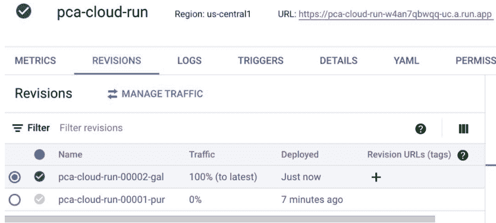

图 7.19 – 新修订版本已部署

5. 如果我们点击 MANAGE TRAFFIC 链接，将出现一个菜单。在此菜单中，你可以为特定修订版本设置自定义的流量百分比。这对于执行测试和回滚可能很有用。将此设置为 50:50 分割并点击 SAVE 按钮：

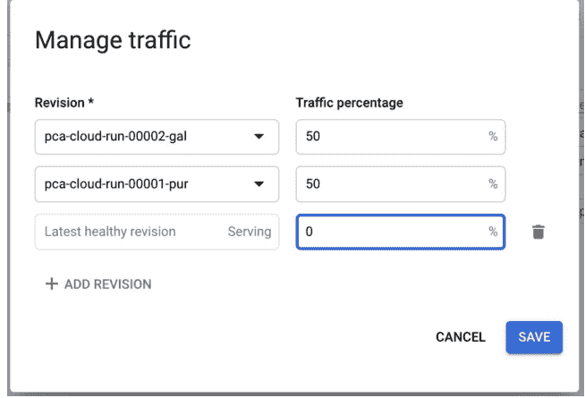

图 7.20 – 管理流量

6. 在 **Service details** 部分，我们将看到流量已在两个修订版本之间拆分：

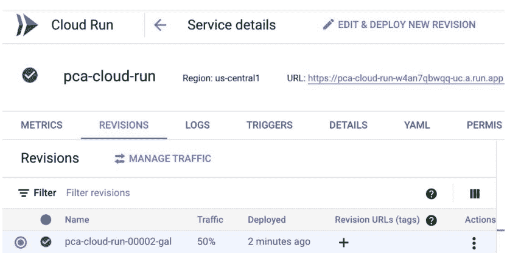

图 7.21 – 服务详情

至此，我们学习了如何部署 Cloud Run 服务的新修订版本，以及如何管理流量以将一定量的流量路由到特定修订版本。这例如可以帮助你对一小部分用户运行金丝雀部署。如果你想了解如何使用持续部署部署新修订版本，请访问 Konrad 的 YouTube 频道：https://www.youtube.com/watch?v=QjBbOKb9yns。

## 映射自定义域名

正如我们在前面的章节中所看到的，对于部署的每个 Cloud Run 服务，都会生成一个自动 URL。你可能希望映射自己的域名而不是使用生成的域名。这可以通过映射自定义域名的功能实现。它要求你执行以下操作：

- 将自定义域名映射到服务。
- 将 DNS 记录添加到你的域名注册商。

如果你没有域名，可以直接从 Cloud Run 控制台使用 Cloud Domains 服务注册域名。

请注意，此功能仅在少数区域可用。要查找所有受支持区域的列表并查看映射自定义域名的逐步操作，请查看 https://cloud.google.com/run/docs/mapping-custom-domains。

## IAM 角色

对 Cloud Run 的访问通过 IAM 保护。让我们看一下预定义角色的列表以及每个角色的简短描述：

- **Cloud Run admin** (`roles/run.admin`)：有权创建、更新和删除服务。还可以获取和设置 IAM 策略。部署服务需要额外的权限。
- **Cloud Run developer** (`roles/run.developer`)：有权创建、更新和删除服务。还可以获取但*不能*设置 IAM 策略。
- **Cloud Run viewer** (`roles/run.viewer`)：有权查看服务和获取 IAM 策略。
- **Cloud Run invoker** (`roles/run.invoker`)：有权调用服务。

## 配额和限制

Cloud Run 的配额和限制列表相当长，因此请参阅 https://cloud.google.com/run/quotas 获取详细列表。对于考试，你可能希望记住其中一些最重要的内容。

Cloud Run 具有以下限制：

- 每个区域 1,000 个服务
- 每个服务 1,000 个修订版本
- 每个服务 1,000 个容器实例（可扩展）
- 每个容器实例 8 GB 内存
- 每个容器实例 4 个 vCPU
- 8 GB 可写内存存储
- 最长 60 分钟超时
- 每个容器实例 250 个并发请求

## Exam Tips

请记住，Cloud Run 的超时时间为 60 分钟，而 Cloud Function 的超时时间为 9 分钟（540s）。这意味着 Cloud Run 可以成为 Cloud Function 会超时的情况下的解决方案。但是，请注意长时间运行容器实例的成本方面。此外，Cloud Run 最多可提供 250 个并发请求，而 Cloud Function 只能提供单个线程。

## 定价

由于 Cloud Run 是一种完全托管的服务，你按使用量付费，无需担心底层基础设施。了解这一点非常重要，因为我们了解到容器会在访问应用程序的请求触发时进行配置和取消配置。在 Cloud Run 的情况下，当应用程序运行时会产生费用，并且按最接近 100 毫秒计费。费用适用于以下情况发生的时间：

- 容器实例正在启动。
- 容器实例正在关闭并处理 SIGTERM (https://cloud.google.com/blog/products/containers-kubernetes/kubernetes-best-practices-terminating-with-grace) 信号。
- 至少有一个实例正在提供请求。

可计费的活动时间从第一个请求的开始到最后一个请求的结束：

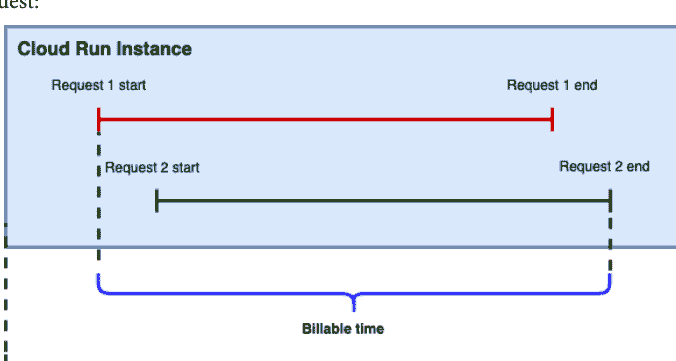

图 7.22 – Cloud Run 计费时间

Cloud Run 提供 200 万次请求的免费额度，前 100 万次请求提供 180,000 vCPU 秒和 360,000 GiB 秒的内存。北美境内还有 1 GiB 的免费出站流量。

请注意，如果你设置了最小容器实例数，你将始终为这些正在运行的容器付费。默认情况下，你的 Cloud Run 服务会缩减为零，空闲时间不收取费用。

## 总结

在本章中，我们学习了 Cloud Run，这是一种允许你在 Google Cloud 上无服务器运行云原生工作负载的服务。Cloud Run 将 Kubernetes 和 Knative 的所有实现细节抽象给开发者，并提供无缝的部署体验。开发者无需理解复杂的 Kubernetes 资源定义即可定义应用程序在负载下的行为。缩放和负载均衡在后台根据部署期间定义的参数完成。Cloud Run 与许多 GCP 服务集成，例如 Cloud IAM 和用于日志记录和监控的 Cloud operations 套件。

我们还部署了 Cloud Run 服务并学习了如何部署新修订版本。最后，我们学习了如何控制各种修订版本之间的流量。

在下一章中，我们将讨论 Anthos，这是一个 GCP 混合多云平台，允许你管理公共云以及本地数据中心中的云原生工作负载。

## 进一步阅读

有关本章涵盖主题的更多信息，请查看以下资源：

- **Overview:** https://cloud.google.com/run/docs
- **Developing the Cloud Run service:** https://cloud.google.com/run/docs/developing
- **Deploying to Cloud Run:** https://cloud.google.com/run/docs/deploying
- **Monitoring Cloud Run:** https://cloud.google.com/run/docs/monitoring
- **Cloud Run authentication:** https://cloud.google.com/run/docs/authenticating/overview
- **Limits and quotas:** https://cloud.google.com/run/quotas
- **Pricing:** https://cloud.google.com/run/pricing


