# 8 使用 Anthos 管理云原生工作负载

在前几章中，我们深入探讨了 Google Kubernetes Engine（GKE）和 Cloud Run，它们为云原生工作负载提供编排。在本章中，我们将介绍 Anthos；这是一个混合多云平台，允许您以一致且受控的方式在任何环境中运行云原生工作负载，无论是在公有云、本地还是边缘。

重要的是要理解 Anthos 采用非常敏捷的方式开发。每 3 个月发布一个新版本。因此，本章中我们不会引用 Anthos 的任何特定版本。相反，我们将向您解释主要概念并引用最新的文档，以便您保持更新并为考试做好准备。

### 考试提示
由于 Anthos 是一个非常热门的话题，它很可能出现在 PCA 考试中。请注意，Anthos 是一个非常广泛的话题，值得单独写一本书，然而，本章将为您提供一个良好的介绍，帮助您通过考试。
对于 PCA 考试，请准备对本章所述的所有 Anthos 服务有一个高层次的理解。即使您不应该期望关于 Anthos 如何工作以及如何配置相关服务的深入问题，我们也鼓励您尝试 Anthos Qwiklabs 以更好地理解它。

本章将涵盖以下主题：

- 什么是 Anthos？
- Anthos 集群部署选项
- Anthos 配置管理
- Anthos 服务网格
- Anthos 二进制授权
- 用于 Anthos 和 GKE 的迁移
- 用于 Anthos 的 Cloud Run

## Anthos 组件

Anthos 不是单一服务，而是一组组合成平台的服务。它允许您在任何部署位置管理并观察您的云原生工作负载。如图 8.1 所示，Anthos 由一组提供以下功能的服务组成：

- 基础设施管理
- 集群管理
- 服务管理
- 策略管理
- 配置管理

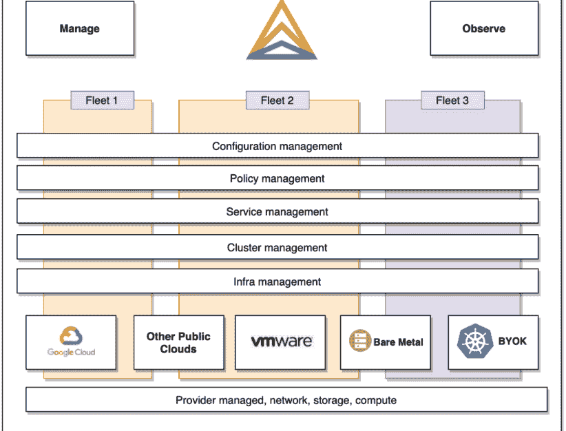

图 8.1 – Anthos 组件

Anthos 允许您将 Kubernetes 资源分组为舰队/环境，以便将它们作为单个实体进行管理。我们将在本章后面更详细地了解舰队。

## Anthos 集群

Anthos 集群允许您使用多个 Kubernetes 集群并为您的云原生工作负载提供一致且安全的环境。Anthos 可以在 Google Cloud Platform（GCP）中使用 GKE、在本地以及其他公有云中部署 Anthos 集群。您还可以附加已存在的 Kubernetes 集群，并在无需配置新的 Anthos 集群并迁移工作负载的情况下利用部分 Anthos 功能。

## Anthos Connect 代理

Anthos Connect 代理可以将任何 Kubernetes 集群连接到 GCP。通过将集群连接到 GKE Hub，您能够直接从 Cloud Console 访问集群并与托管的工作负载进行交互。代理作为名为 Connect Agent 的 Kubernetes Deployment 运行，并与 GKE hub 建立加密连接：

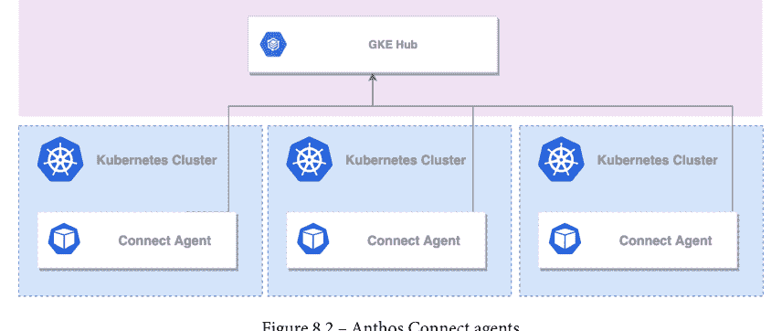

图 8.2 – Anthos Connect 代理

对于集群无法直接访问互联网的场景，代理可以配置为使用 NAT 或代理进行到 GKE hub 的出口。一旦您在 GKE hub 中注册了集群，您将获得与 Kubernetes 集群交互的类似 GKE 的体验。

## 舰队（以前称为 environs）

舰队（以前称为 environs）允许您逻辑地组织舰队感知资源，例如 Kubernetes 集群，以便更轻松地进行管理。例如，您可以在资源上应用统一的配置或策略，以实现舰队内部的一致性。

舰队具有以下限制：单个舰队只能关联到一个名为舰队主机项目的 GCP 项目，并且舰队项目只能有一个舰队。此限制导致在项目级别上对资源进行隔离。

舰队可用于与 **舰队启用组件** 配合使用，例如以下内容：

- **工作负载身份池** – 允许您统一授权池中的工作负载访问外部服务
- **Anthos 配置管理** – 允许您在舰队中的集群和资源上统一应用配置并强制执行策略
- **Anthos 服务网格** – 允许您在舰队中的资源之间创建服务网格
- **多集群入口（MCI）** – 允许您为舰队中的集群和服务端点创建通用入口以提供负载均衡

舰队的另一个重要元素是同一性概念。在不同上下文中但名称相同的对象可以被视为同一实体。这包括以下上下文：

- 命名空间同一性
- 服务同一性
- 访问外部资源时的身份同一性
- 舰队内部的身份同一性

例如，对于命名空间同一性，同一舰队中不同集群中名称相同的命名空间被视为单个实体。

## Anthos 集群部署选项

Anthos 提供了多种部署选项，允许您几乎在任何地方托管云原生工作负载。如前所述，Anthos 是一个发展非常快的平台。因此，您应始终查阅文档以查找最新的支持端点和功能列表，网址为 https://cloud.google.com/anthos/deployment-options。以下图表显示了在撰写本书时可用的和计划中的部署选项：

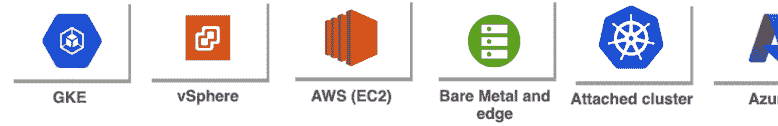

图 8.3 – Anthos 部署选项

另请注意，您可以附加使用托管 Kubernetes 服务在 **Azure Kubernetes Service（AKS）** 和 **Amazon Elastic Kubernetes Service（EKS）** 中配置的 Kubernetes 集群。如果您查看前面的链接，您可能会注意到新的 Anthos 功能总是首先引入 GKE（即在 GCP 上）。这是因为 GKE 非常适合 Anthos 生态系统并利用 GCP 基础设施。您也可以预期，后来附加的在 Anthos 之外配置的集群可能由于技术限制而在功能方面存在一些限制。

现在让我们对每个部署选项进行高层次的了解。

请注意，在 *第 6 章，使用 Google Kubernetes Engine 管理 Kubernetes 集群* 中，我们对 GKE 服务进行了全面回顾。如果您想获取有关此部署选项的更多信息，我们鼓励您重温该章节。要为 GKE 启用 Anthos，请按照此处可以找到的分步指南进行操作：https://cloud.google.com/anthos/docs/setup/cloud。

## Anthos 集群在 VMware 上（GKE on-prem）

Anthos 集群在 VMware 上（GKE on-prem）是第一个将 GKE 引入本地数据中心的部署选项。它可以在基于 **VMware vSphere** 的现有虚拟化平台上运行。Anthos 通过 **vCenter** API 作为基础设施管理层与 vSphere 通信，以配置托管 Kubernetes 节点的 **虚拟机（VM）**。这样我们就能为 GKE on-prem 部署配置控制平面和工作负载集群。

由于 vSphere 是市场上最成熟且被广泛采用的虚拟化平台之一，它具有非常复杂的特性集，包括软件定义网络、存储和高级 API。它也被认为是私有云的最新基础架构。由于 vSphere 通过为软件定义基础设施提供自动化来消除管理开销，因此它是 Google 选择 vSphere 作为 GKE on-prem 的第一个端点的自然选择。您必须意识到，这会带来一些成本，因为您需要在常规许可证之外购买 vSphere 许可证。

## GKE on-prem 组件

在 *第 6 章，使用 Google Kubernetes Engine 管理 Kubernetes 集群* 中，我们了解到 GKE 集群的管理平面位于 GCP，我们作为消费者无需担心它。GCP 负责 GKE Kubernetes 集群的控制平面和数据平面的配置和管理。


当我们迁移到本地部署或另一家云服务提供商时，管理平面位于 GCP 之外。在大多数非 GCP 的 Anthos 集群中，管理平面托管在一个所谓的 **admin cluster** 上，如图 8.4 所示：

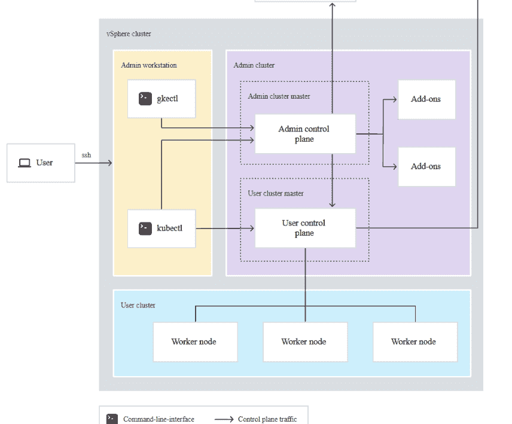

图 8.4 – GKE on-prem 组件（来源：https://cloud.google.com/anthos/clusters/docs/on-prem/overview?hl=pl）

> **重要说明**
> Google 正在不断完善这一架构，并尝试减少或移除 admin cluster 的角色。因此，请注意未来可能会发生变化。

Admin cluster 是一个 Kubernetes 集群，作为 Anthos 集群的基础层进行配置，并运行以下组件：

- **Admin cluster control plane**：托管 admin cluster 的 Kubernetes API、调度器和控制器
- **User cluster control plane**：这些是用户集群控制平面的节点。它们托管用户集群的 Kubernetes API、调度器和控制器
- **Add-ons**：运行 Kubernetes 插件，例如 Google Cloud 的运维套件

需要注意的是，**user clusters**（工作负载集群）的 master 节点运行在 admin cluster 中，而不是在用户集群本身中。

在图 8.4 中你还可以看到 **Admin workstation**，它是一个基于 Linux 的虚拟机。该机器包含下载、配置和管理 GKE on-prem 集群所需的所有工具。

## 负载均衡

负载均衡既需要用于 Anthos on-premises 的管理平面，也需要用于暴露 Kubernetes 服务。有三种负载均衡模式可供选择：

- **Integrated** – 使用 F5 BIG-IP 负载均衡器，需要在 Anthos 集群之外进行配置。通过 API 与 F5 深度集成，因此当服务部署在 Anthos 集群中时，操作员会负责在 F5 设备中创建对象，无需人工干预。请注意，F5 许可证不包含在 Anthos 的费用中
- **Bundled** – 负载均衡器在 Anthos 部署期间进行配置。它基于开源的 Google Seesaw 负载均衡器项目。要了解有关该项目的更多信息，请访问 https://github.com/google/seesaw
- **Manual** – 允许你集成其他第三方负载均衡器

合适的负载均衡模式的选择取决于多个因素，包括你的网络架构、对特定功能的需求以及成本限制。在决定使用哪种负载均衡模式之前，你可能需要咨询数据中心网络架构师。

## GKE on-prem 集群的部署

正如你所想象的，本地集群的部署并不像在 Google Cloud 上部署 GKE 那样简单简单。截至目前，无法直接从 Google Cloud Console 部署 GKE on-prem 集群。对于 GKE on-prem，你将使用命令行工具 `gkeadm` 和 `gkectl`，它们可以直接从本地的 admin workstation 运行。

部署 GKE on-prem 的高层步骤如下：

- 1. 部署和/或准备 vSphere 基础设施。
- 2. 准备你的 Anthos GCP 项目和服务账号。
- 3. 部署 admin workstation 并下载 Anthos 镜像。
- 4. 为 admin cluster 部署集成、手动或捆绑的负载均衡器。
- 5. 部署 admin cluster。
- 6. 为 user cluster 部署集成、手动或捆绑的负载均衡器。
- 7. 部署 user cluster。
- 8. 配置其他服务（例如 Anthos Service Mesh、Config Management 等）。

请注意，此流程可能会发生变化，因此要获取 GKE on-prem 集群的分步安装指南，请访问 https://cloud.google.com/anthos/clusters/docs/on-prem/overview?hl=pl。

## Anthos on AWS

Anthos 集群 on AWS（GKE on AWS）允许你将云原生平台扩展到 AWS 云。它利用 AWS 原生服务，包括以下内容：

- EC2 虚拟机
- **Elastic Block Storage (EBS)**
- **Elastic Load Balancer (ELB)**

这使你能够利用 Anthos 的优势，同时原生使用 AWS 服务。

### Anthos on AWS 组件

Anthos on AWS 已遵循减少 admin cluster 占用或完全移除 admin cluster 的架构决策（参见 *GKE on-prem 组件* 部分）。因此，Anthos 集群 on AWS 有两个组件：

- **Management service：** 这允许我们通过 AWS API 安装、更新和管理用户集群
- **User cluster：** 运行用户工作负载

下图显示了 Anthos on AWS 的架构：

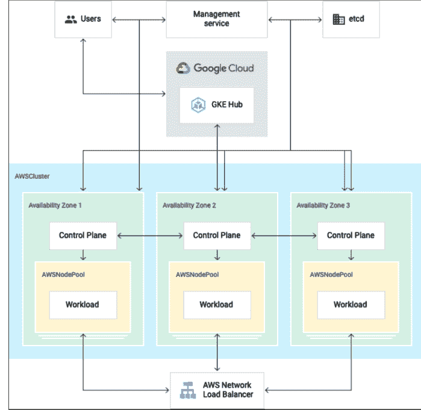

图 8.5 – Anthos on AWS（来源：https://cloud.google.com/anthos/clusters/docs/aws/concepts/architecture?hl=pl）

正如我们在图中看到的，管理服务和用户集群都位于 AWS 中，并连接到位于 GCP 中的 GKE hub。

## 负载均衡

Anthos on AWS 使用 AWS 原生的 ELB，因此无需安装或配置额外的负载均衡器。这消除了管理第三方产品所需额外工具的需求，并为你提供了与 AWS 生态系统深度集成的最佳负载均衡选项。

## Anthos on AWS 的部署

Anthos on AWS 的部署包括以下步骤：

- 1. 准备 AWS 账号。
- 2. 安装管理服务。
- 3. 创建用户集群以运行你的工作负载。

你可以通过以下链接找到分步安装流程：https://cloud.google.com/anthos/clusters/docs/aws/how-to/installation-overview?hl=pl。

## Anthos on Azure

在撰写本章时，Anthos on Azure 的预览版已被宣布。当前功能有限。你可以部署 Anthos 集群和工作负载，但某些管理选项尚未提供。例如，你可以使用 Connect 网关连接到集群，但无法使用 Terraform 管理集群。然而，Google 已宣布这很快会得到解决。

### Anthos on Azure 组件

Anthos on Azure 的架构与我们在 AWS 上看到的非常相似。因此，Anthos 集群 on Azure 有两个组件：

- **Management service：** 这允许我们通过 Azure API 安装、更新和管理用户集群
- **User cluster：** 运行用户工作负载

下图显示了 Anthos on Azure 的架构：

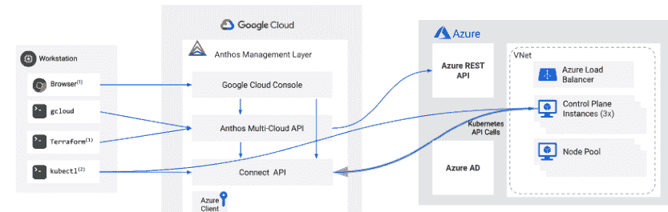

图 8.6 – Anthos on Azure（来源：https://cloud.google.com/anthos/clusters/docs/azure/concepts/architecture）

让我们更详细地了解 Anthos on Azure 的各个组件。

### Management service

Anthos on Azure 的管理服务包括以下内容：

- **Anthos multi-cloud API**，接受 `gcloud` 命令以配置和管理 Anthos 集群
- **AzureClient**，使用 X.509 密钥对与 Azure 建立安全连接，私钥存储在 GCP，公钥存储在 Azure
- **App Registration**，允许 Anthos 集群使用 AzureClient 在 Azure 中创建资源
- **Connect API**，允许直接从 Google Cloud Console 管理集群

### User cluster

用户集群有两个组件：控制平面和至少一个节点池。控制平面负责在高可用的 etcd 数据库中存储配置。控制平面可以管理多个节点池。节点池由充当工作节点的虚拟机构成。

## 负载均衡

Anthos on Azure 对集群控制平面和工作负载均使用 Azure 原生的 Azure Load Balancer。当用户部署类型为 LoadBalancer 的 Kubernetes Service 时，负载均衡器会由 Anthos 自动化自动配置。

## Anthos on Azure 的部署

Anthos on Azure 的部署包括以下步骤：

- 1. 准备 Azure 账号。
- 2. 安装管理服务。
- 3. 创建用户集群。
- 4. 创建节点池。

你可以通过以下链接找到分步安装流程：

```
https://cloud.google.com/anthos/clusters/docs/azure/how-to/installation-overview.
```

## Anthos 集群 on 裸金属

使用 Anthos on bare metal，你可以利用现有基础设施，而无需将 vSphere 作为虚拟化层。由于 Anthos 直接在硬件上运行，因此可以获得最佳性能，包括低网络延迟。使用 Anthos 集群 on bare metal 的成本因无需支付 vSphere 许可证而降低。另一个好处是，你可以通过将 Anthos 集群移至网络边缘来降低延迟。


Figure 8.7 shows the three layers of an Anthos cluster on bare metal: the hardware, operating system, and Anthos itself. You can install the cluster on the nodes running CentOS, RHEL, or Ubuntu:

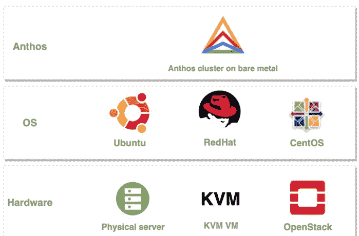

Figure 8.7 – Anthos cluster on bare metal

Consult the documentation for the exact supported versions of your chosen OS.

The Anthos cluster nodes can be also installed on VMs so you can take advantage of your existing hypervisors.

In this deployment option you are responsible for providing the hardware and managing the operating system of the cluster nodes. Google is responsible for providing you the Anthos binaries. You manage the Anthos cluster yourself.

## Anthos on bare metal cluster types

Anthos clusters on bare metal consist of two types of clusters:

- Admin clusters to control the resources of your clusters
- User clusters to run workloads

You can also choose to deploy the cluster in the following modes:

- **Hybrid cluster**: Clusters that combine administration tasks and workloads, as well as controlling other user clusters. The first cluster acts as both the admin and user clusters while other clusters act as user clusters
- **Standalone cluster**: A single standalone Anthos cluster on bare metal
- **Multi-cluster**: A single management cluster with one or more user clusters

This gives you a lot of flexibility in terms of architecting your cluster. You can either choose to have a standalone cluster or manage multiple clusters with an admin cluster.

## Load balancing modes

As in other deployment options, you need to make a choice on a load balancer for both the control plane and workloads. With bare metal you can choose from the following:

- **Bundled load balancer**: Where the load balancer is deployed on a dedicated pool of worker nodes on your control plane cluster nodes
- **Manual load balancer mode**: Where you deploy the load balancer outside of the cluster. You can use either **MetalLB** or **F5 BIG-IP**

Note that for the bundled load balancer there is a requirement that all nodes are in the same L2 subnet as it uses ARP broadcasts.

## Summary of Anthos clusters on bare metal

Anthos clusters on bare metal cover all use cases where there is a need for high performance and direct access to underlying hardware. One such use case is in telco scenarios. Another interesting feature is the capability of hosting VMs using an open source project called Kubevirt (https://kubevirt.io). To learn more about Anthos clusters on bare metal have a look at the following link: https://cloud.google.com/anthos/clusters/docs/bare-metal.

## Anthos Config Management

Anthos Config Management comes with a suite of components that provide you with constant configuration and policies across multiple Anthos clusters. The components are interoperable but can also be used independently of each other. Figure 8.8 shows three components included in the service:

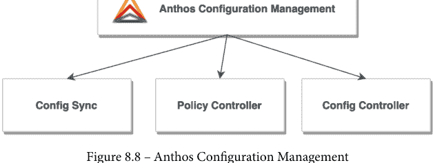

Figure 8.8 – Anthos Configuration Management

Let's look at the components in more detail:

- **Config Sync** continuously reconciles the state of your clusters with a central set of configurations stored in one or more Git repositories. This feature lets you manage common configurations with an auditable, transactional, and version-controlled deployment process that can span hybrid or multi-cloud environments:

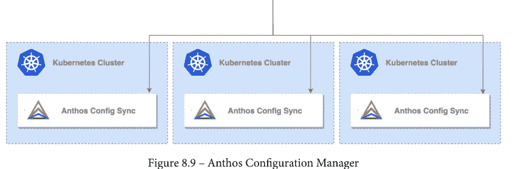

Figure 8.9 – Anthos Configuration Manager

- **Policy Controller** enables the enforcement of fully programmable policies. You can use these policies to actively block non-compliant API requests, or simply to audit the configuration of your clusters and report violations. Policy Controller is based on the open source Open Policy Agent Gatekeeper project and comes with a library of pre-built policies for common security and compliance checks:

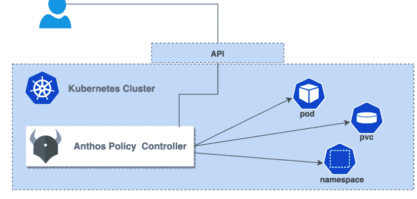

Figure 8.10 – Anthos Policy Controller

The policies are enforced by using objects called constraints. For example, you can use a constraint to require each namespace to have at least one label, or restrict the repositories a given container image can be pulled from. You can also create your own polices with the use of constraint templates. You can find the Google-developed constraint library at https://cloud.google.com/anthos-config-management/docs/reference/constraint-template-library.

As policies are defined as Kubernetes objects, they can be pushed directly to the cluster with the use of a Git repository and the Config Sync service.

As we can see, Config Management is a very powerful service that can help you keep control of your Anthos clusters.

**Config Connector** allows you to provision and manage GCP resources using Kubernetes manifests. This way, you gain a single API to provide both GCP and Kubernetes resources:

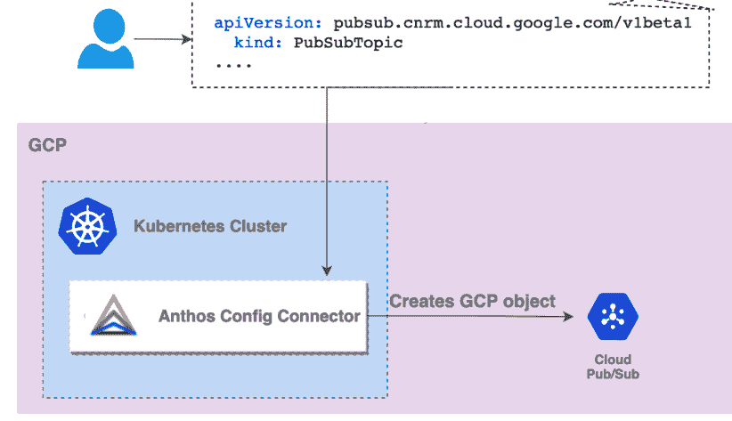

Figure 8.11 – Anthos Config Connector

Config Connector comes with **Custom Resource Definitions (CRDs)** and associated controllers for almost all GCP services. If you want to learn more about the resources supported, visit https://cloud.google.com/config-connector/docs/reference/overview.

The Config Controller service, at the time of writing this book, is in a preview state. It is a Google-hosted service that combines the Config Connector and Config Sync services to allow GitOps operations for Google Cloud and Anthos resources. To achieve this, an administrator defines the desired state of the resources using Config Connector CRDs and stores them in a Git repository. Config Sync makes sure the desired state is enforced.

> **Important Note**
> It is possible that rebranding of this service might happen without any notice, so please refer to the link: https://cloud.google.com/anthos-config-management/docs/concepts/config-controller-overview to learn about current status of the service.

## Service management with Anthos Service Mesh

Anthos Service Mesh is a fully managed service mesh for microservices architectures. It is based on an open source project, started by Google, called Istio. Google is gradually integrating Istio's functionalities with other Google Cloud services such as the Cloud operations suite to provide an enterprise-grade service mesh offering. Let's have a look at Istio first to understand how it works so we can better understand Anthos Service Mesh.

## Istio

Istio is an open source service mesh project. It runs in Kubernetes but may also integrate with traditional workloads hosted on VMs. It provides a programable and application-aware network. With the use of open source Envoy proxies, the traffic between microservices is intercepted and can be controlled, secured, and observed. This allows us to gain full control and visibility of the traffic between complex microservice-based applications. As we see in Figure 8.12, Istio injects Envoy sidecar proxies to the Kubernetes Pods:

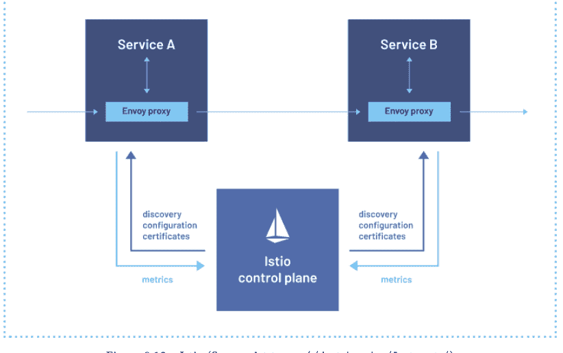

Figure 8.12 – Istio (Source: https://istio.io/latest/)

This way, all the ingress and egress traffic needs to pass through the proxies. The Istio control plane is a Kubernetes application that runs on your cluster. It gathers the metrics and controls network traffic based on the characteristics defined in the Kubernetes manifest.

With Istio you can perform the following tasks:

- **Request routing**: Route requests to multiple versions of a microservice
- **Fault injection**: Inject faults to test the resiliency of the application
- **Traffic shifting**: Gradually migrate traffic between different versions of a microservice to another
- **Query metrics**: Query for Istio metrics using **Prometheus**
- **Visualize metrics**: Use the Istio Dashboard to monitor mesh traffic using **Grafana**
- **Access external services**: Configure the Envoy proxy to pass through requests for unknown services
- **Visualize the service mesh**: Use the Kiali web-based graphical user interface to view service graphs of the mesh and your Istio configuration objects
- **Encrypt the traffic**: Enforce encryption of the traffic between microservices using mTLS

> **Exam Tip**
> Make sure you understand well all the capabilities of Istio and Anthos Service Mesh: request routing; fault injection; traffic shifting; querying metrics; visualizing metrics; accessing external services; visualizing your mesh.

## Configuring Istio

You can install Istio on you any Kubernetes cluster by following the official guide at https://istio.io/latest/docs/setup/getting-started. Once you have Istio installed you can define for which namespace you want the sidecar proxies to be injected by labeling the namespace:

```
kubectl label namespace default istio-injection=enabled
```

In the guide mentioned above, you download the Istio repository that contains a sample application called Bookinfo. Deploy the application to the default namespace by running the following command:

```
kubectl apply -f samples/bookinfo/platform/kube/bookinfo.yaml
```

You can list the Pods by running the following command:

```
kubectl get pods
```


当你运行前面的命令时，你会看到 sidecar 代理已被自动添加到 Pods 中。正如我们在此看到的，2/2 个容器（工作负载和代理）均报告为 READY：

| NAME | READY | STATUS | RESTARTS | AGE |
|---|---|---|---|---|
| details-v1-558b8b4b76-2ll1d | 2/2 | Running | 0 | 2m41s |
| productpage-v1-6987489c74-lpkg1 | 2/2 | Running | 0 | 2m40s |
| ratings-v1-7dc98c7588-vzftc | 2/2 | Running | 0 | 2m41s |
| reviews-v1-7f99cc4496-gdxfn | 2/2 | Running | 0 | 2m41s |
| reviews-v2-7d79d5bd5d-8zqqd | 2/2 | Running | 0 | 2m41s |
| reviews-v3-7dbcdcbc56-m8dph | 2/2 | Running | 0 | 2m41s |

图 8.13 – Bookinfo 应用 Pod

## 使用 Istio

正如我们已经看到的，Istio 具有很多功能。作为一个示例，你可以执行流量拆分。假设我们希望将流量平均分配到 reviews:v1 和 reviews:v3 服务之间。

你可以在 Kubernetes 清单中通过 VirtualService 对象定义此规则，并使用 kubectl apply 命令应用它：

```
apiVersion: networking.istio.io/v1beta1
kind: VirtualService
metadata:
  name: reviews
spec:
  hosts:
    - reviews
  http:
  - route:
    - destination:
        host: reviews
        subset: v1
        weight: 50
    - destination:
        host: reviews
        subset: v3
        weight: 50
```

Istio 将确保传入流量在两个服务之间平均分配。

> 考试提示
> 对于 PCA 考试来说，并不需要深入了解 Istio 的知识，但如果你想了解更多如何使用它的方法，可以在 https://istio.io/latest/docs/setup/getting-started/ 找到逐步指南。

## 使用 Anthos Service Mesh

现在我们知道了 Istio 是什么，让我们来看看 Anthos Service Mesh，它是 Istio 的托管版本。需要注意的是，和往常一样，Anthos Service Mesh 的功能会首先引入到 GCP 上的 GKE，然后再引入到 Anthos 集群的其他版本。由于列表很长，请查看最新列表 https://cloud.google.com/service-mesh/docs/supported-features。

由于 Anthos Service Mesh 只是 Istio 的 Anthos 验证和优化发行版，因此你可以像使用开源版本一样使用 Istio CRDs。

Anthos Service Mesh 带来的额外优势来自于与 GCP 生态系统的集成。这意味着你可以在 Google Cloud Console 中获得对网格的单一视图。你可以可视化所有服务及其之间的流量，并在 Cloud Monitoring 中创建警报。你可以从 Anthos 控制台的 Service Mesh 菜单中访问它：

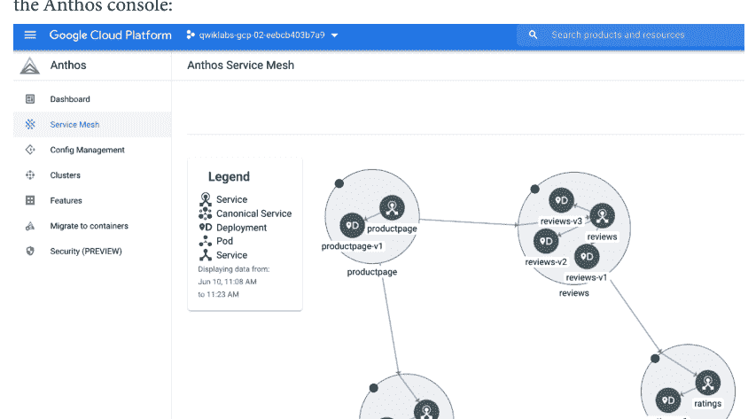

你还可以使用 Anthos Service Mesh 左侧菜单中的 Traffic 选项查看每个服务的流量详情：

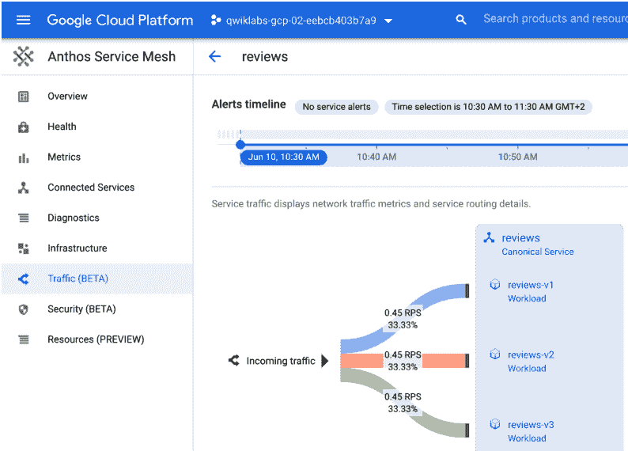

图 8.15 – 服务流量可视化

这将显示有多少流量被路由到每个版本。

## 服务等级目标

另一个非常有用的功能是，你可以基于 **服务等级指标 (SLIs)** 创建所谓的 **服务等级目标 (SLOs)**。SLI 衡量服务的运行情况。指标可以基于可用性或延迟：

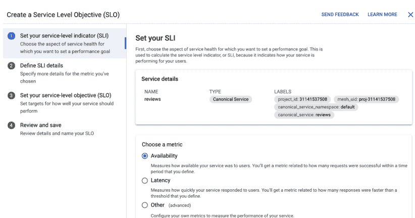

图 8.16 – 创建 SLO

你也可以选择使用高级选项并定义自己的指标。

## Anthos Service Mesh 总结

正如我们在此学到的，Anthos Service Mesh 是一个非常强大的工具，可以让你控制 Anthos 集群内的流量。它还通过能够查看与之相关的指标，为你的应用程序健康状况提供出色的洞察。

如果你想亲身体验 Anthos Service Mesh，请查看 https://www.qwiklabs.com/ 上的 GSP656 - Traffic Management with Anthos Service Mesh 实验。

## Anthos 多集群入口 (MCI)

Anthos MCI 是你在 Anthos 订阅下可用的服务。它基于 Google 的外部 HTTP(S) 负载均衡服务架构构建，代理部署在全球超过 100 个 Google **存在点 (PoPs)**。正如我们在图 8.17 中看到的，MCI 为应用程序提供单一 IP，与应用程序部署位置无关。

> **考试提示**
> 当需要为多集群和多区域应用程序进行负载均衡时，应使用 MCI。它是外部 HTTP(S) 负载均衡器的控制器，为来自互联网的流量提供进入一个或多个 Anthos 集群的入口。

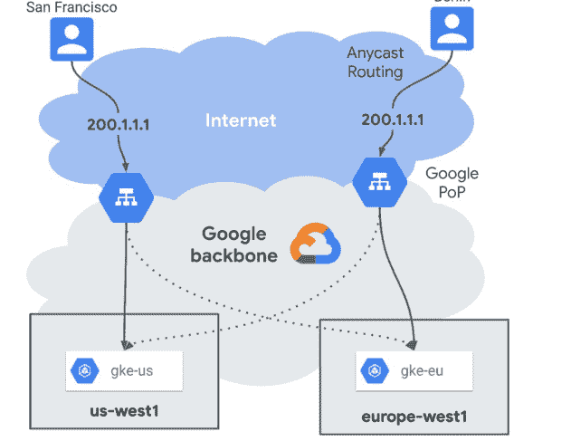

图 8.17 – Anthos MCI（来源：https://cloud.google.com/kubernetes-engine/docs/concepts/multi-cluster-ingress）

Anthos MCI 带有两个非常强大的功能，支持多集群设置。

MCI 的基于接近度的路由会将用户定向到距离他们最近的集群。MCI 的健康检查使我们能够无缝执行集群升级和流量故障转移。

你可以在 https://cloud.google.com/kubernetes-engine/docs/concepts/multi-cluster-ingress 了解更多关于使用 MCI 的信息。

## Anthos 二进制授权

二进制授权是 Google Cloud 的一项服务，旨在为你的容器化软件供应链提供安全性。它降低了部署有缺陷、存在漏洞或未经授权的软件的风险。

它允许你在尝试在一个受支持的平台上部署容器时创建策略。它是通过所谓的证明来实现的，这些证明为部署的镜像进行认证。

截至本书撰写时，二进制授权支持以下平台：

- GKE
- Cloud Run
- Anthos 在 VMware 上的集群

二进制授权补充了 Google 软件供应链服务套件，其中包括 Cloud Source Repositories、Cloud Build、Artifact Registry 和 Container Analysis：

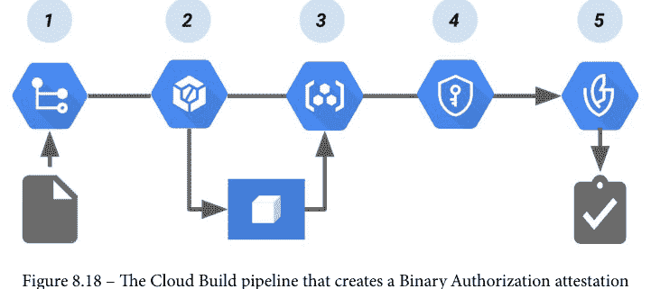

图 8.18 – 创建二进制授权证明的 Cloud Build 流水线
（来源：https://cloud.google.com/binary-authorization/docs/cloud-build?hl=zh-tw）

正如我们在前面的图表中看到的，流水线的工作方式如下：

- 1. 开发者将构建容器镜像的代码推送到 **Cloud Source Repositories**。
- 2. **Cloud Build** 构建容器镜像。
- 3. **Cloud Build** 将容器镜像推送到 **Artifact Registry**。
- 4. **Cloud Key Management Service** 创建用于签署容器镜像的加密密钥对。签名随后存储在证明中。
- 5. 在部署期间，**Binary Authorization** 中的证明者使用密钥对的公钥验证证明。

使用二进制授权应被视为生产工作负载部署的最佳实践。

## Migrate for Anthos 和 GKE

Migrate for Anthos 和 GKE 使我们能够通过提取和迁移传统 VM 主持的应用程序到可以在 GKE 或 Anthos 集群上运行的容器中，来现代化传统 VM 主持的应用程序。这带来了以下好处：

- 通过使用容器优化集群资源使用，实现 **更好的密度**
- 具有 **安全优化的节点内核**，无需更新操作系统
- **将传统应用与现代服务集成**，包括 Anthos Service Mesh、Cloud Logging、Cloud Monitoring 和其他 GCP 原生服务，以将基础设施相关功能卸载到 GCP
- 使用声明式定义进行 **统一的策略和配置管理**
- 通过与 CI/CD 工具的集成实现 **现代化的基于镜像的管理和编排**

截至本书撰写时，以下目标平台受支持：

- GKE
- GCP 上的 Anthos 集群
- VMware 上的 Anthos 集群
- AWS 上的 Anthos 集群

该服务可用于 Windows 和 Linux VM 作为迁移的源。

对于 Linux VM，迁移过程包括以下步骤：

- 1. 将 VM 的操作系统内核交换为 GKE 节点使用的内核
- 2. 设置网络接口、DNS、日志记录和健康状态
- 3. 运行 VM 用户空间中找到的应用程序和服务
- 4. 移除 VM 或硬件相关服务

对于 Windows VM，会生成包含容器镜像定义的 Dockerfile 和包含应用程序内容的 ZIP 文件。会使用官方的 Microsoft Windows Server 镜像。

迁移过程分为多个阶段：

- 1. 发现阶段
- 2. 迁移规划阶段
- 3. 着陆区阶段
- 4. 迁移和部署阶段
- 5. 运行和优化阶段

如果你想了解更多关于 Migrate for Anthos 和 GKE 的架构以及迁移的详细流程，请访问 https://cloud.google.com/migrate/anthos/docs/concepts。

## Anthos 的 Cloud Run

在第 7 章《使用 Cloud Run 部署云原生工作负载》中，我们了解了 Google Cloud Run，它允许我们在 GCP 上运行类似无服务器的云原生工作负载。有了 Anthos 的 Cloud Run，此功能可用于在 GCP、公有云或本地的 Anthos 集群上执行。由于 Anthos 的 Cloud Run 由开源 Knative (https://knative.dev) 项目提供支持，因此工作负载可移植到任何 Kubernetes 集群。

对于已启用的 Anthos 项目，当你创建 Cloud Run 服务时，应为部署平台选择 Anthos 的 Cloud Run 而非 Cloud Run（完全托管）：


## 服务设置

服务会公开唯一的端点，并自动扩展底层基础设施以处理传入请求。部署平台和服务名称无法更改。

### 部署平台

Cloud Run（完全托管）
Cloud Run for Anthos

你没有任何启用了 Cloud Run for Anthos 的集群。创建 Anthos GKE 集群以开始。了解更多
CREATE CLUSTER

可用 Anthos GKE 集群 *
cloudrun-default-cluster (will be created) us-central1-a
此服务的集群之后无法更改。了解更多

命名空间
default

### 服务名称 *

cloudrun-test

### 连接性 *

内部
服务只能通过集群网络调用，且无法从互联网访问。
外部
服务可以通过互联网调用，除通过集群网络外。

### 图 8.19 – Cloud Run for Anthos

如果你没有任何启用了 Cloud Run 的 Anthos 集群，集群将为你创建。如果你想创建启用了 Cloud Run 的集群，请将以下标志添加到 gcloud 命令中：

```
gcloud container clusters create CLUSTER_NAME \
  --addons=HttpLoadBalancing,CloudRun \
  --machine-type=n1-standard-2 \
  --enable-stackdriver-kubernetes
```

请注意，你需要为此命令正确运行指定默认区域和区域。一旦成功执行，你就可以在集群上部署 Cloud Run 服务。

## Cloud Run（完全托管）与 Cloud Run for Anthos

在下表中，我们对 Cloud Run（完全托管）和 Cloud Run for Anthos 之间的差异进行了简单总结：

| 功能 | Cloud Run | Cloud Run for Anthos |
|---|---|---|
| 价格 | 按使用付费 | Anthos 集群成本 |
| 计算 | CPU 和内存限制 | Anthos 集群节点的性能（包括 GPU） |
| 隔离 | 使用 gVisor 沙箱 | Anthos 集群隔离 |
| 扩展 | 1,000 个容器，可扩展配额 | 基于 Anthos 集群 |
| 域名 | 可用 |  |
| VPC 访问 | 无服务器 VPC 访问 | 直接访问 VPC |
| 服务网格 | 未连接到 Istio 服务网格 | 服务连接到 Istio 服务网格 |
| 执行环境 | Google 原生基础设施 | Anthos 集群 |

正如我们所见，差异不仅在于定价模型和执行环境，还在于提供的功能。选择在哪个选项上运行工作负载需要基于你的需求。每个服务都有其优缺点。

## 配额和限制

Anthos 带有一些配额和限制。这些是为了确保你获得最佳性能，并防止你配置过多的资源。由于配额和限制可能会发生变化，最好参考文档以查找最新配额，网址为 https://cloud.google.com/anthos/clusters/docs/on-prem/concepts/scalability。

例如，你可以在撰写本书时查看适用于 VMware 上的 Anthos 集群（GKE on-prem）的配额：

- 你最多可以在每个管理集群上部署 20 个用户集群。
- 对于每个用户集群：
  - 你必须创建最少 3 个节点。
  - 你最多可以创建 250 个节点。
  - 你最多可以创建 7,500 个 Pod：
- 对于每个节点，你最多可以创建 110 个 Pod。
- 对于每个 Google Cloud 项目，你最多可以在 GKE Hub 中注册 15 个用户集群，但你可以提交请求以增加配额。

现在让我们回顾 Anthos 定价。

## 定价

Anthos 集群按用户集群中工作节点每 vCPU 计费。这不包括管理集群和主节点。你可以选择两种计费模式：

- **按需付费** 定价，你在使用 Anthos 管理的集群时按当前适用费率计费。你可以在没有任何长期承诺的情况下开始使用按需付费 Anthos
- **订阅** 定价，你为 Anthos 部署支付月度费用。你可以从长期订阅承诺中受益，获得折扣价格

由于实际价格可能会发生变化，请参考定价列表的文档，网址为 https://cloud.google.com/anthos/pricing。

## 总结

在本章中，我们了解了 Anthos 及其最重要的功能。我们介绍了 Anthos 部署选项，包括 **GKE（Google Cloud）**、**本地（VMware）**、**本地（裸机）**、**AWS**、**附加集群** 和 **Azure**。我们查看了如何使用定义配置同步控制 Anthos 集群的配置并使用 **Anthos Config Management** 强制执行策略。我们学习了如何使用 **Anthos Service Mesh** 控制和观察微服务架构中的流量。我们还了解了如何使用 **Anthos MCI** 分发入站流量。最后，我们学习了如何使用 **Cloud Run on Anthos** 在 Anthos 集群上运行类似无服务器的云原生工作负载。我们将其与在 **Cloud Run（完全托管）** 上运行工作负载进行了比较。在下一章中，我们将了解如何使用 Google Cloud Functions 运行无服务器函数。

## 进一步阅读

你可以参考以下链接获取更多信息：

- **Anthos 主页**：https://cloud.google.com/anthos/docs/concepts/overview
- **Anthos on VMware**：https://cloud.google.com/anthos/clusters/docs/on-prem/
- **Anthos 集群 on 裸机**：https://cloud.google.com/anthos/clusters/docs/bare-metal/1.6/concepts/about-bare-metal
- **Anthos on AWS**：https://cloud.google.com/anthos/clusters/docs/aws/concepts/architecture
- **Anthos on Azure**：https://cloud.google.com/anthos/clusters/docs/azure/
- **Anthos 配置管理**：https://cloud.google.com/anthos/config-management
- **Anthos 服务网格**：https://cloud.google.com/anthos/service-mesh
- **Istio**：https://istio.io/latest/docs
- **Anthos for Anthos and GKE**：https://cloud.google.com/migrate/anthos/docs/concepts
- **Cloud Run on Anthos**：https://cloud.google.com/anthos/run/
- **多集群入口**：https://cloud.google.com/kubernetes-engine/docs/concepts/multi-cluster-ingress
- **Config Connector**：https://cloud.google.com/config-connector
