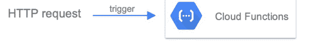
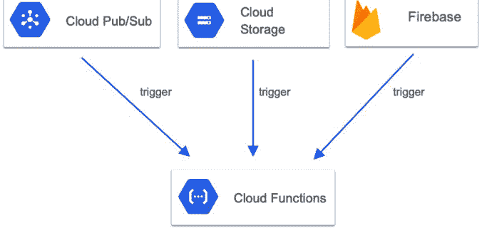
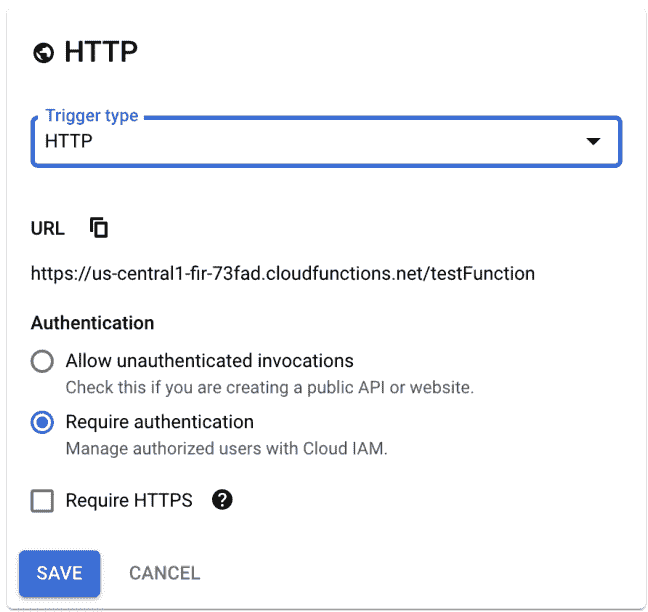
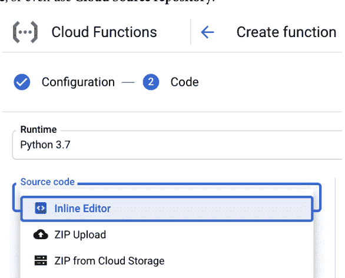

# 9
使用 Google Cloud Functions 运行无服务器函数

在本章中，我们将最终讨论完全无服务器的计算选项，即 Cloud Functions。这意味着不再有服务器，也不再有容器。此服务在后端利用它们，但对最终用户不可见。我们现在唯一需要关心的是代码。Cloud Functions 是一种 Function-as-a-Service（FaaS）服务。这意味着你用 GCP 支持的一种语言编写一个函数，它可以由事件或通过 HTTP 触发。GCP 会负责配置和扩展运行函数所需的资源。

> **重要说明**
> Cloud Functions 在后端如何工作？再次说明，你无需担心运行函数的 GCP 后端基础设施。然而，作为一名工程师，我敢打赌你仍会自行寻找答案。Cloud Functions 使用容器为你的函数设置隔离环境。这些被称为 Cloud Functions 实例。如果并行执行多个函数，将创建多个实例。

## 考试提示

预计 Cloud Architect 考试中会出现 Cloud Functions 问题。你需要了解 Cloud Functions 是什么以及最常见的用例是什么。能够区分两种类型的函数，即 HTTP 和后端函数也很重要。知道何时使用 Cloud Functions 而不是其他计算选项，以及记住支持的编程语言至关重要。最后，确保你能够从 Google Cloud 控制台和命令行部署函数。

在本章中，我们将涵盖以下主题：

- 主要 Cloud Functions 特征
- 用例
- 运行时环境
- Cloud Functions 类型
- 事件和触发器
- 其他考虑因素
- 部署 Cloud Functions
- IAM
- 配额和限制
- 定价

## 主要 Cloud Functions 特征

以下是 Cloud Functions 的关键特征：

- **无服务器**：Cloud Functions 完全无服务器。底层基础设施对最终用户是抽象的。
- **事件驱动**：Cloud Functions 是事件驱动的。它们会响应事件或 HTTP 请求而触发。这意味着它们仅在需要时被调用，且在非活动时不产生任何成本。


- **无状态**：Cloud Functions 不存储状态也不存储数据。这使它们能够独立工作并根据需要进行扩展。必须了解的是，每次调用都有一个执行环境，并且不共享全局变量内存或文件系统。要在函数调用之间共享状态，您的函数应使用 Cloud Datastore 或 Cloud Storage 等服务。
- **自动扩缩容**：Cloud Functions 可从零扩缩容到所需规模。扩缩容由 GCP 管理，无需任何终端用户干预。可以设置自动扩缩容限制以控制执行成本。这很重要，因为设计中的故障可能会导致大幅飙升，从而使账单飙升。

现在我们了解了主要特性，让我们来看一些用例。

## 用例

现在我们对 Cloud Functions 有了基本了解，让我们来看一下众多用例。请记住，在这些用例中，您仍然可以使用其他计算选项。然而，这关乎快速交付解决方案，利用内置的自动扩缩容，并且只为我们使用过的付费。

## 应用后端

与其使用虚拟机进行后端计算，您可以简单地使用函数。让我们来看一些示例后端：

- **物联网后端**：在物联网世界中，有大量设备向后端发送数据。Cloud Functions 允许您处理这些数据，并在需要时自动扩缩容。这无需任何人工干预。
- **移动后端**：Cloud Functions 可以处理由您的移动应用程序提供的数据。它可以与所有 GCP 服务交互以利用大数据、机器学习功能等。无需使用任何虚拟机，您可以完全实现无服务器。
- **第三方 API 集成**：您可以使用函数与提供 API 的任何第三方系统集成。这将允许您通过其他提供商提供的功能扩展应用程序。

接下来，让我们来看一些数据处理示例。

## 实时数据处理系统

在 **事件驱动的数据处理**方面，Cloud Functions 可以在预定义事件发生时被触发。发生这种情况时，它可以预处理传递用于 GCP 大数据服务分析的数据：

- **实时流处理：** 当消息到达 Pub/Sub 时，Cloud Functions 可以被触发以分析或丰富消息，以便为管道中的进一步数据处理步骤做好准备。
- **实时文件处理：** 当文件上传到您的 Cloud Storage 存储桶时，它们可以立即被处理。例如，可以创建缩略图或使用 GCP AI API 进行分析。

接下来，让我们来看智能应用的示例。

## 智能应用

智能应用允许用户通过数据驱动的体验更智能地执行各种任务。其中一些如下：

- **聊天机器人和虚拟助手：** 您可以将文本或语音平台连接到 Cloud Functions，以将其与其他 GCP 服务集成，例如 **DialogFlow**（*参见第 14 章，将机器学习付诸实践*），为用户提供自然的对话体验。对话逻辑可以在 DialogFlow 中定义，无需任何编程技能。可以创建与第三方应用程序的集成，以提供天气信息或商品购买等服务。
- **视频和图像分析：** 您可以使用 Cloud Functions 与各种 GCP AI 构建块交互，例如视频和图像 AI。当用户将图像或视频上传到您的应用程序时，Cloud Functions 可以立即触发相关 API 并返回分析结果。它甚至可以根据分析结果执行操作。
- **轻量级 API 和 Webhook：** 由于 Cloud Functions 可以通过 HTTP 触发，因此您可以将应用程序暴露给外部世界以供程序化使用。您无需从头构建 API。

现在，让我们介绍一些运行时环境示例。

## 运行时环境

Cloud Functions 在完全托管的环境中执行。运行函数所需的基础设施和软件都由您处理。每个函数都是单线程的，并在隔离的环境中以预期上下文运行。您无需关心该环境的任何更新。它们会为您自动更新并根据需要扩缩容。

目前，Cloud Functions 支持以下运行时：

- Node.js 10、12 和 14
- Python 3.7、3.8 和 3.9
- Go 1.11 和 1.13
- Java 11
- .NET Core 3.1
- Ruby 2.6 和 2.7
- PHP 7.4

当您定义函数时，您还可以定义 requirements 或依赖文件，其中说明您的函数依赖于哪些模块或库。但是，请记住，这些库将在函数执行时加载。这会导致执行延迟。我们将在本章的冷启动部分更详细地讨论这个问题。

在下一节中，我们将介绍 Cloud Functions 的类型。

## Cloud Functions 的类型

Cloud Functions 有两种类型：HTTP 函数和后台函数。它们在触发方式上有所不同。让我们分别来看一下。

## HTTP 函数

HTTP 函数由 HTTP(S) 请求调用。接受 POST、PUT、GET、DELETE 和 OPTIONS HTTP 方法。可以使用请求体向函数提供参数：



图 9.1 – HTTP 请求

调用可以定义为同步，因为它可以返回在函数内构建的响应。

> **有趣的事实**
> 不要指望考试会问这个问题。然而，可能有趣的是，Cloud Functions 使用通用框架处理 HTTP 请求。对于 Node.js，这是 Express 4.16.3，对于 Python，这是 Flask 1.0.2，对于 Go，这是标准的 http.HandlerFunc 接口。

## 后台函数

后台函数由事件触发，例如 Cloud Storage 存储桶中的更改、Cloud Pub/Sub 主题中的消息或受支持的 Firebase 事件之一：



图 9.2 – 后台函数

在上图中，我们可以看到 **Cloud Functions** 的各种触发器；即 **Cloud Pub/Sub**、**Cloud Storage** 和 **Firebase。**

接下来，让我们来看事件。

## 事件

**事件**可以定义为在 GCP 环境内或外部发生的事件。当它们发生时，您可能希望触发某些操作。事件的一个例子可能是文件已添加到 Cloud Storage、数据库表中进行了更改，或向 GCP 供应了新资源，等等。这些事件可以来自以下提供商之一：

- HTTP
- Cloud Storage
- Cloud Pub/Sub
- 通过 Pub/Sub sink 的 Cloud Logging
- Cloud Firestore
- Firebase Realtime Database、Storage 和 Authentication

如果您创建 sink 将日志转发到 Pub/Sub，则可以触发 Cloud Functions（有关更多详细信息，请参阅*第 17 章，监控您的基础设施*）。

接下来，让我们来看触发器。

## 触发器

要使您的函数对事件做出反应，需要配置触发器。触发器的实际绑定发生在部署时。我们将在 *部署 Cloud Functions* 部分查看如何使用不同类型的触发器部署函数。

## 其他注意事项

使用 Cloud Functions 时，您应该注意一些功能和注意事项。让我们现在来看一下这些。

## Cloud SQL 连接

如前所述，Cloud Functions 是无状态的，状态需要在外部存储或数据库中保存。这可以使用 Cloud Storage 等外部存储或 Cloud SQL 等数据库来完成。一般来说，可以使用任何外部存储。
我们在第 3 章《Google Cloud Platform 核心服务》中介绍了 Cloud SQL。为了提醒您，它是托管的 MySQL、Postgres 或 MS SQL 数据库。使用 Cloud Functions，您可以通过 Cloud Functions 执行环境中提供的本地套接字接口连接到 Cloud SQL。它消除了将数据库暴露给公共网络的需求。

## 连接到 VPC 网络中的内部资源

如果您的函数需要访问 VPC 内的服务，您可以通过传递公共网络直接连接到它。为此，您需要从网络菜单创建无服务器 VPC 访问连接器，并在部署函数时引用该连接器。请注意，这不适用于共享 VPC 和传统网络。

## 环境变量

Cloud Functions 允许您设置在函数运行时可用的环境变量。这些变量存储在函数的后端，并遵循与函数本身相同的生命周期。这些变量使用 --set-env-vars 标志设置；例如：

```
gcloud functions deploy env_vars --runtime python37 --set-env-vars FOO=bar --trigger-http
```

> 重要提示
> 第一次使用 Cloud Functions 时，您将被要求启用 API。

接下来，让我们来看冷启动。

## 冷启动

如前所述，Cloud Functions 使用函数实例执行。在以下情况下会创建这些新实例：

- 函数部署时
- 需要扩容以处理负载时
- 触发替换现有实例时


冷启动会影响应用程序的性能。Google 提供了一系列提示和技巧来帮助我们减少冷启动的影响。查看 *Further reading* 部分以获取详细指南的链接。

## 本地模拟器

部署函数到 GCP 需要时间。如果您想加快测试速度，可以使用本地模拟器。这仅适用于 Node.js，并且允许您部署、运行和调试函数。

在下一节中，我们将学习如何部署 Cloud Function。

## 部署 Cloud Functions

Cloud Functions 可以使用 CLI、Google Cloud Console 或 API 进行部署。在本节中，我们将查看前两种方法，因为在考试中您很可能会被要求测试它们。

### 使用 Google Cloud Console 部署 Cloud Functions

要从 Google Cloud Console 部署 Cloud Functions，请按照以下步骤操作：

- 1. 从汉堡菜单中选择 **Cloud Functions**。您将看到 **Cloud Functions** 窗口。点击 **CREATE FUNCTION**：


图 9.3 – Cloud Functions 菜单

2. 填写函数的名称和托管区域：

### Basics

Function name *
testFunction

Region
us-central1

### Trigger

### HTTP

Trigger type
HTTP

URL
https://us-central1-fir-73fad.cloudfunctions.net/testFunction

### Authentication

Allow unauthenticated invocations
如果您正在创建公共 API 或网站，请勾选此项。

Require authentication
使用 Cloud IAM 管理授权用户。

Require HTTPS

SAVE   CANCEL

RUNTIME, BUILD AND CONNECTIONS SETTINGS

图 9.4 – 创建函数

3. 从下拉菜单中选择触发器类型：

### Trigger

HTTP

Trigger type

- HTTP
- Cloud Pub/Sub
- Cloud Storage
- Cloud Firestore
- Google Analytics for Firebase PREVIEW
- Firebase Authentication PREVIEW
- Firebase Realtime Database PREVIEW
- Firebase Remote Config PREVIEW

SAVE

CANCEL

图 9.5 – 触发器

4. 点击 **SAVE** 按钮。如果您选择使用 **HTTP** 触发器，调用函数的 URL 将为您在 **URL** 部分生成，如下所示：

### Trigger



图 9.6 – Cloud Function URL

5. 如果您想设置更高级的设置，请点击 **RUNTIME, BUILD AND CONNECTION SETTINGS**。在 **RUNTIME** 选项卡中，您可以设置 **Memory allocated** 和 **Timeout**。您还可以定义将运行函数的服务账号。最后，您可以定义最小和最大实例数：

### RUNTIME, BUILD AND CONNECTIONS SETTINGS

RUNTIME

BUILD

CONNECTIONS

Memory allocated *
256 MiB

Timeout *
60
seconds

### Runtime service account

Runtime service account
App Engine default service account

### Autoscaling

Maximum number of instances

### Runtime environment variables

+ ADD VARIABLE

图 9.7 – 运行时选项

6. 在 BUILD 选项卡中，您可以定义用于构建函数的变量和工作池：

RUNTIME

BUILD

CONNECTIONS

SECURITY

### Build Worker Pools

Selected Environment

### Build environment variables

+ ADD VARIABLE

图 9.8 – 构建选项

7. 在 **CONNECTIONS** 选项卡中，您可以定义各种入站设置。这可以限制触发函数的流量来源。您可能希望创建一个连接器，以便函数可以连接到您的 VPC：

### Runtime, build, connections and security settings

RUNTIME   BUILD   CONNECTIONS   SECURITY

Ingress settings ?

- Allow all traffic
- Allow internal traffic only
  仅允许来自同一项目中 VPC 网络或同一 VPC SC 周边内的流量。
- Allow internal traffic and traffic from Cloud Load Balancing
  允许来自同一项目中 VPC 网络、同一 VPC SC 周边或来自 Cloud Load Balancing 的流量。

Egress settings ?

默认情况下，您的函数可以向互联网发送请求，但不能向 VPC 网络中的资源发送请求。要向 VPC 网络中的资源发送请求，请创建或选择已在与函数相同区域中创建的 VPC 连接器。

VPC Connector
None
Create a Serverless VPC Connector

- Route only requests to private IPs through the VPC connector
- Route all traffic through the VPC connector

图 9.9 – CONNECTIONS

8. 在 SECURITY 选项卡中，您可以设置可由函数使用的密钥：

### Runtime, build, connections and security settings

RUNTIME   BUILD   CONNECTIONS   SECURITY

### Secrets

### Reference a Secret

Secret *

Reference method
Mounted as volume

/ Mount path

Specified paths for secret versions

+ ADD

CANCEL   DONE

REFERENCE A SECRET

图 9.10 – SECURITY

9. 点击 Next 按钮。选择您将如何提供代码。您可以使用 Inline Editor，从本地机器上传（ZIP Upload）或从 Cloud Storage ZIP，或甚至使用 Cloud Source 仓库：



图 9.11 – 源代码

10. 从 Runtime 下拉菜单中，选择您将用于编写函数的编程语言。对于此示例，我们决定使用内联编辑器用于 Python 3.7。因此，我们需要提供两个文件：main.py，其中我们将定义函数，以及 requirements.txt，其中包含依赖项：

图 9.12 – main.py 文件

11. 在 Entry point 字段中，我们必须定义入口点的名称；例如，hello_world：


图 9.13 – 入口点

12. 现在，我们只需点击 DEPLOY 按钮即可部署函数：


图 9.14 – DEPLOY

13. 一旦您的函数已部署，您将在 Cloud Functions 列表中看到它：


图 9.15 – 函数已部署

现在，您的函数已准备好执行。

```
def hello_world(request):
    """Responds to any HTTP request.
    Args:
        request (flask.Request): HTTP request object.
    Returns:
        The response text or any set of values that can be turned into a
        Response object using
        `make_response <http://flask.pocoo.org/docs/1.0/api/#flask.Flask.make_response>`.
    """
    request_json = request.get_json()
    if request.args and 'message' in request.args:
        return request.args.get('message')
    elif request_json and 'message' in request_json:
        return request_json['message']
    else:
        return f'Hello World!'
```

## 使用 gcloud 命令部署函数

现在我们已经了解了如何使用 Google Cloud Console 部署函数，更容易解释 gcloud 命令的参数和标志。

要部署 Cloud Functions，我们可以使用以下命令：

```
gcloud deploy cloud functions $FUNCTION_NAME \
--region=$REGION \
--entry-point=$ENTRY_POINT \
--memory=$MEMORY \
--runtime=$RUNTIME \
--service-account=$SERVICE_ACCOUNT\
--source=$SOURCE \
--stage-bucket=$STAGE_BUCKET \
--timeout=$TIMEOUT \
--retry
```

这里，我们有以下选项：

- $REGION：函数的区域。
- $ENTRY_POINT：函数的名称（在源代码中定义）。
- $MEMORY：可使用的内存量的限制。允许的值为 128 MB、256 MB、512 MB、1,024 MB 和 2,048 MB。
- $SERVICE_ACCOUNT：与函数关联的 IAM 服务账号。
- $SOURCE：源代码的位置。可以是 Cloud Storage、源代码仓库或本地文件系统。
- $STAGE_BUCKET：如果函数从本地目录部署，它定义了源代码将被存储其中的 Cloud Storage 存储桶的名称。
- $TIMEOUT：函数的执行超时。
- --retry：仅适用于后台函数。如果存在，它定义如果函数未成功执行则应重试运行。

接下来，让我们定义我们的触发器。

## 触发器

在定义必要参数后，您可以根据希望如何启动函数来定义以下触发器。

要定义 HTTP 触发器，请使用以下命令：

```
--trigger-http
```

将为函数分配一个端点。

要触发 Cloud Storage 存储桶更改时的函数，请使用以下命令：

```
--trigger-bucket=$TRIGGER_BUCKET
```

这里，我们有以下选项：

- $TRIGGER_BUCKET：Google Cloud Storage 存储桶名称。对此存储桶中文件所做的任何更改都将触发函数执行。

要触发 Pub/Sub 队列中消息到达时的函数，请使用以下命令：

```
--trigger-topic=$TRIGGER_TOPIC
```

这里，我们有以下选项：

- $TRIGGER_TOPIC：Pub/Sub 主题的名称。队列中到达的消息将触发此函数。消息的内容将传递给函数。

对于其他来源，例如 Firebase，请使用以下命令：

```
--trigger-event=$EVENT_TYPE
```

```
--trigger-resource=$RESOURCE
```

这里，我们有以下选项：

- $EVENT_TYPE：应触发函数的动作
- $RESOURCE：事件发生的资源

让我们看一个从 Pub/Sub 配置触发器的示例：

```
gcloud functions deploy hello_pubsub --runtime python37
--trigger-topic mytopic
```


这将部署一个名为 `help_pubsub` 的函数，其中消息会到达 `mytopic` Pub/Sub 主题。

> **重要提示**
> 你可能有兴趣查看一些更高级的触发器，例如使用 Firebase 身份验证。查看 https://cloud.google.com/functions/docs/calling/ 以获取每种可能触发器的示例。

在下一节中，我们将回顾可用于 Cloud Functions 的 IAM 角色。

## IAM

对 Google Cloud Functions 的访问通过 IAM 保护。让我们看一下预定义角色的列表，以及每个角色的简短描述：

- **Cloud Function 管理员**：有权创建、更新和删除函数。可以设置 IAM 策略并查看源代码。
- **Cloud Functions 开发人员**：有权创建、更新和删除函数，以及查看源代码。不能设置 IAM 策略。
- **Cloud Functions 查看者**：有权查看函数。不能获取 IAM 策略，也不能查看源代码。
- **Cloud Function 调用者**：有权使用其公共 URL 调用 HTTP 函数。

请注意，要使 Cloud Functions 开发人员角色生效，您还必须将用户分配给 Cloud Functions 运行时服务账号上的 IAM 服务账号用户角色。

## 配额和限制

Google Cloud Functions 带有预定义的配额。这些默认配额可以通过汉堡菜单通过 **IAM & Admin | Quotas** 进行更改。从此菜单中，我们可以查看当前配额并请求提高这些限制。我们建议您熟悉每个服务的限制，因为这会影响您的可扩展性。对于 Cloud Functions，我们应注意以下三种类型的配额：

- **资源限制**：定义函数可以消耗的总资源量
- **时间限制**：定义事物可以运行的时间长度
- **速率限制**：定义您可以调用 Cloud Functions API 的速率

值的列表相当广泛。如果您想查看详细列表，请查看 *进一步阅读* 部分。

## 定价

Cloud Functions 的价格由多个因素组成。这些包括 **调用** 次数、**计算时间** 和网络速率（**联网**）。这些在以下图表中显示：


图 9.16 – Cloud Functions 定价

请记住，有一个每月免费使用层，您可以在不产生任何成本的情况下试用。截至本书撰写之时，它包括 200 万次调用、100 万秒的计算时间和 5 GB 的出站网络流量。尽情享受吧！

## 总结

在本章中，我们讨论了 Cloud Functions 以及它完美适用的多个用例。我们讨论了两种类型的函数，即 HTTP 和后台函数，并且还了解到函数可以通过特定事件或 HTTP 请求执行。最后，我们查看了如何使用 Google Cloud 控制台和 gcloud 命令部署函数。对于考试来说，了解 Cloud Functions 的用例以及何时使用它们对我们有利非常重要。

通过本章，我们已完成了 Google Compute 选项。在下一章中，我们将查看网络。

## 进一步阅读

有关本章所涵盖主题的更多信息，请查看以下资源：

- **幕后的 Cloud Functions**：https://cloud.google.com/functions/docs/concepts/exec
- **Cloud Functions 和 VPC**：https://cloud.google.com/functions/docs/connecting-vpc
- **本地模拟器**：https://cloud.google.com/functions/docs/emulator
- **冷启动：** https://cloud.google.com/functions/docs/bestpractices/tips
- **配额：** https://cloud.google.com/functions/quotas
- **定价：** https://cloud.google.com/functions/pricing-summary/
- **gcloud 命令：** https://cloud.google.com/sdk/gcloud/reference/functions/deploy
- **Cloud Run：** https://cloud.google.com/run/
