# 10
## Networking Options
in GCP

我们已经知道计算是最基本的云功能。但即使我们能够在不连接到资源的情况下进行计算，也不会产生价值。网络涵盖了许多类型的连接。我们需要能够连接到 Google Cloud 控制台和 Google Cloud Platform (GCP) API。我们可能希望通过虚拟专用网络（VPN）或通过高带宽互连将本地数据中心连接到 GCP。最后，我们可能需要对虚拟机（VM）实例进行负载均衡连接。GCP 网络将帮助我们完成所有这些工作。

在本章中，我们将介绍我们需要了解的所有理论，以便了解工作负载如何在内部和外部与 GCP 通信。我们还将查看所有基本网络服务。

我们将涵盖以下主题：

- 探索 GCP 网络
- 了解虚拟私有云
- 负载均衡
- **网络地址转换（NAT）**
- 混合连接
- DNS
- 防火墙规则
- 私有访问

## 探索 GCP 网络

Google 网络与其他云有所不同。为了了解 Google 在网络方面投入的巨大资金，我们应该查看以下地图（https://cloud.google.com/about/locations/#network-tab）。该地图显示了数十万条光纤电缆在 85 个区域和 146 个 **接入点（PoP）** 之间运行。请记住，此视图来自 2021 年 10 月，并且仍在增长中：

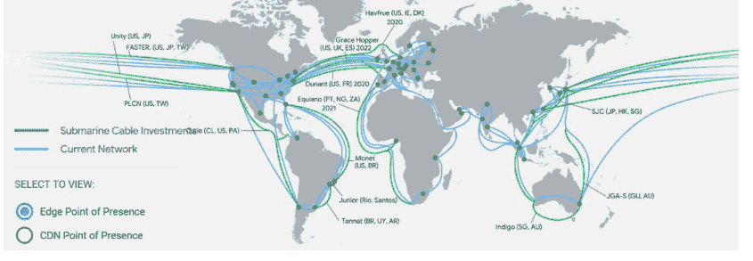

图 10.1 – 网络位置（来源：https://cloud.google.com/about/locations/#network-tab。许可：https://creativecommons.org/licenses/by/4.0/legalcode）

拥有如此庞大的网络基础设施使您能够在非常接近您的 **互联网服务提供商（ISP）** 的位置连接 GCP。事实上，GCP 提供两种网络服务层级，如下所示：

- **Premium**：Premium 层提供高性能路由。除此之外，它还提供全球负载均衡和 **内容分发网络（CDN）** 服务。它面向需要全球存在且以最佳用户体验为目标的用例。此层附带 **服务等级协议（SLA）**。
- **Standard：** Standard 层是性能较低且没有 SLA 的网络。CDN 服务不可用，负载均衡器为区域级。它面向以成本为主要决定因素的用例。暴露给用户的 GCP 网络基于名为 **Andromeda** 的 **软件定义网络（SDN）**。该平台是 GCP 中所有网络服务的编排点。幸运的是，这对用户来说是抽象的，无需了解 Andromeda 本身的工作原理。

> **考试提示**
> 有趣的是，网络并不是考试的关键主题；然而，有一个 GCP 认证网络工程师考试将彻底测试您的 GCP 网络知识。不了解网络基础知识就不可能理解其他 GCP 服务。因此，在本章中，您将了解 Google 的全球网络和 GCP 的网络服务。

## 了解虚拟私有云

GCP 网络的基本概念是 **虚拟私有云（VPC）**，也简单称为 **网络**。正如您在 *第 2 章，入门 Google Cloud Platform* 中所学，GCP 可以划分为项目，以逻辑上隔离 Google Cloud 资源。在一个项目中，您可以创建多个 VPC。

默认情况下，每个项目最多可以创建五个网络（配额可通过联系支持扩展）。多个 VPC 使能够在网络层面上分离 GCP 资源，例如 VM、容器等。VPC 具有 **全局** 范围，并且可以跨所有 GCP 区域。允许驻留在不同 VPC 中的 VM 之间进行连接，您有两个选择：您可以创建共享 VPC 或对等 VPC。我们将在本章后面详细了解每个选项。

此外，VPC 被划分为区域子网，也称为 **子网**，它们具有关联的 IP 范围，用于为资源分配地址。

当您创建新项目时，会为您创建一个默认网络。每个区域都会创建子网，并分配不重叠的 CIDR 块。

> **重要提示**
> **无类域间路由（CIDR）** 是一种 IP 地址方案，取代了传统的 A、B、C 类系统。它基于可变长度子网掩码。在 CIDR 中，子网的前缀可以定义为任意数字，使网络掩码长度更灵活。这意味着组织可以更有效地利用 IP 地址方案。


此外，默认防火墙规则已创建以允许我们从任何地方入站 ICMP、RDP 和 SSH。默认网络内的任何流量也允许。以下 VPC 网络截图来自 GCP 门户的 VPC 网络部分：

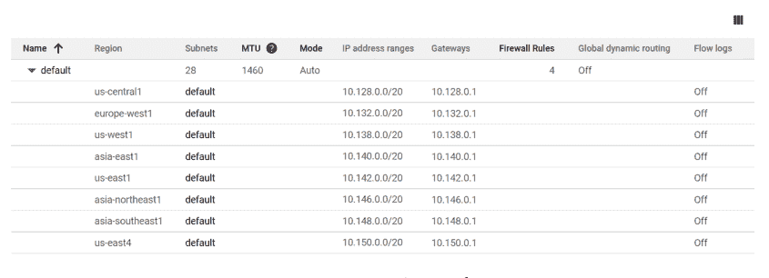

图 10.2 – VPC 网络

如果您创建一个新的 VPC，您可以从以下两种模式中选择：

- **自动模式：** 自动为每个区域创建一个子网，使用预定义的 IP 范围，掩码为 /20，来自 10.128.0.0/9 CIDR 块。每个子网均可扩展至 /16 掩码。
- **自定义模式：** 不会自动创建子网，并将完全控制权委托给用户。您可以决定创建多少个子网以及在哪些区域、动态路由模式（区域或全局）和 MTU 大小。您还可以指定是否希望启用流量日志和专用 Google 访问。

创建子网时，您必须定义一个主范围，并且还可以定义最多五个辅助范围（这是可选的）：

- **主 IP 地址范围：** 对于此范围，地址可以从 RFC 1918 CIDR 地址空间分配，并且在同一网络中不应重叠。这些可以分配给 VM 主内部 IP 地址、VM 别名 IP 地址以及内部负载均衡器的 IP 地址。请注意，此范围内始终保留四个地址。

- **辅助 IP 地址范围**：对于此范围，地址可以从 RFC 1918 CIDR 地址空间分配，并且只能用于别名 IP 地址。这些范围中没有保留地址。

> **重要说明**
> 如果 VM 上运行多个服务，则可以为其分配别名 IP 地址。您可以将它们映射到分配给该 VM 的别名 IP。它也用于 Google Kubernetes Engine Pod。有关更多信息，请参阅本章的 *进一步阅读* 部分。

可以将自动模式网络转换为自定义模式网络，但不能反向转换。请记住，如果您将这些网络通过 VPC 对等互连或 VPN 连接，请不要使用在 VPC 之间或本地网络之间重叠的 IP 范围。

## 连接性

是时候了解 VPC 中 VM 实例之间的连接如何工作了。我们已经提到网络是全局的，而子网是区域性的。现在，让我们来看看 VM 网络。我们应该注意，VM 可以有两种类型的 IP 地址：

- **内部 IP 地址**：在 VM 操作系统中分配
- **外部 IP 地址（可选）**：分配给 VM 但在操作系统中不可见

内部 IP 将始终分配给 VM。外部 IP 可以为您自动创建，也可以由您自行创建。如果您不想使用这种类型的地址，则在请求 VM 时需要将地址设置为 None。请注意，外部 IP 地址对 VM 本身不可见。用于发起连接的 IP 地址取决于以下场景：

- 属于同一网络的 VM 可以使用内部 IP 进行通信，即使它们位于不同区域。
- 位于不同网络的 VM 可以使用外部 IP 进行通信，即使它们位于同一区域。

让我们来看一下下面的图表：

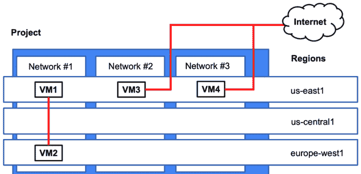

图 10.3 – 通信流程

在此场景中，VM1 和 VM2 可以使用内部 IP 进行通信。VM3 和 VM4 需要使用外部 IP 进行通信。请注意，VM3 和 VM4 之间的流量无需经过互联网，而是通过 Google 边缘路由器路由。

## 成本

了解网络流量如何流动非常重要，因为它会影响您的账单。一般经验法则是以下流量是免费的：

- 入站流量
- 使用内部 IP 在同一区域内 egress
- 使用外部 IP 地址或内部 IP 地址在同一区域内 egress 到不同的 GCP 服务

> **重要说明**
> 此免费流量不包括本书中尚未提及的若干服务：Cloud Memorystore for Redis、Cloud Filestore、GKE 和 Cloud SQL。

您将被收取以下流量的费用：

- 区域内不同区域之间的 egress
- 不同区域之间的 egress
- 互联网 egress（注意：VPN 流量被视为 egress）

> **重要说明**
> 有关当前定价，请参阅 https://cloud.google.com/vpc/network-pricing。

## VPC 流量日志

VPC 流量日志允许您记录到 VM 实例和来自 VM 实例的网络流。流量以 5 秒间隔记录。请注意，只记录流量，而不是完整的网络数据包捕获。日志包含有关源和目标 VPC 以及实例开始和结束时间的信息。VPC 流量日志在子网级别启用，可用于实时安全分析、费用优化、取证或网络监控。

## 跨 VPC 连接

在某些情况下，您可能需要在两个 VPC 之间提供连接。作为示例，贵组织中的部门正在合并，现在它们需要连接到各自 VPC 中驻留的服务。

为此，目前有两种选择：

- 共享 VPC
- VPC 对等互连

让我们来看看这两种选项。

## 共享 VPC

在此模型中，我们有一个在不同项目之间共享的单个 VPC。创建共享 VPC 的项目称为主机项目。可以使用 VPC 的项目称为服务项目。在下面的图表中，我们可以看到有两个服务项目（服务项目 A 和服务项目 B）：

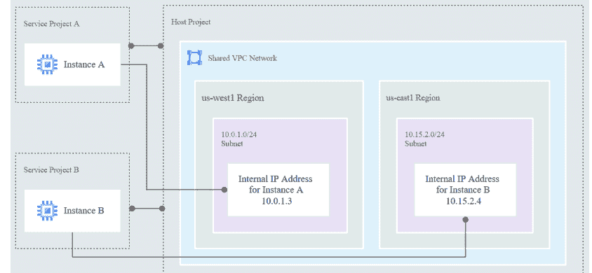

图 10.4 – 共享 VPC（来源：https://cloud.google.com/vpc/docs/shared-vpc。许可：https://creativecommons.org/licenses/by/4.0/legalcode）

要创建共享项目，需要共享 VPC 管理员角色（roles/compute.xpnAdmin）。共享 VPC 管理员可以进一步将权限委托给以下角色：

- **网络管理员**：对网络有完全控制权，不包括防火墙规则和 SSL 证书
- **安全管理员**：对防火墙和 SSL 证书的控制

服务项目中的用户可以预配位于共享 VPC 中的 VM。为此，他们需要分配网络用户角色。请注意，它可以分配在项目或子网级别。

## VPC 网络对等互连

通过 VPC 对等互连，您可以连接两个现有的 VPC，无论它们是否属于同一项目或组织。在此场景中，每个 VPC 的管理保持分离。

对等互连的每个站点独立设置，并且只有在双方都配置后才会建立对等互连。项目所有者/编辑器和网络管理员角色有权执行配置。重要的是要记住，对等 VPC 子网之间的 CIDR 前缀不能重叠。一旦建立对等互连，每个内部 IP 都可以在对等网络之间访问。每个 VPC 可以创建多个对等互连，但不支持传递对等互连。这意味着只允许直接对等 VPC 之间的连接。您不能通过另一个 VPC 在两个 VPC 之间桥接流量。为了更好地理解这一点，请查看以下图表：

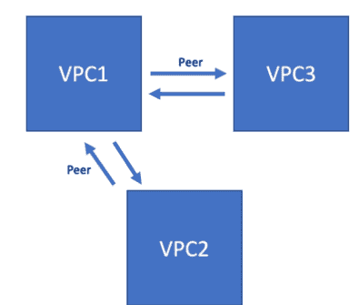

图 10.5 – VPC 对等互连

在此场景中，VPC1 与 VPC2 和 VPC3 对等。VPC2 和 VPC3 之间没有通信，直到在两者之间配置对等互连。请注意，对等互连也可以与共享 VPC 建立。

## 在共享 VPC 和 VPC 对等互连之间选择

以下两个主要因素将帮助您在共享 VPC 和 VPC 对等互连之间进行选择，如下所示：

- 如果 VPC 存在于不同的组织中，请选择 VPC 对等互连。
- 如果您需要共享治理模型，请选择共享 VPC。

> **重要说明**
> 在实际场景中，您可能对跨 VPC 通信有更详细的要求，因此我们鼓励您对此主题进行进一步阅读。


## 负载均衡

负载均衡是 GCP 网络最重要的功能之一。它允许您在可扩展资源之间分配工作负载。它适用于 GCE、GAE 和 GKE。

GCP 中的负载均衡是开始时可能难以理解的主题之一。有许多类型的负载均衡器，而且 Google 文档在将它们映射到控制台中可以看到的内容时略显困难。当我们进入 Google Cloud Console (https://console.cloud.google.com) 并导航到 NETWORKING | Network Services | Load Balancing，然后最终点击 Create load balancer 时，我们将看到以下配置选项：

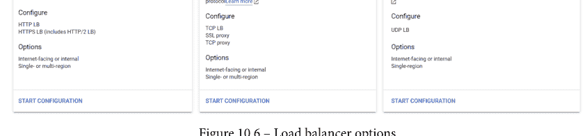

图 10.6 – 负载均衡器选项

查看文档时，它区分了以下负载均衡选项。我们将在负载均衡器类型部分更详细地介绍这些内容：

- HTTP(S) 负载均衡（外部和内部）
- SSL 代理负载均衡
- TCP 代理负载均衡
- 网络负载均衡
- 内部 TCP/UDP 负载均衡

您会清楚地看到，这与 GUI 选项不匹配。请注意，要配置内部 TCP/UDP 负载均衡器，您需要选择 TCP Load Balancing 或 UDP Load Balancing，然后选择 Only between my VMs 选项：

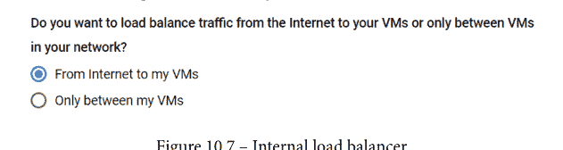

图 10.7 – 内部负载均衡器

值得庆幸的是，考试并不要求您知道如何精确配置每种负载均衡方法，而是集中于它们之间的差异。但是，当您将知识付诸实践时，您将需要它。

> **重要提示**
> 请参阅以下操作指南。所有选项都逐步描述：
> https://cloud.google.com/load-balancing/docs/how-to.

您可能需要执行几个实验（使用 Qwiklabs.com 等服务）才能对负载均衡器配置感到舒适。对于我们的讨论，我们将坚持文档定义，因为它们也符合考试指南。

### 全局与区域负载均衡

负载均衡可以在区域或全局级别提供。这意味着对于区域负载均衡，均衡的资源将驻留在同一区域内，而在全局负载均衡中，资源可以驻留在多个区域中。GCP 与其他云提供商的区别在于，其中一些负载均衡选项在全球范围内可用。您无需担心将负载均衡器放置在正确的区域：

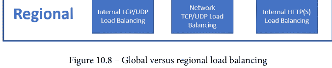

图 10.8 – 全局与区域负载均衡

如前图所示，内部和网络负载均衡器仅限区域。

### 外部与内部

我们还可以根据负载均衡器是外部还是内部来区分它们。在大多数场景中，您希望将应用程序暴露给互联网。这将是外部负载均衡器的完美用例。但是，您可能还希望在应用程序后端进行负载均衡以实现高可用性场景。在这种情况下，您将使用内部负载均衡器，它不允许 VPC 外部的连接。

### 代理与负载均衡器

就到达后端 VM 的源 IP 而言，代理和负载均衡器之间存在重要区别。在代理的情况下，源 IP 被交换为代理的 IP，因为连接在代理处终止。在负载均衡器的情况下，源 IP 被保留。请在配置使用源 IP 的防火墙规则时牢记这一点。

### 负载均衡器类型

牢记我们之前提到的关键区别，让我们看一下每种负载均衡类型：

- **HTTP(S) 负载均衡**：需要特别注意的负载均衡器之一是 HTTP(S) 负载均衡器。**外部 HTTP(S) 负载均衡器**是全局的，允许外部连接。它支持 IPv4 和 IPv6。它只能用于 HTTP 和 HTTPS 流量，但提供一些额外的功能，例如以下内容：
  - CDN 缓存
  - 与 Cloud Armor 集成
  - 支持 URL maps
  - 主机 SSL 证书
  - 支持 Cloud Storage
  - 支持会话亲和性
  - 支持 **快速 UDP 互联网连接 (QUIC)** 协议

- **内部 HTTP(S) 负载均衡器**是区域性的，仅可在 VPC 的所选区域内访问。它们*不*支持以下内容：
  - Cloud CDN
  - Cloud Armor
  - 存储桶
  - Google 管理的 SSL 证书
  - SSL 策略

> **重要提示**
> 会话亲和性会将客户端会话粘贴到单个 VM 实例，只要该实例健康。

- **SSL 代理负载均衡：** SSL 代理终止用户的 SSL（TLS 连接），并 intended for 非 HTTP(S) 流量。它是全局的，允许外部连接，支持 IPv4 和 IPv6。从代理到机器的流量可以使用 TCP 或 SSL 协议。
- **TCP 代理负载均衡：** TCP 代理终止不需要 SSL 的非 HTTP 流量。它是全局的，允许外部连接，支持 IPv4 和 IPv6。
- **网络 TCP/UDP 负载均衡：** 网络负载均衡使用非代理负载均衡器，根据入站 IP 协议数据（如地址、端口和协议类型）分发流量。它是区域性的、外部的，仅支持 IPv4。网络负载均衡器将要进行负载均衡的 VM 收集到称为 **目标池** 的逻辑组中。
- **内部 TCP/UDP 负载均衡：** 内部负载均衡是非代理形式的负载均衡。它是区域性的、内部的，仅支持 IPv4。例如，它可用于三层应用程序，其中 Web 服务需要对应用程序层进行内部连接的负载均衡。

接下来，让我们比较这些不同类型的负载均衡器。

### 比较

现在我们已经了解了每个负载均衡器，让我们看一下表格，帮助我们将最重要的功能放在一个区域：

| 负载均衡器类型 | 流量类型 | 保留客户端 IP | 全局或区域 | 负载均衡方案 | 负载均衡器目标端口 | 代理或直通 |
|---|---|---|---|---|---|---|
| External HTTP(S) | HTTP or HTTPS | No | Global* | EXTERNAL | HTTP on 80 or 8080; HTTPS on 443 | Proxy |
| Internal HTTP(S) | HTTP or HTTPS | No | Regional | INTERNAL_MANAGED | HTTP on 80 or 8080; HTTPS on 443 | Proxy |
| SSL Proxy | TCP with SSL offload | No | Global* | EXTERNAL | 25, 43, 110, 143, 195, 443, 465, 587, 700, 993, 995, 1883, 3389, 5222, 5432, 5671, 5672, 5900, 5901, 6379, 8085, 8099, 9092, 9200, and 9300 | Proxy |
| TCP Proxy | TCP without SSL offload | No | Global* | EXTERNAL | 25, 43, 110, 143, 195, 443, 465, 587, 700, 993, 995, 1883, 3389, 5222, 5432, 5671, 5672, 5900, 5901, 6379, 8085, 8099, 9092, 9200, and 9300 | Proxy |
| External Network TCP/UDP | TCP, UDP, ESP, or ICMP (Preview) | Yes | Regional | EXTERNAL | Any | Pass-through |
| Internal TCP/UDP | TCP or UDP | Yes | Regional backends, regional frontends (global access supported) | INTERNAL | Any | Pass-through |

图 10.9 – 负载均衡器比较（来源：https://cloud.google.com/load-balancing/docs/ choosing-load-balancer. 许可：https://creativecommons.org/licenses/by/4.0/legalcode）

查看图 8.9，思考每种均衡器的用例。一个很好的例子可以是三层应用程序。您将使用哪种负载均衡器来平衡每个层？

### 选择合适的负载均衡器

要选择合适的负载均衡器，让我们看一下 Google 提供的以下图表：

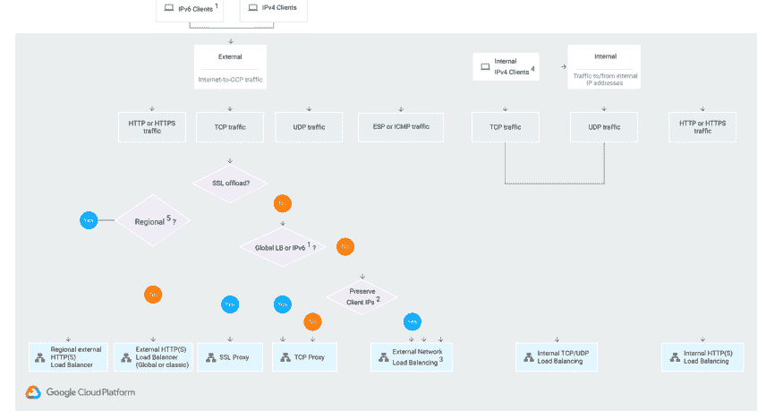

1 IPv6 客户端在 Premium Tier 中配置负载均衡器时支持 TCP 流量。IPv6 客户端不支持 UDP 流量。
2 选择外部网络负载均衡的另一个原因是，如果您需要确保负载均衡器位于特定区域。
3 外部网络负载均衡器使用可在任何地方由客户端访问的区域外部 IP 地址。
4 位于 VPC 网络或连接到 VPC 网络的网络中的客户端。
5 外部 HTTP(S) 负载均衡器（经典）可以在 Standard Tier 中配置为区域性。

图 10.10 – 负载均衡器考虑因素（来源：https://cloud.google.com/load-balancing/docs/choosing-load-balancer. 许可：https://creativecommons.org/licenses/by/4.0/legalcode）

让我们逐步介绍前面的图表：

- 1. 首先，我们需要选择是否希望负载均衡器可外部访问或内部访问。对于外部暴露，我们选择要平衡的流量。
- 2. 对于 HTTP 和 HTTPS 流量，我们使用 HTTP(S) 负载均衡器。
- 3. 对于具有 SSL 卸载的 TCP 流量，我们将选择 SSL 代理。如果我们不需要 SSL 卸载但需要 IPv6 或全局范围支持，我们将选择 TCP 代理。
- 4. 然后，我们需要检查是否需要保留客户端 IP。如果需要，我们选择网络负载均衡器；如果不需要，我们保留 TCP 代理。网络负载均衡器也可用于不需要 IPv6 或全局范围的 UDP 流量。
- 5. 对于内部负载均衡，使用内部 TCP/UDP 负载均衡器。


正如你所见，选择合适的负载均衡器可能是一项相当令人望而生畏的任务。然而，如果你遵循前面的流程图，你应该能够选择最佳方案。

现在我们已经了解了负载均衡的工作原理，接下来我们将了解 NAT。

## NAT

NAT 是一种服务，当流量通过路由设备时，它会转换源和/或目标地址。在 GCP 的情况下，NAT 允许我们在与外部网络通信时隐藏 VM 的原始 IP 地址。在 GCP 的情况下，它允许具有内部地址的 VM 访问互联网。

目前 NAT 有两种选择，如下所示：

- NAT 网关
- Cloud NAT

Google 建议使用 Cloud NAT 而非 NAT 网关。如果你仍在使用 NAT 网关，Google 建议你将其迁移到 Cloud NAT，因为它是一种托管且可自动扩缩的服务。

## NAT 网关

Google 允许我们配置一台 VM 作为 NAT 网关。这样，你只需将一台 VM 暴露给互联网。网关机器需要使用 `--can-ip-forward` 参数进行配置，该参数允许流量转发。你还需要为应使用该网关的子网创建默认路由。正如你所见，此解决方案看起来并不具备可扩展性，并引入了单点故障的概念。

为消除此问题，你可以创建多个网关并将其放入托管实例组中。接下来，你将路由规则配置到具有相同优先级的 NAT 网关。在这种情况下，GCP 使用 **等价多路径 (ECMP)** 在 NAT 网关之间分配流量。

> **重要说明**
> 要了解如何创建高可用 NAT 网关，请完成 https://www.qwiklabs.com/focuses/612?parent=catalog 上的 *Building High Availability and High Bandwidth NAT Gateways* 实验。

如果这听起来很复杂，幸运的是，有一个更简单的解决方案。是的，你猜对了！Cloud NAT。

## Cloud NAT

Cloud NAT 是一种区域性的可自动扩缩服务，由 Google 全面托管。它允许 VM 在无需外部 IP 地址的情况下访问互联网。它不允许入站互联网流量进入 VM。该服务由 Google SDN 提供，因此无需管理网关实例。事实上，在幕后，并没有真正的代理 VM。

就带宽而言，每个 VM 获得的带宽与它拥有外部 IP 地址时完全相同。

## 混合连接

所谓混合连接，是指 GCP 与本地数据中心之间的连接。如果你想通过安全通道连接到 GCP 而不仅仅是穿越互联网，这一点很重要。实现这种连接有多种方式。你选择的方案将取决于你的可靠性、带宽和延迟要求。

现在，让我们来看一些可能的混合连接选项，即 VPN Interconnect 和对等互连。

## VPN

Cloud VPN 是一种区域性服务，它将使用 IPSec 隧道安全地将本地网络连接到 GCP VPC。所有通过互联网穿越隧道的流量都经过加密。支持 IKEv1 和 IKEv2 两种加密算法。VPN 连接需要一个 Cloud VPN 网关、一个本地 VPN 网关，以及从每个网关的角度建立的两个 VPN 隧道。当两个隧道都创建后，连接即建立。本地网关可以是硬件或软件设备。有特殊要求，即本地网关的 MTU 不应高于 1,460 字节。VPN 支持静态和动态路由。动态路由由 VPC 网络中的路由器管理并使用边界网关协议 (BGP)，而静态路由是手动创建的并支持路由下一跳。

截至撰写时，Google 提供两种类型的 VPN 网关：HA VPN 和 Classic VPN。

## HA VPN

HA VPN，如你所料，是一种高可用 VPN 解决方案，允许我们将本地网络连接到单个区域中的 GCP VPC。由于其高可用性，HA VPN 在服务可用性方面提供 99.99% 的 SLA。当我们创建此类 VPN 时，GCP 会自动创建两个外部 IP 地址——每个固定接口一个，每个 HA VPN 网关接口都支持多个隧道。我们应注意，可以仅使用单个活动接口和一个外部 IP 配置 HA VPN，但这样将无法获得上述 SLA。要实现 99.99% 可用性 SLA，需要满足一些要求。让我们更详细地讨论：

- 可用性仅在连接的 Google Cloud 端得到保证，这意味着端到端可用性将取决于对等 VPN 网关的正确配置。如果配置正确，则两侧均为 Google Cloud 网关，端到端 99.99% 可用性将得到保证。为了在两侧 VPN 网关均位于 VPC 网络时实现高可用性，我们需要使用两个 HA VPN 网关，并且两者必须位于同一区域。
- 虽然两个网关必须位于同一区域，但如果我们的 VPC 网络配置为 **全局动态路由** 模式，则网关共享的子网的路由可以在任何区域。如果我们将 VPC 网络配置为 **区域动态路由** 模式，则只有与同一区域的子网的路由才会被与对等网络共享。学习到的路由仅应用于与 VPN 隧道位于同一区域的子网。
- HA VPN 还必须拒绝在外部 VPN 网关资源中配置的 Google Cloud IP 地址；例如，使用 VM 实例的外部 IP 地址作为外部 VPN 网关资源的外部 IP 地址。为了获得完全受支持的 HA VPN 拓扑，必须在 Google Cloud 网络的两侧都使用 HA VPN。

我们还必须确保从 Cloud VPN 网关的角度配置两个 VPN 隧道。这根据我们的设计有特定的要求：

- **两个对等 VPN 网关设备**：此配置要求 Cloud VPN 网关每个接口上的每个隧道都必须连接到其自己的对等网关。
- **单个对等 VPN 网关设备带两个接口**：此配置要求 Cloud VPN 网关每个接口上的每个隧道都必须连接到对等网关上的其自己的接口。
- **单个对等 VPN 网关设备带单个接口**：此配置要求 Cloud VPN 网关每个接口上的两个隧道都必须连接到对等网关上的同一接口。
- 对等 VPN 设备必须配置适当的冗余。设备厂商将指定冗余配置的细节，这可能因厂商而异。
- 如果我们的设计需要两个对等设备，则每个对等设备应连接到不同的 HA VPN 网关接口。如果对等方来自另一家提供商，例如 Azure，则在 Azure 端也应以适当的冗余配置 VPN 连接。
- 最后，我们的对等 VPN 网关设备必须支持动态 (BGP) 路由。

## Classic VPN

Classic VPN 网关具有单个接口和单个外部 IP 地址。它们支持使用 BGP 或静态路由的隧道，并提供 99.9% 的服务可用性 SLA。我们不会过多讨论 Classic VPN。从 2021 年第四季度开始，我们将无法再使用静态路由创建连接另一个 Classic VPN 网关的 Classic VPN 隧道，也无法将 Classic VPC 网络连接到另一家云提供商网络。你也将无法创建新的 Classic VPN 隧道。Google 鼓励我们将生产流量迁移到 HA VPC。

## Interconnects

Interconnect 是一种第 2 层连接方法，会产生月度费用。当你需要在 GCP 与本地网络之间实现低延迟和高可用连接，并且计划进行大量数据传输时，你会使用它。

它有两种类型，如下所示：

- **Dedicated Interconnect：** 连接与 Google Edge 建立。Google 按小时向我们收费，费用取决于电路的大小（即 10 Gbps 或 100 Gbps）。通过 Dedicated Interconnect 连接从 VPC 网络传出的流量也需要付费。
- **Partner Interconnect：** 连接与 Google 合作伙伴网络建立。Google 也按 VLAN 附件的容量按小时向我们收费，通过 Partner Interconnect 连接从 VPC 网络传出的流量也需要付费。


连接可以通过引入多个链路来扩展。对于专用互连，每个连接提供 10 Gbps 或 100 Gbps 电路。最多可以创建八个 10 Gbps 连接，使每个互连的总最大带宽达到 80 Gbps，或 2 x 100 Gbps（200 Gbps）电路。对于合作伙伴互连，带宽范围从 50 Mbps 到 50 Gbps。互连提供 99.9% 或 99.99% 的正常运行时间 SLA。这取决于您的配置和连接数量。

有关定价方案的更多信息，我们建议您查看 https://cloud.google.com/network-connectivity/docs/interconnect/pricing。

## Peering

Peering 是一种三层连接方法。它提供对 Google Workspace、YouTube 和 Google API 等服务的连接，这些服务使用公共 IP 地址。它使我们能够建立更高可用性和延迟的连接。请注意，这些连接存在于 GCP 之外。Peering 没有维护成本，并且有以下两种类型：

- **Direct Peering**
- **Carrier Peering**

Direct Peering 每个与 GCP PoP 建立的链路提供 10 Gbps 连接，PoP 是 Google 网络与互联网其余部分连接的点。Carrier Peering 带宽取决于提供商。请注意，peering 不提供 SLA。

## 选择合适的连接方法

总体而言，Google 的建议是先使用 Cloud VPN 开始连接，如果需要则迁移到 Interconnect。再次，Google 提供了一个不错的流程图，可帮助您根据具体情况做出最佳连接方法的正确选择：

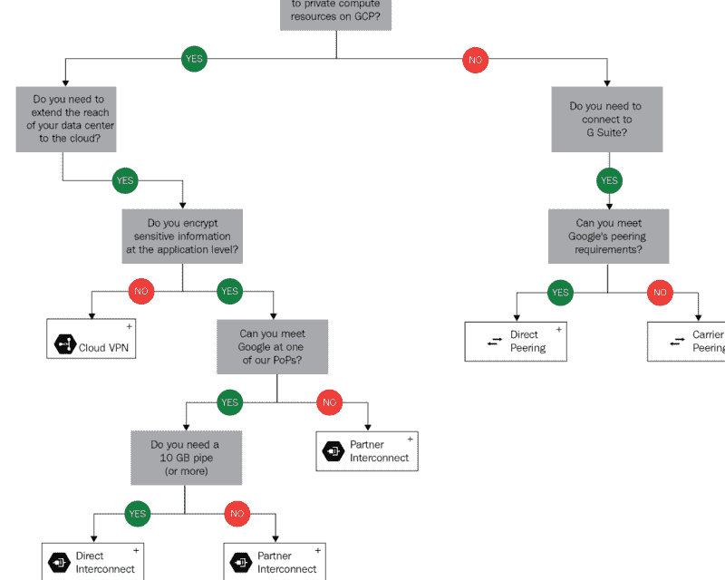

图 10.11 – Interconnect 考虑因素（来源：https://cloud.google.com/hybrid-connectivity/）

这结束了混合连接部分。再次，在选择 Interconnect 连接之前请三思。除非您有高带宽和低延迟要求，否则先从 VPN 开始，只有在未获得预期结果时才迁移到 Interconnect。在后面的章节中，我们将研究域名系统（DNS），它对于正确的主机名和 URL 解析至关重要。

## Network Connectivity Center

Network Connectivity Center 是管理 Google Cloud 中网络连接的枢纽辐射模型。它允许我们使用 Google 的网络作为广域网（WAN）进行数据传输，将本地或其它公有云网络连接在一起。使用此服务可实现对 Google 网络的全球范围和可靠性的访问。

使用枢纽辐射模型，站点使用各种本地连接相互连接。例如，数据中心 A 可以通过 Cloud VPN 连接到 VPC，而数据中心 B 可以通过专用互连连接到同一 VPC。这些站点随后通过与 VPC 关联的 Network Connectivity Center 枢纽连接。

## DNS

DNS 允许将域名解析为 IP 地址。关于 GCP 中的 DNS，您需要了解以下几个概念：

- DNS resolution
- Cloud DNS
- DNS Security (DNSSEC)

### DNS resolution

VPC 附带内部 DNS 服务。机器的内部名称会自动在内部区域中注册。这允许同一网络内的 VM 使用内部 DNS 名称相互访问。DNS 记录遵循 VM 的生命周期。VM 创建时创建，VM 删除时删除。这意味着名称在实例部署时创建，在实例删除时移除。请注意，记录仅为内部 IP 创建（不包括外部和别名 IP）。解析仅适用于同一 VPC 内的 VM。

如您所知，有许多类型的 DNS 记录（A、MX、SRV、CNAME 等）。在此情况下实际创建的记录是所谓的 A 记录。这些记录将主机名翻译为 IP 地址。它们使用以下模式创建：

```
<INSTANCE_NAME>.c.<PROJECT_ID>.internal
```

这里，INSTANCE_NAME 是 GCP 自动生成的 hostname，PROJECT_ID 是 VM 部署所在的项目的 ID。

当 VM 部署时，IP 设置会自动配置。VM 的 DNS 服务器设置也会配置并指向其元数据服务器。对于公共名称解析，查询会转发到 Google 的公共 DNS 服务器。对于外部 IP，记录不会自动注册。它们可以注册到外部 DNS 服务器或托管在 Cloud DNS 服务中的 DNS 区域。

### Cloud DNS

Cloud DNS 是一种托管服务，允许您托管数百万条 DNS 记录，而无需管理任何服务器或软件。由于它托管在 Google 托管的基础设施上，因此提供 100% 的正常运行时间 SLA。

Cloud DNS 允许我们创建包含多条记录的管理区域。要从当前提供商迁移，您可以导出区域然后导入到 Cloud DNS。记录可以使用 API 和 `gcloud` 命令管理。

### DNSSEC

DNSSEC 是一种 DNS 扩展，允许对域名查找响应进行身份验证。它保护请求者免受 DNS 请求响应的篡改和污染。在 GCP 中，DNSSEC 可以按 DNS 区域启用。请注意，它也需要在您的域名注册商处配置。此外，请求者需要确保其工作站上的解析器对 DNSSEC 签名的域验证签名。

> **Important Note**
> 有关更多详细信息，请参阅 https://cloud.google.com/dns/docs/dnssec。

## VPC firewall rules

防火墙是硬件或软件设备，用于过滤通过它的网络流量。此过滤可以根据许多条件进行，例如源、目标 IP、协议或端口。它允许您保护网络免受不需要的访问。

防火墙规则允许您控制到和来自基于 VM 的实例的流量。防火墙规则独立于 VM 操作系统工作，并且在启用状态下始终强制执行。VPC 充当分布式防火墙，利用微分段。这意味着防火墙规则按 VM 强制执行，即使机器位于同一网络中。应注意，它没有分析数据包内容的能力。防火墙规则由以下组件构成：

- **Ingress (inbound) firewall rules:**
  - **Priority:** 65545 with a default value of 1000
  - **Action:** `allow` or `deny`
  - **Enforcement:** `enabled` or `disabled`
- **Target (destination)**: All instances in the network, tag, and service account
- **Source**: Address range, subnet, service account, and network tag
- **Protocol and ports**: Allow all or specify a protocol(s) and port(s)
- **Egress (outbound) firewall:**
  - **Priority:** 65545 with a default value of 1000
  - **Action:** allow or deny
  - **Enforcement:** enabled or disabled
  - **Target (source)**: All instances in the network, tag, and service account
  - **Destination**: Address range and subnet
  - **Protocol and ports**: Allow all or specify a protocol(s) and port(s)

我们可以进一步将这些防火墙规则分为如下：

- Default firewall rules
- Implied rules
- Always allowed traffic rules
- Always denied rules
- User-defined rules
- GKE firewall rules

上述规则是您在了解基础设施和应用程序需要什么流量进行通信后实际定义的内容。**默认规则**由 Google 定义，以提供管理环境所需的基本保护和功能。现在，让我们更仔细地查看它们各自。

### Default rules

对于默认网络，创建了多个优先级为 65534 的允许入站防火墙规则，如下所示：

- `default-allow-internal`: VPC 内实例之间所有协议和端口的入站连接
- `default-allow-ssh`: 从任何源到 VPC 中任何实例的 TCP 端口 22 入站连接


- `default-allow-rdp`: 允许来自任何源到 VPC 中任何实例的 TCP 端口 3389 入站连接
- `default-allow-icmp`: 允许来自任何源到 VPC 中任何实例的入站 ICMP 流量：

| 名称 | 类型 | 目标 | 过滤条件 | 协议/端口 | 操作 | 优先级 | 网络 |
|---|---|---|---|---|---|---|---|
| default-allow-http | 入站 | http-server | IP 范围：0.0.0.0/0 | tcp:80 | 允许 | 1000 | default |
| default-allow-https | 入站 | https-server | IP 范围：0.0.0.0/0 | tcp:443 | 允许 | 1000 | default |
| default-allow-icmp | 入站 | 应用于所有 | IP 范围：0.0.0.0/0 | icmp | 允许 | 65534 | default |
| default-allow-internal | 入站 | 应用于所有 | IP 范围：10.128.0.0/9 | tcp:0-65535 udp:0-65535 icmp | 允许 | 65534 | default |
| default-allow-rdp | 入站 | 应用于所有 | IP 范围：0.0.0.0/0 | tcp:3389 | 允许 | 65534 | default |
| default-allow-ssh | 入站 | 应用于所有 | IP 范围：0.0.0.0/0 | tcp:22 | 允许 | 65534 | default |

图 10.12 – 防火墙规则

还有针对 HTTP 和 HTTPS 流量的预定义规则。这些规则的目标是标签。您可以将这些标签分配给您的 VM 以允许此类型流量来自任何源。

## 隐含规则

有两个隐含的防火墙规则，优先级最低为 65535，具体如下：

- **拒绝入站规则** 源为 0.0.0.0/0
- **允许出站规则** 目标为 0.0.0.0/0

此时，可能有必要澄清一下，65535 是最低可能的优先级，0 是最高。此外，IP 范围 0.0.0.0/0 等同于所有 IPv4 地址。规则无法删除，但可以被具有更高优先级的任何规则覆盖。

## 始终允许的流量规则

有某些类型的流量始终允许从 VM 发出，具体如下：

- 到元数据服务器的流量
- DHCP 流量
- DNS 流量
- NTP 流量

## 始终拒绝的规则

还有一些类型的流量始终被阻止，具体如下：

- GRE 流量
- 除 TCP、UDP、ICMP、AH、ESP、SCTP 和 IPIP 之外的协议
- TCP 端口 25 上的出站 SMTP 流量

## 用户定义规则

最后，用户定义规则是您将定义的规则，以允许应用程序所需的通信，而该通信不符合默认、始终允许或隐含规则：

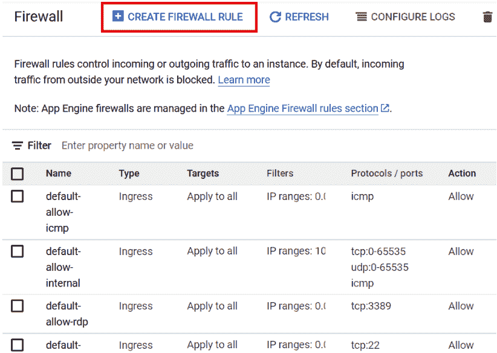

图 10.13 – 创建防火墙规则

这些规则可以通过转到导航菜单，VPC 网络 | 防火墙，并点击创建防火墙规则来创建。

## 防火墙日志

防火墙日志允许您验证防火墙规则是否正常运行。它可以为新的和现有的防火墙规则启用。日志注入到 Google Cloud 操作套件中（以前称为 Stackdriver）。

## 分层防火墙策略

分层防火墙策略允许我们为组织创建和执行一致的策略。它们可以分配给整个组织或单个文件夹。与 VPC 防火墙规则一样，分层防火墙策略包含可以拒绝或允许连接的规则，但还可以借助 goto_next 操作将评估委托给低一级的策略或 VPC 网络防火墙规则。这允许组织范围的管理员在一个地方管理防火墙规则。

我们应该注意，在组织或文件夹节点级别创建策略不会自动将规则应用于节点 – 策略需要与组织中的节点关联，并且单个策略可以与多个节点关联。策略是防火墙规则的容器，当我们将策略与组织或文件夹关联时，规则会立即应用。我们可以为节点交换策略，这会原子地交换应用于该节点下 VM 实例的所有防火墙规则。与组织节点关联的规则首先被评估，并且组织中的任何文件夹和 VPC 网络都会继承此策略。如果策略应用于文件夹，则该文件夹中的所有文件夹和 VPC 网络都将继承其关联的策略。分层策略不能与项目关联。可以在以下图表中看到可以应用防火墙规则的层级：

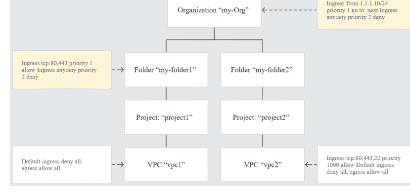

图 10.14 – 分层策略继承（来源：https://cloud.google.com/vpc/docs/firewall-policies）

分层防火墙策略规则必须具有指定的优先级，该优先级在每个策略中是唯一的。这与 VPC 防火墙规则不同，后者可以有多个具有相同优先级的规则。此外，防火墙策略规则没有名称，而是策略本身具有 ID 和名称，每个规则都有唯一的优先级数字。然后按优先级顺序评估规则，从最高优先级规则开始，表示为最低数字。例如，优先级号为 100 的规则将覆盖优先级为 200 的规则。

要从 Google Cloud Shell 创建防火墙策略，请使用以下代码并替换您的组织 ID 和文件夹 ID：

```
gcloud compute firewall-policies create \
    [--organization ORG_ID] | --folder FOLDER_ID] \
    --short-name SHORT_NAME
```

然后我们通过使用以下命令向策略添加规则。我们使用了示例组织 ID：

```
gcloud compute firewall-policies rules create 1000 \
    --action=allow \    --description="allow-scan-probe" \
    --layer4-configs=tcp:123 \    --firewall-policy=example-firewall-policy \    --organization=123456789\    --src-ip-ranges=10.100.0.1/32
```

最后，将防火墙策略与组织节点关联。我们使用了示例组织 ID：

```
gcloud compute firewall-policies associations create \
    --firewall-policy=example-firewall-policy \
    --organization=123456789
```

在下一节中，我们将查看私有访问选项。

## 私有访问选项

Google 提供了各种选项，让 VM 实例无需外部 IP 地址即可访问受支持的 API 和服务。根据您的用例，您可以配置一个或全部可用选项，它们彼此独立运行。作为高层次概述，以下是使用每个选项的原因：

- **面向 Google API 的 Private Service Connect**：用于在本地和 GCP 资源不需要外部 IP 地址时，使用 VPC 网络中的端点连接到 Google API 和服务。
- **Private Google Access**：用于在不为 GCP 资源分配外部 IP 地址的情况下连接到 Google API 和服务。
- **面向本地主机的 Private Google Access**：用于在本地主机不需要外部 IP 地址时，通过 VPC 网络连接到 Google API 和服务。
- **面向服务的 Private Service Connect**：用于在不为 GCP 资源分配外部 IP 地址的情况下连接到另一个 VPC 网络中的受支持服务。
- **Private Services Access**：用于在不为 GPC 或第三方资源分配外部 IP 地址的情况下连接到特定的 Google 或第三方服务。
- **Serverless VPC Access**：用于使用内部 IP 地址直接从无服务器 Google 服务连接到 VPC 网络中的资源。

使用私有访问时还存在 DNS 方面的考虑，因此了解每个选项及其影响非常重要。例如，如果我们想使用 **面向本地主机的 Private Google Access** 选项，我们的本地网络必须配置 DNS 区域和记录，以便 Google 域名解析为 `private.googleapis.com` 或 `restricted.googleapis.com` 的 IP 地址集。

> **重要说明**
> 欲了解更多详情，请查看 Google 文档 https://cloud.google.com/vpc/docs/private-access-options。

## 摘要

在本章中，我们介绍了 GCP 中的基本网络概念。我们学习了 VPC、负载均衡、防火墙、DNS 和混合连接。确保您了解如何将 VM 连接到 GCP 网络，以及如何保护和负载均衡它们。现在您了解了连接到本地数据中心的各种方式，我们建议您获得一些实践经验。设置您的第一个 VPC，创建防火墙规则，并部署和管理一个带有您选择的负载均衡器的 VM 实例组。如果您在操作中遇到任何问题，请返回本书并查看本章或 *第 4 章，使用 Google Compute Engine*。

在 *第 11 章，探索 GCP 中的存储和数据库选项 – 第 1 部分* 和 *第 12 章，探索 GCP 中的存储和数据库选项 – 第 2 部分* 中，我们将看到如何存储数据。这对于有状态工作负载至关重要。


## 进一步阅读

本章中我们提供的网络服务概述对于考试来说应该足够了。如果您仍觉得需要更深入了解 GCP 网络知识，请查看以下链接：

- **VPC**：https://cloud.google.com/vpc/docs/
- **Firewalls**：https://cloud.google.com/vpc/docs/firewalls
- **Load balancing**：https://cloud.google.com/load-balancing/docs/
- **Interconnects**：https://cloud.google.com/interconnect/docs/
- **VPN**：https://cloud.google.com/vpn/docs/
- **DNS**：https://cloud.google.com/dns/docs/
- **NAT**：https://cloud.google.com/nat/docs/
- **Alias IP addresses**：https://cloud.google.com/vpc/docs/alias-ip
