## 11
在 GCP 中探索存储和数据库选项 – 第 1 部分

在前两章中，我们学习了有关网络和计算服务的重要主题。现在，我们将继续了解 GCP 的另一个基础产品——存储。每个应用程序都需要存储数据，但并非所有数据都相同。数据可以是有结构的、无结构的、关系型的或事务型的，而 GCP 提供了满足这些需求的服务。您的应用程序甚至可能需要使用多个存储服务来实现需求。

在本章中，我们将了解 Google 提供的不同类型的存储，并解释在选择特定服务之前应考虑的内容。Google 提供了众多存储选项，如果在一章中全部涵盖，可能会让您难以消化。因此，我们将本章分为两部分。

在本部分中，我们将考虑应选择哪种存储选项，并探讨以下主题：

- 选择合适的存储选项
- 了解 Cloud Storage
- 了解 Cloud Firestore
- 了解 Cloud SQL

尽管 BigQuery 可以被视为一种存储选项，但我们将在 *第 13 章，分析大数据选项* 中介绍该产品。

让我们从了解何时应选择特定的存储服务开始本章。之后，我们将逐一介绍每项服务，同时集中于考试主题。

## 选择合适的存储选项

正如本章开头所述，Google 提供了各种存储服务。您必须了解针对您的需求应使用哪种正确的存储。Google 提供了一个不错的流程图供我们逐步了解。它易于遵循，并展示了需求如何决定应选择哪种存储选项。请花点时间查看以下决策树。该图表通过一些关键问题来确保我们选择的存储服务能够满足需求：

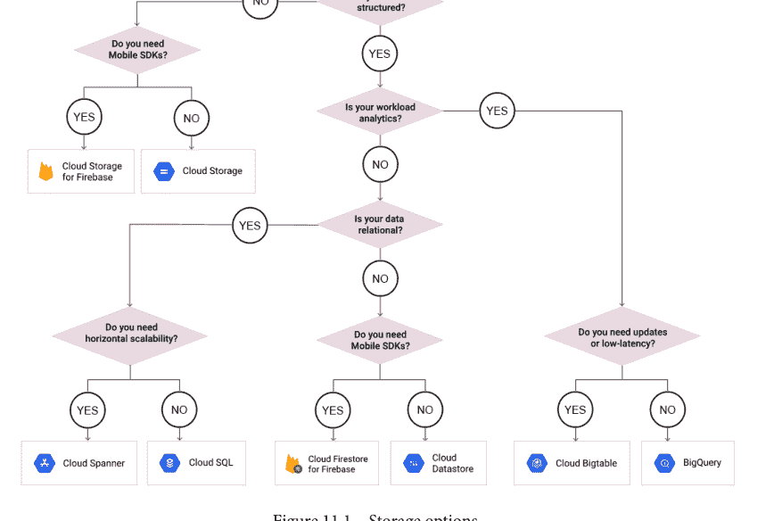

图 11.1 – 存储选项

有了上述图表，我们来看一个示例：

- 1. 首先，我们需要了解我们的数据是否是有结构的。根据此答案，将推荐不同的服务。
- 2. 如果我们的数据是有结构的，那么我们应检查工作负载是否用于分析。
- 3. 如果我们的数据不用于分析，那么我们应检查我们的数据是否具有关系性。
- 4. 如果我们的数据具有关系性，那么我们需要知道是否需要水平扩展。
- 5. 如果需要，则应选择 Cloud Spanner。如果不需要，则应选择 Cloud SQL。

如上图所示，根据需求会有各种结果。GCP 提供了大量存储服务，但如果我们遵循此流程图，就应该能够选择最佳选项。

此外，Google 还提供了以下信息，这可能有助于您了解所需的产品：

| CATEGORY | PRODUCT | GOOD FOR |
|---|---|---|
| Object Storage | Cloud Storage | Streaming videos. Image and web asset libraries. Data lakes. |
| Block Storage | Persistent disk | Disks for virtual machines. Shared read-only data across multiple VMs. Creating durable backups of running VMs. Storage for databases. |
| Block Storage | Local SSD | Flash-optimized databases. Hot caching layer for analytics. Application scratch disk. |
| Archival Storage | Cloud Storage | Data analytics. Rendering and media processing. Application migrations. Web content management. |
| Data Transfer | Data Transfer Service | Collecting research data. Moving ML/AI training datasets. Migrating from S3 to Google Cloud. |
| Data Transfer | Transfer Appliance | Transfer data for archival, migrations, or analytics. Capturing sensor data for ML or analytics. Moving data from bandwidth-constrained locations. |

## Exam Tip

理解这些选项至关重要。您可能会遇到需要关系型数据库而非非关系型数据库的场景，或需要选择适合结构化数据的选项。您还需要了解存储的限制；例如，假设您被告知需要评估一种提供 NoSQL 数据库并可扩展到 TB 级数据的服务。阅读本章后，您应该能够将此场景映射到某项服务。

在下一节中，我们将讨论数据一致性。

## Data consistency

数据一致性是指存储服务如何处理事务以及数据如何写入数据库。在阅读本章时，请确保您回顾每项服务的一致性，因为这是选择产品或服务时的主要设计因素之一。

我们还将借此机会解释 ACID。这是数据一致性的一个关键术语，我们将在本章中多次提及。

ACID 是以下属性的缩写：

- **Atomicity**：事务涉及两条或多条信息时，所有信息都将被提交或全部不提交。例如，在进行银行转账时，资金的借记和贷记将被视为单个事务。如果借记或贷记任一失败，则两者都将失败。
- **Consistency**：如果出现上述失败，则所有数据将恢复到事务开始前的状态。
- **Isolation**：银行转账将与其他事务隔离。在我们的示例中，这意味着在转账完成之前我们不会从银行扣款。
- **Durability**：即使发生故障，数据也将以正确状态可用。

> **Exam Tip**
> 您还应能够识别支持结构化数据、低延迟或水平扩展的存储服务。同样，您应能够识别提供强一致性或支持 ACID 属性的存储服务。

现在，让我们更仔细地查看每项服务。我们将从 Cloud Storage 开始。

## Understanding Cloud Storage

Google Cloud Storage 是在 Google Cloud 中存储对象的服务。它是完全托管的，并且可以动态扩展。对象是指任何格式的文件组成的不可变数据块。一些用例包括视频转码、视频流、静态网页和备份。它旨在提供安全且持久的存储，同时通过不同的存储类别为您的需求提供最佳价格和性能。

Cloud Storage 使用存储桶的概念；如果您使用过 AWS S3 存储，您可能熟悉该术语。存储桶是您的数据所在的基本容器，并附加到 GCP 项目，如其他 GCP 服务一样。每个存储桶名称在全球范围内唯一，一旦创建，就无法更改。没有最小或最大存储大小限制，我们只为所用付费。我们可以通过多种方式控制对存储桶的访问。我们将在第 15 章《安全与合规》中更详细地学习安全，但作为概述，我们有以下主要方法：

- **Cloud Identity and Access Management (IAM)**：我们将在第 15 章《安全与合规》中更详细地讨论 IAM。IAM 将授予对存储桶及其内部对象的访问权限。这为我们提供了一种集中管理权限的方式，而非对单个对象提供精细控制。IAM 策略在整个 GCP 中使用，并且权限应用于存储桶中的所有对象。
- **Access Control Lists (ACLs)**：ACL 仅由 Cloud Storage 使用。这允许我们为单个对象授予读或写访问权限。不建议使用此方法，但有时可能需要。例如，您可能希望自定义存储桶内单个对象的访问权限。
- **Signed URLs**：这通过专用 URL 为存储桶内的对象提供有时限的读或写访问权限。任何收到此 URL 的人都可以访问该对象，直至 URL 生成时指定的时间。

我们还将在第 15 章《安全与合规》中提及加密。默认情况下，Cloud Storage 会在数据写入磁盘之前始终在服务器端对其进行加密。有三种服务器端加密选项可用：

- **Google-Managed Encryption Keys**：Cloud Storage 将代表客户管理加密密钥，无需进一步设置。
- **Customer-Supplied Encryption Keys (CSEK s)**：客户创建并管理其加密密钥。
- **Customer-Managed Encryption Keys (CMEKs)**：客户使用 GCP 的 **Key Management Service (KMS)** 生成并管理其加密密钥。

还有 **client-side encryption** 选项，其中加密在数据发送到 Cloud Storage 之前发生，并在服务器端进行额外加密。


## 存储桶位置

存储桶位置允许我们指定存储数据的地点。以下是不同的位置类型：

- **区域：** 这是一个特定位置，例如伦敦。
- **双区域：** 双区域是一对区域，例如爱荷华州和南卡罗来纳州。双区域是地理冗余的，这意味着数据存储在至少两个独立的地理位置中，并且两者相距 100 英里，以确保我们数据的最大可用性。地理冗余是异步发生的。
- **多区域：** 多区域是一个大区域，例如欧盟，并且包含两个或多个地理位置。多区域也是地理冗余的。当然，将数据存储在多个位置会带来更高的成本。

存储桶位置是永久性的，因此在选择首选选项之前应进行一些考虑。数据应存储在对业务用户方便的位置。例如，如果您希望为同一区域的用户优化延迟和网络带宽，则基于区域的位置是理想的。但是，如果您对更高的可用性也有额外要求，则可以考虑双区域以利用这种地理冗余。

## 存储类别

我们之前提到过存储类别，我们应该明确了解不同的产品对于在本次考试中取得成功至关重要。让我们更详细地了解一下：

- **标准：** 这是新存储桶的默认设置。没有最低存储要求，这是频繁访问数据和/或仅存储短时间数据的最佳选择。与多区域或双区域一起使用时，标准存储的可用性 SLA 为 99.95%。在单个区域中使用时，可用性 SLA 为 99.9%。Google 还发布了所谓的典型月度可用性，对于多区域和双区域而言，这为 > 99.99%，而对于区域而言，则为 99.99%。
- **近线：** 使用近线存储类别来存储每月读取或修改不超过一次的数据——例如备份数据。近线提供的 SLA 略低于标准，但这是为了换取更低的静态存储成本。与多区域或双区域一起使用时，近线存储的可用性 SLA 为 99.9%（典型月度可用性为 99.95%）。在单个区域中使用时，可用性 SLA 为 99.0%（典型月度可用性为 99.9%）。近线的每 GB 成本非常低，但会产生检索成本。最短存储期限为 30 天。
- **冷线：** 使用冷线存储类别来存储每季度访问不超过一次的数据；例如，用于灾难恢复。它是一种成本非常低且高度耐用的服务。与多区域或双区域一起使用时，冷线存储的可用性 SLA 为 99.9%（典型月度可用性为 99.95%）。在单个区域中使用时，可用性 SLA 为 99.0%（典型月度可用性为 99.9%）。该类别提供的每 GB 存储成本低于近线，但检索成本更高。最短存储期限为 90 天。
- **归档：** 使用归档存储来长期保存一年内访问不超过一次的数据。这是可用的最低成本存储，并且与许多其他云存储供应商不同，数据将在毫秒级而不是小时或天内可用。最短存储期限为 365 天。与多区域或双区域一起使用时，归档存储的典型月度可用性为 99.95%，SLA 为 99.9%。在单个区域中使用时，典型月度可用性为 99.9%，SLA 为 99.0%。

这些不同的类别在以下图表中进行了总结。请注意，SLA 和典型月度可用性可能会显示不同的百分比值：

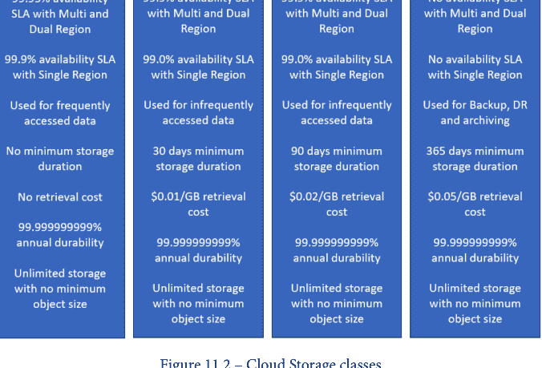

图 11.2 – Cloud Storage 类别

您可以编辑 Cloud Storage 存储桶以在这些存储类别之间移动。请注意，还有一些额外的存储类别无法使用 Cloud Console 设置：

- **多区域存储：** 这相当于标准存储，但只能用于存储在多区域或双区域中的对象。
- **区域存储：** 这相当于标准存储，但只能用于存储在区域中的对象。
- **耐久性降低的可用性存储 DRA：** 这可以与标准存储进行比较，但 DRA 存储的操作价格更高，性能更低，尤其是在可用性方面，其 SLA 为 99%。

存储桶在其创建时获得默认存储类别，其中的任何对象都将继承此类别，除非另有指定。我们可以更改存储桶的默认存储类别，但它仅适用于更改后的新对象；现有对象将保留在原始类别中。我们还可以使用 Cloud Storage Transfer Service 在存储桶之间有效地移动数据。但是，请注意，在不同位置之间移动数据会产生网络使用成本。此外，我们还应注意可能适用的额外费用。由于近线、冷线和归档存储用于存储不经常访问的数据，Google 可能会收取检索或提前删除费用。当我们复制、读取或重写存储在这些存储类别中的数据或元数据时，将收取检索费用。

## 数据一致性

Cloud Storage 在某些情况下会提供强一致性和最终一致性。

在以下情况下可以预期强一致性：

- 将数据上传到 Cloud Storage 时，这意味着数据在写入或更新操作后将始终可供读取。
- 一旦我们成功删除数据，文件将立即不可用。

在以下情况下可以预期最终一致性：

- 当撤销对资源的访问时。撤销访问通常需要大约 1 分钟的时间，但在某些情况下，可能需要更长的时间。

## Cloud Storage FUSE

Cloud Storage 无法挂载到 Google Compute Engine 实例上。但是，如果您想探索这一点，GCP 目前提供使用开源 FUSE 适配器的第三方集成，可让您将存储桶作为文件系统挂载到 Linux 上。这可免费使用且不受官方支持；但是，正常的 Cloud Storage 费用适用。

## 创建和使用存储桶

现在我们对存储类别有了很好的了解，让我们看看如何创建存储桶。我们还将学习如何将文件复制到我们的存储桶中并更改对象的存储策略。

我们有两种创建存储桶的选项——通过控制台或使用 gsutil。我们将在第 16 章 Google Cloud 管理选项中更多地了解 gsutil，但就本章而言，您只需知道它是一个专用命令行工具，可向您的 Cloud Storage 服务发出 RESTful API 调用。让我们通过以下步骤了解如何从控制台创建存储桶：

- 1. 从导航菜单浏览到 STORAGE。然后，选择 Cloud Storage | Browser：

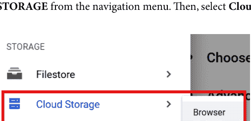

图 11.3 – 导航到 Cloud Storage

- 2. 点击 CREATE BUCKET，如以下屏幕截图所示：

Store and retrieve your data
Get started by creating a bucket — a container where you can organize and control access to your data and files in Cloud Storage.
CREATE BUCKET
TAKE QUICKSTART

图 11.4 – CREATE BUCKET

- 3. 为存储桶命名。请记住，这必须是全局唯一的：

Create a bucket
Name your bucket
Pick a globally unique, permanent name. Naming guidelines
cloudarchitect0001
Tip: Don't include any sensitive information
CONTINUE

图 11.5 – 为存储桶命名

- 4. 选择存储桶的位置：

Choose where to store your data
This permanent choice defines the geographic placement of your data and affects cost, performance, and availability. Learn more
Location type
Multi-region
Highest availability across largest area
Dual-region
High availability and low latency across 2 regions
Region
Lowest latency within a single region
Location
us (multiple regions in United States)

图 11.6 – 位置类型


5. 选择适合您需求的存储类别。选择位置。您会注意到位置将是区域或地区，具体取决于您选择的是多区域还是区域。请记住，您的选择会影响成本：

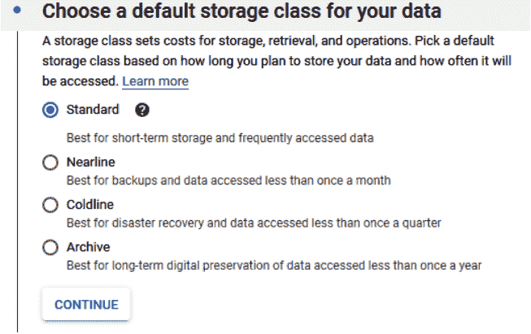

图 11.7 – 存储类别选项

6. 选择 ACL 或 IAM 访问控制模型：

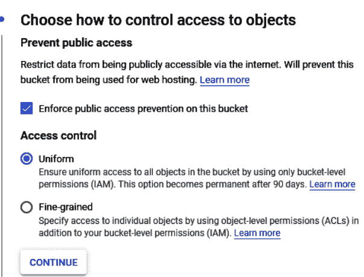

图 11.8 – 访问控制选项

7. 我们还可以设置更高级的设置，这些设置将显示加密和保留策略。默认情况下，Google 将管理我们的密钥。还可以设置保留策略。这将提供对象在存储桶中受删除保护的最小持续时间：

## 选择如何保护对象数据

您的数据始终通过 Cloud Storage 得到保护，但您也可以从以下附加数据保护选项中进行选择以防止数据丢失。请注意，对象版本控制和保留策略不能同时使用。

## 保护工具

- 无
- 对象版本控制（最适合数据恢复）
  用于恢复已删除或覆盖的对象。为了最大限度地降低存储版本的成本，我们建议限制每个对象的非当前版本数量并安排在若干天后过期。了解更多
- 保留策略（最适合合规）
  用于在对象上传后指定的最短时间内防止存储桶中的对象被删除或修改。了解更多

## 数据加密？

- Google 管理的加密密钥
  无需配置
- 客户管理的加密密钥（CMEK）
  通过 Google Cloud Key Management Service 管理

图 11.9 – 可选的高级设置

8. 单击创建，我们就完成了。

正如您所见，这是一个相当简单的过程。让我们通过使用我们专用的命令行工具 gsutil 来使其更简单，该工具我们可以通过 Cloud Shell 访问：

- 1. 在 Cloud Shell 中，我们可以运行以下命令：

```
gsutil mb -c <storage class> -l <location> gs://<bucket name>
```

让我们更详细地查看代码：

- <storage class> 是我们希望应用于存储桶的类别。
- <location> 是我们想要创建存储桶所在的区域。
- <bucket name> 是我们希望分配给存储桶的唯一名称。

2. 让我们在 us-east1 区域创建一个名为 cloudarchitect001 的新存储桶并应用区域存储类别：

```
gsutil mb -c regional -l us-east1 gs://cloudarchitect001
```

3. 现在，我们有一个空的存储桶。让我们使用 gsutil 并使用以下语法将一些对象移动到我们的存储桶中：

```
gsutil cp <filename> gs://<bucketname>
```

这里，<filename> 是您希望复制的文件名，而 <bucketname> 是目标存储桶。

4. 在此示例中，让我们将一个名为 conf.yaml 的文件复制到我们新建的名为 cloudarchitect001 的存储桶中：

```
gsutil cp conf.yaml gs://cloudarchitect001
```

5. 让我们看看如何更改文件的存储类别。单个对象的存储类别只能使用 gsutil 放入存储桶中。我们应使用以下语法：

```
gsutil rewrite -s <storage class> gs://<bucket name>/<file name>
```

6. 让我们更改我们的文件 conf.yaml，使其使用 Coldline 存储：

```
gsutil rewrite -s coldline gs://cloudarchitect001/conf.yaml
```

太好了！因此，我们现在知道如何管理我们的存储桶。在下一节中，我们将查看 Cloud Storage 的一些关键功能。

## 版本控制和生命周期管理

现在，让我们看看版本控制和生命周期管理。这些是 Cloud Storage 提供的重要的功能，并且对考试尤其重要。

> 考试提示
> Cloud Storage 提供了一系列功能。要在考试中取得成功，您必须了解 Cloud Storage 的版本控制和生命周期管理功能。与存储类别一样，您应该在继续阅读本章的后续部分之前复习这些内容并确保自己熟悉。

## 版本控制

可以启用版本控制以检索我们已删除或覆盖的对象。请注意，在这一点上，这会增加存储成本，但如果您能够回滚到重要文件的先前版本，这可能是值得的。额外成本来自每次覆盖或删除对象的实时版本时创建的每个对象的归档版本。文件的归档版本将保留原始名称，但也会附加一个世代号以标识它。让我们逐步了解版本控制的过程：

- 1. 要启用版本控制，我们应使用 gsutil 命令：

```
gsutil versioning set on gs://<bucket name>
```

这里，<bucket name> 是我们想要启用版本控制的存储桶。

让我们查看以下屏幕截图，显示了它的外观。在此示例中，我们正在为我们的 cloudarchitect 存储桶启用版本控制，然后确认版本控制确实已启用：

```
google3339831_student@cloudshell:~ (qwiklabs-gcp-e7f0f69cddalb280)$ gsutil versioning set on gs://cloudarchitect
Enabling versioning for gs://cloudarchitect/...
google3339831_student@cloudshell:~ (qwiklabs-gcp-e7f0f69cddalb280)$ gsutil versioning get gs://cloudarchitect
gs://cloudarchitect: Enabled
```

图 11.10 – 设置版本控制

- 2. 现在，让我们将一个名为 vm.yaml 的文件复制到我们的存储桶中。我们可以使用 -v 开关对其进行版本控制：

```
google3339831_student@cloudshell:~ (qwiklabs-gcp-e7f0f69cddalb280)$ gsutil cp -v vm.yaml gs://cloudarchitect
Copying file://vm.yaml [Content-Type=application/octet-stream]...
Created: gs://cloudarchitect/vm.yaml#1557763393469362

Operation completed over 1 objects/492.0 B.
```

图 11.11 – 复制文件

- 3. 如果我们修改此文件，我们可以通过运行具有以下语法的命令来列出可用的版本：

```
gsutil ls -a gs://<bucket name>/<filename>
```

让我们在位于我们的 cloudarchitect 存储桶中的名为 vm.yaml 的文件上运行此命令。我们可以看到我们有几个归档版本可用：

```
google3339831_student@cloudshell:~ (qwiklabs-gcp-e7f0f69cddalb280)$ gsutil ls -a gs://cloudarchitect/vm.yaml
gs://cloudarchitect/vm.yaml#1557760768160333
gs://cloudarchitect/vm.yaml#1557763393469362
gs://cloudarchitect/vm.yaml#1557763527069403
```

图 11.12 – 查看不同的版本

我们可以随时打开和关闭版本控制。我们关闭它时，任何可用的归档版本仍会保留，但我们应该记住，在启用此选项之前我们不会有任何归档版本。

## 生命周期管理

归档文件可能会迅速失控并不必要地影响我们的账单。为避免这种情况，我们可以利用生命周期管理策略。生命周期管理配置可以分配给存储桶。这些文件是一组规则，可以应用于存储桶中的当前或未来对象。当任何对象符合配置的准则时，Cloud Storage 可以自动执行操作。

使用生命周期管理策略最常见的用例之一是当我们希望在设定时间后降低对象的存储类别时。例如，可能存在一种情况，即数据在移至 Cloud Storage 后 30 天内需要频繁访问，之后每年仅访问一次。将此数据保留在区域或多区域存储中毫无意义，因此我们可以使用生命周期管理在 30 天后将其移至 Coldline 存储。也许对象在 1 年后根本不需要，在这种情况下，我们可以使用策略删除这些对象。这有助于降低成本。让我们学习如何将策略应用于存储桶。

我们需要做的第一件事是创建生命周期配置文件。正如我们之前提到的，这些文件包含我们希望应用于存储桶的一组规则。如果策略包含多个规则，则对象必须匹配所有条件后才会采取操作。可能单个对象会受到多个操作的影响；在这种情况下，Cloud Storage 将在重新评估任何额外操作之前仅执行其中一个操作。

我们还应注意，Delete 操作将优先于 SetStorageClass 操作。此外，如果对象有两个规则应用于它以将对象移至 Nearline 或 Coldline，则如果两个规则使用相同的条件，对象将始终移至 Coldline 存储类别。配置文件可以用 JSON 或 XML 创建。

在以下示例中，我们将创建一个简单的 JSON 格式的配置文件，该文件将在 60 天后删除文件。我们还将在 30 天后删除归档文件。让我们将其保存为 lifecycle.json：

```
{
  "lifecycle": {
    "rule": [{
      "action": {
        "type": "Delete"
```


},
"condition": {
"age": 60,
"isLive": true
}
}, {
"action": {
"type": "Delete"
},
"condition": {
"age": 30,
"isLive": false
}
}]
}
}

> **考试提示**
> 如果 `isLive` 的值为 true，则此生命周期条件将仅匹配处于活动状态的对象；但是，如果将值设置为 false，则生命周期条件将仅匹配已归档的对象。我们还应注意，非版本化存储桶中的对象被视为活动对象。

我们还可以使用 gsutil 使用以下语法在存储桶上启用此策略：

```
gsutil lifecycle set <lifecycle policy name> gs://<bucket name>
```

这里，<lifecycle policy name> 是我们创建的包含策略的文件，而 <bucket name> 是我们要应用策略的唯一存储桶名称。以下代码显示了如何将我们的 lifecycle.json 文件应用到我们的 cloudarchitect 存储桶：

```
gsutil lifecycle set lifecycle.json gs://cloudarchitect
```

我们之前提到过，生命周期的常见用例是在设定时间后将对象移至更便宜的存储类别。让我们看一个映射到常见场景的示例。假设我们 cloudarchitect 存储桶中有对象，我们希望在 90 天内频繁访问。之后，我们每月才需要访问一次数据。最后，在 180 天后，我们每年才访问一次数据。我们可以将这些需求转换为存储类别并创建以下策略，这将有助于将成本降至最低。

让我们稍微分解一下，因为我们现在有一个包含两条规则的策略，每条规则各有两个条件。任何年龄大于 90 天且应用了 REGIONAL 存储类别的存储对象都将被移至 NEARLINE 存储。任何年龄大于 180 天且应用了 NEARLINE 存储类别的对象都将被移至 ARCHIVE 存储：

```
{
    "lifecycle": {
        "rule": [{
            "action": {
                "type": "SetStorageClass",
                "storageClass": "NEARLINE"
            },
            "condition": {
                "age": 90,
                "matchesStorageClass": ["REGIONAL"]
            }
        },
        {
            "action": {
                "type": "SetStorageClass",
                "storageClass": "ARCHIVE"
            },
            "condition": {
                "age": 180,
                "matchesStorageClass": ["NEARLINE"]
            }
        }
    }
}
```

> **考试提示**
> 至少需要一个条件。如果输入了错误的操作或条件，则会收到 400 错误请求错误响应。

接下来，让我们了解一下保留策略和锁定。

## 保留策略和锁定

存储桶锁定允许我们为 Cloud Storage 存储桶配置数据保留策略。这意味着我们可以管理存储桶中对象必须保留多长时间，并防止策略被减少或移除。

我们可以通过运行以下命令创建保留策略：

```
gsutil retention set 60s "gs://<bucketname>"
```

这将策略设置为 60 秒。我们也可以将其设置为 60d 表示 60 天，1m 表示 1 个月，或 10y 表示 10 年。设置此策略的输出将类似于以下内容：

```
Retention Policy (UNLOCKED):
    Duration: 60 Second(s)
    Effective Time: Thu, 01 Jul 2021 05:49:05 GMT
```

请注意，如果存储桶没有保留策略，则我们可以随时删除或替换对象。但是，如果应用了策略，则存储桶中的对象只有在其年龄超过保留策略期限后才能被替换或删除。

> **考试提示**
> 保留策略和对象版本控制是互斥的功能，这意味着对于给定的存储桶，同时只能启用其中一个。

## 对象保留

对象保留是可放置在单个对象上的元数据标志，这意味着它们无法被替换或删除。我们仍然可以编辑已被保留的对象元数据。

有两种类型的保留，并且对象可以应用一种、两种或都不应用。当对象存储在没有保留策略的存储桶中时，两种保留类型行为相同。但是，如果对存储桶应用了保留策略，则在释放保留时，保留对对象的影响不同：

- **基于事件的保留**：这会重置对象在存储桶中用于保留期的时间。
- **临时保留**：这不会影响对象在存储桶中用于保留期的时间。

让我们看一个示例以便更清楚一些。假设我们有两个对象——对象 A 和对象 B——我们将其添加到具有 1 个月保留期的存储桶中。我们对对象 A 应用 **基于事件的保留**，对对象 B 应用 **临时保留**。仅由于保留期，我们通常在 1 个月后可以删除这两个对象。但是，由于我们对每个对象都应用了 **对象保留**，因此我们无法这样做。如果我们释放对象 A 上的保留，则由于 **基于事件的保留**，对象必须在存储桶中再保留 1 个月后我们才能删除它。如果我们释放对象 B 上的保留，由于 **临时保留** 不会影响对象在存储桶中的时间，我们可以立即删除它。

## 传输数据

在某些情况下，我们可能想要从本地或另一个基于云的存储将文件传输到存储桶，Google 提供了许多方法来执行此操作。我们应该牢记一些注意事项，以确保我们选择合适的选项。数据的大小和可用带宽将是决定因素。让我们快速看一下图表，以了解通过特定带宽传输某些设定数据大小需要多长时间：

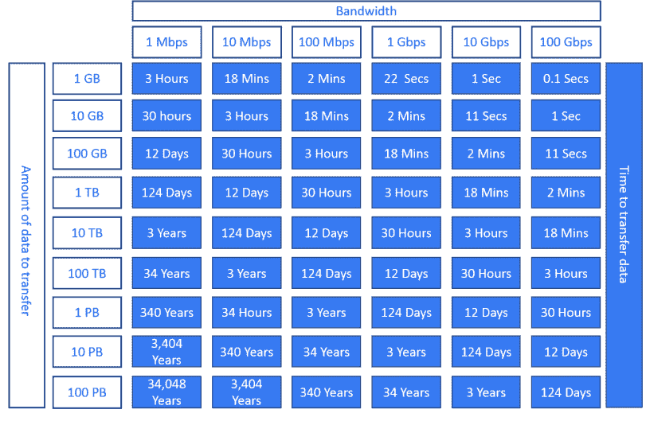

图 11.13 – 数据传输指导

接下来，让我们看一些传输数据的方法。

## Cloud Storage 传输服务

Cloud Storage 传输服务为我们提供了将数据从在线源传输或备份到数据接收器的选项。假设，例如，我们想将数据从我们的 AWS S3 存储桶移动到我们的 Cloud Storage 存储桶。S3 将是我们的源，而目标 Cloud Storage 存储桶将是我们的接收器。我们还可以使用 Cloud Storage 传输服务将数据从 HTTP/HTTP(s) 源或甚至另一个 Cloud Storage 存储桶移动。为了使这些数据迁移或同步更容易，Cloud Storage 传输服务提供了几个选项：

- 我们可以安排一次性传输操作或定期操作。
- 如果目标数据接收器中不存在源中的对应对象，我们可以删除目标数据接收器中已有的对象。
- 我们可以在传输后删除源对象。
- 我们可以使用基于文件创建日期、文件名或您希望导入数据的时段的文件夹，在源和目标之间安排定期同步。

> **考试提示**
> 您也可以使用 `gsutil` 在 Cloud Storage 和其他位置之间传输数据。您可以通过使用 `-m` 选项启用多线程复制来加快本地传输文件的速度。如果您计划上传较大的文件，`gsutil` 将把这些文件拆分为几个较小的块并并行上传。
> 
> 建议在从 Amazon S3 传输数据到 Cloud Storage 时使用 Cloud Storage 传输服务。

## Google 传输设备

如果我们查看图 9.13，我们可以看到传输时间相当长。如果我们有 PB 级的存储需要传输，则应使用 Transfer Appliance。这是一种硬件存储设备，可实现安全离线数据迁移。它可以在我们的数据中心设置，并且可机架安装。我们只需用数据填充它，然后将其运送到接收位置，Google 将其上传到 Cloud Storage。

Google 提供 40 TB 或 300 TB 传输设备的选项。以下内容摘自 https://cloud.google.com/transfer-appliance/docs/4.0/security-and-encryption：

> “上传您的数据后，我们会通过应用 NIST 800-88 标准来清除信息，对您退回的设备中的驱动器介质进行清理...”

Transfer Appliance 的常见用例是将大量现有备份从本地迁移到使用 Coldline 存储类别的更便宜的 Cloud Storage。通过网络执行此上传需要超过 1 周的时间。

现在，我们将了解一下 IAM。


## 理解 IAM

访问 Google Cloud Storage 由 IAM 保护。让我们来看一下以下预定义角色及其详情的列表：

- **Storage Object Creator**：有权创建对象，但不授予查看、删除或覆盖对象的权限
- **Storage Object Viewer**：有权查看对象及其元数据，但无权访问 ACL，并有权列出存储桶中的对象
- **Storage Object Admin**：对对象有完全控制权，可以创建、查看和删除对象
- **Storage Admin**：对存储桶和对象有完全控制权
- **Storage HMAC Key Admin**：对项目中的 HMAC 密钥有完全控制权，只能应用于项目

## 配额和限制

Google Cloud Storage 带有预定义的配额。这些默认配额可以通过 **Navigation** 菜单，在 **IAM & Admin | Quotas** 部分进行更改。从此菜单中，我们可以查看当前配额并请求提高这些限制。我们建议您熟悉每个服务的限制，因为这会影响您的可扩展性。对于 Cloud Storage，我们应注意以下限制：

- 单个对象最大大小限制为 5 TiB。
- 对单个对象的更新限制为每秒一次。
- 每个存储桶的初始写入限制为每秒 1,000 次。
- 每个存储桶的初始读取限制为每秒 5,000 次。
- 每个对象的 ACL 条目限制为 100 条。
- 存储桶创建操作的限制为每 2 秒一次。
- 存储桶删除操作的限制为每 2 秒一次。

## 价格

Google Cloud Storage 的价格基于四个组成部分：

- **数据存储**：适用于存储在 Cloud Storage 中的静态数据，按 GB/月计费，费用取决于存储的位置和类别。
- **网络使用**：适用于从我们的存储桶读取对象数据或元数据，或在存储桶之间移动数据时。
- **操作使用**：适用于在 Cloud Storage 中执行更改存储桶及其对象或检索其信息的操作。费用取决于存储的类别。
- **检索和提前删除费用**：适用于从 Nearline、Coldline 和 Archive 存储类别访问数据时。检索费用将在读取、复制或重写数据或元数据时适用。最小存储期限适用于存储在 Nearline、Coldline 和 Archive 存储中的数据。即使文件在最短期限之前被删除，您仍会被收取对象的存储时长费用。

## 理解 Cloud Firestore

在这一节开始时明智地注意，Google 已将其之前的 Cloud Datastore 产品重新命名为名为 **Cloud Firestore** 的新主要版本。然而，了解两者之间的关系也很重要，因为 Firestore 提供了 Native 模式和 Datastore 模式选项，后者使用传统的 Datastore 系统的行为与 Firestore 存储层，这消除了 Datastore 的一些限制。

Cloud Datastore 是一种 NoSQL 数据库，旨在简化应用程序开发。它使用分布式架构，具有高度可扩展性，并且由于它是无服务器的，我们无需担心底层基础设施。Cloud Datastore 将我们的数据分布在多台机器上，并在广阔的地理区域上使用无主、同步复制。

Firestore 在此基础上构建，还加速了移动、物联网和 Web 应用程序的开发。它提供内置的实时同步，以及离线模式，可提高实时应用程序开发的效率。这包括实时资产跟踪、实时分析、社交媒体资料和游戏排行榜等工作负载。

Firestore 还为我们的数据提供非常 **高可用性（HA）**。通过自动多区域复制和强一致性，它提供 99.999% 的保证。

在我们进一步深入细节之前，我们不想假设您知道什么是 NoSQL 数据库。SQL 数据库在行业中对非数据库管理员来说更为人所知。SQL 数据库主要是一种关系型数据库，基于由若干行数据组成的表，这些数据具有预定义的模式。

将其与 NoSQL 数据库的概念进行比较，NoSQL 数据库是一种基于键值对的非关系型数据库，无需遵循任何模式定义。最终，这使我们能够高效扩展；因此，我们可以看到根据需要添加或删除资源变得容易得多。这种弹性使 Cloud Datastore 非常适合事务信息，例如实时库存、始终提供有效数据的 ACID 事务，或提供用户资料以根据过去的活动或偏好记录用户体验。然而，也需要注意的是，NoSQL 数据库可能不适合每个场景，在选择数据库时应予以考虑，特别是关于查询数据的效率。好的；既然我们知道了什么是 NoSQL 数据库，让我们来看看构成 Datastore 数据库的内容，因为数据对象之间的关系与其他您可能熟悉的数据库的处理方式不同。传统的 SQL 数据库由表、行和列组成。在 Cloud Datastore 中，实体相当于一行，种类相当于表。实体是可以具有一个或多个命名属性的数据对象。

每个实体都有一个标识它的键。让我们看一下下面的表格来比较 SQL 数据库和 Cloud Datastore 中使用的术语：

| Concept | SQL Database | Cloud Datastore |
|---|---|---|
| Category of object | Table | Kind |
| One object | Row | Entity |
| Individual data for an object | Column | Property |
| Unique ID for an object | Primary Key | Key |

Figure 11.14 – Terminology comparison

现在，让我们更详细地了解所提供的不同类型的模式。

## Cloud Firestore 在 Datastore 模式或 Native 模式下

当我们创建新数据库时，必须选择其中一种模式。然而，我们不能在同一项目中使用混合模式。因此，建议您考虑您的设计以及应用程序的构建目的。

Native 模式提供重构产品的所有新功能。它结合了 Cloud Datastore 和 Firebase 实时数据库的优点。Firebase 最初是为需要实时跨客户端同步状态的移动应用程序而设计的。因此，Firestore 利用了这一点并提供了一个新的强一致存储层，以及实时更新。此外，它还提供集合和文档数据模型以及移动和 Web 客户端库。Native 模式可以自动扩展到数百万个并发客户端。

> **Exam Tip**
> 虽然 Firestore 与 Datastore 向后兼容，但新的数据模型、实时更新和移动及 Web 客户端库则不兼容。您必须使用 Native 模式才能访问这些功能。

Datastore 模式支持 Datastore API，因此无需更改任何现有的 Datastore 应用程序。如果您的架构需要使用已建立的 Datastore 服务器架构，则 Datastore 模式允许这样做并移除了 Datastore 的一些限制，主要是 Datastore 模式提供强一致性，除非指定最终一致性。Datastore 模式可以自动扩展到每秒数百万次写入。

> **Exam Tip**
> Firestore 在 Datastore 模式中的数据对象称为实体。

## 升级到 Firestore

需要 Datastore 数据库的新项目应使用 Firestore 在 Datastore 模式下。然而，从 2021 年开始，现有的 Datastore 数据库将自动升级，无需更新应用程序代码。Google 将通知用户升级计划，该计划无需停机。

## 创建和使用 Cloud Datastore

我们需要做的第一件事是在使用 Cloud Firestore 之前选择模式。让我们来看一下在 Datastore 模式下创建数据库并对我们创建的实体运行一些查询。在此之前，让我们提醒自己 Datastore 是一种托管服务。在我们进行此过程时，您会注意到我们直接创建实体，而无需先配置任何底层基础设施。您还应注意，与 GCP 的所有存储服务一样，Cloud Datastore 在写入磁盘之前会自动加密所有数据。按照以下步骤创建 Firestore 在 Datastore 模式下：

1. 从我们的 GCP 控制台，浏览到 **DATABASES Firestore:**

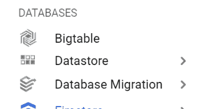


2. 我们现在需要选择一个操作模式。**Native mode** 是官方的 Firestore 模式，是 Cloud Datastore 的下一个主要版本，并提供新功能，例如实时更新以及移动和网页客户端库。Datastore mode 使用传统的 Cloud Datastore 系统行为。在我们的示例中，我们将使用 **Datastore mode：**

|  | Native mode | Datastore mode |
|---|---|---|
|  | 启用 Cloud Firestore 的所有功能，支持离线和实时同步。SELECT NATIVE MODE | 在 Cloud Firestore 强大的存储层之上利用 Cloud Datastore 的系统行为。SELECT DATASTORE MODE |
| API | Firestore | Datastore |
| Scalability | 自动扩展到数百万并发客户端 | 自动扩展到每秒数百万次写入 |
| App engine support | 不支持 App Engine 标准 Python 2.7 和 PHP 5.5 运行时 | 所有运行时 |
| Max writes per second | 10,000 | 无限制 |
| Real-time updates | ✓ | ✕ |
| Mobile/web client libraries with offline data persistence | ✓ | ✕ |
| Query consistency | 强一致性 | 强一致性 |
| Data model | Documents / collections | Entities / kinds |
| Web console | Google Cloud Platform 和 Firebase 中的 Firestore 页面 | Google Cloud Platform 中的 Datastore 页面 |

Figure 11.16 – Choosing Datastore mode

3. 选择 Datastore 数据库的位置并点击 CREATE DATABASE：

Choose carefully: your location selection is permanent and will also apply to this project's App Engine app

Figure 11.17 – Selecting a location

4. 数据库准备就绪后，我们将被引导至 Entities 菜单。点击 CREATE ENTITY 来创建我们的第一个 Datastore 实体：

Figure 11.18 – Creating an entity

我们现在可以为实体指定一个命名空间、一个 Kind（在 SQL 术语中即表）以及一个键标识符，后者将自动生成。让我们将命名空间保持为默认值并创建一个名为 exam 的新 kind：

Figure 11.19 – Create an entity

5. 点击 **ADD PROPERTY** 指定名称——在本例中为 `title`。我们还可以从多种类型中选择，但在本示例中，我们希望使用 **String**。最后，我们将为其赋值为 `Professional Cloud Architect`。点击 **DONE** 添加该属性：

# Properties

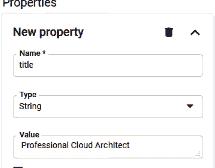

Figure 11.20 – Adding entity properties

6. 我们可以重复 *Step 5* 来添加另一个属性。这次，我们将使用 `cost` 作为名称，**Integer** 作为类型，`200` 作为值。当我们在实体中添加完所有想要的属性后，点击 **CREATE**。让我们再创建两个具有 exam kind 的新实体，分别用于 `Associate Cloud Engineer` 考试和 `Professional Cloud Developer` 考试：

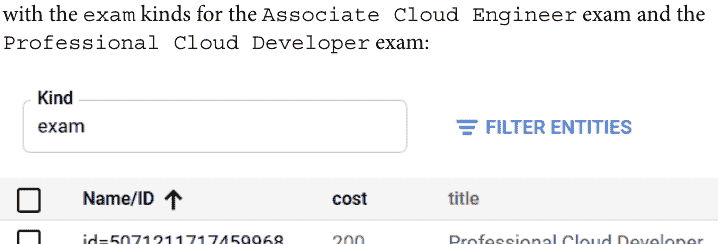

Figure 11.21 – Creating an entity

7. 现在，我们可以根据 cost 或 title 过滤实体查询。让我们查找有关 Professional Cloud Developer 考试的信息：

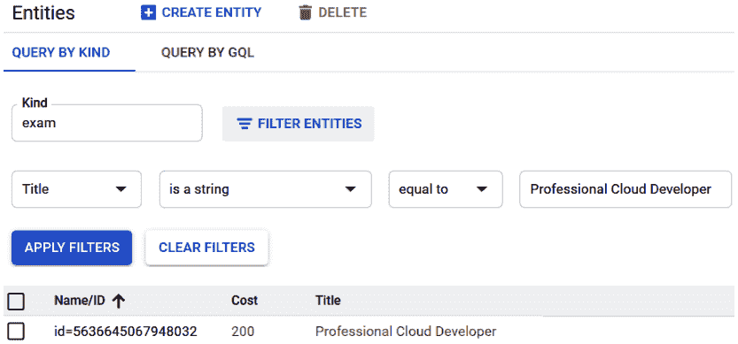

Figure 11.22 – Filter entities

8. 我们也可以使用 QUERY BY GQL 并输入类似 SQL 的查询来获得相同的结果：

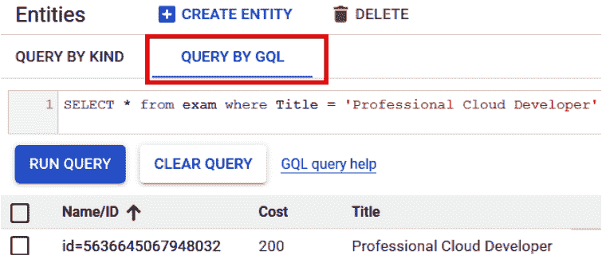

```
SELECT * from exam where Title = 'Professional Cloud Developer'
```

Figure 11.23 – Executing the query

至此，我们已经了解了创建 Datastore 数据库以及查询所创建实体的便捷性。现在，让我们继续并查看 Datastore 与 Firestore 之间的一些差异。

## Summary of Datastore mode versus Native mode

Cloud Firestore 在 Native mode 中是完整重品牌的产品。它融合了 Cloud Datastore 和 Firebase 实时数据库的优点，提供与 Datastore 相同的概念性 NoSQL 数据库，但由于 Firebase 是为低延迟移动应用而构建的，因此还包括以下新功能：

- 一个新的强一致性存储层
- 一个集合和文档数据模型
- 实时更新
- 移动和网页客户端库

Cloud Firestore 在 Datastore mode 中使用相同的 Datastore 系统行为，但将访问 Firestore 存储层，这将消除一些限制，例如以下内容：

- 不再局限于最终一致性，因为所有查询都变为强一致性
- 不再局限于 25 个实体组限制
- 不再局限于每个实体组每秒 1 次写入

## IAM

对 Google Cloud Datastore 的访问通过 IAM 保护。让我们查看预定义角色的列表及其详情：

- **Datastore owner with an AppEngine app admin**: 拥有对 Datastore mode 的完全访问权限
- **Datastore owner without an AppEngine app admin**: 拥有对 Datastore mode 的访问权限，但无法启用管理员访问、检查 Datastore mode 管理员是否已启用、禁用 Datastore mode 写入或检查 Datastore mode 写入是否已禁用
- **Datastore user**: 拥有对 Datastore mode 数据库中数据的读写访问权限。主要用于开发人员或服务账号
- **Datastore viewer**: 拥有读取所有 Datastore mode 资源 的权限
- **Datastore import-export admin**: 拥有管理导入和导出的完全访问权限
- **Datastore index admin**: 拥有管理索引定义的完全访问权限

## Quotas and limits

Google Cloud Datastore 带有预定义的配额。这些默认配额可以通过进入 **Navigation** 菜单，在 **IAM & Admin | Quotas** 部分进行更改。从此菜单中，我们可以查看当前配额并请求提高这些限制。我们建议您熟悉每个服务的限制，因为这会影响您的可扩展性。Cloud Firestore 提供免费配额，让我们零成本开始：

- 存储数据的限制为 1 GiB。
- 每日读取限制为 50,000 次。
- 每日写入限制为 20,000 次。
- 每日删除限制为 20,000 次。
- 每月网络出站限制为 10 GiB。

免费层级下有以下标准限制：

- 子集合的最大深度为 100。
- 文档的最大大小为 6 KiB。
- 文档的最大大小为 1 MiB。
- 每个数据库每秒最大写入次数为 10,000。
- 最大 API 请求大小为 10 MiB。
- 最多可将 500 次写入传递给一次提交操作或在一次事务中执行。
- 单个文档 Commit 操作或事务中最多可执行 500 个字段转换。

## Pricing

Google Cloud Firestore 的定价提供免费配额供我们开始使用，如前所述。

如果超出这些限制，将会产生费用，具体取决于数据所在位置而波动。一般定价按每 100,00 文档的读取、写入和删除计费。存储数据按每 GB 每月计费。

## Understanding Cloud SQL

从名称上看，Cloud SQL 是一个数据库服务，可轻松设置、维护和管理您在 Google Cloud 上的关系型 PostgreSQL、MySQL 或 SQL Server 数据库。

尽管我们正在配置底层实例，但它是一个完全托管的服务，能够处理多达 64 TB 的存储。Cloud SQL 数据库是关系型的，这意味着它们组织成表、行和列。作为替代方案，我们可以将 SQL Server 应用程序镜像安装到 Compute Engine 实例上，但 Cloud SQL 提供了许多由 Google 完全托管带来的好处——例如，可扩展性、修补和更新会自动应用，提供自动备份，并且开箱即用提供 HA。再次强调，虽然这些好处看起来很棒，但我们也应注意存在一些不支持的功能，并在承诺使用 Cloud SQL 之前加以考虑。

> **Exam Tip**
> Cloud SQL 可容纳多达 64 TB 的存储。如果您需要处理更大量的数据，则应考虑替代服务，例如 Cloud Spanner。

现在，让我们查看 Cloud SQL 提供的一些功能。


Cloud SQL for MySQL 为我们提供以下功能：

- MySQL 目前提供对 MySQL 5.6、5.7 和 8.0 的支持，并且在选择高内存实例类型时，最多可提供 624 GB 的 RAM 和 64 TB 的存储。
- 多个区域之间存在数据复制，并具有自动故障转移。
- 完全托管的 MySQL Community Edition 数据库可在云中使用。
- 具有时间点恢复和按需备份。
- 支持实例克隆。
- 它提供与 GCP 的监控和日志解决方案的集成 – Cloud Operations。

Cloud SQL for PostgreSQL 为我们提供以下功能：

- 云中完全托管的 PostgreSQL 数据库，存储量最高可达 64 TB，具体取决于实例是具有专用还是共享 vCPU
- 自定义机器类型，最高可达 624 GB RAM 和 96 个 CPU
- 多个区域之间的数据复制，具有自动故障转移
- 实例克隆
- 按需备份
- 与 GCP 的监控和日志解决方案集成 – Cloud Operations 日志和监控

Cloud SQL for SQL Server 为我们提供以下功能：

- 云中完全托管的 SQL Server 数据库。
- 自定义机器类型，最高可达 624 GB RAM 和 96 个 CPU。
- 最多 64 TB 的存储。
- 在 Google 内部网络中对自定义数据进行加密，包括数据库表、临时文件和备份。
- 数据库可以使用 BAK 和 SQL 文件导入。
- 实例克隆。
- 与 Cloud Operations 日志和监控集成。
- 跨多个区域的数据复制。
- 通过区域持久磁盘实现高可用性。

现在我们知道了主要功能，让我们来看一下在创建新实例时需要注意的一些事项：

- **选择实例**：与其它 GCP 服务类似，我们可以选择实例的位置。将数据库实例放置在依赖它的服务附近是有意义的。我们应该了解数据库需求，并对活动连接、内存和 CPU 使用率有一个基线，以便让我们选择正确的机器类型。如果过度配置，这将影响我们的成本，同样，如果配置不足，我们可能会影响性能或可用性，如果资源耗尽。
- **选择区域**：我们可以选择实例部署到的区域。请注意，区域在部署后无法更改，但区域可以随时更改。为了实现高可用性，我们可以选择多个区域，这提供了在所选区域内自动故障转移到另一个区域。从性能角度来看，我们应该将实例部署在靠近使用它们的服务附近。我们将在本章后面更详细地讨论高可用性。
- **选择存储**：创建实例时，我们可以选择不同的存储层。根据我们的需求，我们可能希望选择 SSD 以获得更低的延迟和更高的吞吐量；然而，如果我们不需要如此高性能的磁盘，也可以选择 HDD。
- **选择加密**：创建实例时，我们可以选择让 Google 管理我们的加密密钥，这是默认设置，也可以选择客户管理的密钥，该密钥通过 Google KMS 服务进行管理。

选择正确的容量以适应数据库大小也非常重要，因为一旦创建实例，就无法减小容量。如果我们过度配置存储，则需要为未使用的空间付费。如果我们配置不足的存储，则可能导致可用性问题。避免这种情况的一种方法是启用自动存储增加设置。如果启用，则每 30 秒检查一次存储，以确保存储未低于设定的阈值大小。如果低于阈值，则会自动向实例添加额外存储。阈值大小取决于实例当前配置的存储量，并且不能大于 25 GB。这听起来很棒，但我们也应注意，如果需求出现峰值，则会造成存储成本永久增加。我们还应注意，将存储容量创建或增加到 30 TB 或更大可能会导致备份等操作的延迟增加：

- **选择 IP 地址：** 我们可以选择公共或私有 IP 地址。默认情况下使用公共 IP 地址，这将阻止所有 IP 地址。因此，我们必须添加特定的 IP 地址或范围才能打开实例。如果要使用私有 IP 地址，我们必须启用 Google 的 Service Networking API。这对每个项目都是必需的。如果我们希望使用私有 IP 地址，我们需要确保在实例所在的 Google 服务 VPC 网络与我们的 VPC 网络之间设置了 VPC 对等连接。这在以下图表中显示：

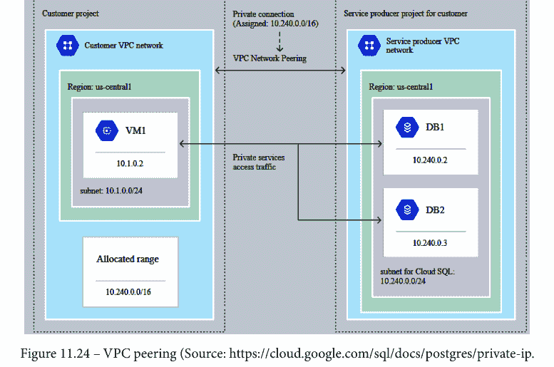

图 11.24 – VPC 对等连接（来源：https://cloud.google.com/sql/docs/postgres/private-ip. 许可：https://creativecommons.org/licenses/by/4.0/legalcode）

我们在第 10 章《GCP 中的网络选项》中更详细地讨论了 VPC 对等连接。使用私有 IP 将有助于降低网络延迟并提高安全性，因为流量永远不会暴露到互联网；然而，我们还应注意，要从其他 GCP 资源通过私有 IP 地址访问 Cloud SQL 实例，该资源必须位于同一区域。

> **重要说明**
> 如果您希望从在 Google 容器服务中运行的应用程序访问 Cloud SQL 实例，即 Google Kubernetes Engine，建议您使用私有 IP 地址。

- **自动备份**：启用自动备份会对性能产生轻微影响；然而，我们应该愿意接受这一点以利用只读副本、克隆或时间点恢复等功能。我们可以选择备份的位置。但是，默认情况下，备份存储在最近的多区域位置，因此除非基于独特的架构决策，否则不应自定义。此外，我们可以选择存储多少个自动备份。这默认为 7，并且除非有特定原因需要更改，否则不建议修改它。另外，请注意，如果选择了多个区域，则默认启用自动备份且无法禁用。
- **维护窗口**：使用此服务时，我们还应指定维护窗口。我们可以选择一天中的特定日期和 1 小时的时间段来应用更新。GCP 不会在此指定窗口内对该实例启动任何更新。请注意，如果未指定窗口，则可能在任何时间发生潜在中断的更新。

## 数据一致性

Cloud SQL 是一种关系数据库，提供强一致性和对 ACID 事务的支持。

## 创建和管理 Cloud SQL

现在我们对概念有了了解，让我们来看一下如何创建新的 MySQL 实例：

- 1. 进入导航菜单并进入 **DATABASES | SQL：**
- 2. 点击 **Create an instance**。
- 3. 选择所需的数据库引擎。在我们的示例中，我们将选择 **MySQL**：

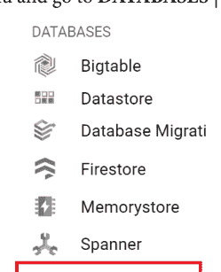

图 11.25 – 选择 SQL

选择您的数据库引擎

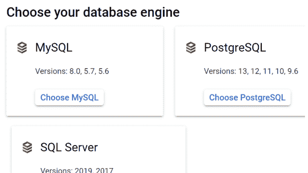

图 11.26 – 选择您的数据库引擎

4. 为实例命名并设置密码。您可以输入自己的密码，也可以点击 Generate 以获取随机密码。此外，您还可以选择位置和数据库版本。在本示例中，我们将保持默认值不变：

## 创建 MySQL 实例

## 实例信息

实例 ID *
cloudarchitect

使用小写字母、数字和连字符。以字母开头。

密码 *
••••••••••••••
GENERATE
为 root 用户设置密码。了解更多

无密码

数据库版本 *
MySQL 8.0

## 选择区域和区域可用性

为了获得更好的性能，请将数据保留在需要它的服务附近。区域是永久的，而区域可以随时更改。

区域
europe-west2 (London)

单区域
发生故障时无故障转移。不推荐用于生产。

多区域（高可用）

图 11.27 – 创建 MySQL 实例


5. 现在，让我们来看一些自定义配置。首先，我们必须选择机器类型和存储选项：

## 创建一个 MySQL 实例

## 自定义您的实例

您也可以稍后自定义实例配置

## 机器类型

机器类型

选择预设或自定义。 为了获得更好的性能，请选择内存足够容纳您最大表的机器类型。

高内存

- 4 vCPU，26 GB
- 8 vCPU，52 GB
- 16 vCPU，104 GB
- 自定义

## 存储

存储类型

选择是永久性的。 存储类型会影响性能。

- SSD（推荐）
  最受欢迎的选择。 相比 HDD 延迟更低，QPS 和数据吞吐量更高。
- HDD

图 11.28 – 选择机器类型和存储

我们还可以设置存储容量和加密选项，以启用使用客户管理的加密密钥。 在前面的屏幕截图中，我们使用的是默认设置。

6. 接下来，我们可以选择为我们的实例分配私有或公共 IP 地址：

## 连接

为连接到此实例选择网络路径。 为了获得额外的安全性，请考虑使用 Cloud SQL 代理。 了解更多

私有 IP
需要额外的 API 和权限，这可能需要您的系统管理员。 一旦启用就无法禁用。 了解更多

公共 IP
授权网络或使用 Cloud SQL 代理连接到此实例。 了解更多

## 授权网络

您尚未授权任何外部网络连接到您的 Cloud SQL 实例。 外部应用程序仍可通过 Cloud SQL 代理连接到实例。 了解更多

图 11.29 – 选择连接类型

7. 为备份提供 4 小时。 此外，如果需要，请确保选中创建故障转移副本选项：

## 备份

自动备份和时间点恢复

以最低成本保护您的数据免于丢失。 了解更多

自动备份
选择一段时间内自动备份您的数据的时间窗口，该备份可能在窗口之外继续进行直至完成。 时间为您的本地时区（UTC+1）。
下午 5:00 — 下午 9:00

高级选项

启用时间点恢复
允许您从特定时间点恢复数据，精确到秒的分数。 启用二进制日志（复制所需）。 请确保您的存储能够支持您保留的日志天数。

高级选项

您无法禁用这些设置，因为它们对于复制和高可用性是必需的。

图 11.30 – 创建备份计划

8. 通过选择一天和 1 小时的时间段来设置维护计划：

## 维护

维护通常每隔几个月才进行一次，并且在进行更新时需要重启您的实例，这会短暂中断服务

## 首选窗口

选择此实例进行例行维护的最佳日期和时间窗口。

星期六

凌晨 12:00 — 凌晨 1:00

小时显示在您的本地时区（UTC+1）。

## 更新顺序

相对于此项目中的其他实例

任意

图 11.31 – 创建维护窗口

9. 在此阶段，我们还可以添加所需的任何标签。 最后，单击创建。

与其他服务一样，我们可以使用可用的命令行工具创建实例。 本章前面我们已经涉及了一些命令行工具，同样，我们可以使用 gcloud 创建新实例。 我们可以运行以下语法来创建新数据库：

```
gcloud sql instances create <instance name> --database-version=<DATABASE version> --cpu=<cpu size> --memory=<RAM size> --region=<region name>
```

让我们更详细地查看这段代码：

- <instance name> 是我们数据库实例的名称。
- <DATABASE version> 是您希望创建的 MySQL 或 PostgreSQL 的特定版本名称。

- `<cpu size>` 和 `<RAM size>` 是我们希望创建的资源的大小。
- `<region name>` 是我们希望部署实例到的区域。

让我们创建一个名为 `cloudarchitect001` 的 PostgreSQL DB，版本为 9.6，并分配 4 个 CPU 和 3,840 MiB 的 RAM。 我们将在 `us-central` 区域部署此实例。 请注意，此命令可能会要求您启用 API。 单击是：

```
gcloud sql instances create cloudarchitect001 --database-version=POSTGRES_9_6  --cpu=1 --memory=3840MiB --region=us-central
```

> **考试提示**
> 您可以直接将本地的 MySQL、SQL 或 PostgreSQL 数据库映射到 Cloud SQL，而无需将其转换为不同格式。 这使其成为公司尝试公共云服务的常见选项之一。

现在我们已通过控制台和命令行创建了新实例，让我们更详细地了解一些重要功能 – 读副本和故障转移副本。

## 读副本

Cloud SQL 提供了将主实例复制到一个或多个读副本的能力。 这本质上是主实例的副本，它将几乎实时地在副本中注册对主实例所做的更改。

> **提示**
> 我们在此要强调的是，读副本不提供 HA，并且我们无法从主实例故障转移到读副本。 它们也不遵循我们在创建主实例时可能指定的任何维护窗口。

Cloud SQL 为读复制提供了几种方案：

- **读副本**：提供额外的读取容量和用于优化主实例性能的分析目标。
- **跨区域读副本**：提供与标准读副本相同的功能，但还提供灾难恢复能力、改进的读取性能以及在区域之间迁移的能力。

- **外部读副本**：复制到外部于 Cloud SQL 的 MySQL 实例。 如果您从本地网络连接，它可以帮助降低延迟，并提供迁移到其他平台的路径。
- **从外部服务器复制**：外部 MySQL 实例为主实例并被复制到 Cloud SQL。 这也提供到 GCP 的数据复制。

启用读副本是一个简单的过程。 让我们学习如何从 GCP 控制台执行此操作：

- 1. 再次浏览至 **数据库 | SQL**。 让我们为现有的 `cloudarchitect001` 实例添加一个副本。 我们只需打开选项菜单并选择 **创建读副本**：

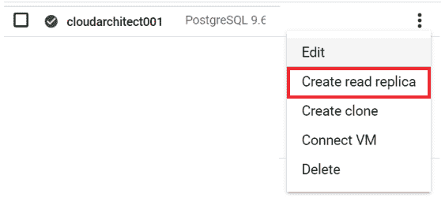

图 11.32 – 创建读副本

> **考试提示**
> 在我们创建读副本之前，必须满足以下要求：必须启用二进制日志，并且在启用二进制日志后必须至少创建过一次备份。

只需为实例命名，选择一个区域，然后单击 **创建**。 我们将看到与创建主实例时使用的配置类似的配置选项：

## 实例信息

实例 ID *
cloudarchitect001-replica
使用小写字母、数字和连字符。 以字母开头。

数据库版本
PostgreSQL 9.6

## 选择区域和区域可用性

为了获得更好的性能，请将您的数据保留在需要它的服务附近。 区域是永久性的，而区域可以随时更改。

区域
us-central1（爱荷华）

单区域
发生故障时无故障转移。 不推荐用于生产。

多区域（高可用性）
在您选择的区域内自动故障转移到另一个区域。 推荐用于生产实例。 增加成本。

图 11.33 – 创建副本

2. 一旦读副本创建完成，我们将在正常的实例视图中看到以下内容：

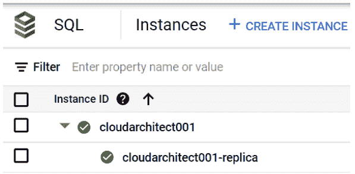

图 11.34 – 查看读副本

在本节中，我们查看了读副本和各种可用选项。 在下一节中，我们将查看故障转移副本。

## 高可用性

我相信我们都熟悉 HA 这个术语。 其目的当然是为了减少服务的停机时间，就 Cloud SQL 而言，是为了减少区域或实例不可用时的停机时间。 公共云并不免于停机，区域性中断可能会发生，以及实例可能损坏。 通过启用 HA，我们的数据继续可供客户端应用程序使用。 如前一节所述，在部署新的 Cloud SQL 实例时，我们可以选择多区域配置来启用 HA，这意味着在同一区域但不同区域中创建两个单独的实例。 第一个实例配置为主实例，而第二个实例用作备用。 通过对每个区域的持久磁盘进行同步复制，对主实例所做的所有写入都将在事务被确认完成之前复制到两个区域的磁盘中。 在区域或实例发生故障的情况下，持久磁盘将附加到备用实例，后者将成为新的主实例。 然后用户将被路由到此新主实例。 此过程称为故障转移。 需要注意的是，即使原始主实例重新上线，此配置也会保持不变。 这是因为一旦原始主实例再次可用，它将被销毁、重新创建并成为新的备用实例。 如果需要将主实例恢复到原始区域，则可以执行回退。 此过程与故障转移相同，但我们是在做出决定。

请注意，直到 2021 年第一季度，旧版 MySQL 具有使用故障转移副本的 HA 选项。 这现在已不再可通过 Cloud Console 获得。

## 备份和恢复

我们在创建新实例时之前提到过备份和恢复。 我们可以创建备份计划并根据需要从控制台或命令行触发按需备份。 如果我们想编辑实例，我们必须检查我们配置的备份计划或在必要时更改备份时间：

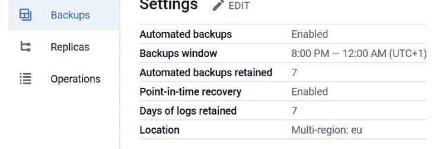

图 11.35 – 编辑备份计划


备份是一种在损坏或数据丢失的情况下从特定时间点恢复我们数据的方式。Cloud SQL 为我们提供了将数据恢复到原始实例或不同实例的选项。这两种方法都会覆盖目标实例上的所有当前数据。

让我们看看如何从控制台恢复：

+   1. 从我们的 MySQL 部署中，我们可以点击 BACKUPS 选项卡，然后滚动到页面的底部以找到我们想要恢复的特定备份：

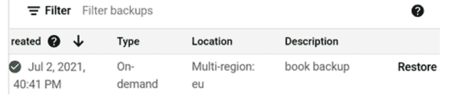

图 11.36 – 选择备份

+   2. 如果我们没有任何副本或已删除它们，那么我们可以继续。你会注意到我们可以直接恢复到源实例，也可以选择另一个实例：

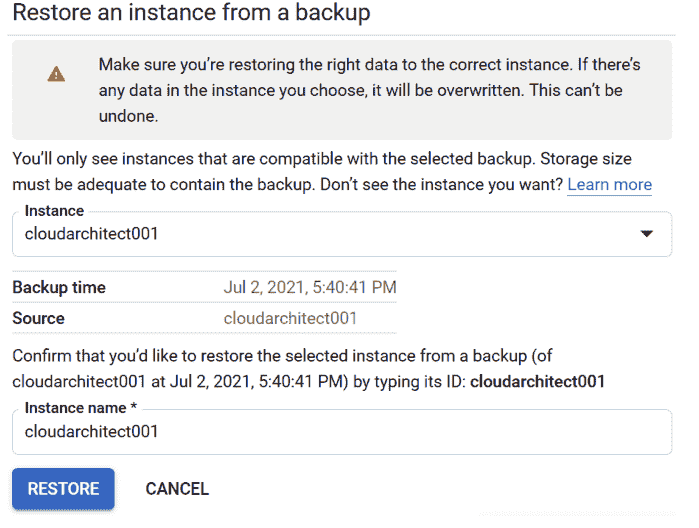

图 11.37 – 恢复备份

在下一节中，我们将了解如何迁移数据。

## 数据库迁移服务

GCP 现在提供了一项服务，允许我们轻松地将数据库从本地、Compute Engine 或甚至其他云迁移到 Cloud SQL。从本质上讲，这就是 MySQL 和 PostgreSQL 工作负载在 Cloud SQL 中的 *lift and shift*。对于希望将现有服务迁移到公共云的组织来说，这是一个理想的初始步骤，因为它意味着需要管理的基础设施更少，同时还能享受 Google Cloud 的 HA、DR 和性能优势。

## 实例克隆

我们之前提到过我们可以克隆实例。这将创建源实例的副本，但它将完全独立。这并不意味着我们已建立集群或只读副本。一旦克隆完成，对源实例的任何更改都不会反映在新的克隆实例中，反之亦然。实例 IP 地址和副本不会复制到新的克隆实例，必须在克隆实例上重新配置。同样，从源实例获取的任何备份都不会复制到克隆实例。

这可以从我们的 GCP 控制台或使用 gcloud 命令行工具完成：

+   1. 让我们看看执行此操作时我们将使用的语法：
+   ```
+   gcloud sql instances clone <instance source name> <target instance name>
+   ```
+   在这里，`<instance source name>` 是你想要克隆的实例的名称，而 `<target instance name>` 是你希望分配给克隆实例的名称。
+   2. 让我们看看如何克隆我们的 `cloudarchitect001` 实例：
+   ```
+   gcloud sql instances clone cloudarchitect001 cloudarchitect001cloned
+   ```

我们将克隆的实例命名为 `cloudarchitect001cloned`。

## IAM

访问 Google Cloud SQL 是通过 IAM 保护的。让我们看一下预定义角色的列表及其详细信息：

+   - **Owner**: 对所有 GCP 资源具有完全访问和控制权限
+   - **Editor**: 对所有 SQL 资源具有读写访问权限
+   - **Viewer:** 对所有 Google Cloud 资源具有只读访问权限，包括 Cloud SQL 资源
+   - **Cloud SQL Admin:** 对所有 Cloud SQL 资源具有完全控制权
+   - **Cloud SQL Editor:** 有权管理特定实例；无法查看或修改权限或修改 SSL 证书的用户；无法导入数据或从备份恢复，也无法克隆、删除或提升实例；并且无法停止或启动副本或删除数据库、副本或备份
+   - **Cloud SQL Viewer:** 对所有 Cloud SQL 资源具有只读权限
+   - **Cloud SQL Client:** 可通过 App Engine 和 Cloud SQL Proxy 访问云 SQL 实例
+   - **Cloud SQL Instance User:** 允许访问 Cloud SQL 资源

## 配额和限制

Google Cloud SQL 带有预定义的配额。这些默认配额可以通过 **Navigation** 菜单下的 **IAM & Admin | Quotas** 部分进行更改。从此菜单中，我们可以查看当前配额并请求提高这些限制。我们建议你熟悉每个服务的限制，因为这可能会影响你的可扩展性。对于 Cloud SQL，我们应该注意一些重要的限制。

> **Exam Tip**
> MySQL（第二代）和 PostgreSQL 的存储限制为 10 TB。

需要了解的其他限制包括以下内容：

+   - 每个项目最多有 100 个实例的限制。
+   - 最大存储限制为 64 TB。

## 定价

Cloud SQL 的定价基于 CPU 和内存定价、存储和网络定价以及实例定价。

对于 CPU 和内存，它取决于位置、CPU 数量以及你计划使用的内存量。只读副本的收费与独立实例相同。

对于存储和网络，它取决于位置、每月每 GB 使用的存储量以及从 Cloud SQL 的网络出站流量。

实例定价也取决于实例所在的位置和共享核心机器类型。

## 总结

在本章中，我们通过查看哪些选项最适合常见需求来了解可供我们使用的存储选项。我们还了解了 Google Cloud Storage、Cloud Firestore 和 Cloud SQL。

对于 Google Cloud Storage，我们查看了用例、存储类别以及服务的一些主要功能。我们还涵盖了一些在传输数据时需要考虑的事项。很明显，Cloud Storage 提供了很多灵活性，但在我们需要存储更结构化数据时，我们需要考虑替代方案。

对于 Cloud Datastore，我们了解到该服务是一个 NoSQL 数据库，如果你的应用程序依赖于高度可用且结构化的数据，则非常理想。此外，Cloud Datastore 可以轻松地从零扩展到数 TB 的数据，并且非常适合 ACID 事务。我们还了解到它提供最终一致性或强一致性；然而，如果我们有不同的需求并且需要一个具有完整 SQL 支持的 **在线事务处理 (OLTP)** 的关系数据库，那么我们应该考虑 Cloud SQL。

对于 Cloud SQL，我们了解到我们有不同的产品——MySQL、SQL Server 和 PostgreSQL。我们回顾了如何创建和管理我们的实例，如何创建副本以及如何恢复我们的实例。

在下一章中，我们将继续通过介绍 Cloud Spanner 和 Bigtable 来了解 GCP 存储选项。

## 进一步阅读

阅读以下文章以获取有关本章所涵盖主题的更多信息：

+   - **Cloud Storage**: https://cloud.google.com/storage/docs/
+   - **Cloud Datastore**: https://cloud.google.com/datastore/docs/
+   - **Cloud SQL**: https://cloud.google.com/sql/docs/
+   - **Cloud SQL pricing:** https://cloud.google.com/sql/pricing
+   - **Importing data into Cloud SQL:** https://cloud.google.com/sql/docs/mysql/import-export/importing
+   - **Exporting data from Cloud SQL:** https://cloud.google.com/sql/docs/mysql/import-export/exporting
