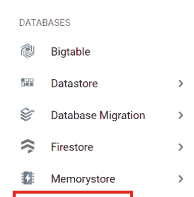
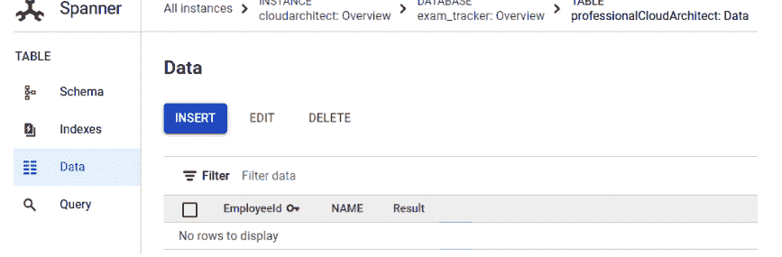
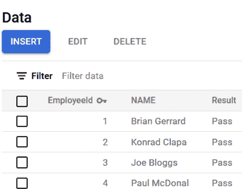
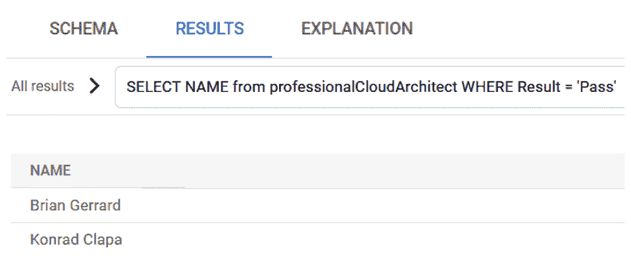
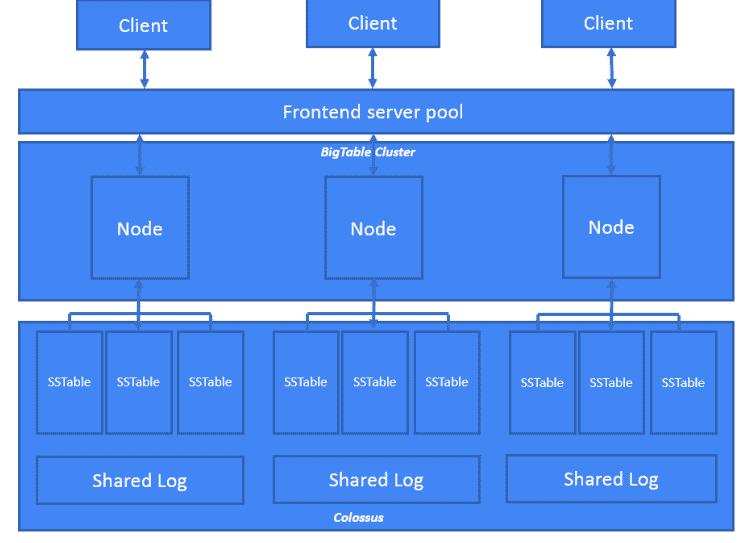
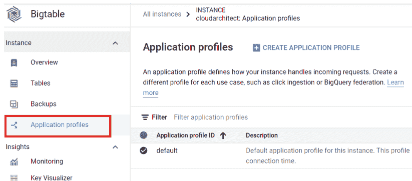
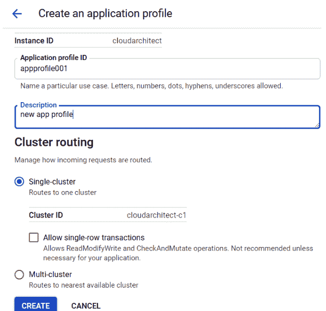

## 12
探索 GCP 中的存储和数据库选项 – 第 2 部分

在我们存储和数据库探索的第一部分中，我们查看了多个服务。在本章中，我们将重点关注剩余的核心数据库选项。

这些服务的概念可能听起来与我们在上一章中讨论的相似。例如，Cloud Spanner 与 Cloud SQL 相似，而 Bigtable 可能让你想到 Cloud Datastore。在本章中，我们不仅会介绍 Cloud Spanner 和 Bigtable 服务，还会向你展示它们之间的区别以及为什么你可能需要选择它们而不是其他产品。

本章涵盖以下主题：

+   - Cloud Spanner
+   - Bigtable

## Cloud Spanner

可能存在你需要水平扩展而 Cloud SQL 无法满足这些需求的情况。引入 Cloud Spanner。Cloud Spanner 是一种云原生、完全托管的解决方案，旨在将关系数据库功能，例如 ACID 事务和 SQL 查询的支持，与非关系数据库的水平扩展相结合。我们应该在需要每秒高查询量或跨多个区域交付时使用 Cloud Spanner。与大多数数据库不同，Cloud Spanner 是全球分布式的，并提供强一致的数据库服务和高性能。

> **Important Note**
> 再次强调，Cloud Spanner 是强一致的。

它还提供 >=99.999% 的可用性 SLA，当你使用多区域实例时，并且能够提供高达每秒 10,000 次读取查询或每秒 2,000 次写入查询。重要的是要理解 Cloud Spanner 类似于 SQL 并具有模式；然而，由于其高可用性，它非常适合关键任务工作负载。其主要使用案例来自金融和零售行业。

> **Exam Tip**
> 具有水平可扩展性，它还支持跨多个区域托管的应用程序。请记住，Cloud Spanner 非常适合需要强一致性的工作负载。

让我们看看 Cloud Spanner 的配置。我们必须在我们的 GCP 项目内创建一个 Cloud Spanner 实例来执行此操作。

## 实例配置

当我们创建新实例时，我们应该选择实例配置。这将决定我们的实例驻留的位置以及实例中数据库的复制。我们可以在以下之间进行选择：

+   - **Multi-regional:** 使用此实例，我们将获得 99.999% 的更高 SLA——或每年大约 5 分钟的停机时间——但成本会更高。多区域允许数据库的数据在多个区域的多个区域中复制，使我们能够从位置读取数据并具有低延迟。然而，由于副本分布在多个区域以上，我们的应用程序会看到写入延迟略有增加。


- **区域：** 这将导致 99.99% 的 SLA，这仍然非常高，相当于每年大约只有 52 分钟的停机时间。区域实例应选择在用户和服务位于同一区域的情况下使用。这将提供最低的延迟。正如你所见，需求将决定最佳选项。我们无法在创建后更改实例的配置。区域配置将包含三个读写副本，这使我们能够满足有关我们数据所在位置的任何治理要求。

## 节点数

我们还必须选择分配给实例的节点数。这将决定实例可用的 CPU/RAM 和存储资源量。每个节点可提供多达 2 TB 的存储，并且建议生产环境至少使用三个节点。我们可以在创建后更改节点数以进行扩容或缩容。

## 处理单元

Cloud Spanner 现在支持处理单元。1,000 个处理单元相当于 1 个节点，每个 100 个单元的增量将表现得像 1/10 个节点。

## 复制

我们之前提到过副本，并且仔细查看 Cloud Spanner 内的复制非常重要。Cloud Spanner 所构建的基础分布式文件系统将在字节级别自动复制。然而，为了提供额外的数据可用性和地理位置相关性，Cloud Spanner 还会通过创建 Cloud Spanner 组织数据的行的副本（副本）来复制数据。这些副本随后存储在不同的地理区域。其中一个副本将被选为领导者，并负责处理写入。Cloud Spanner 有三种类型的副本：

- **读/写：** 这种类型的复制将维护我们数据的完整副本，并且有资格成为领导者。这是单区域实例唯一可用的复制类型。
- **只读：** 这种类型的复制仅支持读取并且不能成为领导者。它将维护从我们的读写副本复制而来的数据的完整副本。只读仅在多区域配置中可用。
- **见证：** 这种类型的复制不支持读取，也不会维护我们数据的完整副本。见证复制使我们更容易在不使用读写副本所需的计算资源的情况下实现写入的法定人数。见证仅在多区域配置中可用。

## TrueTime

TrueTime 是基于 GPS 和原子钟构建的全球分布式时钟。它返回一个时间间隔，该间隔保证包含时钟的实际时间。TrueTime 提供给在 Google 服务器上运行的应用程序，这允许应用程序生成单调递增的时间戳。Cloud Spanner 使用 TrueTime 为事务分配时间戳，每当 Cloud Spanner 认为事务发生时。

## 数据一致性

如果你正在寻找保证的强一致性，那么 Cloud Spanner 就是适合你的数据库！这完全归功于它为云而设计，因此将消除其他数据库产品的大量限制。请注意，Cloud Spanner 提供外部一致性，这是一种比强一致性更强的属性。这是事务处理系统的最严格一致性属性。

当我们谈论 Cloud Spanner 的数据一致性时，明智的做法是提高对 CAP 定理概念的认识。该定理说数据库只能同时具有以下三个属性中的两个：

- **C：一致性**。这意味着共享数据具有单一值。
- **A：可用性**。读取和更新均为 100%。
- **P：分区**。容忍网络分区。

这意味着系统可以由 CA、CP 或 AP 组成。该定理是关于 100% 可用性的，但我们知道系统不会提供 100% 可用性；因此，系统开发人员被迫认真考虑权衡。如果我们认为在系统生命周期中的某个时刻某些网络分区是不可避免的，那么分布式系统应该设计为在分区期间放弃一致性或可用性——但仅在分区期间。Cloud Spanner 在分区期间将放弃可用性以确保一致性。鉴于 Spanner 提供 99.999% 的可用性，这相当于每年不到 5.26 分钟的停机时间，这被认为足够高，以至于我们不必担心可用性权衡。

## 加密

默认情况下，Cloud Spanner 中的所有数据都将使用 Google 管理的默认加密。当启用 **客户管理加密密钥 (CMEK)** 时，Cloud Spanner 将使用我们的 Cloud **密钥管理服务 (KMS)** 密钥来保护静态数据。要使用 CMEK，我们必须在创建数据库时指定 Cloud KMS 密钥。截至 2021 年 6 月，Cloud Spanner 在使用 CMEK 时支持 **Cloud 外部密钥管理器 (Cloud EKM)**。

## 时间点恢复

Cloud Spanner 提供防止意外写入或删除的保护。这被称为 **时间点恢复 (PITR)**。例如，如果应用程序发布损坏了数据库，则 PITR 可以从过去 7 天中的某个时间点恢复你的数据。PITR 通过允许我们配置数据库的 `version_retention_period` 来保留数据的所有版本及其模式而工作。保留期范围为 1 小时到 7 天。我们可以恢复整个数据库或其一部分，但我们在设置更长的保留期时也应考虑性能，因为这会使用更多的系统资源，尤其是在经常覆盖数据的数据库上。

接下来，让我们看看如何创建我们的第一个 Spanner 实例。

## 创建 Cloud Spanner 实例

让我们实际创建 Cloud Spanner 实例。我们还将创建一个数据库——即一个表——并在其上运行查询：

1. 浏览到 **DATABASES | Spanner**，如下图所示：



图 12.1 – 浏览到 Cloud Spanner

2. 选择创建实例，然后输入实例名称。请注意，你可能必须启用 API。ID 将根据我们的名称自动填充，但如果需要可以修改。我们还可以选择区域配置和计算容量。点击 Create 以配置实例：

# 为你的实例命名

实例同时具有名称和 ID。名称仅用于显示目的。ID 是永久且唯一的标识符。

实例名称 *
cloudarchitect
名称必须为 4-30 个字符长

实例 ID *
cloudarchitect
允许使用小写字母、数字、连字符

# 选择配置

确定你的节点和数据的位置。影响成本、性能和复制。多区域配置将为你的领导者副本选择默认领导者区域。你可以随时通过 DDL 语句更改领导者区域。了解更多

比较区域配置

区域
多区域
 eur3

# 分配计算容量

你的计算容量决定了实例中的数据吞吐量、每秒查询数 (QPS) 和存储限制。一个节点等于 1,000 个处理单元。影响计费。

单位 *
处理单元
数量 *
1000
仅限整数。以 100 的增量输入，最高 1,000，之后以 1,000 的增量。

图 12.2 – 创建新实例

3. 一旦我们的实例创建完成，点击 Create database：

# 在 cloudarchitect 中创建数据库

# 为你的数据库命名

为你的数据库输入一个永久名称，至少两个字符，以字母开头。

数据库名称 *

exam_tracker

允许使用小写字母、数字、连字符、下划线

图 12.3 – 创建数据库

4. 现在，我们可以创建一个表。让我们创建一个名为 professionalCloudArchitect 的表。我们的表将跟踪员工在参加 Google 专业云架构师考试时的表现。填充文本字段如下后，点击 SUBMIT 创建表：

# 定义 exam_tracker 模式

使用 Cloud Spanner 的数据定义语言 (DDL) 在你的实例中定义模式。DDL 语句允许你修改数据库；在数据库中创建、修改或删除表；以及在数据库中创建或删除索引。要编写多个语句，请用分号分隔。了解更多

DDL 模板  快捷方式

```
CREATE TABLE professionalCloudArchitect (
EmployeeId INT64 NOT NULL,
NAME STRING(1024),
Result STRING(1024),
) PRIMARY KEY (EmployeeId);
```

图 12.4 – 创建表


5. 现在，我们可以通过点击新建的表格，浏览到 Data，然后点击 Insert 来填充它：



图 12.5 – 填充表格

6. 查询编辑器将会出现并允许我们填写表格数据。通过在 VALUES 部分下添加以下内容并点击 RUN 来完成此操作：

```
INSERT INTO
professionalCloudArchitect (EmployeeId,
  NAME,
  Result)
VALUES
(1, 'Brian Gerrard' , 'Pass'),
(2, 'Konrad Clapa' , 'Pass'),
(3, 'Joe Bloggs' , 'Pass'),
(4, 'Paul McDonal' , 'Fail'),
(5, 'Alison Munro' , 'Fail');
```

图 12.6 – 主键

7. 我们的表格视图现在看起来像这样：



图 12.7 – 数据

8. 现在，让我们再次点击 Query 选项卡并对我们的信息执行查询以查看谁通过了考试。选择 RUN 来执行查询：


图 12.8 – 查询

9. 让我们查看我们的结果，如下所示：



图 12.9 – 结果

通过这样做，我们得到一份通过考试的团队成员名单。

## IAM

对 Google Cloud Spanner 的访问通过 IAM 进行保护。以下是预定义角色的列表，以及每个角色的简短说明：

- **Spanner Admin**：此人对项目中的所有 Cloud Spanner 资源拥有完全权限。
- **Spanner Database Admin**：此人有权列出所有 Cloud Spanner 实例并在创建实例中创建/列出/删除数据库。他们可以授予和撤销对项目中数据库的访问权限，并且他们还可以读取和写入项目中的所有 Cloud Spanner 数据库。
- **Spanner Database Reader**：此人有权从 Cloud Spanner 数据库中读取、执行数据库查询以及查看数据库架构。
- **Spanner Database User**：此人有权读取和写入 Cloud Spanner 数据库、执行数据库上的 SQL 查询，以及查看和更新数据库架构。
- **Spanner Viewer**：此人有权查看所有 Cloud Spanner 实例并查看所有 Cloud Spanner 数据库。
- **Restore Admin:** 此人有权从备份中恢复数据库。
- **Backup Admin:** 此人有权 *创建*、*查看*、*更新* 和 *删除* 备份。

## 配额和限制

Cloud Spanner 带有预定义的配额。这些默认配额可以通过 **Navigation** 菜单以及 **IAM & Admin | Quotas** 进行更改。从此菜单中，我们可以查看当前配额并请求增加这些限制。我们建议您了解每个服务的限制，因为这可能会影响您的可扩展性。对于 Cloud Spanner，我们应该注意以下限制：

- 实例 ID 的长度限制为 2 到 64 个字符。
- 每个实例的数据库数量限制为 100 个。
- 数据库 ID 的长度限制为 2 到 30 个字符。
- 每个节点的存储限制为 2 TB。
- 架构大小限制为 10 MB。
- 架构更改大小限制为 10 MB。
- 每个数据库的表数量限制为 5,000 个。
- 表名的长度限制为 1 到 128 个字符。
- 每个表的列数限制为 1,024 个。
- 列名的长度限制为 1 到 128 个字符。
- 每个列的数据量限制为 10 MB。
- 表键中的列数限制为 16 个。
- 每个数据库的索引数量限制为 10,000 个。
- 每个表的索引数量限制为 32 个。
- 索引键中的列数限制为 16 个。
- 函数调用次数限制为 1,000 次。
- 每个项目、每个实例配置的节点数限制为 25 个。

## 定价

Cloud Spanner 按使用的计算容量以及使用的存储和网络带宽收费。我们将被收取以下费用：

- 节点最大数量乘以每小时费率。随着 Spanner 转向处理单元，这可能是完整节点的一部分（1,000 个处理单元小于 1 个节点）。
- 我们数据库中 1 个月内的平均数据量。这些价格会根据实例的位置而波动。
- 某些类型流量的出站网络流量费用。然而，复制或入站流量不收取费用。
- 备份使用的存储量也按 1 个月计算，并乘以月费率。

> 考试提示
> 关于 Cloud Spanner 需要记住的一个重要点是它提供 ACID 事务。如果原子事务涉及两条或更多条信息，则所有信息都会被提交；否则，什么也不会提交。

## Bigtable

名字里就有线索，但 Bigtable 是 GCP 的大数据 NoSQL 数据库服务。Bigtable 延迟低，可以扩展到数十亿行和数千列。它也是为许多 Google 核心服务提供支持的数据库，例如搜索、分析、地图和 Gmail。这使得 Bigtable 成为分析和实时工作负载的绝佳选择，因为它旨在以低延迟和高吞吐量处理大规模工作负载。

> 考试提示
> Bigtable 可以支持 PB 级数据，适用于实时访问和分析工作负载。它是物联网（IoT）应用的绝佳选择，这些应用需要频繁的数据摄取或高速交易。

鉴于 Bigtable 的巨大可扩展性，我们将介绍存储模型和架构。当我们讨论 Bigtable 时，我们会提到 HBase。HBase 本质上是 Bigtable 架构的开源实现，并遵循相同的设计理念。Bigtable 将其数据存储在表中，这些表存储在键/值映射中。每个表都由行组成，行将描述单个实体。

表还由列组成，列包含每个行的单独值。行由行键索引，并且相互关联的列被分组到列族中。Bigtable 仅提供基本操作，例如 *创建、读取、更新* 和 *删除*。这意味着它有一些很好的用例，同时也不适合其他用例。Bigtable 不应用于事务支持——正如我们之前提到的，CloudSQL 或 Spanner 更适合 OLTP。

下图显示了 Bigtable 的架构：



图 12.10 – Bigtable 架构

在这里，我们可以看到客户端的请求在发送到 Bigtable 节点之前会经过前端服务器。这些节点构成了一个属于 Bigtable 实例的 Bigtable 集群，该实例充当集群的容器。

集群中的每个节点处理请求的子集。我们可以通过添加更多节点来增加集群可以处理的并发请求数。前面的图表仅显示单个集群，但可以通过添加第二个集群来启用复制。有了第二个集群，我们可以将不同类型的流量发送到特定的集群，当然可用性也会增加。

为了帮助平衡查询的工作负载，Bigtable 被分片为连续行的块。这些被称为 tablets，并以排序字符串表（SSTable）格式存储在 Google 的文件系统 Colossus 上。SSTable 以基于行键的排序顺序存储不可变的行片段。每个表都将与特定的 Bigtable 节点相关联，并且写入在被确认后立即存储在 Colossus 共享日志中。我们还应注意，数据永远不会存储在 Bigtable 节点上。然而，这些节点指向存储在 Colossus 中的一组 tablets，这意味着如果 Bigtable 节点失败，则不会发生数据丢失。

现在我们了解了高层架构，让我们来看一下 Bigtable 的配置。

## Bigtable 配置

在本节中，我们将查看构成 Bigtable 的关键组件。我们将讨论以下内容：

- 实例
- 集群
- 节点
- 架构
- 复制

## 实例

Cloud Bigtable 由实例组成，实例将包含最多四个我们的应用程序可以连接到的集群。每个集群包含节点。我们应该将实例想象成我们集群和节点的容器。我们可以修改集群中的节点数量以及实例中的集群数量。当我们创建实例时，如预期，我们可以选择要部署到的区域和区域，我们还可以选择存储类型，即 SSD 或 HDD。位置和存储类型都是永久性的选择。


## 集群

Bigtable 集群代表特定位置的服务。每个集群都属于一个 Bigtable 实例，并且，正如我们已经提到的，每个实例最多可以有四个集群。当我们的应用程序向实例发送请求时，它会由实例中的一个集群处理。每个集群位于单个区域中，并且实例的集群必须位于唯一的区域中。如果我们的配置意味着我们拥有多个集群，那么 Bigtable 将自动开始复制我们的数据，通过在每个集群的区域中存储数据的副本并在副本之间同步更新来实现。为了将不同类型的流量彼此隔离，我们可以选择应用程序要连接的集群。

## 节点

生产实例中的每个集群至少有三个节点。节点正如你所期望的那样，是 Bigtable 用于管理我们数据的计算资源。Bigtable 会尝试在所有节点之间均匀分配读写操作，并且在每个节点上存储相等数量的数据。如果 Bigtable 集群过载，我们可以添加更多节点以提高其性能。同样，我们也可以缩减规模并移除节点。

## 模式

值得注意的是，设计 Bigtable 模式与设计关系数据库模式非常不同。没有二级索引，因为每个表只有一个索引。行按行键（唯一的索引）按字典顺序排序，从最低到最高的字节串。如果表中存在两行，一行可能成功更新，而另一行可能失败。因此，我们应避免设计需要跨行原子性的模式。不良的模式设计可能是 Bigtable 整体性能不佳的原因。

> **考试提示**
> 模式也可以为**时间序列数据**设计。如果我们想随着发生的时间一起衡量某事，那么我们就是在构建时间序列。Bigtable 中的数据以行中无结构的列形式存储，每行都有一个行键。这使得 Bigtable 非常适合时间序列数据。当我们需要考虑时间序列的模式设计模式时，应使用高而窄的表，这意味着每行存储一个事件。这使得查询我们的数据变得更容易。

## 复制

数据的可用性是一个非常大的关注点。Bigtable 复制将我们的数据复制到多个区域或同一区域内的多个区域中，从而提高我们数据的可用性和持久性。当然，要使用复制，我们必须创建一个具有多个集群的实例或向现有实例添加集群。一旦设置完成，Bigtable 将立即开始复制，并在实例拥有集群的每个区域中存储我们数据的单独副本。由于这种复制几乎是实时完成的，因此可作为我们数据的一个良好备份。当集群无响应时，Bigtable 将执行自动故障转移。

## 应用程序配置文件

如果我们需要实例使用复制，则需要使用**应用程序配置文件**。通过将设置存储在这些应用程序配置文件中，我们可以管理来自应用程序的传入请求并确定 Bigtable 如何处理它们。每个 Bigtable 实例都将有一个默认的应用程序配置文件，但我们也可以创建自定义配置文件。我们的代码应更新为指定应用程序在连接到实例时要使用的应用程序配置文件。如果我们未指定任何内容，则 Bigtable 将使用默认配置文件。

应用程序配置文件的配置将影响应用程序如何与使用复制的实例通信。应用程序配置文件中包含**路由策略**。**单集群路由**会将所有请求路由到实例中的单个集群，而**多集群路由**会自动将流量路由到实例中最接近的集群。如果我们创建一个具有一个集群的实例，则默认应用程序配置文件将使用单集群路由。如果我们创建一个具有两个或更多集群的实例，则默认应用程序配置文件将使用多集群路由。

要创建应用程序配置文件，我们必须拥有一个 Bigtable 实例。我们可以从 GCP 控制台创建自定义应用程序配置文件，通过浏览汉堡菜单并进入 **Bigtable**，然后单击我们希望创建应用程序配置文件的实例。最后，浏览左侧窗格中的 **Application profiles** 选项并单击 **CREATE APPLICATION PROFILE**。

在下面的屏幕截图中，我们正在为名为 **cloudarchitect** 的实例创建应用程序配置文件：



图 12.11 – 应用程序配置文件

然后，我们需要为配置文件提供一个 ID，并在认为必要时输入描述。之后，我们必须选择所需的路由策略：



图 12.12 – 应用程序配置文件设置

请注意，我们可以勾选单行事务的复选框。Bigtable 不支持原子更新多于一行行的事务；然而，它可以使用单行事务来完成 *read-modify-write* 和 *conditional writes* 操作。请注意，此选项仅在使用单集群路由策略时可用，以防止冲突。

## 数据一致性

需要理解的一个重要方面是，Bigtable 默认是最终一致的，这意味着当我们向集群之一写入更改时，我们将能够从其他集群读取该更改，但只有在复制发生后才能读取。为了克服这一限制，我们可以在启用复制时启用 **Read-Your-Writes** 一致性。这将确保应用程序不会读取比最近写入更旧的数据。为了为一组应用程序实现 Read-Your-Writes 一致性，我们应在应用程序配置文件中使用单集群路由策略将请求路由到同一集群。然而，这样的缺点是，如果集群变得不可用，则我们需要手动执行故障转移。

## 规划容量

在规划 Bigtable 集群时需要考虑的一个重要方面是吞吐量与延迟之间的权衡。对于延迟敏感的应用程序，Google 建议我们为应用程序的最大 Bigtable QPS 规划至少 2 倍的容量。这是为了确保 Bigtable 集群的 CPU 使用率低于 50%，从而为前端服务提供低延迟。

> **考试提示**
> 容量规划使我们能够为流量激增或键访问热点提供缓冲，这可能会导致集群中节点之间的流量不平衡。

## 创建 Bigtable 实例和表

让我们看看如何从 GCP 控制台创建 Bigtable 实例：

- 1. 浏览到 **DATABASES | Bigtable**，如下图所示：

# DATABASES

- - Bigtable
- - Datastore >
- - Database Migration >
- - Firestore >
- - Memorystore >
- - Spanner

图 12.13 – Bigtable

2. 单击 CREATE INSTANCE：

图 12.14 – 创建实例

3. 为我们的实例提供名称和实例 ID 并选择实例类型。另请选择我们所需的存储类型：

# Create an instance

A Cloud Bigtable instance is a container for your clusters. Learn more

# 1 Name your instance

Instance name *
cloudarchitect
For display purposes only

Instance ID *
cloudarchitect
ID is permanent

CONTINUE

图 12.15 – 实例配置

4. 提供集群详细信息；即位置和所需的节点数。我们也可以在需要时设置复制。请注意，我们还可以选择存储类型 – SSD 或 HDD。如果我们不更改它，这将默认为 SSD。单击 Done 以接受集群更改并单击 Create 以完成实例配置：

# Select a cluster ID

ID is permanent

Cluster ID *
cloudarchitect-c2

# Select a location

Choice is permanent. Determines where cluster data is stored. To reduce latency and increase throughput, store your data near the services that need it. Learn more

Region *
europe-west2 (London)
Zone *
Any

# Allocate nodes

Node count can be updated at any time to meet your cluster's need for data throughput, storage, and rows read per second. For better instance performance, keep your cluster's CPU utilization under the recommended threshold for your app profile routing policy. Contact us if you need to increase your node quota. Learn more

Nodes *
3

图 12.16 – 添加集群

一旦我们拥有实例和集群，我们就可以创建表。我们之前提到过，Bigtable 有一个名为 cbt 的命令行工具，使用它创建表非常简单。再次，我们将假设你熟悉此工具。打开 Cloud Shell 以便我们可以配置 cbt 工具。我们将在第 16 章 Google Cloud Management Options 中更详细地介绍 cbt 和 Cloud Shell：

- 1. 在创建表之前，运行以下语法以减轻在未来命令行中指定它们的需要：

```
echo project = <project ID> ~/.cbt rc
echo instance = <instance ID> >> ~/.cbt rc
```


这里，我们有以下内容：

- `<project ID>` 是我们的 Bigtable 实例关联的项目的 ID。
- `<instance ID>` 是我们实例的 ID。

2. 配置完成后，我们可以使用非常简单的语法创建表：

```
cbt createtable table001
```

这里，我们创建了一个名为 `table001` 的表。

## IAM

对 Google Cloud Bigtable 的访问通过 IAM 保护。以下是预定义角色的列表，以及每个角色的简短描述：

- **Bigtable Admin**：此人拥有所有 Bigtable 功能的权限，并且可以在此创建新实例。此角色应由项目管理员使用。
- **Bigtable User**：此人对存储在表中的数据具有只读访问权限。此角色应由应用程序开发人员或服务账号使用。
- **Bigtable Reader**：此人对存储在表中的数据具有只读访问权限。此角色应由数据科学家使用。
- **Bigtable Viewer**：此角色应用于授予 Cloud Bigtable 的最小权限集。

## 配额和限制

Google Cloud Bigtable 带有预定义的配额。这些默认配额可以通过 **Navigation** 菜单以及 **IAM & Admin | Quotas** 进行更改。从此菜单中，我们可以查看当前配额并请求提高这些限制。我们建议您了解每个服务的限制，因为这可能会影响您的可扩展性。对于 Cloud Bigtable，我们应注意以下限制：

- 每个节点 SSD 存储的限制为 2.5 TB。
- 每个节点 HDD 存储的限制为 8 TB。
- 每个实例中的表数量限制为 1,000。

对于 Cloud Bigtable，我们还应注意以下配额：

- 默认情况下，您可以在每个项目中的每个区域最多配置 30 个 SSD 或 HDD 节点。
- 应审查许多操作配额。

## 定价

Bigtable 根据多个因素收费：

- 实例类型按每小时、每个节点收费。
- 存储按每月收费，成本因使用 SSD 或 HDD 而异。
- Internet 出站费率根据月度使用量收取。入站流量免费。

有关更具体的详细信息，请参阅 *Further reading* 部分中的 Bigtable 定价 URL。

## 摘要

在本章中，我们介绍了 Cloud Spanner 和 Bigtable。

就 **Cloud Spanner** 而言，我们现在明白这是一个可扩展且全球分布的数据库。它是强一致性的，并且旨在将关系数据库的优点与非关系数据库的可扩展性相结合。Cloud Spanner 可以跨区域扩展，以满足可能具有高可用性要求的负载。

我们从高层次介绍了 **Bigtable**，以确保您了解考试中期望的内容。它是一种完全托管的 NoSQL 数据库服务，可以大规模扩展并提供低延迟，非常适合物联网，因为它可以实时处理高速事务，与机器学习和分析集成良好，并且可以支持超过一 PB 的数据。

我们现在已经完成了一个信息量很大的章节。我们已经查看了 GCP 提供的关键数据库服务。我们建议您查看本章中的考试提示，并确保您了解每个服务的主要功能。我们讨论的一些关键设计决策是关系型与非关系型、结构化数据与非结构化数据、可扩展性，以及 SQL 与 NoSQL。

在下一章中，我们将研究大数据。

## 进一步阅读

阅读以下文章以了解本章所涵盖内容的更多信息：

- **Cloud Spanner**: https://cloud.google.com/spanner/docs/
- **Cloud Spanner Pricing**: https://cloud.google.com/spanner/pricing
- **Bigtable**: https://cloud.google.com/Bigtable/docs/
- **Bigtable Pricing**: https://cloud.google.com/Bigtable/pricing
