## 13
分析大数据选项

如果您一直在研究云计算，那么您很可能已经遇到过 **big data** 术语。这用于描述现代企业正在处理的海量数据。我们并不那么担心数据的总量，而更关心我们如何使用这些数据。如今几乎所有事物都带有数字足迹，挑战在于摄取这些数据并提取有意义的信息。Google 提供了协同工作的服务，使我们能够收集数据、处理数据并分析数据。我们分析数据的速度越快，业务决策就能越快做出。大数据对许多组织变得非常重要。

在本章中，我们将涵盖以下主题：

- 端到端大数据解决方案
- Pub/Sub
- Dataflow
- BigQuery
- Dataproc
- Cloud IoT
- Cloud Data Fusion
- Datastream

在本章中，我们希望以考试期望的水平介绍主要的 Google 大数据服务和概念。当然，更深入的研究也是可用的。

## 端到端大数据解决方案

在开始查看服务之前，让我们看一个非常简单的图表。这代表了端到端大数据解决方案。GCP 为我们提供了所有工具来构建一个弹性且可扩展的服务，在其中我们可以导入大量数据、处理事件，然后执行业务规则。

> Exam Tip
> 了解此流程非常重要，以及哪些服务映射到每个阶段。随着我们阅读本章，我们将把每个大数据服务映射到我们端到端解决方案中的一个阶段。

我们可以从多个来源摄取数据，执行代码来处理这些数据，然后分析数据以确保我们最大化业务能力：

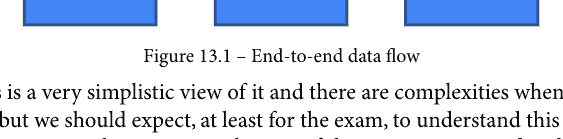

当然，这只是非常简化的视图，在构建解决方案时存在复杂性，但我们至少应期望在考试中从高层次理解这一点。让我们更详细地查看映射到每个阶段的服务。

## Cloud Pub/Sub

Pub/Sub 是一种消息传递和事件摄取服务，充当松散耦合系统之间的粘合剂。它允许我们在独立应用程序之间发送和接收消息，同时将事件发布者和订阅者解耦。这意味着发布者无需了解其订阅者。Pub/Sub 完全托管，因此易于扩展，非常适合现代流分析管道。

有一些核心概念您应该理解：

- 一个 **publisher** 是将创建并向主题发送消息的应用程序。
- 一个 **topic** 是发布者向其发送消息的资源。
- 一个 **subscription** 代表从单个主题到订阅应用程序的交付消息流。订阅者将通过拉取或推送接收消息，这意味着 Pub/Sub 使用 webhook 将消息推送到端点，或者消息由应用程序通过 HTTPS 请求向 Google API 拉取。
- 一个 **message** 是发布者将发送到主题的数据。简单来说，它是通过系统传输的数据。

发布者可以是任何可以向 `googleapis.com` 发出 HTTPS 请求的应用程序。这可以是现有的 GCP 服务、**Internet Of Things (IoT)** 设备或终端用户应用程序。

正如我们之前提到的，订阅者通过拉取或推送交付方法接收消息。与发布者类似，拉取订阅者可以是任何可以向 `googleapis.com` 发出 HTTPS 请求的应用程序。在这种情况下，订阅者应用程序将向 Pub/Sub 发起请求以检索消息。另一方面，推送订阅者必须是能够通过 HTTPS 接受 POST 请求的 webhook 端点。

在这种情况下，Cloud Pub/Sub 会向订阅者应用程序发起请求以传递消息。应考虑哪种方法最适合我们的需求。例如，如果您预计有大量消息（例如，每秒超过一条消息），则建议使用拉取交付方法。或者，如果您有多个主题必须由同一个 webhook 处理，则建议使用推送交付方法：

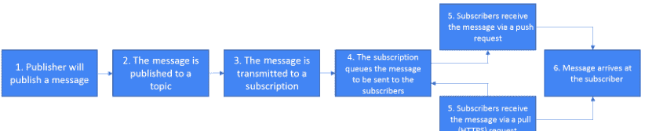

图 13.2 – 推送交付方法


为了总结这一点，让我们来看一下前面的图表中实际的工作方式。
当所有交付都完成后，该消息将从队列中移除。

由于 Cloud Pub/Sub 能很好地与其他 GCP 产品集成，因此它开启了大量用例。

让我们来看看最常见的用例：

- **分布式事件通知：** 假设有一个服务需要在有新注册时发送通知。Pub/Sub 使下游服务能够订阅并接收此新注册的通知。
- **平衡工作负载：** 任务可以分发到多个 Compute Engine 实例中。
- **日志记录：** Pub/Sub 可以将日志写入多个系统。例如，如果我们希望使用实时信息，我们可以写入监控系统，如果我们希望在稍后分析数据，我们可以写入数据库。

## 创建主题和订阅

Pub/Sub 可以从多个数据源摄取数据。下面的图表显示了可以向 Pub/Sub 传递数据的关键服务。这是我们解决方案的第一步：

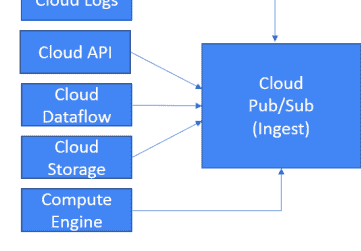

图 13.3 – 向 Pub/Sub 传递数据

现在，让我们来看一下如何创建 Pub/Sub 主题和订阅。然后，我们将发布一条消息并通过 Cloud Shell 拉取它。请参阅第 16 章《Google Cloud 管理选项》，了解有关 Cloud Shell 的更多信息。在此，我们假设您可以打开它：

1. 从 **导航** 菜单浏览到 **大数据 | Pub/Sub**，如下截图所示：

图 13.4 – 选择 Pub/Sub

2. 点击 CREATE TOPIC：

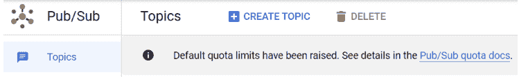

图 13.5 – 创建主题

3. 提供主题 ID。在此示例中，我们将其命名为 newTopic。点击 CREATE TOPIC，如下截图所示：

### Create a topic

A topic forwards messages from publishers to subscribers.

Topic ID *
newTopic
Topic name: projects/eighth-effect-319712/topics/newTopic

Add a default subscription

Use a schema

Use a customer-managed encryption key (CMEK)

CANCEL   CREATE TOPIC

图 13.6 – 输入主题 ID

4. 选择 Create subscription，如下截图所示：

| Topic ID | Encryption key | Topic name | Labels |
| newTopic | Google-managed | projects/eighth-effect-319712/topics/newTopic | — |
Create subscription

图 13.7 – 创建订阅

5. 提供 **订阅 ID**。在此示例中，我们将其命名为 newSub。我们将保持其余设置不变，但我们应该注意每个设置的作用：

- **消息保留时长**：Pub/Sub 将尝试在最多 7 天内传递消息。之后，消息将被删除且无法再访问。
- **订阅过期**：如果没有活动连接或 pull/push 成功，则订阅会过期。
- **确认截止时间**：订阅方应在特定时间内确认消息；否则，Pub/Sub 将尝试重新传递此消息。

请注意，我们将 **交付类型** 保持为 **Pull**，如下截图所示：

### Delivery type ?

○ Pull
○ Push

### Message retention duration ?

Duration is from 10 minutes to 7 days

Days 7
Hours 0
Minutes 0

☐ Retain acknowledged messages ?
When enabled, acknowledged messages are retained for the message retention duration specified above. This increases message storage fees. Learn more

### Expiration period ?

○ Expire after this many days of inactivity (up to 365)

31 Days

A subscription is inactive if there is no subscriber activity such as open connections, active pulls, or successful pushes.

○ Never expire
The subscription will never expire no matter the activity.

### Acknowledgement deadline ?

10 Seconds

Deadline time is from 10 seconds to 600 seconds

图 13.8 – 订阅设置

6. 返回 Topics 并点击我们最近创建的主题。滚动到底部，选择 MESSAGES 选项卡，然后选择 PUBLISH MESSAGE：

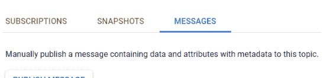

图 13.9 – 浏览到消息

7. 输入消息内容并选择 PUBLISH，如下截图所示：

### Message body

The message you want to publish to this topic. Either message or attribute will be required to publish.

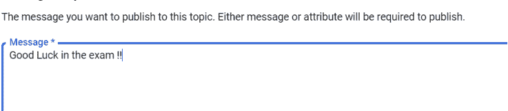

### Message attributes

At most 100 attributes per message, attribute key should not start with 'goog' and should not exceed 256 bytes


图 13.10 – 发布消息

8. 从 Cloud Shell，我们现在可以拉取消息：

```
gcparchitectbook@cloudshell:~ (eighth-effect-319712)$ gcloud pubsub subscriptions pull --auto-ack newSub
```

| DATA | MESSAGE_ID | ORDERING_KEY | ATTRIBUTES | DELIVERY_ATTEMPT |
| Good Luck in the exam !! | 2629643884009593 |  |  |  |

图 13.11 – Cloud Shell 输出

这就完成了如何向 Pub/Sub 发布和检索消息的说明。

## Pub/Sub Lite

虽然 Pub/Sub 应该是大多数应用集成用例的默认解决方案，但 GCP 也提供 Pub/Sub Lite，供在成本更低可以接受一定运维开销的应用使用。它提供的功能更少，可用性更低，并且需要手动预留和管理资源容量。然而，使用 Pub/Sub Lite 对于具有单个订阅的系统来说可能便宜高达 85%。

产品之间的其他主要差异如下：

- Pub/Sub 在全球范围内路由消息，而 Lite 在区域内路由消息。
- Pub/Sub 的主题和订阅是全局资源，而 Lite 中它们是区域资源。
- Pub/Sub 自动扩展，而 Lite 需要我们手动配置容量。

## IAM

对 Pub/Sub 的访问通过 IAM 保护。让我们来看一下预定义角色的列表以及每个角色的简短描述：

- **Pubsub Publisher**：此角色有权发布主题。
- **Pubsub Subscriber**：此角色有权消费订阅或将订阅附加到主题。
- **Pubsub Viewer**：此角色有权列出主题和订阅。
- **Pubsub Editor**：此角色有权创建、删除和更新主题，以及创建、删除和更新订阅。
- **Pubsub Admin**：此角色有权检索和设置主题和订阅的 IAM 策略。

## 配额和限制

Pub/Sub 有一些限制。我们建议您了解每个服务的限制，因为这会影响您的可扩展性。对于 Pub/Sub，我们应注意以下限制：

- 每个项目最多有 10,000 个主题和 10,000 个订阅。
- 每个主题最多可附加 10,000 个订阅。
- 每次发布请求最多有 1,000 条消息，总大小为 10 MB。
- 每条消息最多为 10 MB。

## 定价

Pub/Sub 按消息摄取和传递计费。保留已确认消息还会有存储费用。

在本节中，我们介绍了 Pub/Sub 和 Pub/Sub Lite。在下一节中，我们将介绍 Cloud Dataflow。

## Cloud Dataflow

Cloud Dataflow 是一项基于 Apache Beam 的服务，Apache Beam 是一种用于创建数据处理管道的开源软件。管道本质上是一段代码，用于确定我们希望如何处理数据。一旦这些管道构建完成并输入到服务中，它们就成为 Dataflow 作业。这就是我们处理由 Pub/Sub 摄取的数据的地方。它会执行步骤，将数据从一种格式更改为另一种格式，并且可以转换实时流或历史批处理数据。Dataflow 完全无服务器且完全托管。它会启动执行 Dataflow 作业所需的资源，并在作业完成后删除这些资源。例如，一个管道作业可能由多个步骤组成。如果某个特定步骤需要在 15 台机器上并行执行，则 Dataflow 会自动扩展到这 15 台机器，并在作业完成后将其移除。这些资源基于 Compute Engine，被称为 worker，Cloud Storage 用作临时暂存区和 I/O。这些资源基于我们的位置设置。

> **考试提示**
> Dataflow 可以在流和批模式下转换和丰富数据。其无服务器架构可用于分片和并行处理非常大的批处理数据集或大量实时流。

Cloud Dataflow 是我们端到端解决方案的下一阶段，将处理由 Cloud Pub/Sub 传递的数据。让我们来看一下这对图 13.3 中的服务设计有何影响：

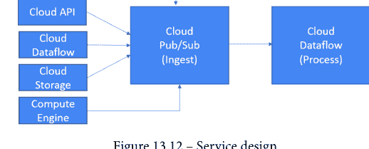


现在，让我们使用 Google 的开源 Dataflow 模板之一创建一个流式管道。

这里，我们有一个 Pub/Sub 订阅，我们希望将数据写入数据仓库服务以进行分析。在本示例中，我们将使用 BigQuery 来分析我们的数据。我们将在下一节讨论此服务。我们需要 Dataflow 将来自 Pub/Sub 的 JSON 格式消息转换为 BigQuery 元素。对于此示例，我们将使用一个 Google 公共 GCP 项目，该项目已设置 Pub/Sub 主题。我们还假设我们已准备好一个 BigQuery 表以供数据写入：

+   1. 从 **Navigation** 菜单浏览到 **BIG DATA | Dataflow**：

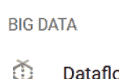

Figure 13.13 – Browsing to Dataflow

+   2. 点击 **CREATE JOB FROM TEMPLATE**：

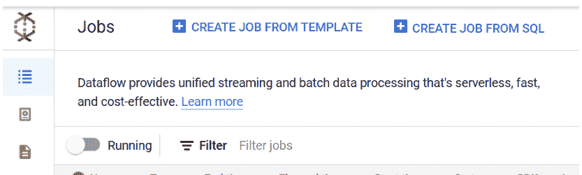

Figure 13.14 – CREATE JOB FROM TEMPLATE

3. 现在，我们可以为 Dataflow 作业填充所需的参数：

+   - 选择部署 Dataflow 工作器并存储元数据的位置。我们将保持默认设置。
+   - 插入 Pub/Sub 输入主题。这是一个由 Google 作为模板一部分提供的公共项目。
+   - 插入数据将被写入的 BigQuery 输出表。
+   - 插入用于存储临时文件的 Cloud Storage 存储桶：

## Create job from template

Job name *
job001
Must be unique among running jobs

Regional endpoint *
europe-west2
Choose a Dataflow regional endpoint to deploy worker instances and store job metadata. You can optionally deploy worker instances to any available Google Cloud region or zone by using the worker region or worker zone parameters. Job metadata is always stored in the Dataflow regional endpoint. Learn more

Dataflow template *
Pub/Sub Topic to BigQuery

Streaming pipeline. Ingests JSON-encoded messages from a Pub/Sub topic, transforms them using a JavaScript user-defined function (UDF), and writes them to a pre-existing BigQuery table as BigQuery elements. OPEN TUTORIAL

Figure 13.15 – Create job from template

一旦选择了 dataflow 模板，我们需要填充其他必需参数。我们需要输入一个有效的 Pub/Sub 主题。在以下示例中，我们使用的是一个由公共 GCP 管理的主题。我们还需要输入一个 BigQuery 表以输出数据，然后输入临时文件写入的位置。在我们的示例中，我们使用名为 `cloudarchitectbookupdate` 的 Cloud Storage 存储桶：

Input Pub/Sub topic *
projects/pubsub-public-data/topics/taxirides-realtime
The Pub/Sub topic to read the input from. Ex: projects/your-project-id/topics/your-topic-name

BigQuery output table *
eighth-effect-319712:taxirides.realtime
The location of the BigQuery table to write the output to. If you reuse an existing table, it will be overwritten. The table's schema must match the input JSON objects. Ex: your-project:your-dataset.your-table

Temporary location *
gs://cloudarchitectbookupdate/temp
Path and filename prefix for writing temporary files. Ex: gs://your-bucket/temp

Encryption
Google-managed encryption key
No configuration required
Customer-managed encryption key (CMEK)
Manage via Google Cloud Key Management Service

SHOW OPTIONAL PARAMETERS

RUN JOB

Figure 13.16 – Additional options

4. 一旦我们运行了作业，我们将看到流程图作为输出以查看其状态。此图表显示了我们管道的阶段。它从 Cloud Pub/Sub 主题读取 JSON 格式消息，使用 JavaScript 用户定义函数对其进行转换，然后将其写入我们的 BigQuery 表。这是将 Cloud Pub/Sub 数据快速移动到 BigQuery 的一种方法：

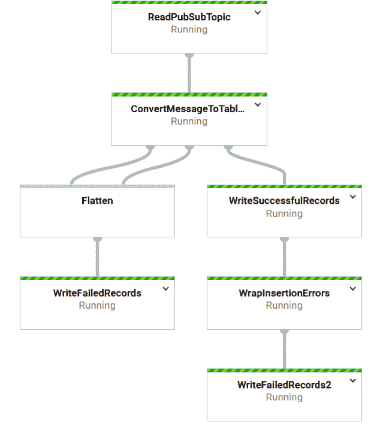

Figure 13.17 – Graph view

5. 如果我们进入 BigQuery 表并运行 SQL 查询，我们将看到我们正在从 Pub/Sub 主题中提取数据（请注意，您的表名称将不同）：

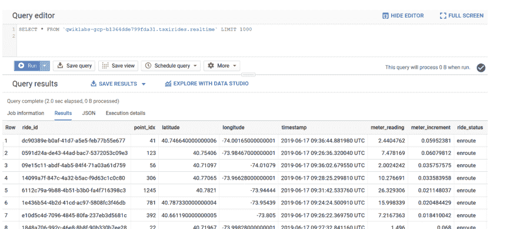

Figure 13.18 – Query results

当然，此查询将被改进，而不是我们选择所有内容。

需要额外注意的一点是，尽管前面的示例已从模板构建了管道作业，但这只是可用选项之一。此选项允许我们无需编码即可快速开始。但是，GCP 为我们提供了使用以下语言构建管道的选项：

+   - Java and Maven
+   - Python
+   - SQL

## IAM

对 Cloud Dataflow 的访问通过 IAM 保护。让我们看一下预定义角色的列表，以及每个角色的简短描述：

+   - **Dataflow Admin**：此角色有权创建和管理 Dataflow 作业。
+   - **Dataflow Developer**：此角色有权执行和操作 Dataflow 作业。
+   - **Dataflow Viewer**：此角色对所有 Dataflow 相关资源具有只读权限。
+   - **Dataflow Worker**：此角色为 GCE 服务账号提供执行 Dataflow 管道工作单元的权限。

## Quotas and limits

Google Cloud Dataflow 带有预定义的配额。这些默认配额可以通过 Navigation 菜单和 IAM & Admin | Quotas 进行更改。从此菜单中，我们可以查看当前配额并请求提高这些限制。我们建议您了解每个服务的限制，因为这可能会影响您的可扩展性。对于 Cloud Dataflow，我们应注意以下限制：

+   - Dataflow 使用 Compute Engine 执行管道代码，然后我们受 Compute Engine 配额的约束。
+   - 每个管道的工作器数量限制为 1,000 个。
+   - 作业创建请求的限制为 10 MB。
+   - 侧输入分片的限制为 20,000 个。

## Pricing

Dataflow 按每个作业按秒计费。价格因地区而异，具体取决于位置。

## BigQuery

BigQuery 是一种完全托管的无服务器分析服务。它可以扩展到 PB 级数据，适用于数据仓库工作负载。它是我们解决方案的分析阶段，一旦 Dataflow 处理了我们的数据，BigQuery 将通过在很短的时间内查询大量数据为我们的业务提供价值。查询以 SQL 语言执行，因此对许多人来说使用起来很容易。我们应强调 BigQuery 是企业级规模，可以极快地执行大型 SQL 查询——所有这些都不需要我们预配任何底层基础设施。

> **Exam Tip**
> BigQuery 非常适合数据仓库工作负载，因为它具有 PB 级存储容量。

## BigQuery features

在本节中，我们将查看数据集和表。这些是 BigQuery 的两个重要概念，我们需要理解它们才能在考试中取得成功。

## Datasets

数据集用于组织和控制对表和视图的访问。我们在将数据加载到 BigQuery 之前至少需要一个数据集。数据集名称在每个项目中是唯一的，我们需要指定一个位置。位置可以是区域或多区域，并且在数据集创建后我们无法更改位置。在选择位置时应考虑一些因素，具体取决于导出或摄取要求。例如，如果我们计划从 Cloud Storage 等外部数据源查询数据，我们查询的数据必须与我们的 BigQuery 数据集位于同一位置。

我们可以通过浏览汉堡菜单 | BIG DATA | BigQuery，然后 SQL Workplace 创建新数据集。最后，点击我们项目旁边的三个点并选择 Create Dataset：

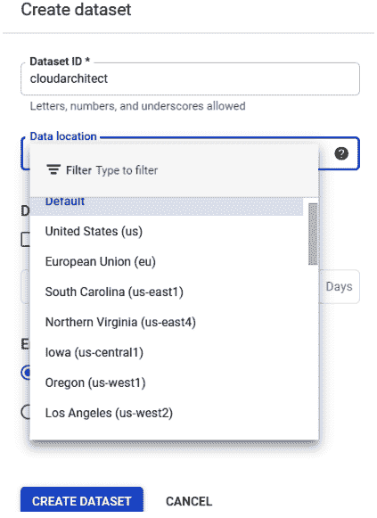

Figure 13.19 – Selecting a dataset location

创建数据集时需要考虑的另一个因素是是否应用默认表过期时间。BigQuery 对数据存储和每次查询收费。我们应该考虑设置过期日期，如果我们的表是临时使用的。以下示例显示了在选择数据位置后与前一个截图相同的截图：

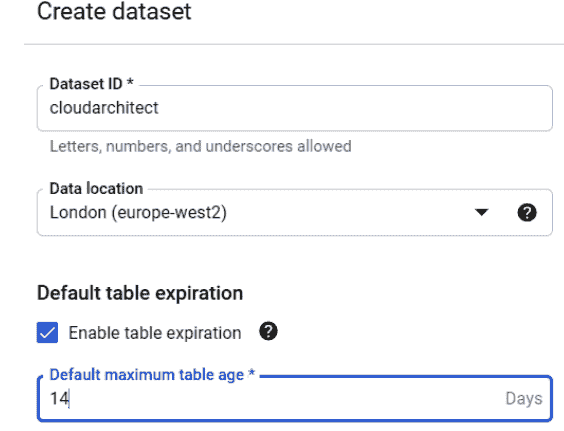

Figure 13.20 – Default table expiration

我们为数据集中的每个表设置了 14 天的过期值。

## Tables

一旦我们创建了数据集，我们就可以创建表并将数据加载到其中。表将包含组织成行的单个记录。每个表由一个模式定义，该模式将描述列名称和数据类型；例如，字符串或整数。模式在我们创建表时决定。我们还可以在创建表时为表设置过期日期。如果我们在创建数据集时设置了过期值，则该值将被创建表时设置的过期值覆盖。如果两者均未设置值，则表将永不过期。

分区表使管理和查询数据变得更容易。这些是被拆分为较小分区的表，这意味着它将提高查询性能并降低成本。这是因为查询读取的字节数也减少了。


BigQuery 提供三种类型的表分区：

- **摄取时间**：BigQuery 会自动将数据加载到按日期、基于数据的分区中。
- **时间单位列**：这些允许我们对 **DATE**、**TIMESTAMP** 或 **DATETIME** 列进行表分区。
- **整数范围**：这些允许我们根据 **整数** 列中的值范围对表进行分区。

> **考试提示**
> 可以为分区表设置过期数据。如果例如需要在一段时间后删除敏感数据，则可以使用此功能。

## 联邦查询

要将查询语句发送到外部数据库并将结果作为临时表接收，我们可以使用联邦查询。这些将使用 BigQuery 连接 API 并与外部数据库建立连接。这允许我们在标准 SQL 查询中使用 EXTERNAL_QUERY 函数将语句发送到外部数据库，使用该数据库的 SQL 方言。结果将被转换为 BigQuery 标准 SQL 数据类型。

## 连接的表格

顺便提醒一下，Google Sheets 是 Google 的在线电子表格应用程序。连接的表格让我们能够在无需了解 SQL 的情况下分析来自 Google Sheet 的数据。我们可以从 Google Sheet 电子表格中访问、分析和共享数十亿行的 BigQuery 数据。如果我们希望在可识别的电子表格界面内与合作伙伴或分析师协作，或在不进行进一步电子表格导出的情况下提供单一事实来源，这可能很有用。连接的表格将代表我们执行 BigQuery 查询，通过请求或计划进行，并将结果保存在我们的电子表格中以供分析。

## 存储与计算分离

BigQuery 将存储与计算分离。通过解耦这些组件，我们可以选择最适合我们组织的存储和处理解决方案，因为它们可以独立扩展，因此提供真正的弹性数据仓库解决方案。

## 物化视图

为了提高性能和效率，BigQuery 提供物化视图，即预计算视图，会定期缓存我们查询的结果。BigQuery 使用这些预计算结果，并在可能的情况下仅读取基表的增量更改以计算最新的结果。使用这些视图可以显著增强具有共同特征的工作负载的性能。

## BigQuery BI Engine

BigQuery BI Engine 是内置于 BigQuery 的 **商业智能 (BI)** 服务，允许我们分析存储在 BigQuery 中的数据。它提供亚秒级查询响应时间和高并发。此外，我们可以构建由 BigQuery 支持的仪表板和报告，而不会影响性能或安全性。它可以集成到 Google 工具中，例如 Data Studio（我们将在本章后面介绍）和连接的表格，或第三方 BI 工具，例如 Microsoft 的 Power BI 或 Tableau。

## BigQuery ML Engine

BigQuery ML 是一个 **机器学习 (ML)** 服务，允许我们使用 SQL 查询在 BigQuery 中创建和执行 ML 模型。机器学习将在 *第 14 章，将机器学习付诸实践* 中更详细地讨论。

## BigQuery GIS

BigQuery GIS 允许我们通过位置智能增强分析工作流程。通过使用地理数据类型和标准 SQL 地理函数，我们可以在 BigQuery 中分析和可视化地理空间数据。对于基于位置数据做出决策的组织而言，这可能是一个真正的优势。

## BigQuery Omni

截至撰写本文时，该功能处于预览阶段。然而，我们值得为您的信息突出介绍该服务。BigQuery Omni 是一种多云分析解决方案，允许我们在 Azure、AWS 和 GCP 中跨所有平台在 BigQuery UI 内分析数据。BigQuery Omni 由 Anthos 提供支持，这意味着我们无需管理任何底层基础设施。我们将在 *第 8 章，使用 Anthos 管理云原生工作负载* 中讨论 Anthos。

## 使用 BigQuery

让我们看看 BigQuery 的强大功能。Google 为公众使用提供了多个示例数据集，以便您感受 BigQuery。在此示例中，我们将使用一个名为 Chicago Taxi Trips 的数据集，并执行查询以查看哪个下车区域的 tip 最高：

1. 浏览到 GCP 控制台中的 BIG DATA | BigQuery，如以下屏幕截图所示：

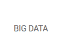

图 13.21 – 选择 BigQuery

2. 展开 ADD DATA 并选择 Explore public datasets，如以下屏幕截图所示：

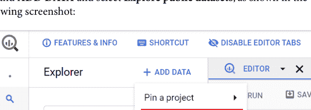

图 13.22 – 探索公共数据集

3.  在市场中搜索 taxi 并选择 Chicago Taxi Trips 数据集：

## Marketplace

Marketplace > "taxi" > Datasets

## Filter by

TYPE
Datasets

## Datasets

2 results

Chicago Taxi Trips
City of Chicago
Chicago taxi trips from 2013 to present

NYC TLC Trips
City of New York
New York City taxi and limousine trips since 2009

图 13.23 – 在市场中搜索

4.  查看数据集：

Chicago Taxi Trips
City of Chicago
Chicago taxi trips from 2013 to present

VIEW DATASET

图 13.24 – 公共数据集

5.  您现在将看到可供我们使用的公共数据集。浏览到 Chicago Taxi Dataset：

## Explorer

+ ADD DATA

Type to search

Viewing pinned projects.

primeval-nectar-318916

bigquery-public-data

chicago_taxi_trips

图 13.25 – 控制台中可用的数据集

6.  现在，我们可以在此数据集上编写新查询。此查询将提供一些有价值的信息。我们将按下车社区分组检索司机获得的平均小费和最高小费。我们可以看到此查询使用标准 SQL 语言，并且支持 ANSI 2011：

```
SELECT
dropoff_community_area,
FORMAT('%3.2f', AVG(tips)) AS average_tip,
FORMAT('%3.2f', MAX(tips)) AS max_tip
FROM
`bigquery-public-data.chicago_taxi_trips.taxi_trips`
WHERE
dropoff_community_area IS NOT NULL
GROUP BY
dropoff_community_area
ORDER BY
average_tip DESC
LIMIT
10
```

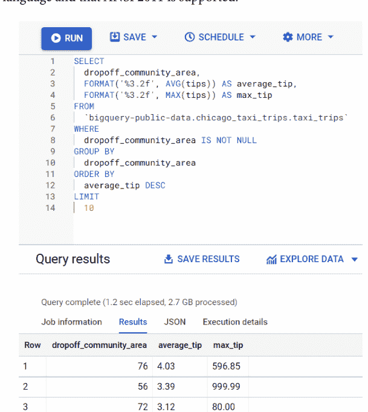

图 13.26 – 数据集查询

请注意，从结果中我们可以看到查询仅在 1.2 秒内处理完成。这可能不是查询的数据量很大，但它表明我们可以快速加载数据集并执行查询。部署基础设施无需任何先决条件步骤。

关于 BigQuery，我们需要提及的一件事是它有一个名为 bq 的命令行工具。我们将在第 16 章《Google Cloud 管理选项》中更详细地介绍 bq。

## 导入和导出数据

前面的示例基于公共数据集。BigQuery 允许我们从控制台或 Cloud Shell 上传数据。让我们看看如何使用控制台上传本地的 CSV 文件。在此示例中，我们将使用一个名为 london_bikes 的示例数据集。我们还将使用一个名为 london_bikes.csv 的 CSV：

1.  从我们的 BigQuery 数据集，我们可以点击加号 (+) 图标创建新表，如以下屏幕截图所示：

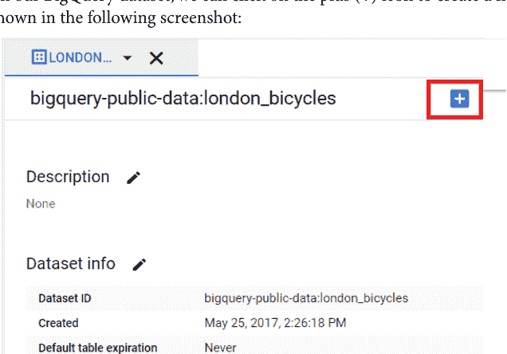

图 13.27 – 添加表

2.  然后，我们会得到几种创建表的方法。选择 Upload 并浏览到我们的 CSV 文件位置：

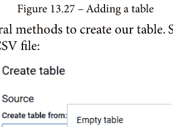

图 13.28 – 上传

3.  然后，我们可以填充要添加表的目标数据集并构建我们的架构。在此示例中，我们将使用不同类型向架构添加条目。在这里，我们可以看到 start_station_name 和 num 都是 STRING：

## Create table

Source
Create table from: Upload
Select file: london_bikes.csv Browse
File format: CSV

Destination
Search for a project
Enter a project name
Project name My First Project
Dataset name london_bikes
Table type Native table
Table name london

Schema
Auto detect
Schema and input parameters
Edit as text
Name Type Mode
start_station_name STRING NULLABLE
num STRING NULLABLE
+ Add field

图 13.29 – 导入表

有时，我们也需要将表导出到外部源。这也是一个非常简单的过程。

让我们将表导出到 Cloud Storage 存储桶：

1.  从我们的表视图，我们可以点击 EXPORT：

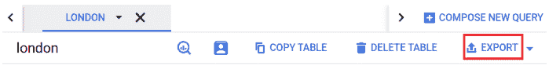

图 13.30 – EXPORT


2. 然后，我们可以填充我们的存储桶名称并导出它：

## 导出表到 Google Cloud Storage

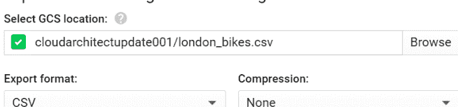

图 13.31 – 导出表到 Google Cloud Storage

GCP 还提供了一种名为 BigQuery Data Transfer Service 的服务，它将按计划自动执行将数据移入 BigQuery 的过程。完成初始数据传输配置后，该服务将自动将数据加载到 BigQuery。请注意，它不能用于将数据从 BigQuery 传输出去。

## 存储

尽管我们将 BigQuery 讨论为大数据，但让我们提醒自己，它也是一种存储服务。没有必要将旧数据导出到另一个存储平台。使用 BigQuery，我们可以享受与 Cloud Storage 等服务相同的低廉长期存储。只要我们在 90 天内未编辑表，则我们的成本将降低 50%，这将与 Cloud Storage Nearline 类的成本相匹配。

我们现在已从数据中获得了有价值的信息。通过将我们的完整服务组合在一起，从高层次来看，我们的解决方案现在看起来像这样：

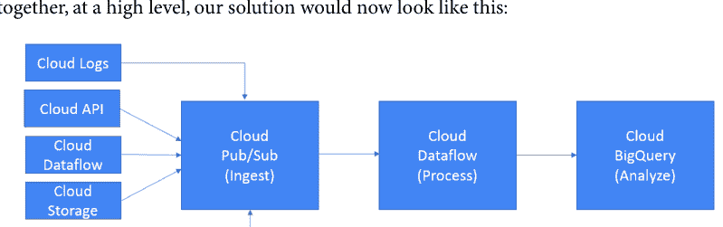

图 13.32 – 服务架构图

花点时间回顾一下前面的图表，并了解每个阶段使用的服务。这对考试很重要。

## Storage Read API

BigQuery 还提供 Storage Read API，可快速访问 BigQuery 管理的表数据。这是访问 BigQuery 中表数据的第三种选择，除了 `tabledata.list` 或 `jobs.getQueryResults` REST API，或使用 BigQuery `extract` 作业进行批量数据导出，后者会将表数据导出到 Cloud Storage。当使用 Storage Read API 时，结构化数据以二进制序列化格式通过线路发送，从而允许额外的并行性，从而改进了原来的两个选项。

## IAM

对 BigQuery 的访问通过 IAM 保护。让我们看一下预定义角色的列表，以及每个角色的简短描述：

- **BigQuery User**：此角色有权在项目中运行作业。它还可以创建新数据集。组织中的大多数个人都应为用户。
- **BigQuery Job User**：此角色有权在项目中运行作业。
- **BigQuery Read Sessions User**：此角色有权通过 BigQuery storage API 在项目中创建和读取会话。
- **BigQuery Data Viewer**：此角色有权读取数据集元数据并列出数据集中的表。它还可以读取数据集表的数据和元数据。
- **BigQuery Metadata Viewer**：此角色有权列出所有数据集并读取项目中所有数据集的元数据。它还可以列出所有表和视图并读取项目中所有表和视图的元数据。
- **BigQuery Data Editor**：此角色有权读取数据集元数据并列出数据集中的表。它可以创建、更新、获取和删除数据集表。
- **BigQuery Data Owner**：此角色有权读取、更新和删除数据集。它还可以创建、更新、获取和删除数据集表。
- **BigQuery Admin**：此角色有权管理项目中的所有资源。

## 配额和限制

BigQuery 带有预定义的配额。这些默认配额可以通过导航菜单和 IAM & Admin | Quotas 进行更改。从此菜单中，我们可以查看当前配额并请求提高这些限制。我们建议您了解每个服务的限制，因为这会影响您的可扩展性。对于 BigQuery，我们应注意以下限制：

- 并发查询的限制为 100 个。
- 查询执行时间限制为 6 小时。
- 每天允许最多 1,500 次表操作。
- 每个项目每秒最多可流式传输 100,000 行数据。在美国和欧盟多区域为 500,000。
- 每个用户最多允许 300 个并发 API 请求。

## 定价

BigQuery 的存储成本基于我们存储的数据量。我们可能会被收取活动存储和长期存储费用。当然，长期存储的月度费用会更低。此外，我们还会为运行查询付费。我们为查询提供了两种定价模式：

- **按需**：此模式根据每个查询处理的数据量收费。
- **固定费率**：这使我们可以购买专用资源进行处理，因此我们不会为单个查询付费。

定价还取决于我们的 BigQuery 数据集的位置。现在，让我们来看一下 Dataproc。

## Dataproc

Dataproc 是 GCP 用于运行 Hadoop 和 Spark 集群的大数据托管服务。Hadoop 和 Spark 是开源框架，以分布式方式处理大数据应用的数据处理。基本上，它们为数据提供海量存储，同时提供巨大的处理能力来处理并发处理任务。

如果我们参考本章的 *端到端大数据解决方案* 部分，Dataproc 也是处理阶段的一部分。它可以与 Dataflow 相比较；然而，Dataproc 要求我们预配服务器，而 Dataflow 是无服务器的。

**考试提示**
如果我们已有现有的 Hadoop 或 Spark 集群，则应选择 Dataproc 而非 Dataflow。此外，还需要现有资源的技能。如果我们需要创建新的管道作业或处理流数据，则应选择 Dataflow。

作为在本地托管这些服务的替代方案，Google 提供了 Dataproc，它具有许多优势——主要是节省成本，因为您只需为所使用的资源付费，无需为所需处理能力和存储进行大量初始投入。传统的本地 Hadoop 集群通常运行成本高昂，因为您为未经常使用的处理能力付费，并且我们不能删除集群，因为我们的数据也会被删除。相比之下，Dataproc 摆脱了持久集群，转而使用临时集群。Dataproc 与 Cloud Storage 集成良好。因此，如果我们有运行作业的需求，我们可以非常快速地启动集群，处理我们的数据，并将其存储在同一区域的 Cloud Storage 中。然后，我们可以简单地删除我们的集群。Dataproc 集群不用于 24/7 运行，因为它们是特定于作业的，这就是我们能够节省成本的地方。这种方法使我们能够为单个作业使用不同的集群配置，根据单个作业或作业组扩展集群，并减少集群的维护，因为我们每次需要运行作业时都只需启动一个全新配置的集群。

**考试提示**
临时集群的全部意义在于仅在作业生命周期内使用它。

## 架构

下图显示了 Dataproc 的高层架构：

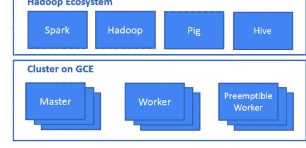

图 13.33 – Dataproc

底层的 Dataproc 基础设施建立在 Compute Engine 上，这意味着我们可以根据预算构建多种机器类型，并利用预定义和自定义机器类型。

> **考试提示**
> 使用抢占式实例也会增加成本节约。

创建 Dataproc 集群时，我们可以选择最多 96 个 CPU 内核和 624 GB RAM 的最大组合。我们还可以选择 SSD 和 HDD 存储。请参阅 *第 4 章，使用 Google Compute Engine*，了解有关机器类型的更多详细信息。

在 Dataproc 集群中，有不同类别的机器：

- **主节点**：此机器将分配并同步工作节点上的任务并处理结果。
- **工作节点**：这些机器将处理数据。由于其 CPU 和内存规格很高，这些可能很昂贵。
- **抢占式工作节点**：这些是次要工作节点，可选。它们执行相同的工作，但降低了非关键数据处理的每小时计算成本。

创建新集群时，我们可以选择不同的集群模式：

- **标准**：这包括一个主节点和 N 个工作节点。如果 Compute Engine 出现故障，在飞行中的作业将失败，并且文件系统在主节点重新启动之前将无法访问。
- **高可用性**：这包括三个主节点和 N 个工作节点。这旨在允许在 Compute Engine 出现故障或重新启动的情况下不间断操作。
- **单节点**：这将主节点和工作节点合并在一起。这不适合大规模数据处理，应用于 PoC 或小规模非关键数据处理。


默认情况下，当我们创建一个集群时，标准 Apache Hadoop 生态系统组件将自动安装在集群上：

- Apache Spark
- Apache Hadoop
- Apache Pig
- Apache Hive
- Python
- Java
- Hadoop 分布式文件系统 (HDFS)

> **重要说明**
> 从本地部署迁移到 Google Cloud Storage 的流程在 https://cloud.google.com/solutions/migration/hadoop/hadoop-gcp-migration-data 中有进一步说明。

我们还可以在可执行文件或脚本中指定初始化操作，Dataproc 会在集群设置完成后立即在集群中的所有节点上运行这些操作。这些操作通常用于设置作业依赖项，以确保作业不需要安装任何依赖项。

## IAM

对 Dataproc 的访问通过 IAM 保护。让我们来看一下预定义角色的列表，以及每个角色的简短描述：

- **Dataproc Editor**：对此具有完全控制权 Dataproc。
- **Dataproc Viewer**：此角色有权获取和列出 Dataproc 机器类型、区域、区域和项目。
- **Dataproc Worker**：此角色仅适用于服务账号，并提供与 Dataproc 配合操作所需的最低权限。
- **Dataproc Admin**：此角色具有与 Editor 相同的权限，但可以获取和设置 Dataproc IAM 权限。

## 配额和限制

由于 Dataproc 集群使用其他 GCP 产品，因此 Compute Engine 的限制和配额适用于 Dataproc。当我们创建 Dataproc 集群时，计算资源将影响我们的区域配额限制。

我们建议您查看 *进一步阅读* 部分，了解有关 Compute 配额的更多信息。

## Cloud IoT Core

**物联网**，或 **IoT**，是连接到互联网的物理对象的统称。你无疑今天正在使用许多 IoT 设备，例如智能手表、Google Home 或无线控制的灯泡。

Cloud IoT Core 是一种完全托管的服务，允许我们安全地连接、管理和从全球各地的设备摄取数据。它也是完全无服务器的，这意味着无需前期软件安装。Cloud IoT Core 与其他 GCP 服务集成，为收集、处理和分析实时数据提供完整的解决方案。让我们看一下下面的图表。它向我们展示了 Cloud IoT Core 在本章讨论的整体端到端解决方案中的位置，以及 IoT 设备可用于与其通信的协议 – MQTT 和 HTTP：

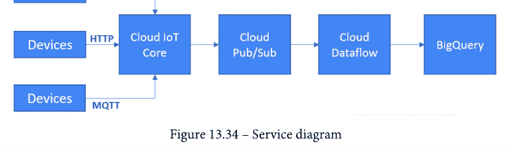

图 13.34 – 服务图

> **重要说明**
> 
> **MQTT** 是一种 Pub/Sub 协议，常用于嵌入式设备。MQTT 被认为以数据为中心，更适合 IoT。
> 
> **HTTP** 是一种无连接协议，设备将保持与 Cloud IoT Core 的连接。HTTP 被认为以文档为中心。

两种协议都通过 **协议桥** 与 Cloud IoT Core 通信，该桥提供以下功能：

- MQTT 和 HTTP 协议端点
- 自动负载均衡
- 通过 Pub/Sub 实现全球数据访问

另一个关键组件是 **设备管理器**。它用于执行以下操作：

- 注册单个设备
- 配置单个设备
- 更新和控制设备
- 提供基于角色的访问控制
- 提供用于设备部署和监控的控制台和 API

## IAM

对 Cloud IoT Core 的访问通过 IAM 保护。让我们来看一下预定义角色的列表，以及每个角色的简短描述：

- **Cloudiot Viewer**：对此具有只读访问权限 所有 Cloud IoT 资源。
- **Cloudiot Device Controller**：此角色有权更新设备的配置。它没有创建或删除设备的权利。
- **Cloudiot Provisioner**：此角色有权从注册表中创建和删除设备，但不能修改注册表。
- **Cloudiot Editor**：对此具有读写访问权限 所有 Cloud IoT 资源。
- **Cloudiot Admin**：对此具有完全控制权 所有 Cloud IoT 资源和权限。

## 配额和限制

Cloud IoT core 有许多限制，从项目限制到设备限制不等，并分为三个类别：

- **项目、设备和遥测限制**：这些限制指的是每个项目的设备数量、设备元数据、遥测事件有效负载以及每个设备的 MQTT 连接。
- **速率**：这些限制指的是设备到云和云到设备吞吐量限制、每个连接的 MQTT 每秒传入消息数以及设备管理器 API 限制。
- **时间**：这些限制指的是 MQTT 连接时间和超时限制。

我们建议您参考 *进一步阅读* 部分了解更多信息。

## 定价

Cloud IoT Core 根据每个日历月使用的數據量收费。Google 建议使用定价计算器来根据交换的数据量估算价格。

## Data Fusion

Cloud Data Fusion 是一种完全托管的云原生数据集成服务，可快速构建和管理数据管道。Data Fusion 使用 Dataproc 作为这些管道的执行环境。GUI 面向各种用户，这意味着业务用户、开发人员和数据科学家可以轻松构建集成解决方案，以清理、准备和转换数据。数据融合还提供了一系列预配置的插件来扩展其功能。还需要注意的是，它由一个名为 **Cask Data Application Platform (CDAP)** 的开源项目提供支持。

## 核心概念

一些核心 Data Fusion 概念值得强调，以便了解该产品及其使用方法。

## 实例

首先，我们必须创建一个 Cloud Data Fusion 实例。实例作为 Compute Engine 服务账号运行，Data Fusion 使用 Dataproc 集群执行管道。实例是 Data Fusion 的唯一部署，并从 GCP 控制台创建。在创建时，我们可以决定要部署的实例类型，选择将由需求和成本决定。有三个选项：

- **Developer** 实例提供功能齐全的版本，具有区域可用性和对执行环境的限制。
- **Basic** 实例提供全面的集成能力，但对同时管道运行有限制，建议用于非关键环境。
- **Enterprise** 实例也提供全面的集成能力，但对同时管道运行没有限制，建议用于关键环境。

每个实例都包含一个唯一且独立的 Data Fusion 部署，其中包含一组处理管道生命周期管理、编排、协调和元数据管理的服务。请注意，在我们创建实例之前，将提示我们启用 API 并创建凭据：

## 版本

Developer
此版本为产品探索和开发环境提供功能齐全的版本，具有区域可用性和对执行环境的限制。

Basic
此版本提供全面的数据集成能力。用户可以构建批处理数据管道；连接到任何数据源；执行免代码转换。对同时管道运行有限制。建议用于非关键环境。

Enterprise
此版本提供 Basic 版本提供的所有功能。此外，还包括对实时数据管道的支持；与数据血缘的交互；对同时管道运行没有限制；以及高可用性。建议用于关键环境。

图 13.35 – 选择实例版本

一旦实例部署完成，我们可以点击实例 URL，这将打开一个单独的 Data Fusion UI，允许我们查看我们的实例。让我们来看一下部署示例管道：

1. 从 Data Fusion UI，点击 **HUB**。这将打开一个插件列表，我们可以利用这些插件来扩展 Data Fusion 的功能：

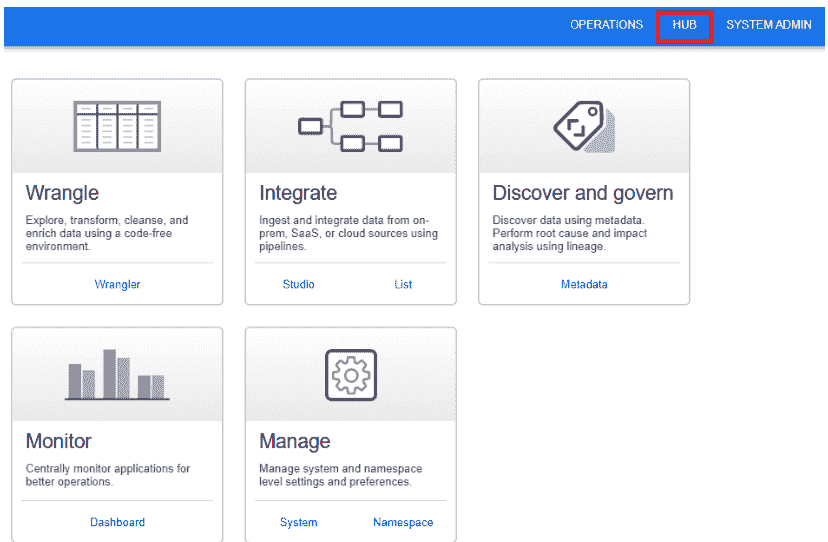

图 13.36 – 查看实例


2. 选择 Cloud Data Fusion Quickstart 插件：

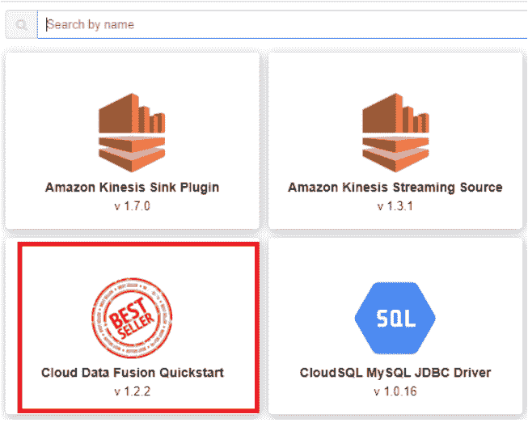

图 13.37 – Quickstart 插件

3. 点击 Create，必要时更新管道名称，然后点击 Finish：

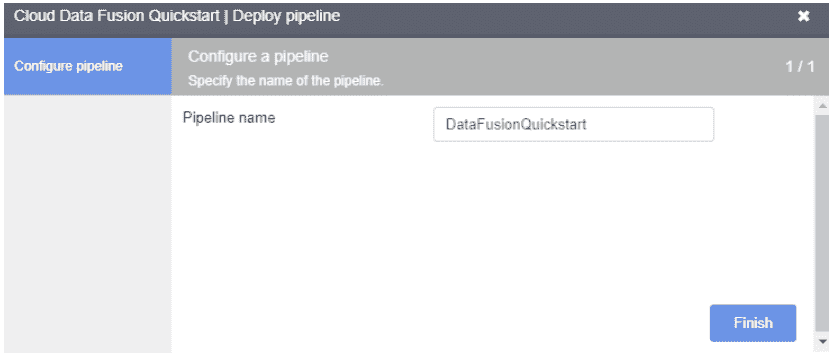

图 13.38 – 创建管道

4. 在提示时点击 **Customize Pipeline**。这将带我们进入管道工作室。这是一个用于开发管道的图形界面。它允许我们将各种插件拖放到画布上。如果我们从右上角点击 **Deploy**，它将把管道提交给 Data Fusion。在此示例管道中，我们正在从 Cloud Storage 读取包含《纽约时报》畅销书数据的 JSON 文件。然后它将对文件运行转换以解析和清理数据。最后，它将把最近一周内新增的、价格低于 $25 的评分最高的书籍加载到 BigQuery 中：

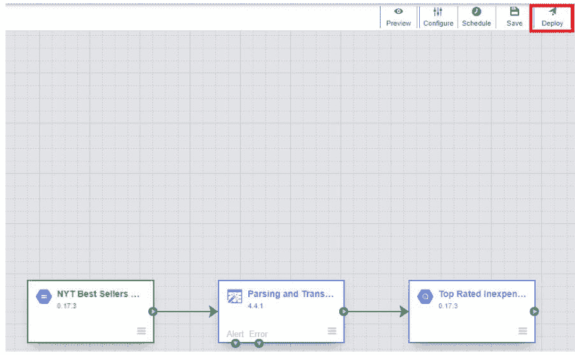

图 13.39 – 部署管道

5. 然后我们可以 **Run** 我们的管道并在流程结束时查看结果：

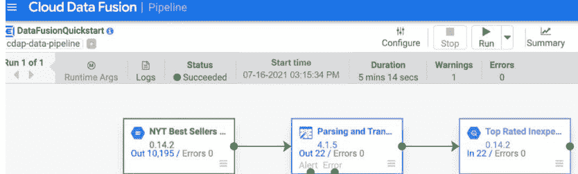

图 13.40 – 管道结果

至此，我们已经了解了入门使用 Data Fusion 是多么容易。

## Execution environments

Cloud Data Fusion 会在我们手动运行管道或希望管道通过计划或管道状态触发器运行时创建临时执行环境。我们已经提到 Cloud Data Fusion 支持 Dataproc 作为执行环境。我们可以选择以 MapReduce、Spark 或 Spark Streaming 程序的方式运行管道。Cloud Data Fusion 会在管道运行开始时在我们的客户项目中配置一个临时的 Dataproc 集群。然后，它将使用 MapReduce 或 Spark 在集群中执行管道，并在管道执行完成后删除集群。

如果我们使用 Terraform 等技术来管理现有的 Dataproc 集群，我们可以配置 Cloud Data Fusion 使用这些集群而不配置新集群。

建议我们使用自动扩缩容策略来增加集群规模，而不是减小规模。使用自动扩缩容减小规模也会移除保存中间数据的节点，可能导致失败。

## Pipelines

管道为我们提供了一种可视化设计数据和控制流的方式，用于从各种数据源——无论是本地还是基于云的——提取、转换、聚合和加载数据。管道允许我们创建数据处理工作流，帮助我们解决数据摄取、集成和迁移问题。我们可以使用 Cloud Data Fusion 构建实时和批处理管道。

管道允许我们使用数据的逻辑流来表达数据处理工作流，而 Cloud Data Fusion 将处理在执行环境中物理运行所需的所有功能。Cloud Data Fusion 规划器通过在 Dataproc 上使用 Apache Spark 和 Apache Hadoop MapReduce 将逻辑流转换为并行计算。

## Use cases

应考虑以下用例使用 Data Fusion：

- GCP 上的安全数据湖。Data Fusion 帮助我们在 GCP 上构建可扩展的分布式数据湖。
- 具有 BigQuery 的敏捷数据仓库。Data Fusion 可以打破数据孤岛并实现在 BigQuery 中开发数据仓库解决方案。
- 统一分析。Data Fusion 可以在各种本地数据仓库之间建立分析环境。

## IAM

对 Cloud Data Fusion 的访问通过 IAM 保护。让我们来看一下预定义角色的列表以及每个角色的简短描述：

- **Datafusion Viewer**：这具有对 Data Fusion UI 的完全访问权限，以及查看、创建、管理和运行管道的权限。
- **Datafusion Admin**：这具有所有查看者权限，外加创建、更新和删除所有 Data Fusion 实例的权限
- **Datafusion Runner**：这授予 Dataproc 服务账号，以便 Dataproc 获得授权以通信管道运行程序信息。

## Quotas and limits

值得注意的有几个限制：

- 单个用户在单个区域的请求限制为每分钟 600 次。
- Data Fusion 配额适用于所有执行的管道。
- Data Fusion 还存储日志，因此适用 Cloud Operations 日志配额。

我们建议您参考 *Further reading* 部分获取更多信息。

## Pricing

Data Fusion 的使用量按 Cloud Data Fusion 实例从创建到删除之间的时间长度（以分钟为单位）来衡量。Cloud Data Fusion 按分钟计费，尽管价格按小时定义。使用量将以小时为单位衡量——例如，30 分钟为 0.5 小时——以将按小时的价格应用于按分钟的使用。

现在，让我们来看 Datastream API。

## Datastream API

Datastream 是一种无服务器的 **change data capture (CDC)** 和复制服务。它帮助我们将来自 Oracle 或 MySQL 的变更流引入 Google 的数据服务，以支持分析、数据库复制和事件驱动架构。它允许我们在异构数据库和应用程序之间以最小的延迟和停机时间同步数据。

请注意，在撰写本文时，该产品处于 pre-GA 阶段。然而，我们认为值得强调该服务以供了解。

## Additional considerations

Google 提供的其他服务我们希望重点介绍：

- **Dataprep**：这是一个 Web 应用程序，允许我们通过与数据样本交互来定义数据的准备规则。与我们讨论过的许多其他服务一样，Dataprep 是无服务器的，无需前期部署。默认情况下，Dataprep 作业在 Dataflow 管道上执行。有关更多信息，请参阅 https://cloud.google.com/dataprep/。
- **Datalab**：这基于 Jupyter（前身为 IPython），这是一个开源 Web 应用程序。Datalab 是一个交互式数据分析和机器学习环境。我们可以使用该产品通过 Python 和 SQL 交互式地可视化和探索数据。这将被视为我们端到端解决方案的数据使用阶段的一部分，并将使用从 BigQuery 传递的数据。Datalab 免费，但运行在 Compute Engine 实例上，因此会产生费用。有关更多信息，请参阅 https://cloud.google.com/datalab/。
- **Data Studio**：这是一个 **Business Intelligence (BI)** 解决方案，可将您的数据转化为信息丰富且易于阅读的仪表板和报告。它是一个完全托管的可视化分析服务。有关更多信息，请参阅 https://datastudio.google.com/overview/。
- **Composer**：另一个工作流编排服务是 Cloud Composer。基于 Apache Airflow 开源项目构建，它允许我们创建跨公共云和本地数据中心的跨域工作流。工作流是一系列用于摄取、转换、分析和利用数据的任务。在 Airflow 中，这些工作流使用所谓的 **Directed Acyclic Graphs (DAGs)** 创建。DAGs 表示我们想要调度和运行的一组任务。Cloud Composer 使用 Python 运行，因此不受云厂商锁定影响且易于使用。DAGs 使用 Python 脚本创建，以代码形式定义任务及其依赖关系。

与 Data Fusion 类似，执行这些工作流需要一个环境。通过使用 Cloud Composer，我们可以受益于 Airflow 的所有功能，而无需任何安装或管理开销，因此 Composer 将配置运行我们工作流所需的 GCP 资源。此组件组称为 Cloud Composer 环境，基于 GKE。您可以在创建 Composer 环境时定义 GKE 集群中的节点数。有关更多信息，请参阅 https://cloud.google.com/composer/docs/concepts/overview。


- **Looker：** Looker 是一个企业平台，帮助我们探索和共享公司数据，以便做出更明智的业务决策。使用一种名为 LookML 的建模语言，我们可以查询数据以创建报表、仪表板和其他数据模式。

- **数据目录：** 没有合适的工具，处理当今许多组织中日益增长的数据资产数量将是一个真正的挑战。利益相关者希望搜索有洞察力的数据、理解数据，并使数据尽可能有用。数据目录是一种可扩展的元数据管理服务，可以编目来自 BigQuery、Pub/Sub、Dataproc 元存储和 Cloud Storage 的数据资产的元数据。有关更多信息，请参阅 https://cloud.google.com/data-catalog/docs/concepts。

虽然前述服务不是主要的考试主题，但我们仍应了解每项服务提供的功能。

## 摘要

在本章中，我们涵盖了与考试相关的与大数据的主要方面。我们介绍了每项服务，并展示了这些服务可以在我们端到端解决方案的不同阶段使用。我们花时间了解如何从 GCP 控制台配置 Pub/Sub、Dataflow 和 BigQuery，并讨论了 Dataproc 和 Cloud IoT Core。

> **考试提示**
> 本章的关键要点是了解哪些服务映射到数据的摄取、处理和分析阶段。

然后，我们查看了我们解决方案的处理阶段。Cloud Dataflow 将部署 Google Compute Engine 实例来部署和执行我们的 Apache Beam 管道，该管道将处理来自 Pub/Sub 的数据并将其传递到后续阶段进行分析和存储。我们展示了如何在 GCP 控制台中轻松创建管道，该管道从 Pub/Sub 拉取信息以在 BigQuery 中进行分析。

之后，我们介绍了 BigQuery 并理解它是数据仓库。它旨在使数据分析师更高效，在很短的时间内处理 PB 级数据。它是完全无服务器的，因此在使用之前我们不必担心预配任何基础设施，这节省了大量前期成本和时间。我们了解了设置数据集并开始查询它是多么容易和快速。

我们还介绍了 Dataproc。我们介绍了该服务的架构，并确定 Dataproc 是在本地托管 Hadoop 集群的替代方案。我们现在应该理解 Dataproc 可用于处理从 Cloud Pub/Sub 注入的数据。

我们还介绍了 Cloud IoT Core，用于连接物联网设备。我们向您展示了如何摄取这些设备生成的实时数据。此外，我们讨论了使用 Data Fusion 的数据管道以及 Datastream 中的无服务器 CDC 和复制服务。我们还介绍了 Dataprep、Datalab、Datastudio、Composer、DataCatalog 和 Looker。

在下一章中，我们将研究机器学习。

## 进一步阅读

阅读以下文章以获取有关本章所涵盖主题的更多信息：

- 对于 Cloud Pub/Sub，请参阅以下内容：
  - **Pub/Sub**：https://cloud.google.com/pubsub/docs/
  - **定价**：https://cloud.google.com/pubsub/pricing
  - **配额**：https://cloud.google.com/pubsub/quotas
  - **复杂事件处理**：https://cloud.google.com/solutions/architecture/complex-event-processing
  - **用例**：https://cloud.google.com/pubsub/docs/overview
- 对于 Cloud Dataflow，请参阅以下内容：
  - **Dataflow**：https://cloud.google.com/dataflow/docs/
  - **定价**：https://cloud.google.com/dataflow/pricing
  - **配额**：https://cloud.google.com/dataflow/quotas
- 对于 BigQuery，请参阅以下内容：
  - **BigQuery**：https://cloud.google.com/bigquery/docs/
  - **定价**：https://cloud.google.com/bigquery/pricing
  - **配额**：https://cloud.google.com/bigquery/quotas
- 对于 Dataproc，请参阅以下内容：
  - **Dataproc：** https://cloud.google.com/dataproc/docs/
  - **配额：** https://cloud.google.com/compute/quotas
  - **定价：** https://cloud.google.com/dataproc/pricing
- 对于 Cloud IoT Core，请参阅以下内容：
  - **Cloud IoT Core：** https://cloud.google.com/iot/docs/
  - **配额：** https://cloud.google.com/iot/quotas
  - **定价：** https://cloud.google.com/iot/pricing
- 对于 Data Fusion，请参阅以下内容：
  - **Data Fusion：** https://cloud.google.com/data-fusion/docs/resources
  - **配额：** https://cloud.google.com/data-fusion/quotas
  - **定价：** https://cloud.google.com/data-fusion/pricing
- 对于 Datastream，请参阅 https://cloud.google.com/datastream。

## 14

## 将机器学习付诸实践

正如我们已经提到的，**机器学习 (ML)** 是 **Google Cloud Platform (GCP)** 的差异化因素之一。你应该特别关注本章，因为你将了解到你实际上不需要是数据科学家就能在你的应用中利用 ML。Google 为初学者和经验丰富的用户都提供了选择。ML 对许多人来说可能是一个令人望而生畏的话题，但希望我们能够通过简单的示例解释基本的基础概念。在有了这种理解之后，我们将能够查看 GCP 中可用的 ML 服务。希望你对本章的兴奋程度与我们撰写时的兴奋程度一样。

在本章中，我们将涵盖以下主题：

- 人工智能和 ML 的介绍
- ML 的七个步骤
- 学习模型
- GCP ML 选项
- TensorFlow
- Vertex AI
- 预训练 ML 模型
- Dialogflow
- AutoML

> **考试提示**
> 有趣的是，ML 主题在考试中已大幅减少。2020 年引入了一个新的考试 Professional Machine Learning Engineer，需要深入了解 Google ML 服务。我们仍然认为该主题非常重要，希望你能理解基础知识。

作为云架构师，你应该能够区分不同的 GCP ML 服务并为你的用例识别合适的服务。可能有两种服务满足要求，但 *哪一种在使用时会带来更少的精力？* 记住有哪些类型的 ML 模型并理解它们之间的差异。不要害怕——没人会要求你开发自己的模型！

## 人工智能和 ML 的介绍

**人工智能 (AI)** 被描述为数字计算机执行智能人类可以执行的任务的能力。ML 是 AI 的一个子集。它被机器用来基于数据做出决策，而无需获得特定的编程指令。它可用于例如指示收到的电子邮件是否为垃圾邮件、识别对象或做出智能预测。ML 概念在以下图表中说明：

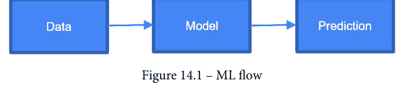

如我们所见，ML 模型依赖于从对称为 **训练数据** 的样本的分析中创建的数学模型。开发模型的过程称为 **模型训练**。模型的目的是以尽可能高的准确度回答我们的问题。准确性越好，模型越好。你可能对这个模型是如何创建的感到困惑。我们将在下一节中讨论这个问题。

## ML 的七个步骤

Google 指出 ML 有七个步骤：

- 1. 收集数据
- 2. 准备数据
- 3. 选择模型
- 4. 训练
- 5. 评估
- 6. 超参数调优
- 7. 预测

让我们通过一个示例逐步了解每个步骤。假设我们正在训练模型来检查水果是苹果还是柠檬。我们需要选择将用于训练模型的特征。有很多可能的替代方案，包括形状、颜色、味道和皮肤光滑度：


图 14.2 – ML 实验的对象

对于本次训练，我们将使用颜色和糖含量。第二项测量可能不是最简单的获得，但对于本次测试，让我们假设我们拥有适当的设备来做到这一点。


## 收集和准备数据

让我们开始收集数据，通过购买多颗苹果和柠檬。我们将从创建包含两个特征的表格开始——**颜色**和**糖分含量**。

> **重要说明**
> 颜色以波长区间表示，单位为**纳米 (nm)**。

这是一个涉及几种水果的示例，但为了获得准确的预测，我们需要更多样本：

| Color [nm] | Sugar content [g] | Fruit |
|---|---|---|
| 590 | 10 | Apple |
| 570 | 2 | Lemon |
| 610 | 15 | Apple |
| 500 | 3 | Lemon |

在此阶段，我们应该尝试可视化数据，以确保我们没有收集过多一种类型的水果；否则，模型会偏向该水果。

现在，我们需要将数据拆分为**训练**和**评估数据**。如果我们的模型正确，用于训练的数据不应用于评估，因为我们总是会得到好的结果。一个经验法则是，我们应该使用 80% 的数据进行训练，剩余的 20% 作为评估数据。一旦完成此划分，可能还需要额外的步骤来准备数据，例如归一化和去重。在我们的案例中，这些是不需要的。

## 选择模型

现在，我们需要确定要使用哪个模型。有成千上万的模型可供选择。它们可以适用于图像、文本或基于数值的数据。模型应根据用例选择。由于我们的案例中只有两个特征，模型可以是一个简单的线性模型。

## 训练

现在，我们将进入 ML 的核心：实际训练。让我们看看我们为训练选择的模型。这里，我们有 X = W x Y + b，其中 W 是权重，b 是偏置，而 X 和 Y 是特征。在训练期间，我们将操作 W 和 b 的值，并使用训练数据验证我们是否得到正确的预测。其中每一次操作都称为一次训练步骤：

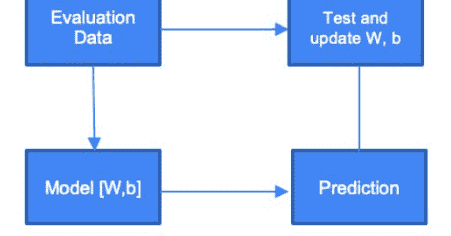

图 14.3 – ML 训练

起初我们可能得到较差的结果，但逐渐地，我们将为 W 和 b 的值获得准确的预测。如果我们没有得到预期结果，可能需要选择更复杂的模型：

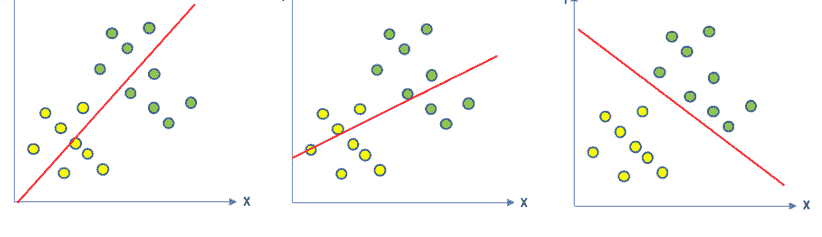

图 14.4 – 调整权重和偏置

在前面的图中，我们可以看到当操作 W 和 b 时直线如何变化。一开始，我们可能得到看似不合适的[content]

## 收集和准备数据

让我们开始收集数据，通过购买多颗苹果和柠檬。我们将从创建包含两个特征的表格开始——**颜色**和**糖分含量**。

> **重要说明**
> 颜色以波长区间表示，单位为**纳米 (nm)**。

这是一个涉及几种水果的示例，但为了获得准确的预测，我们需要更多样本：

| Color [nm] | Sugar content [g] | Fruit |
|---|---|---|
| 590 | 10 | Apple |
| 570 | 2 | Lemon |
| 610 | 15 | Apple |
| 500 | 3 | Lemon |

在此阶段，我们应该尝试可视化数据，以确保我们没有收集过多一种类型的水果；否则，模型会偏向该水果。

现在，我们需要将数据拆分为**训练**和**评估数据**。如果我们的模型正确，用于训练的数据不应用于评估，因为我们总是会得到好的结果。一个经验法则是，我们应该使用 80% 的数据进行训练，剩余的 20% 作为评估数据。一旦完成此划分，可能还需要额外的步骤来准备数据，例如归一化和去重。在我们的案例中，这些是不需要的。

## 选择模型

现在，我们需要确定要使用哪个模型。有成千上万的模型可供选择。它们可以适用于图像、文本或基于数值的数据。模型应根据用例选择。由于我们的案例中只有两个特征，模型可以是一个简单的线性模型。

## 训练

现在，我们将进入 ML 的核心：实际训练。让我们看看我们为训练选择的模型。这里，我们有 X = W x Y + b，其中 W 是权重，b 是偏置，而 X 和 Y 是特征。在训练期间，我们将操作 W 和 b 的值，并使用训练数据验证我们是否得到正确的预测。其中每一次操作都称为一次训练步骤：


图 14.3 – ML 训练

起初我们可能得到较差的结果，但逐渐地，我们将为 W 和 b 的值获得准确的预测。如果我们没有得到预期结果，可能需要选择更复杂的模型：


图 14.4 – 调整权重和偏置

在前面的图中，我们可以看到当操作 W 和 b 时直线如何变化。一开始，我们可能得到看似不合适的


正如你所知，Google 拥有世界上最大的数据集。因此，它开发了 TensorFlow 以实现高度可扩展性。Google 将其用于 Gmail、Google 搜索和 Photos 等服务。你可以通过 TensorFlow Playground 来了解 TensorFlow 的工作原理，该链接如下：https://playground.tensorflow.org:

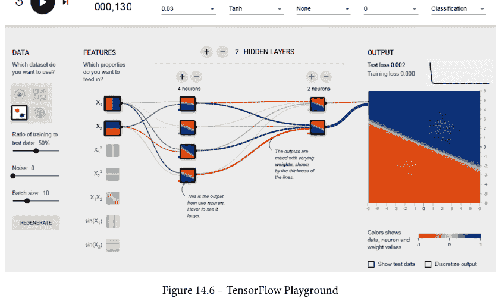

图 14.6 – TensorFlow Playground

正如你所见，它允许你选择想要分析的数据集类型，并且你可以尝试我们在《机器学习的七个步骤》部分讨论过的所有参数。对过程的可视化使你能够理解参数变化如何影响最终输出。

> **考试提示**
> 对于考试，你并不真正需要深入了解 TensorFlow。只需了解它是什么以及用途即可。不过，尝试 TensorFlow Playground 可能是一个好主意。
> 
> 即使它不是考试的一部分，你也可能想看看 TensorFlow 用法的示例。以下视频演示了如何对服装图像进行分类：https://www.youtube.com/watch?v=FiNgI1IwRNk。

## Cloud Vertex AI

Vertex AI 是一项 Google Cloud AI 平台服务，允许你使用预训练或自定义工具构建、部署和扩展 ML 模型，而无需担心底层基础设施。它是 AI Platform 服务的演进，并引入了与 AutoML 的集成。

> **考试提示**
> Vertex AI 于 2021 年在 Google I/O 大会上宣布。在撰写本书时，仍有大量 Vertex AI 功能处于预览阶段。我们不认为你在 PCA 考试中会遇到关于此的问题。我们仍然认为这个主题非常令人兴奋。如果你想了解更多关于 Vertex AI 的信息，请查看文档：https://cloud.google.com/vertex-ai/docs/start。

你可以加速学习过程，因为支持多种 CPU、GPU 和 **Tensor Processing Unit (TPU)** 节点。它可与多个框架配合使用，但最流行的是 TensorFlow。由于 TensorFlow 是开源的，因此允许可移植性。模型可以在有限数据上本地训练，然后发送到 GCP 以大规模训练。Vertex AI 与其他 GCP 服务集成，例如用于数据存储的 Cloud Storage 和用于数据处理的 Cloud Dataflow。

### 使用 Vertex AI

下图应能让你了解 Vertex AI 在开发、部署和监控你的 ML 模型过程中的位置：

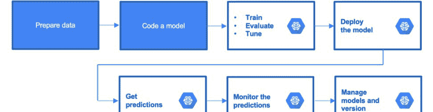

图 14.7 – Vertex AI 工作流

现在，思考一下我们之前讨论的七个步骤。你可以看到 Vertex AI 将允许你从训练模型进展到将其部署到生产环境。从那里，模型可以被使用。你还将能够对模型进行版本控制，以查看每个版本的表现如何。

### Cloud TPUs

在本节中，我们将解释 TPU 是什么。它们是 Google 定制开发的 **Application-Specific Integrated Circuits (ASICs)**，用于加速 ML 工作负载。

它们增强了线性代数计算的性能，而线性代数计算在 ML 应用中被大量使用。TPU 使模型训练时间从数周缩短到数小时。在下图中，我们可以看到在 Google Next 大会上展示的一组使用 TPU 的服务器机架：

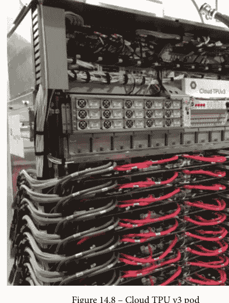

图 14.8 – Cloud TPU v3 pod

正如 Google 所指出的，以下因素使你的模型适合使用 TPU 进行训练：

- 使用矩阵计算的模型
- 主训练循环中不包含自定义 TensorFlow 操作的模型
- 训练时间很长的模型，例如数周
- 具有非常大批处理大小的模型

在其他情况下，你可以考虑使用 CPU 或 GPU。

### 预训练 ML 模型

Google 的预训练模型可用于在无需我们了解 ML 如何工作的情况下进行预测。所有模型都可通过 API 访问，可直接从你的应用程序中使用。用于预测的数据通过 JSON 文件提供或存储在 Cloud Storage 中。目前有以下几种模型可用：

- Cloud Speech-to-Text API
- Cloud Text-to-Speech API
- Cloud Translation API
- Cloud Natural Language API
- Cloud Vision API
- Cloud Video Intelligence API

让我们快速了解一下它们各自的功能。

### Cloud Speech-to-Text API

Cloud Speech-to-Text API 使开发人员能够将语音转换为文本。该 API 接受接收到的音频并返回文本转录。该 API 可同步、异步或以流式模式使用。支持多种语言和方言。完整列表请查看进一步阅读部分。

### Cloud Text-to-Speech API

Cloud Text-to-Speech API 使开发人员能够将文本转换为 **Speech Synthesis Markup Language (SSML)** 输入的自然人类语音音频数据。支持多种语言，每种语言都有多个声音可供选择。有两种类型的声音可供选择，**Standard** 和 **WaveNet**，后者是一个高级模块，可缩小与人类语音的差距。

### Cloud Translation API

Cloud Translation API 可实现数百种语言的翻译。如果语言未知，服务可以自动检测。Cloud Translation 带有最流行语言的库，因此你可以直接在代码中使用它，而无需使用 REST API。

### Cloud Natural Language API

Cloud Natural Language API 允许你利用 Google 用于其搜索引擎的深度学习模型来分析文本。它也被 Google Assistant 所利用。

它能够执行以下操作：

- 提取有关实体（包括地点、人物和事件）的信息
- 对实体进行分类
- 执行情感分析
- 执行语法分析

> **考试提示**
> 预计考试中会出现有关 Natural Language API 的问题。请记住，它是分析自然人类语言的简便方法。使用它比自行开发模型更快。请记住上述功能，以便你能将其适应考试中给出的用例。

鉴于上述功能，该 API 可用于以下用例。

它可用于分析文档、新闻、社交媒体或博客文章。结合 Speech-to-Text API，可分析呼叫中心通话的客户满意度。请注意，仅支持有限数量的语言。如果你的语言不受支持，你可以使用 Translation API 将文本转换为受支持的语言。

让我们付诸实践！该 API 既可通过 REST API 访问，也可通过 gcloud ml language 命令访问，文本可作为参数提供或从 Cloud Storage 上传。为了更好地可视化，我们将使用 Google 提供的 GUI 工具（https://cloud.google.com/natural-language）来分析一些示例文本：

```
Packt has released a new book to help IT geeks learn GCP. The readers really love it!
```

查看实体，我们可以看到找到了五个实体。每个实体都带有 Salience 属性（范围为 0–1），该属性规定该实体在句子中的重要性。值越高，其显著性就越高。对于某些实体，你还会获得 Wikipedia 链接，以便获取更多信息：

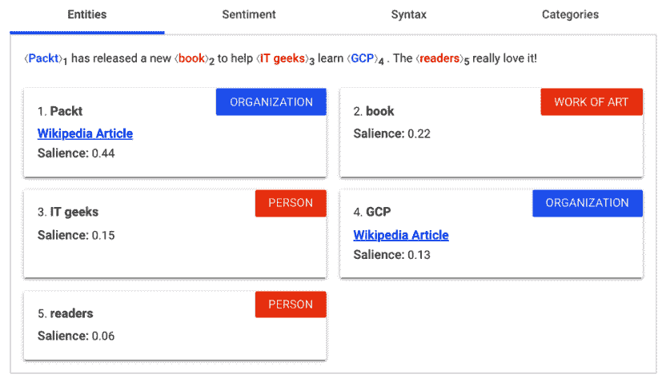

图 14.9 – Natural Language API – 实体

对于情感分析，我们看到两个情感属性：

- **Score**：范围从 -1（非常负面）到 1（非常正面）
- **Magnitude**：范围从 0 到无穷大，显示陈述的强度：

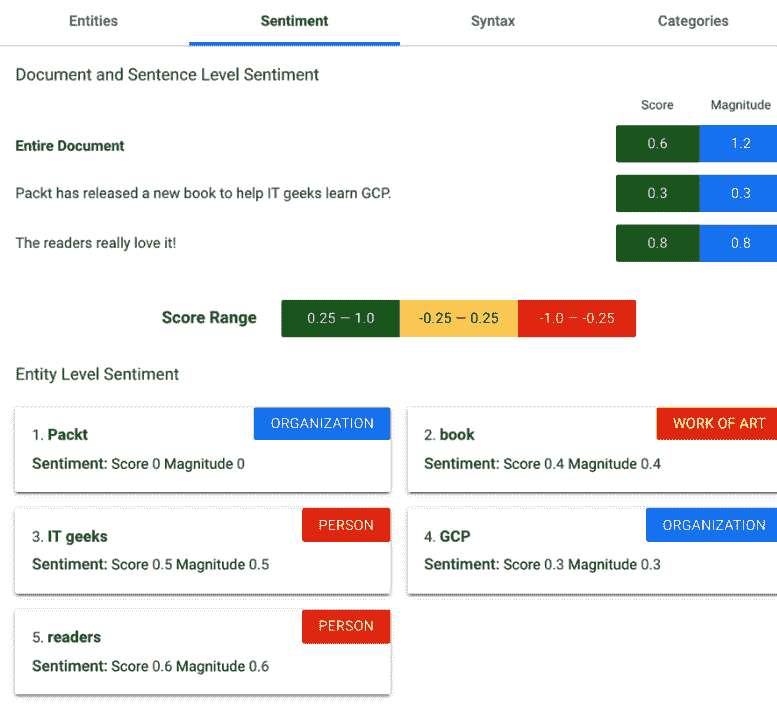

图 14.10 – Natural Language API – 情感

现在，我们将前一句改为如下：

```
Packt has released a new book to help IT geeks learn GCP. The readers think it is ok.
```


我们可以看到，对于第二句话，Score 和 Magnitude 都已降为 0：

## Entities
Sentiment
Syntax
Categories

## Document and Sentence Level Sentiment

Score
Magnitude

Entire Document

0.1
0.3

Packt has released a new book to help IT geeks learn GCP.

0.3
0.3

The readers think it is ok.

0
0

Score Range
0.25 – 1.0
-0.25 – 0.25
-1.0 – 0.25

## Entity Level Sentiment

1. Packt
ORGANIZATION
Sentiment: Score 0 Magnitude 0

2. book
WORK OF ART
Sentiment: Score 0.4 Magnitude 0.4

3. IT geeks
PERSON
Sentiment: Score 0.5 Magnitude 0.5

4. GCP
ORGANIZATION
Sentiment: Score 0.3 Magnitude 0.3

5. readers
PERSON
Sentiment: Score -0.1 Magnitude 0.1

Figure 14.11 – Natural Language API – Sentiment change

**Syntax** 选项卡显示了详细的语法信息：

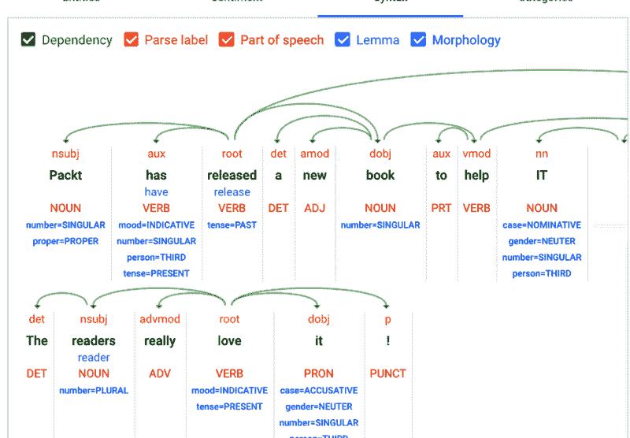

Figure 14.12 – Natural Language API – Syntax

最后，文本被归类为 **Computer & Electronics**，**Confidence** 值为 0.67：

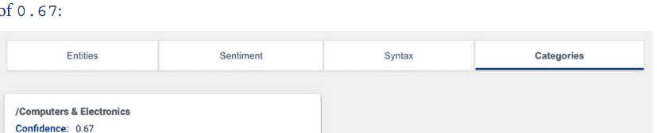

Figure 14.13 – Natural Language API – Categories

正如你所见，这是一个非常强大的 API，可以帮助你对文本进行深度分析。

请记住，这仍在开发中，新的功能将随着时间的推移而添加。

## The Cloud Vision API

**Cloud Vision API** 提供了视觉检测功能，包括以下内容：

- Image labeling
- Face and landmark detection
- **Optical Character Recognition (OCR)**
- Tagging explicit content

你可以使用 https://cloud.google.com/vision/ 来测试此 API。你只需上传图像即可查看可能的分析结果。

如果我们查看 **Faces** 选项卡，我们可以看到人脸和帽子被正确检测到。该服务还能够检测到喜悦的情绪，我可以确认这一点，因为照片中的人是我，当时玩得很开心：


Figure 14.14 – Vision AI – Faces

在 **Objects** 选项卡中，我们可以看到大多数物体已被正确识别，尽管我不记得那天穿过裙子：

Figure 14.15 – Vision AI – Objects

Labels 选项卡揭示了图像如何被标记的分析。同样，大多数标签是有意义的，除了网球拍：

Figure 14.16 – Vision AI – Labels

当我们查看 OCR 功能时，分析相当不错，特别是当我们查看 +Block 3 时，API 检测到了来自标志的 S，而该标志使用了奇特的字体：

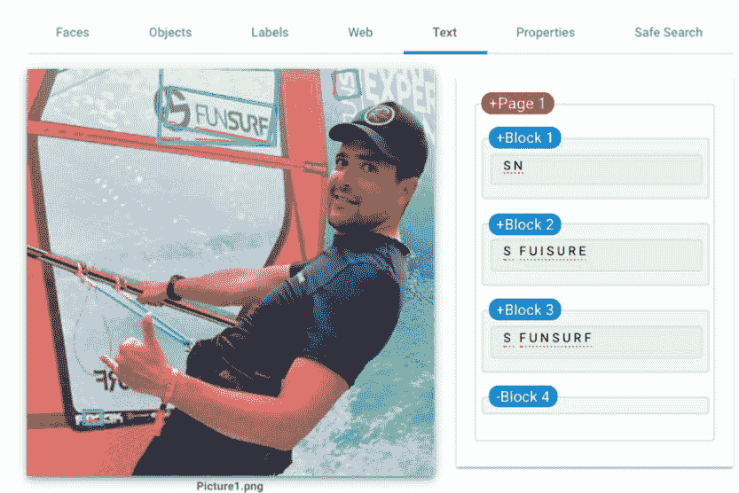

# Figure 14.17 – Vision AI – Text

最后，如果我们在图像下方展开 Show JSON 链接，我们还可以看到 REST API 的调用和响应会是什么样子：

Figure 14.18 – Vision AI – JSON response

正如我们在前面的屏幕截图中所见，我们以 JSON 格式获得响应。这使我们能够轻松解析它，并在应用程序的代码中使用查询结果。

## The Cloud Video Intelligence API

Google Cloud Video Intelligence 允许你分析已上传到 Cloud Storage 的视频。

目前，以下功能可用：

- **Labels:** 这些检测并标记实体，例如动物、植物和人。
- **Shots:** 这些检测视频中的场景变化并对其进行标记。
- **Explicit content:** 这些是针对色情内容的显式内容注释。

这可以有多种用例。视频元数据可以用描述其内容的标签创建，以便在媒体库中实现更好的搜索。此外，含有不当内容的视频可以被识别并从公共访问中移除。

## Dialogflow

这实际上是 GCP 之外的工具，其起源于名为 **Api.ai** 的产品。它被开发用于使用自然语言处理进行人机交互。

它允许你创建所谓的 **agents** 和 **intents**，这些具有明确的可能对话场景。Dialogflow 能够根据用户用来展示特定意图的短语的可能变体自行训练。提供的短语越多，它学习触发意图的能力就越好：

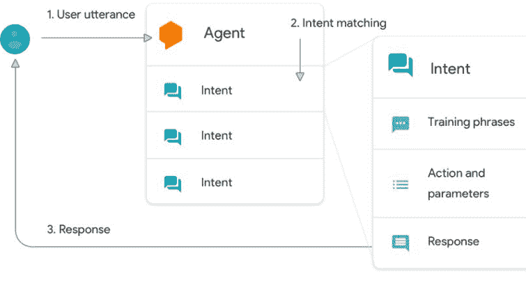

Figure 14.19 – Dialogflow (Source: https://cloud.google.com/dialogflow/docs/intents-overview. License: https://creativecommons.org/licenses/by/4.0/)

当用户调用一个意图时，代理可以用简单的响应回答，或者可以进行更高级的操作。例如，可以将意图与定义的参数相关联进行分析。

参数可以被提取并传递给所谓的 **fulfillment**，这基本上是 Firebase functions。开发人员可以生成 Node.js 代码以集成到 Dataflow 之外的第三方系统。这可用于检索信息或被要求执行特定操作。作为示例，可以向天气服务发出调用以获取特定位置的预报，或调用智能家居系统以关闭客厅的灯。Dialogflow 可以使用 REST API 与你的应用程序或网站集成，或者你可以使用以下应用程序的一键式集成：

- Google Assistant
- Slack
- Facebook Messenger
- Twitter
- Skype
- Amazon Alexa
- Microsoft Cortana

Dialogflow 提供了三种类型的代理。你选择的取决于你的设计的先进程度：

- **Dialogflow ES**: 适用于小型到中型以及简单到中等解决方案的标准代理。
- **Dialogflow CX**: 适用于大型和复杂解决方案的高级代理。
- **Dialogflow Trial**: 这提供了 Dialogflow ES 的功能，但配额有限。适用于实验。

你可以通过访问以下链接找到这三种代理版本之间详细的比较：
https://cloud.google.com/dialogflow/docs/editions.

## AutoML

当预训练模型不适合用途时，AutoML 就派上用场了。作为示例，Vision API 可以识别沙发，*但如果我们想识别我们公司生产的特定沙发怎么办？* Vision API 无法为我们做到这一点。

在这种情况下，我们需要使用 AutoML 或训练我们自己的模型。正如你可能已经猜到的，前者是一种更简单的方法。AutoML 从你那里获取数据集，训练并部署模型，然后通过 REST API 提供服务。这听起来有点像魔法，对吧？请看下面的图表：

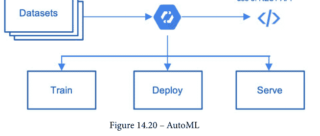

Figure 14.20 – AutoML

请注意，有五项服务可供你训练自定义模型：

- **AutoML Vision**: 根据你自己定义的标签对图像进行分类。
- **AutoML Translation**: 执行翻译查询，返回特定于你领域的結果。
- **AutoML Natural Language**: 将英语内容分类到自定义类别集。
- **AutoML Tables**: 将结构化数据转化为预测性洞察。
- **AutoML Video Intelligence**: 允许你对视频片段进行分类。

让我们看一个例子。看看你将如何实际使用 AutoML，使用 Vision API 的示例，来识别你公司生产的桌子。简而言之，你需要做的是：

1. 拍摄你桌子的多张照片。
2. 上传到 Cloud Storage。
3. 创建一个带有照片标签的 CSV 文件。
4. 将 CSV 文件提供给 AutoML 以训练模型。

一旦模型训练完成，你就可以通过 REST API 访问该模型，就像使用任何其他预训练模型一样。相当惊人，对吧？如果想看到 AutoML Vision 的实际效果，请查看 *Further reading* 部分中的 *AI adventures* 视频。

## Summary

在本章中，我们了解了 GCP 提供的 ML 服务。我们从 ML 理论开始，介绍基本概念和命名法，以便更好地理解实际服务。我们了解到，根据你的角色和使用场景，你需要做出正确的选择，选择对你最有效的服务。有时，一个目标可以使用两种或更多不同的服务来实现。我们还了解到，你不需要是数据科学家就可以利用 ML。那些知识非常有限的人可以使用预训练模型。如果这些模型对你的使用场景不够好，你可以尝试 AutoML，它允许在无需我们自行开发模型的情况下创建新模型。我们只需要向 GCP 提供适当的数据集即可。

最后，对于那些拥有知识并能够自行开发模型的人来说，Vertex AI 是你可以用来自行开发和托管模型的服务。

在下一章中，我们将更详细地了解如何在 GCP 中保护我们的环境。

## Further reading

阅读以下文章以获取有关本章所涵盖内容的更多信息：

- **ML building blocks**: https://cloud.google.com/products/ai/
- **Dialogflow**: https://cloud.google.com/dialogflow/docs/
- **ML Engine**: https://cloud.google.com/ml-engine/docs/
- **Cloud AutoML**: https://cloud.google.com/automl/docs/
- **TensorFlow**: https://www.tensorflow.org/
- **AI adventures video**: https://www.youtube.com/watch?v=nKW8Ndu7Mjw
- **Speech-to-Text**: https://cloud.google.com/speech-to-text/docs/basics
- **Vertex AI**: https://cloud.google.com/vertex-ai/docs


